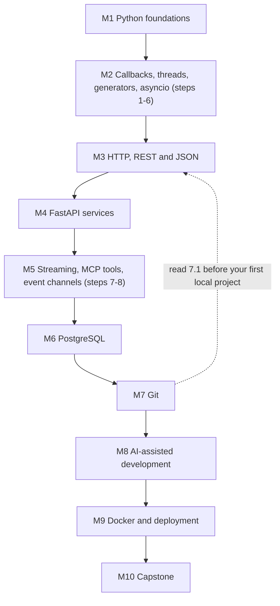
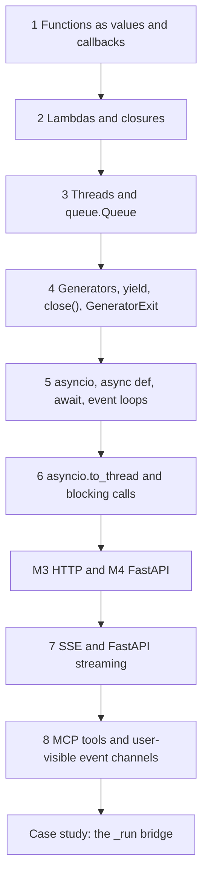

## 1. What this page is

This page tells you what to study, in which order, and why the order matters. Read it before the first lesson. Come back to it after each module.

Level 0 has 10 modules and 49 lessons. Each module is one folder. Each lesson is one idea, with worked examples, exercises and check questions.

## 2. The order of the modules



| Order | Module | Why it comes here |
|---|---|---|
| 1 | [M1 Python foundations](/notes/ai/ai-engineering/01-software-engineering-fundamentals/m01-python-foundations) | Every later idea is Python code. Functions, data structures, exceptions and types come first. |
| 2 | [M2 Callbacks, threads, generators and asyncio](/notes/ai/ai-engineering/01-software-engineering-fundamentals/m02-concurrency-foundations) | Steps 1 to 6 need only Python. They explain how a program waits for many slow things at the same time. |
| 3 | [M3 HTTP, REST and JSON](/notes/ai/ai-engineering/01-software-engineering-fundamentals/m03-http-rest-json) | Step 7 streams over HTTP. You must know a normal request and response first. |
| 4 | [M4 FastAPI services](/notes/ai/ai-engineering/01-software-engineering-fundamentals/m04-fastapi-services) | Step 7 uses FastAPI responses. Lesson 4.4 also uses steps 5 and 6 (`def` vs `async def`). |
| 5 | [M5 Streaming, MCP tools and event channels](/notes/ai/ai-engineering/01-software-engineering-fundamentals/m05-streaming-and-agent-events) | Steps 7 and 8, the `_run` case study and the meanings of "partial". |
| 6 | [M6 PostgreSQL persistence](/notes/ai/ai-engineering/01-software-engineering-fundamentals/m06-postgresql) | The service must keep its data after a restart. |
| 7 | [M7 Git and collaboration](/notes/ai/ai-engineering/01-software-engineering-fundamentals/m07-git) | Another person must run and change your code. Read lesson 7.1 early: your local practice project starts in module 3. |
| 8 | [M8 AI-assisted development](/notes/ai/ai-engineering/01-software-engineering-fundamentals/m08-ai-assisted-development) | You can check an agent's work only after you know the fundamentals that it uses. |
| 9 | [M9 Docker and deployment](/notes/ai/ai-engineering/01-software-engineering-fundamentals/m09-docker-and-deployment) | The service must run the same way on another machine. |
| 10 | [M10 Capstone](/notes/ai/ai-engineering/01-software-engineering-fundamentals/m10-capstone) | One project uses every module. |

The roadmap site puts asyncio inside its first module (M0.1) and streaming inside its FastAPI module (M0.3). These notes split them into M2 and M5, because the 8-step order below needs more lessons than the site gives.

## 3. The 8-step order for callbacks, threads, generators, asyncio, streaming and MCP events

These eight steps build on each other. Each step uses the one before it. Do not skip a step, and do not change the order.



| Step | Idea | Lessons | Why it comes after the step before | After this step you can |
|---|---|---|---|---|
| 1 | Functions as values and callbacks | [2.1](/notes/ai/ai-engineering/01-software-engineering-fundamentals/m02-concurrency-foundations/l1-functions-as-values-and-callbacks) | It is the first step. It needs only `def` and calls from [1.2](/notes/ai/ai-engineering/01-software-engineering-fundamentals/m01-python-foundations/l2-control-flow-and-functions). | Pass a function such as `q.put` to other code, and say who calls it and when. |
| 2 | Lambdas and closures, including `name=name` in loops | [2.2](/notes/ai/ai-engineering/01-software-engineering-fundamentals/m02-concurrency-foundations/l2-lambdas-and-closures) | A closure is a function value (step 1) that also carries names from its outer function. | Predict which value a closure sees, and fix the late-binding bug in a loop. |
| 3 | Threads and `queue.Queue` | [2.3](/notes/ai/ai-engineering/01-software-engineering-fundamentals/m02-concurrency-foundations/l3-threads), [2.4](/notes/ai/ai-engineering/01-software-engineering-fundamentals/m02-concurrency-foundations/l4-queues-and-producer-consumer) | `Thread(target=worker)` takes a function value (step 1). The target is often a closure over a queue (step 2). | Run work next to the main thread, pass items with `put()` and `get()`, end the stream with a sentinel and carry an exception across threads. |
| 4 | Generators, `yield`, `close()` and `GeneratorExit` | [2.5](/notes/ai/ai-engineering/01-software-engineering-fundamentals/m02-concurrency-foundations/l5-generators-and-yield) | The consumer of a queue is a loop (step 3). A generator turns that loop into a stream that the caller reads item by item. | Write a lazy stream, and say when its cleanup code runs. |
| 5 | `asyncio`, `async def`, `await` and event loops | [2.6](/notes/ai/ai-engineering/01-software-engineering-fundamentals/m02-concurrency-foundations/l6-asyncio-and-the-event-loop) | A coroutine pauses at `await` as a generator pauses at `yield` (step 4). An async generator combines both. | Run many waits at the same time on one thread, and explain why `asyncio.run` refuses a running loop. |
| 6 | `asyncio.to_thread` and blocking calls | [2.7](/notes/ai/ai-engineering/01-software-engineering-fundamentals/m02-concurrency-foundations/l7-blocking-calls-and-to-thread) | A blocking call freezes the event loop (step 5). `to_thread` moves it to a worker thread (step 3). | Decide between `def`, `async def` and `to_thread` for any piece of work. |
| 7 | SSE and FastAPI streaming | [5.1](/notes/ai/ai-engineering/01-software-engineering-fundamentals/m05-streaming-and-agent-events/l1-streaming-and-server-sent-events), [5.2](/notes/ai/ai-engineering/01-software-engineering-fundamentals/m05-streaming-and-agent-events/l2-fastapi-streaming-responses) | A streaming response body is a generator (step 4). FastAPI runs a sync generator in a worker thread and an async generator on the loop (steps 5 and 6). | Stream events to a browser, and say what happens to the producer when the client leaves. |
| 8 | MCP tools and user-visible event channels | [5.3](/notes/ai/ai-engineering/01-software-engineering-fundamentals/m05-streaming-and-agent-events/l3-mcp-tools-and-tool-execution), [5.4](/notes/ai/ai-engineering/01-software-engineering-fundamentals/m05-streaming-and-agent-events/l4-user-visible-event-channels) | A tool publishes events through an emit callback (steps 1 and 2) into a channel (step 3), and the stream (step 7) carries them to the user. Tool handlers run on the event loop (steps 5 and 6). | Keep tool results for the model apart from events for the user, and write a tool that does not block the loop. |

> [!key] The rule for async tools
> Use `async def` when the tool's own operations are asynchronous, such as `httpx.AsyncClient` requests or an async database driver. In that case the tool does not need a worker thread for those operations. Wrap only blocking work in `asyncio.to_thread`. Lesson [5.3](/notes/ai/ai-engineering/01-software-engineering-fundamentals/m05-streaming-and-agent-events/l3-mcp-tools-and-tool-execution) measures both cases.

## 4. The `_run` example, line by line, mapped to the steps

The [case study](/notes/ai/ai-engineering/01-software-engineering-fundamentals/m05-streaming-and-agent-events/l5-case-study-the-run-bridge) explains every line of this example. The table shows which step teaches the idea of each line.

```python
def _run(prompt: str, ui_context: str | None, session_id: str, resume: bool):
    q: queue.Queue = queue.Queue()
    end = object()

    async def pump(options):
        async for msg in query(prompt=prompt, options=options):
            q.put(msg)

    def worker():
        try:
            server, allowed = build_server(q.put)
            os.makedirs(WORK_DIR, exist_ok=True)
            asyncio.run(pump(_options(
                foundry_token(), ui_context, server, allowed,
                session_id, resume
            )))
        except Exception as e:
            q.put(e)
        finally:
            q.put(end)

    threading.Thread(target=worker, daemon=True).start()

    while (item := q.get()) is not end:
        if isinstance(item, Exception):
            raise item
        yield item
```

| Code | Idea | Step | Lesson |
|---|---|---|---|
| `prompt: str`, `ui_context: str \| None` | Type annotations | (M1) | [1.8](/notes/ai/ai-engineering/01-software-engineering-fundamentals/m01-python-foundations/l8-type-annotations-and-pydantic) |
| `q: queue.Queue = queue.Queue()` | A thread-safe event channel | 3 | [2.4](/notes/ai/ai-engineering/01-software-engineering-fundamentals/m02-concurrency-foundations/l4-queues-and-producer-consumer) |
| `end = object()` | A sentinel | 3 | [2.4](/notes/ai/ai-engineering/01-software-engineering-fundamentals/m02-concurrency-foundations/l4-queues-and-producer-consumer) |
| `async def pump(options):` | A coroutine function, and a closure over `q` and `prompt` | 2, 5 | [2.2](/notes/ai/ai-engineering/01-software-engineering-fundamentals/m02-concurrency-foundations/l2-lambdas-and-closures), [2.6](/notes/ai/ai-engineering/01-software-engineering-fundamentals/m02-concurrency-foundations/l6-asyncio-and-the-event-loop) |
| `async for msg in query(...)` | An async generator read with `async for` | 4, 5 | [2.6](/notes/ai/ai-engineering/01-software-engineering-fundamentals/m02-concurrency-foundations/l6-asyncio-and-the-event-loop) |
| `build_server(q.put)` | A bound method passed as a callback, used by tools as `emit` | 1, 8 | [2.1](/notes/ai/ai-engineering/01-software-engineering-fundamentals/m02-concurrency-foundations/l1-functions-as-values-and-callbacks), [5.4](/notes/ai/ai-engineering/01-software-engineering-fundamentals/m05-streaming-and-agent-events/l4-user-visible-event-channels) |
| `asyncio.run(pump(...))` | A new event loop in the worker thread | 5 | [2.6](/notes/ai/ai-engineering/01-software-engineering-fundamentals/m02-concurrency-foundations/l6-asyncio-and-the-event-loop) |
| `foundry_token()` inside the arguments | Evaluation order: arguments run before the call, in the worker thread | 1, 3 | [5.5](/notes/ai/ai-engineering/01-software-engineering-fundamentals/m05-streaming-and-agent-events/l5-case-study-the-run-bridge) |
| `except Exception as e: q.put(e)` | Exception propagation across threads | 3 | [2.4](/notes/ai/ai-engineering/01-software-engineering-fundamentals/m02-concurrency-foundations/l4-queues-and-producer-consumer) |
| `finally: q.put(end)` | The sentinel always arrives | 3 | [2.4](/notes/ai/ai-engineering/01-software-engineering-fundamentals/m02-concurrency-foundations/l4-queues-and-producer-consumer) |
| `threading.Thread(target=worker, daemon=True).start()` | A worker thread, a daemon flag | 3 | [2.3](/notes/ai/ai-engineering/01-software-engineering-fundamentals/m02-concurrency-foundations/l3-threads) |
| `while (item := q.get()) is not end:` | A blocking `get()` in the consumer, the walrus operator, identity with `is` | 3 | [2.4](/notes/ai/ai-engineering/01-software-engineering-fundamentals/m02-concurrency-foundations/l4-queues-and-producer-consumer) |
| `raise item` | The exception reaches the caller's thread | 3 | [2.4](/notes/ai/ai-engineering/01-software-engineering-fundamentals/m02-concurrency-foundations/l4-queues-and-producer-consumer) |
| `yield item` | A generator streams each item to the caller | 4, 7 | [2.5](/notes/ai/ai-engineering/01-software-engineering-fundamentals/m02-concurrency-foundations/l5-generators-and-yield), [5.2](/notes/ai/ai-engineering/01-software-engineering-fundamentals/m05-streaming-and-agent-events/l2-fastapi-streaming-responses) |

## 5. What "partial" means

The word "partial" has several meanings in streaming code. A partial output is one piece of a larger output, for example one text delta. An incremental event is a complete small event, for example "tool started". An incomplete result is a stream that ended before its last piece. Lesson [5.6](/notes/ai/ai-engineering/01-software-engineering-fundamentals/m05-streaming-and-agent-events/l6-what-partial-means) separates these meanings and shows how a consumer knows that a result is complete.

## 6. A session plan

The roadmap site gives this level 22 sessions. These notes add two modules (M2 and M5) for the added topics. Plan about 28 sessions.

| Module | Lessons | Sessions (site) | Sessions (plan) |
|---|---|---|---|
| M1 Python foundations | 10 | 4 (M0.1 with async) | 4 |
| M2 Callbacks, threads, generators, asyncio | 7 | (inside M0.1) | 4 |
| M3 HTTP, REST and JSON | 5 | 3 | 3 |
| M4 FastAPI services | 5 | 3 (M0.3 with streaming) | 2 |
| M5 Streaming, MCP tools, event channels | 6 | (inside M0.3) | 3 |
| M6 PostgreSQL | 4 | 2 | 2 |
| M7 Git | 3 | 2 | 2 |
| M8 AI-assisted development | 4 | 5 | 5 |
| M9 Docker and deployment | 4 | 2 | 2 |
| M10 Capstone | 1 | 1 | 1 or more |
| Total | 49 | 22 | 28 |

### How each session works

1. **Recall.** One or two questions from lessons that are due.
2. **Problem.** The question that the idea answers.
3. **Intuition.** An analogy, and the point where it stops working.
4. **Mechanism.** The exact details, with a source for each claim.
5. **Code.** I write the code myself. Hints come in three levels: idea, pseudocode, partial code.
6. **Check and explain back.** Check questions, then I teach the idea back.
7. **Close.** A session report, then a notes update.

> [!key] Gate rule
> A lesson passes only when I answer its check questions correctly, in my own words, with the correct reason. "I understand" does not pass a gate.

## 7. Where the exercises run

| Kind | Where |
|---|---|
| Pure Python, Pydantic, closures, generators, asyncio without threads | A browser lab. Each lesson links one. In a lab cell, write `await main()`, not `asyncio.run(main())`. |
| Threads, servers, PostgreSQL, Docker, Git, curl | The local practice project: one uv project in one Git repository, outside the Downloads folder. It becomes the capstone repository. |

## 8. Level self-check

Answer these at the end of the level, without notes. Each answer must give a reason.

```check
{
  "question": "Ten API calls each take 2 seconds. Why does asyncio make the total about 2 seconds, and what goes wrong if one call inside an async def uses a blocking library?",
  "hint": "Lessons 2.6 and 2.7.",
  "answer": "Each call spends its 2 seconds waiting for the network. At each await, the task gives the event loop back, so the loop starts all ten requests and they wait at the same time. The total is about the longest wait, 2 seconds. A blocking call (for example time.sleep or a sync HTTP client) does not give the loop back. The loop thread stops for the whole call, so every other task waits too, and the total grows. Use an async client, or move the blocking call to asyncio.to_thread."
}
```

```check
{
  "question": "A POST request times out, and you do not know if the server processed it. Can you retry it automatically? What would make a retry safe?",
  "hint": "Lesson 3.2.",
  "answer": "Not blindly. POST is not idempotent, so a second request can do the work a second time, for example create a duplicate order. A retry is safe when the API accepts an idempotency key (the server returns the first result for a repeated key), when the operation is idempotent by design (for example PUT to a client-chosen id), or after you check the server state first."
}
```

```check
{
  "question": "What is the difference between 401 and 403, and between 400 and 422 in a FastAPI app?",
  "hint": "Lessons 3.2 and 4.2.",
  "answer": "401 means the request has no valid credentials: the server does not know who you are. 403 means the server knows who you are, but you may not do this. FastAPI returns 422 when the request parsed but failed validation against the declared types and models. 400 is the general code for a bad request, for example a business rule that your own code rejects."
}
```

```check
{
  "question": "Why should a shared HTTP client or database engine be created at startup (lifespan) and not inside each request?",
  "hint": "Lessons 4.3 and 6.4.",
  "answer": "A shared client keeps a pool of open connections and reuses them, so each request saves the connection and TLS setup. One client per request is slower, can exhaust sockets or database connections under load, and can leak connections that nobody closes. Lifespan creates the client once and closes it cleanly at shutdown."
}
```

```check
{
  "question": "Your query was fast with 100 rows and slow with 1 million. What do you check first, and what does an index cost you?",
  "hint": "Lesson 6.3.",
  "answer": "Run EXPLAIN ANALYZE on the query. A sequential scan on the filter or sort column shows a missing index. An index costs disk space, and it makes every INSERT, UPDATE and DELETE slower, because each write must also change the index."
}
```

```check
{
  "question": "Name one thing that belongs in CLAUDE.md or AGENTS.md, one that belongs in a Skill, and one that must be a hook. Why does the third one not work as a written instruction?",
  "hint": "Lessons 8.2 to 8.4.",
  "answer": "CLAUDE.md or AGENTS.md: project facts for every task, for example the test command and the code style. A Skill: a repeated procedure that loads only when needed, for example a code review checklist. A hook: a check that must happen every time, for example blocking edits to .env files. A written instruction is advice to the model, and the model can forget or skip it. The agent program runs a hook on every matching event, so the check always happens."
}
```

```check
{
  "question": "Your container works locally but crashes in production at startup. List the first four things you check, in order.",
  "hint": "Lessons 9.3 and 9.4.",
  "answer": "1. The container logs: they show the real error. 2. The configuration: every required environment variable and secret is present, for example DATABASE_URL. 3. The port and the host binding: the app listens on 0.0.0.0 and on the port that the platform expects. 4. The dependencies: the database and other services are reachable from the production network."
}
```

```check
{
  "question": "What does uv sync --locked protect you from, and why does the Docker guide install dependencies in a separate layer from your code?",
  "hint": "Lessons 1.9 and 9.2.",
  "answer": "uv sync --locked fails when the lock file does not match pyproject.toml, so the build never installs versions that nobody tested. Dependencies change rarely and code changes often. When dependencies have their own layer, Docker reuses that cached layer after a code-only change, so the rebuild is fast."
}
```

## 9. Links

- Part page: [01 L0 Software engineering fundamentals](/notes/ai/ai-engineering/01-software-engineering-fundamentals)
- Subject page: [AI Engineering Roadmap 2026](/notes/ai/ai-engineering)
- [Glossary](/notes/ai/ai-engineering/glossary)
- [Sources and verification](/notes/ai/ai-engineering/sources-and-verification)
