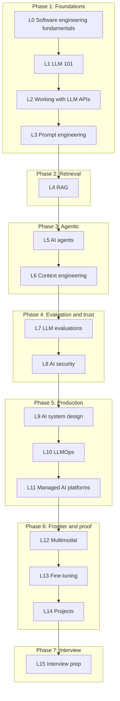

## The map

The roadmap has 16 levels in 7 phases. Each level is one part folder in this subject.

## Parts

| Part | Level | Folder | Sessions (site) | Modules (site) | Level project (site) | Lessons written |
|---|---|---|---|---|---|---|
| 01 | L0 | [Software engineering fundamentals](/notes/ai/ai-engineering/01-software-engineering-fundamentals) | 22 | 8 | Ship a no-AI REST service | 49 |
| 02 | L1 | [LLM 101](/notes/ai/ai-engineering/02-llm-101) | 15 | 12 | none (proposed: a model selection report) | 0 |
| 03 | L2 | [Working with LLM APIs](/notes/ai/ai-engineering/03-working-with-llm-apis) | 19 | 12 | Streaming tool-using assistant | 0 |
| 04 | L3 | [Prompt engineering](/notes/ai/ai-engineering/04-prompt-engineering) | 11 | 9 | Optimize a real prompt | 0 |
| 05 | L4 | [RAG](/notes/ai/ai-engineering/05-rag) | 27 | 15 | Hybrid search engine, advanced RAG application | 0 |
| 06 | L5 | [AI agents](/notes/ai/ai-engineering/06-ai-agents) | 22 | 11 | Production-style agent | 0 |
| 07 | L6 | [Context engineering](/notes/ai/ai-engineering/07-context-engineering) | 13 | 9 | Context-managed long-horizon agent | 0 |
| 08 | L7 | [LLM evaluations](/notes/ai/ai-engineering/08-llm-evaluations) | 17 | 9 | none (proposed: an eval suite) | 0 |
| 09 | L8 | [AI security](/notes/ai/ai-engineering/09-ai-security) | 15 | 9 | Red-team and secure an agentic RAG app | 0 |
| 10 | L9 | [AI system design](/notes/ai/ai-engineering/10-ai-system-design) | 16 | 10 | AI system design document | 0 |
| 11 | L10 | [LLMOps](/notes/ai/ai-engineering/11-llmops) | 23 | 11 | LLMOps project | 0 |
| 12 | L11 | [Managed AI platforms](/notes/ai/ai-engineering/12-managed-ai-platforms) | 18 | 10 | Deploy on a managed platform | 0 |
| 13 | L12 | [Multimodal 101](/notes/ai/ai-engineering/13-multimodal) | 20 | 13 | Ship a multimodal build | 0 |
| 14 | L13 | [Fine-tuning](/notes/ai/ai-engineering/14-fine-tuning) | 16 | 10 | A LoRA that beats a prompted baseline | 0 |
| 15 | L14 | [Projects](/notes/ai/ai-engineering/15-portfolio-projects) | 16 | 7 builds | 3 to 5 public portfolio projects | 0 |
| 16 | L15 | [Interview prep](/notes/ai/ai-engineering/16-interview-prep) | 16 | 10 | Full mock GenAI interview loop | 0 |

The site counts 286 sessions in total. The session and module counts come from the roadmap capture of 2026-10-18.

A **lesson** is one idea. A **session** is one sitting. A lesson page can exist before I study it. Its status stays `not-started` until I pass its gate.

## Order of study

1. Study L0 in the order of its [learning roadmap](/notes/ai/ai-engineering/01-software-engineering-fundamentals/roadmap).
2. Then follow the levels in order, L1 to L15.
3. Before each new level, its part folder gets its lessons, in the same format as L0.

The earlier study plan proposed one change: a short diagnostic on L0 to L2, then L4, L7 and L8 before the agent levels. That decision is still open.

## How each session works

1. **Recall.** One or two questions on old lessons that are due.
2. **Problem.** The question that the idea answers, and why it matters in a real AI system.
3. **Intuition.** A picture or an analogy, and the point where the analogy stops working.
4. **Mechanism.** The exact technical details. Every claim has a source.
5. **Experiment.** A small test that proves the claim.
6. **Code.** I write the code myself. Hints come in three levels: idea, pseudocode, partial code.
7. **Check and explain back.** Check questions, then I teach the idea back.
8. **Close.** Session report in chat, then a notes update.

> [!key] Gate rule
> A gate passes only when I answer the check questions correctly in my own words. "I understand" does not pass a gate. A correct answer with a wrong reason does not pass.

## Review schedule

1. After I pass a lesson, it gets a `confidence` from 1 to 5 (my own rating), a `learned` date and a `reviewDue` date.
2. After each passed review, `reviewDue` moves: +1 day, then +3, +7, +14 and +30 days.
3. After a failed review, `reviewDue` is +1 day, and the mistake goes into [Mistakes](/notes/ai/ai-engineering/00-progress/mistakes).
