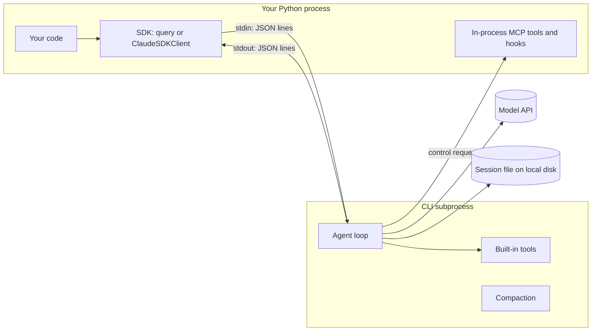

## 1. The question this idea answers

You write `async for message in query(prompt="..."):` in Python. Answers arrive. But what actually runs?

- Which program calls the model?
- Which program runs the tools?
- Where is the conversation saved, and by whom?
- Why does a missing folder or a missing file give an error that talks about "Claude Code"?

The answer to all four questions is the same. The SDK does almost nothing itself. It starts a second program, the **Claude Code CLI**, and passes messages to it and from it. If you know this, most surprises of the SDK become easy to explain: session files on the local disk, environment variables that "do not work", and errors with confusing names.

## 2. Mental model

> [!analogy] A dispatcher and a worker in another room
> You (your Python code) talk to a dispatcher (the SDK). The dispatcher does not do the job. The dispatcher has a phone line to a worker in another room (the CLI). The worker phones the expert (the model), uses the tools on the bench, and writes everything in a diary that stays in the worker's room (the session file).
>
> The dispatcher gives the worker the job description once, when the worker starts. Then the dispatcher passes your messages to the worker and passes the worker's reports back to you, line by line.
>
> **Where it stops working:** the phone line works in both directions. For some jobs the worker calls the dispatcher back: "Run this custom tool for me", "May I use this tool?", "Here is a hook event." Your Python code answers these calls while the worker waits. So your process is not only a listener.

## 3. Terms

| Term | Plain meaning |
|---|---|
| Claude Agent SDK | The Python package `claude-agent-sdk`. It starts the CLI and turns its output into Python objects. |
| Claude Code CLI | The `claude` program. It runs the agent loop: model calls, tools, permissions, sessions and compaction. |
| CLI | Command-line interface: a program that you start with a command and arguments. |
| subprocess | A program that another program starts and controls. Here, the CLI is a subprocess of your Python process. |
| bundled CLI | A copy of the CLI binary inside the SDK package. The SDK uses it unless you give `cli_path`. |
| stdin, stdout, stderr | The three standard text streams of a process: input, output and error output. |
| stream-json | The format on the pipe: one JSON object per line, in both directions. |
| transport | The SDK component that starts the subprocess and moves the JSON lines. |
| control protocol | The request and response messages on the same pipe that carry settings, hook calls, permission checks and custom tool calls. |
| initialize request | The first control request. It sends hooks, agent definitions and some system prompt settings to the CLI. |
| working directory (`cwd`) | The folder in which the CLI runs. It decides which project files the CLI sees and where its session file goes. |

## 4. Method and math

### 4.1 The layers




| Layer | What it is (checked on 2026-10-12) | Its job |
|---|---|---|
| Your code | Your application | Builds options, sends prompts, reads messages. |
| SDK | `claude-agent-sdk` 0.2.165 | Starts the CLI, writes JSON lines to its stdin, parses JSON lines from its stdout into Python objects, answers control requests. |
| CLI | The bundled `claude` binary, version 2.1.296 | Runs the agent loop. Calls the model. Runs built-in tools. Asks your process to run in-process tools. Writes the session file. Compacts the context. |
| Model API | Anthropic API, or a cloud provider such as Microsoft Foundry | Runs the model. Each call is stateless ([LLM APIs L1](/notes/ai/llm-apis/01-messages-api/l1-messages-and-content-blocks)). |

The agent-loop docs say: "Both the TypeScript and Python SDKs bundle a native Claude Code binary, so most installs need no separate Claude Code install."

### 4.2 How the SDK finds and starts the CLI

The SDK looks for the CLI in this order (source: `_find_cli` in `subprocess_cli.py`):

1. The bundled binary inside the package: `_bundled/claude`, or `claude.exe` on Windows.
2. A `claude` program on the `PATH`.
3. Fixed folders, for example `~/.npm-global/bin/claude` and `~/.local/bin/claude`.
4. If none exists: `CLINotFoundError`.

The `cli_path` option skips the search.

Then the SDK starts the CLI with a command like this one (shortened):

```text
claude --output-format stream-json --verbose [flags from your options] --input-format stream-json
```

Each option becomes a flag. For example `max_turns=8` becomes `--max-turns 8`, and `resume="<id>"` becomes `--resume=<id>`. The source comment says: "Always use streaming mode with stdin". So the CLI always reads JSON lines from stdin, also when your prompt is a plain string. A string prompt becomes one user message on stdin after the initialize request.

> [!key] One query() call is one CLI process
> Each call to `query()` starts a new CLI subprocess and ends it when the answer is complete. `ClaudeSDKClient` keeps one subprocess alive across many prompts ([L3](/notes/ai/claude-agent-sdk/01-foundations/l3-query-vs-claudesdkclient)). The process start takes time, and the new process knows nothing about the old one unless it reads a session file ([sessions](/notes/ai/claude-agent-sdk/04-sessions/l1-what-a-session-is)).

### 4.3 What crosses the pipe

| Direction | What | When |
|---|---|---|
| SDK → CLI (stdin) | `initialize` control request: hook callback ids, agent definitions, `systemPromptSnapshot`, `excludeDynamicSections`, skills | Once, at the start |
| SDK → CLI | User messages: `{"type": "user", "message": {"role": "user", "content": ...}}` | Once for a string prompt, many times in streaming input mode |
| CLI → SDK (stdout) | `system` message with subtype `init`: session id, model, tools, cwd | At the start |
| CLI → SDK | `assistant` messages (model output), `user` messages (tool results), stream events | During the loop |
| CLI → SDK | `result` message: final text, cost, usage, session id | At the end of each answer |
| CLI → SDK → CLI | Control requests and responses: hook callbacks, `can_use_tool` permission checks, calls to in-process MCP tools | Whenever the loop needs them |

The SDK reads stdout line by line. It skips lines that are not JSON. It turns each JSON object into a Python class: `SystemMessage`, `AssistantMessage`, `UserMessage`, `ResultMessage`, `StreamEvent` and others ([planned lesson 2.2](/notes/ai/claude-agent-sdk/02-options-and-messages)). The parser skips message types that it does not know, so new CLI versions do not break old SDK versions.

### 4.4 Who does what

| Job | Done by | Consequence |
|---|---|---|
| Calling the model | CLI | The model credentials and provider settings must reach the CLI process, as environment variables or settings. |
| Assembling the system prompt | CLI, from SDK flags | Without `system_prompt`, the SDK sends `--system-prompt ""` and the CLI uses a minimal prompt ([L5.1](/notes/ai/claude-agent-sdk/05-prompts-and-input/l1-system-prompts-and-snapshot)). |
| Running built-in tools (Read, Bash, and others) | CLI | They run in the CLI's working directory, with the CLI's permissions. |
| Running in-process MCP tools | Your process, at the CLI's request | Your tool code runs inside your Python process and can use your objects. |
| Writing the session file | CLI | The file is on the local disk of the machine that runs the CLI. |
| Compacting the context | CLI | It changes the CLI's copy of the conversation, not yours. |
| Parsing messages | SDK | You get Python objects, not raw JSON. |

### 4.5 The environment of the subprocess

The SDK builds the environment of the CLI from four sources, in this order (source: `subprocess_cli.py`, lines 814 to 868):

1. Your process environment, `os.environ`, without the variable `CLAUDECODE`.
2. `CLAUDE_CODE_ENTRYPOINT="sdk-py"`. You can replace it.
3. The `env` option of `ClaudeAgentOptions`. The docs say: "Environment variables merged on top of the inherited process environment".
4. `CLAUDE_AGENT_SDK_VERSION`, always set by the SDK. If `cwd` is set, `PWD` is set to it.

> [!trap] `options.env` changes the child, not the parent
> The `env` option changes only the environment of the CLI subprocess. It does not change `os.environ` of your Python process. Code in your own process that reads an environment variable does not see a value that you put only in `options.env`. Lesson [4.3](/notes/ai/claude-agent-sdk/04-sessions/l3-session-files-on-temporary-disks) shows a real failure that comes from this rule.

### 4.6 Errors at start

When the subprocess cannot start, the SDK raises an error from the `CLIConnectionError` family. The code (lines 901 to 915 of `subprocess_cli.py`, commit b6e9d12) catches only `FileNotFoundError` in a special way:

| What happened | Error that you get |
|---|---|
| `FileNotFoundError` and `cwd` does not exist | `CLIConnectionError("Working directory does not exist: ...")` |
| `FileNotFoundError` and `cwd` exists | `CLINotFoundError("Claude Code not found at: ...")` |
| Any other exception, for example `PermissionError` | `CLIConnectionError("Failed to start Claude Code: ...")` |

> [!trap] "Not found" does not always mean "not installed"
> `FileNotFoundError` from the operating system can have other causes than a missing CLI binary. The SDK reports all of them as `CLINotFoundError` when `cwd` exists. Read the chained exception (`raise ... from e`) to see the real operating system error. [Planned lesson 7.1](/notes/ai/claude-agent-sdk/07-errors-and-cost) covers this in detail.

### 4.7 Production view

| Concern | What the architecture means |
|---|---|
| Latency | Each `query()` call pays the start time of a process. A long-lived `ClaudeSDKClient` pays it once. |
| State | The CLI keeps state in memory while it runs and in a session file on the local disk. A new process on another machine has neither. |
| Configuration | Provider settings and credentials must reach the CLI: through the inherited environment, `options.env` or a settings file. |
| Isolation | Built-in tools run on the machine of the CLI. Disable the ones that you do not need with the `tools` option. |
| Debugging | Pass a `stderr` callback to receive the CLI's error output in your code. Without a callback, the child writes it to the stderr of your process, and your code never sees it (source: `subprocess_cli.py`, "Pipe stderr only when the caller registered a callback"). |
| Upgrades | A new SDK version can bring a new bundled CLI with new behavior. Pin the SDK version and read the changelog. |

## 5. Code

These exercises go in `claude-agent-sdk/01-architecture.ipynb`. Exercises 1.1 and 1.2 call the model. Exercises 1.3 and 1.4 do not.

**Exercise 1.1: see every message.** Run `query()` with a short string prompt. Print the class name of every message, and for `SystemMessage` print its `subtype`.

Acceptance test: the output starts with `SystemMessage` subtype `init` and ends with `ResultMessage`.

**Exercise 1.2: see the subprocess.** While a `query()` runs, list the child processes of your Python process (use `psutil`). Print the command line of the child.

Acceptance test: the command line contains `--output-format stream-json` and `--input-format stream-json`.

**Exercise 1.3: the parent does not see `options.env`.** Pass `env={"LAB_MARKER": "child-only"}` in the options. After the call, print `os.environ.get("LAB_MARKER")`.

Acceptance test: the value is `None`. Write one sentence that explains why.

**Exercise 1.4: start errors.** Call `query()` twice, with no model call needed: once with `cwd` set to a folder that does not exist, once with `cli_path` set to a file that does not exist. Catch the exceptions and print their class names and `__cause__`.

Acceptance tests:

- The first call raises `CLIConnectionError` with "Working directory does not exist".
- The second call raises `CLINotFoundError`. Its `__cause__` is a `FileNotFoundError`.

## 6. Common mistakes

1. **"The SDK calls the model."** The CLI calls the model. The SDK talks only to the CLI.
2. **"Each `query()` remembers the earlier one."** Each `query()` is a new process. It remembers nothing unless it resumes a session.
3. **Setting a variable in `options.env` and reading it in your own process.** The variable exists only in the child.
4. **Trusting the name `CLINotFoundError`.** Check the chained exception for the real operating system error.
5. **Forgetting the local disk.** The CLI writes the session file on the machine where it runs. A container that restarts loses it.

## 7. One-minute explanation

The Claude Agent SDK is a thin Python layer. When you call `query()`, it starts the Claude Code CLI as a subprocess. It usually uses a copy of the CLI that comes inside the package. The two programs talk with one JSON object per line: the SDK writes to the CLI's input, and the CLI writes to its output. The CLI does the real work. It calls the model, runs the built-in tools, keeps the conversation and writes it to a session file on the local disk. When the CLI needs your code, for a custom tool, a hook or a permission check, it sends a control request back to your process. Options become command-line flags, and `options.env` sets the environment of the child process only.

## 8. Check questions

```check
{
  "question": "Your service calls query() three times for three user messages. How many CLI processes start, and what does the third process know about the first two messages?",
  "answer": "Three processes start, one for each query() call. The third process knows nothing about the first two messages unless the call resumes or continues a session, so that the CLI reads the earlier conversation from the session file."
}
```

```check
{
  "question": "You set options.env = {\"CLAUDE_CONFIG_DIR\": \"/tmp/claude\"}. Which program uses /tmp/claude, and which program still uses ~/.claude?",
  "hint": "Whose environment does options.env change?",
  "answer": "The CLI subprocess uses /tmp/claude, because options.env is merged into its environment. Your Python process still uses its own os.environ, so any code that runs in your process and reads CLAUDE_CONFIG_DIR still sees no value and falls back to ~/.claude."
}
```

```check
{
  "question": "Name three jobs that the CLI does and one job that runs inside your Python process.",
  "answer": "The CLI calls the model, runs the built-in tools, writes the session file and compacts the context. Calls to in-process MCP tools (and hook callbacks) run inside your Python process, at the request of the CLI."
}
```

## 9. Links

- Next: [L2: The agent loop](/notes/ai/claude-agent-sdk/01-foundations/l2-the-agent-loop)
- Background: [LLM APIs L1: Messages and content blocks](/notes/ai/llm-apis/01-messages-api/l1-messages-and-content-blocks)
- Where the session file lives: [Sessions L1: What a session is](/notes/ai/claude-agent-sdk/04-sessions/l1-what-a-session-is)
- [Glossary](/notes/ai/claude-agent-sdk/glossary)
