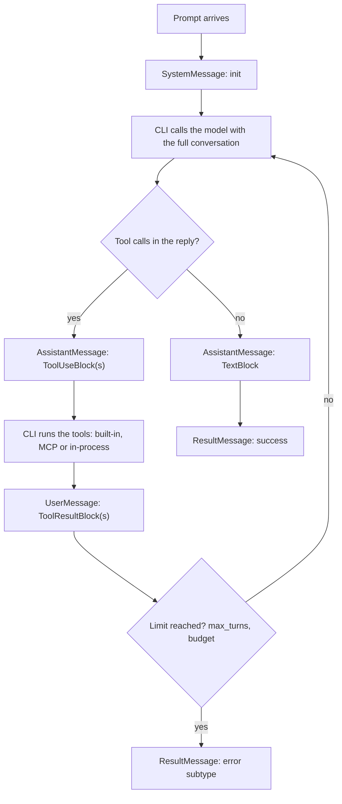

## 1. The question this idea answers

A user asks one question. The model calls a tool, reads the result, calls another tool, and only then writes an answer. All of this happens inside one `query()` call.

What exactly happens in that time? Which messages does my code receive, and in which order? What is a "turn"? What stops the loop when the model never stops calling tools? And how do I know if the answer is complete or cut?

An agent is not magic. An agent is a loop around stateless model calls ([LLM APIs L2](/notes/ai/llm-apis/01-messages-api/l2-tool-use-and-tool-result)). This lesson shows the loop that the CLI runs, step by step, and the exact objects that the SDK gives to your code.

## 2. Mental model

> [!analogy] An investigator with a notebook
> An investigator gets a question. The investigator thinks, then decides: "I need the shipping records." An assistant brings the records. The investigator reads them and decides: "Now I need the plant list." The assistant brings it. When the investigator has enough, the investigator writes the answer. Every request and every record goes into a notebook, in order.
>
> The investigator is the model. The assistant is the CLI, which runs the tools. The notebook is the conversation that the CLI sends to the model on every call.
>
> **Where it stops working:** a real investigator remembers what happened. The model remembers nothing between calls. The CLI must send the full notebook again on every call. So the notebook grows, and each step costs more than the step before.

## 3. Terms

| Term | Plain meaning |
|---|---|
| agent loop | The cycle that the CLI repeats: call the model, run the requested tools, add the results, call the model again. |
| turn | One round trip inside the loop: the model asks for tools, the CLI runs them, and the results return to the model. The final answer with no tool call is also counted as a turn in the docs example. |
| `SystemMessage` | A message from the CLI about the session. The subtype `init` starts every run. |
| `AssistantMessage` | Output of the model: text, thinking or tool calls. |
| `UserMessage` | Input to the model from the user side. Inside the loop it carries tool results. |
| `ResultMessage` | The last message of one answer: the final text, the cost, the token usage, the number of turns and the session id. |
| result subtype | The `subtype` field of a `ResultMessage`. It says how the loop ended. |
| `max_turns` | An option that stops the loop after a number of tool-use turns. |
| `max_budget_usd` | An option that stops the loop when the estimated cost reaches a value in US dollars. |
| `effort` | An option for the depth of reasoning: `low`, `medium`, `high`, `xhigh` or `max`. |
| `terminal_reason` | A field of `ResultMessage` with the exact reason for the end, for example `completed` or `api_error`. |
| `compact_boundary` | A `SystemMessage` subtype. The CLI compacted the conversation at this point. |

## 4. Method and math

### 4.1 The five steps

The agent-loop page describes five steps (checked on 2026-10-12). The quotes are shortened.

1. **Receive the prompt.** "The SDK yields a `SystemMessage` with subtype `"init"`".
2. **Evaluate and respond.** The model "may respond with text, request one or more tool calls, or both". The SDK yields one or more `AssistantMessage` objects.
3. **Execute tools.** "The SDK runs each requested tool". Hooks can "intercept, modify, or block tool calls".
4. **Repeat.** "Steps 2 and 3 repeat as a cycle. Each full cycle is one turn. Claude continues calling tools and processing results until it produces a response with no tool calls."
5. **Return the result.** "The SDK yields a final `AssistantMessage` with the text response (no tool calls), followed by a `ResultMessage` with the final text, token usage, cost, and session ID."



> [!note] "The SDK runs each tool" means the CLI
> The docs say that the SDK runs the tools. In the architecture of [L1](/notes/ai/claude-agent-sdk/01-foundations/l1-what-the-sdk-is), the CLI subprocess runs the built-in tools and MCP tools. For in-process tools, the CLI asks your Python process to run the function. The loop itself lives in the CLI.

### 4.2 A full trace

The user asks: "How many orders shipped on 2026-10-11, and which plant shipped the most?" Two in-process tools exist: `count_orders` and `orders_by_plant`. This is the sequence that your code receives. The ids are shortened.

| # | Python object | Content | Model call |
|---|---|---|---|
| 1 | `SystemMessage` subtype `init` | `data["session_id"] = "9f2c..."`, model, tools | — |
| 2 | `AssistantMessage` | `ToolUseBlock(id="toolu_1", name="mcp__data__count_orders", input={"date": "2026-10-11"})` | call 1 |
| 3 | `UserMessage` | `ToolResultBlock(tool_use_id="toolu_1", content="412")` | — |
| 4 | `AssistantMessage` | `ToolUseBlock(id="toolu_2", name="mcp__data__orders_by_plant", ...)` | call 2 |
| 5 | `UserMessage` | `ToolResultBlock(tool_use_id="toolu_2", content="Plant B: 201, ...")` | — |
| 6 | `AssistantMessage` | `TextBlock("412 orders shipped. Plant B shipped the most: 201.")` | call 3 |
| 7 | `ResultMessage` | `subtype="success"`, `num_turns=3`, `result="412 orders shipped..."`, `session_id="9f2c..."` | — |

Three facts come from this trace.

1. **The CLI made three model calls.** Call 2 contained the question, call 1's output and the first result. Call 3 contained everything before it. Each call is larger than the call before.
2. **Tool results arrive as `UserMessage` objects.** This matches the API rule that a `tool_result` goes in a `user` message. A `UserMessage` in the stream is not always text from a human.
3. **The final text appears twice:** in the last `AssistantMessage` and in `ResultMessage.result`.

> [!trap] One API response can arrive as several AssistantMessage objects
> The docs say that the SDK yields "one or more `AssistantMessage` objects, one for each content block". A model reply with a thinking block, a text block and a tool call can arrive as three objects. The `message_id` field joins them: "Multiple messages from one turn share the same ID". Code that stores the conversation must group the objects by `message_id` to rebuild one API message.

### 4.3 What a turn is, and how max_turns counts

The docs define a turn as "one round trip inside the loop: Claude produces output that includes tool calls, the SDK executes those tools, and the results feed back to Claude automatically. This happens without yielding control back to your code."

In the docs example, an agent fixes a test in four steps. The docs say: "That was four turns: three with tool calls, one final text-only response." So `num_turns` in the result counts all model responses of the loop, also the last one.

`max_turns` is different. The docs say: "`max_turns` / `maxTurns`, which counts tool-use turns only. For example, `max_turns=2` in the loop above would have stopped before the edit step." The default is "No limit".

> [!example] Worked example: max_turns
> The task of section 4.2 needs two tool-use turns and one final turn.
>
> | `max_turns` | What happens |
> |---|---|
> | not set | The loop finishes. `subtype = "success"`, `num_turns = 3`. |
> | 2 | Two tool-use turns are allowed. The loop finishes normally. |
> | 1 | After the first tool-use turn, the loop stops. `subtype = "error_max_turns"`. No final answer. |

> [!trap] Two sources disagree, and zero means no limit
> The SDK source docstring says: "A turn consists of a user message and assistant response." The docs page says that `max_turns` counts tool-use turns only. Test the behavior with your SDK version before you depend on an exact number. Also, the SDK sends `--max-turns` only when the value is truthy (`if self._options.max_turns:`). So `max_turns=0` means no limit, not zero turns.

### 4.4 How the loop ends: result subtypes

| Subtype | What happened (docs, checked on 2026-10-12) | `result` text present? |
|---|---|---|
| `success` | "Claude finished the task normally" | yes |
| `error_max_turns` | "Hit the `maxTurns` limit before finishing" | no |
| `error_max_budget_usd` | "Hit the `maxBudgetUsd` limit before finishing" | no |
| `error_during_execution` | "An error interrupted the loop (for example, a cancelled request)" | no |
| `error_max_structured_output_retries` | No valid structured output within the retry limit | no |

The docs add: "All result subtypes carry `total_cost_usd`, `usage`, `num_turns`, and `session_id`". So you can always log the cost and the session id, also after an error.

> [!trap] An API failure can report subtype "success"
> The Python reference says: "When the final request fails, such as on an API error, Claude Code reports `subtype` `"success"` with the cause in `terminal_reason`, for example `"api_error"`". Check `terminal_reason` first, then `subtype`. A check of `subtype == "success"` alone can treat a failed answer as a good one.

Two more behaviors matter:

1. **A single-shot `query()` raises after an error result.** The docs say that it "yields the final result message, then raises an error that includes the failure text, such as `Reached maximum number of turns`". So wrap the loop in `try`, and read the result message before the exception.
2. **Messages can arrive after the result.** The docs say: "A small number of trailing system events, such as `prompt_suggestion`, can arrive after it, so iterate the stream to completion". Do not `break` out of the loop at the `ResultMessage`. The Python reference also warns that `break` "can cause asyncio cleanup issues".

### 4.5 Controls that stop or shape the loop

| Option | Type and default | Effect |
|---|---|---|
| `max_turns` | `int`, no limit | Stops after this many tool-use turns. |
| `max_budget_usd` | `float`, no limit | "Estimated spend at which the loop stops". The docs warn: "Spend can therefore pass the cap by up to the cost of that one response". It covers subagents too. |
| `effort` | `"low"` to `"max"`, not set | Depth of reasoning. The docs say that effort and extended thinking "are independent". If unset, "Claude Code resolves the effort level itself". |
| `task_budget` | `{"total": int}` | A token budget that the API itself applies, sent with a beta header. |

### 4.6 The loop and the context window

The model API is stateless. So on every turn, the CLI sends the full conversation: system prompt, tool definitions, earlier messages, all tool calls and all results. The input of turn $k$ is larger than the input of turn $k-1$ by one model reply and its tool results.

> [!example] Worked example: input growth inside one answer
> Assume a fixed prefix (system prompt and tool definitions) of 6,000 tokens, a question of 50 tokens, each tool call of 60 tokens and each tool result of 900 tokens.
>
> | Model call | Input | Tokens |
> |---|---|---|
> | 1 | prefix + question | 6,000 + 50 = 6,050 |
> | 2 | call 1 input + call 1 + result 1 | 6,050 + 60 + 900 = 7,010 |
> | 3 | call 2 input + call 2 + result 2 | 7,010 + 60 + 900 = 7,970 |
>
> Total input for one answer: 6,050 + 7,010 + 7,970 = 21,030 tokens. Most of it is the same prefix, sent three times. Prompt caching makes the repeated part cheap ([context engineering L7](/notes/ai/context-engineering/01-foundations/l7-prompt-caching)).

When the conversation reaches the compaction point, the CLI summarizes it and yields a `SystemMessage` with subtype `compact_boundary`. The docs say: "Compaction replaces older messages with a summary". [Lesson 6.1](/notes/ai/claude-agent-sdk/06-context-window/l1-window-size-and-auto-compaction) covers the details.

### 4.7 Where your code can act

| Moment | Mechanism |
|---|---|
| Before the loop | `ClaudeAgentOptions`: tools, system prompt, limits, session settings |
| Before each tool call | Hooks such as `PreToolUse`, and the `can_use_tool` permission callback |
| Inside a tool | Your in-process MCP tool function |
| During the loop | `interrupt()`, only with `ClaudeSDKClient` ([L3](/notes/ai/claude-agent-sdk/01-foundations/l3-query-vs-claudesdkclient)) |
| After the loop | The `ResultMessage`: subtype, `terminal_reason`, cost, usage, session id |

### 4.8 Production view

| Concern | What to do |
|---|---|
| Reliability | Read the stream to its end. Handle every result subtype and check `terminal_reason`. |
| Cost | Set `max_turns` and `max_budget_usd`. Log `total_cost_usd` and `usage` for every answer. |
| Latency | Each tool-use turn adds one model call. Fewer, better tools mean fewer turns. |
| Observability | Log the session id from the `init` message at the start, so a crash in the middle can still be traced. |
| Storage | Group `AssistantMessage` objects by `message_id`. Keep each `ToolUseBlock` with its `ToolResultBlock`. |

## 5. Video

```video
{
  "src": "/notes/media/claude-agent-sdk/manim/m01-agent-loop.mp4",
  "caption": "One answer with two tool-use turns: the messages that the SDK yields, and the conversation that grows on every model call."
}
```

## 6. Code

These exercises go in `claude-agent-sdk/02-agent-loop.ipynb`.

**Exercise 2.1: a fake loop with no API.** Write a function `fake_model(messages)` that returns a scripted reply: a tool call on the first two calls, then text. Write `run_loop(question, tools, max_turns)` that repeats the five steps with the fake model and yields Python dictionaries shaped like the SDK messages.

Acceptance tests:

- With no limit, the output matches the order of the trace in section 4.2 and ends with `subtype = "success"` and `num_turns = 3`.
- With `max_turns=1`, the output ends with `subtype = "error_max_turns"` and has no final text.
- The function never sends a `tool_result` without its `tool_use` in the messages ([LLM APIs L2](/notes/ai/llm-apis/01-messages-api/l2-tool-use-and-tool-result)).

**Exercise 2.2: a real trace.** Run a real `query()` with one in-process tool. Print a table: index, class name, block types, `message_id`, and for the result: `subtype`, `terminal_reason`, `num_turns`, `total_cost_usd`.

Acceptance test: you can find each of the five steps in your printed table.

**Exercise 2.3: the limit.** Run the same prompt with `max_turns=1`. Catch the exception from `query()`.

Acceptance tests:

- You print the `ResultMessage` with `subtype = "error_max_turns"` before the exception.
- You print the session id and the cost of the failed run.

## 7. Common mistakes

1. **"An agent is a special kind of model."** An agent is a loop around stateless model calls, plus tools and state.
2. **"A UserMessage always holds text from the user."** Inside the loop, it carries tool results.
3. **Leaving the loop with `break` at the ResultMessage.** Trailing events can follow, and `break` can cause cleanup problems. Read the stream to its end.
4. **Checking only `subtype == "success"`.** An API failure can report `success` with `terminal_reason = "api_error"`.
5. **Treating `max_turns` and `num_turns` as the same count.** `max_turns` counts tool-use turns. `num_turns` in the docs example counts the final text-only response too.
6. **Storing each AssistantMessage as a separate model message.** Several objects can belong to one API message. Group them by `message_id`.

## 8. One-minute explanation

Inside one `query()`, the CLI runs a loop. It sends the full conversation to the model. If the reply asks for tools, the CLI runs them and adds the results to the conversation as a user message, then calls the model again. Each round trip is a turn. The loop ends when the model replies with no tool call, or when a limit stops it: `max_turns` for tool-use turns, or `max_budget_usd` for cost. Your code receives an `init` system message first, then assistant messages with tool calls, user messages with tool results, the final assistant text, and last a `ResultMessage` with the subtype, the cost, the usage, the number of turns and the session id. Because the model is stateless, every turn resends everything, so each turn costs more than the one before.

## 9. Check questions

```check
{
  "question": "A run yields: SystemMessage(init), AssistantMessage(tool_use), UserMessage(tool_result), AssistantMessage(tool_use), UserMessage(tool_result), AssistantMessage(text), ResultMessage. How many model calls happened, and how many tool-use turns?",
  "answer": "Three model calls, because there are three groups of assistant output. Two of them asked for tools, so there were two tool-use turns. The third call produced the final text."
}
```

```check
{
  "question": "Your code treats a run as good when result.subtype == \"success\". A user reports an empty answer, and the logs show subtype success. What should you check, and why?",
  "answer": "Check result.terminal_reason. The Python reference says that when the final request fails, for example on an API error, Claude Code reports subtype success with the cause in terminal_reason, such as api_error. Check terminal_reason first, then subtype."
}
```

```check
{
  "question": "The prefix is 10,000 tokens and the question is 100 tokens. Each tool call is 50 tokens and each tool result is 1,000 tokens. The answer needs three tool-use turns and a final turn. What is the input of the fourth model call?",
  "hint": "Each tool-use turn adds one call and one result to the conversation.",
  "answer": "10,000 + 100 + 3 × (50 + 1,000) = 10,100 + 3,150 = 13,250 tokens."
}
```

```check
{
  "question": "Why can a tool result appear in your stream as a UserMessage, when no human typed it?",
  "answer": "The Messages API requires every tool_result block to be in a message with the role user. The CLI sends the results to the model in a user message, and the SDK yields that message to your code as a UserMessage."
}
```

## 10. Links

- Previous: [L1: What the SDK is](/notes/ai/claude-agent-sdk/01-foundations/l1-what-the-sdk-is)
- Next: [L3: query() vs ClaudeSDKClient](/notes/ai/claude-agent-sdk/01-foundations/l3-query-vs-claudesdkclient)
- The API rules inside the loop: [LLM APIs L2: tool_use and tool_result](/notes/ai/llm-apis/01-messages-api/l2-tool-use-and-tool-result)
- Cost growth: [Context engineering L6: The cost of a conversation](/notes/ai/context-engineering/01-foundations/l6-the-cost-of-a-conversation)
- [Glossary](/notes/ai/claude-agent-sdk/glossary)
