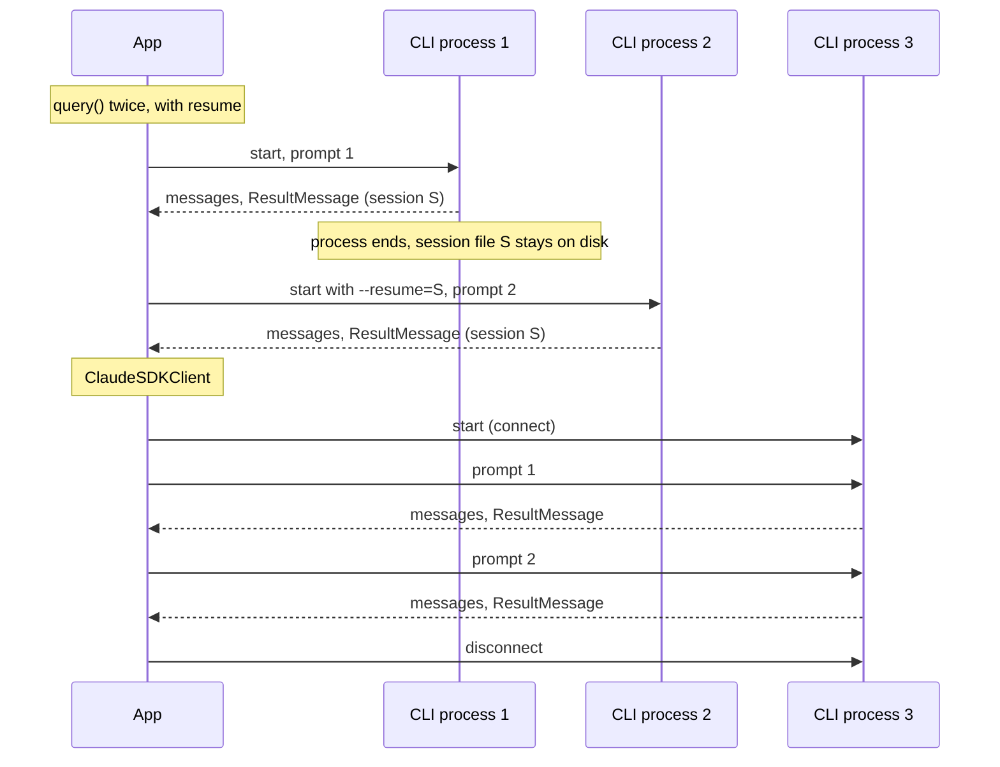

## 1. The question this idea answers

The SDK has two ways to start the agent loop: the function `query()` and the class `ClaudeSDKClient`. Both run the same loop ([L2](/notes/ai/claude-agent-sdk/01-foundations/l2-the-agent-loop)). So why are there two?

The difference is **lifetime**. `query()` lives for one exchange. `ClaudeSDKClient` lives for many. This choice decides how a chat backend keeps a conversation between two user messages: in a live process, in a session file, or in its own database. It also decides whether the user can stop an answer in the middle.

## 2. Mental model

> [!analogy] A taxi and a rented car
> `query()` is a taxi. You call it, ride once, pay, and it drives away. The next ride is a new taxi with a new driver who knows nothing about your first ride. If you want the new driver to continue your trip, you must give the trip log to the new driver: that is `resume` with a session id.
>
> `ClaudeSDKClient` is a car that you rent for the day. You keep it between trips, and the trip log stays in the car. You can also stop the car in the middle of a trip: that is `interrupt()`.
>
> **Where it stops working:** the rented car exists only in one place, your current process. If your server restarts, or the next HTTP request goes to another server, the car is gone. A taxi company can serve you from any garage, if the trip log is available there.

## 3. Terms

| Term | Plain meaning |
|---|---|
| `query()` | An async function. It starts a CLI process, sends the prompt, yields the messages and ends the process. |
| `ClaudeSDKClient` | A class. It keeps one CLI process open and sends many prompts to it. |
| async iterator | An object that you read with `async for`. Each step can wait for new data. |
| async context manager | An object that you use with `async with`. It runs setup code at the start and cleanup code at the end. |
| exchange | One prompt and the full answer to it, up to the `ResultMessage`. |
| interrupt | A signal that stops the current answer of a `ClaudeSDKClient`. |
| request-scoped | Lives only for one HTTP request. |
| long-lived | Lives across many requests. |
| sticky routing | A load balancer rule that sends all requests of one user to the same server. |

## 4. Method and math

### 4.1 The two signatures

From the Python reference and the source (checked on 2026-10-12):

```python
async def query(
    *,
    prompt: str | AsyncIterable[dict[str, Any]],
    options: ClaudeAgentOptions | None = None,
    transport: Transport | None = None,
) -> AsyncIterator[Message]
```

```python
class ClaudeSDKClient:
    def __init__(self, options: ClaudeAgentOptions | None = None, transport: Transport | None = None): ...
    async def connect(self, prompt: str | AsyncIterable[dict] | None = None) -> None: ...
    async def query(self, prompt, session_id: str = "default") -> None: ...
    async def receive_response(self) -> AsyncIterator[Message]: ...
    async def receive_messages(self) -> AsyncIterator[Message]: ...
    async def interrupt(self) -> None: ...
    async def disconnect(self) -> None: ...
    # also: set_model, set_permission_mode, get_context_usage, get_mcp_status, and others
```

Note the difference in shape. `query()` returns the messages directly. `ClaudeSDKClient.query()` returns nothing: it only sends the prompt. You read the answer with `receive_response()`.

### 4.2 The official comparison

This table is from the Python reference, word for word:

| Feature | `query()` | `ClaudeSDKClient` |
|---|---|---|
| Session | Creates a new session by default | Reuses same session |
| Conversation | Single exchange | Multiple exchanges in same context |
| Connection | Managed automatically | Manual control |
| Streaming Input | Supported | Supported |
| Interrupts | Not supported | Supported |
| Hooks | Supported | Supported |
| Custom Tools | Supported | Supported |
| Continue Chat | Manual via `continue_conversation` or `resume` | Automatic |
| Use Case | One-off tasks | Continuous conversations |

The reference says about `query()`: "Each call to `query()` starts fresh with no memory of previous interactions unless you pass `continue_conversation=True` or `resume`". About the client: "Maintains a conversation session across multiple exchanges."

### 4.3 query() in use

A single exchange:

```python
from claude_agent_sdk import query, ClaudeAgentOptions, ResultMessage

async def ask(prompt: str) -> str | None:
    final = None
    async for message in query(prompt=prompt, options=ClaudeAgentOptions(max_turns=8)):
        if isinstance(message, ResultMessage):
            final = message
    return final.session_id if final else None
```

A second exchange that continues the first one. The new process reads the earlier conversation from the session file:

```python
options = ClaudeAgentOptions(resume=session_id)   # the id from the first ResultMessage
async for message in query(prompt="And which plant shipped the most?", options=options):
    ...
```

Without `resume`, the second call has no memory of the first. The sessions part covers `resume`, `continue_conversation` and `fork_session` in full ([sessions L2](/notes/ai/claude-agent-sdk/04-sessions/l2-resume-continue-fork)).

### 4.4 ClaudeSDKClient in use

```python
from claude_agent_sdk import ClaudeSDKClient, ClaudeAgentOptions

async with ClaudeSDKClient(options=ClaudeAgentOptions(max_turns=8)) as client:
    await client.query("How many orders shipped on 2026-10-11?")
    async for message in client.receive_response():
        ...                              # ends after the ResultMessage

    await client.query("And which plant shipped the most?")   # same process, same session
    async for message in client.receive_response():
        ...
```

The second prompt continues the same conversation with no `resume`, because the same CLI process still holds it. The sessions docs say: "Each call to `client.query()` automatically continues the same session".

### 4.5 Process lifetime



| | `query()` per message | One `ClaudeSDKClient` per chat |
|---|---|---|
| CLI processes for a 10-message chat | 10 | 1 |
| Where the conversation lives between messages | The session file on disk | The live process, and also the session file |
| Start cost | Paid 10 times | Paid once |
| Memory while the user reads | None | One process for each open chat |
| Survives a server restart | Yes, if the session file survives | No. The process is gone. A new client must resume from the file. |
| Can stop an answer in the middle | No | Yes, with `interrupt()` |

### 4.6 Interrupts

Only `ClaudeSDKClient` can stop an answer. The reference adds a trap: "`interrupt()` sends a stop signal but does not clear the message buffer... You must drain them with `receive_response()` before reading the response to a new query."

So the correct order is:

1. Call `await client.interrupt()`.
2. Read `receive_response()` to its end, and discard or store what remains.
3. Send the next prompt.

If you skip step 2, the next `receive_response()` returns the old messages first.

### 4.7 Two limits of the client

1. **One async context.** The source docstring says: "you cannot use a ClaudeSDKClient instance across different async runtime contexts (e.g., different trio nurseries or asyncio task groups)." A web server that handles each request in a new task, or a new thread with its own event loop, cannot simply keep a client in a global variable and use it from all requests.
2. **receive_response waits for a result.** It "Terminates immediately after yielding a ResultMessage... If no ResultMessage is received, the iterator continues indefinitely." Always set a timeout around it in a server.

### 4.8 Three designs for a chat backend

A web backend gets one HTTP request for each user message. It must keep the conversation between requests. There are three designs.

| Design | How it works | Strengths | Weaknesses |
|---|---|---|---|
| A. `query()` per message, with `resume` | Store the session id with the chat. Each request starts `query(resume=session_id)`. | Any request is independent. The CLI keeps exact tool calls and thinking blocks. | The session file must exist on the disk of the server that handles the request ([sessions L3](/notes/ai/claude-agent-sdk/04-sessions/l3-session-files-on-temporary-disks)). |
| B. One client per chat, in memory | Keep a `ClaudeSDKClient` alive for each open chat. | No process start per message. Interrupts work. | Needs sticky routing, memory for each open chat, and one async context. All lost on restart. |
| C. `query()` per message, rebuild the context | Store the chat in your own database. Each request starts a new session and puts the earlier turns into the prompt. | Fully independent of local disks. Works with any server. | The earlier turns become text in one prompt, not real past messages. Tool calls and thinking blocks lose their structure. Prompt caching changes. |

Designs A and C can be combined: try A, and use C when the session file is missing. The sessions part calls these **Flow 1** and **Flow 2** ([sessions L3](/notes/ai/claude-agent-sdk/04-sessions/l3-session-files-on-temporary-disks)).

> [!key] The choice is about where the conversation lives
> `query()` vs `ClaudeSDKClient` is not a question of features. It is a question of where the conversation lives between two user messages: in a live process, in a local session file, or in your own database.

### 4.9 Calling async code from a sync server

Both entry points are `async`. A sync web framework, or sync code in a worker thread, must run them in an event loop. A common pattern is `asyncio.run(...)` inside a worker thread. `asyncio.run` fails if the thread already runs an event loop. The Python subject covers this ([planned lesson](/notes/software-engineering/python/01-asyncio)).

### 4.10 Production view

| Concern | `query()` per message | `ClaudeSDKClient` |
|---|---|---|
| Scaling | Easy. Requests are independent, if the state is available. | Hard. Needs sticky routing and per-chat memory. |
| Latency | Process start on every message | Process start once |
| Failure recovery | A crash loses only the current answer | A crash loses the live state of every open chat on that server |
| User control | No stop button | Stop button with `interrupt()` |
| Resource use | Nothing between messages | One process per open chat |

## 5. Code

These exercises go in `claude-agent-sdk/03-query-vs-client.ipynb`. They call the model.

**Exercise 3.1: no memory.** Call `query()` with "My name is Asha." Then call `query()` again with "What is my name?" and no `resume`.

Acceptance test: the second answer does not contain "Asha". Print both session ids. They are different.

**Exercise 3.2: memory through the session file.** Repeat exercise 3.1, but pass `resume=<first session id>` in the second call.

Acceptance tests:

- The second answer contains "Asha".
- Print the session id of the second `ResultMessage` and compare it with the first. Record what you see. Lesson [4.2](/notes/ai/claude-agent-sdk/04-sessions/l2-resume-continue-fork) explains it.

**Exercise 3.3: memory in a live process.** Do the same two prompts with one `ClaudeSDKClient`.

Acceptance tests:

- The second answer contains "Asha" without `resume`.
- With `psutil`, show that exactly one CLI child process existed during both prompts.

**Exercise 3.4: interrupt.** With a client, ask for a long answer, wait one second, call `interrupt()`, drain `receive_response()`, then ask "Say OK."

Acceptance test: the last answer that you print is the answer to "Say OK.", not old text from the first prompt.

## 6. Common mistakes

1. **"query() remembers the last call."** Each call starts a new process and a new session, unless you pass `resume` or `continue_conversation`.
2. **Reading ClaudeSDKClient.query() as if it returns messages.** It only sends the prompt. Read with `receive_response()`.
3. **A global ClaudeSDKClient shared by all web requests.** It cannot cross async contexts, and it mixes the conversations of different users.
4. **A new prompt after interrupt() with no drain.** The old messages come first.
5. **Design B behind a load balancer with no sticky routing.** The next message goes to a server that has no client for the chat.

## 7. One-minute explanation

`query()` and `ClaudeSDKClient` run the same agent loop. The difference is lifetime. `query()` starts a CLI process for one exchange and ends it, so each call starts a new session unless you pass `resume` or `continue_conversation`. `ClaudeSDKClient` keeps one CLI process open, so many prompts continue the same session automatically, and it can stop an answer with `interrupt()`. For a web backend, this is a question of where the conversation lives between two messages. With `query()` it lives in a session file or in your own database, so any server can handle the next message. With the client it lives in a live process, which needs sticky routing and dies with the server.

## 8. Check questions

```check
{
  "question": "A backend runs four servers behind a load balancer with no sticky routing. It keeps one ClaudeSDKClient per chat in a Python dictionary. Users say the agent 'forgets' them. Why?",
  "answer": "Each client lives in the memory of one server. The next message of a chat often goes to a different server, which has no client for that chat, so it starts a new conversation. The fix is sticky routing, or query() per message with resume from a session file that every server can read, or rebuilding the context from a shared database."
}
```

```check
{
  "question": "Which entry point do you need for a stop button in the chat UI, and what must the code do after the stop before the next prompt?",
  "answer": "ClaudeSDKClient, because only it supports interrupt(). After interrupt(), the code must read receive_response() to its end, because interrupt() does not clear the message buffer. Then it sends the next prompt."
}
```

```check
{
  "question": "Name one strength and one weakness of Design C (query() per message, earlier turns rebuilt into the prompt from your own database).",
  "answer": "Strength: it does not depend on any local file or live process, so any server can handle any message. Weakness: the earlier turns become text in one prompt instead of real past messages, so tool calls and thinking blocks lose their structure, and the prompt cache behaves differently."
}
```

## 9. Links

- Previous: [L2: The agent loop](/notes/ai/claude-agent-sdk/01-foundations/l2-the-agent-loop)
- Next in the priority path: [Sessions L1: What a session is](/notes/ai/claude-agent-sdk/04-sessions/l1-what-a-session-is)
- [Sessions L3: Session files on temporary disks](/notes/ai/claude-agent-sdk/04-sessions/l3-session-files-on-temporary-disks) (Flow 1 and Flow 2)
- [Glossary](/notes/ai/claude-agent-sdk/glossary)
