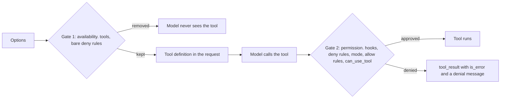

## 1. The question this idea answers

A server-side data agent sets about fifteen options on every `query()` call. Most wrong values do not raise an error. They fail quietly:

- The model sees a tool, calls it, and the call is denied, because the allow rule used the wrong name.
- The agent follows rules from a `CLAUDE.md` file that came with the base image.
- A run fails with `Check stderr output for details`, and the details went to a stream that nobody reads.
- With no `permission_mode`, the CLI starts in a mode that you did not choose.

For each option, you need four facts: its type, its default, what it becomes on the CLI side, and its trap. This lesson gives those facts from the source code of SDK 0.2.165. It ends with a reference options object for a server-side data agent.

## 2. Mental model

> [!analogy] A work order for a new contractor every morning
> Each `query()` call hires a new contractor: a new CLI process. The options are the written work order. `tools` lists the tools in the van. `allowed_tools` lists the jobs that need no phone call to the office. `disallowed_tools` lists forbidden jobs. `permission_mode` says what to do when no list covers a job: phone the office (`can_use_tool`), refuse (`dontAsk`), or let a reviewer decide (`auto`). `max_turns` and `max_budget_usd` limit the work. `cwd` is the address of the site.
>
> The contractor reads the work order once, at the start. Nothing that you change later reaches this contractor. The next contractor gets a new work order.
>
> **Where it stops working:** a human contractor asks when a line in the work order makes no sense. The CLI does not. A tool name that matches nothing is silently ignored, and `max_turns=0` silently means "no limit". Only a few wrong values, such as `max_budget_usd=0.0`, stop the process before it starts.

## 3. Terms

| Term | Plain meaning |
|---|---|
| `ClaudeAgentOptions` | The dataclass that holds all settings of one run. |
| CLI flag | A command-line argument that the SDK passes to the CLI, for example `--max-turns 12`. |
| availability layer | The checks that decide which tools appear in the request to the model. |
| permission layer | The checks that decide what happens when the model calls a tool: run, ask or deny. |
| built-in tool | A tool that the CLI implements itself, for example `Read`, `Bash` or `WebFetch`. |
| allow rule | An entry that approves matching tool calls without asking. `allowed_tools` adds allow rules. |
| deny rule | An entry that blocks matching tool calls. `disallowed_tools` adds deny rules. |
| bare name | A rule with only a tool name, for example `"Read"` or `"mcp__data__count_orders"`. |
| scoped rule | A rule with a pattern in parentheses, for example `"Bash(rm *)"`. |
| permission mode | The global policy for tool calls that no rule decides: `default`, `dontAsk`, `auto`, and others. |
| `can_use_tool` | A Python callback that decides tool calls that would otherwise ask for approval. |
| setting source | One layer of settings files on disk: `user`, `project` or `local`. |
| `stderr` callback | A Python function that receives each line of the CLI's error output. |

## 4. Method and math

### 4.1 Where each option goes

The SDK does not apply options itself. It passes them to the CLI subprocess on one of four paths ([Foundations L1](/notes/ai/claude-agent-sdk/01-foundations/l1-what-the-sdk-is)).

| Path | Options (examples) | Source |
|---|---|---|
| CLI flag | `tools`, `allowed_tools`, `disallowed_tools`, `permission_mode`, `mcp_servers`, `setting_sources`, `include_partial_messages`, `thinking`, `effort`, `max_turns`, `max_budget_usd`, `model`, `system_prompt` | `_build_command()` in `subprocess_cli.py` |
| Environment of the subprocess | `env`, `cwd` (also sets `PWD`), `enable_file_checkpointing` | `connect()` in `subprocess_cli.py` |
| `initialize` control request | `agents`, `hooks`, `snapshot`, `exclude_dynamic_sections`, `skills` | `_internal/client.py` |
| Stays in your process | the in-process MCP server instance, the `can_use_tool` function, the `stderr` function | `_internal/query.py` and `subprocess_cli.py` |

This is the real command that the SDK builds for the reference options object of section 4.9, with placeholder values. It was printed with `_build_command()` (SDK 0.2.165, checked on 2026-10-13). Each flag is on its own line, and the program name is omitted.

```text
--output-format 'stream-json'
--verbose
--system-prompt 'You answer questions about plant production data.'
--tools ''
--allowedTools 'mcp__data__count_orders,mcp__data__downtime_by_line,mcp__genie__*'
--max-turns '12'
--max-budget-usd '0.5'
--model 'claude-sonnet-5'
--permission-mode 'dontAsk'
--mcp-config '{"mcpServers": {"data": {"type": "sdk", "name": "production-data"}, "genie": {"type": "http", "url": "https://example.invalid/mcp", "headers": {"Authorization": "Bearer TOKEN"}}}}'
--include-partial-messages
--setting-sources=
--thinking 'adaptive'
--thinking-display 'summarized'
--effort 'medium'
--input-format 'stream-json'
```

Note four facts in this output. The in-process server crosses as `{"type": "sdk", "name": "production-data"}`, because the SDK strips the `instance` field. The bearer token of the HTTP server is on the command line, but the token in `env` is not. The `--setting-sources=` flag has an empty value. And `--input-format 'stream-json'` is always last, also for a string prompt.

### 4.2 The tool options

| Option | Type and default (0.2.165) | Becomes | Trap |
|---|---|---|---|
| `tools` | list of names, or the `claude_code` preset, or `None`. Default `None`. | `None`: no flag. `[]`: `--tools ""`. A list: `--tools Read,Grep`. The preset: `--tools default`. | `None` does not mean "no tools". It means the CLI default set. |
| `mcp_servers` | dict of server key to config, or a path or JSON string. Default `{}`. | `--mcp-config` with a JSON object | The whole JSON is a command-line argument, also the `headers` of an HTTP server. |
| `allowed_tools` | list of rules. Default `[]`. | `--allowedTools a,b` when not empty | It approves. It does not restrict. |
| `disallowed_tools` | list of rules. Default `[]`. | `--disallowedTools a,b` when not empty | A bare built-in name removes the tool. A scoped rule only denies matching calls. |
| `permission_mode` | `default`, `acceptEdits`, `plan`, `bypassPermissions`, `dontAsk`, `auto`, or `None`. Default `None`. | `--permission-mode X` when set | `None` sends no flag, and the CLI chooses the starting mode. |
| `can_use_tool` | async callback or `None`. Default `None`. | The SDK sets `permission_prompt_tool_name="stdio"`, so prompts arrive as control requests. | It never runs for calls that an allow rule or the mode already approved. |

The source lines for `tools` (`subprocess_cli.py`, lines 591 to 601):

```python
        if self._options.tools is not None:
            tools = self._options.tools
            if isinstance(tools, list):
                if len(tools) == 0:
                    cmd.extend(["--tools", ""])
                else:
                    cmd.extend(["--tools", ",".join(tools)])
            else:
                # Preset object - 'claude_code' preset maps to 'default'
                cmd.extend(["--tools", "default"])
```

In a local test (CLI 2.1.296, a clean environment), `tools=None` gave the model 20 built-in tools and the MCP tools. Examples of the built-ins: `Agent`, `Bash`, `Edit`, `Read`, `Write`, `WebFetch` and `WebSearch`. `tools=[]` gave only the MCP tools. The exact default set depends on the CLI version and the environment.

### 4.3 What exists, and what runs without asking

The custom-tools page names the two layers (checked on 2026-10-13): "availability, which controls whether a tool appears in Claude's context, and permission, which controls whether a call is approved once Claude attempts it."

| Option | Layer | Effect (docs) |
|---|---|---|
| `tools: ["Read", "Grep"]` | Availability | "Only the listed built-ins are in Claude's context. Unlisted built-ins are removed. MCP tools are unaffected." |
| `tools: []` | Availability | "All built-ins are removed. Claude can only use your MCP tools." |
| allowed tools | Permission | "Listed tools run without a permission prompt. Other unlisted tools remain available" |
| disallowed tools | Both | A bare name "removes the tool from Claude's context". A scoped rule "leaves the tool in context and denies only calls that match" |



The permissions page gives the order of gate 2: hooks, deny rules, ask rules, the permission mode, allow rules, and last the `can_use_tool` callback. It adds: "In `dontAsk` mode, this step is skipped and the tool is denied."

> [!key] Three lists, three jobs
> `tools` decides which built-in tools exist. `allowed_tools` decides which calls run without asking. `disallowed_tools` blocks. A tool that is available but not allowed is still visible to the model, and its calls go to the permission mode.

> [!example] Worked example: six configurations, one in-process tool
> The server key is `data`, the tool is `count_orders`, and `tools=[]`. The CLI (2.1.296) ran against a local fake Messages API that always calls the tool. The table shows what the model received as the tool result.
>
> | `allowed_tools` | `permission_mode` | Outcome |
> |---|---|---|
> | `["mcp__data__count_orders"]` | not set | runs, result "412" |
> | `[]` | not set | denied. The CLI started in `auto` mode. Its classifier could not evaluate the call through the fake server, so it blocked it. |
> | `[]` | `"default"` | denied: "Claude requested permissions to use mcp__data__count_orders, but you haven't granted it yet." |
> | `["count_orders"]` | `"dontAsk"` | denied: "Permission to use mcp__data__count_orders has been denied because Claude Code is running in don't ask mode." |
> | `["mcp__data__count_orders"]` | `"dontAsk"` | runs, result "412" |
> | full name, plus `disallowed_tools=["mcp__data__count_orders"]` | not set | denied by rule: "Permission to use mcp__data__count_orders has been denied." |
>
> In every denied row, the `ResultMessage` still had `subtype="success"`, and its `permission_denials` list named the call. A denial is a tool result, not an exception.

> [!trap] A bare MCP name in disallowed_tools did not hide the tool
> The docs say that a bare deny rule removes the tool from the context. In the same local test, `disallowed_tools=["Read"]` removed `Read` from the request. But `disallowed_tools=["mcp__data__count_orders"]` and `["mcp__data__*"]` left the MCP tool in the `init` tool list and in the request. The CLI denied the call by rule instead. The model can waste a turn when it calls the tool. To hide an in-process tool for sure, do not register it in the server.

### 4.4 The permission mode when you set none

The permissions page says (checked on 2026-10-13): "If you don't set one, Claude Code picks the starting permission mode", from a `permissions.defaultMode` in the settings files, "Otherwise the built-in default, which can be auto mode". It also warns: "If your application relies on the `default` mode or on such a rule, pass `default` explicitly."

In the local test, every run with no `permission_mode` reported `permissionMode: "auto"` in the `init` message. The `auto` classifier is a model call. Through a gateway that cannot serve it, the classifier "could not evaluate" and blocked the call.

> [!trap] auto mode drops broad allow rules
> The docs say: "A session that starts in auto mode drops broad allow rules such as a bare `Bash` entry". For a headless server, pass the mode explicitly. `dontAsk` with an explicit allow list gives a fixed tool surface: "every other call that would prompt is denied instead."

### 4.5 Settings files and context

| Option | Type and default | Becomes | Trap |
|---|---|---|---|
| `setting_sources` | list of `user`, `project`, `local`, or `None`. Default `None`. | `None`: no flag, and the CLI loads all sources. `[]`: `--setting-sources=` | With `None`, a server loads the user, project and local settings files, and the `CLAUDE.md` files, from its own disk. |
| `system_prompt` | string, preset, custom, file, or `None` | `--system-prompt`, `--append-system-prompt` or `--system-prompt-file` | `None` sends `--system-prompt ""`: a minimal prompt ([L5.1](/notes/ai/claude-agent-sdk/05-prompts-and-input/l1-system-prompts-and-snapshot)). |

The source line for `setting_sources` (line 729 to 730) shows why `[]` and `None` differ:

```python
        if effective_setting_sources is not None:
            cmd.append(f"--setting-sources={','.join(effective_setting_sources)}")
```

The Python reference adds a version note: "In Python SDK 0.1.59 and earlier, an empty list was treated the same as omitting the option".

### 4.6 Output options: partial messages, thinking, effort

| Option | Type and default | Becomes | Trap |
|---|---|---|---|
| `include_partial_messages` | `bool`, `False` | `--include-partial-messages` | You receive raw API events and must assemble text yourself ([L2.2](/notes/ai/claude-agent-sdk/02-options-and-messages/l2-message-and-block-types)). |
| `thinking` | adaptive, enabled with `budget_tokens`, or disabled. Default `None`. | adaptive: `--thinking adaptive`. enabled: `--max-thinking-tokens N`. disabled: `--thinking disabled`. `display`: `--thinking-display X`. | The reference says: "On Claude Opus 4.7 and later, the API default is `"omitted"`, so set `"summarized"` to receive thinking content". |
| `effort` | `low`, `medium`, `high`, `xhigh`, `max`, or `None` | `--effort X` | The agent-loop page says that effort and thinking "are independent". If unset, "Claude Code resolves the effort level itself". |

The `thinking` dict is a `TypedDict`, so it is a plain dict at runtime. Read its fields with `config["budget_tokens"]`, not with a dot.

### 4.7 Limits: turns and budget

```python
        if self._options.max_turns:
            cmd.extend(["--max-turns", str(self._options.max_turns)])

        if self._options.max_budget_usd is not None:
            cmd.extend(["--max-budget-usd", str(self._options.max_budget_usd)])
```

The two tests differ: a truthiness test for turns, an `is not None` test for budget. This gives two traps with opposite results.

| Value | What the SDK sends | What happened in the local test (CLI 2.1.296) |
|---|---|---|
| `max_turns=0` | no flag | No limit. The run finished with `success`. |
| `max_turns=1` | `--max-turns 1` | `error_max_turns`, `terminal_reason="max_turns"`, `errors=['Reached maximum number of turns (1)']`, then a `ResultError` from `query()`. |
| `max_budget_usd=0.0` | `--max-budget-usd 0.0` | The CLI exited before the first turn. It printed "--max-budget-usd must be a positive number greater than 0". `query()` raised `ProcessError("Command failed with exit code 1")`. |

The agent-loop page explains the budget check: the CLI compares spend "after model responses arrive", so "Spend can therefore pass the cap by up to the cost of that one response". Leave headroom. [Foundations L2](/notes/ai/claude-agent-sdk/01-foundations/l2-the-agent-loop) covers the turn count in detail.

### 4.8 Process options: model, env, cwd, stderr

| Option | Type and default | Becomes | Trap |
|---|---|---|---|
| `model` | `str` or `None` | `--model X` when the string is not empty | On Microsoft Foundry, use the deployment name. The Foundry page warns that aliases such as `sonnet` "resolve to Claude Code's built-in default for Microsoft Foundry, which can lag the newest release". |
| `env` | dict, `{}` | Merged over `os.environ` for the child only | Your own process never sees these values ([Foundations L1](/notes/ai/claude-agent-sdk/01-foundations/l1-what-the-sdk-is)). |
| `cwd` | path or `None`. The docstring: "Defaults to the process cwd." | The working directory of the child, and `PWD` | It decides the session project directory and the store key ([L4.4](/notes/ai/claude-agent-sdk/04-sessions/l4-session-store-and-mirror-errors)). A missing folder raises `CLIConnectionError`. |
| `stderr` | callable or `None` | The SDK pipes stderr only when it is set. | Without it, a failed process gives `ProcessError` with the text "Check stderr output for details", and the details are lost. |

The `ProcessError` text is fixed in the source (line 1157 to 1161):

```python
            self._exit_error = ProcessError(
                f"Command failed with exit code {returncode}",
                exit_code=returncode,
                stderr="Check stderr output for details",
            )
```

So the `stderr` field of the exception never holds the real error output. Only your callback receives it.

> [!trap] Secrets on the command line
> `mcp_servers` becomes one `--mcp-config` argument, with the `headers` of each HTTP server inside it. On Linux, other processes on the same machine can usually read the command line of a process. `env` values do not appear on the command line. Prefer short-lived tokens in MCP headers, and never log the full command.

### 4.9 A reference options object for a server-side data agent

This object is a starting point for a chat service that answers production-data questions with in-process tools and a remote MCP server. Each line has one reason. The URL and token are placeholders.

```python
options = ClaudeAgentOptions(
    model="claude-sonnet-5",                     # pin the deployment name, never an alias
    system_prompt=SYSTEM_PROMPT,                 # our role and rules; None gives a minimal prompt
    setting_sources=[],                          # no settings or CLAUDE.md files from the server disk
    tools=[],                                    # no built-in tools: no Bash, Read or Write on the server
    mcp_servers={
        "data": data_server,                     # in-process tools; the KEY becomes the name prefix
        "genie": {"type": "http", "url": GENIE_MCP_URL,
                  "headers": {"Authorization": f"Bearer {short_lived_token}"}},
    },
    allowed_tools=["mcp__data__count_orders",    # full names: mcp__<key>__<tool>
                   "mcp__data__downtime_by_line",
                   "mcp__genie__*"],             # a glob is valid only after mcp__<server>__
    permission_mode="dontAsk",                   # anything not allowed is denied, never auto-classified
    include_partial_messages=True,               # text deltas for the UI
    thinking={"type": "adaptive", "display": "summarized"},  # thinking text for a status line
    effort="medium",                             # data lookups rarely need deep reasoning
    max_turns=12,                                # stop a tool loop that does not converge
    max_budget_usd=0.50,                         # positive, with headroom for one more response
    cwd="/app/agent-work",                       # fixed folder: stable session and store keys
    env={"CLAUDE_CODE_USE_FOUNDRY": "1",         # provider settings reach only the CLI
         "ANTHROPIC_FOUNDRY_RESOURCE": FOUNDRY_RESOURCE,
         "ANTHROPIC_FOUNDRY_AUTH_TOKEN": entra_token},  # requires Claude Code 2.1.203 or later
    stderr=lambda line: log.warning("claude-cli: %s", line),  # keep the real error text
)
```

The Foundry variable names come from the Claude Code page "Claude Code on Microsoft Foundry" (checked on 2026-10-13). That page says that `ANTHROPIC_FOUNDRY_AUTH_TOKEN` "takes precedence over `ANTHROPIC_FOUNDRY_API_KEY` and over the default credential chain". Entra ID tokens expire, so create the options for each request, not once at start.

### 4.10 Production view

| Concern | What to do |
|---|---|
| Security | `tools=[]` on a server. `setting_sources=[]`. `permission_mode="dontAsk"` with full-name allow rules. Put no long-lived secrets in `mcp_servers`. |
| Correctness | Log the `init` message: `tools`, `mcp_servers` with status, `permissionMode`, `model`. Compare them with what you intended. |
| Observability | Always pass a `stderr` callback. Count `permission_denials` in every `ResultMessage`. |
| Cost | Set `max_turns` and a positive `max_budget_usd`. Choose `effort` per agent. |
| Reliability | Build the options per request. Each `query()` is a new process and reads them once. |
| Upgrades | Pin the SDK version. Defaults such as the starting permission mode can change with the bundled CLI. |

## 5. Video

```video
{
  "src": "/notes/media/claude-agent-sdk/manim/m04-tools-vs-allowed-tools.mp4",
  "caption": "Two gates: tools and bare deny rules decide what the model sees, allow rules and the permission mode decide what runs."
}
```

## 6. Code

These exercises go in `claude-agent-sdk/08-options.ipynb`. Exercises 1.1 and 1.2 need no model call.

**Exercise 1.1: print the command.** Build a `SubprocessCLITransport` with your options, set its `_cli_path` to `"claude"`, and print `_build_command()`. Do it for `tools=None`, `tools=[]`, `setting_sources=None`, `setting_sources=[]`, `max_turns=0` and `max_budget_usd=0.0`.

Acceptance tests:

- Your printed flags match the tables of sections 4.2, 4.5 and 4.7.
- You write one sentence for each pair that explains the difference.

**Exercise 1.2: a config linter.** Write `lint_options(options)`. It returns a list of warnings for these cases:

- an `allowed_tools` entry that does not start with `mcp__` while `tools == []`
- an MCP glob that does not start with `mcp__<server>__`
- a server key in `mcp_servers` with no allow rule
- `permission_mode is None` or `setting_sources is None`
- `max_turns == 0` or `max_budget_usd <= 0`
- no `stderr` callback

Acceptance tests:

- The reference object of section 4.9 returns no warnings.
- `allowed_tools=["count_orders"]` with `tools=[]` returns a warning that names the entry.
- Each other rule has one test that triggers it.

**Exercise 1.3: the six configurations.** Run the six rows of the worked example in section 4.3 against a real model or your fake model server. Record the `init` value of `permissionMode`, the tool result text and `permission_denials`.

Acceptance tests:

- Your table has the same "runs" and "denied" pattern.
- You explain each denied row with one step of the permission order.

## 7. Common mistakes

1. **"allowed_tools limits the agent to these tools."** It only pre-approves them. Use `tools` and deny rules to limit what exists.
2. **Bare names for MCP tools in allow rules.** The rule must use the full name `mcp__<server key>__<tool>`.
3. **No `permission_mode` on a server.** The CLI chooses the starting mode, and it can be `auto`. Pass `dontAsk` or `default` explicitly.
4. **`max_turns=0` to block tool use.** Zero sends no flag, so there is no limit.
5. **`max_budget_usd=0.0` as "no budget".** The CLI rejects it and the process exits. Use `None` for no budget.
6. **No `stderr` callback.** The exception then says only "Check stderr output for details".
7. **`setting_sources` left as `None` on a server.** Settings and `CLAUDE.md` files from the server disk load into the run.

## 8. One-minute explanation

`ClaudeAgentOptions` is a work order for one CLI process. The SDK turns most fields into command-line flags, some into environment variables, and a few into the initialize request. The biggest trap is the three tool lists. `tools` decides which built-in tools exist, `allowed_tools` decides which calls run without asking, and `disallowed_tools` blocks. A tool that exists but is not allowed still reaches the model, and its calls go to the permission mode. With no mode set, the CLI picks one, possibly `auto`, so a server should pass `dontAsk` and full `mcp__<key>__<tool>` names. Other traps hide in the source. `max_turns=0` means no limit, and `max_budget_usd=0.0` makes the CLI exit. `setting_sources=None` loads files from disk, and without a `stderr` callback the real error text is lost.

## 9. Check questions

```check
{
  "question": "A service sets tools=[], mcp_servers={\"data\": server}, allowed_tools=[\"count_orders\"] and permission_mode=\"dontAsk\". The model calls the tool. What happens, and what is the fix?",
  "hint": "Which name does the model use for the tool?",
  "answer": "The call is denied. The model calls mcp__data__count_orders, and the bare rule count_orders matches nothing. In dontAsk mode every call that no rule approves is denied, so the model receives a denial message as the tool result. The fix is allowed_tools=[\"mcp__data__count_orders\"] or the glob mcp__data__*."
}
```

```check
{
  "question": "Explain the difference between tools=None and tools=[] in terms of the CLI flag and what the model sees.",
  "answer": "tools=None sends no --tools flag. The CLI then uses its default built-in tools (20 in a CLI 2.1.296 test) plus the MCP tools. tools=[] sends --tools \"\", so all built-in tools are removed and the model sees only the MCP tools."
}
```

```check
{
  "question": "A run fails with ProcessError(\"Command failed with exit code 1\") and stderr=\"Check stderr output for details\". Where is the real error text, and how do you capture it next time?",
  "answer": "The SDK pipes the CLI's stderr only when a stderr callback is set. Without the callback, the child wrote the text to the stderr of the parent process, for example a container log. The exception field is a fixed string. Pass stderr=lambda line: log.warning(line) to receive every line in your code."
}
```

```check
{
  "question": "Why can max_turns=0 and max_budget_usd=0.0 give opposite surprises?",
  "answer": "The SDK tests max_turns for truthiness, so 0 sends no flag and the run has no turn limit. It tests max_budget_usd with is not None, so 0.0 is sent as --max-budget-usd 0.0. The CLI rejects any value that is not greater than 0 and exits before the first turn."
}
```

## 10. Links

- Next: [L2: Message and block types](/notes/ai/claude-agent-sdk/02-options-and-messages/l2-message-and-block-types)
- How options reach the CLI: [Foundations L1: What the SDK is](/notes/ai/claude-agent-sdk/01-foundations/l1-what-the-sdk-is)
- Turn and budget limits: [Foundations L2: The agent loop](/notes/ai/claude-agent-sdk/01-foundations/l2-the-agent-loop)
- The tools themselves: [L3.1: In-process MCP tools](/notes/ai/claude-agent-sdk/03-custom-tools/l1-in-process-mcp-tools)
- `system_prompt` and `setting_sources`: [L5.1: System prompts and snapshot](/notes/ai/claude-agent-sdk/05-prompts-and-input/l1-system-prompts-and-snapshot)
- Remote MCP servers: [Databricks MCP servers](/notes/platforms/databricks/04-mcp-and-genie/l1-databricks-mcp-servers)
- [Glossary](/notes/ai/claude-agent-sdk/glossary)
