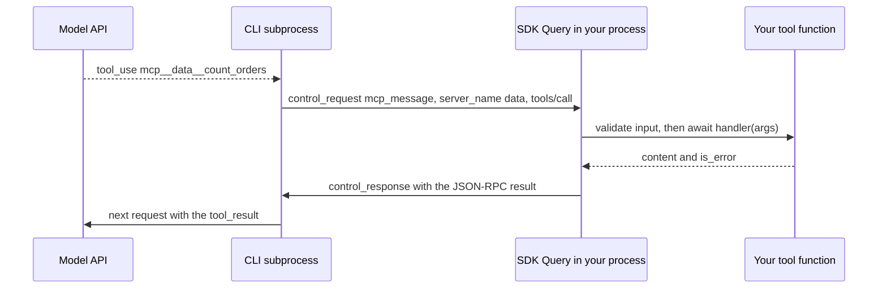

## 1. The question this idea answers

A data agent must answer "How many orders did Plant B ship yesterday?". The model cannot read your warehouse. It needs a tool: a Python function that runs a query with your connection pool, for the user who asked, and returns a small result.

The SDK offers a direct way. Write an async function, mark it with `@tool`, and put it into a server inside your Python process. Then six questions follow:

- Which name does the model use to call it, and which name goes into `allowed_tools`?
- What must the function return, and what happens when it raises?
- How does a call get from the CLI subprocess into your function?
- How does the function know which user it serves?
- What happens when the function does slow, blocking work?
- What does a large result cost?

This lesson answers each one from the SDK source (0.2.165) and the docs. It adds runs of the real CLI (2.1.296) against a local fake model server.

## 2. Mental model

> [!analogy] A call center that phones your office
> The CLI is a call center, and the model is a customer on the line. Your Python process is your office, and the in-process server is the office switchboard with a list of specialists: your tools. The call center knows your switchboard by the label that you wrote in its directory, the key in `mcp_servers`. It ignores the name painted on the switchboard, the `name=` argument.
>
> When the customer asks for a specialist, the call center phones your office over the cable that already carries everything else: stdin and stdout. It waits for the answer and reads it to the customer.
>
> **Where it stops working:** in a real office, each specialist works in a separate room. Here all specialists share one desk: the Python event loop. A specialist who does slow blocking work at the desk stops every other call in the office. That includes other tools, other users' requests, and the reading of the CLI's own messages.

## 3. Terms

| Term | Plain meaning |
|---|---|
| MCP | Model Context Protocol: an open protocol that connects an application to tools and data with JSON-RPC 2.0 messages. |
| MCP server | A program or object that lists tools and runs them when a client sends `tools/call`. |
| in-process server | An MCP server that runs inside your Python process. The SDK calls it an SDK server, config type `"sdk"`. |
| external server | An MCP server outside your process: a child process (`stdio`) or a remote service (`sse`, `http`). |
| `@tool` | The SDK decorator that turns an async function into an `SdkMcpTool`. |
| `create_sdk_mcp_server` | The SDK function that puts tools into an in-process server and returns its config. |
| server key | The dict key under which you put a server in `mcp_servers`. |
| full tool name | The name that the model and the rules use: `mcp__<server key>__<tool name>`. |
| input schema | The JSON Schema that describes the arguments of a tool. |
| tool result | The dict that your function returns: `content` and, optionally, `is_error`. |
| `is_error` | A flag in the tool result. `True` tells the model that the call failed. |
| control request | A message on the CLI pipe that asks your process to do something, here to run a tool. |
| closure | A function that keeps access to variables of the function that created it. |
| event loop | The asyncio scheduler that runs all coroutines of your process on one thread. |
| blocking call | A call that holds the thread until it ends, for example `time.sleep` or a synchronous database driver. |

## 4. Method and math

### 4.1 MCP in one paragraph

An MCP server publishes a list of tools. Each tool has a name, a description and an input schema. A client asks for the list with `tools/list` and runs a tool with `tools/call`. All messages are JSON-RPC 2.0 requests and responses. The Claude Code CLI is an MCP client. It reads the tool list of each configured server, gives the tools to the model, and sends `tools/call` on request. The result shape is the MCP `CallToolResult` type ([MCP specification](https://modelcontextprotocol.io/specification/2025-06-18/server/tools)).

### 4.2 Two kinds of servers

The config types in `types.py` (SDK 0.2.165, checked on 2026-10-13):

| Config type | Fields | Who runs the server | How the CLI reaches it |
|---|---|---|---|
| `McpSdkServerConfig` | `type: "sdk"`, `name`, `instance` | Your Python process | Control requests on the CLI pipe |
| `McpStdioServerConfig` | `type` (optional, `"stdio"`), `command`, `args`, `env` | A child process that the CLI starts | That process's stdin and stdout |
| `McpSSEServerConfig` | `type: "sse"`, `url`, `headers` | A remote service | Server-sent events over HTTP |
| `McpHttpServerConfig` | `type: "http"`, `url`, `headers` | A remote service | HTTP |

| | In-process server | External server |
|---|---|---|
| Access to your objects | Direct: pools, caches, the current request | None. It needs its own credentials. |
| Deployment | Part of your app | A separate process or service |
| Isolation | Shares your event loop and memory | Its own process |
| Result fields | Python forwards only `content` and `is_error` | Also `structuredContent` |
| Reuse by other clients | No | Yes |

The custom-tools page says about `structuredContent`: "The Python `@tool` decorator forwards only `content` and `is_error` from the handler's return dict. To return `structuredContent` from Python, run a standalone MCP server instead of an in-process SDK server." Databricks managed MCP servers are external HTTP servers ([Databricks MCP servers](/notes/platforms/databricks/04-mcp-and-genie/l1-databricks-mcp-servers)).

### 4.3 Define a tool

```python
from typing import Annotated, Any
from claude_agent_sdk import tool, create_sdk_mcp_server

@tool(
    "count_orders",
    "Count the orders that one plant shipped on one date. Use it for any shipped-order count.",
    {"date": Annotated[str, "Ship date, YYYY-MM-DD"], "plant": str},
)
async def count_orders(args: dict[str, Any]) -> dict[str, Any]:
    n = await orders_repo.count(args["plant"], args["date"])   # your async data access
    return {"content": [{"type": "text", "text": f"{args['plant']} shipped {n} orders on {args['date']}."}]}

data_server = create_sdk_mcp_server(name="production-data", tools=[count_orders])
```

The signature is `tool(name, description, input_schema, annotations=None)`. The function must be `async`, and it receives one dict.

The `input_schema` argument accepts three forms. This table shows the JSON Schema that `_build_input_schema()` produced for each one in a sandbox test:

| Form | You write | The model receives |
|---|---|---|
| Type map | `{"date": Annotated[str, "Ship date, YYYY-MM-DD"], "plant": str}` | `{"type": "object", "properties": {"date": {"type": "string", "description": "Ship date, YYYY-MM-DD"}, "plant": {"type": "string"}}, "required": ["date", "plant"]}` |
| JSON Schema | `{"type": "object", "properties": {"date": {"type": "string"}}, "required": []}` | the same dict, unchanged |
| `TypedDict` | `class Args(TypedDict): date: str` and `line: NotRequired[int]` | `{"type": "object", "properties": {"date": {"type": "string"}, "line": {"type": "integer"}}, "required": ["date"]}` |

In the type map, every key is required. For an optional argument, use the JSON Schema form or a `TypedDict` with `NotRequired`, and read the value with `args.get()`. The docs add that the type map "doesn't support enums", so an enum needs the JSON Schema form.

> [!trap] A JSON Schema dict without "properties"
> The SDK treats a dict as JSON Schema only when it has a string `"type"` key and a `"properties"` key. The test gave this result for `{"type": "object"}`: `{"type": "object", "properties": {"type": {"type": "string"}}, "required": ["type"]}`. The schema now demands an argument named `type`. For a tool with no arguments, pass `{}`.

### 4.4 The result, and errors

The function returns `{"content": [...], "is_error": True or False}`. The SDK converts each content item before the CLI sees it (`_convert_tool_content` in `__init__.py`):

| Item `type` | What the CLI receives |
|---|---|
| `text` | the text |
| `image` | the image, with `data` (base64) and `mimeType` |
| `resource_link` | text: name, URI and description on separate lines |
| `resource` with `text` | the text |
| `resource` with `blob` | dropped, with the log warning "Binary embedded resource cannot be converted to text, skipping" |
| anything else, for example `audio` | dropped, with a log warning |

The custom-tools page says: "A handler error doesn't stop the agent loop. The SDK's in-process MCP server catches uncaught exceptions and returns them as error results". The SDK code shows three error paths in `run_tool()`. The tests ran each one through the real CLI:

| What happened | The model received (`is_error: true`) |
|---|---|
| The handler raised `RuntimeError("warehouse database timeout")` | `warehouse database timeout` |
| The model sent `{"date": 20261011}` for a `str` field | `Input validation error: 20261011 is not of type 'string'` |
| The tool name is not on the server (from the source) | `Tool '<name>' not found` |

In every case the run ended with `subtype="success"`, and the model read the message as the tool result. A raw exception text often lacks context, so catch errors yourself and compose a useful message, as the docs recommend.

> [!note] Error text has a size limit
> The Claude Code MCP page says: "Error text longer than about 11,000 characters keeps only its first 5,000 and last 5,000 characters". Keep error messages short and specific.

### 4.5 The full name: the key, not the name

The custom-tools page says (checked on 2026-10-13): "The key in `mcpServers` becomes the `{server_name}` segment in each tool's fully qualified name: `mcp__{server_name}__{tool_name}`."

> [!example] Worked example: which name does the model call?
> A service creates `create_sdk_mcp_server(name="production", tools=[count_orders])` and passes `mcp_servers={"data": server}`. The `init` message of the real run listed:
>
> ```text
> tools:       ['mcp__data__count_orders']
> mcp_servers: [{'name': 'data', 'status': 'connected', 'source': 'sdk'}]
> ```
>
> | Key | `name=` argument | Tool | Full name |
> |---|---|---|---|
> | `data` | `production` | `count_orders` | `mcp__data__count_orders` |
> | `calc` | `calculator` | `add` | `mcp__calc__add` |
>
> The `name=` argument appears nowhere in the full name.

> [!trap] The docstring example uses bare names
> The docstring of `create_sdk_mcp_server` in SDK 0.2.165 shows `mcp_servers={"calc": calculator}` with `allowed_tools=["add", "multiply"]`. The Python reference shows `allowed_tools=["mcp__calc__add", "mcp__calc__multiply"]`. The reference is right. In a test with `permission_mode="dontAsk"`, the bare rule `"count_orders"` matched nothing and the call was denied ([L2.1](/notes/ai/claude-agent-sdk/02-options-and-messages/l1-claude-agent-options)).

Globs are valid in allow rules only after the server prefix. The permissions page says: "Allow rules accept tool-name globs only after a literal `mcp__<server>__` prefix", and an entry like `["mcp__*"]` "is ignored with a startup warning". So `"mcp__data__*"` approves every tool of the `data` server.

### 4.6 allowed_tools and tools=[]

For a server-side agent, combine three settings:

- `tools=[]` removes every built-in tool. The docs say: "Claude can only use your MCP tools."
- `allowed_tools` with full names or a server glob approves your tools.
- `permission_mode="dontAsk"` denies every call that no rule approves.

The tool definitions still reach the model with the full names. In the local test, the request held `{"name": "mcp__data__count_orders", "description": "...", "input_schema": {...}}`.

### 4.7 The round trip through the CLI

The tool function runs in your process, but the CLI decides when to call it. The call crosses the pipe twice.



1. **At start**, the SDK passes the server of section 4.5 in `--mcp-config` as `{"type": "sdk", "name": "production"}` under the key `data`. It strips the `instance` field, which stays in your process.
2. **During the run**, the CLI writes a `control_request` with subtype `mcp_message`. It holds the `server_name` (the key) and one JSON-RPC message, for example `tools/call`.
3. **The SDK starts a new task for each control request** (`_spawn_control_request_handler` in `_internal/query.py`). It routes the message to the bridge of that key, and the bridge passes it to the `mcp.server.Server` over an in-memory transport.
4. **`run_tool()` validates** the arguments with `jsonschema`, awaits your function, and converts the result.
5. **The SDK writes a `control_response`.** The CLI builds the `tool_result`, yields it to you as a `UserMessage`, and calls the model again.

Because the CLI needs your answers, the SDK keeps stdin open while a run has in-process servers, hooks or a `can_use_tool` callback. The source explains why: "Closing stdin while any of these are configured makes every later request fail CLI-side with \"Stream closed\"." The bridge has one more limit, from its docstring: server-to-client requests such as sampling and elicitation "are refused", and notifications "are dropped".

### 4.8 Closures and per-request context

The tool function needs data that is not in the model's input: the user's identity, the allowed plants, a database pool. A closure gives it that data without a global variable.

```python
def make_data_server(user: User, repo: OrdersRepo):
    @tool("count_orders", "Count the orders that the user's plant shipped on one date.",
          {"date": Annotated[str, "YYYY-MM-DD"]})
    async def count_orders(args):
        n = await repo.count(user.plant_id, args["date"])     # identity from the closure, not from the model
        return {"content": [{"type": "text", "text": f"{n} orders on {args['date']}."}]}
    return create_sdk_mcp_server(name="production-data", tools=[count_orders])

# For each HTTP request:
options = ClaudeAgentOptions(mcp_servers={"data": make_data_server(request_user, repo)}, ...)
```

A test ran two queries at the same time with `asyncio.gather`, each with its own closure server. Each answer held its own plant: `('Plant A', 'The tool says: Plant A: 412 orders on 2026-10-11')` and `('Plant B', 'The tool says: Plant B: 412 orders on 2026-10-11')`.

> [!trap] Per-request data in a module-level variable
> One process serves many requests at the same time. If a request writes `CURRENT_USER = user` into a global, and the tool reads it, a second request can overwrite it before the first tool call runs. The first user then receives the second user's data. Put per-request values in a closure, and take identity from your application, never from tool arguments that the model writes ([self-asserted identity](/notes/software-engineering/security-and-operations/01-access-control/l1-self-asserted-identity)).

Shared mutable state is a second risk. Tools marked `readOnlyHint=True` can run in parallel inside one answer, so two calls can change the same object at once.

### 4.9 Blocking work inside an async tool

All control-request tasks of a query run on one event loop. The agent-loop page adds: "Custom tools default to sequential execution. To enable parallel execution for a custom tool, set `readOnlyHint` in its annotations."

A test gave the model one response with two parallel calls of a tool marked `readOnlyHint=True`. The tool waited 2 seconds in two ways. The times are seconds after the start of the query:

| Handler body | Call 1 | Call 2 | Result at |
|---|---|---|---|
| `time.sleep(2)` | 1.14 to 3.14 | 3.14 to 5.14 | 5.21 s |
| `await asyncio.to_thread(time.sleep, 2)` | 1.66 to 3.68 | 1.68 to 3.69 | 3.76 s |

With the blocking call, the second call could not start until the first one ended. The handler time was 2 + 2 = 4 seconds instead of 2. During those seconds the loop also read no CLI output and served no other request of your web server.

> [!key] Never block the event loop in a tool
> Use async drivers. Wrap synchronous work, for example a synchronous SQL connector, in `asyncio.to_thread(...)`, or in `anyio.to_thread.run_sync(...)`, which works on every anyio backend. Keep the shared desk free.

Long calls have one more limit. The Claude Code MCP page says: "An MCP tool call in the main conversation that is still running after two minutes moves to a background task instead of blocking the session." The variable `CLAUDE_CODE_MCP_AUTO_BACKGROUND_MS` changes this threshold (Claude Code 2.1.212 or later).

### 4.10 Result size and context cost

A tool result becomes a `tool_result` block in the conversation. Every later model call of the session sends it again ([Foundations L2, section 4.6](/notes/ai/claude-agent-sdk/01-foundations/l2-the-agent-loop)).

> [!example] Worked example: one large result, sent many times
> A tool returns 40,000 characters after model call 1. The answer needs model calls 2, 3 and 4.
>
> - Call 2 sends the result: 40,000 characters.
> - Call 3 sends it again: 40,000.
> - Call 4 sends it again: 40,000.
>
> Total for one answer: 3 × 40,000 = 120,000 characters of input from one tool call. Each later turn of the chat adds 40,000 more, until compaction removes it. Prompt caching lowers the price of the repeats, not the space that they take in the window.

The CLI also has size thresholds. The Claude Code MCP page gives three of them (checked on 2026-10-13):

- a warning above 10,000 tokens
- a default limit of 25,000 tokens, set with `MAX_MCP_OUTPUT_TOKENS`
- a default "persist-to-disk threshold of 50,000 characters" for text results

A tool can raise its own threshold "up to a hard ceiling of 500,000 characters" with `ToolAnnotations(maxResultSizeChars=N)`.

A test with the real CLI returned three sizes:

| Result | The model received |
|---|---|
| 40,000 characters | all 40,000 characters |
| 60,000 characters | 2,378 characters: `<persisted-output>` with "Output too large (58.6KB). Full output saved to: ...tool-results/<id>.json" and "Preview (first 2KB)" |
| 60,000 characters, `maxResultSizeChars=100000` | all 60,000 characters |

> [!trap] tools=[] plus a persisted result
> The CLI saved the large result to a file and gave the model the file path. But with `tools=[]` the model has no `Read` tool. It saw only a 2 KB preview. Design tools to return small results: counts, top rows, aggregates, with `limit` and `offset` arguments for more.

Tool definitions cost context too. The agent-loop page says that tool search "defers MCP tool schemas by default, falling back to upfront loading on unsupported models and certain platforms". In the local test of this lesson, which used a custom `ANTHROPIC_BASE_URL`, the request held the full tool definition. Check your own requests before you count on deferral.

### 4.11 Production view

| Concern | What to do |
|---|---|
| Naming | Allow rules use `mcp__<key>__<tool>`. Log the `init` tool list once and compare it with your rules. |
| Security | Build the server per request with a closure. Check permissions inside the tool, with identity from your app. |
| Latency | No blocking calls. Use async drivers or `asyncio.to_thread`. Mark side-effect-free tools `readOnlyHint=True` for parallel runs. |
| Context cost | Return small, aggregated results. Use `maxResultSizeChars` only for results that the model really needs whole. |
| Reliability | Catch exceptions and return `is_error: True` with a short, specific message. |
| Testing | Call `tool.handler(args)` directly in unit tests. Test names and permissions in one integration run. |

## 5. Video

```video
{
  "src": "/notes/media/claude-agent-sdk/manim/m05-in-process-tool-round-trip.mp4",
  "caption": "A tool call travels from the model through the CLI back into your Python process, under the name mcp__<key>__<tool>, and a blocking handler stops every other call."
}
```

## 6. Code

These exercises go in `claude-agent-sdk/10-custom-tools.ipynb`. Exercises 1.1 to 1.3 need no model call.

**Exercise 1.1: two tools.** Write `count_orders(date, plant)` and `downtime_by_line(date, line)` with `@tool`. Store the data in a small in-memory table or a local PostgreSQL table. `line` is optional in `downtime_by_line`: without it, the tool returns the top three lines.

Acceptance tests (call `count_orders.handler({...})` directly):

- A valid call returns `{"content": [{"type": "text", ...}]}` with the right count.
- An unknown plant returns `is_error: True` and a message that names the plant.
- A handler that hits a database error returns `is_error: True`. No exception leaves the handler.
- Every result is shorter than 2,000 characters.

**Exercise 1.2: schemas.** Write each tool's schema in a different form: a type map for one, a `TypedDict` for the other. Print the JSON Schema that the SDK builds (the private helper `claude_agent_sdk._build_input_schema(tool)` returns it).

Acceptance tests:

- `date` is in `required` for both tools.
- `line` is not in `required`.
- A test shows the trap of section 4.3: `{"type": "object"}` produces a required `type` property.

**Exercise 1.3: names and rules.** Write `allow_rules(servers: dict[str, list[SdkMcpTool]]) -> list[str]`, where each key is a server key.

Acceptance tests:

- `{"data": [count_orders, downtime_by_line]}` gives `["mcp__data__count_orders", "mcp__data__downtime_by_line"]`.
- The `name=` argument of the server never appears in the output.

**Exercise 1.4: the shared desk.** Use a real model or your fake model server. Ask a question that makes two parallel calls of a `readOnlyHint=True` tool. Record the start and end time of each call, once with `time.sleep(2)` and once with `asyncio.to_thread`. Then run two queries at the same time with `asyncio.gather`, each with its own closure server.

Acceptance tests:

- With `time.sleep`, the calls do not overlap. With `asyncio.to_thread`, they overlap.
- Each of the two concurrent queries receives only its own user's data.

## 7. Common mistakes

1. **Using the `name=` argument in rules.** The full name uses the key of `mcp_servers`.
2. **Bare names in `allowed_tools`.** They match nothing. Use `mcp__<key>__<tool>` or `mcp__<key>__*`.
3. **Raising exceptions to signal a failure.** It works, but the model receives only the raw text. Return `is_error: True` with a useful message.
4. **A blocking call inside an async tool.** It stops the event loop: no parallel calls, no other requests, no reading of CLI output.
5. **Per-request data in a global variable.** Concurrent requests overwrite it. Use a closure.
6. **Large raw results.** They fill the window, are resent on every call, and above 50,000 characters the model may see only a preview.
7. **Expecting `structuredContent` from a Python in-process tool.** Only `content` and `is_error` are forwarded.

## 8. One-minute explanation

An in-process tool is an async Python function marked with `@tool` and put into a server with `create_sdk_mcp_server`. The server lives in your process, so the function can use your database pool and the current request. The model calls it as `mcp__<server key>__<tool name>`, where the key is the dict key in `mcp_servers`, not the server's `name=`. Allow rules need that full name. The CLI decides when to call the tool and sends the call back to your process as a control request on the same pipe. The SDK validates the arguments, awaits your function and returns its `content` and `is_error`. Exceptions and invalid input become error results, so the loop continues. All tool calls share one event loop, so blocking work must go to a thread. Keep results small, because each result stays in the context and large ones are replaced by a short preview.

## 9. Check questions

```check
{
  "question": "A service passes mcp_servers={\"wh\": create_sdk_mcp_server(name=\"warehouse\", tools=[list_lines])}. Which name does the model call, and which allow rule approves every tool of this server?",
  "answer": "The model calls mcp__wh__list_lines, because the key wh becomes the server segment. The rule mcp__wh__* approves every tool of that server. The name warehouse appears nowhere in the full names."
}
```

```check
{
  "question": "A tool calls a synchronous database driver that takes 3 seconds. The model makes two parallel calls of this read-only tool. What happens to the timing, and what is the fix?",
  "hint": "How many threads run the event loop?",
  "answer": "Both control-request tasks run on one event loop. The blocking driver call holds the loop, so the second call starts only after the first ends: about 6 seconds instead of 3. During that time the process also reads no CLI output and serves no other request. The fix is an async driver or asyncio.to_thread around the synchronous call."
}
```

```check
{
  "question": "A tool raises KeyError('plant_7'). What does the model receive, and does the run fail?",
  "answer": "The SDK catches the exception and returns an error result with is_error true and the text of the exception, here 'plant_7' with quotes. The run does not fail: the model reads the error as the tool result and continues. A composed message, such as 'Unknown plant: plant_7. Valid plants: A, B, C.', helps the model more."
}
```

```check
{
  "question": "With tools=[], a tool returns 80,000 characters. What does the model see, and why is that a problem?",
  "answer": "The CLI saves results above its 50,000-character default threshold to a file. The model gets a short persisted-output message with a 2 KB preview and the file path. With tools=[] the model has no Read tool, so it cannot open the file and works from the preview only. Return smaller results, or raise maxResultSizeChars for that one tool if the model needs the whole result."
}
```

## 10. Links

- Previous part: [L2.2: Message and block types](/notes/ai/claude-agent-sdk/02-options-and-messages/l2-message-and-block-types)
- Next in the priority path: [Sessions L1: What a session is](/notes/ai/claude-agent-sdk/04-sessions/l1-what-a-session-is)
- Allow rules and permission modes: [L2.1: ClaudeAgentOptions](/notes/ai/claude-agent-sdk/02-options-and-messages/l1-claude-agent-options)
- Tool calls at the API level: [LLM APIs L2: tool_use and tool_result](/notes/ai/llm-apis/01-messages-api/l2-tool-use-and-tool-result)
- Async basics: [Event loop and coroutines](/notes/software-engineering/python/01-asyncio/l1-event-loop-and-coroutines)
- External MCP servers: [Databricks MCP servers](/notes/platforms/databricks/04-mcp-and-genie/l1-databricks-mcp-servers)
- [Glossary](/notes/ai/claude-agent-sdk/glossary)
