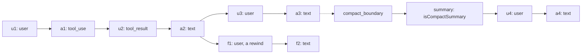

## 1. The question this idea answers

Every `ResultMessage` carries a `session_id`. You can pass it to `resume` later, and the agent remembers the earlier conversation ([L3 of Foundations](/notes/ai/claude-agent-sdk/01-foundations/l3-query-vs-claudesdkclient)).

But the model is stateless, and each `query()` is a new process. So where does the memory come from? What is a session, physically? Who writes it, where, and what is inside?

The answer: a session is a **file**. The CLI writes it on the local disk of the machine where it runs. Everything about resume, fork, temporary containers and chat design follows from that one fact.

## 2. Mental model

> [!analogy] A logbook that the worker keeps in the worker's own room
> The CLI keeps a logbook for each conversation. Every event gets its own line: the user's prompt, each model reply, each tool call and each tool result. Each line names the line before it, so the lines form a chain. When the CLI resumes a conversation, it reads the logbook and sends the chain to the model.
>
> The logbook stays in the CLI's room: the local disk. A worker in another building cannot read it.
>
> **Where it stops working:** a paper logbook is a straight list. The session file can branch. A rewind makes a new line name an older line as its parent, so the chain splits. After compaction, the current chain starts at a summary line, but the old lines stay in the file.

## 3. Terms

| Term | Plain meaning |
|---|---|
| session | The conversation history that the CLI collects while the agent works, saved on disk. |
| session id | A UUID that names one session, for example `5b3f2c1a-8d4e-4f6b-9a7c-2e1d0f9b8a6c`. |
| UUID | A 128-bit identifier, written as 36 characters. Two random UUIDs are equal with almost zero probability. |
| session file (transcript) | The file `<session-id>.jsonl` that holds one session. |
| JSONL | JSON Lines: one complete JSON object on each line of a text file. |
| config directory | The folder where Claude Code keeps its data: `~/.claude` by default, or the value of `CLAUDE_CONFIG_DIR`. |
| project directory | The folder `projects/<encoded-cwd>/` inside the config directory. It holds the session files of one working directory. |
| encoded cwd | The working directory with every character that is not a letter or a digit replaced by `-`. |
| entry | One line of the session file. |
| `parentUuid` | The field of an entry that names the entry before it. |
| chain | The list of entries from the first entry to the newest entry, found by following `parentUuid` links. |
| leaf | The newest entry of a chain. No other entry names it as its parent. |
| sidechain | The transcript of a subagent. It lives in its own folder next to the main file. |
| compact summary | An entry with `isCompactSummary: true`. After compaction, it replaces the older entries in the chain. |

## 4. Method and math

### 4.1 The definition

The sessions page says (checked on 2026-10-12):

> "A session is the conversation history the SDK accumulates while your agent works. It contains your prompt, every tool call the agent made, every tool result, and every response. The SDK writes it to disk automatically so you can return to it later."

It also says: "Sessions persist the **conversation**, not the filesystem." If the agent edits a file, a resume does not undo the edit.

From the architecture of [Foundations L1](/notes/ai/claude-agent-sdk/01-foundations/l1-what-the-sdk-is), the writer is the CLI subprocess, not your Python code. The docs say "the SDK" because the SDK and the CLI ship together.

### 4.2 Where the file lives

The path pattern is:

```text
<config directory>/projects/<encoded cwd>/<session id>.jsonl
```

| Part | Value |
|---|---|
| config directory | `~/.claude`, or the value of `CLAUDE_CONFIG_DIR` in the environment of the CLI |
| encoded cwd | The absolute working directory of the CLI, with each character that is not `a-z`, `A-Z` or `0-9` replaced by `-` |
| session id | The UUID of the session |

The docs tip says: "replace every non-alphanumeric character in the absolute working directory with `-`: `/Users/me/proj` becomes `-Users-me-proj`. For a working directory whose converted name exceeds 200 characters, Claude Code truncates the name and appends a hash". The SDK source does the same: `_SANITIZE_RE = re.compile(r"[^a-zA-Z0-9]")` and `MAX_SANITIZED_LENGTH = 200`.

> [!example] Worked example: three encoded paths
> | Working directory | Encoded cwd |
> |---|---|
> | `/app/agent` | `-app-agent` |
> | `/home/app/python/source_code` | `-home-app-python-source-code` (the `_` becomes `-` too) |
> | `C:\Users\ASohi\lab` | `C--Users-ASohi-lab` (the `:` and the `\` each become `-`) |
>
> With the default config directory, the session `5b3f2c1a-...` of the first example is at `~/.claude/projects/-app-agent/5b3f2c1a-....jsonl`.

> [!trap] The working directory is part of the path
> The same session id under a different working directory means a different project directory. Newer CLI versions (2.1.223 and later) search all project directories when you resume by id. Older versions searched only the current one. The store-based resume of [L4](/notes/ai/claude-agent-sdk/04-sessions) still needs the same working directory. Keep `cwd` fixed for one chat.

### 4.3 How you get the session id

| Where | How to read it |
|---|---|
| The `init` system message, at the start | `message.data["session_id"]` (in Python, the id is inside `data`) |
| Every `AssistantMessage` and `StreamEvent` | `message.session_id` |
| The `ResultMessage`, at the end | `message.session_id`. The docs say that it is "present on every result regardless of success or error". |

You can also choose the id yourself with the `session_id` option. The source docstring says: "Must be a valid UUID. Can't be combined with `continue_conversation` or `resume` unless `fork_session` is also set." This is useful when your database creates the chat row first and you want the session file to carry the same id.

### 4.4 What is inside the file

Each line is one JSON object. The SDK's own reader (`_internal/sessions.py`) uses these fields: `type`, `uuid`, `parentUuid`, `sessionId`, `message`, `timestamp`, `isSidechain`, `isMeta` and `isCompactSummary`. The `message` field holds a message in the Messages API shape: a `role` and a list of content blocks.

This is a **simplified** example of four lines for one tool-use answer. It shows the structure. It is not a byte copy of a real file, which has more fields.

```json
{"type":"user","uuid":"u1","parentUuid":null,"sessionId":"5b3f...","timestamp":"2026-10-12T14:00:00Z","message":{"role":"user","content":"How many orders shipped on 2026-10-11?"}}
{"type":"assistant","uuid":"a1","parentUuid":"u1","sessionId":"5b3f...","message":{"role":"assistant","content":[{"type":"tool_use","id":"toolu_1","name":"mcp__data__count_orders","input":{"date":"2026-10-11"}}]}}
{"type":"user","uuid":"u2","parentUuid":"a1","sessionId":"5b3f...","message":{"role":"user","content":[{"type":"tool_result","tool_use_id":"toolu_1","content":"412"}]}}
{"type":"assistant","uuid":"a2","parentUuid":"u2","sessionId":"5b3f...","message":{"role":"assistant","content":[{"type":"text","text":"412 orders shipped."}]}}
```

> [!key] The session file keeps the real blocks
> The file stores each message with its content blocks: `tool_use`, `tool_result`, `thinking` with its signature, and `text`. So a resume gives the model the exact earlier messages, not a text summary of them. This is the main strength of resume over rebuilding the context from a text transcript ([LLM APIs L1, section 4.7](/notes/ai/llm-apis/01-messages-api/l1-messages-and-content-blocks)).

### 4.5 The chain, branches and compaction

The entries form a chain through `parentUuid`. The SDK source explains how it reads a session: it "Builds the conversation chain by finding the leaf and walking parentUuid", and it returns the messages "in chronological order (root -> leaf)".

Two events change the shape of the chain.

**A branch.** A rewind, for example a resume at an earlier message with the `resume_session_at` option, makes a new entry name an older entry as its parent. The file then holds two chains that share a start. The reader finds every leaf and picks one, with the file order as the tie-breaker. A fork is different: it writes a new session file with a copy of the history ([L2](/notes/ai/claude-agent-sdk/04-sessions/l2-resume-continue-fork)).

**Compaction.** When the conversation gets too long, the CLI writes a `compact_boundary` entry and a summary entry with `isCompactSummary: true`. The source comment says: "post-compaction, the isCompactSummary message replaces earlier messages". The reader does not follow the link from the boundary back to the old entries. So the current chain starts at the summary.



In this picture, the current chain of the main session is `summary → u4 → a4`. The entries `u1` to `a3` stay in the file, but the model does not see them after compaction. The branch `f1 → f2` is a rewind from `a2`: it lives in the same file and shares the start `u1 → a2`. The reader must choose one leaf, `a4` or `f2`.

> [!note] Source labels for this section
> **From the SDK source:** the field names, the leaf-and-parent reading rule, the tie-breaker for several leaves, and the rule that the reader starts after compaction at the summary. **Not in the docs:** an explicit statement that old entries stay in the file after compaction. The source behavior (the reader skips them instead of a writer deleting them) supports it. Treat it as an inference and test it.

### 4.6 What a session is not

| A session is not | Why |
|---|---|
| Your chat history | It is the CLI's working copy. It holds tool internals, system entries and compaction summaries. After compaction, its current chain no longer matches what the user saw. |
| Shared between machines | The docs say: "Session files are local to the machine that created them." |
| The filesystem state | "Sessions persist the conversation, not the filesystem." |
| Permanent | Claude Code's sessions page gives a default retention of 30 days for transcripts (checked on 2026-10-12). Old files can be deleted. |
| Free of private data | It holds every prompt and every tool result in plain text. |

> [!key] Two different records
> The user sees a transcript that your application shows. The model sees what the CLI builds from the session file. These are two records with two owners. The subject [Conversation State](/notes/ai/conversation-state/01-where-state-lives/l1-three-copies-of-a-conversation) builds on this difference.

### 4.7 Disabling the session file

Some services want no transcript on disk. The sessions page says that TypeScript has `persistSession: false`. For Python: "set `CLAUDE_CODE_SKIP_PROMPT_HISTORY` in the `env` option to suppress transcript writes instead." Without the file, `resume` and `continue_conversation` cannot work.

### 4.8 Production view

| Concern | What the file means |
|---|---|
| Durability | The file is as durable as the disk. A container with a temporary disk loses it on restart ([L3](/notes/ai/claude-agent-sdk/04-sessions/l3-session-files-on-temporary-disks)). |
| Scaling | A second server does not have the file. |
| Privacy | The file holds prompts and tool results, which can hold personal data. Decide who can read the disk, and delete old files. |
| Disk use | Long agent runs with large tool results make large files. |
| Debugging | The file is the exact record of what the model received. Read it when an answer is wrong. |

## 5. Code

These exercises go in `claude-agent-sdk/04-session-files.ipynb`.

**Exercise 1.1: encode a path.** Write `encode_cwd(path)` with the rule of section 4.2, including the 200-character limit (use any hash for the suffix in your version).

Acceptance tests:

- The three paths of the worked example give the three encoded values.
- A path of 300 characters gives a result that starts with the first 200 encoded characters.

**Exercise 1.2: find the file.** Run one `query()` with a fixed `cwd`. Build the expected path from the config directory, `encode_cwd(cwd)` and the session id. Check that the file exists.

Acceptance test: `Path(expected).exists()` is `True`.

**Exercise 1.3: read the chain.** Read the file line by line with `json.loads`. Build the chain from the leaf back to the root with `parentUuid`. Print the type and the block types of each entry in the chain.

Acceptance tests:

- Every `tool_use` id in the chain has a matching `tool_result` later in the chain.
- Your chain has the same user and assistant messages, in the same order, as `get_session_messages(session_id)` from the SDK.

## 6. Common mistakes

1. **"The session lives in the model."** It lives in a file on the local disk of the CLI.
2. **"The session file is the chat history to show the user."** It is the CLI's working copy. After compaction, its current chain starts at a summary.
3. **Changing `cwd` between two messages of one chat.** The session goes to a different project directory.
4. **Expecting a resume on another server to work.** The file exists only where it was written.
5. **Forgetting that the file holds private data.** Every tool result is in it, in plain text.

## 7. One-minute explanation

A session is a file. While the agent works, the CLI writes every prompt, model reply, tool call and tool result to a JSON Lines file on the local disk. The path is the config directory, then `projects`, then the working directory with every non-alphanumeric character replaced by a dash, then the session id with `.jsonl`. Each line names the line before it, so the lines form a chain. The CLI resumes a session by reading the chain and sending it to the model, with the real content blocks. A rewind can branch the chain, a fork copies it into a new file, and compaction makes the current chain start at a summary. The file is local, it can expire, and it is the CLI's working copy, not your chat history.

## 8. Check questions

```check
{
  "question": "The CLI runs with cwd = /srv/chat_app and no CLAUDE_CONFIG_DIR. The session id is 0f8e...c1. Where is the file?",
  "answer": "~/.claude/projects/-srv-chat-app/0f8e...c1.jsonl. The / characters and the _ character each become -."
}
```

```check
{
  "question": "Why does a resume give the model better context than pasting the old conversation as text into a new prompt?",
  "answer": "The session file keeps each earlier message with its real content blocks: tool_use with ids, tool_result, thinking with its signature, and text. A resume sends those as real past messages. Pasted text turns them into one block of prose in one user message, so the structure, the pairing and the signatures are lost."
}
```

```check
{
  "question": "After a compaction, you read the session file with get_session_messages(). The first message is a summary, not the user's first question. Is the file broken?",
  "answer": "No. After compaction, the CLI writes a summary entry with isCompactSummary, and the reader starts the current chain there. The older entries are not in the chain. This is why the session file cannot serve as the transcript that the user sees."
}
```

## 9. Links

- Next: [L2: resume, continue and fork](/notes/ai/claude-agent-sdk/04-sessions/l2-resume-continue-fork)
- Background: [Foundations L1: What the SDK is](/notes/ai/claude-agent-sdk/01-foundations/l1-what-the-sdk-is)
- The bigger picture: [Three copies of a conversation](/notes/ai/conversation-state/01-where-state-lives/l1-three-copies-of-a-conversation)
- [Glossary](/notes/ai/claude-agent-sdk/glossary)
