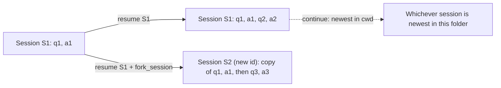

## 1. The question this idea answers

A `query()` call starts a new session by default ([Foundations L3](/notes/ai/claude-agent-sdk/01-foundations/l3-query-vs-claudesdkclient)). To continue an earlier conversation, the SDK offers three options: `resume`, `continue_conversation` and `fork_session`.

They look similar, but they find a different session, write to a different file and return a different id. One of them is dangerous in a service with many users. This lesson gives the exact behavior of each, so that you can predict the session id after every call.

## 2. Mental model

> [!analogy] Three ways to open a document
> - **resume** is "open the file named X and keep typing". The changes go into file X.
> - **continue** is "open the newest file in this folder and keep typing". You do not choose the file. The folder chooses it.
> - **fork** is "open file X, save it as a new copy, and type in the copy". File X does not change.
>
> **Where it stops working:** a document stays where you left it. A session file is local to one machine and one config directory. And a fork copies only the conversation. If the agent in the fork edits a real file on disk, the edit is real for every session.

## 3. Terms

| Term | Plain meaning |
|---|---|
| `resume` | An option with a session id. The new run loads that session and adds to it. |
| `continue_conversation` | An option, `True` or `False`. The new run loads the newest session in the current working directory and adds to it. |
| `fork_session` | An option, used with `resume`. The new run copies the history into a new session with a new id. |
| `session_id` (option) | An option that sets the id of the new session. It must be a valid UUID. |
| `resume_session_at` | An option with a message UUID. A resume loads the conversation only up to that message. |
| branch | A session that starts with a copy of another session's history and then differs. |
| in-flight | Running now: an answer that has started and has not reached its `ResultMessage`. |

## 4. Method and math

### 4.1 The definitions

The sessions page says (checked on 2026-10-12):

> "**Continue** and **resume** both pick up an existing session and add to it. The difference is how they find that session:
> - **Continue** finds the most recent session in the current directory. You don't track anything. Works well when your app runs one conversation at a time.
> - **Resume** takes a specific session ID. You track the ID. Required when you have multiple sessions (for example, one per user in a multi-user app) or want to return to one that isn't the most recent.
>
> **Fork** is different: it creates a new session that starts with a copy of the original's history. The original stays unchanged."

And about the fork id: "The fork gets its own session ID; the original's ID and history stay unchanged."

### 4.2 The three options side by side

| Option | How the CLI finds the session | Where new entries go | Session id in the result | CLI flag |
|---|---|---|---|---|
| none | No earlier session | A new file | A new id | — |
| `resume="S1"` | By id. Newer CLIs search every project directory. | File `S1` | `S1` | `--resume=S1` |
| `continue_conversation=True` | The most recent session in the current working directory | That file | The id of that session | `--continue` |
| `resume="S1", fork_session=True` | By id | A new file with a copy of `S1`'s history | A new id | `--resume=S1 --fork-session` |

The source docstring says that `continue_conversation` is "Mutually exclusive with `resume`."



### 4.3 Worked example: predict the ids

All calls run with the same `cwd`. Each row shows the options and the result.

| Step | Prompt | Options | Session id in the result | Effect on files |
|---|---|---|---|---|
| 1 | "My name is Asha." | none | `S1` (new) | New file `S1` |
| 2 | "What is my name?" | `resume="S1"` | `S1` | `S1` gets two more messages. The answer is "Asha". |
| 3 | "Pretend my name is Ben." | `resume="S1", fork_session=True` | `S2` (new) | New file `S2` with a copy of steps 1 and 2, then this exchange. `S1` does not change. |
| 4 | "What is my name?" | `resume="S1"` | `S1` | The answer is "Asha". The fork did not change `S1`. |
| 5 | "What is my name?" | `resume="S2"` | `S2` | The answer is "Ben". |
| 6 | "What is my name?" | `continue_conversation=True` | `S2` | The newest session in the folder is `S2`, from step 5. The answer is "Ben". |

Step 6 is the important one. `continue_conversation` did not continue the session that you were "in". It continued the session that was written last.

### 4.4 Why continue is dangerous with many users

A web service often runs every chat with the same `cwd`. Then all sessions share one project directory.

> [!example] Two users, one folder
> 1. Asha sends a message. The service starts a run. It writes session `SA`.
> 2. Ben sends a message one second later. The service starts a new run. It writes session `SB`.
> 3. Asha sends her second message. The service uses `continue_conversation=True`.
>
> The newest session in the folder is `SB`. Asha's second message goes into Ben's conversation. Asha can now read answers that use Ben's data.

> [!trap] continue_conversation is for one conversation at a time
> The docs say that continue "Works well when your app runs one conversation at a time." In a multi-user service, store the session id with each chat and use `resume`. Never use `continue_conversation`.

### 4.5 Choosing the session id yourself

The `session_id` option sets the id of the new session. The source docstring says: "Must be a valid UUID. Can't be combined with `continue_conversation` or `resume` unless `fork_session` is also set."

| Use | Options |
|---|---|
| The first message of a chat, with the chat's own UUID as the session id | `session_id=chat_uuid` |
| A fork with an id that you choose | `resume=old_id, fork_session=True, session_id=new_uuid` |
| Not allowed | `resume=old_id, session_id=new_uuid` with no fork |

When the session id equals the chat id, you need no extra column to map one to the other. The cost: the chat id must be a UUID.

### 4.6 What a resume restores, and what it does not

| Item | Restored by a resume? | What to do |
|---|---|---|
| Earlier messages with all content blocks | yes | Nothing. This is the purpose of resume. |
| The system prompt | It is recorded on the first request of the session and reused ([L5.1](/notes/ai/claude-agent-sdk/05-prompts-and-input/l1-system-prompts-and-snapshot)) | Do not expect a changed system prompt to apply on a resume. |
| Files that the agent changed | no. "Sessions persist the conversation, not the filesystem." | Use file checkpointing if you need to revert files. |
| Your options: tools, MCP servers, model, limits, permission mode | no. Each run is a new process with new flags. | Pass all options again on every call. The docs examples pass `allowed_tools` again on each resume. |
| Budget totals | no. The reference says that `max_budget_usd` "Counts only the call's own spend; totals restored from a resumed session don't count." | Track the total cost of a chat in your own database. |

### 4.7 Recovering from a limit

The docs list "Recover from a limit" as a common reason to resume: "The first run ended with `error_max_turns` or `error_max_budget_usd`... resume with a higher limit." The session holds all work up to the limit, so the agent does not repeat it.

### 4.8 Two runs on one session at the same time

The docs do not describe two runs that resume the same session at the same time. This section is an engineering interpretation, not a documented behavior.

Two CLI processes would load the same chain and append new entries to the same file. Each one would answer without the other's messages, and both sets of entries would name the same old leaf as their parent. The file would then hold a branch ([L1, section 4.5](/notes/ai/claude-agent-sdk/04-sessions/l1-what-a-session-is)), and a later resume would pick only one leaf.

> [!key] One in-flight answer per chat
> Allow only one in-flight answer for each chat. A lock on the chat id, or a check in the database, prevents two runs from resuming the same session at once. A double click on "send" is the usual cause.

### 4.9 Production view

| Concern | What to do |
|---|---|
| Correctness | Store the session id with each chat. Use `resume`. Never use `continue_conversation` in a multi-user service. |
| Concurrency | One in-flight answer per chat. |
| Configuration | Pass every option again on each resume. |
| Cost | Keep the chat's total cost in your own data. A resume does not carry budget totals. |
| Experiments | Use `fork_session` to try a different prompt or tool set on a copy of a real conversation. |

## 5. Video

```video
{
  "src": "/notes/media/claude-agent-sdk/manim/m02-resume-continue-fork.mp4",
  "caption": "resume adds to the named session, fork copies it into a new id, and continue picks whichever session is newest in the folder."
}
```

## 6. Code

These exercises go in `claude-agent-sdk/05-resume-fork.ipynb`. They call the model.

**Exercise 2.1: predict, then run.** Write your predictions for the six steps of section 4.3 in a table before you run anything. Then run the six steps and print the session id of each result.

Acceptance tests:

- Your printed ids match the pattern `S1, S1, S2, S1, S2, S2`.
- After step 3, the number of `.jsonl` files in the project directory grew by exactly one.

**Exercise 2.2: the fork does not touch the original.** Count the lines of file `S1` before and after step 3.

Acceptance test: the count is the same.

**Exercise 2.3: the continue trap.** With one `cwd`, run a session for "user A" ("My secret word is apple"), then a session for "user B" ("My secret word is pear"). Then send "What is my secret word?" with `continue_conversation=True`, as if user A sent it.

Acceptance test: the answer is "pear". Write one sentence for a design review that explains why the service must use `resume`.

**Exercise 2.4: choose the id.** Create a UUID with `uuid.uuid4()`. Start a new session with `session_id=str(that_uuid)`.

Acceptance test: the `ResultMessage.session_id` equals your UUID, and the file name is `<your uuid>.jsonl`.

## 7. Common mistakes

1. **"resume makes a new session."** resume adds to the same session and returns the same id. Only fork makes a new id.
2. **continue_conversation in a multi-user service.** It continues the newest session in the folder, which can belong to another user.
3. **Passing only `resume` and no other options.** Tools, MCP servers, model and limits must be passed again.
4. **Expecting a fork to undo file changes.** A fork branches the conversation, not the filesystem.
5. **Two runs on one session at once.** Allow one in-flight answer per chat.

## 8. One-minute explanation

There are three ways to start from an earlier session. `resume` takes a session id, loads that session and adds the new exchange to it, so the id stays the same. `continue_conversation` takes no id: it loads the newest session in the current working directory, which is fine for one conversation at a time and dangerous for many users who share a folder. `fork_session`, used with `resume`, copies the history into a new session with a new id and leaves the original unchanged. A resume restores the conversation, not the files on disk, not your options and not the budget totals, so pass the options again on every call. In a chat service, store the session id with each chat, use `resume`, and allow only one in-flight answer per chat.

## 9. Check questions

```check
{
  "question": "A run uses resume = \"S7\" and fork_session = True. What is the session id of the result, and does file S7 change?",
  "answer": "A new id, because a fork creates a new session. File S7 does not change. The new file starts with a copy of S7's history."
}
```

```check
{
  "question": "A team stores no session ids. Each new message calls query(continue_conversation=True). All chats run in the same working directory. What goes wrong when two users chat at the same time?",
  "answer": "continue_conversation loads the most recent session in the working directory. With two users in one folder, a message from one user can continue the other user's session. The answers can then mix the conversations and leak data. The fix is to store each chat's session id and use resume."
}
```

```check
{
  "question": "A run ends with error_max_turns after five useful tool calls. How do you finish the task without repeating the five calls?",
  "answer": "Resume the same session id with a higher max_turns. The session file holds all the work up to the limit, so the agent continues from there."
}
```

```check
{
  "question": "Can you call query(resume = old_id, session_id = new_uuid) with no fork_session? Why?",
  "answer": "No. The session_id option cannot be combined with resume or continue_conversation unless fork_session is also set. A plain resume adds to the old session, so it cannot take a new id."
}
```

## 10. Links

- Previous: [L1: What a session is](/notes/ai/claude-agent-sdk/04-sessions/l1-what-a-session-is)
- Next: [L3: Session files on temporary disks](/notes/ai/claude-agent-sdk/04-sessions/l3-session-files-on-temporary-disks)
- [System prompts and snapshot](/notes/ai/claude-agent-sdk/05-prompts-and-input/l1-system-prompts-and-snapshot)
- [Glossary](/notes/ai/claude-agent-sdk/glossary)
