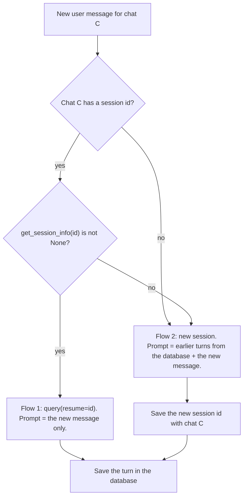

## 1. The question this idea answers

A chat service stores a session id with each chat and resumes it on the next message ([L2](/notes/ai/claude-agent-sdk/04-sessions/l2-resume-continue-fork)). This works on a laptop. Then the service moves to a container platform:

- The container has a **temporary local disk**. A restart or a new deployment deletes every file on it.
- The platform can run **several instances** of the service. Each instance has its own disk.

Now the session file of a chat may not exist where the next message arrives. What happens then, and how should the service decide what to do? This lesson answers both questions. It also explains a quiet bug: the session helpers can look in the wrong folder and report that a file is missing when it exists.

## 2. Mental model

> [!analogy] A cloakroom ticket
> A session id is a cloakroom ticket. The coat is the session file. The ticket is useful only in the cloakroom that holds the coat.
>
> If the cloakroom was emptied overnight (a restart), or if you are at a different branch of the hotel (another instance), the ticket gets you nothing. So before you give the ticket, ask: "Is my coat here?" If it is not, you need your own record of what the coat looked like: your own database.
>
> **Where it stops working:** a lost coat is a total loss. A lost session file is not, if your own database holds the conversation. The service can rebuild a new session from it. The rebuilt session is not identical to the lost one: it holds the old turns as text, not as the original blocks.

## 3. Terms

| Term | Plain meaning |
|---|---|
| temporary disk (ephemeral disk) | A local disk whose files are deleted when the container stops or is replaced. |
| instance | One running copy of a service. A platform can run several instances behind one address. |
| session helpers | The SDK functions `list_sessions`, `get_session_info` and `get_session_messages`, and others. They read session files directly. |
| `SDKSessionInfo` | The object that `get_session_info` returns: session id, summary, last change time, file size, working directory, and others. |
| Flow 1 | The session file exists. The service resumes the session. |
| Flow 2 | The session file does not exist. The service starts a new session and puts the earlier turns from its own database into the prompt. |
| source of truth | The one record that wins when two records disagree. |
| `os.environ` | The environment variables of the current Python process. |

## 4. Method and math

### 4.1 What the docs say

The sessions page has a section "Resume across hosts" (checked on 2026-10-12). It starts: "Session files are local to the machine that created them." Then it gives three choices, quoted here word for word:

1. "**Pass a session store.** Attach a `sessionStore` / `session_store` adapter so the SDK mirrors transcripts to your own backend and another host can resume them. The store lookup key derives from the working directory, so resume from a `cwd` matching the original run's."
2. "**Move the session file.** Persist `~/.claude/projects/<encoded-cwd>/<session-id>.jsonl` from the first run and restore it inside any directory under `~/.claude/projects/` on the new host before calling `resume`."
3. "**Don't rely on session resume.** Capture the results you need (analysis output, decisions, file diffs) as application state and pass them into a fresh session's prompt. This is often more robust than shipping transcript files around."

This lesson builds a design from choices 3 and "resume when you can". [L4](/notes/ai/claude-agent-sdk/04-sessions) covers the session store, and why a team can decide against it.

### 4.2 The session helpers

These Python functions are synchronous. They run in **your** process and read the session files directly. They do not start the CLI.

| Function (SDK 0.2.165) | Returns |
|---|---|
| `list_sessions(directory=None, limit=None, offset=0, include_worktrees=True)` | `list[SDKSessionInfo]`, newest first |
| `get_session_info(session_id, directory=None)` | `SDKSessionInfo` or `None` |
| `get_session_messages(session_id, directory=None, limit=None, offset=0)` | `list[SessionMessage]`: the user and assistant messages of the current chain |

`SDKSessionInfo` has the fields `session_id`, `summary`, `last_modified` (milliseconds), `file_size`, `custom_title`, `first_prompt`, `git_branch`, `cwd`, `tag` and `created_at`.

The docstring of `get_session_info` says that it returns `None` "if the session file is not found, is a sidechain session, or has no extractable summary". When `directory` is omitted, "all project directories are searched for the session file".

> [!trap] None has three causes
> `get_session_info` returns `None` for a missing file, but also for a subagent transcript or a file with no summary that the reader can extract. For a normal session with at least one user prompt, `None` almost always means "no file". Test this with your own sessions before you depend on it.

### 4.3 The CLAUDE_CONFIG_DIR trap

A service often sets `CLAUDE_CONFIG_DIR` to a folder that it controls, for example `/tmp/claude-home`. Recall the rule from [Foundations L1, section 4.5](/notes/ai/claude-agent-sdk/01-foundations/l1-what-the-sdk-is): `options.env` changes the environment of the CLI subprocess only.

Now examine how the helpers find the config directory. This is the SDK source (`_internal/sessions.py`, commit b6e9d12):

```python
def _get_claude_config_home_dir() -> Path:
    """Returns the Claude config directory (respects CLAUDE_CONFIG_DIR)."""
    config_dir = os.environ.get("CLAUDE_CONFIG_DIR")
    if config_dir:
        return Path(unicodedata.normalize("NFC", config_dir))
    return Path(unicodedata.normalize("NFC", str(Path.home() / ".claude")))
```

The helpers read `os.environ`. A function `_get_projects_dir(env_override)` exists that can read a passed `env` first, but `get_session_info`, `list_sessions` and `get_session_messages` call it with no argument. So the helpers never see `options.env`.

| `os.environ` has | `options.env` has | The CLI writes to | The helpers read from | Result |
|---|---|---|---|---|
| nothing | nothing | `~/.claude` | `~/.claude` | Match |
| nothing | `/tmp/claude-home` | `/tmp/claude-home` | `~/.claude` | **Mismatch** |
| `/tmp/claude-home` | nothing | `/tmp/claude-home` (inherited) | `/tmp/claude-home` | Match |
| `/tmp/a` | `/tmp/b` | `/tmp/b` (the option wins) | `/tmp/a` | **Mismatch** |

> [!example] Worked example: the quiet failure
> A service sets `options.env = {"CLAUDE_CONFIG_DIR": "/tmp/claude-home"}` and nothing in `os.environ`.
>
> 1. Message 1: a new session. The CLI writes `/tmp/claude-home/projects/-app/S1.jsonl`.
> 2. Message 2: the service calls `get_session_info("S1")`. The helper searches `~/.claude/projects/`. It finds nothing and returns `None`.
> 3. The service decides that the file is missing and takes Flow 2. It starts a new session and rebuilds the context from the database.
> 4. This repeats on every message. No error appears. Every message pays for a rebuilt context, and the model never sees the original blocks.
>
> **Fix:** set `CLAUDE_CONFIG_DIR` in `os.environ` before the first SDK call, and do not set a different value in `options.env`. The child inherits `os.environ`, so both programs use the same folder.

### 4.4 The two flows



| | Flow 1: resume | Flow 2: rebuild |
|---|---|---|
| Condition | The session file exists on this disk | No session id, or no file |
| Prompt | Only the new user message | The earlier turns from the database, as text, plus the new message |
| What the model sees | The original messages with all blocks, or a compaction summary of them | The earlier turns as text inside one user message |
| Prompt cache | The old prefix can match the cache | A new prefix, so a cache miss on the first call |
| Session id afterwards | Unchanged | A new id. Save it with the chat. |

Why must the earlier turns go into the prompt text in Flow 2? Because the SDK input accepts only user messages. Every documented input example is a message with `"type": "user"`. The SDK has no documented way to insert old assistant turns into a new session. [Lesson 5.2](/notes/ai/claude-agent-sdk/05-prompts-and-input/l2-streaming-input-mode) covers the input modes.

> [!key] The database is the source of truth, the session file is a cache
> Your database holds the conversation that the user saw. It survives restarts and serves every instance. The session file is a cache of the model's context: fast and exact when it exists, gone when the disk is replaced. Flow 1 is a cache hit. Flow 2 is a cache miss. A design must be correct with no cache hits at all.

### 4.5 Instances and the hit rate of Flow 1

Assume a service with $N$ instances, a load balancer that picks an instance at random for each request, and no restarts. The file of a chat exists only on the instance that handled the chat's last message. The chance that the next message reaches that instance is:

$$
P(\text{Flow 1}) = \frac{1}{N}
$$

| Instances $N$ | $P(\text{Flow 1})$ for the next message |
|---|---|
| 1 | 1.00 |
| 2 | 0.50 |
| 4 | 0.25 |
| 10 | 0.10 |

This model is a simplification. Sticky routing raises the rate. Restarts lower it. A Flow 2 also moves the chat to a new session on the new instance, so the chat "follows" the last instance that served it. The lesson is the trend: more instances, fewer resumes. With many instances, Flow 2 is the normal case, not the exception.

### 4.6 The other two choices in short

| Choice | How it works | Main risk |
|---|---|---|
| Move the file | Copy the JSONL file to shared storage after each run. Copy it back before each resume. | Two instances can copy and change the same file at once. The service must lock the chat. |
| Session store | The SDK mirrors each batch of entries to your backend through `append()` and `load()` ([L4](/notes/ai/claude-agent-sdk/04-sessions)). | The docs say that a failed batch is dropped after three attempts, with a `mirror_error` message, and that on a run resumed from the store "a dropped batch has no surviving copy once the run ends." |

### 4.7 Production view

| Concern | What to do |
|---|---|
| Correctness | Make Flow 2 correct first. Flow 1 is an optimization. |
| Configuration | Set `CLAUDE_CONFIG_DIR` in `os.environ`, once, at process start. |
| Monitoring | Count Flow 1 and Flow 2 for each message. A Flow 2 rate near 100% on a single instance means a bug, for example the config directory trap. |
| Cost | Flow 2 sends the rebuilt history as new input with no cache match. Limit the rebuilt history to a token budget. |
| Concurrency | One in-flight answer per chat, in both flows. |

## 5. Code

These exercises go in `claude-agent-sdk/06-temporary-disks.ipynb`.

**Exercise 3.1: reproduce the trap.** In a fresh Python process, pass `env={"CLAUDE_CONFIG_DIR": "/tmp/lab-claude"}` in the options. Run one `query()`. Then call `get_session_info(session_id)`.

Acceptance tests:

- The file exists under `/tmp/lab-claude/projects/`.
- `get_session_info` returns `None`.
- After `os.environ["CLAUDE_CONFIG_DIR"] = "/tmp/lab-claude"`, the same call returns an `SDKSessionInfo`.

**Exercise 3.2: choose the flow.** Write `choose_flow(chat)`, where `chat` has an optional `session_id`. It returns `"flow1"` or `"flow2"`. Inject the lookup function as an argument, so that the tests need no real files.

Acceptance tests:

- No session id gives `"flow2"`.
- A session id with a lookup that returns `None` gives `"flow2"`.
- A session id with a lookup that returns an object gives `"flow1"`.

**Exercise 3.3: build the Flow 2 prompt.** Write `rebuild_prompt(turns, new_message, max_chars)`. It formats the earlier turns as a clearly marked transcript, keeps the newest turns when the text is too long, and puts the new message last.

Acceptance tests:

- The new message is always present and always last.
- The output never exceeds `max_chars`.
- When turns are dropped, the oldest turns go first.

**Exercise 3.4: simulate the hit rate.** Simulate 10,000 chats of 10 messages each, with $N$ instances and random routing. Count the share of messages after the first that find their file.

Acceptance test: for $N = 1, 2, 4$ the shares are close to 1.00, 0.50 and 0.25.

## 6. Common mistakes

1. **Assuming the session file is always there.** On a temporary disk or with several instances, it often is not.
2. **Setting CLAUDE_CONFIG_DIR only in options.env.** The CLI uses it, but the session helpers in your process do not.
3. **Treating the session file as the source of truth.** Your database is the source of truth. The file is a cache.
4. **No metric for Flow 1 and Flow 2.** The config directory trap shows no error. Only the Flow 2 rate reveals it.
5. **Forgetting to save the new session id after Flow 2.** The next message then takes Flow 2 again.

## 7. One-minute explanation

A session file exists only on the disk where the CLI wrote it. On a container platform, a restart deletes it, and each instance has its own disk, so the next message of a chat often arrives where the file is not. The service must check before it resumes. If the chat has a session id and `get_session_info` finds the file, it resumes: Flow 1. If not, it starts a new session and puts the earlier turns from its own database into the prompt: Flow 2, and it saves the new session id. The database is the source of truth, and the session file is only a cache of the model's context. One trap: the session helpers read `CLAUDE_CONFIG_DIR` from `os.environ`, not from `options.env`, so set it in `os.environ`, or the helpers look in the wrong folder and every message takes Flow 2 with no error.

## 8. Check questions

```check
{
  "question": "A service on one instance shows a Flow 2 rate of 100%, also for chats with many messages. What is the most likely cause, and how do you confirm it?",
  "hint": "Which environment do the session helpers read?",
  "answer": "CLAUDE_CONFIG_DIR is set only in options.env. The CLI writes the files to that folder, but get_session_info reads os.environ and searches ~/.claude, so it returns None every time. Confirm it by listing the folder from options.env (the files are there) and by calling get_session_info after setting the same value in os.environ (it now finds them)."
}
```

```check
{
  "question": "A service runs 5 instances with random routing. What share of follow-up messages can resume their session, under the simple model of section 4.5? What does this mean for the design?",
  "answer": "1/5 = 0.20, so about 20%. About 80% of follow-up messages take Flow 2. So Flow 2 is the normal path, and it must be correct, tested and cost-limited. Flow 1 is only an optimization."
}
```

```check
{
  "question": "Why must Flow 2 put the earlier turns into the text of the new prompt, instead of passing them as real past assistant messages?",
  "answer": "The SDK input accepts user messages only. The documented input format is a message with type user, and there is no documented way to insert old assistant turns into a new session. So the earlier turns must go into the user prompt as text."
}
```

```check
{
  "question": "Your database and a session file disagree about the last answer of a chat. Which one wins, and why?",
  "answer": "The database. It holds what the user saw and it survives restarts and serves every instance. The session file is the CLI's working copy and a cache of the model context. It can be compacted, deleted or missing on another instance."
}
```

## 9. Links

- Previous: [L2: resume, continue and fork](/notes/ai/claude-agent-sdk/04-sessions/l2-resume-continue-fork)
- Next in the part: [L4: SessionStore and mirror errors](/notes/ai/claude-agent-sdk/04-sessions/l4-session-store-and-mirror-errors)
- Next in the priority path: [L5.1: System prompts and snapshot](/notes/ai/claude-agent-sdk/05-prompts-and-input/l1-system-prompts-and-snapshot)
- The `options.env` rule: [Foundations L1: What the SDK is](/notes/ai/claude-agent-sdk/01-foundations/l1-what-the-sdk-is)
- The database side: [Chats, messages and parts](/notes/ai/conversation-state/02-chat-history-model/l1-chats-messages-and-parts)
- [Glossary](/notes/ai/claude-agent-sdk/glossary)
