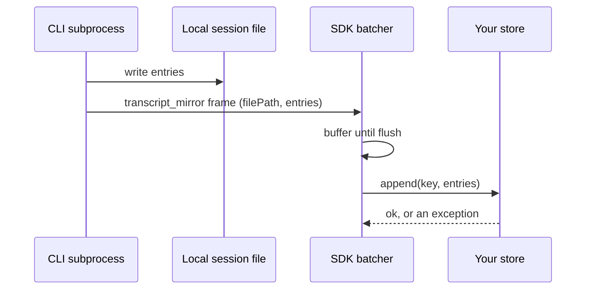

## 1. The question this idea answers

[L3](/notes/ai/claude-agent-sdk/04-sessions/l3-session-files-on-temporary-disks) showed that a session file lives only on the disk where the CLI wrote it. The sessions page offers three ways to resume on another host. The first one is a **session store**: an adapter that copies the transcript to your own backend, such as S3, Redis or PostgreSQL.

A store sounds like a full answer to temporary disks. But what exactly does it guarantee? When does it lose data, and does your code notice? And why can a team decide to keep its own database as the source of truth and not use a store at all?

This lesson is "know only": it explains the mechanism and its limits, so that you can defend the design choice. It uses the SDK source (0.2.165), the session-storage page, and real runs of CLI 2.1.296 against a local fake model server.

## 2. Mental model

> [!analogy] A photocopier next to the clerk's notebook
> The CLI is a clerk who writes every entry in a notebook: the local session file. After each batch of entries, an assistant photocopies the new page to the archive: your store. If the copier jams, the assistant tries three times. Then the assistant throws the batch away and leaves a note in your inbox: a `mirror_error` message.
>
> On a normal day the notebook stays on the desk, so the page still exists. On a day that starts from the archive, a resume from the store, the clerk gets a temporary notebook that is shredded in the evening. A batch that the copier dropped on that day is gone.
>
> **Where it stops working:** a jammed copier makes noise. A mirror error is one message in the stream, and it can arrive after the final result. If no code reads it, the loss is silent until a later resume misses a turn.

## 3. Terms

| Term | Plain meaning |
|---|---|
| `SessionStore` | The protocol for an adapter that receives a copy of the session transcript. Two methods are required: `append` and `load`. |
| adapter | Your class that implements `SessionStore` for one backend, for example PostgreSQL. |
| mirror | The copy of the transcript in the store. The local file stays the primary copy. |
| dual write | The CLI writes each batch to the local file first, then the SDK sends the same batch to the store. |
| batch | A list of transcript entries that the SDK sends in one `append` call. |
| flush | The moment when the SDK sends the pending entries to the store. |
| flush mode | `batched` (once per turn, or when the buffer is large) or `eager` (after every frame). |
| `MirrorErrorMessage` | A `SystemMessage` with subtype `mirror_error`. The SDK yields it when a batch could not be stored. |
| `SessionKey` | The address of one transcript in the store: `project_key`, `session_id` and an optional `subpath`. |
| `project_key` | The working directory, encoded like a project directory name. |
| materialize | Load a session from the store and write it into a temporary config directory, so that the CLI can resume it. |
| idempotency key | A value that marks an entry as already stored, so a repeated write does not duplicate it. Here, the entry `uuid`. |
| conformance suite | The test function `run_session_store_conformance` that checks an adapter against the contract. |

## 4. Method and math

### 4.1 What a SessionStore is

From the session-storage page (checked on 2026-10-13): "A `SessionStore` is an object with two required methods, `append` and `load`, and four optional methods."

| Method | Required | Called when (docs and source) |
|---|---|---|
| `append(key, entries)` | yes | After each batch of transcript entries is written locally |
| `load(key)` | yes | Before the subprocess starts, when `resume` is set, or `continue_conversation` picks the newest store session |
| `list_sessions(project_key)` | no | By `list_sessions_from_store()` and by `continue_conversation`. Without it, `continue_conversation` with a store raises `ValueError`. |
| `list_session_summaries(project_key)` | no | For fast listing with one call |
| `delete(key)` | no | By `delete_session_via_store()`. Without it, deletion does nothing. |
| `list_subkeys(key)` | no | During resume, to restore subagent transcripts |

The entries are the CLI's own transcript lines. The docstring of `SessionStoreEntry` says: "That union is internal, so this is a minimal structural supertype — adapters should treat entries as pass-through blobs". One test run produced these entry types: `queue-operation`, `user`, `attachment`, `atis-latch`, `assistant`, `last-prompt`, `cost-state` and `mode`. So a store holds the harness state in an internal format, not a chat history that your app can read.

The SDK ships `InMemorySessionStore` for tests, and the Python repository has copy-in reference adapters for S3, Redis and PostgreSQL in `examples/session_stores/`.

### 4.2 The dual write

The docs say: "The Claude Code subprocess always writes each batch of transcript entries to local disk first, and the SDK then forwards the same batch to your store's `append()`, so the store is a mirror of the local transcript rather than a replacement for it."



When a store is set, the SDK adds the flag `--session-mirror` (source line 723 to 724). The CLI then sends the extra `transcript_mirror` frames, and the SDK removes them from the stream before parsing.

Which copy survives the run depends on how the run started. The docs:

| How the run started | What survives the run |
|---|---|
| "Fresh session, or a resume when the store has nothing for the session" | "the local transcript under your config directory outlives the run, and the store receives a copy" |
| "Run resumed from the store" | "the local copy is deleted at run end, so the store holds the only durable copy" |

### 4.3 Flush modes

| Mode | When the SDK calls `append()` (docstring of `session_store_flush`) |
|---|---|
| `"batched"` (default) | "once per turn or when the buffer exceeds 500 entries / 1 MiB" |
| `"eager"` | "a background flush after every frame for near-real-time delivery" |

The constants in `transcript_mirror_batcher.py` are `MAX_PENDING_ENTRIES = 500` and `MAX_PENDING_BYTES = 1 << 20`. Eager mode sets both thresholds to 0. In both modes the appends of one process stay in order, and a slow adapter does not stop the message stream.

In the test, a fresh one-turn run made two `append` calls. The first sent 12 entries when the result arrived. The second sent 2 entries when the run closed.

### 4.4 Retries and mirror_error

The batcher constants (SDK 0.2.165):

```python
MIRROR_APPEND_MAX_ATTEMPTS = 3
MIRROR_APPEND_BACKOFF_S = (0.2, 0.8)
SEND_TIMEOUT_SECONDS = 60.0
```

The docs describe the rule: "If `append()` rejects, the SDK retries the batch up to two more times with a short backoff, for at most three attempts in total. A call that times out isn't retried, since the original call may still land. If the batch still fails, the SDK logs the error, emits a `{ type: "system", subtype: "mirror_error" }` message into the iterator, drops the batch, and continues the query."

> [!example] Worked example: a store that is unavailable for one run
> The adapter raised `ConnectionError("store unreachable")` on every `append`. The run had two batches. The times are seconds after the run started.
>
> | Batch | Attempt times | Gaps |
> |---|---|---|
> | 1 (5 entries) | 1.01, 1.21, 2.01 | 0.20 and 0.80 |
> | 2 (3 entries) | 2.01, 2.21, 3.01 | 0.20 and 0.80 |
>
> The stream showed a `MirrorErrorMessage` at 2.01 s, the `ResultMessage` with `subtype="success"` at 2.01 s, and a second `MirrorErrorMessage` at 3.01 s, after the result. The SDK log showed "[TranscriptMirrorBatcher] flush failed for <path>: store unreachable". The answer to the user was correct. The store received no entry of this run.

A retried batch can partly overlap an earlier partial write. The docs say: "deduplicate by `entry.uuid` in your `append()` implementation." In PostgreSQL that is a unique index and `ON CONFLICT DO NOTHING` ([isolation and upserts](/notes/databases/postgres/02-transactions/l2-isolation-and-upserts)).

### 4.5 Resume from the store

When `session_store` is set together with `resume` or `continue_conversation`, the SDK runs `materialize_resume_session()` before it starts the CLI:

1. It computes `project_key` from `cwd`. For `continue_conversation`, it first asks `list_sessions()` for the newest session. Then it calls `store.load({"project_key": ..., "session_id": ...})` with the timeout `load_timeout_ms` (default 60,000).
2. It writes the entries to a new temporary directory `claude-resume-*`, with the same layout as `~/.claude/`.
3. It copies authentication files into it.
4. It starts the CLI with `CLAUDE_CONFIG_DIR` set to that directory.
5. After the run, it deletes the directory.

If `load()` returns nothing, the SDK skips these steps, and the CLI resumes from local disk as usual. If `load()` raises or exceeds the timeout, the query fails with a `RuntimeError` that says "failed during resume materialization" or "timed out".

> [!trap] Docs and source disagree on the copied files
> The session-storage page says that Python copies "credentials and `.claude.json` only, so an app that authenticates through `apiKeyHelper` in your user `settings.json` fails with `Not logged in`". The source of 0.2.165 also copies `settings.json` and `cowork_settings.json`, with plugin keys removed, and its changelog adds this in 0.2.137. The code follows the source: a current SDK copies the settings file too. The source also removes `refreshToken` from the copied credentials.

### 4.6 The dropped batch that has no surviving copy

The docs warn: "On a run resumed from the store, a dropped batch has no surviving copy once the run ends." Three runs show it.

> [!example] Worked example: one lost turn
> 1. **Run 1, fresh session, store working.** Prompt "My plant is Plant B." The store holds 14 entries. The local file exists in the real config directory.
> 2. **Run 2, `resume` from the store, store unavailable.** Prompt "The line is Line 4." Two `MirrorErrorMessage` objects, then a normal answer. The store still holds 14 entries. The temporary `claude-resume-*` directory with the only local copy of this turn was deleted.
> 3. **Run 3, `resume` from the store, store working.** Prompt "Repeat everything I told you." The fake model server recorded what the model received:
>
> ```text
> user:      My plant is Plant B.
> assistant: Echo: My plant is Plant B.
> user:      Repeat everything I told you.
> ```
>
> The turn "The line is Line 4." is gone from the model's context. No exception was raised in any run.

> [!key] A store is a best-effort mirror
> The store receives a copy after the local write, and failures do not stop the agent. On a fresh run, the local file still holds a dropped batch. On a run resumed from the store, nothing does. Read every `MirrorErrorMessage`, also after the `ResultMessage`.

### 4.7 The cwd coupling of project_key

The docs: "Because `projectKey` encodes the working directory, resume or continue from the store from a working directory matching the original run's." In the Python source, the key comes from `project_key_for_directory(options.cwd)`. It is the real path of the folder, encoded like a project directory name ([L1, section 4.2](/notes/ai/claude-agent-sdk/04-sessions/l1-what-a-session-is)).

The fourth test run resumed the same session from another working directory, `labcwd2`, after the local file was removed, as on a new host. The store lookup used the new key and found nothing. The CLI then tried a normal resume and failed:

```text
ResultError: Claude Code returned an error result: No conversation found with session ID: 7b4ef165-1ca1-4a51-b5d1-e4493eba0b2e (exit code: 1)
```

The TypeScript SDK can set the key name with `CLAUDE_CODE_PROJECT_DIR_NAME` (TypeScript SDK 0.3.234 or later). The Python source of 0.2.165 has no such variable or option. The docstring of `SessionKey.project_key` calls it a "Caller-defined scope", but in Python only `cwd` decides it. To separate tenants, give each tenant its own adapter instance or key prefix inside the adapter.

> [!trap] A frame that does not match the config directory is dropped with a warning only
> The batcher maps each file path to a key relative to the expected `projects` folder. If the CLI writes somewhere else, the source logs "dropping mirror frame: filePath ... is not under ... -- subprocess CLAUDE_CONFIG_DIR likely differs from parent (custom env / container?)" and skips the frame. No `MirrorErrorMessage` appears. Set `CLAUDE_CONFIG_DIR` in one place only ([L3, section 4.3](/notes/ai/claude-agent-sdk/04-sessions/l3-session-files-on-temporary-disks)).

### 4.8 Limits

| Limit | Source |
|---|---|
| Not combinable with `enable_file_checkpointing`. The SDK raises `ValueError`: "session_store cannot be combined with enable_file_checkpointing". | `session_store_validation.py` |
| `continue_conversation` with a store needs `list_sessions()`, or the SDK raises `ValueError`. | `session_store_validation.py` |
| A custom `transport` skips store-backed resume. | docstring of `query()` |
| The SDK never deletes from the store. "Retention is the adapter's responsibility". | docs |
| `get_session_messages_from_store()` returns the chain after compaction. The docs give an example of "503 raw entries" that "may return 18 messages". | docs |
| The entries use an internal format that can change with the CLI version. | `SessionStoreEntry` docstring |
| Only the main transcript is restored if the adapter has no `list_subkeys()`. | docs |

### 4.9 Why a team may keep its own database instead

[Three copies of a conversation](/notes/ai/conversation-state/01-where-state-lives/l1-three-copies-of-a-conversation) separates the user transcript (copy 1) from the harness state (copy 2). A session store makes copy 2 durable. It does not give you copy 1.

| | Session store | Own database plus Flow 2 |
|---|---|---|
| What it holds | The CLI's internal transcript entries, with tool internals and compaction summaries | The messages that the user typed and saw, in your own schema |
| Write path | Best effort: a batch can be dropped, and the agent continues | Your transaction, after the answer, all or nothing |
| On a resumed run | The store is the only copy, and a dropped batch is lost | Not affected: the database is written by your code |
| Key | `cwd` and session id, fixed by the SDK | Your chat id and user id |
| What the model gets on a new host | The earlier blocks of the session chain, through a temporary config directory with copied credentials | The earlier turns as text in a new session ([L3](/notes/ai/claude-agent-sdk/04-sessions/l3-session-files-on-temporary-disks)) |
| Format stability | Internal, can change with the CLI | Yours |

A store is a good fit when exact blocks matter more than control. Examples: long runs with many tool calls and thinking blocks, workers that resume each other, and no transcript of your own. A chat service that must store what the user saw already needs copy 1. With copy 1 in its own database, Flow 2 needs no store, and the store would add a second, weaker record of the same chat.

### 4.10 Production view

| Concern | What to do, if you use a store |
|---|---|
| Observability | Count `MirrorErrorMessage` objects, also after the result. Alert on any of them on a run resumed from the store. |
| Idempotency | Deduplicate by `entry.uuid`. Append entries without a `uuid` as they are. |
| Configuration | Keep `cwd` fixed per deployment. Set `CLAUDE_CONFIG_DIR` in one place. |
| Latency | `load_timeout_ms` bounds the resume. A slow store delays the first token of every resumed message. |
| Retention | Implement deletion and expiry yourself. The SDK never deletes. |
| Testing | Run `run_session_store_conformance` against the adapter in CI. |

## 5. Code

These exercises go in `claude-agent-sdk/11-session-store.ipynb`. They are reading exercises and need no model call.

**Exercise 4.1: read the reference store and the suite.** Read `InMemorySessionStore` in `_internal/session_store.py` and `run_session_store_conformance` in `testing/session_store_conformance.py`. List the 14 contracts in your own words. Mark the contracts that test optional methods.

Acceptance tests:

- `await run_session_store_conformance(InMemorySessionStore)` passes in your notebook.
- Your list has 14 entries, and 8 of them name an optional method.

**Exercise 4.2: a minimal store.** Write a dict-based store with only `append` and `load`. Then write a broken copy whose `load` returns `[]` for an unknown key.

Acceptance tests:

- The minimal store passes the suite. The optional contracts are skipped.
- The broken store fails. You name the contract that fails, and why the SDK needs `None` there.

**Exercise 4.3: a failure table.** Write a table with four columns: failure, what the SDK does, what your code sees, and whether data is lost. Use these rows:

- `append` fails once
- `append` fails three times on a fresh run
- `append` fails three times on a run resumed from the store
- `append` exceeds 60 seconds
- `load` raises, or `load` returns `None`
- `cwd` differs on resume
- `CLAUDE_CONFIG_DIR` differs between parent and child

Acceptance test: every row names a source line, a docs sentence or a test from this lesson.

## 6. Common mistakes

1. **"The store replaces the local file."** It is a mirror. The CLI always writes locally first.
2. **"A store failure stops the query."** It does not. The SDK retries three times, drops the batch and continues.
3. **Stopping the loop at the `ResultMessage`.** A `MirrorErrorMessage` can arrive after it.
4. **No deduplication by `uuid`.** A retried batch can write the same entries twice.
5. **A different `cwd` on another host.** The store lookup uses another `project_key` and finds nothing.
6. **Using the store as the chat history for the UI.** It holds internal entries, and its chain changes at compaction.
7. **Trusting the docs list of copied files for Python.** The source of a current SDK also copies `settings.json`.

## 7. One-minute explanation

A `SessionStore` is an adapter with `append` and `load` that receives a copy of the session transcript. The CLI always writes each batch to the local file first. Then the SDK sends the same batch to the store: once per turn by default, or after every frame in eager mode. If `append` fails, the SDK tries three times, then drops the batch, yields a `mirror_error` message and continues, so the answer looks normal. To resume from the store, the SDK loads the session into a temporary config directory, runs the CLI there and deletes the directory afterwards. So on a run resumed from the store, a dropped batch has no surviving copy. The store key comes from the working directory, so another host must use the same `cwd`. A store makes the harness state durable, but it is not the user transcript. A team that already stores its own chat history can rebuild context from its database and skip the store.

## 8. Check questions

```check
{
  "question": "On a fresh session, the store is unavailable for the whole run. On a second run, the same session is resumed from the store, and the store is unavailable again. Which run loses data for good, and why?",
  "answer": "The second run. On a fresh session the local file in the real config directory survives the run, so the dropped batches still exist locally. A run resumed from the store writes into a temporary config directory. The SDK deletes that directory at the end of the run, so its dropped batches have no surviving copy."
}
```

```check
{
  "question": "An adapter raises an exception on every append call. How many attempts does the SDK make for one batch, how long does it wait between them, and what does your loop receive?",
  "answer": "Three attempts, with waits of 0.2 seconds and 0.8 seconds between them. Then the SDK logs the error, drops the batch and yields a MirrorErrorMessage (a SystemMessage with subtype mirror_error, with key and error). The query continues normally. A timed-out append is not retried."
}
```

```check
{
  "question": "A worker on host B resumes a session from the store and gets 'No conversation found with session ID'. Host A created the session. Name the most likely cause.",
  "hint": "What decides project_key in the Python SDK?",
  "answer": "Host B runs with a different working directory. The Python SDK derives project_key from cwd, so the store lookup on host B uses another key and finds nothing. The SDK then passes the id to a normal resume, and the CLI finds no local file either. Both hosts must use the same cwd."
}
```

```check
{
  "question": "Give two reasons why a chat service that already stores its own transcript may decide against a session store.",
  "answer": "First, the store is best effort. Batches can be dropped, and on a run resumed from the store a dropped batch is lost. The service's own transcript is written in its own transaction. Second, the store holds the CLI's internal entries keyed by cwd, not the messages that the user saw. The service still needs its own copy 1, and Flow 2 can rebuild context from it with no store."
}
```

## 9. Links

- Previous: [L3: Session files on temporary disks](/notes/ai/claude-agent-sdk/04-sessions/l3-session-files-on-temporary-disks)
- Next in the priority path: [L5.2: Streaming input mode](/notes/ai/claude-agent-sdk/05-prompts-and-input/l2-streaming-input-mode)
- The session file itself: [L1: What a session is](/notes/ai/claude-agent-sdk/04-sessions/l1-what-a-session-is)
- The copies of a conversation: [Three copies of a conversation](/notes/ai/conversation-state/01-where-state-lives/l1-three-copies-of-a-conversation)
- Reading every message to the end: [L2.2: Message and block types](/notes/ai/claude-agent-sdk/02-options-and-messages/l2-message-and-block-types)
- [Glossary](/notes/ai/claude-agent-sdk/glossary)
