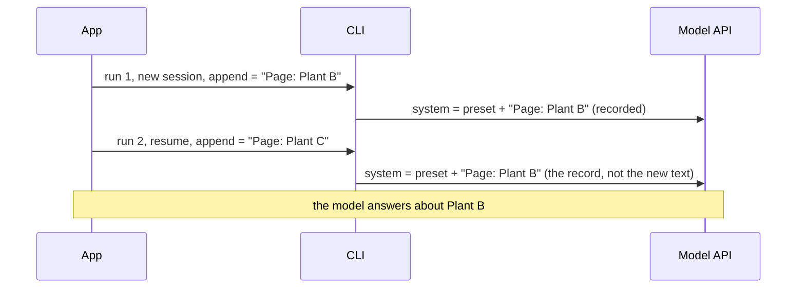

## 1. The question this idea answers

The system prompt tells the model who it is, what it may do and how to answer. The SDK option `system_prompt` sets it. But which text does the model really receive?

- If you set nothing, does the model get the full Claude Code prompt, or nothing?
- Where do CLAUDE.md files go?
- If you change the system prompt between two messages of one chat, does the model see the change?

The last question hides a real bug. A service puts per-request data, such as the page that the user has open, into the system prompt. On a resumed session, the model keeps the old value, because the session recorded its system prompt on its first request. The bug appears only on resumed sessions, so it comes and goes. This lesson explains the rule and the fixes.

## 2. Mental model

> [!analogy] A passport photo
> When a session starts, Claude Code takes a photo of the system prompt and puts it in the session's passport. Every later request of that session, also after a resume, shows the same photo. If you change your look later (a new `append` text), the passport still shows the old photo. You get a new photo only when the passport is renewed: after a compaction, or with a new session.
>
> With `snapshot: False`, there is no passport photo. Claude Code takes a new photo on every request.
>
> **Where it stops working:** a new photo is free. A new system prompt is not free. It changes the start of the input, so the prompt cache no longer matches, and the docs warn that preserved thinking can be lost.

## 3. Terms

| Term | Plain meaning |
|---|---|
| system prompt | The instructions before the conversation. On the Messages API, the top-level `system` field. |
| minimal prompt | The short prompt that the SDK uses when `system_prompt` is not set. It covers tool calling only. |
| `claude_code` preset | The full Claude Code system prompt, chosen with `{"type": "preset", "preset": "claude_code"}`. |
| `append` | Extra text that goes after the preset prompt. |
| custom prompt | `{"type": "custom", "prompt": "..."}`: your own full prompt, in the form that can set `snapshot`. |
| file prompt | `{"type": "file", "path": "..."}`: the CLI reads the prompt from a file. |
| `snapshot` | A setting that decides whether a session keeps the system prompt that it recorded on its first request. |
| recorded prompt | The system prompt that a session saved on its first request. |
| dynamic section | A part of the preset prompt that changes per user or per machine: working directory, auto-memory, git status. |
| `setting_sources` | The list of settings files that the CLI loads: `user`, `project`, `local`. It also controls CLAUDE.md. |
| per-turn context | Data that is true for one message only, for example the page that the user has open now. |

## 4. Method and math

### 4.1 The four types

The option type is `str | SystemPromptPreset | SystemPromptCustom | SystemPromptFile | None` (SDK 0.2.165, checked on 2026-10-12).

```python
# 1. A plain string: your full prompt
system_prompt = "You answer questions about plant production data. Use the tools."

# 2. The Claude Code preset, with optional extra text
system_prompt = {"type": "preset", "preset": "claude_code",
                 "append": "Always answer in metric units."}

# 3. A custom prompt in the form that can set snapshot
system_prompt = {"type": "custom", "prompt": "You answer questions about plant production data.",
                 "snapshot": True}

# 4. A prompt read from a file by the CLI
system_prompt = {"type": "file", "path": "/app/prompts/system.md"}
```

| Type | Fields | When to use it |
|---|---|---|
| `str` | — | Your own full prompt, with the default snapshot behavior. |
| `SystemPromptPreset` | `type: "preset"`, `preset: "claude_code"`, optional `append`, `exclude_dynamic_sections`, `snapshot` | You want Claude Code's full prompt, with its tool guidance and safety instructions, plus your rules. |
| `SystemPromptCustom` | `type: "custom"`, `prompt`, optional `snapshot` | Your own full prompt, and you want to set `snapshot`. The docstring: "A custom system prompt, in the form that can also set `snapshot`." |
| `SystemPromptFile` | `type: "file"`, `path` | A long prompt. The reference warns that on Linux a string prompt over about 128 KB fails with `Argument list too long`, and on Windows the limit is about 32 KB. |

### 4.2 What reaches the CLI

The SDK turns each form into a CLI flag (source: `subprocess_cli.py`, lines 576 to 589):

| Your option | CLI flag |
|---|---|
| not set (`None`) | `--system-prompt ""` |
| a string | `--system-prompt <string>` |
| custom | `--system-prompt <prompt>` |
| file | `--system-prompt-file <path>` |
| preset with `append` | `--append-system-prompt <append>` |
| preset with no `append` | no flag. The CLI uses its default Claude Code prompt. |

`snapshot` and `exclude_dynamic_sections` do not become flags. They travel in the `initialize` control request, as `systemPromptSnapshot` and `excludeDynamicSections`.

### 4.3 The default is a minimal prompt

The system prompt page says:

> "the SDK uses a minimal prompt that covers tool calling but omits the rest of the `claude_code` preset's content, including its security and safety instructions. This differs from `claude -p`, which uses the Claude Code system prompt by default."

So an SDK agent with no `system_prompt` is not "Claude Code in Python". It is a model with tool-calling instructions and little else. Your own prompt must give the role, the rules and the limits.

### 4.4 The preset and its dynamic sections

The preset prompt holds sections that change per machine and per user. The docstring of `exclude_dynamic_sections` says:

> "Strip per-user dynamic sections (working directory, auto-memory, git status) from the system prompt so it stays static and cacheable across users. The stripped content is re-injected into the first user message..."

Why this matters: the prompt cache matches a prefix ([prompt caching](/notes/ai/context-engineering/01-foundations/l7-prompt-caching)). A system prompt that differs per user gives every user a different prefix, so no user benefits from another user's cache. A static system prompt gives all users the same prefix.

### 4.5 CLAUDE.md and setting_sources

CLAUDE.md files are not part of the system prompt. The page says that the SDK "inject[s]... into the conversation and leaves the system prompt untouched".

Whether they load depends on `setting_sources`, not on the preset:

| `setting_sources` | Loads |
|---|---|
| `None` (default) | All sources: user, project and local settings, so CLAUDE.md loads. The source docstring: "When `None`, all sources are loaded (matches CLI defaults)." |
| `["project"]` | `.claude/settings.json` and the project CLAUDE.md |
| `[]` | Nothing. "Pass `[]` to disable filesystem settings (SDK isolation mode)." |

> [!trap] A server can load files that you did not plan
> With the default, the CLI loads `~/.claude/CLAUDE.md` and the project CLAUDE.md from the working directory. On a server, this can be a file from a developer, a base image or an earlier deployment. For a service, pass an explicit list, often `[]`, and put every instruction in your own prompt.

### 4.6 Snapshot: the session records its system prompt

This is the docstring of `snapshot` in `types.py` (lines 59 to 68), word for word:

> "Whether the session keeps the system prompt it recorded on its first request. When True, every later request, including after resume, sends the recorded prompt, so changing `append` has no effect until the session is compacted or you start a new session. When False, the prompt is rebuilt on every request, for example while you iterate on `append` text across calls that resume the same session. When omitted, it acts as True, except in bare mode (`--bare`), where it acts as False.
>
> Requires Claude Code CLI 2.1.257 or later. Before 2.1.265, a session with an `append` or custom prompt recorded it only when `snapshot` was True."

And the system prompt page says:

> "if you pass a different `append` or custom prompt when you return to a session with `resume` or `continue`, Claude doesn't see it on the next turn. Claude Code records the system prompt on a session's first request and reuses that record until the session is compacted."

Four facts follow:

1. **The default is to record.** If you do not set `snapshot`, it acts as `True`.
2. **The SDK still sends the flag on every run.** Each new process gets `--system-prompt` or `--append-system-prompt` again. The CLI ignores it and uses the record.
3. **The record changes at compaction or in a new session.** So the "old" prompt can change at a moment that you do not control.
4. **The docs do not say where the record is stored.** It is part of the session state. A new session, for example a Flow 2 rebuild, starts a new record.



### 4.7 The per-turn data bug

> [!example] Worked example: the page that does not change
> A chat UI sends the current page with each message. The service puts it in `append`.
>
> | Message | Page in the UI | Flow | `append` sent | What the model sees |
> |---|---|---|---|---|
> | 1 | Plant B | new session | "Page: Plant B" | "Page: Plant B" (recorded) |
> | 2 | Plant C | Flow 1, resume | "Page: Plant C" | "Page: Plant B" |
> | 3 | Plant C | Flow 2, rebuild after a restart | "Page: Plant C" | "Page: Plant C" (new record) |
> | 4 | Plant D | Flow 1, resume | "Page: Plant D" | "Page: Plant C" |
>
> The answer is wrong on messages 2 and 4 and right on 1 and 3. The pattern depends on the flow, which depends on restarts and routing ([L4.3](/notes/ai/claude-agent-sdk/04-sessions/l3-session-files-on-temporary-disks)). So the bug is hard to reproduce on a developer laptop, where Flow 1 is almost always the case.

There are three fixes. The first one is the documented recommendation. The page says that to change instructions in the middle of a session, put them in the next user message, or return `additionalContext` from a `UserPromptSubmit` or `PostToolUse` hook.

| Fix | How | Cost |
|---|---|---|
| A. Put per-turn data in the user message | The prompt becomes, for example, `"<ui_context>Page: Plant C</ui_context>\n\nWhich line is slowest?"` | None. The system prompt stays static and cacheable. The data is part of the conversation history, which is correct: it was true at that turn. |
| B. A `UserPromptSubmit` hook | The hook returns `additionalContext` with the page | More code. Same effect as A. |
| C. `snapshot: False` | The CLI rebuilds the system prompt on every request | The docs say that the resumed request "can't reuse the session's prompt cache", and preserved thinking can be lost. It requires `claude-agent-sdk` 0.2.153 or later. |

> [!key] A rule for where instructions go
> The system prompt holds what is true for the whole conversation and the same for every user. Data that is true for one turn goes in that turn's user message. Facts that must survive across chats go in your own database.

### 4.8 Where each kind of instruction belongs

| Kind of content | Example | Place |
|---|---|---|
| Role and rules, the same for everyone | "You answer questions about production data. Never guess a number." | System prompt (string, custom or preset `append`) |
| Tool guidance | When to use each tool | Tool descriptions, and the system prompt |
| Per-user data that does not change in the chat | The user's plant and language | The first user message, or the system prompt of a new session only |
| Per-turn data | The page open now, the selected date range | The user message of that turn |
| Long-lived facts about the user | Preferences | Your database. Inject them into the first message of a new session. |

### 4.9 Production view

| Concern | What to do |
|---|---|
| Correctness | Keep per-turn data out of the system prompt. Test the second message of a resumed session, not only the first message. |
| Safety | Without `system_prompt`, the SDK uses a minimal prompt with no Claude Code safety instructions. Write your own rules. |
| Cost | Keep the system prompt identical across users and turns so the cache prefix matches. Consider `exclude_dynamic_sections` with the preset. |
| Isolation | Set `setting_sources` explicitly on servers. |
| Size | Use a file prompt for long prompts, because of the argument length limits. |

## 5. Video

```video
{
  "src": "/notes/media/claude-agent-sdk/manim/m03-system-prompt-snapshot.mp4",
  "caption": "The session records its system prompt on the first request. A resume reuses the record, so a new append text has no effect until a compaction or a new session."
}
```

## 6. Code

These exercises go in `claude-agent-sdk/07-system-prompt.ipynb`. They call the model.

**Exercise 1.1: reproduce the bug.** Start a session with the preset and `append = "The code word is RED."`. Ask "What is the code word?". Then resume the same session with `append = "The code word is BLUE."` and ask again.

Acceptance tests:

- Both answers say RED.
- Write two sentences that explain why, with the word "recorded".

**Exercise 1.2: snapshot off.** Repeat exercise 1.1 with `"snapshot": False` in both runs.

Acceptance tests:

- The second answer says BLUE.
- Compare `cache_read_input_tokens` in the `usage` of the second run of 1.1 and of 1.2. Record the difference and explain it.

**Exercise 1.3: the fix.** Keep the system prompt static. Put `<ui_context>The code word is BLUE.</ui_context>` at the start of the second user message instead.

Acceptance test: the second answer says BLUE, with the default snapshot behavior.

**Exercise 1.4: the minimal prompt.** Run one `query()` with no `system_prompt` and `setting_sources=[]`, and one with the preset. Ask each: "List the rules that you follow when you edit files."

Acceptance test: write three differences between the answers, and connect each one to section 4.3.

## 7. Common mistakes

1. **"No system_prompt means the full Claude Code prompt."** The SDK sends an empty flag, and the CLI uses a minimal prompt.
2. **Per-turn data in the system prompt.** On a resumed session, the recorded prompt wins.
3. **Testing only the first message.** The bug appears from the second message of a resumed session.
4. **Expecting CLAUDE.md in the system prompt.** It is injected into the conversation, and only when `setting_sources` loads it.
5. **Disabling snapshot to fix per-turn data.** It works, but it costs cache hits. Put the data in the user message instead.

## 8. One-minute explanation

The `system_prompt` option takes a string, the `claude_code` preset with optional `append` text, a custom prompt or a file. With no value, the SDK uses a minimal prompt that covers tool calling and omits Claude Code's other instructions. CLAUDE.md files are not part of it: they are injected into the conversation when `setting_sources` loads them. The key rule is snapshot. A session records its system prompt on its first request and reuses that record on every later request, also after a resume, until a compaction or a new session. So if you change the `append` text between two messages of one chat, a resumed session ignores the change. Per-turn data, such as the page that the user has open, belongs in the user message of that turn, not in the system prompt.

## 9. Check questions

```check
{
  "question": "A service puts the user's selected date range into the preset append text on every message. Users say the agent 'sticks' to an old date range, but only sometimes. Explain the 'sometimes'.",
  "answer": "The session records its system prompt on the first request. On a resumed session (Flow 1), the CLI sends the recorded prompt with the old date range and ignores the new append text. On a new session (Flow 2, after a restart or on another instance), a new record is made with the current range, so the answer is right. Whether a message resumes depends on restarts and routing, so the bug comes and goes."
}
```

```check
{
  "question": "Give two fixes for the problem in the previous question, and say which one keeps the prompt cache.",
  "answer": "Fix 1: put the date range in the user message of each turn and keep the system prompt static. This keeps the cache. Fix 2: set snapshot False, so the system prompt is rebuilt on every request. This loses the cache match on resumed requests. A third option is a UserPromptSubmit hook that returns additionalContext, which works like fix 1."
}
```

```check
{
  "question": "An SDK agent has no system_prompt and default setting_sources. On a server, it suddenly follows rules that nobody wrote in the code. Where can they come from?",
  "answer": "From CLAUDE.md files. With setting_sources None, the CLI loads user, project and local settings, so it injects ~/.claude/CLAUDE.md and the project CLAUDE.md of the working directory into the conversation. On a server these files can come from a base image or an old deployment. Pass setting_sources = [] and write all rules in your own prompt."
}
```

## 10. Links

- Previous in the priority path: [Sessions L3: Session files on temporary disks](/notes/ai/claude-agent-sdk/04-sessions/l3-session-files-on-temporary-disks)
- Next in the part: [L2: Streaming input mode](/notes/ai/claude-agent-sdk/05-prompts-and-input/l2-streaming-input-mode)
- Next in the priority path: [Three copies of a conversation](/notes/ai/conversation-state/01-where-state-lives/l1-three-copies-of-a-conversation)
- Background: [Context engineering L7: Prompt caching](/notes/ai/context-engineering/01-foundations/l7-prompt-caching)
- [Glossary](/notes/ai/claude-agent-sdk/glossary)
