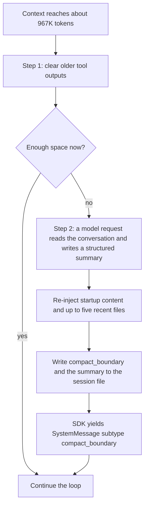
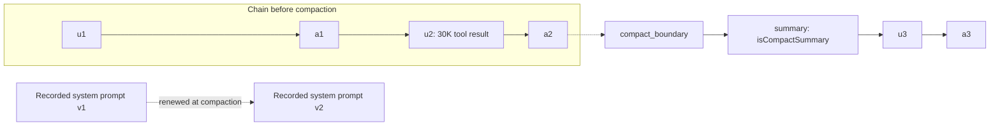

## 1. The question this idea answers

A data agent answers questions about plants, orders and downtime. Each answer runs several tool calls, and each tool result stays in the conversation. After a long chat, the conversation holds hundreds of thousands of tokens.

The model is Claude Sonnet 5 with a 1M-token window. So the questions are:

- What exactly must fit in 1M tokens: only the input, or the output too?
- When does Claude Code stop the growth, and what does it do?
- What does the SDK tell your code when it happens?
- What happens to the session file, and to the system prompt that the session recorded?
- Is a full window a good thing? What does a 950K-token call cost, and does the model still answer well?

This lesson answers each question with official numbers. Lesson [L2](/notes/ai/claude-agent-sdk/06-context-window/l2-compaction-controls) shows the settings that change the behavior.

## 2. Mental model

> [!analogy] A whiteboard in a war room
> A team works at a very large whiteboard. Everything goes on it: the brief, every question, every printout from the database, every answer. Before each decision, the expert reads the whole board from top to bottom.
>
> When the board is almost full, a secretary acts. First the secretary removes old printouts. If that is not enough, the secretary photographs the board and files the photo in the archive. Then the secretary wipes the board and writes a one-page summary at the top. Some items return to the board at once: the team rules and the five most recently used documents.
>
> **Where it stops working:** reading a whiteboard costs nothing. The model re-reads the whole board on every call, and you pay for every token it reads. Also, a crowded board does not only cost money. The expert makes more mistakes on a crowded board, long before it is full.

## 3. Terms

| Term | Plain meaning |
|---|---|
| context window | The maximum number of tokens that one model request can hold: the input and the output of that request together. |
| input tokens | Everything the request sends: system prompt, tool definitions, messages, tool results. |
| output tokens | The tokens the model generates in one request, including thinking. |
| `max_tokens` | The request field that limits the output tokens of one request. |
| max output | The largest `max_tokens` value a model accepts: 128K on current models. |
| native-1M model | A model that Claude Code runs with the 1M window by default, with no `[1m]` suffix. |
| auto-compaction | Claude Code's automatic step that shrinks its copy of the conversation when it nears the limit. |
| compaction point | The context size at which auto-compaction runs. About 967K tokens on native-1M models by default. |
| tool output clearing | The first step of compaction: Claude Code removes old tool outputs from its copy of the conversation. |
| compact summary | A structured summary that replaces the older conversation after compaction. |
| `compact_boundary` | A `SystemMessage` subtype that the SDK yields after a compaction. |
| prompt cache | A provider-side store of an input prefix. A cached prefix is cheaper and faster to read. |
| cold call | A request whose prefix is not in the prompt cache, for example after a pause longer than the cache lifetime. |
| context editing | An API feature that removes old tool results on the server for one request. Your own message list stays complete. |
| server compaction | An API feature that summarizes the conversation on the server and returns a compaction block. |

## 4. Method and math

### 4.1 Window sizes of the current models

The Claude models overview (checked on 2026-10-13):

| Model | API id | Context window | Max output |
|---|---|---|---|
| Claude Fable 5.1 | `claude-fable-5-1` | 1M tokens | 128K tokens |
| Claude Opus 5.5 | `claude-opus-5-5` | 1M tokens | 128K tokens |
| Claude Sonnet 5.5 | `claude-sonnet-5-5` | 1M tokens | 128K tokens |
| Claude Haiku 5.5 | `claude-haiku-5-5` | 1M tokens | 128K tokens |

The context-windows page adds the older models (checked on 2026-10-13): "Claude Fable 5.1, Claude Mythos 5.1, Claude Fable 5, Claude Mythos 5, Claude Opus 5.5, Claude Opus 5, Claude Opus 4.8, Claude Opus 4.7, Claude Opus 4.6, Claude Sonnet 5.5, Claude Sonnet 5, Claude Sonnet 4.6, Claude Haiku 5.5, and Claude Mythos Preview have a 1M-token context window. A single request to any of them can generate up to 128k output tokens". It also says: "Other Claude models, including Claude Sonnet 4.5 (deprecated), have a 200k-token context window."

Claude Code adds one more distinction. The model-config page says that "Fable 5.1, Fable 5, Sonnet 5 and later, Haiku 5.5, and Opus 4.7 and later run with the 1M window by default". Opus 4.6 and Sonnet 4.6 reach 1M "only through their `[1m]` variant". So Sonnet 5 is a native-1M model in Claude Code.

### 4.2 Input and output share the window

The context-windows page (checked on 2026-10-13): "Everything in the request counts toward the context window: the system prompt, every message in `messages` (including tool results, images, and documents), and your tool definitions. The output Claude generates for the turn, including its extended thinking, counts too."

So for one request:

$$
\text{input tokens} + \text{output tokens} \le \text{window}
$$

What happens when a request breaks this rule depends on which part is too large:

| Situation | Result (docs, checked on 2026-10-13) |
|---|---|
| The input alone is larger than the window | HTTP 400 `invalid_request_error`, "prompt is too long", on every model |
| Input plus `max_tokens` is larger than the window, on Claude 4.5 models and newer | The API accepts the request. If generation reaches the limit, it stops with `stop_reason: "model_context_window_exceeded"` |

> [!example] Worked example: 900K of input and a 128K output limit
> The window is 1,000,000 tokens. The input is 900,000 tokens and `max_tokens` is 128,000.
>
> 1. Input plus `max_tokens` = 900,000 + 128,000 = 1,028,000. That is more than 1,000,000.
> 2. On Sonnet 5 the API still accepts the request.
> 3. Space left for output = 1,000,000 − 900,000 = 100,000 tokens.
> 4. If the model writes 100,000 output tokens, including thinking, the response stops with `model_context_window_exceeded`. The answer is cut.
>
> With 1,010,000 input tokens, the request fails at once with HTTP 400.

This is why Claude Code compacts before the window is full: it must keep space for the next response.

### 4.3 The compaction point

The model-config page lists the default auto-compaction points (checked on 2026-10-13):

| Model and setup | Where auto-compaction runs |
|---|---|
| Native-1M models: the Fable models, Sonnet 5 and later, Haiku 5.5, Opus 4.7 and later | "before the window fills, at about 967K tokens by default" |
| Sonnet 4.6 and Opus 4.6 without extended context | "at the 200K boundary" |
| Native-1M models with `CLAUDE_CODE_DISABLE_1M_CONTEXT=1` | "at the 200K boundary" |
| A model id that Claude Code does not recognize, such as a gateway alias | "at the context window Claude Code assumes for the ID" |

The headroom on a native-1M model is 1,000,000 − 967,000 = 33,000 tokens. The docs give the 967K figure but no formula for it. Lesson [L2](/notes/ai/claude-agent-sdk/06-context-window/l2-compaction-controls) shows that a larger `CLAUDE_CODE_MAX_OUTPUT_TOKENS` lowers this point.

> [!trap] A Foundry deployment name can cost you 800K tokens of window
> The Claude Code page for Microsoft Foundry says (checked on 2026-10-13): "Claude Code reads the model from the deployment name in your model variables." And: "For a deployment name it can't match to a model, Claude Code assumes a 200K window unless you declare a different one."
>
> A deployment named `sonnet-prod` serves Sonnet 5, but Claude Code cannot match the name. The session compacts near 200K, not near 967K. Nothing fails, so nobody notices. The fix: name the deployment with the model id (`claude-sonnet-5`), or map it with the `modelOverrides` setting.

You can read the window that Claude Code uses at run time:

- `ResultMessage.model_usage[model]["contextWindow"]` for each model of the run.
- `ClaudeSDKClient.get_context_usage()`, whose `maxTokens` field is, in the words of the Python reference, "the model's context window, or the lower auto-compaction window when one applies".

### 4.4 What compaction does

The "How Claude Code works" page (checked on 2026-10-13): "It clears older tool outputs first, then summarizes the conversation if needed. Your requests and key code snippets are preserved; detailed instructions from early in the conversation may be lost."



The context-window page describes the summary. It keeps "your requests and intent, key technical concepts, files examined or modified with important code snippets, errors and how they were fixed, pending tasks, and current work. It replaces the verbatim conversation: full tool outputs and intermediate reasoning are gone."

Two more facts from the same pages:

1. "As of v2.1.198, the summarization request inherits your session's extended thinking configuration."
2. If one file or tool output is so large that the context fills again at once after each summary, "Claude Code stops auto-compacting after a few attempts and shows an error instead of looping."

### 4.5 The compact_boundary message

The agent-loop page says: "The SDK emits a message with `type: "system"` and `subtype: "compact_boundary"` in the stream when this happens (in Python this is a `SystemMessage`...)". The Python SDK has no special class for it, so the details are in `message.data`.

The Python reference does not list the fields. The CLI's own message schema (Claude Code 2.1.296, the CLI that SDK 0.2.165 bundles) defines them: `compact_metadata` with `trigger` (`"manual"` or `"auto"`), `pre_tokens`, and the optional `post_tokens` and `duration_ms`.

```python
from claude_agent_sdk import SystemMessage

if isinstance(message, SystemMessage) and message.subtype == "compact_boundary":
    meta = message.data.get("compact_metadata") or {}
    log.info("compacted trigger=%s pre=%s post=%s",
             meta.get("trigger"), meta.get("pre_tokens"), meta.get("post_tokens"))
```

A test with a fake CLI (a small script that writes one frame in this schema to stdout) confirmed the parsing path in SDK 0.2.165. The SDK yielded:

```text
SystemMessage subtype=compact_boundary compact_metadata={'trigger': 'auto', 'pre_tokens': 967412, 'post_tokens': 41870}
```

The token numbers in this test are inputs of the fake, not a measurement.

### 4.6 What survives compaction

The context-window page has this table (checked on 2026-10-13, shortened):

| Mechanism | After compaction |
|---|---|
| System prompt and output style | Both still apply |
| Project-root CLAUDE.md and unscoped rules | Re-injected from disk |
| Auto memory | Re-injected from disk |
| Files Claude read or edited | Claude Code re-reads up to five, most recently modified first |
| Invoked skill bodies | Re-injected, capped at 5,000 tokens per skill and 25,000 tokens total |
| Context that hooks added earlier | Summarized with the rest of the conversation |
| Earlier messages and tool results | Replaced by the summary |

It adds: "A file over 5,000 tokens comes back as a path reference without its content".

> [!key] Rules that must survive belong outside the conversation
> Anything that exists only as a message can become one line of a summary, or disappear. A rule that must hold for the whole chat belongs in the system prompt. Facts that the answer depends on belong in your own database, so that the service can inject them again.

### 4.7 Effect on the session file and on the recorded system prompt

**The session file.** Compaction is a persistent change in the CLI's copy of the conversation ([Sessions L1](/notes/ai/claude-agent-sdk/04-sessions/l1-what-a-session-is)). The CLI writes a `compact_boundary` entry and a summary entry with `isCompactSummary: true`. The SDK reader does not follow the link from the boundary to the old entries. The source comment in `_internal/sessions.py` says: "post-compaction, the isCompactSummary message replaces earlier messages". So a later resume loads the summary and the newer entries, not the original turns.

**The recorded system prompt.** A session records its system prompt on its first request and reuses the record "until the session is compacted" ([Prompts L1](/notes/ai/claude-agent-sdk/05-prompts-and-input/l1-system-prompts-and-snapshot)). So a compaction is one of the two moments when a changed `append` text starts to apply. The model can see a different system prompt after a compaction, at a moment that your code did not choose.



Your user transcript does not change. The application stores what the user saw in its own database ([Transient vs persistent context](/notes/ai/conversation-state/01-where-state-lives/l2-transient-vs-persistent-context)).

### 4.8 Cost and latency of very long inputs

Every model request re-sends the whole context. The price is per token, at the same rate for 9K and 900K tokens on these models. The pricing page says: "A 900k-token request is billed at the same per-token rate as a 9k-token request." (Haiku 5.5 is the exception: it costs more above 100K.)

Claude Sonnet 5 prices, USD per million tokens (pricing page, checked on 2026-10-13):

| Base input | 5-minute cache write | Cache read | Output |
|---|---|---|---|
| 2.00 | 2.50 | 0.20 | 10.00 |

The SDK caches the stable prefix by itself. The cost-tracking page says that with an API key or on Microsoft Foundry, "Cache entries for your own turns use a 5-minute TTL by default". A chat user who reads an answer for six minutes makes the next call a cold call.

> [!example] Worked example: one model call with 950K or 50K tokens of context
> Each call adds 10,000 new tokens and writes 1,000 output tokens.
>
> **Warm call, 950,000 tokens of context:**
> - cache read: 940,000 × 0.20 / 1,000,000 = 0.188
> - cache write: 10,000 × 2.50 / 1,000,000 = 0.025
> - output: 1,000 × 10 / 1,000,000 = 0.010
> - total: **USD 0.223**
>
> **Cold call, 950,000 tokens:** the whole context is written to the cache again: 950,000 × 2.50 / 1,000,000 = 2.375, plus 0.010 output = **USD 2.385**.
>
> **The same two calls with 50,000 tokens of context:**
> - warm: 40,000 × 0.20/10⁶ + 10,000 × 2.50/10⁶ + 0.010 = 0.008 + 0.025 + 0.010 = **USD 0.043**
> - cold: 50,000 × 2.50/10⁶ + 0.010 = **USD 0.135**
>
> An answer with four model calls near 950K costs about 4 × 0.223 = USD 0.89 when warm. One cold call alone costs USD 2.385. These numbers came from a Python script run in the sandbox.

Compaction itself has a cost. The costs page says: "`/compact` reads the conversation it summarizes, so compacting a large context is itself a large request." After compaction, the next request misses the cache, because the prefix changed. The costs page calls this an "expected rebuild".

Latency follows the same trend. Before the first output token, the model must process the whole input ([Context engineering L4](/notes/ai/context-engineering/01-foundations/l4-attention-and-the-cost-of-length)). A cached prefix is faster: the agent-loop page says that caching "reduces cost and latency for repeated prefixes". The docs give no latency numbers for 1M-token inputs. Measure your own: `ResultMessage.duration_api_ms` gives the API time of each answer.

### 4.9 The quality risk of long context

A fact inside the window is not always a fact that the model uses. [Context engineering L5](/notes/ai/context-engineering/01-foundations/l5-position-and-length-effects) separates three effects: the position of the fact, the total length, and stale text near the fact. All three grow in a long agent chat. Old tool results are often stale: yesterday's shift numbers sit next to today's.

> [!key] A 1M window is a capacity, not a target
> The window decides when the request fails. It does not decide when the answers get worse, or when a call gets expensive. A service that lets every chat grow to 967K pays for the largest and slowest calls, with the highest risk of a missed fact.

### 4.10 The API-level alternatives in short

Applications that call the Messages API directly have two server features. The Claude Agent SDK does not need them, because Claude Code compacts its own copy.

| Feature | How it works (checked on 2026-10-13) | Kind of change |
|---|---|---|
| Context editing, `clear_tool_uses_20250919` (beta `context-management-2025-06-27`) | Clears old tool results when the input passes a trigger (default 100,000 input tokens). Keeps the 3 newest tool uses by default. "Your client application maintains the full, unmodified conversation history." | Transient for your data |
| Threshold compaction, `compact_20260112` (beta `compact-2026-01-12`) | Default trigger `{"type": "input_tokens", "value": 150000}`, and "value must be at least 50,000 tokens". The API "returns a compaction block at the start of the assistant response". | Persistent, once you append the block |

LangChain has middleware with the same two ideas ([summarization](/notes/ai/langchain-langgraph/03-context-management/l1-summarization-middleware) and [context editing](/notes/ai/langchain-langgraph/03-context-management/l2-context-editing-middleware)).

### 4.11 Production view

| Concern | What to do |
|---|---|
| Correctness | Log `compact_boundary` with its `pre_tokens`. A compaction in a short chat means a wrong window, for example an unmatched Foundry deployment name. |
| Configuration | Check `model_usage[model]["contextWindow"]` in the first result after each deployment. |
| Cost | Expect cold calls after pauses longer than 5 minutes. Price the cold case, not only the warm case. |
| Latency | Log `duration_api_ms` against context size. Long contexts make every answer slower. |
| Quality | Keep tool results small (counts, top rows, summaries). Do not let the window fill only because it can. |
| Durability | Keep the user transcript in your own database. Compaction changes only the CLI's copy. |

## 5. Video

```video
{
  "src": "/notes/media/claude-agent-sdk/manim/m06-auto-compaction.mp4",
  "caption": "A session fills toward 967K tokens, old tool outputs are cleared, a summary replaces the old turns, the SDK yields compact_boundary, and the user transcript in the database stays complete."
}
```

## 6. Code

These exercises go in `claude-agent-sdk/13-context-window.ipynb`.

**Exercise 1.1: will the request fit?** Write `check_request(input_tokens, max_tokens, window=1_000_000)`. It returns `"ok"`, `"may_stop_at_window"` or `"rejected"`, by the rules of section 4.2 for Claude 4.5 models and newer. No API call is needed.

Acceptance tests:

- `(900_000, 128_000)` gives `"may_stop_at_window"`.
- `(1_010_000, 1_000)` gives `"rejected"`.
- `(500_000, 128_000)` gives `"ok"`.

**Exercise 1.2: the cost of one call.** Write `call_cost(context, new_tokens, output_tokens, warm, prices)`. A warm call reads the old context from the cache and writes the new tokens. A cold call writes the whole context.

Acceptance tests:

- With the Sonnet 5 prices of section 4.8, you reproduce USD 0.223, 2.385, 0.043 and 0.135.
- The function raises `ValueError` when `new_tokens` is larger than `context`.

**Exercise 1.3: see a compaction.** With a `ClaudeSDKClient`, run a session whose tool returns about 20,000 tokens per call. Pass `env={"CLAUDE_CODE_AUTO_COMPACT_WINDOW": "100000"}` so that compaction comes early and cheaply ([L2](/notes/ai/claude-agent-sdk/06-context-window/l2-compaction-controls)). Log every `compact_boundary`.

Acceptance tests:

- You print at least one `compact_boundary` with `trigger == "auto"`.
- After the run, `get_session_messages(session_id)` starts with the summary, not with your first prompt.
- The raw `.jsonl` file still holds the line with your first prompt.

**Exercise 1.4: read the window.** In the same session, call `get_context_usage()` before and after the compaction, and read `model_usage` from the result.

Acceptance test: you print `totalTokens`, `maxTokens` and `contextWindow`, and you explain in two sentences why `maxTokens` and `contextWindow` differ.

## 7. Common mistakes

1. **"1M tokens of input are available."** Input and output share the window, and Claude Code compacts at about 967K.
2. **"Compaction changes my chat history."** It changes the CLI's session chain. Your own transcript must come from your own database.
3. **"Instructions from the first message stay forever."** After compaction they can be one summary line, or gone. Put rules in the system prompt.
4. **Pricing only the warm case.** A chat with pauses longer than 5 minutes makes cold calls, which cost about 10 times more at large context.
5. **Trusting the model to use a long context well.** Accuracy drops with length, position and stale text.
6. **Deployment names that Claude Code cannot match.** The session silently runs with a 200K window.

## 8. One-minute explanation

Current Claude models have a 1M-token window, and one request can write up to 128K output tokens. Input and output share the window, so a 900K input leaves only 100K for the answer. Claude Code compacts a native-1M session, such as Sonnet 5, at about 967K tokens: first it clears old tool outputs, then it asks the model for a structured summary that replaces the old turns. The system prompt and project CLAUDE.md still apply, and up to five recent files are read again. The SDK yields a `SystemMessage` with subtype `compact_boundary`, whose `compact_metadata` holds the trigger and the token count before compaction. In the session file, the chain now starts at the summary, and the recorded system prompt is renewed. A full window is expensive: a cold 950K call on Sonnet 5 costs about USD 2.39, and long contexts are slower and less accurate. So treat the 1M window as a limit, not as a goal.

## 9. Check questions

```check
{
  "question": "A request to Sonnet 5 has 850,000 input tokens and max_tokens = 128,000. Is it accepted? What can happen to the answer?",
  "hint": "Add the two numbers and compare with the window.",
  "answer": "850,000 + 128,000 = 978,000, which is below 1,000,000, so it fits completely and is accepted. The answer can use all 128,000 output tokens. With 900,000 input tokens it would still be accepted on Claude 4.5 models and newer, but generation would stop with model_context_window_exceeded after 100,000 output tokens."
}
```

```check
{
  "question": "Name the two steps of Claude Code's compaction, in order, and three things that are present again right after it.",
  "answer": "First it clears older tool outputs, then it summarizes the conversation if that is not enough. After it, the system prompt still applies, the project-root CLAUDE.md and auto memory are re-injected, and up to five of the most recently modified files are read again. Invoked skill bodies are also re-injected, within caps."
}
```

```check
{
  "question": "A service on Microsoft Foundry sees compact_boundary messages with pre_tokens near 190,000, on Sonnet 5. What is the likely cause, and how do you confirm it?",
  "answer": "Claude Code cannot match the deployment name to a model, so it assumes a 200K window. Confirm it by reading model_usage[model][\"contextWindow\"] in a ResultMessage, or maxTokens from get_context_usage(): it shows 200,000 instead of 1,000,000. Fix it by naming the deployment with the model id or by mapping it with modelOverrides."
}
```

```check
{
  "question": "Why can the model follow a different system prompt after a compaction, even though your code did not change anything at that moment?",
  "answer": "A session records its system prompt on its first request and reuses the record until the session is compacted. At compaction the record is renewed from the options of the current run. If the append text changed since the first request, the new text starts to apply after the compaction."
}
```

## 10. Links

- Previous in the priority path: [Prompts L1: System prompts and snapshot](/notes/ai/claude-agent-sdk/05-prompts-and-input/l1-system-prompts-and-snapshot)
- Next: [L2: Compaction controls](/notes/ai/claude-agent-sdk/06-context-window/l2-compaction-controls)
- The session chain: [Sessions L1: What a session is](/notes/ai/claude-agent-sdk/04-sessions/l1-what-a-session-is)
- Why long inputs answer worse: [Context engineering L5: Position and length effects](/notes/ai/context-engineering/01-foundations/l5-position-and-length-effects)
- Cache prices: [Context engineering L7: Prompt caching](/notes/ai/context-engineering/01-foundations/l7-prompt-caching)
- [Glossary](/notes/ai/claude-agent-sdk/glossary)
