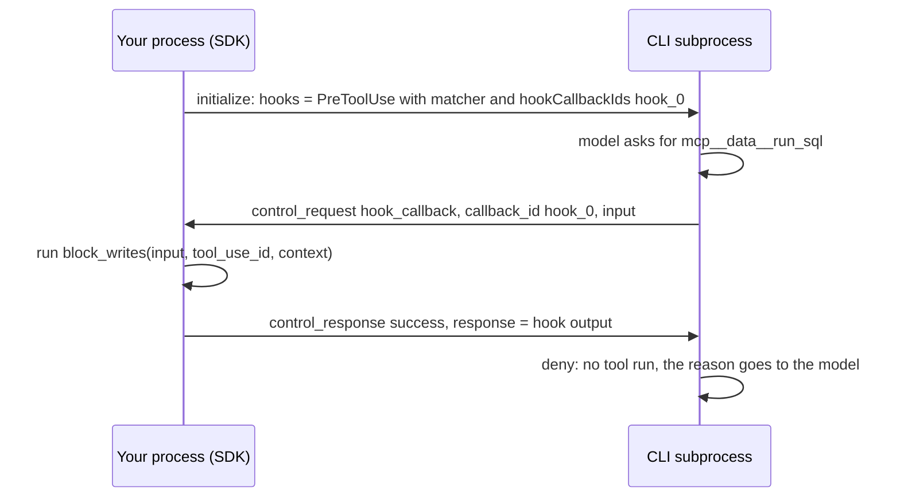

## 1. The question this idea answers

A data agent needs rules that the model cannot talk its way around:

- A SQL tool may run only `SELECT` statements.
- Each user message must carry the page that the user has open, also on a resumed session ([Prompts L1](/notes/ai/claude-agent-sdk/05-prompts-and-input/l1-system-prompts-and-snapshot)).
- The transcript must be archived before each compaction ([Context window L2](/notes/ai/claude-agent-sdk/06-context-window/l2-compaction-controls)).
- Every tool call must reach an audit log.

A system prompt can ask for these things. It cannot enforce them. The SDK's answer is hooks: your Python functions, which run at fixed points of the loop. But the loop runs in the CLI subprocess, not in your process. So how does the CLI call your Python function, what can the function change, and what can it not change?

## 2. Mental model

> [!analogy] Inspection stations on a production line, with an intercom
> A production line runs in another building: the CLI. Some stations have an intercom to your office: before a part goes into a machine, after the machine works, when a new order arrives, and before the line is cleaned. The line calls, describes the part, and waits. You answer "go", "stop, and here is why", or "go, but use these settings instead".
>
> **Where it stops working:** you can stop a part or change its settings, but you cannot rebuild the line. No hook can rewrite the request that goes to the model, or delete old messages. And if two inspectors listen at the same station, the line calls both at the same time, not one after the other.

## 3. Terms

| Term | Plain meaning |
|---|---|
| hook | A Python function that the CLI calls at a named point of the agent loop. |
| hook event | The named point, for example `PreToolUse` or `Stop`. |
| `HookMatcher` | A dataclass that groups callbacks with an optional matcher and a timeout. |
| matcher | A string that filters which events reach the callbacks. For tool events it matches the tool name. |
| hook input | The dict that the callback receives: event name, session id, transcript path, and event fields. |
| hook output | The dict that the callback returns. `{}` means "continue with no change". |
| `hookSpecificOutput` | The part of the output with event-specific controls, such as `permissionDecision`. |
| `permissionDecision` | A `PreToolUse` output: `allow`, `deny`, `ask` or `defer`. |
| `updatedInput` | A `PreToolUse` output that replaces the tool's input. |
| `additionalContext` | Text that the CLI inserts into the conversation, as a system reminder, at the point where the hook fired. |
| `decision: "block"` | A top-level output that blocks the action of some events, with a `reason`. |
| `hook_callback` | The control request that the CLI sends to the SDK to run one callback. |
| callback id | A name such as `hook_0` that the SDK gives each callback in the `initialize` request. |
| middleware | LangChain's mechanism for code that runs around model and tool calls inside the agent graph. |

## 4. Method and math

### 4.1 The hook events in Python

`HookEvent` in `types.py` (SDK 0.2.165) lists exactly ten events:

| Event | When it fires | Can it block? | Main outputs |
|---|---|---|---|
| `PreToolUse` | Before a tool runs | Yes | `permissionDecision`, `updatedInput`, `additionalContext` |
| `PostToolUse` | After a tool returns | No, the tool already ran | `additionalContext`, `updatedToolOutput` |
| `PostToolUseFailure` | After a tool fails | No | `additionalContext` |
| `UserPromptSubmit` | When a prompt is submitted | Yes | `additionalContext`, `decision: "block"` |
| `Stop` | When the agent would stop | Yes: blocking makes it continue | `decision: "block"` with `reason`, `additionalContext` |
| `SubagentStart` | When a subagent starts | No | `additionalContext` |
| `SubagentStop` | When a subagent would stop | Yes, like `Stop` | `decision: "block"`, `additionalContext` |
| `PreCompact` | Before a compaction | Yes | `decision: "block"` |
| `Notification` | Agent status messages | No | Side effects only. The reference lists no decision control. |
| `PermissionRequest` | A tool call needs a permission decision | Through its `decision` object | `decision` with `behavior` |

The hooks page (checked on 2026-10-13) lists many more events for TypeScript only, for example `SessionStart`, `SessionEnd`, `PostCompact` and `StopFailure`. It says that `SessionStart` and `SessionEnd` "aren't available in the Python SDK because its `HookEvent` type omits them", and that in Python they work only as shell command hooks in settings files that `setting_sources` loads.

### 4.2 HookMatcher and the callback

```python
@dataclass
class HookMatcher:
    matcher: str | None = None          # None: every event of this type
    hooks: list[HookCallback] = field(default_factory=list)
    timeout: float | None = None        # seconds

HookCallback = Callable[[HookInput, str | None, HookContext], Awaitable[HookJSONOutput]]
```

The callback is `async def hook(input_data, tool_use_id, context) -> dict`. In Python, `context` holds `{"signal": None}`. The docs call it "reserved for future use".

Matcher rules, from the hooks reference (checked on 2026-10-13):

| Matcher value | Evaluated as |
|---|---|
| omitted, `""` or `"*"` | Match all |
| Only letters, digits, `_`, `-`, spaces and commas, plus the pipe character as a separator | An exact name, or a list of exact names, for example `Write` or a pipe-separated list such as `Write`, `Edit` |
| Any other character | A JavaScript regular expression, unanchored, for example `^mcp__data__` |

Two more rules: "Matchers only match tool names, not file paths or other arguments", and "`Stop` ignores matchers entirely".

> [!note] Source and docs disagree on the default timeout
> The comment in `types.py` says "Timeout in seconds for all hooks in this matcher (default: 60)". The SDK sends a timeout only when you set one (`if matcher.get("timeout") is not None`). Without it, the CLI applies its own default, and the hooks page gives it: "600 seconds for most events, 30 seconds for `UserPromptSubmit`". The code follows the docs. Set `timeout` explicitly.

### 4.3 The output fields

`SyncHookJSONOutput` in `types.py` has these top-level fields: `continue_`, `suppressOutput`, `stopReason`, `decision` (only `"block"`), `systemMessage`, `reason` and `hookSpecificOutput`. `AsyncHookJSONOutput` has `async_: True` and an optional `asyncTimeout` in milliseconds.

Python cannot use `continue` and `async` as names, so the SDK renames them before it sends the output. The function `_convert_hook_output_for_cli` in `_internal/query.py` turns `async_` into `async` and `continue_` into `continue`.

| Field | Meaning (hooks pages, checked on 2026-10-13) |
|---|---|
| `continue_: False` | "Claude stops processing entirely after the hook runs." |
| `systemMessage` | "Warning message shown to the user", not to the model |
| `decision: "block"` with `reason` | Blocks the action of the events that support it |
| `async_: True` | The agent continues at once. Async outputs "can't block, modify, or inject context". |
| `suppressOutput` | The `types.py` docstring says "Hide stdout from transcript mode". The hooks reference says "Has no effect". The CLI decides, so follow the reference. |

### 4.4 How hooks travel through the control protocol

The CLI cannot call a Python function directly. The SDK sends the hook configuration in the `initialize` control request, with an id for each callback. When an event fires, the CLI sends a `hook_callback` control request on stdout. The SDK runs the function and writes a `control_response` on stdin ([Foundations L1](/notes/ai/claude-agent-sdk/01-foundations/l1-what-the-sdk-is)).



A fake CLI recorded the real traffic of SDK 0.2.165. The options had a `PreToolUse` matcher `^mcp__data__` and a `UserPromptSubmit` matcher with `timeout=10`. The SDK sent this `hooks` field in `initialize`:

```json
{
  "PreToolUse": [{"matcher": "^mcp__data__", "hookCallbackIds": ["hook_0"]}],
  "UserPromptSubmit": [{"matcher": null, "hookCallbackIds": ["hook_1"], "timeout": 10}]
}
```

The `UserPromptSubmit` callback returned `{"continue_": True, "hookSpecificOutput": {...}}`. The SDK answered the CLI with:

```json
{"subtype": "success", "request_id": "cli_1",
 "response": {"continue": true,
              "hookSpecificOutput": {"hookEventName": "UserPromptSubmit",
                                     "additionalContext": "The user is viewing: Plant B, shift 2."}}}
```

Two failure cases from the same test:

```text
callback that forgot "return {}"  -> {"subtype": "error", "error": "'NoneType' object has no attribute 'items'"}
callback that raised RuntimeError -> {"subtype": "error", "error": "audit store unreachable"}
```

The docs pages checked for this lesson do not describe how the CLI treats an error response. Catch your own exceptions, and always return a dict.

> [!trap] Matchers on one event run at the same time
> The `hooks` option docstring says: "multiple matchers registered on the same event are dispatched **concurrently** by the CLI". The hooks page adds: "For permission decisions, the most restrictive result applies". Write each hook so that it does not depend on another hook having run first.

### 4.5 PreToolUse: allow, deny or modify

The values of `permissionDecision` are `allow`, `deny`, `ask` and `defer`. The hooks page gives the order: "`deny` takes priority over `defer`, which takes priority over `ask`, which takes priority over `allow`."

This guard ran in the test of section 4.4. It returned the `deny` output for `DELETE FROM orders`:

```python
async def block_writes(input_data, tool_use_id, context):
    sql = input_data["tool_input"].get("sql", "")
    if not sql.lstrip().upper().startswith("SELECT"):
        return {"hookSpecificOutput": {"hookEventName": "PreToolUse",
                "permissionDecision": "deny",
                "permissionDecisionReason": "Only SELECT statements are allowed."}}
    return {}

options = ClaudeAgentOptions(hooks={
    "PreToolUse": [HookMatcher(matcher="^mcp__data__", hooks=[block_writes], timeout=5)]})
```

The model receives the reason as the tool result and can try a different approach. A prefix check like this one is only an illustration. A real guard needs a SQL parser or a read-only database role.

Rules for the other decisions:

| Decision | Effect |
|---|---|
| `allow` | The tool runs without a permission prompt. The `can_use_tool` docstring warns that "a `PreToolUse` hook returning an *allow* decision also skips this callback." |
| `updatedInput` | Replaces the tool input. "Pair `updatedInput` with `permissionDecision: 'allow'` to auto-approve the modified input". "Always return a new object rather than mutating the original `tool_input`." |
| `ask` | The docs say: "`'ask'` to show it to the user". In the SDK, the user prompt is your `can_use_tool` callback, which its docstring calls "the SDK replacement for the interactive permission prompt". |
| `defer` | "the turn ends with a result message whose `stop_reason` is `"tool_deferred"`". `ResultMessage.deferred_tool_use` holds the call. "With `'defer'`, `updatedInput` is ignored." |

### 4.6 PostToolUse: add context or replace the output

A `PostToolUse` hook can return `additionalContext`, which the CLI places "next to the tool result", and `updatedToolOutput`, which "Replaces the tool output before it is sent to the model". The `types.py` docstring warns that for built-in tools "the value must match the tool's output schema", or "the original output is kept".

A common use: a data tool sometimes returns 40,000 tokens of rows. A `PostToolUse` hook can replace the output with the row count, the first 50 rows and a reference to the full result in storage. The model's context then grows by a few thousand tokens, not by 40,000.

### 4.7 UserPromptSubmit: the fix for per-turn data

[Prompts L1](/notes/ai/claude-agent-sdk/05-prompts-and-input/l1-system-prompts-and-snapshot) showed the bug: a resumed session keeps its recorded system prompt, so per-turn data in `append` is ignored. A `UserPromptSubmit` hook gives the model the data of this turn:

```python
def ui_context_hook(page: str):
    async def hook(input_data, tool_use_id, context):
        return {"hookSpecificOutput": {"hookEventName": "UserPromptSubmit",
                                       "additionalContext": f"The user is viewing: {page}."}}
    return hook

# one query() per user message: build the hook with this request's data
options = ClaudeAgentOptions(resume=session_id, hooks={
    "UserPromptSubmit": [HookMatcher(hooks=[ui_context_hook(request_page)], timeout=5)]})
```

The facts that make this work, from the hooks reference (checked on 2026-10-13):

1. Placement: "Claude Code wraps the string in a system reminder and inserts it into the conversation at the point where the hook fired", for this event "alongside the submitted prompt".
2. Persistence: "Claude Code saves the injected text in the session transcript... when you resume with `--continue` or `--resume`, Claude Code replays the saved text rather than re-running the hook for past turns". So turn 3 keeps the page of turn 3. This is correct for per-turn data.
3. Size: "If a value exceeds 10,000 characters, Claude Code writes the text to a file in the session directory and passes Claude the file path with a preview of up to the first 2,000 characters instead."
4. Wording: "Write the text as factual statements rather than imperative system instructions." Text that looks like system commands "can trigger Claude's prompt-injection defenses".
5. Failure: an SDK callback on `UserPromptSubmit` that reaches its timeout "blocks the prompt", because it "can be acting as a policy gate that must not fail open".

> [!trap] UserPromptSubmit also fires on prompts that no user typed
> The hooks reference: Claude Code also runs it on "A scheduled task firing", "A background subagent reporting back to the session that started it", and "A message another session sends". A hook that reads the current page must not attach a stale page to a subagent's report.

### 4.8 PreCompact and Stop

**PreCompact** receives `trigger` (`manual` or `auto`) and `custom_instructions`. It can return `{}` after it archives `transcript_path`, or `{"decision": "block", "reason": ...}`. [Context window L2, section 4.8](/notes/ai/claude-agent-sdk/06-context-window/l2-compaction-controls) has a tested example and the rule: block only manual compaction.

**Stop** receives `stop_hook_active`, and optionally `last_assistant_message`, `background_tasks` and `session_crons` (`types.py`). Returning `{"decision": "block", "reason": "..."}` makes the agent continue, and the reason becomes its next instruction. Two limits from the hooks guide (checked on 2026-10-13):

- "Claude Code overrides a Stop hook after it blocks eight times in a row with no tool call from Claude in between." The variable `CLAUDE_CODE_STOP_HOOK_BLOCK_CAP` raises the cap.
- "Parse the `stop_hook_active` field from the JSON input and exit early if it's `true`."

And from the SDK hooks page: "Hooks may not fire when the agent hits the `max_turns` limit because the session ends before hooks can execute". Do not put cost logging in a `Stop` hook. Read the `ResultMessage` instead.

### 4.9 Hooks compared with LangChain middleware

LangChain's `create_agent` runs middleware inside the agent graph, in your own process ([LangChain middleware hooks](/notes/ai/langchain-langgraph/02-middleware/l1-the-middleware-hooks)).

| Need | Claude Agent SDK hook | LangChain v1 middleware |
|---|---|---|
| Block or change a tool call | `PreToolUse` with `deny` or `updatedInput` | `wrap_tool_call`, before `handler` |
| Change a tool result | `PostToolUse` with `updatedToolOutput` | `wrap_tool_call`, after `handler` |
| Add per-turn context | `UserPromptSubmit` with `additionalContext` (saved in the transcript) | `before_model` (persistent) or `wrap_model_call` (transient) |
| Change the model request: messages, tools, model | Not possible | `wrap_model_call` with `request.override(...)` |
| Summarize the history | Claude Code compaction, with `PreCompact` to observe or block | `SummarizationMiddleware` in `before_model` |
| Check the final answer | `Stop` with `decision: "block"` | `after_agent`, or `after_model` with a jump |
| Where the code runs | Your process, called by the CLI over the pipe | Your process, as graph nodes or wrappers |
| Order of several handlers | Concurrent on one event | `before_*` first to last, `wrap_*` nested, `after_*` last to first |

> [!key] Hooks guard the edges of the loop, not its inside
> SDK hooks can stop, change or annotate tool calls, prompts, compaction and stopping. They cannot see or rewrite the message list that the CLI sends to the model. When you need that control, it belongs in a harness that owns the model call, such as LangChain middleware.

### 4.10 Production view

| Concern | What to do |
|---|---|
| Security | Enforce policy in `PreToolUse`, and also in the tool itself or in database permissions. A hook is one layer. |
| Latency | Every hook is a round trip over the pipe, and the loop waits. Keep hooks fast. Use `async_` for pure logging. |
| Reliability | Always return a dict. Catch exceptions inside the hook. Set `timeout` explicitly. |
| Concurrency | Make hooks on one event independent of each other. |
| Observability | Log `tool_use_id`, `agent_id` and the decision. `agent_id` is present only inside a subagent. |
| Context size | Use `PostToolUse` with `updatedToolOutput` to shrink large data results. |

## 5. Code

These exercises go in `claude-agent-sdk/17-hooks.ipynb`.

**Exercise 1.1: a SQL guard.** Write a `PreToolUse` hook for your data tool. It denies anything that is not a single read statement, and adds `LIMIT 1000` to a `SELECT` with no limit through `updatedInput`.

Acceptance tests:

- Unit tests with fake inputs: `DELETE ...` gives `deny`, `SELECT ... LIMIT 10` gives `{}`, `SELECT ...` without a limit gives `allow` with the new SQL.
- The hook never changes the original `tool_input` dict.
- In a live run, a prompt that asks for a delete ends with an answer that explains the refusal.

**Exercise 1.2: per-turn page context.** Reproduce the bug of Prompts L1 with `append`, then fix it with the `UserPromptSubmit` hook of section 4.7.

Acceptance tests:

- On a resumed session, the second answer uses the second page.
- The `.jsonl` session file contains the injected text of both turns.

**Exercise 1.3: watch the protocol.** Write a fake CLI that sends one `hook_callback` request and records the `initialize` request and the response.

Acceptance tests:

- The recorded `hooks` field has one `hookCallbackIds` entry per callback, and `timeout` only where you set one.
- A callback that returns `{"continue_": False}` arrives as `{"continue": false}`.
- A callback that returns `None` arrives as an error response.

**Exercise 1.4: an audit log.** Write `PreToolUse` and `PostToolUse` hooks that write one row per tool call: `tool_use_id`, tool name, input size, output size, duration and `agent_id`.

Acceptance test: in a run with parallel tool calls, every `tool_use_id` has exactly one start row and one end row.

## 6. Common mistakes

1. **"A hook can edit the prompt that goes to the model."** It can add context, block, or change tool input and output. It cannot rewrite the message list.
2. **Forgetting `return {}`.** The SDK then sends an error response to the CLI.
3. **Expecting matchers to see arguments.** They match tool names only. Check `tool_input` inside the hook.
4. **Relying on the order of hooks on one event.** They run concurrently.
5. **Putting cost logging in a `Stop` hook.** It may not fire at `max_turns`. Read the `ResultMessage`.
6. **Instruction-style text in `additionalContext`.** Write facts, or the model may treat the text as an injection.

## 7. One-minute explanation

Hooks are async Python functions that run at named points of the agent loop. In Python there are ten events, among them `PreToolUse`, `PostToolUse`, `UserPromptSubmit`, `Stop` and `PreCompact`. You register them in `options.hooks` as `HookMatcher` objects with an optional matcher, which matches tool names, and a timeout. The loop runs in the CLI, so the SDK sends the hook configuration in the `initialize` request. The CLI then calls each function with a `hook_callback` control request over the pipe. The function returns a dict. `{}` continues with no change. `permissionDecision` and `updatedInput` control tool calls. `additionalContext` adds facts next to the prompt or tool result. `decision: "block"` blocks the events that support it. `additionalContext` from `UserPromptSubmit` is saved in the transcript, which makes it the right place for per-turn data. Unlike LangChain middleware, hooks cannot change the model request itself, and several hooks on one event run at the same time.

## 8. Check questions

```check
{
  "question": "Your PreToolUse hook returns permissionDecision allow for every read-only tool, and you also pass a can_use_tool callback that logs every permission check. The log stays empty for those tools. Why?",
  "answer": "A PreToolUse hook that returns allow approves the call before any permission prompt. The can_use_tool docstring says that an allow decision from a PreToolUse hook also skips that callback. Log in the hook itself, or do not return allow."
}
```

```check
{
  "question": "Why does a UserPromptSubmit hook fix the per-turn data bug of a resumed session, when changing the append text does not?",
  "hint": "Where does each piece of text live?",
  "answer": "The append text is part of the system prompt, which the session records on its first request and reuses on resume. additionalContext from UserPromptSubmit is inserted into the conversation next to the prompt of this turn and saved in the transcript. So each turn carries its own value, and a resume replays the saved values of earlier turns."
}
```

```check
{
  "question": "Describe the messages on the pipe when the model asks for mcp__data__run_sql and one PreToolUse hook is registered for it.",
  "answer": "At start, the SDK sent initialize with hooks = {PreToolUse: [{matcher, hookCallbackIds: [hook_0]}]}. When the model asks for the tool, the CLI writes a control_request with subtype hook_callback, callback_id hook_0, the hook input and the tool_use_id. The SDK runs the Python function and writes a control_response with subtype success and the hook output, with continue_ and async_ renamed. The CLI then applies the decision."
}
```

```check
{
  "question": "Name one thing that LangChain middleware can do and SDK hooks cannot, and one place where SDK hooks persist data that a transient LangChain change would not.",
  "answer": "LangChain wrap_model_call can change the model request itself: the messages, tools or model, with request.override. SDK hooks cannot. On the other side, additionalContext from a UserPromptSubmit or PostToolUse hook is saved in the session transcript and replayed on resume, while a wrap_model_call change applies to one call only."
}
```

## 9. Links

- Previous in the priority path: [Errors and cost L2: Cost and usage fields](/notes/ai/claude-agent-sdk/07-errors-and-cost/l2-cost-and-usage-fields)
- Next: [L2: Subagents](/notes/ai/claude-agent-sdk/08-hooks-and-subagents/l2-subagents)
- The pipe and control requests: [Foundations L1: What the SDK is](/notes/ai/claude-agent-sdk/01-foundations/l1-what-the-sdk-is)
- The per-turn data bug: [Prompts L1: System prompts and snapshot](/notes/ai/claude-agent-sdk/05-prompts-and-input/l1-system-prompts-and-snapshot)
- LangChain's side: [The middleware hooks](/notes/ai/langchain-langgraph/02-middleware/l1-the-middleware-hooks)
- Transient and persistent changes: [Transient vs persistent context](/notes/ai/conversation-state/01-where-state-lives/l2-transient-vs-persistent-context)
- [Glossary](/notes/ai/claude-agent-sdk/glossary)
