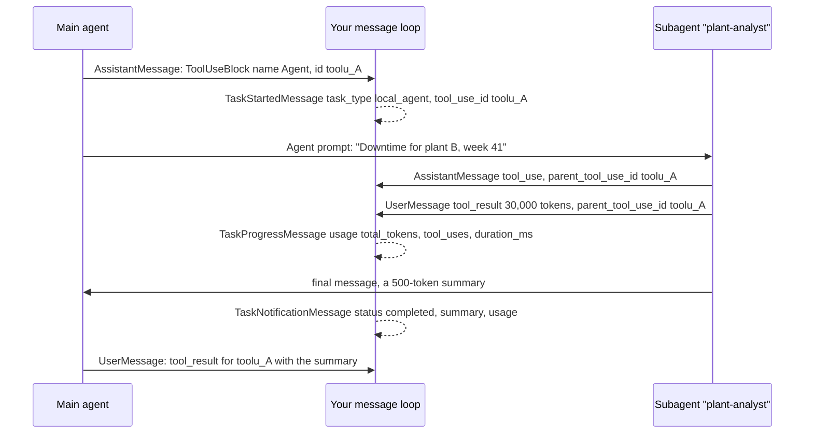

## 1. The question this idea answers

A user asks: "Compare last week's downtime at plants A, B and C." Each plant query returns about 30,000 tokens of rows. If the main agent runs the three queries itself, its context grows by 90,000 tokens. Every later message of the chat re-reads them ([Context window L1](/notes/ai/claude-agent-sdk/06-context-window/l1-window-size-and-auto-compaction)).

The SDK offers another way: the main agent sends each plant to a subagent. Each subagent reads its 30,000 tokens in its own context and returns a short summary. So the questions are:

- How do you define a subagent, and how does the main agent call it?
- What does the subagent see, and what returns to the main agent?
- What does your code receive in the message stream while subagents work?
- How are the costs counted? When does the isolation save money, and when does it cost more?

## 2. Mental model

> [!analogy] A manager and analysts with their own desks
> A manager gets a question. The manager writes a short brief for each analyst and gives it to the analyst. Each analyst works at a separate desk with a separate pile of printouts. When done, each analyst returns a one-page memo. The manager's desk receives only the memos, so it stays clear.
>
> **Where it stops working:** a real analyst remembers the printouts and can answer a follow-up question at once. Here the manager has only the memo. If the memo dropped the figure that the user asks about next, someone must run the query again. Also, every analyst first reads the standard handbook (system prompt, tool definitions) at their own cost, and the manager waits for the slowest analyst.

## 3. Terms

| Term | Plain meaning |
|---|---|
| subagent | A separate agent instance that the main agent starts for a subtask, with its own conversation and context window. |
| `AgentDefinition` | The dataclass that defines a subagent: description, prompt, tools, model and other fields. |
| `Agent` tool | The built-in tool that starts a subagent. The `init` message lists it as `Task`. |
| `subagent_type` | The input field of the `Agent` tool that names the subagent definition to use. |
| context isolation | The subagent's tool calls and results stay in its own context. Only its final message returns to the parent. |
| final message | The subagent's last response, which becomes the `tool_result` of the `Agent` tool call. |
| `parent_tool_use_id` | A field on messages from inside a subagent: the id of the `Agent` tool call that started it. |
| background subagent | A subagent that runs while the main agent continues. It is the default. |
| `TaskStartedMessage` | A `SystemMessage` subclass that the SDK yields when a background task, such as a subagent, starts. |
| `TaskProgressMessage` | A `SystemMessage` subclass with periodic progress and token usage of a running task. |
| `TaskNotificationMessage` | A `SystemMessage` subclass that reports that a task completed, failed or was stopped. |
| `forward_subagent_text` | An option that also forwards a subagent's text and thinking blocks into the stream. |
| subagent transcript | The JSONL file of one subagent, in the folder `<session-id>/subagents/` next to the main session file. |
| spawn depth | How many layers of subagents can start subagents of their own. |

## 4. Method and math

### 4.1 AgentDefinition

The dataclass in `types.py` (SDK 0.2.165), with the meanings from the subagents page (checked on 2026-10-13):

| Field | Type | Meaning |
|---|---|---|
| `description` | `str`, required | "Natural language description of when to use this agent". The main model reads it to decide. |
| `prompt` | `str`, required | "The agent's system prompt defining its role and behavior" |
| `tools` | `list[str] or None` | "Array of allowed tool names. If omitted, inherits every tool available to subagents" |
| `disallowedTools` | `list[str] or None` | Tools to remove. MCP patterns such as `mcp__server__*` work too. |
| `model` | `str or None` | An alias (`"sonnet"`, `"opus"`, `"haiku"`, `"inherit"`) or a full model id |
| `skills` | `list[str] or None` | Skills to preload into the subagent's context |
| `memory` | `"user"`, `"project"`, `"local"` or `None` | "Memory source for this agent" |
| `mcpServers` | `list` of names or inline configs, or `None` | MCP servers available to this agent |
| `initialPrompt` | `str or None` | Used only when the agent runs as the main thread. "Ignored when the agent is invoked as a subagent" |
| `maxTurns` | `int or None` | "Maximum number of agentic turns before the agent stops" |
| `background` | `bool or None` | Forces a background run |
| `effort` | level or `int` or `None` | Reasoning effort for this agent |
| `permissionMode` | `PermissionMode or None` | Permission mode inside this agent |

The camelCase names are deliberate: "multi-word field names such as `disallowedTools` and `mcpServers` keep their camelCase spelling to match the wire format". The TypeScript-only field `omitClaudeMd` does not exist in Python.

The SDK sends the definitions in the `initialize` control request. It converts each one with `asdict` and drops the `None` fields. A fake-CLI test of SDK 0.2.165 recorded this part of the request:

```json
"agents": {"sql-analyst": {"description": "Runs data queries and returns a short summary.",
                           "prompt": "You answer with numbers only.",
                           "tools": ["mcp__data__run_sql"], "model": "haiku"}},
"forwardSubagentText": true
```

> [!trap] "haiku" depends on the provider
> An alias resolves per provider. The model-config page (checked on 2026-10-13) shows that on Microsoft Foundry `haiku` resolves to Haiku 4.5 and `sonnet` to Sonnet 4.5. This changes when you set `ANTHROPIC_DEFAULT_HAIKU_MODEL` and `ANTHROPIC_DEFAULT_SONNET_MODEL`. Use full model ids, or pin the aliases.

### 4.2 How the main agent calls a subagent

The main model calls the `Agent` tool. The subagents page: "To detect when a subagent is invoked, check for `tool_use` blocks where `name` is `"Agent"`." It adds that the tool "appears as `"Agent"` in `tool_use` blocks but as `"Task"` in the `system:init` tools list", and that before Claude Code 2.1.63 the blocks also said `"Task"`. The input names the definition in `subagent_type` and carries the brief in its prompt.

The model chooses when to delegate, from each `description`. To force it, name the agent in the prompt: "Use the code-reviewer agent to check...". Put `"Agent"` in `allowed_tools`, so that the call runs without a permission prompt. A built-in `general-purpose` subagent exists even with no definitions.

> [!note] Subagents run in the background by default
> The subagents page: "An Agent tool call that omits the `run_in_background` input launches a background subagent, and Claude sets `run_in_background: false` when it needs the result before continuing." Before Claude Code 2.1.198, not every session had this default.

### 4.3 A separate context window, and only the final message returns

The subagents page (checked on 2026-10-13): "The only content you pass from parent to subagent is the Agent tool's prompt string, so include any file paths, error messages, or decisions the subagent needs directly in that prompt."

| The subagent receives | The subagent does not receive |
|---|---|
| Its own system prompt (`AgentDefinition.prompt`) and the Agent tool's prompt | The parent's conversation history or tool results |
| Project CLAUDE.md, when `setting_sources` loads it | Preloaded skill content, unless listed in `skills` |
| Tool definitions: the parent's, or the subset in `tools` | The parent's system prompt |

On the return path: "intermediate tool calls and results stay inside the subagent; only its final message returns to the parent." Three details follow:

1. The parent "may summarize it in its own response". Ask for verbatim output in your main prompt if you need it.
2. Since Claude Code 2.1.210, the CLI scans the final message for patterns that imitate harness tags or turn markers. It can add a `[harness: ...]` line, but it never removes the subagent's text.
3. "An API error that ends the subagent early, such as a rate limit, is never delivered as its result."

### 4.4 Parallel subagents and their limits

Several `Agent` calls in one response run at the same time. The subagents page: "independent subtasks finish in the time of the slowest one rather than the sum of all of them."

| Limit | Variable (through `options.env`) | Default (checked on 2026-10-13) |
|---|---|---|
| Depth | `CLAUDE_CODE_MAX_SUBAGENT_SPAWN_DEPTH` | 3 layers below the main agent. `1` stops subagents from starting their own. |
| Concurrency | `CLAUDE_CODE_MAX_CONCURRENT_SUBAGENTS` | 20 at once. Above it, the call returns `Concurrent subagent limit reached`. |
| Spend | `max_budget_usd` option | No limit. At the cap, a new spawn returns `Budget limit reached`. |

Hooks of parallel subagents interleave on the same pipe. The `types.py` comment on `agent_id` says it is "the only reliable way to attribute each one to the correct sub-agent" ([Hooks L1](/notes/ai/claude-agent-sdk/08-hooks-and-subagents/l1-hooks)).

### 4.5 What your code receives



| Stream item | Fields that matter (`types.py`) |
|---|---|
| Messages from inside a subagent | `parent_tool_use_id` = the id of the `Agent` call |
| `TaskStartedMessage` | `task_id`, `description`, `tool_use_id`, `task_type` (`"local_agent"` for a subagent, per the Python reference) |
| `TaskProgressMessage` | `task_id`, `usage` (`total_tokens`, `tool_uses`, `duration_ms`), `last_tool_name` |
| `TaskNotificationMessage` | `task_id`, `status` (`completed`, `failed`, `stopped`), `summary`, `output_file`, `usage` |
| `TaskUpdatedMessage` | `task_id`, `patch`, `status` |

By default only part of a subagent's work reaches the stream. The `forward_subagent_text` docstring: "By default only `tool_use` / `tool_result` blocks from subagents (spawned via the Agent tool) are emitted... When true, the subagent's text and thinking blocks are forwarded the same way". The SDK sends this choice in `initialize` as `forwardSubagentText`.

> [!trap] A finished task may send no notification
> The `TaskNotificationMessage` docstring: "not every terminal task emits this message. Background tasks may instead report completion only via a `TaskUpdatedMessage` whose `patch.status` is terminal". Clear your "running" list on a terminal status from either message. The constant `TERMINAL_TASK_STATUSES` holds `completed`, `failed`, `stopped` and `killed`.

> [!key] Store the main conversation, not the subagents' internals
> For the chat history, keep the messages with `parent_tool_use_id` equal to `None`, plus the `Agent` call and its result. The subagent's internal messages are progress, not conversation. Show them in the UI if you want, but do not replay them into the main context.

### 4.6 Transcripts on disk

The SDK source documents the location (`_internal/sessions.py`, `list_subagents`):

```text
~/.claude/projects/<project>/<sessionId>/subagents/agent-<agentId>.jsonl
```

Files "may be nested in subdirectories such as `workflows/<runId>/`". A sidecar file `agent-<agentId>.meta.json` holds the id of the spawning `Agent` call. The helpers `list_subagents(session_id, directory=None)` and `get_subagent_messages(session_id, agent_id, ...)` read them, and `_from_store` variants exist for a session store.

The same temporary-disk rules apply as for the main file ([Sessions L3](/notes/ai/claude-agent-sdk/04-sessions/l3-session-files-on-temporary-disks)). To resume a subagent, the subagents page uses the `agentId: <id>` line in the `Agent` tool result: resume the session and name the agent id in the prompt.

### 4.7 Cost accounting

| Field | Subagent spend | Source |
|---|---|---|
| `ResultMessage.usage` | Excluded | Cost-tracking page |
| `ResultMessage.total_cost_usd` | Included | Cost-tracking page |
| `ResultMessage.model_usage` | Included, by model | Cost-tracking page |
| `TaskProgressMessage.usage.total_tokens` | That task's tokens so far | `types.py` |
| `max_budget_usd` | Counted toward the cap | Agent-loop page |

Each subagent pays for its own prefix: its system prompt, its tool definitions and any CLAUDE.md. Its requests also have their own cache TTL control (`CLAUDE_CODE_SUBAGENT_PROMPT_CACHE_TTL`, per the cost-tracking page). [Errors and cost L2](/notes/ai/claude-agent-sdk/07-errors-and-cost/l2-cost-and-usage-fields) computes a subagent's share by hand.

### 4.8 Worked example: when isolation pays

> [!example] Worked example: three plant queries, with and without subagents
> Assumptions: main prefix 12,000 tokens (system prompt and tools), question 100, each tool call 150, each plant result 30,000, final answer 600. Each subagent has a 6,000-token prefix, receives a 200-token brief and returns a 500-token summary. Prices: Sonnet 5 (L1 of Part 6). Each call reads the previous context from the cache and writes the new part. A Python script in the sandbox computed every number.
>
> **A. The main agent queries the three plants itself**
> - Call 1: input 12,000 + 100 = 12,100. Output: 3 tool calls = 450.
> - Call 2: input 12,100 + 450 + 3 × 30,000 = 102,550. Output: the answer, 600.
> - Input tokens of this answer: 12,100 + 102,550 = **114,650**. Cost: **USD 0.2683**.
> - Main context afterwards: 102,550 + 600 = **103,150**.
>
> **B. Three subagents, one per plant**
> - Main call 1: input 12,100. Output: 3 `Agent` calls = 3 × 200 = 600.
> - Each subagent, call 1: 6,000 + 200 = 6,200. Call 2: 6,200 + 150 + 30,000 = 36,350. Output: the 500-token summary.
> - Main call 2: 12,100 + 600 + 3 × 500 = 14,200. Output: the answer, 600.
> - Input tokens: 12,100 + 14,200 + 3 × (6,200 + 36,350) = **153,950**. Cost: **USD 0.3434**.
> - Main context afterwards: 14,200 + 600 = **14,800**.
>
> **The comparison**
> - For this one answer, B costs 0.3434 − 0.2683 = USD 0.0751 more, and processes 34% more input.
> - Every later main call carries 103,150 − 14,800 = 88,350 fewer tokens. That saves 88,350 × 0.20 / 10⁶ = USD 0.0177 per warm call, or 88,350 × 2.50 / 10⁶ = USD 0.2209 per cold call.
> - Break-even: 0.0751 / 0.0177 = 4.2, so B is cheaper after 5 later warm calls, or after 1 cold call.

The cost is only one side. Latency: in A, the answer needs 2 model calls in a row. In B, it needs 4 in a row: main, subagent call 1, subagent call 2, main. Detail: in B, the main agent no longer has the rows. A follow-up about one shift at plant B needs a new query.

### 4.9 When subagents help, and when they hurt

| Subagents help when | Subagents hurt when |
|---|---|
| A tool returns large outputs that the rest of the chat does not need, such as raw query rows | The user is likely to ask follow-ups about details of those outputs |
| Several independent subtasks can run in parallel | The task is short and sequential: extra model calls only add latency |
| A subtask needs other instructions or fewer tools, such as a read-only analyst | Each subagent would re-pay a large prefix for a small task |
| The chat continues for many messages, or users pause longer than the cache lifetime | The question is the last one, so isolation saves nothing later |
| You want a hard boundary for a risky tool set | You need every intermediate number in the final answer, verbatim |

### 4.10 Production view

| Concern | What to do |
|---|---|
| Cost | Read `model_usage`, not `usage`. Cap spend with `max_budget_usd`, and depth and concurrency with the two variables. |
| Latency | Count the model calls in a row. Use subagents for parallel work, not for one small step. |
| Correctness | Ask for exact numbers in the subagent's final message, in a fixed format. The parent sees nothing else. |
| Models | Use full model ids in `AgentDefinition.model`, or pin the aliases per provider. |
| Observability | Track tasks by `task_id` and `tool_use_id`. Clear them on a terminal status from either task message. |
| Storage | Store the main conversation. Keep subagent transcripts only for debugging, and expect them to vanish with a temporary disk. |

## 5. Video

```video
{
  "src": "/notes/media/claude-agent-sdk/manim/m07-subagent-context-isolation.mp4",
  "caption": "Three subagents read 30,000 tokens each in their own context windows, only 500-token summaries return, and the main context stays at 14,800 tokens instead of 103,150."
}
```

## 6. Code

These exercises go in `claude-agent-sdk/18-subagents.ipynb`.

**Exercise 2.1: define and detect.** Define a `plant-analyst` subagent with one data tool and a full model id. Ask a question that needs two plants. Print a table of every stream item: class, `parent_tool_use_id`, and for task messages `task_id`, `status` and `usage`.

Acceptance tests:

- At least two `ToolUseBlock` objects with the name `Agent` (or `Task`) appear.
- Every message from inside a subagent has a `parent_tool_use_id` equal to one of those ids.
- Each task reaches a terminal status, from a `TaskNotificationMessage` or a `TaskUpdatedMessage`.

**Exercise 2.2: usage against model_usage.** In the run of exercise 2.1, compare the token counts of `usage` and `model_usage`.

Acceptance tests:

- `model_usage` shows more input tokens than `usage`. You explain the difference in one sentence.
- Your cost computed from `model_usage` matches `total_cost_usd` within 1%.

**Exercise 2.3: the break-even.** Write a function that takes the assumptions of section 4.8. It returns the cost of A, the cost of B, and the number of later warm and cold calls until B is cheaper.

Acceptance tests:

- With the values of section 4.8 you get USD 0.2683, USD 0.3434, 5 and 1.
- With results of 5,000 tokens instead of 30,000, you report whether B can ever be cheaper, with the reason.

**Exercise 2.4: read the transcripts.** After the run of exercise 2.1, list the subagent ids with `list_subagents(session_id)` and read one with `get_subagent_messages`.

Acceptance tests:

- The number of ids equals the number of `Agent` calls.
- The subagent's messages contain the 30,000-token tool result, and the main session's messages do not.

## 7. Common mistakes

1. **"The subagent knows the chat."** It receives only its own system prompt and the `Agent` prompt. Put every needed fact in the brief.
2. **Computing cost from `usage`.** It excludes subagents. Use `model_usage` or `total_cost_usd`.
3. **Using subagents for every tool call.** Each one re-pays a prefix and adds model calls in a row.
4. **Waiting for `TaskNotificationMessage` only.** A task can finish with only a `TaskUpdatedMessage`.
5. **Aliases on Microsoft Foundry.** `haiku` and `sonnet` resolve to older models unless you pin them.
6. **Replaying subagent internals into the main history.** Store only the `Agent` call and its result.

## 8. One-minute explanation

A subagent is a separate agent with its own context window. You define it with an `AgentDefinition`: a description that tells the main model when to use it, a system prompt, and optionally tools, a model and limits. The main model starts it by calling the `Agent` tool with a brief. Apart from its own setup, that brief is all the subagent gets from the parent. The subagent's tool calls and results stay in its own context, and only its final message returns as the tool result. In the stream, messages from inside the subagent carry `parent_tool_use_id`, and task messages report start, progress and the end. `usage` excludes subagent tokens, while `total_cost_usd`, `model_usage` and `max_budget_usd` include them. Isolation costs more for one answer, because each subagent pays its own prefix and adds model calls. But it keeps large tool outputs in the subagents' contexts, not in the main context. Over a long chat with cold calls, that saves money.

## 9. Check questions

```check
{
  "question": "A subagent answers about the wrong plant. The main agent's earlier messages clearly name plant B. Why can the subagent not know that, and what is the fix?",
  "answer": "A subagent does not receive the parent's conversation history. It gets its own system prompt and the Agent tool's prompt string only. The fix is to make the main agent put every needed fact, such as the plant id and the date range, into the Agent prompt, for example by an instruction in the main system prompt or in the subagent's description."
}
```

```check
{
  "question": "In the worked example, why does B cost more for the answer itself but less over the rest of the chat?",
  "answer": "B processes 153,950 input tokens instead of 114,650, because each subagent pays its own 6,000-token prefix and its own calls, so it costs USD 0.3434 instead of 0.2683. But the main context after the answer is 14,800 tokens instead of 103,150, so each later main call carries 88,350 fewer tokens. That saves USD 0.0177 per warm call and USD 0.2209 per cold call, so B is cheaper after 5 warm or 1 cold later calls."
}
```

```check
{
  "question": "How do you tell, in the message stream, which messages come from a subagent and which subagent they belong to?",
  "answer": "Messages from inside a subagent carry parent_tool_use_id, which equals the id of the Agent tool_use block that started it. Main-agent messages have parent_tool_use_id = None. The task messages carry the same tool_use_id and a task_id, so you can join progress and completion to the call."
}
```

```check
{
  "question": "A run with max_budget_usd = 2.0 spawns many subagents. What happens at the cap, and which result field still undercounts?",
  "answer": "Subagent spend counts toward the cap. At the cap, a new spawn fails with Budget limit reached, running background subagents are stopped, and the query ends with error_max_budget_usd. The spend can pass the cap by the last response plus what running subagents spend before they stop. ResultMessage.usage still undercounts, because it excludes subagents. total_cost_usd and model_usage include them."
}
```

## 10. Links

- Previous: [L1: Hooks](/notes/ai/claude-agent-sdk/08-hooks-and-subagents/l1-hooks)
- Next in the priority path: [Glossary](/notes/ai/claude-agent-sdk/glossary)
- Cost fields: [Errors and cost L2: Cost and usage fields](/notes/ai/claude-agent-sdk/07-errors-and-cost/l2-cost-and-usage-fields)
- Why context size matters: [Context window L1: Window size and auto-compaction](/notes/ai/claude-agent-sdk/06-context-window/l1-window-size-and-auto-compaction)
- Isolation as a context strategy: [Context engineering Part 7](/notes/ai/context-engineering/07-compress-and-isolate)
- Session files and sidechains: [Sessions L1: What a session is](/notes/ai/claude-agent-sdk/04-sessions/l1-what-a-session-is)
