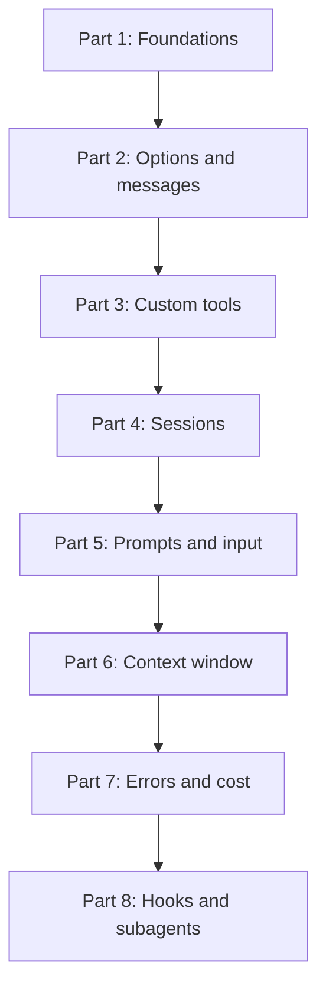

## The map

## Parts

| Part | Folder | Lessons | Pages written | Content |
|---|---|---|---|---|
| 1 | [01 Foundations](/notes/ai/claude-agent-sdk/01-foundations) | 3 | 3 | What the SDK is, the agent loop, query() vs ClaudeSDKClient |
| 2 | [02 Options and messages](/notes/ai/claude-agent-sdk/02-options-and-messages) | 2 | 0 | ClaudeAgentOptions, message and block types, partial messages |
| 3 | [03 Custom tools](/notes/ai/claude-agent-sdk/03-custom-tools) | 1 | 0 | In-process MCP tools |
| 4 | [04 Sessions](/notes/ai/claude-agent-sdk/04-sessions) | 4 | 3 | Session files, resume, continue, fork, temporary disks, SessionStore |
| 5 | [05 Prompts and input](/notes/ai/claude-agent-sdk/05-prompts-and-input) | 2 | 1 | System prompt types and snapshot, streaming input mode |
| 6 | [06 Context window](/notes/ai/claude-agent-sdk/06-context-window) | 2 | 0 | Window size and auto-compaction |
| 7 | [07 Errors and cost](/notes/ai/claude-agent-sdk/07-errors-and-cost) | 2 | 0 | SDK errors, usage and cost fields |
| 8 | [08 Hooks and subagents](/notes/ai/claude-agent-sdk/08-hooks-and-subagents) | 2 | 0 | Hooks and subagents |

A **lesson** is one idea. A **session** is one sitting. A lesson page can exist before I study it. Its status stays `not-started` until I pass its gate.

## How each session works

1. **Recall.** One or two questions on old lessons that are due.
2. **Problem.** The question that the idea answers, and why it matters in a real agent.
3. **Intuition.** A picture or an analogy, and the point where the analogy stops working.
4. **Visual.** A diagram, a figure or a Manim video.
5. **Mechanism.** The exact technical details. Every claim has a source.
6. **Experiment.** A small test that proves the claim: a fake model, a local file, a local database.
7. **Code.** I write the code myself. Hints come in three levels: idea, pseudocode, partial code.
8. **Check and explain back.** Check questions, then I teach the idea back.
9. **Close.** Session report in chat, then a notes update.

> [!key] Gate rule
> A gate passes only when I answer the check questions correctly in my own words. "I understand" does not pass a gate. A correct answer with a wrong reason does not pass.
