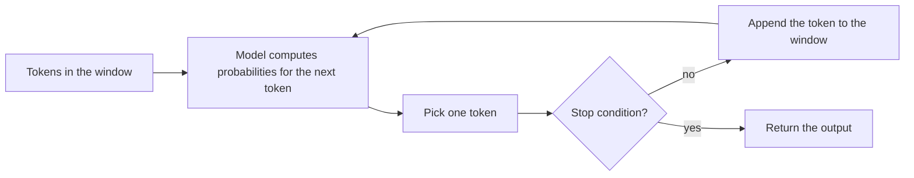

## 1. The question this idea answers

I send a short message to a chatbot. The answer uses my name, a company policy and the result of a database query. Where did that information come from?

The model can use only two sources: the knowledge in its weights, and the tokens in its context window on this one call. Everything that this subject teaches is about the second source.

## 2. Mental model

> [!analogy] A reader with one sheet of paper
> Picture an expert who has read a large library, but who remembers nothing about you. For each request, the expert gets **one sheet of paper**. The sheet holds the instructions, the documents and your question. The expert reads the sheet and then writes the answer **on the same sheet**, one word at a time. When the sheet is full, the expert must stop.
>
> - The library in the expert's head is the **weights**: general knowledge, fixed at training time.
> - The sheet is the **context window**: the only place for facts about this task.
> - The free space at the bottom of the sheet is the **output reserve**.
>
> **Where it stops working:** a human reads from top to bottom, one line at a time. The model processes all input tokens of the sheet at the same time, in parallel (lesson [L4](/notes/ai/context-engineering/01-foundations/l4-attention-and-the-cost-of-length)). Also, the expert does not "look back" at earlier sheets. Each new sheet is a new start (lesson [L3](/notes/ai/context-engineering/01-foundations/l3-the-chat-api-call)).

## 3. Terms

| Term | Plain meaning |
|---|---|
| token | The unit of text that a model reads and writes. A token is often a word or a part of a word (lesson [L2](/notes/ai/context-engineering/01-foundations/l2-tokens-and-tokenizers)). |
| context window | All the tokens that a model can process in one call. The input and the output share it. |
| input (prompt) | The tokens that the application sends to the model on one call. |
| output (completion) | The tokens that the model writes on that call. |
| weights (parameters) | The numbers that training sets inside the model. They hold general knowledge up to the training cutoff. They do not change during a call. |
| next-token prediction | The model computes a probability for every token in its vocabulary. The next token comes from that distribution. |
| autoregressive generation | The model adds each new token to the sequence and then predicts the token after it. It repeats this until it stops. |
| inference call | One request to the model and its one response. |
| `max_tokens` | The largest number of output tokens that the application allows on one call. |
| temperature | A setting that controls how random the choice of the next token is. Near 0, the most probable token wins almost every time. |
| hallucination | A confident statement that the weights and the window do not support. |

## 4. Method and math

### 4.1 Two places where knowledge lives

| | Weights | Context window |
|---|---|---|
| What it holds | General knowledge, language, skills | Facts for this task: instructions, documents, history, tool results |
| When it changes | Only with training or fine-tuning | On every call |
| Who controls it | The model provider | The application, which means you |
| Freshness | Stops at the training cutoff | As fresh as the data you put in |
| Can you check it? | No. You cannot list what the weights "know". | Yes. You can log every token. |

A model has no private access to your database, your files or your last conversation. If a fact is not in the weights and not in the window, the model cannot use it. It can only guess. A confident guess about a missing fact is a **hallucination**.

### 4.2 The generation loop

The model reads a sequence of tokens $t_1, t_2, \ldots, t_n$. It then computes a probability for each possible next token:

$$
P(t_{n+1} \mid t_1, t_2, \ldots, t_n)
$$

The symbols mean:

- $t_i$ is the token at position $i$.
- $n$ is the number of tokens in the sequence so far.
- $P(a \mid b)$ is the probability of $a$ when $b$ is known.

The application picks one token from this distribution. The **temperature** setting controls this pick. A temperature near 0 almost always picks the most probable token. A higher temperature gives less probable tokens more chance. The new token goes at the end of the sequence. The model then predicts the next token again.



The loop stops for one of these reasons:

1. The model writes an end-of-turn token.
2. The output reaches `max_tokens`.
3. The output matches a stop sequence.
4. The model asks the application to run a tool (Part 6).
5. The window is full.

> [!example] Worked example: one step
> The window holds the tokens of "The capital of France is". The model computes a distribution. Assume that it gives " Paris" a probability of 0.92, " a" 0.03 and " the" 0.02. The application picks " Paris". The window now holds "The capital of France is Paris", and the model predicts the next token from that longer sequence.
>
> These probabilities are invented for the example. Real values depend on the model.

### 4.3 The input and the output share the window

Each model has a fixed window size, for example 1,000,000 tokens. The rule is:

$$
\text{input tokens} + \text{output tokens} \le \text{window size}
$$

On current Claude models the output includes the extended-thinking tokens. On OpenAI models it includes the reasoning tokens. So a long input leaves less room for the answer and for the reasoning.

> [!example] Worked example: no room for the answer
> A model has a 200,000-token window. The application sends 195,000 input tokens and sets `max_tokens` to 8,000.
>
> - Space left for output: 200,000 − 195,000 = 5,000 tokens.
> - The application asked for 8,000 tokens, but only 5,000 can fit.
>
> On Claude 4.5 and later models, the call starts, and generation stops when the window is full. The stop reason is `model_context_window_exceeded`. If the input alone is larger than the window, the API returns an error ("prompt is too long"). Either way, the answer is short or missing.

> [!note] Window sizes checked on 2026-10-12
> Current Claude models (4.6 and later) have a 1,000,000-token window and up to 128,000 output tokens. Older models such as Claude Sonnet 4.5 and Haiku 4.5 have 200,000. The current OpenAI flagship models list a 1,050,000-token window. These numbers change often. Source: Anthropic "Context windows" and OpenAI "Models" pages.

### 4.4 Most of the window is not the user's message

The application builds the input from many parts. The user types only one of them.


| Part | Who writes it | Example |
|---|---|---|
| System prompt | The developer | "You are the support agent for TechStore..." |
| Tool definitions | The developer | JSON schemas for `lookup_order` and `check_warranty` |
| Conversation history | The user and the model, earlier | The last 10 turns |
| Retrieved documents | A retrieval system | The return policy, found by search |
| Tool results | The application, after it runs a tool | `{"order_id": "A17", "days_since_purchase": 35}` |
| State and memory | A memory system | "Customer since 2021. Prefers email." |
| New user message | The user | "Can I return my laptop?" |

In a production agent, the new user message is often less than 1% of the input. The rest comes from the application. Part 2 names these parts "the six elements of context".

> [!key] The main idea
> The model can only use what is in the window on this call. The application decides what goes into the window. **Context engineering** is the discipline of that decision: which tokens go in, in which order and in which format, on every call.

Anthropic states the goal as "finding the smallest possible set of high-signal tokens that maximize the likelihood of some desired outcome" (Anthropic Engineering, "Effective context engineering for AI agents", 29 September 2025).

### 4.5 Production view

| Concern | What the window means for it |
|---|---|
| Latency | Each input token must be processed before the first output token appears (lesson [L4](/notes/ai/context-engineering/01-foundations/l4-attention-and-the-cost-of-length)). |
| Cost | Providers bill every input token and every output token on every call (lesson [L6](/notes/ai/context-engineering/01-foundations/l6-the-cost-of-a-conversation)). |
| Reliability | A missing fact causes a guess. Too many irrelevant tokens also reduce accuracy (lesson [L5](/notes/ai/context-engineering/01-foundations/l5-position-and-length-effects)). |
| Security | Every token in the window can change the behavior of the model. A retrieved web page can hold hidden instructions (Part 6, prompt injection). |
| Observability | Log the full assembled input of each call, not only the user message. Most failures are visible only in the full input. |

## 5. Code

These exercises go in `notebooks/01-foundations.ipynb` in the lab repository. I write all the code myself.

**Exercise 1.1: build the window by hand.**

1. Write a function `assemble(system, tools, history, documents, user)` that returns one string with clear section labels.
2. Count the characters in each section and in the total. Print the share of the user message as a percent.
3. Use a realistic system prompt (about 300 words), two tool descriptions, five history turns, two documents and a one-line question.

Acceptance tests:

- The function returns every section in a fixed order.
- An empty section does not leave an empty label.
- The printed share of the user message is less than 5% for the realistic input.

**Exercise 1.2: the window budget check.**

Write `fits(window, input_tokens, max_tokens) -> bool` and `room_for_output(window, input_tokens) -> int`.

Acceptance tests:

- `room_for_output(200_000, 195_000)` returns 5,000.
- `fits(200_000, 195_000, 8_000)` returns `False`.
- A negative room raises a `ValueError` with a clear message.

## 6. Common mistakes

1. **"The model remembers our last chat."** The model has no memory between calls. The application sends the history again on each call (lesson [L3](/notes/ai/context-engineering/01-foundations/l3-the-chat-api-call)).
2. **"The context window is my message."** The window holds the full assembled input and the output.
3. **"`max_tokens` is a separate budget."** The output shares the window with the input.
4. **"The model knows our data because it is smart."** A capable model still needs the facts in the window. Without them, it guesses.
5. **"A bigger window means the model uses all of it well."** Accuracy depends on the position and the amount of the content (lesson [L5](/notes/ai/context-engineering/01-foundations/l5-position-and-length-effects)).

## 7. One-minute explanation

A language model does one thing: it reads a sequence of tokens and predicts the next token. It repeats this to write a full answer. The model has two sources of knowledge. The first is its weights, which training fixed in the past. The second is the context window: all the tokens that the application sends on this call. The window holds the instructions, the documents, the conversation history, the tool results and the user's question. The answer also goes into the same window, so the input and the output share one limit. If a fact is not in the weights and not in the window, the model can only guess. So the quality of an answer depends on what the application puts into the window. Context engineering is the work of choosing those tokens.

## 8. Check questions

```check
{
  "question": "A model has a 200,000-token window. The input is 196,500 tokens. How many output tokens can fit? Is max_tokens = 4,000 safe?",
  "hint": "The input and the output share the window.",
  "answer": "200,000 − 196,500 = 3,500 output tokens can fit. max_tokens = 4,000 asks for 500 more than the space. The answer can stop early because the window is full."
}
```

```check
{
  "question": "A chatbot answers with the correct return policy of a company. The policy is not public, so it is not in the weights. Where must the policy be?",
  "hint": "Name the only other source of facts on a call.",
  "answer": "In the context window of that call: for example in the system prompt, in a retrieved document, or in a tool result. The application put it there."
}
```

```check
{
  "question": "Name two facts that live in the weights and two facts that must come through the window, for a customer-support bot.",
  "answer": "Weights: grammar and general knowledge, for example how a refund usually works or what a laptop is. Window: facts about this customer and this company, for example the order date and the current return policy."
}
```

```check
{
  "question": "Why does the generation loop need the previous output token before it can predict the next one?",
  "hint": "Look at the condition in P(t_{n+1} | t_1 ... t_n).",
  "answer": "The prediction of token n+1 uses all tokens up to n, and token n is the last output token. So the model writes one token at a time. This is autoregressive generation."
}
```

## 9. Links

- Next: [L2: Tokens and tokenizers](/notes/ai/context-engineering/01-foundations/l2-tokens-and-tokenizers)
- [L3: The chat API call](/notes/ai/context-engineering/01-foundations/l3-the-chat-api-call)
- Background in the papers area: [Language models and context](/notes/papers/long-context/2023-lost-in-the-middle/01-background-language-models)
- [Glossary](/notes/ai/context-engineering/glossary)
