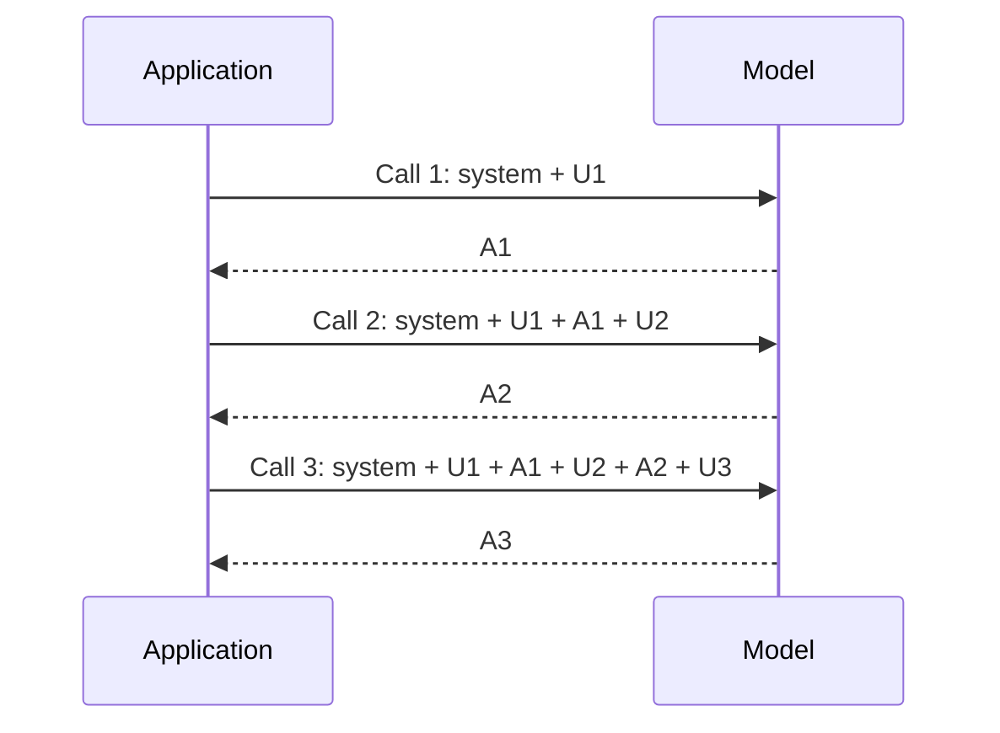

## 1. The question this idea answers

Lesson 1.1 says that the model has no memory between calls. But a chatbot remembers my name from turn 1 when I am at turn 10. How?

The answer is that the **application** remembers, not the model. On every turn, the application sends the full conversation again. This lesson shows the exact shape of that request.

## 2. Mental model

> [!analogy] A phone call with a person who forgets
> You call an expert who forgets everything when the call ends. To continue tomorrow, you must read the full transcript of all earlier calls at the start of the new call. Each call gets longer, because the transcript grows.
>
> **Where it stops working:** some providers can keep the transcript on their servers for you (section 4.4). This saves you work, but the model still reads the full transcript on every call, and the provider still bills it as input. The model itself stays stateless.

## 3. Terms

| Term | Plain meaning |
|---|---|
| stateless | The server keeps no memory of earlier calls. Each call must carry everything that the model needs. |
| messages array | The ordered list of turns that the application sends: who said what, in order. |
| role | The label of a message: `user`, `assistant`, and on some APIs `system`, `developer` or `tool`. |
| system prompt | Instructions from the developer that apply to the whole conversation. On the Anthropic API it is the top-level `system` field. |
| developer message | OpenAI's name for system-level instructions on newer models. It ranks above user messages. |
| turn | One user message and the model's reply to it. |
| stop reason | The field in a response that says why the model stopped writing. |
| usage | The field in a response with the billed token counts. |
| server-side conversation state | A provider feature that stores earlier turns, so the application can send only the new turn. |

## 4. Method and math

### 4.1 One call, field by field

This is a minimal request to the Anthropic Messages API (`POST /v1/messages`). The model ID is a placeholder.

```json
{
  "model": "<model id>",
  "max_tokens": 1024,
  "system": "You are the support agent for TechStore. Answer in two sentences or fewer.",
  "messages": [
    { "role": "user", "content": "Hi, I bought a laptop last month. My name is Asha." }
  ]
}
```

| Field | Job |
|---|---|
| `model` | Which model to call. Required. |
| `max_tokens` | The largest number of output tokens. Required. |
| `system` | The system prompt. It is a top-level field, not a message. |
| `messages` | The conversation. Roles are only `user` and `assistant`. The API merges two neighboring messages with the same role into one turn. |

The response looks like this (shortened):

```json
{
  "role": "assistant",
  "content": [ { "type": "text", "text": "Hi Asha! How can I help with your laptop?" } ],
  "stop_reason": "end_turn",
  "usage": { "input_tokens": 41, "output_tokens": 13 }
}
```

The response `content` is a list of **content blocks**. A block can hold text, a tool call (Part 6) or thinking. The token numbers in this example are illustrative.

### 4.2 Three turns: the payload grows

The model forgets Asha's name after call 1. So the application must send call 1 again inside call 2.



> [!example] Worked example: input tokens per call
> Assume a system prompt of 300 tokens, user messages of 30 tokens and replies of 80 tokens.
>
> | Call | What the application sends | Input tokens |
> |---|---|---|
> | 1 | system + U1 | 300 + 30 = 330 |
> | 2 | system + U1 + A1 + U2 | 330 + 80 + 30 = 440 |
> | 3 | system + U1 + A1 + U2 + A2 + U3 | 440 + 80 + 30 = 550 |
>
> Each call is 110 tokens larger than the one before: one reply plus one new user message. Lesson [L6](/notes/ai/context-engineering/01-foundations/l6-the-cost-of-a-conversation) turns this growth into a cost formula.

### 4.3 Three providers, one idea

| Item | Anthropic Messages API | OpenAI | Google Gemini |
|---|---|---|---|
| Where the system instructions go | Top-level `system` field | Chat Completions: a `developer` message (it replaces `system` from o1 on). Responses API: `developer` messages or the `instructions` parameter. | `system_instruction` |
| Roles in the conversation | `user`, `assistant` | `user`, `assistant`, `developer`, and `tool` for tool results in Chat Completions | `user`, `model` |
| Who keeps the history | The application | The application, or the server (section 4.4) | The application, or the server with the newer Interactions API |
| Where tool results go | A `tool_result` block inside a `user` message | Chat Completions: a `tool` message. Responses API: a `function_call_output` item. | A function response part |

All three were checked on 2026-10-12. The names change often. Check the current docs before you build.

> [!trap] OpenAI `instructions` do not carry over
> In the OpenAI Responses API, the `instructions` parameter applies only to the current request. When you chain calls with `previous_response_id`, the earlier `instructions` are not in the context. Send them on every call.

### 4.4 Server-side state is a convenience, not memory

OpenAI offers two ways to keep the history on the server: `previous_response_id`, which chains responses, and the Conversations API. Gemini's Interactions API offers `previous_interaction_id`. Each one saves the application from storing and sending the history.

These features do not change the model. OpenAI's docs say that each request is "independent and stateless". They also say that when you chain responses, "all previous input tokens for responses in the chain are billed as input tokens". So the cost and the window use are the same as when you send the history yourself.

| Question | Answer |
|---|---|
| Does the model remember? | No. The server rebuilds the full input on each call. |
| Do earlier turns still use the window? | Yes. |
| Are earlier turns still billed? | Yes, as input tokens. |
| What changes? | Who stores the history, and for how long. OpenAI stores response objects for 30 days by default. `store: false` turns this off. |

### 4.5 Stop reasons: always check them

The Anthropic API documents seven stop reasons (checked on 2026-10-12). The application must handle each one.

| `stop_reason` | Meaning | What the application must do |
|---|---|---|
| `end_turn` | The model finished its answer. | Show the answer. |
| `max_tokens` | The output reached `max_tokens`. | The answer is cut. Raise the limit, or ask the model to continue. |
| `stop_sequence` | The output matched a stop sequence that you set. | Handle it as your design requires. |
| `tool_use` | The model asks the application to run a tool. | Run the tool. Send the result back (Part 6). |
| `pause_turn` | A server-side tool loop reached its limit. | Send the response back to let the model continue. |
| `refusal` | Safety classifiers stopped the answer. It comes as a normal HTTP 200 response, not an error. | Show a safe message and log the case. |
| `model_context_window_exceeded` | The window is full. | Make the input smaller (Part 7), then call again. |

> [!trap] A cut answer looks like a normal answer
> A response with `max_tokens` has no error code. If the application ignores `stop_reason`, it shows a half answer, or it parses half a JSON object.

### 4.6 Where the parts of context go

Part 2 names six elements of context. This table shows where each one goes in an Anthropic request. Lesson 2.3 covers this in full.

| Element | Field in the Anthropic request |
|---|---|
| System instructions | `system` |
| Tool definitions | `tools` |
| Conversation history | `messages` (earlier `user` and `assistant` turns) |
| Retrieved knowledge | Usually inside the current `user` message, or in `system` |
| Tool results | `tool_result` blocks inside a `user` message |
| State and memory | Usually in `system`, or at the start of the current `user` message |
| New user input | The last `user` message |

### 4.7 Production view

| Concern | What statelessness means for it |
|---|---|
| Cost | Every earlier turn is billed again on every call (lesson [L6](/notes/ai/context-engineering/01-foundations/l6-the-cost-of-a-conversation)). Prompt caching can reduce this (lesson [L7](/notes/ai/context-engineering/01-foundations/l7-prompt-caching)). |
| Reliability | Check `stop_reason` on every call. Retry only safe calls, and give each request an ID. |
| Privacy | The history holds personal data. Decide where it is stored, for how long, and who can read it. |
| Observability | Log the full request and the full response, including `usage` and `stop_reason`. |
| Portability | Keep the history in a neutral format inside your application. Convert it to each provider's format at the last step. |

## 5. Video

```video
{
  "src": "/notes/media/context-engineering/manim/m01-payload-grows.mp4",
  "caption": "Each call sends the full conversation again, so the payload grows with every turn."
}
```

## 6. Code

These exercises go in `notebooks/01-foundations.ipynb`.

**Exercise 3.1: prove statelessness without an API.** Write a fake model `fake_llm(system, messages)`. It answers "Your name is X" only if a message in `messages` contains "My name is X". Otherwise it answers "I do not know your name."

Acceptance tests:

- Call it twice with only the new message each time: the second answer is "I do not know your name."
- Call it twice with the full history: the second answer contains the name.

**Exercise 3.2: a real chat loop.** Use one provider SDK. Write a loop that keeps a `history` list and sends the full history on each call. Print `usage` after each turn.

Acceptance tests:

- After 5 turns, the printed input tokens grow on every call.
- The model answers a question about a fact from turn 1.

**Exercise 3.3: a stop-reason handler.** Write `handle(response)` with one branch for each stop reason in section 4.5.

Acceptance test: with `max_tokens=20` and a long question, the handler reports that the answer was cut.

**Exercise 3.4: a format adapter.** Keep the history as a neutral list of `{"role", "text"}` items. Write `to_anthropic(system, history)` and `to_openai_chat(system, history)`. They return the request bodies as Python dictionaries. Do not call any API.

Acceptance tests:

- The Anthropic body has a top-level `system` and no message with role `system`.
- The OpenAI body starts with a `developer` message.
- Two neighboring user items stay in the correct order.

## 7. Common mistakes

1. **"The model remembers the chat."** The application sends the history again on every call.
2. **A `system` message inside `messages` on the Anthropic API.** The system prompt is the top-level `system` field.
3. **"Tool results come back as `tool_use` blocks."** The model writes the `tool_use` block. The application sends the result back in a `tool_result` block inside a `user` message. The handbook (Session 1, FAQ Q24) has this backwards.
4. **"Server-side state makes old turns free."** OpenAI bills all earlier input tokens in a chain again.
5. **Ignoring `stop_reason`.** A cut answer has no error code.

## 8. One-minute explanation

Every call to a language model is stateless. The server keeps nothing between calls, and the model has no memory. A chatbot seems to remember because the application stores the conversation and sends all of it again on every turn. The request holds the system prompt, the list of earlier user and assistant messages, the new user message and settings such as `max_tokens`. The response holds the new reply, a stop reason and the token usage. So each call is larger than the one before. Some providers can store the history on their side, but they still feed it to the model and bill it again. Always check the stop reason, because a cut answer looks like a normal one.

## 9. Check questions

```check
{
  "question": "A system prompt has 500 tokens. Each user message has 40 tokens and each reply has 120 tokens. How many input tokens does call 4 send?",
  "hint": "Call k sends the system prompt, all earlier turns and the new user message.",
  "answer": "500 + 3 × (40 + 120) + 40 = 500 + 480 + 40 = 1,020 tokens."
}
```

```check
{
  "question": "A team switches from sending the full history to OpenAI's previous_response_id. They expect lower token costs. Are they right?",
  "hint": "What does the OpenAI conversation-state guide say about billing?",
  "answer": "No. The guide says that all previous input tokens in the chain are billed as input tokens. The change moves storage to the server. It does not reduce the tokens that the model reads or the input bill."
}
```

```check
{
  "question": "A response has stop_reason = \"max_tokens\". The application parses the text as JSON and crashes. What happened, and what are two fixes?",
  "answer": "The output reached max_tokens, so the JSON object is cut. Fix 1: check stop_reason before parsing, and retry with a higher max_tokens. Fix 2: ask for a shorter output, or use structured outputs with enough room for the full object."
}
```

```check
{
  "question": "On the Anthropic API, where does the result of a tool go, and which role carries it?",
  "answer": "In a tool_result content block, inside a message with the role user. The block names the tool_use_id of the call that it answers."
}
```

## 10. Links

- Previous: [L2: Tokens and tokenizers](/notes/ai/context-engineering/01-foundations/l2-tokens-and-tokenizers)
- Next: [L4: Attention, the KV cache and the cost of length](/notes/ai/context-engineering/01-foundations/l4-attention-and-the-cost-of-length)
- [L6: The cost of a conversation](/notes/ai/context-engineering/01-foundations/l6-the-cost-of-a-conversation)
- [L7: Prompt caching](/notes/ai/context-engineering/01-foundations/l7-prompt-caching)
- [Glossary](/notes/ai/context-engineering/glossary)
