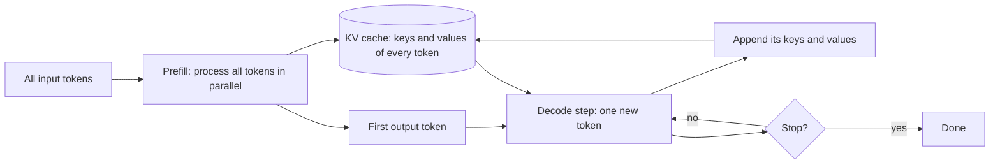

## 1. The question this idea answers

A longer input makes a call slower and more expensive to serve. Output tokens cost several times more than input tokens. But the provider bills each token at a flat rate. What happens inside the model that explains all three facts?

## 2. Mental model

> [!analogy] A meeting where each speaker checks all earlier notes
> In a meeting, each new speaker reads the notes of every earlier speaker before talking. Speaker 10 reads 9 notes. Speaker 1,000 reads 999 notes. The total reading work grows much faster than the number of speakers. A shared notebook helps: each speaker writes a short summary card once, and later speakers read the cards instead of asking each person again. That notebook is the **KV cache**.
>
> **Where it stops working:** the model does not read the earlier cards one at a time. During the input phase it processes all tokens at the same time on the GPU. Also, attention is not the only work. The other layers of the model cost the same for each token, so their work grows only linearly with length.

## 3. Terms

| Term | Plain meaning |
|---|---|
| self-attention | The layer where each token computes how much to use every other visible token. |
| query, key, value (Q, K, V) | Three vectors that each token produces. A query is compared with the keys of other tokens. The scores weight their values. |
| attention weight | The share of attention that one token gives to another. The weights of one query add up to 1. |
| causal mask | The rule that a token can use only earlier tokens and itself, never later ones. |
| prefill | The first phase of a call. The model processes all input tokens in parallel and stores their keys and values. |
| decode | The second phase of a call. The model writes output tokens one at a time. |
| KV cache | The stored keys and values of all earlier tokens. Decode reads it instead of recomputing it. |
| time to first token (TTFT) | The delay from the request to the first output token. Prefill is most of it. |
| compute-bound | Limited by arithmetic speed. Prefill is usually compute-bound. |
| memory-bound | Limited by memory-read speed. Decode is usually memory-bound. |
| grouped-query attention (GQA) | A design where several query heads share one key head and one value head. It makes the KV cache smaller. |

## 4. Method and math

### 4.1 Attention in one formula

$$
\text{Attention}(Q, K, V) = \text{softmax}\!\left(\frac{QK^{\top}}{\sqrt{d_k}} + M\right) V
$$

The symbols mean:

- $n$ is the number of tokens in the sequence.
- $Q$, $K$ and $V$ are matrices with $n$ rows, one row for each token. Each row of $Q$ and $K$ has $d_k$ numbers.
- $QK^{\top}$ is an $n \times n$ matrix of scores: one score for each pair of tokens.
- $\sqrt{d_k}$ scales the scores so that the softmax stays stable.
- $M$ is the causal mask: 0 where a token may look, $-\infty$ where it may not.
- softmax turns each row of scores into weights that are positive and add up to 1.

The $n \times n$ score matrix is the key point. Vaswani et al. (2017), Table 1, give the cost of one self-attention layer as $O(n^2 \cdot d)$, where $d$ is the size of the token vectors.

### 4.2 Count the pairs

With the causal mask, token $i$ looks at tokens $1$ to $i$. So the number of scored pairs in one head of one layer is:

$$
1 + 2 + \cdots + n = \frac{n(n+1)}{2}
$$

> [!example] Worked example: double the length
> - $n = 1{,}000$: $\frac{1000 \times 1001}{2} = 500{,}500$ pairs.
> - $n = 2{,}000$: $\frac{2000 \times 2001}{2} = 2{,}001{,}000$ pairs.
>
> The length doubled, and the pairs grew about **4 times**. For $n = 128{,}000$ there are about 8.19 billion pairs in each head of each layer.

The other layers of a transformer (the feed-forward layers) cost the same for each token. Their total work grows linearly with $n$. So the total work of a call grows somewhere between linear and quadratic. Attention dominates when $n$ is large.

### 4.3 The "attention budget": a precise meaning

Anthropic writes that models have an "attention budget" (Anthropic Engineering, "Effective context engineering for AI agents", 29 September 2025). The formula gives this metaphor a precise base. For each query token $i$, softmax makes the weights add up to 1:

$$
\sum_{j \le i} a_{ij} = 1
$$

Here $a_{ij}$ is the weight that token $i$ gives to token $j$. If the context holds more tokens, they share the same total weight of 1 in each head.

> [!analogy] Where the budget metaphor stops working
> A model can still put almost all of one head's weight on a single token. Many heads and many layers also run in parallel. So more tokens do not simply dilute every fact by the same amount. Measured accuracy loss with length comes from training and position effects too (lesson [L5](/notes/ai/context-engineering/01-foundations/l5-position-and-length-effects)).

### 4.4 Two phases: prefill and decode



| | Prefill | Decode |
|---|---|---|
| Tokens processed per step | All input tokens at the same time | One new token |
| Attention work | Every input token against every earlier input token: about $n^2/2$ pairs | The new token against all cached keys: about $n$ pairs per step |
| Bottleneck | Arithmetic (compute-bound) | Reading the KV cache and the weights from memory (memory-bound) |
| What you feel | Time to first token | Time between output tokens |

The vLLM paper (Kwon et al., SOSP 2023) describes the same two phases. It says that the prompt phase "can be parallelized using matrix-matrix multiplication operations". It also says that the generation phase "severely underutilizes GPU computation and becomes memory-bound".

### 4.5 The size of the KV cache

The KV cache holds one key vector and one value vector for each token, in each layer and each key-value head.

$$
\text{bytes per token} = 2 \times L \times H_{kv} \times d_{head} \times b
$$

The symbols mean:

- The first factor 2 counts the key and the value.
- $L$ is the number of layers.
- $H_{kv}$ is the number of key-value heads.
- $d_{head}$ is the size of one head.
- $b$ is the bytes for each number: 2 for 16-bit values.

> [!example] Worked example 1: OPT-13B
> $L = 40$, and $H_{kv} \times d_{head} = 5{,}120$, with 16-bit values.
>
> $2 \times 40 \times 5{,}120 \times 2 = 819{,}200$ bytes = 800 KiB for each token.
>
> For 2,048 tokens: $819{,}200 \times 2{,}048 \approx 1.68$ GB. The vLLM paper gives the same numbers: "800 KB" per token and "up to 1.6 GB" per request.

> [!example] Worked example 2: Llama 3 8B (grouped-query attention)
> $L = 32$, $H_{kv} = 8$, $d_{head} = 128$, with 16-bit values.
>
> $2 \times 32 \times 8 \times 128 \times 2 = 131{,}072$ bytes = 128 KiB for each token.
>
> For 131,072 tokens (128K): $131{,}072 \times 131{,}072$ bytes = 16 GiB for one sequence. Without grouped-query attention ($H_{kv} = 32$), it would be 64 GiB.

So a long context holds a lot of GPU memory for the whole call. This limits how many requests a server can run at the same time.

### 4.6 Why output tokens cost more

Prices checked on 2026-10-12:

| Model | Input (USD / MTok) | Output (USD / MTok) | Output ÷ input |
|---|---|---|---|
| Claude Sonnet 5.5 | 2 | 10 | 5 |
| Claude Haiku 5.5 (prompt up to 100K tokens) | 0.10 | 0.50 | 5 |
| OpenAI gpt-6.1-sol | 2 | 10 | 5 |

Providers do not publish the reason for the ratio. Section 4.4 gives a likely explanation. Prefill handles all input tokens in one parallel pass. Decode needs one full pass for **each** output token, and each pass reads the KV cache and the weights from memory.

### 4.7 Why the bill is still linear

The compute of attention grows with $n^2$, but most providers bill a flat price for each token. Anthropic's pricing page says: "A 900k-token request is billed at the same per-token rate as a 9k-token request." Some providers charge a higher rate above a size limit. For example, OpenAI doubles the input price above 272K input tokens, and Claude Haiku 5.5 charges more above 100K (checked on 2026-10-12).

So the length of the input affects you in three ways:

1. **Cost:** linear in tokens, at a flat rate, except above long-context limits.
2. **Latency:** time to first token grows with the input, because prefill must finish first.
3. **Quality:** accuracy can drop with length and position (lesson [L5](/notes/ai/context-engineering/01-foundations/l5-position-and-length-effects)).

### 4.8 FlashAttention does not remove the square

FlashAttention (Dao et al., NeurIPS 2022) computes **exact** attention. It splits the work into tiles and cuts the slow reads and writes between GPU memories. It still uses $O(n^2 d)$ arithmetic operations, but it needs only $O(n)$ extra memory instead of storing the full $n \times n$ matrix. It makes long contexts practical. It does not make attention linear.

### 4.9 Production view

| Concern | What this lesson means for it |
|---|---|
| Latency | Output tokens usually dominate total time. OpenAI's latency guide says that a 50% shorter prompt "may only result in a 1–5% latency improvement", except with very large contexts. To cut total time, cut output first. To cut time to first token on a huge input, cut the input or cache it (lesson [L7](/notes/ai/context-engineering/01-foundations/l7-prompt-caching)). |
| Cost | Input and output are billed linearly. Output is about 5 times the input price on many models. |
| Capacity | A long context holds GPU memory for the KV cache. Self-hosted models need this number for planning. |
| Quality | More tokens in the window do not mean better use of them (lesson [L5](/notes/ai/context-engineering/01-foundations/l5-position-and-length-effects)). |

## 5. Graphs

```plot
{
  "title": "Attention pairs per head per layer (red) grow with the square of the length",
  "xAxis": { "label": "input length (thousands of tokens)", "domain": [0, 4] },
  "yAxis": { "label": "pairs (millions)", "domain": [0, 8.5] },
  "disableZoom": true,
  "data": [
    { "fn": "0.5*x^2", "color": "#C81D25" }
  ]
}
```

At 1,000 tokens the curve is at 0.5 million pairs. At 2,000 tokens it is at 2 million. At 4,000 tokens it is at 8 million.

```plot
{
  "title": "KV cache of Llama 3 8B in 16-bit (blue) grows linearly with the length",
  "xAxis": { "label": "context length (thousands of tokens)", "domain": [0, 130] },
  "yAxis": { "label": "KV cache size (GiB)", "domain": [0, 17] },
  "disableZoom": true,
  "data": [
    { "fn": "0.1220703*x", "color": "#1E6091" }
  ]
}
```

Each token adds 128 KiB, so 1,000 tokens add about 0.12 GiB. At 128K tokens the cache is 16 GiB.

## 6. Video

```video
{
  "src": "/notes/media/context-engineering/manim/m02-attention-pairs.mp4",
  "caption": "Attention pairs grow with the square of the input length, and the KV cache keeps the keys and values for decode."
}
```

## 7. Code

These exercises go in `notebooks/01-foundations.ipynb`.

**Exercise 4.1: one causal attention head in NumPy.**

1. Write `causal_attention(Q, K, V)` for one head, with the mask and the scaling of section 4.1.
2. Use random matrices with $n = 6$ and $d_k = 4$.

Acceptance tests:

- Each row of the weight matrix adds up to 1 (within 1e-6).
- The weights above the diagonal are exactly 0.
- The output for token 1 equals the value vector of token 1.

**Exercise 4.2: count the work.** Write `pairs(n)` and print the ratio `pairs(2n) / pairs(n)` for n = 10, 1,000 and 100,000. Explain why the ratio moves toward 4.

**Exercise 4.3: a KV cache calculator.** Write `kv_bytes_per_token(L, H_kv, d_head, b)` and `kv_bytes(n, ...)`. Reproduce the two worked examples of section 4.5.

**Exercise 4.4 (optional, costs money): measure time to first token.** Use a streaming API call with `max_tokens` = 20. Measure the time to the first token for inputs of about 1K, 10K and 50K tokens. Estimate the cost before you run it. Plot the result.

## 8. Common mistakes

1. **"Twice the tokens means twice the work."** The attention part grows about 4 times. The rest grows 2 times.
2. **"The bill grows with the square of the length."** Most providers bill each token at a flat rate. Some charge more above a long-context limit.
3. **"FlashAttention makes attention linear."** It saves memory and time, but the arithmetic is still $O(n^2 d)$.
4. **"The KV cache is the same as prompt caching."** The KV cache lives inside one call. Prompt caching keeps the KV cache of a prefix for later calls (lesson [L7](/notes/ai/context-engineering/01-foundations/l7-prompt-caching)).
5. **"A shorter prompt always makes the answer much faster."** Output usually dominates total latency.

## 9. One-minute explanation

Inside each attention layer, every token compares itself with every earlier token. For n tokens that is about n²/2 comparisons, so twice the length means about four times the attention work. A call has two phases. In prefill, the model processes all input tokens in parallel and stores their keys and values in the KV cache. This sets the time to the first token. In decode, the model writes one token at a time and reads the whole KV cache for each one. That is slow, memory-bound work, which is a likely reason that output tokens cost about five times more than input. Providers still bill each token at a flat rate. So length costs you money linearly, time to first token, and GPU memory for the cache.

## 10. Check questions

```check
{
  "question": "An input grows from 3,000 to 9,000 tokens. By about what factor does the number of attention pairs grow? By what factor does the input bill grow?",
  "hint": "Pairs grow with n², the bill grows with n.",
  "answer": "Pairs: (9,000 / 3,000)² = 3² = 9 times. Bill: 9,000 / 3,000 = 3 times, at a flat per-token price."
}
```

```check
{
  "question": "A model has 48 layers, 8 key-value heads, a head size of 128, and 16-bit values. How large is its KV cache for 100,000 tokens?",
  "hint": "bytes per token = 2 × L × H_kv × d_head × b.",
  "answer": "Per token: 2 × 48 × 8 × 128 × 2 = 196,608 bytes = 192 KiB. For 100,000 tokens: 19,660,800,000 bytes ≈ 19.7 GB ≈ 18.3 GiB."
}
```

```check
{
  "question": "Why is decode usually memory-bound while prefill is compute-bound?",
  "answer": "Prefill processes all input tokens together, so the GPU does large matrix-matrix products and stays busy with arithmetic. Decode makes one token per step. Each step must read the weights and the full KV cache from memory but does little arithmetic for that one token, so memory speed limits it."
}
```

```check
{
  "question": "A chatbot's answers take 8 seconds. The prompt is 3,000 tokens and the answers are about 600 tokens. Which change will cut the latency most: a 50% shorter prompt, or 50% shorter answers? Why?",
  "answer": "50% shorter answers. Decode writes one token at a time, so 600 output tokens dominate the total time. The 3,000-token prompt goes through prefill in one parallel pass. OpenAI's latency guide reports only a 1–5% gain from a 50% shorter prompt, except for very large contexts."
}
```

## 11. Links

- Previous: [L3: The chat API call](/notes/ai/context-engineering/01-foundations/l3-the-chat-api-call)
- Next: [L5: Position and length effects](/notes/ai/context-engineering/01-foundations/l5-position-and-length-effects)
- [L7: Prompt caching](/notes/ai/context-engineering/01-foundations/l7-prompt-caching): reuse the KV cache of a prefix
- Background in the papers area: [Attention and position](/notes/papers/long-context/2023-lost-in-the-middle/02-background-attention-and-position)
- [Glossary](/notes/ai/context-engineering/glossary)
