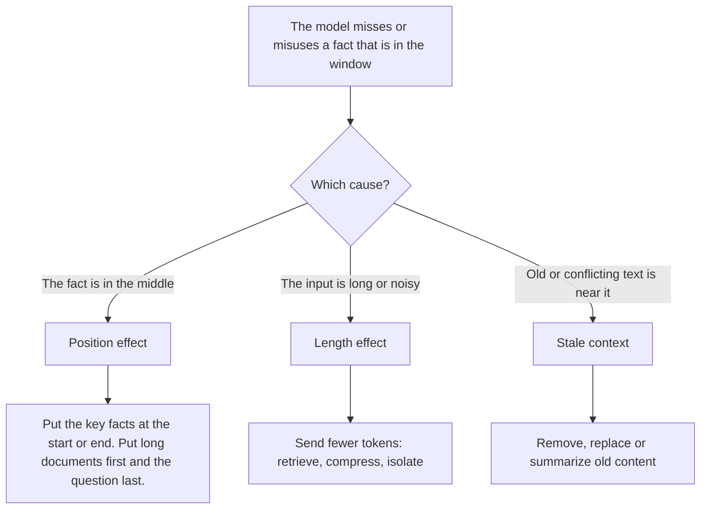

## 1. The question this idea answers

Current models accept 1,000,000 tokens. So why does a model still miss a fact that I put in the window? And why do engineers say "more context can make answers worse"?

Three different effects cause this. The handbook mixes them under the names "lost in the middle" and "context rot". This lesson separates them, because each one has a different fix.

## 2. Mental model

> [!analogy] A long briefing pack
> A manager gets a 300-page briefing pack before a meeting.
>
> 1. **Position:** the manager reads the first and the last pages with care, and skims the middle. A key fact on page 150 is easy to miss.
> 2. **Length:** a 300-page pack is harder to use than a 10-page pack with the same key facts. More pages mean more chances for confusion.
> 3. **Stale pages:** page 40 has last year's policy, and page 200 has this year's. The manager can follow the wrong one.
>
> **Where it stops working:** a model does not "get tired" or "skim". Its behavior comes from training and from its architecture, and it changes from model to model. The pattern is an empirical result. You must measure it on your own model and task.

## 3. Terms

| Term | Plain meaning |
|---|---|
| position effect | Accuracy changes with **where** the relevant information is in the input, with the length fixed. |
| lost in the middle | The position effect found by Liu et al.: accuracy is highest at the start or end, and lowest in the middle. |
| U-curve | The shape of accuracy against position in that study: high, low, then high again. |
| length effect | Accuracy drops when the input gets **longer**, even when the task stays the same. |
| context rot | The name that Chroma's July 2025 report uses for the length effect. |
| stale context | Old, wrong or conflicting text in the window, for example an old tool result or an instruction that a later turn replaced. |
| needle in a haystack (NIAH) | A test that hides one fact (the needle) in long filler text (the haystack) and asks for it. |
| distractor | Text that looks relevant but does not answer the question. |
| closed-book | A test of the model with no documents at all. It measures what the weights know. |
| effective context length | The longest input where a model still performs above a set level. It is often shorter than the advertised window. |

## 4. Method and math

### 4.1 Effect 1: position (lost in the middle)

Liu et al. (2023), "Lost in the Middle: How Language Models Use Long Contexts" (TACL 2024), gave a model 20 documents. Exactly one document held the answer. They moved that document from position 1 to position 20 and measured accuracy.

> [!example] The result for GPT-3.5-Turbo with 20 documents (Table 6 of the paper)
> | Position of the answer document | 1 | 5 | 10 | 15 | 20 |
> |---|---|---|---|---|---|
> | Accuracy (%) | 75.8 | 57.2 | 53.8 | 55.4 | 63.2 |
>
> - Best: position 1, 75.8%. Worst: position 10, 53.8%. The gap is 22.0 points.
> - With **no documents** (closed-book), the model got 56.1%. So at position 10, the 20 documents made the answer **worse** than no documents.
> - With **only** the answer document (oracle), it got 88.3%. So even at the best position, 19 distractors cost 12.5 points.

> [!note] Source check: what the U-curve measures
> **Corrected.** The handbook draws this curve as "attention" across the window. The paper measured **accuracy** against the position of the relevant document. It did not measure attention weights. Source: Liu et al., TACL 2024, arXiv 2307.03172.

The papers area has a full study of this paper: [Lost in the Middle (2023)](/notes/papers/long-context/2023-lost-in-the-middle). Its page on [later work](/notes/papers/long-context/2023-lost-in-the-middle/10-limits-and-later-work) covers how far the result holds for newer models.

### 4.2 Effect 2: length (context rot)

Chroma's technical report "Context Rot: How Increasing Input Tokens Impacts LLM Performance" (Hong, Troynikov and Huber, 14 July 2025) tested 18 models from Anthropic, OpenAI, Google and Alibaba. It changed the input **length** and kept the task the same. Its main findings:

1. "Model performance degrades as input length increases, often in surprising and non-uniform ways." This holds even for simple tasks.
2. Distractors hurt, and their harm grows with length.
3. When the question and the needle share fewer words, the drop with length is steeper.
4. The report also used a conversational-memory benchmark (LongMemEval). All models did much better with a focused prompt of about 300 tokens than with the full prompt of about 113,000 tokens.
5. A plain needle-in-a-haystack test measures only "lexical retrieval": finding the same words. So a perfect score on it says little about real tasks.

Two other benchmarks show the same pattern with numbers:

| Benchmark | Finding |
|---|---|
| RULER (Hsieh et al. 2024, arXiv 2404.06654) | 17 long-context models were tested. Almost all were near perfect on a plain needle test, but "only half of them can maintain satisfactory performance at the length of 32K". For example, GPT-4-1106-preview claims 128K, but its effective length was 64K. |
| NoLiMa (Modarressi et al., ICML 2025) | The needle and the question share few words. At 32K tokens, 11 of 13 models fell below 50% of their short-input score. GPT-4o fell from 99.3% to 69.7%. |

Anthropic's post "Effective context engineering for AI agents" (29 September 2025) links Chroma's report and draws the rule: "context, therefore, must be treated as a finite resource with diminishing marginal returns".

> [!note] Source check: "quality peaks at 40–60% utilization"
> **Unsupported.** The handbook (Session 5 FAQ, Q4) says that "Anthropic's research shows that quality peaks at roughly 40–60% context utilization". No Anthropic source makes this claim. Chroma's report shows a drop with **absolute length**, not a peak at a fraction of the window. Use your own measurements to set a limit.

### 4.3 Effect 3: stale and conflicting context

The third effect has nothing to do with length or position. The window holds text that is **wrong for this step**. The handbook (Session 1, §3.2.2) lists five sources:

| Source | Example |
|---|---|
| Stale knowledge | Q2 sales figures from two turns ago stay in the window while the user asks about Q3. |
| Instruction drift | Turn 3 says "answer in JSON". Turn 9 says "answer in Markdown". Both stay in the window. |
| Conversation bloat | At turn 30, 25 old turns are no longer relevant. |
| Old tool results | A large database result from turn 5 is still in the window at turn 20. |
| Format pollution | The model copies the bullet style of early turns when the task now needs prose. |

These are content problems. A larger window does not fix them. Only removal, replacement or summary fixes them (Part 7).

### 4.4 Three causes, three fixes



| Cause | Test that shows it | Fix | Where this subject teaches it |
|---|---|---|---|
| Position | Move one fact through the input. Keep the length fixed. | Put critical content at the edges. For long documents, put the documents first and the question at the end. | Part 3, Part 5 |
| Length | Keep the fact and the position. Add filler or distractors. | Retrieve less and better. Compress. Split the work across sub-agents. | Parts 4, 5, 7 |
| Stale context | Add an old version of the fact, or a conflicting instruction. | Clear old tool results. Version instructions. Summarize history. | Parts 3, 7, 8 |

> [!key] Order of documents and question
> Anthropic's prompting guide says: "Queries at the end can improve response quality by up to 30 percent in tests, especially with complex, multidocument inputs." It also says to place long documents "near the top of your prompt, above your query, instructions, and examples". Source: Anthropic, "Prompting best practices", checked on 2026-10-12.

### 4.5 Production view

| Concern | What this lesson means for it |
|---|---|
| Quality | Do not trust the advertised window size. Measure accuracy on your own task at your real input lengths. |
| Retrieval | Send fewer, better chunks. Put the best chunk where the model uses it best (Part 5). |
| Agents | Agent context grows with every step. Old tool results become stale context (Part 7). |
| Evaluation | A plain needle test is not enough. Test with distractors and with needles that share few words with the question. |
| Model changes | Position and length effects differ between models. Re-test after each model change. |

## 5. Graphs

```plot
{
  "title": "GPT-3.5-Turbo, 20 documents (exact values from the paper): accuracy (red), closed-book 56.1% (purple)",
  "xAxis": { "label": "position of the answer document", "domain": [0, 21] },
  "yAxis": { "label": "accuracy (%)", "domain": [45, 80] },
  "disableZoom": true,
  "data": [
    { "points": [[1, 75.8], [5, 57.2], [10, 53.8], [15, 55.4], [20, 63.2]], "fnType": "points", "graphType": "polyline", "color": "#C81D25", "skipTip": true },
    { "points": [[1, 75.8], [5, 57.2], [10, 53.8], [15, 55.4], [20, 63.2]], "fnType": "points", "graphType": "scatter", "color": "#C81D25", "skipTip": true },
    { "fn": "56.1", "color": "#6A4C93", "skipTip": true }
  ]
}
```

The red points form the U-curve. Where the red line is under the purple line, the documents made the answer worse than no documents.

## 6. Video

```video
{
  "src": "/notes/media/context-engineering/manim/m03-position-vs-length.mp4",
  "caption": "The position effect and the length effect are two different effects with two different causes."
}
```

## 7. Code

These exercises go in `notebooks/01-foundations.ipynb`. They call an API, so estimate the cost first.

**Exercise 5.1: a position test.**

1. Make 20 short filler paragraphs and one paragraph with a fact, for example "The access code for the north gate is 4471."
2. For each position 1, 5, 10, 15 and 20, put the fact paragraph there and ask "What is the access code for the north gate?"
3. Run 10 trials for each position with different filler. Record the accuracy.

Acceptance tests:

- A table with five rows: position and accuracy.
- A plot of accuracy against position.
- One sentence that says whether your model shows a U-curve.

**Exercise 5.2: a length test.** Keep the fact at position 1. Test total inputs of about 1K, 8K and 32K tokens. Use one version where the question repeats the needle's words, and one version that does not, for example "Which number opens the northern entrance?"

Acceptance test: a 3 × 2 table of accuracy. One sentence that compares the two versions.

**Exercise 5.3: a stale-context test.** Put two versions of the fact into the window: "The code was 4471" early, and "The code changed to 9025 today" later. Ask for the current code. Then move the new version to the start. Record what changes.

## 8. Common mistakes

1. **"Lost in the middle and context rot are the same thing."** One is about position at a fixed length. The other is about length. A third problem, stale context, is about content.
2. **"A 1M-token window means the model uses 1M tokens well."** RULER and NoLiMa show effective lengths far below the advertised size.
3. **"A perfect needle-in-a-haystack score proves long-context ability."** That test checks only the matching of the same words.
4. **"More documents always help retrieval."** Liu et al. found that 20 documents with the answer in the middle gave a lower score than no documents.
5. **"The U-curve shows attention."** It shows accuracy.

## 9. One-minute explanation

A model can miss a fact that is in its window, for three different reasons. First, position: Liu et al. moved one useful document through 20 documents. Accuracy was 75.8% at the start, 53.8% in the middle and 63.2% at the end, and the middle was worse than no documents at all. Second, length: Chroma tested 18 models and found that accuracy drops as the input gets longer, even on simple tasks. RULER and NoLiMa show that the useful length is often far shorter than the advertised window. Third, stale context: old tool results and conflicting instructions mislead the model. Each cause has its own fix: put key facts at the edges, send fewer tokens, and remove old content.

## 10. Check questions

```check
{
  "question": "In Liu et al., GPT-3.5-Turbo scores 53.8% with the answer document at position 10 of 20, and 56.1% with no documents. What does this mean for a RAG system?",
  "hint": "Compare the two numbers.",
  "answer": "Adding 20 documents with the answer in the middle made the result 2.3 points worse than adding nothing. So retrieving many documents is not safe by default. Send fewer, better documents, and put the best ones at the start or the end."
}
```

```check
{
  "question": "A team's model fails on a contract question. The answer clause is in a 400-page contract that fills 300K tokens, and an older version of the clause is also in the window. Name the three possible causes, and one test for each.",
  "answer": "Position: move the clause to the start and the end at the same length, and compare. Length: retrieve only the relevant section, about 2K tokens, and compare. Stale context: remove the older version of the clause and compare."
}
```

```check
{
  "question": "A model scores 100% on a needle-in-a-haystack test at 128K tokens. Why is this weak evidence that it can answer real questions over 128K tokens?",
  "answer": "The plain test measures lexical retrieval: the question and the needle share words. Real tasks need the model to connect ideas with different words and to ignore distractors. NoLiMa found large drops when the needle and the question share few words."
}
```

```check
{
  "question": "Anthropic's prompting guide gives a rule for long documents and the question. What is the rule, and what gain does the guide report?",
  "answer": "Put the long documents near the top, above the question, instructions and examples. Put the question at the end. The guide says that this can improve response quality by up to 30 percent in its tests, especially with complex multi-document inputs."
}
```

## 11. Links

- Previous: [L4: Attention, the KV cache and the cost of length](/notes/ai/context-engineering/01-foundations/l4-attention-and-the-cost-of-length)
- Next: [L6: The cost of a conversation](/notes/ai/context-engineering/01-foundations/l6-the-cost-of-a-conversation)
- Paper study: [Lost in the Middle (2023)](/notes/papers/long-context/2023-lost-in-the-middle) and its [engineering takeaways](/notes/papers/long-context/2023-lost-in-the-middle/09-engineering-takeaways)
- [Glossary](/notes/ai/context-engineering/glossary)
