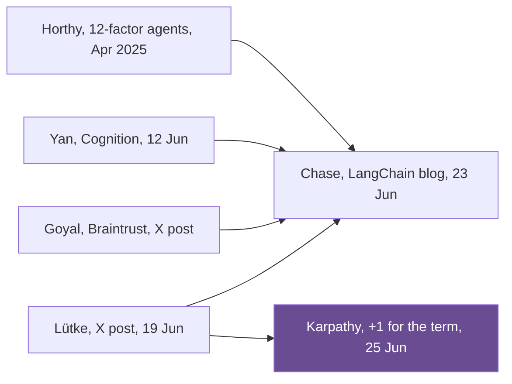

## 1. The question this idea answers

A support bot gives a wrong answer. The team rewrites the prompt five times. The answer gets more polite, but it stays wrong. Why does better wording stop helping?

Usually the problem is not the words. The model does not have the fact, the rule or the tool that the task needs. No phrasing can add a fact that is not in the window (lesson [1.1](/notes/ai/context-engineering/01-foundations/l1-what-a-model-does-with-context)). This lesson defines the discipline that fixes this kind of failure, and it gives one test to tell a wording problem from a context problem.

## 2. Mental model

> [!analogy] An email against a briefing packet
> A new executive starts work on Monday. You can send one well-written email that says "Please fix our churn problem". Or you can prepare a full briefing packet. The packet holds the churn numbers, the customer interviews, the budget and the org chart. It also names the people who can approve a change, and it states what success means.
>
> - The email is **prompt engineering**: the best possible wording of one request.
> - The packet is **context engineering**: the design of everything the executive sees before acting.
>
> The executive's intelligence is the same in both cases. Only the packet changes the result. (The handbook uses this analogy in Session 1, FAQ Q1.)
>
> **Where it stops working:** the executive remembers Monday's packet on Tuesday. The model does not. The application must build a new packet for every call, because each call is stateless (lesson [1.3](/notes/ai/context-engineering/01-foundations/l3-the-chat-api-call)). Also, the executive can walk down the hall and ask for a missing file. The model can ask only through a tool that you give it.

## 3. Terms

| Term | Plain meaning |
|---|---|
| prompt engineering | The craft of writing the text of one instruction or question so that a model does the task well. |
| vibe coding | Karpathy's name (February 2025) for coding where you accept what the AI writes without reading it closely. |
| solvability test | The question "with only what is in the window and the available tools, could a competent person do this task?" If the answer is no, the failure is a context problem. |
| context coverage | The share of the facts and actions that a task needs which are present in the window or available as tools. |
| high-signal tokens | Tokens that change the answer toward the desired outcome. Anthropic's principle asks for the smallest set of them. |
| agent | An application that calls a model in a loop. The model picks an action, a tool runs it, and the result returns to the context for the next step. |
| agentic engineering | The handbook's name for its fourth "era": building agent systems on top of context engineering. It is not an established technical term. |

## 4. Method and math

### 4.1 Why prompt engineering hits a ceiling

Examine what a production call contains. The user's message is a small part of it.

> [!example] Worked example: the share of the user's message
> A support agent sends this input on one call (token counts are an example):
>
> | Part | Tokens | Share |
> |---|---|---|
> | System prompt | 1,500 | 18.1% |
> | Tool definitions (8 tools) | 2,400 | 29.0% |
> | Conversation history | 2,400 | 29.0% |
> | Retrieved documents | 1,800 | 21.7% |
> | State and memory | 150 | 1.8% |
> | New user message | 40 | 0.5% |
> | **Total** | **8,290** | **100%** |
>
> The user's message is $40 / 8{,}290 \approx 0.48\%$ of the input. The handbook gives a similar picture (Session 1, FAQ Q6). A query of fewer than 100 tokens sits inside 10,000 or more tokens of other context. That is less than 1%.

Now sort the reasons that a call fails. Only one kind of failure is a wording problem.

| Failure | Example | Can better wording fix it? | What fixes it |
|---|---|---|---|
| Unclear instruction | "Summarize" with no length or audience | Yes | Clearer instruction (Part 3) |
| Missing fact | The return policy is not in the window | No | Retrieve or inject the fact (Parts 4, 5) |
| Missing capability | The bot cannot read the order | No | Give it a tool (Part 6) |
| Wrong fact | An old policy version is in the window | No | Fix the data and its source (lesson 2.5) |
| Too much content | 40 documents bury the one that matters | No | Select, compress, order (Parts 5, 7) |

This is the ceiling. Prompt engineering improves one row of this table. The other four rows need changes to what the window holds.

### 4.2 The handbook's four eras

The handbook tells the history as four eras (Session 1, §1.1). The years and the names are the **handbook's own periodization**, not an industry standard.

| Handbook era | Handbook year | What you do | What the record shows |
|---|---|---|---|
| Prompting | 2023 | Write one clever instruction | Prompting is older. GPT-3 (Brown et al. 2020) did tasks from text demonstrations alone, "without any gradient updates or fine-tuning". |
| Vibe coding | Early 2025 | Accept what the AI writes | Karpathy named it on X on 2 February 2025 (details below). |
| Context engineering | Mid 2025 | Design the whole information system | The term spread in June 2025 (section 4.3). |
| Agentic engineering | 2026 | Build agent systems | The handbook's label. Agents need context engineering on every step of their loop. |

The eras overlap. Teams still write prompts, and agents still need context. The handbook says the same about the last step: agentic engineering is "built on top of context engineering, not as a replacement for it".

**Vibe coding, from the source.** Karpathy posted on X on 2 February 2025 at 23:17 UTC. Three lines of the post matter:

- The definition: "There's a new kind of coding I call “vibe coding”, where you fully give in to the vibes, embrace exponentials, and forget that the code even exists."
- The practice: "I “Accept All” always, I don't read the diffs anymore."
- The limit: "It's not too bad for throwaway weekend projects, but still quite amusing."

So "coined by Karpathy" is fair. The handbook adds that vibe coding "fell apart in production". That matches Karpathy's own limit: he never proposed it for production.

### 4.3 Where the term came from

The handbook says that three leaders started to use the term "independently and within the same week in June 2025". The record shows a chain, not three separate discoveries.

| Date (UTC) | Who | What |
|---|---|---|
| 7 Apr 2025 | Tobi Lütke (Shopify) | Shares an internal memo: "Reflexive AI usage is now a baseline expectation at Shopify." It is about using AI at work, not about context engineering. |
| By 11 Apr 2025 | Dex Horthy (HumanLayer) | Publishes "12-factor agents" on GitHub. Factor 3 is "Own your context window". |
| 12 Jun 2025 | Walden Yan (Cognition) | "Don't Build Multi-Agents": "At the core of reliability is Context Engineering." |
| 19 Jun 2025, 03:01 | Tobi Lütke | Prefers "context engineering" to "prompt engineering" on X. In Ottawa it is still 18 June, 11:01 pm. |
| 23 Jun 2025 | Harrison Chase (LangChain) | Blog post "The rise of context engineering". |
| 25 Jun 2025, 15:54 | Andrej Karpathy | X post that opens "+1 for “context engineering” over “prompt engineering”." |
| 29 Sep 2025 | Anthropic | Engineering post "Effective context engineering for AI agents". |



An arrow means "the later post cites or answers the earlier one". Chase writes that his definition "builds upon recent takes on this from" Lütke, Ankur Goyal and Walden Yan, and he links to their posts. Karpathy's post came six days after Lütke's. Its opening "+1 … over prompt engineering" answers Lütke's framing directly. The mirrors of the post show no formal reply link. So the safe wording is this: Karpathy endorsed the term in response to the discussion that Lütke started.

> [!note] Source check: "independently … convergent evolution"
> **Corrected.** The handbook (Session 1, §1.1.3, §1.2 and the §1.2 Key Takeaway) makes three claims. Three leaders defined context engineering "independently". It "was not coordinated". It "was convergent evolution". Chase's post says that it "builds upon" posts by Lütke, Goyal and Yan. Karpathy's post opens with "+1" for the term, six days after Lütke. Yan used the term earlier, on 12 June 2025. The idea is older still: Horthy's "Own your context window" dates from April 2025. Sources: Chase, LangChain blog, 23 June 2025. Karpathy, X, 25 June 2025. Yan, Cognition blog, 12 June 2025. Checked on 2026-10-12.

So the correct story is "a fast-spreading term", not "three independent inventions". The order also shows that Karpathy did not coin the term. He gave it the largest audience.

### 4.4 Four definitions, side by side

Read each definition for the one idea that it adds.

| Who, date | Exact words | What it adds |
|---|---|---|
| Tobi Lütke, 19 Jun 2025 | "the art of providing all the context for the task to be plausibly solvable by the LLM" | **Solvability.** The test is the task, not the prompt. |
| Harrison Chase, 23 Jun 2025 | "building dynamic systems to provide the right information and tools in the right format such that the LLM can plausibly accomplish the task" | **Systems, tools and format.** Context is assembled by code at run time. |
| Andrej Karpathy, 25 Jun 2025 | "the delicate art and science of filling the context window with just the right information for the next step" | **The next step.** Context changes on every call, and "just right" means not too much. |
| Anthropic, 29 Sep 2025 | "the set of strategies for curating and maintaining the optimal set of tokens (information) during LLM inference" | **Curation over time.** It includes "all the other information that may land there outside of the prompts". |

Three details from the original sources matter:

1. Lütke's full post says: "I really like the term “context engineering” over prompt engineering. It describes the core skill better: the art of providing all the context for the task to be plausibly solvable by the LLM." He calls it the "core skill".
2. Karpathy's definition sits inside a longer sentence that starts "When in every industrial-strength LLM app, …". The post then says that an LLM app is a "thick layer" of software around the LLM calls. It ends: "The term “ChatGPT wrapper” is tired and really, really wrong."
3. Anthropic's post gives a guiding principle as a separate sentence: good context engineering means "finding the smallest possible set of high-signal tokens that maximize the likelihood of some desired outcome."

> [!note] Source check: Lütke's "mega skill" and the memo
> **Corrected.** The handbook (Session 1, FAQ Q8) says that Lütke calls context engineering the "mega skill". FAQ Q21 goes further. It says that he told his entire company that context engineering "is the most important skill". His June post says "core skill". His company-wide memo (shared on X on 7 April 2025) is about reflexive AI use, not about context engineering. FAQ Q21 merges two separate posts. Sources: Lütke, X, 19 June 2025 and 7 April 2025. Checked on 2026-10-12.

> [!note] Source check: the Anthropic principle
> **Corrected.** The handbook (Session 1, §3.2 and Key Takeaway 3) quotes Anthropic with these words:
>
> - Handbook: "Find the smallest set of high-signal tokens that maximize the likelihood of your desired outcome."
> - Original: "finding the smallest possible set of high-signal tokens that maximize the likelihood of some desired outcome."
>
> The handbook drops "possible" and "some", and it gives no title or date. Source: Anthropic Engineering, "Effective context engineering for AI agents", 29 September 2025.

### 4.5 The solvability test

Lütke's definition gives a practical test. Ask it before you change any wording:

> [!key] The solvability test
> With only what is in this window, and only these tools, could a competent person do this task? If not, the failure is a context problem.

Make the test concrete with a set count. List what the task needs, then list what the call provides.

$$
c = \frac{\lvert N \cap A \rvert}{\lvert N \rvert}
$$

The symbols mean:

- $N$ is the set of facts and actions that the task needs.
- $A$ is the set of facts in the window plus the actions that the tools make possible.
- $\lvert X \rvert$ is the number of items in the set $X$.
- $N \cap A$ is the set of needed items that the call provides.
- $c$ is the context coverage, between 0 and 1.

A task is plausibly solvable only if $c = 1$. Full coverage is necessary, not sufficient: the facts must also be correct, findable and not buried (lessons 2.4 and 2.5).

> [!example] Worked example: the TechStore bot at turn 3
> The customer asks for a return of a laptop that she bought 35 days ago (lesson 2.6 has the full transcript). At turn 2 she asks for an exception, so the bot must also know what it may decide alone. The task needs seven items:
>
> $N$ = {days since purchase, issue type, price, return policy, warranty status, the bot's authority for exceptions, a way to escalate}
>
> At turn 3 the history holds three of them. Turn 1 gives the issue, a flickering screen, and turn 3 adds that it started after 2 weeks. Turn 2 gives 35 days. Turn 3 gives the price of USD 2,400. The policy, the warranty status, the authority rules and an escalation tool are absent.
>
> $c = 3/7 \approx 0.43$
>
> More than half of what the task needs is not in the call. No rewording of the system prompt can make the bot apply a policy that it never saw. The fix is to add the policy document, the authority rules, a warranty tool and an escalation tool.

Anthropic gives a similar human test for tools: "If a human engineer can't definitively say which tool should be used in a given situation, an AI agent can't be expected to do better." Use the human test for facts too. Hand the exact window to a colleague, with no other help. If the colleague cannot answer, the model will guess.

### 4.6 Prompt engineering is a subset

The handbook states the relation well: "Prompt engineering is not dead. It is a subset." And: "A good prompt in a bad context will still produce bad results."

| Dimension | Prompt engineering | Context engineering |
|---|---|---|
| Unit of work | The text of one instruction | Everything that enters each call |
| When it happens | Once, at design time | On every call, at run time |
| Main question | "How do I say this?" | "What must the model see now, and what must it not see?" |
| Typical output | A prompt template | Code that selects, orders, formats and trims context |
| Main failure | Ambiguous wording | Missing, wrong, stale or excess content |

The handbook says that prompt engineering manages only "element #2 of 6", the user's message. This subject draws the line a little wider. Classic prompt techniques (a role, few-shot examples, step-by-step instructions) also live in the system prompt. So prompt-writing skill is still needed inside several elements (Part 3). The difference is the scope of the decision: prompt engineering decides the words, and context engineering decides what enters the window at all.

### 4.7 Why this matters now: agents

An agent calls the model many times in a loop. The context changes on every step, so every step needs a fresh decision about what to include. The handbook (Session 1, FAQ Q23) describes the loop: observe, decide with the model, act with tools, update the state. Each step is a context-engineering decision.

The handbook cites Gartner to show the scale. The exact prediction (press release, 26 August 2025) is: "Forty percent of enterprise applications will be integrated with task-specific AI agents by the end of 2026". The headline adds "Up from Less Than 5% in 2025".

> [!note] Source check: the Gartner prediction
> **Corrected (wording).** The handbook's Key Takeaway 5 (Session 1, §7) says "Gartner says 40% of enterprise apps will have AI agents by 2026". Gartner says "task-specific AI agents" and "by the end of 2026". The Key Concept box after §1.1.4 keeps "task-specific". Both places then add "The bottleneck is not model capability. It is context engineering." That sentence is the handbook's own opinion. Gartner does not say it. Also, a prediction is not a measurement. Source: Gartner press release, 26 August 2025.

### 4.8 The learning ladder: atoms to organs

The handbook (Session 1, §2.3) uses a four-level ladder from a GitHub repository, davidkimai/Context-Engineering. It calls the repository "the davidkimai framework".

| Level | Repository label | Handbook example | Where this subject teaches it |
|---|---|---|---|
| Atoms | "Single instructions / Simple constraints / Basic prompts" | "Summarize this text" | Part 3 |
| Molecules | "Example pairs / Few-shot patterns / Demonstration sets" | A few-shot prompt with a role and a format | Part 3 |
| Cells | "Persistent memory / State management / Context window" | A chatbot with history and retrieval | Parts 4, 5, 7, 8 |
| Organs | "Multi-step flows / Specialists / System orchestration" | A research agent with sub-agents | Part 7, Part 10 |

Use the ladder only as a study order. Three facts limit it:

1. It is a community repository under the MIT licence. It is not peer-reviewed research.
2. The repository does not stop at organs. It continues to "neural systems" and "neural & semantic field theory", and adds protocol shells and a meta-recursive framework. The handbook shows only the first four levels.
3. Its README credits Karpathy with coining "context engineering". Section 4.3 shows that this is wrong.

### 4.9 Production view

| Concern | What this lesson means for it |
|---|---|
| Debugging | Run the solvability test before you edit wording. No wording fix can repair a missing, wrong or excess context. |
| Observability | Log the full assembled input of every call. A wording problem and a context problem look the same in the user's message alone. |
| Ownership | The context assembly code is product code. Give it an owner, tests and reviews, like any other code. |
| Cost | Every token that you add is billed on every call (lesson [1.6](/notes/ai/context-engineering/01-foundations/l6-the-cost-of-a-conversation)). "Smallest possible set" is also a cost rule. |
| Change control | A model upgrade can change behavior. A context change can too. Version both, and test both against the same evaluation set (Part 9). |

## 5. Code

These exercises go in `notebooks/02-paradigm-shift.ipynb`. They call no API.

**Exercise 1.1: the share of the user's message.**

1. Write `shares(parts: dict[str, int]) -> dict[str, float]` that returns each part's share of the total, in percent.
2. Run it on the worked example of section 4.1.
3. Run it on one real request from a system at work. Count with the provider's `usage` field or with `tiktoken` (lesson [1.2](/notes/ai/context-engineering/01-foundations/l2-tokens-and-tokenizers)).

Acceptance tests:

- The worked example gives a user share of 0.48% (to two decimals).
- An empty dictionary raises a `ValueError`.
- The shares add up to 100% within 0.01.

**Exercise 1.2: a solvability checker.**

1. Write `coverage(needed: set[str], available: set[str]) -> float` and `missing(needed, available) -> set[str]`.
2. Describe three tasks as sets. Use the TechStore return at turn 3, an SQL agent that must count "active customers", and a code-review bot that sees only the diff.
3. For each task, print the coverage and the missing items.

Acceptance tests:

- The TechStore task gives a coverage of 3/7 (about 0.43) and four missing items.
- `coverage(set(), {"a"})` raises a `ValueError`, because a task with no needs is not defined.
- One sentence for each task says whether a prompt rewrite can help.

**Exercise 1.3: wording problem or context problem?**

1. Write ten short failure reports from your own work or invent realistic ones. Example: "The bot quotes a 14-day return window, but the policy says 30 days."
2. Label each one with one row of the table in section 4.1.
3. For each label, write one sentence of evidence that you would look for in the logged input.

Acceptance test: at least seven of the ten reports are not wording problems, or you explain why your system is different.

## 6. Common mistakes

1. **"Context engineering is prompt engineering with a new name."** Prompt engineering decides the words. Context engineering decides what enters the window on each call: facts, tools, history and state.
2. **"Karpathy coined the term context engineering."** Yan (12 June), Lütke (19 June) and Chase (23 June) used it before his post of 25 June 2025. He endorsed it.
3. **"Three leaders defined it independently."** Chase's post says that it builds on Lütke, Goyal and Yan. Karpathy's post opens with "+1".
4. **"Lütke told all of Shopify that context engineering is the most important skill."** His company memo (April 2025) is about using AI. His June post calls context engineering the "core skill".
5. **"Gartner says that context engineering is the bottleneck."** Gartner predicts task-specific agents in 40% of enterprise apps by the end of 2026. The bottleneck sentence is the handbook's.
6. **"If the answer is wrong, rewrite the prompt."** First run the solvability test. Coverage below 1 means that no rewrite can fix it.

## 7. One-minute explanation

Prompt engineering is the craft of wording one request well. It stops helping when the model lacks a fact, a rule or a tool, because wording cannot add information. Context engineering is the wider discipline: it decides what enters the context window on every call. That includes the system prompt, the history, retrieved documents, tool definitions, tool results and memory. The term spread in June 2025: Yan used it, then Lütke, then Chase, who built on them, then Karpathy, who endorsed it. Lütke's definition gives the key test: is the task plausibly solvable with what the model can see? If not, the problem is the context, not the model. Anthropic adds the economy rule: use the smallest possible set of high-signal tokens. Prompt engineering is still needed, but as one part of this larger job. Agents make it urgent, because every step of their loop needs new context.

## 8. Check questions

```check
{
  "question": "A call has a 3,000-token system prompt, 5,000 tokens of tool definitions, 6,000 tokens of history, 4,000 tokens of retrieved text, 200 tokens of state and a 50-token user message. What share of the input did the user type?",
  "hint": "Add all parts first.",
  "answer": "Total = 3,000 + 5,000 + 6,000 + 4,000 + 200 + 50 = 18,250 tokens. User share = 50 / 18,250 ≈ 0.27%. More than 99% of the input comes from the application."
}
```

```check
{
  "question": "An SQL agent must count \"active customers\". It needs: the question, the schema of the orders table, the schema of the customers table, the business definition of \"active\", and a tool to run SQL. The call holds the question and the orders schema. What is the context coverage, and what do you add first?",
  "hint": "c = (needed items that are present) / (needed items).",
  "answer": "c = 2/5 = 0.4. Add the customers schema, the definition of active, and the run-SQL tool. The definition is the most dangerous gap: without it the model invents one, and the SQL runs without error but answers a different question."
}
```

```check
{
  "question": "Put these in date order and say whether the handbook's word \"independently\" fits: Karpathy's \"+1\" post, Chase's LangChain post, Lütke's X post, Yan's \"Don't Build Multi-Agents\".",
  "answer": "Yan (12 June 2025), Lütke (19 June), Chase (23 June), Karpathy (25 June). \"Independently\" does not fit: Chase says that his definition builds on Lütke, Goyal and Yan, and Karpathy endorses the term with \"+1\" six days after Lütke."
}
```

```check
{
  "question": "A bot quotes the wrong refund amount. The team has rewritten the system prompt five times. Which test do you run first, and what result would prove that more rewriting is useless?",
  "answer": "The solvability test. List what the task needs (the refund rule, the order amount, any fees) and check the logged input for each item. If the refund rule or the order data is missing (coverage below 1), no wording can fix the answer. Add the missing facts or a tool that returns them."
}
```

```check
{
  "question": "What exactly does the Gartner press release of 26 August 2025 predict, and which part of the handbook's sentence is not from Gartner?",
  "answer": "Gartner predicts that 40% of enterprise applications will be integrated with task-specific AI agents by the end of 2026, up from less than 5% in 2025. The claim that \"the bottleneck is context engineering\" is the handbook's own opinion."
}
```

## 9. Links

- Next: [L2: The LLM OS model](/notes/ai/context-engineering/02-paradigm-shift/l2-the-llm-os-model)
- [L1.1: What a model does with context](/notes/ai/context-engineering/01-foundations/l1-what-a-model-does-with-context): why a fact must be in the window
- [L6: The context audit](/notes/ai/context-engineering/02-paradigm-shift/l6-the-context-audit): the solvability test applied to a full transcript
- Part overview: [02 Paradigm shift](/notes/ai/context-engineering/02-paradigm-shift)
- [Glossary](/notes/ai/context-engineering/glossary)
