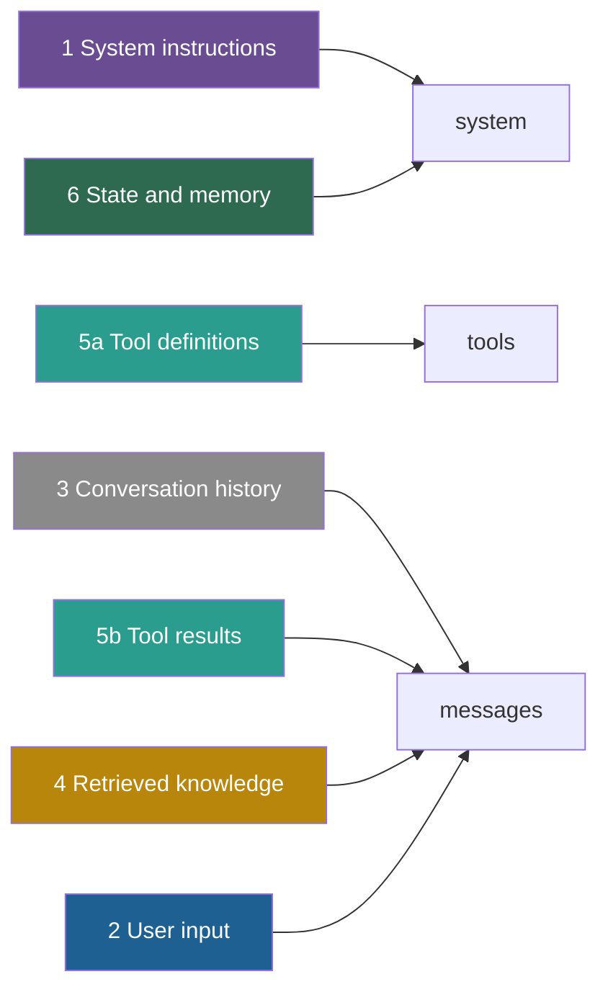

## 1. The question this idea answers

Every call is assembled from parts. If I cannot name the parts, I cannot budget them, log them or audit them. So what are the parts of a context? Where does each part go in a real API request? What happens when they compete for space?

The handbook names six elements (Session 1, §2.2). This lesson defines them exactly and maps them to the request fields of two providers. It also gives the three decisions that you make for each element on every call.

## 2. Mental model

> [!analogy] A hospital shift handover
> A doctor starts a night shift. Before seeing a patient, the doctor gets a folder with six tabs:
>
> 1. The ward's standing orders: how to behave, what never to do.
> 2. What the patient asks for right now.
> 3. The notes of the day shift.
> 4. Lab results and the clinical guideline for this condition.
> 5. The list of tests that the doctor may order, and the results of tests already run.
> 6. The patient's chart: allergies, history, preferences.
>
> A good handover puts the right papers behind each tab, and nothing else. A bad handover leaves a tab empty or stuffs it with last month's papers.
>
> **Where it stops working:** the doctor remembers the folder after reading it once. The model reads the whole folder again on every call, as one sequence of tokens. Also, the six tabs are a convention of this subject. The API knows only its own fields, such as `system`, `messages` and `tools` (section 4.3).

## 3. Terms

| Term | Plain meaning |
|---|---|
| context element | One of six kinds of information that together form the input of a call. Each token of the input belongs to one element. |
| system instructions | Text from the developer that defines the model's role, rules, tone and limits for the whole conversation. |
| user input | The current request of the user on this call. |
| conversation history | The earlier user messages and model replies of this conversation, including earlier tool calls. |
| retrieved knowledge | Documents, records or search results that the application fetches and places in the window for this request. |
| tool definitions | The names, descriptions and input schemas of the functions that the model may ask the application to run. |
| tool results | The output of a tool run, which the application returns to the model. |
| state and memory | Facts about the user, the task or the session that the application keeps outside the model and loads when needed. |
| scratchpad | A place where an agent writes notes or a plan during a task, so that later steps can use them. |
| context budget | The maximum number of input tokens that a design allows on one call. It is a design choice and is often far below the window size. |
| output reserve | The part of the window kept free for the model's answer, set by `max_tokens`. |
| level of detail | How much of a source enters the window: the full text, an extract, a summary or only a pointer. |
| lightweight identifier | A short reference such as a file path, a query or a link, which a tool can resolve to the full content later. |

## 4. Method and math

### 4.1 The six elements, defined


| # | Element | Handbook example | TechStore example | Who writes it | How long it stays relevant |
|---|---|---|---|---|---|
| 1 | System instructions | "You are a senior financial analyst at Acme Corp…" | "You are the support agent for TechStore…" | Developer | The whole deployment |
| 2 | User input | "What were our Q3 revenue numbers?" | "Can I return my laptop?" | User | This turn |
| 3 | Conversation history | The user asked about Q2 earlier, and the model gave a summary. | Turns 1 and 2 of the chat | User and model | This conversation |
| 4 | Retrieved knowledge | The Q3 revenue report: total revenue USD 142M, up 8% year on year | The return policy, version 7 | Retrieval system | This question |
| 5 | Tool definitions and results | `get_stock_price(ticker)` and the price it returned | `lookup_order` and its JSON result | Developer (definitions), application (results) | Definitions: the deployment. Results: often one step. |
| 6 | State and memory | "User prefers bullet-point format. Timezone: PST." | "Gold tier. Customer since 2021." | Memory system | This session, or across sessions |

The last column matters most for design. Content with a long life belongs early in the window, where prompt caching can reuse it (lesson [1.7](/notes/ai/context-engineering/01-foundations/l7-prompt-caching)). Content with a short life becomes stale context soon after its step (lesson [1.5](/notes/ai/context-engineering/01-foundations/l5-position-and-length-effects)).

Two notes on element 6. The handbook's lecture defines it as "Persistent facts, scratchpads, structured metadata". Its FAQ Q3 says "persisted across sessions". Both are true, for two different lifetimes:

- **Session state:** the plan, a scratchpad, and key facts of this conversation, such as "price = USD 2,400".
- **Long-term memory:** facts that survive the session, such as the user's preferences. Part 8 covers it.

### 4.2 Are there "exactly six"?

The handbook says the six elements are "exactly six types" and "the complete context window". Treat this as a **rule of thumb**: a useful taxonomy for audits, not a law. Some content needs a decision about where it belongs:

| Content | Where to file it | Why |
|---|---|---|
| Few-shot examples | System instructions | They are fixed by the developer and shape behavior, like rules. |
| The model's earlier replies and thinking blocks | Conversation history | They come from earlier turns. |
| An image or a PDF | User input if the user sent it. Retrieved knowledge if the application fetched it. | The source decides the trust level. |
| The output reserve | Not an element | It is free space, but it shares the window limit (lesson [1.1](/notes/ai/context-engineering/01-foundations/l1-what-a-model-does-with-context)). |

One element hides two very different things. Tool **definitions** are static, so they are cache-friendly. Tool **results** are dynamic, often large, and stale soon. Keep them in separate rows of every budget, even though the handbook counts them as one element.

The working rule: every token in the window must belong to exactly one element. If you cannot name its element, you cannot budget it, log it or audit it.

### 4.3 Where each element goes in a request

The API does not know the six elements. It knows fields. Lesson [1.3](/notes/ai/context-engineering/01-foundations/l3-the-chat-api-call) gave the request shapes. This table maps each element to them (checked on 2026-10-12).

| Element | Anthropic Messages API | OpenAI Responses API | OpenAI Chat Completions |
|---|---|---|---|
| 1 System instructions | Top-level `system` | `instructions` (this request only) or `developer` messages | A `developer` message (it replaces `system` from o1 on) |
| 2 User input | The last `user` message | A `user` item in `input` | The last `user` message |
| 3 Conversation history | Earlier `user` and `assistant` messages | Earlier `input` items, or server state through `previous_response_id` | Earlier messages |
| 4 Retrieved knowledge | No field. Text inside a `user` message or inside `system`. | No field. Text inside `input` or a `developer` message. | No field. Text inside a message. |
| 5a Tool definitions | `tools`, each with an `input_schema` | `tools`, each with `parameters` | `tools`, each with `function.parameters` |
| 5b Tool results | A `tool_result` block inside a `user` message, linked by `tool_use_id` | A `function_call_output` item, linked by `call_id` | A `tool` message, linked by `tool_call_id` |
| 6 State and memory | No field. Usually in `system` or at the start of the `user` message. | No field | No field |

Gemini uses `system_instruction`, a `contents` list with the roles `user` and `model`, and function declarations with `parameters`. The names change often, so check the current docs before you build.



The diagram shows the Anthropic API. Seven inputs go into three fields. Two elements have no field of their own: retrieved knowledge and state. They are plain text that your code places and labels. Nothing in the API stops a retrieved document from looking like an instruction. So your context builder must mark each part clearly, for example with XML tags or headers (Part 3).

> [!trap] Tool results are not `tool_use` blocks
> The model writes a `tool_use` block. Your application answers with a `tool_result` block inside a `user` message. The handbook (Session 1, FAQ Q24) has this backwards. Lesson [1.3](/notes/ai/context-engineering/01-foundations/l3-the-chat-api-call) gives the correction.

### 4.4 One request with all six elements

This Anthropic request carries all six elements. The model ID is a placeholder, and the texts are shortened.

```json
{
  "model": "<model id>",
  "max_tokens": 1024,
  "tools": [
    {
      "name": "lookup_order",
      "description": "Return the order record for one order ID: product, price in USD, purchase date and days since purchase.",
      "input_schema": {
        "type": "object",
        "properties": { "order_id": { "type": "string" } },
        "required": ["order_id"]
      }
    }
  ],
  "system": [
    { "type": "text", "text": "You are the support agent for TechStore. <rules>...</rules>", "cache_control": { "type": "ephemeral" } },
    { "type": "text", "text": "<customer_profile>Tier: Gold. Customer since 2021.</customer_profile>" }
  ],
  "messages": [
    { "role": "user", "content": "My laptop screen is flickering. Order A17." },
    { "role": "assistant", "content": [ { "type": "tool_use", "id": "toolu_01", "name": "lookup_order", "input": { "order_id": "A17" } } ] },
    { "role": "user", "content": [ { "type": "tool_result", "tool_use_id": "toolu_01", "content": "{\"price_usd\": 2400, \"days_since_purchase\": 35}" } ] },
    { "role": "assistant", "content": "I found order A17. Let me check the policy for you." },
    { "role": "user", "content": [
      { "type": "text", "text": "<policy source=\"returns-v7\">Electronics with a manufacturer defect: 90-day return window.</policy>" },
      { "type": "text", "text": "Can I still return it?" }
    ] }
  ]
}
```

| Part of the request | Element |
|---|---|
| `tools` | 5a Tool definitions |
| First `system` block, with the cache breakpoint | 1 System instructions |
| Second `system` block | 6 State and memory |
| Messages 1, 2 and 4 | 3 Conversation history (message 2 is the model's tool call) |
| Message 3 | 5b Tool result |
| The `<policy>` block in message 5 | 4 Retrieved knowledge |
| "Can I still return it?" | 2 User input |

Two layout choices follow lesson 1.7. The stable rules come first, with the cache breakpoint. The customer profile changes for each customer, so it comes after the breakpoint. If the profile were in the first block, every new customer would invalidate the cache.

### 4.5 One budget for all elements

All six elements and the answer share one limit. You also choose a budget below the window size, for cost, latency and quality.

$$
\sum_{i=1}^{6} T_i + R \le B \le W
$$

The symbols mean:

- $T_i$ is the number of input tokens of element $i$ on this call.
- $R$ is the output reserve, the value of `max_tokens`.
- $B$ is the context budget that your design allows.
- $W$ is the model's context window.

> [!example] Worked example: a 32,000-token budget
> The model has a 1,000,000-token window, but the team sets $B = 32{,}000$ for cost and latency. The answer reserve is $R = 4{,}096$.
>
> | Element | Tokens | Share of input |
> |---|---|---|
> | System instructions | 2,000 | 7.5% |
> | Tool definitions | 3,000 | 11.3% |
> | Conversation history | 8,000 | 30.2% |
> | Retrieved knowledge | 12,000 | 45.3% |
> | State and memory | 1,000 | 3.8% |
> | User input | 500 | 1.9% |
> | **Input total** | **26,500** | **100%** |
>
> - Input plus reserve: $26{,}500 + 4{,}096 = 30{,}596 \le 32{,}000$. The call fits with 1,404 tokens to spare.
> - Retrieval now finds one more 2,000-token chunk. The total becomes $32{,}596$, which is 596 tokens over the budget.
> - Something must give: drop the weakest chunk, summarize the history from 8,000 to 4,000 tokens, or lower the reserve. Each choice costs something.
>
> The input costs $26{,}500 \times 2 / 10^6 = 0.053$ USD per call on Claude Sonnet 5.5 (USD 2 / MTok, checked on 2026-10-12).

This is what "the elements compete for space" means (handbook FAQ Q3). A bigger history leaves less room for documents. More tools leave less room for history.

### 4.6 Three decisions for each element

The handbook's FAQ Q3 names the art: "deciding what goes in, in what order, and at what level of detail." Make these three decisions for every element on every call.

**Decision 1: what.** Select only what helps this step. Karpathy's phrase is "for the next step". The handbook gives an example (FAQ Q7). An agent that now writes an SQL query needs the schema and the question. It does not need the HTML of a page that it browsed two steps ago.

**Decision 2: in which order.** Two rules from Part 1 decide most orders:

1. Stable content first, so prompt caching can reuse it. Anthropic builds the cache prefix in the order tools, system, then messages (lesson 1.7).
2. Long documents above the question, and the question last. Anthropic's guide says: "Queries at the end can improve response quality by up to 30 percent in tests, especially with complex, multidocument inputs." (lesson 1.5)

**Decision 3: at what level of detail.** A source can enter the window at four levels.

> [!example] Worked example: four levels of detail for one contract
> A contract has 12,000 tokens. The question is about the termination fee in one clause. The counts are illustrative.
>
> | Level | What enters the window | Tokens | Trade-off |
> |---|---|---|---|
> | Full text | The whole contract | 12,000 | Complete, but costly, and the clause can be lost in the middle. |
> | Extract | The termination clause and its definitions | 600 | Precise, but retrieval must find the right clause. |
> | Summary | A summary of the contract | 300 | Cheap, but the exact fee and its conditions may be lost. |
> | Pointer | "Contract C-17, §4" plus a tool to fetch it | 15 | Cheapest, but it needs one more tool call and one more step. |
>
> The extract uses $600 / 12{,}000 = 5\%$ of the full text.

Anthropic calls the pointer approach "just in time" loading. Agents "maintain lightweight identifiers" such as file paths, queries and links, and load the data with tools at run time ("Effective context engineering for AI agents", 29 September 2025). Part 5 compares it with retrieval before the call.

| Element | Typical "what" question | Typical position | Detail options |
|---|---|---|---|
| System instructions | Which rules apply to this product? | First, cached | Full rules, or rules plus loaded-on-demand sections |
| Tool definitions | Which tools does this step need? | Before `system` (Anthropic) | Full schemas, or a short list plus tool search |
| State and memory | Which facts about this user matter now? | After the stable block | Facts, or a pointer to a profile tool |
| Conversation history | Which turns still matter? | Before the new turn | Full turns, a window of recent turns, or a summary |
| Retrieved knowledge | Which chunks answer this question? | Above the question | Full text, extract, summary or pointer |
| User input | Is the request complete and safe? | Last | As typed, or with structured fields |

### 4.7 Where each element can fail, and where this subject teaches it

| Element | Typical failure | Taught in |
|---|---|---|
| System instructions | Vague, contradictory, or too long | [03 System layer](/notes/ai/context-engineering/03-system-layer) |
| User input | Ambiguous, missing facts, or an injection attempt | [03 System layer](/notes/ai/context-engineering/03-system-layer), [06 Tools and MCP](/notes/ai/context-engineering/06-tools-and-mcp) |
| Conversation history | Bloat and stale turns | [07 Compress and isolate](/notes/ai/context-engineering/07-compress-and-isolate) |
| Retrieved knowledge | Wrong, stale, too much, or badly ordered | [04 Write and RAG](/notes/ai/context-engineering/04-write-and-rag), [05 Retrieval quality](/notes/ai/context-engineering/05-retrieval-quality) |
| Tool definitions and results | Too many tools, huge results, old results kept | [06 Tools and MCP](/notes/ai/context-engineering/06-tools-and-mcp), [07 Compress and isolate](/notes/ai/context-engineering/07-compress-and-isolate) |
| State and memory | Missing, outdated, or leaked to the wrong user | [04 Write and RAG](/notes/ai/context-engineering/04-write-and-rag), [08 Memory](/notes/ai/context-engineering/08-memory) |

### 4.8 Production view

| Concern | What this lesson means for it |
|---|---|
| Observability | Log the token count of each element on each call. A cost spike then points to one element, for example tool results. |
| Cost | Budget each element separately. Tool definitions and the system prompt are billed on every call, even when unused. |
| Caching | Put elements with a long life first, and per-user or per-call content after the cache breakpoint. |
| Security | Give each element a trust level. Developer text is trusted. Retrieved text and tool results are data, not instructions. Keep `system` for stable, vetted content, and never place web pages or user files there. |
| Privacy | State and memory hold personal data. Load only what this call needs, and only for this user. |

## 5. Code

These exercises go in `notebooks/02-paradigm-shift.ipynb`. They call no API. Later parts reuse the builder, so move it to `src/context_builder.py` when it passes.

**Exercise 3.1: a six-slot context builder.**

1. Write a dataclass `Context` with one field for each element. Split element 5 into `tool_definitions` and `tool_results`.
2. Write `to_anthropic(ctx) -> dict` and `to_openai_responses(ctx) -> dict`. Each returns a request body. Do not call any API.
3. Wrap each retrieved document in a tag that names its source, for example `<doc source="returns-v7">`.

Acceptance tests:

- The Anthropic body has a top-level `system` field and no message with the role `system`.
- Each tool result sits in a `user` message directly after the `assistant` message with the matching `tool_use` block.
- An empty element produces no empty block and no empty tag.
- The user input is always the last text in the request.

**Exercise 3.2: a per-element budget report.**

1. Write `budget_report(ctx, budget, reserve)` that counts tokens per element and prints a table like the one in section 4.5.
2. Count with `tiktoken` and `o200k_base`. Label the result "estimate" for Claude (lesson [1.2](/notes/ai/context-engineering/01-foundations/l2-tokens-and-tokenizers)).
3. If the total is over the budget, print by how many tokens.

Acceptance tests:

- With the token counts of section 4.5 passed in directly, the report shows 26,500 input tokens and 1,404 tokens to spare.
- After adding a 2,000-token chunk, the report shows 596 tokens over the budget.

**Exercise 3.3: where state goes, and what it does to the cache.** Reuse `first_change` from Exercise 7.1 of lesson 1.7.

1. Build two requests for two different customers. Place the customer profile in the first `system` block.
2. Build the same two requests with the profile after the stable block.
3. Compare the index of the first changed block in each layout.

Acceptance test: in the first layout, the first change is the system block, so almost nothing is cacheable. In the second layout, the stable system block stays identical.

## 6. Common mistakes

1. **"The API has a field for each element."** It has fields for system instructions, messages and tools. Retrieved knowledge and state are text that your code places.
2. **"Put every retrieved document in the system prompt, so the model trusts it."** Text from the web or from users then gets the authority of developer instructions. Documents that change also break the cache when they sit in `system`. Keep `system` for stable, vetted content.
3. **"Tool definitions are free."** They are input tokens on every call. The handbook warns that they "can be surprisingly large" (FAQ Q6).
4. **"State and memory is the same as history."** History is the raw record of turns. State is a curated set of facts, such as "price = USD 2,400", that the application updates after each turn.
5. **"Order does not matter if everything fits."** Order changes caching, and it changes accuracy through position effects (lessons 1.5 and 1.7).

## 7. One-minute explanation

Every model call is built from six kinds of information. System instructions set the role and the rules. User input is the request now. Conversation history holds the earlier turns. Retrieved knowledge brings documents and records for this question. Tool definitions say what the model can ask the application to do, and tool results bring back what happened. State and memory hold curated facts about the user and the task. The API knows only some of these as fields: `system`, `messages` and `tools` on Anthropic. Retrieved knowledge and state are just text that your code places and labels. All six share one budget with the answer, so more of one means less of another. For each element on each call, decide what goes in, in which order, and at what level of detail. Stable content goes first for caching, and the question goes last.

## 8. Check questions

```check
{
  "question": "A design has a 16,000-token budget and a 2,000-token output reserve. The elements are: system 1,200, tools 2,500, history 5,000, retrieved 6,000, state 300, user 100 tokens. Does the call fit? If not, name two fixes.",
  "hint": "Add all elements, then add the reserve.",
  "answer": "Input = 1,200 + 2,500 + 5,000 + 6,000 + 300 + 100 = 15,100 tokens. With the reserve: 17,100, which is 1,100 over the 16,000 budget. Fixes: drop the weakest retrieved chunk or two, summarize the history, or remove tools that this step does not need."
}
```

```check
{
  "question": "Label each item with its element: (a) \"User prefers metric units\", (b) \"The Q3 report says revenue was USD 142M\", (c) \"You are a senior analyst. Never give investment advice.\", (d) the JSON schema of get_stock_price, (e) the model's summary of Q2 from two turns ago, (f) {\"price\": 191.2} returned by get_stock_price.",
  "answer": "(a) state and memory, (b) retrieved knowledge, (c) system instructions, (d) tool definition, (e) conversation history, (f) tool result."
}
```

```check
{
  "question": "On the Anthropic API and on the OpenAI Responses API, where does a tool result go, and which ID links it to the tool call?",
  "answer": "Anthropic: a tool_result block inside a user message, linked by tool_use_id to the model's tool_use block. OpenAI Responses: a function_call_output input item, linked by call_id to the model's function_call item."
}
```

```check
{
  "question": "Why should the customer profile come after the cached system block, and not inside it?",
  "answer": "The profile changes for every customer. Prompt caching needs an exact prefix. If the profile is inside the first cached block, every new customer changes that block, so nothing after it can come from the cache. After the breakpoint, the stable rules stay identical and cacheable."
}
```

```check
{
  "question": "A 12,000-token manual is in the window, but the question needs one 600-token section. Name the four levels of detail and say which one you choose if the agent has a fetch tool and latency is not critical.",
  "answer": "Full text, extract, summary, pointer. With a fetch tool and relaxed latency, a pointer (for example the section ID) is cheapest: the agent fetches only the 600-token section when it needs it. If latency matters, retrieve the extract before the call."
}
```

## 9. Links

- Previous: [L2: The LLM OS model](/notes/ai/context-engineering/02-paradigm-shift/l2-the-llm-os-model)
- Next: [L4: The quality curve and the five causes of rot](/notes/ai/context-engineering/02-paradigm-shift/l4-the-quality-curve)
- [L1.3: The chat API call](/notes/ai/context-engineering/01-foundations/l3-the-chat-api-call): roles and fields
- [L1.7: Prompt caching](/notes/ai/context-engineering/01-foundations/l7-prompt-caching): why stable content goes first
- [Glossary](/notes/ai/context-engineering/glossary)
