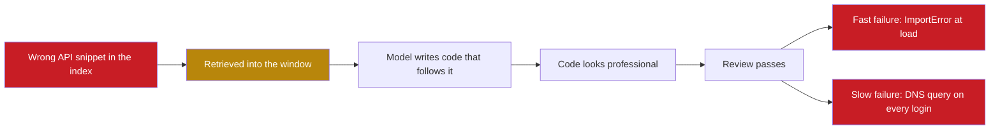

## 1. The question this idea answers

Take one model and one task. Give it a vague prompt, then a careful prompt, then a full engineered context. Does the context really change the result more than the wording? And what happens when the context itself is wrong?

The handbook's demo (Session 1, §4) answers the first question with a claim. This lesson checks the claim, and then finds an error inside the demo's own context. That error is the most useful part: it shows that a model follows wrong context as confidently as right context.

## 2. Mental model

> [!analogy] A fence and a wrong survey
> You hire a contractor to build a fence.
>
> 1. "Build me a fence." You get some fence.
> 2. A spec sheet: height, material, a gate on the east side. You get a better fence.
> 3. The spec sheet, a site survey and the local building code. You get the right fence in the right place.
>
> Now the survey has one wrong number: the property line is 2 meters off. The contractor builds a perfect fence, to code, on the neighbor's land. Better context gave a better fence. Wrong context gave a confident mistake.
>
> **Where it stops working:** an experienced contractor might notice the wrong line. A model sometimes notices too, because its weights may hold the correct fact. But you cannot predict when it will notice, so you cannot depend on it.

## 3. Terms

| Term | Plain meaning |
|---|---|
| vibe prompt | A short request that states only the goal, with no requirements or context. |
| engineered prompt | A request that states the requirements in detail, but still gives only the user input element. |
| engineered context | A call where several elements work together: system instructions, retrieved knowledge and the user input. |
| parametric knowledge | What the model knows from its weights, from training. |
| knowledge conflict | The window says one thing and the weights say another. Which one the model follows is not predictable. |
| provenance | Where a piece of context came from: the source, its version and the date that someone checked it. |
| rubric | A list of criteria with points, used to score an output. |
| substring scorer | A scorer that gives points when certain text fragments appear anywhere in the output. |
| executable test | A test that runs the generated code on known inputs and compares the result with the expected output. |
| fixture | A small, fixed input file built to test one behavior, with a known correct result. |
| ceiling effect | A score that reaches its maximum early, so it cannot show further improvement. |
| business rule | A requirement that comes from the domain, not from the code style, for example "count only completed orders". |

## 4. Method and math

### 4.1 The task and the three approaches

The task: "Build a Python function that validates email addresses, handles edge cases, and includes error logging."

**Approach 1, vibe coding** (handbook Listing 1):

```python
prompt = "Build me an email validator in Python"
```

**Approach 2, an engineered prompt** (Listing 2, shortened). It asks for a `validate_email` function that returns a boolean. The function must handle empty strings, `None` and Unicode, and use the email-validator library. It must log errors, have type hints and come with 5 test cases.

**Approach 3, an engineered context** (Listing 3). Three variables carry three elements:

| Variable | Element | What it holds |
|---|---|---|
| `system_prompt` | System instructions | A senior Python developer at Acme Corp. Python 3.11+, strict type checking, email-validator 2.x, Google-style docstrings, a custom logger, no bare `except`, pytest with `parametrize`, at most 30 lines per function. |
| `retrieved_knowledge` | Retrieved knowledge | An incident report (2025-11-15, P1: regex-only validation let spam through) with the action item "all new email validation MUST include check_deliverability=True". Then an "API reference" for the library. |
| `user_message` | User input | "Write a validate_email function for our user registration service." |

The handbook's summary is: "The model did not get smarter between Approach 2 and Approach 3. You gave it better context." Approaches 1 and 2 use one element. Approach 3 uses three.

### 4.2 What the handbook shows, and what it does not

The handbook describes the outputs: approach 1 gives "a basic regex pattern (often incorrect for edge cases)", and approach 3 uses "the correct library version, includes DNS validation", the custom logger and specific exceptions. It shows no generated code, no runs and no scores for this demo.

So these outcomes are predictions, not results. They are plausible, and the direction is a good **rule of thumb**. But treat them as a hypothesis, and measure them with the rubric of section 4.7.

### 4.3 The retrieved API reference is wrong

Here is the "API reference" from Listing 3, exactly as the handbook gives it:

```text
### email-validator 2.x API Reference:
- validate_email(email, check_deliverability=False)
  -> EmailInfo
- EmailInfo.normalized -> cleaned email string
- Raises EmailNotValidError for invalid emails
```

Compare it with the real library. The current version is 2.3.0, released on 26 August 2025 (checked on 2026-10-12).

| Handbook line | Real library (README and changelog) | Verdict |
|---|---|---|
| `check_deliverability=False` | The default is `check_deliverability=True`. | Wrong |
| `-> EmailInfo` | The function returns a `ValidatedEmail` object. No `EmailInfo` class exists. | Wrong |
| `EmailInfo.normalized` | `.normalized` exists on `ValidatedEmail`. Version 2.0.0 renamed `email` to `normalized`, and `.email` still works. | Right attribute, wrong class |
| `Raises EmailNotValidError` | Correct. It is raised through the subclasses `EmailSyntaxError` and `EmailUndeliverableError`. `EmailNotValidError` is itself a subclass of `ValueError`. | Right, but incomplete |

Where does the name `EmailInfo` come from? The README's quick start stores the result in a variable named `emailinfo`. The same quick start passes `check_deliverability=False` and explains why: "When using this in a login form, set `check_deliverability` to `False` to avoid unnecessary DNS queries." Someone probably copied the example call and read the example's argument as the default.

> [!note] Source check: the email-validator API in Listing 3
> **Corrected.** The handbook (Session 1, §4.3, Listing 3) gives `validate_email(email, check_deliverability=False) -> EmailInfo` and `EmailInfo.normalized`. In email-validator 2.3.0 the default is `check_deliverability=True`, the result is a `ValidatedEmail` object with `.normalized`, and failures raise `EmailNotValidError` through `EmailSyntaxError` and `EmailUndeliverableError`. No `EmailInfo` class exists. Sources: the python-email-validator README and changelog on GitHub, and PyPI. Checked on 2026-10-12.

### 4.4 How wrong context becomes confident, wrong code

The demo's thesis is that the model follows its context. That is true for wrong context too. Follow each wrong line to its effect.

| Wrong line in the window | Code that a model can write from it | What happens |
|---|---|---|
| `-> EmailInfo` | `from email_validator import validate_email, EmailInfo` | `ImportError` when the module loads. Nothing in the file runs. |
| `-> EmailInfo` | `def validate_email(...) -> EmailInfo:` with no import | On Python 3.12, without `from __future__ import annotations`, the annotation is evaluated when the function is defined, so it raises `NameError`. |
| `-> EmailInfo` | Either version above | The team's "strict type checking" fails on an unknown name. |
| `check_deliverability=False` as the default | A later login check written as `validate_email(address)`, trusting "no DNS by default" | The real default is `True`, so every login makes DNS queries. The README warns against exactly this. |

Notice the last row. In the registration task itself, the wrong default does no harm, because the incident report forces `check_deliverability=True` explicitly. The harm appears in **another** task that retrieves the same snippet. A wrong document in a retrieval index is a bug that spreads to every query that finds it.



Why does the model not catch the error? It has two sources: its weights, which may hold the real README, and the window, which says something else. This is a **knowledge conflict**, and you cannot predict which source wins on a given call. The handbook's own sentence, "You gave it better context", also explains this failure. Here you gave it wrong context.

> [!key] The main idea
> Better context means correct, current and sourced context. More context that is wrong produces confident, wrong output. A wrong document in the window is a bug, like a wrong value in a configuration file.

### 4.5 Rules for retrieved knowledge

1. **Carry provenance.** Each snippet states its source, the library version and the date that someone checked it. For example: `<doc source="email-validator README" version="2.3.0" checked="2026-10-12">`.
2. **Generate API references from the code, not by hand.** Read the installed package with `importlib.metadata.version(...)`, `inspect.signature(...)` and `help(...)`. A hand-written summary is how `EmailInfo` was born.
3. **Pin versions.** The system prompt says "email-validator 2.x". The snippet must match the version that `pip` installs.
4. **Test the generated code by running it.** An `ImportError` appears in the first second of a test run.
5. **Give each document an owner and a review date.** Re-check documents after each library upgrade.

### 4.6 The notebook's Lab 2: one task at four context levels

The workshop notebook (Session 1, Lab 2, "Multi-Model Context Analyzer") runs a cleaner version of the same idea. The task is: "Write a Python function that processes a CSV file of customer orders and returns the top 5 customers by total spending."

| Level | What is added | Fixed text added (tokens, `o200k_base`) |
|---|---|---|
| 0 | The bare task | 23 |
| 1 | A system prompt with coding standards. The learner writes it: Python 3.11+, type hints, Google docstrings, `pathlib`, the `csv` module, `Decimal` for money, error handling. | Depends on the learner's prompt |
| 2 | Two few-shot example functions in the team's style | 457 |
| 3 | A retrieved CSV specification with business rules | 243 |

The specification at level 3 holds six business rules:

1. Count only orders with `status = "completed"`. Exclude refunded and cancelled orders.
2. Handle the UTF-8 byte-order mark (BOM) that Excel sometimes adds.
3. If the `amount` field is empty, skip the row and log a warning.
4. Negative amounts are adjustments. Include them.
5. If an `order_id` repeats, count only the first occurrence.
6. The file can have up to 500,000 rows. Do not load all of them into memory at once.

The notebook's hypothesis: "Adding context improves quality more than switching models." Before you run it, update the model IDs. Its `MODEL_MAP` uses `claude-sonnet-4-20250514`, and Claude Sonnet 4 was retired on 15 June 2026, except on some clouds (checked on 2026-10-12). Its `count_tokens` helper uses the GPT-4o tokenizer for every model, so its Claude counts are estimates (lesson [1.2](/notes/ai/context-engineering/01-foundations/l2-tokens-and-tokenizers)).

### 4.7 Why the scorer cannot measure what it claims

The notebook scores each response with `score_response`. This is its logic, shortened:

```python
type_hints     = any(p in response for p in ["-> ", ": str", ": int", ": list", ...])
docstring      = '"""' in response or "'''" in response
error_handling = any(p in response for p in ["try:", "except ", "raise ", ...])
structure      = all(k in response for k in ["def ", "return ", "import "])
# each check gives 0 or 5 points, so the maximum is 20
```

Each check asks only whether a fragment of text appears somewhere in the response. That causes seven problems:

1. **It reads prose as code.** The fragments can appear in explanations, not only in code.
2. **It never runs the code.** A function that crashes on the first row can score 20.
3. **It scores none of the six business rules.** The level-3 context exists to teach those rules, and the scorer cannot see them.
4. **It has a ceiling.** Once level 1 reaches 20 out of 20, levels 2 and 3 cannot score higher. So the experiment cannot show their effect.
5. **It is coarse.** Each check is 0 or 5, so the total can take only five values.
6. **It runs once per level** at temperature 0.3. There is no estimate of noise (lesson 2.4).
7. **The conclusion is fixed text.** The "Key Insight" cell states "Context engineering has 3x more impact than model selection", with "~5 points" against "~15 points". Those numbers do not come from the run.

> [!example] Worked example: two responses that score 20 out of 20
> **Response A**, a function that breaks four of the six business rules:
>
> ```python
> import csv
>
> def top_customers(path: str) -> list:
>     """Return the top 5 customers."""
>     totals = {}
>     try:
>         rows = list(csv.DictReader(open(path)))
>     except FileNotFoundError:
>         return []
>     for row in rows:
>         amount = float(row["amount"])
>         totals[row["customer_id"]] = totals.get(row["customer_id"], 0) + amount
>     return sorted(totals.items(), key=lambda kv: kv[1], reverse=True)[:5]
> ```
>
> It counts refunded and cancelled orders (rule 1). It crashes on an empty amount instead of skipping it (rule 3). It counts duplicate orders twice (rule 5). It loads every row into memory with `list(...)` (rule 6). It also uses `float` for money, against the standards. Rule 4 passes by accident. It ignores the BOM (rule 2), which does no harm here only because it never reads the first column.
>
> `score_response` gives it type hints 5, docstring 5, error handling 5, structure 5: **20 out of 20**.
>
> **Response B**, one sentence and no code:
>
> ```text
> I cannot write code, but to import a file, try: open it, return the rows -> done, and put """docstrings""" under each def statement.
> ```
>
> It contains `-> `, `"""`, `try:`, `def `, `return ` and `import `. It also scores **20 out of 20**.
>
> Both scores were computed by running the notebook's function on these two strings.

> [!note] Source check: "3x more impact than model selection"
> **Corrected.** The notebook (Session 1, Lab 2, Key Insight cell) says "Context engineering has 3x more impact than model selection", with a table of "~5 points" against "~15 points". These numbers are fixed text, not results of the run. The scorer checks only for text fragments, never runs the code, and scores none of the six business rules. So the experiment cannot support the claim. Source: the notebook's own `score_response` code and its Lab 2 cells.

### 4.8 Design a better rubric

You design the new rubric. It must test what the task asks for: correct results under the business rules, and the team's standards. Use the requirements below.

| Requirement | How to test it | Design question for you |
|---|---|---|
| Correct result under each business rule | Executable tests on fixtures: one small CSV per rule, with a known answer | How many points per rule? Does a crash fail all rules? |
| BOM handling | A fixture saved with the `utf-8-sig` encoding | What must the code do with the first header name? |
| Warning on an empty amount | Capture logs with pytest's `caplog` or `unittest`'s `assertLogs` | Which log level counts as a warning? |
| No full load of 500,000 rows | Measure peak memory with `tracemalloc` on a large generated file | What memory limit is fair? |
| Team standards | Parse the code with `ast`: annotations on every parameter and return, a docstring (`ast.get_docstring`), no bare `except:`, `Decimal` instead of `float` | Are standards worth as much as correctness? |
| Safe execution | Run the generated code in a subprocess with a timeout, in a temporary directory | Never run model output inside your notebook process. |
| Noise | Five samples per level. Report the mean and the spread. | How many questions or tasks make the comparison fair? |

> [!example] Worked example: one fixture with a hand-computed answer
> This fixture tests rules 1, 3, 4 and 5 at the same time. Save it with the `utf-8-sig` encoding, so it also carries a BOM (rule 2).
>
> ```text
> order_id,customer_id,customer_name,order_date,amount,status
> ORD-1,C1,Asha,2024-03-01,100.00,completed
> ORD-1,C1,Asha,2024-03-01,100.00,completed
> ORD-2,C2,Ben,2024-03-02,50.00,refunded
> ORD-3,C2,Ben,2024-03-03,-10.00,completed
> ORD-4,C3,Chen,2024-03-04,,completed
> ORD-5,C3,Chen,2024-03-05,30.00,cancelled
> ```
>
> Apply the rules row by row:
>
> 1. ORD-1 counts once for C1: 100.00. The second ORD-1 is a duplicate (rule 5).
> 2. ORD-2 is refunded, so it does not count (rule 1).
> 3. ORD-3 is an adjustment of −10.00 for C2, and it counts (rule 4).
> 4. ORD-4 has an empty amount: skip it and log a warning (rule 3).
> 5. ORD-5 is cancelled, so it does not count (rule 1).
>
> Expected result: C1 with 100.00, then C2 with −10.00. C3 has no counted order, so it does not appear.
>
> Response A raises `ValueError: could not convert string to float: ''` on ORD-4. Without the ORD-4 row, it returns C1 200.0, C2 40.0, C3 30.0: wrong for every customer. A function that reads the file with plain `utf-8` sees the first header as `'\ufefforder_id'`, with a BOM character before the name. So `row["order_id"]` raises a `KeyError`. Any correct solution must read `order_id` for rule 5, so the BOM rule really matters.

A good rubric also forces you to decide what the specification leaves open. Must a customer with a negative total appear in the top 5? What happens on a tie? Record these decisions before you score anything. Otherwise your rubric measures your mood, not the code.

### 4.9 Production view

| Concern | What this lesson means for it |
|---|---|
| Reliability | Retrieved knowledge is code-like input. A wrong snippet causes wrong code in every task that retrieves it. |
| Governance | Every document in a retrieval index needs provenance: source, version, date checked and an owner. |
| Evaluation | Score with executable tests on fixtures, not with text fragments. Keep the rubric in version control. |
| Security | Run generated code in a subprocess with a timeout and no secrets in its environment. |
| Upgrades | A library upgrade can make a correct snippet wrong. Re-check documents when dependencies change. |

## 5. Code

These exercises go in `notebooks/02-paradigm-shift.ipynb`. Exercises 5.1, 5.2 and 5.4 call no API. Install the library first: `pip install email-validator==2.3.0`.

**Exercise 5.1: a documentation checker.**

1. Write `check_names(module, names: list[str]) -> dict[str, bool]` that reports which names exist in a module.
2. Run it on `email_validator` with the names from the handbook's API reference: `validate_email`, `EmailInfo`, `EmailNotValidError`.
3. Check the exception classes with `issubclass`, and the type of the result of `validate_email("asha@gmail.com", check_deliverability=False)`.
4. Find the effective default of `check_deliverability`. Read `inspect.signature(validate_email)`. If it shows a placeholder such as `None`, find where the real default is set, with `inspect.getsource`.

Acceptance tests:

- `EmailInfo` is reported as missing.
- `issubclass(EmailNotValidError, ValueError)` is `True`.
- The result type is named `ValidatedEmail`.
- One sentence states the effective default of `check_deliverability` and the line of source code that sets it.

**Exercise 5.2: rubric version 2.**

1. Build one fixture file for each of the six business rules, plus the combined fixture of section 4.8. Write the expected result for each by hand.
2. Write `run_candidate(code: str, fixture: Path) -> dict` that writes the code to a temporary file and runs it in a subprocess with a 10-second timeout.
3. Write the static checks with `ast`.
4. Combine everything into `score_v2(code) -> dict` with one score per requirement and a total.

Acceptance tests:

- Response A of section 4.7 fails at least four of the six rule tests.
- Response B scores 0 on every rule test.
- A correct solution that you write yourself scores the maximum on every rule test.

**Exercise 5.3 (optional, costs money): run the four levels with both rubrics.** Update the model IDs. Run each level 5 times on one model. Score every response with `score_response` and with `score_v2`.

Acceptance tests:

- A table with the mean and the spread of both scores for each level.
- Two sentences on where the two rubrics disagree, and which one you trust.

**Exercise 5.4: Debug exercise.** This is the API reference from the handbook's Listing 3:

```text
- validate_email(email, check_deliverability=False) -> EmailInfo
- EmailInfo.normalized -> cleaned email string
- Raises EmailNotValidError for invalid emails
```

Find every error with the installed library only, without a web search. Then write a corrected snippet with provenance tags. The answer is in the Check questions section.

## 6. Common mistakes

1. **"More context always beats a better prompt."** Wrong context gives confident, wrong output. Context must be correct, current and sourced.
2. **"The model will notice a wrong API document."** Sometimes its weights know better, sometimes not. You cannot predict which source wins.
3. **"If the code looks professional, it is correct."** Response A has type hints, a docstring and a `try` block, and it breaks four business rules.
4. **"A keyword scorer measures code quality."** It measures whether some text fragments appear. One sentence of prose scores 20 out of 20.
5. **"One run per configuration is a result."** Without repeats and enough tasks, the difference between levels can be noise (lesson 2.4).

## 7. One-minute explanation

The handbook gives one model the same task three times. First a vague prompt, then a careful prompt, then a full context with a system prompt and retrieved knowledge. The claim is that context, not wording, makes the big difference. That is a good hypothesis, but the handbook shows no outputs or scores. Inside its own context there is a bug. The retrieved API reference says that `check_deliverability` defaults to False and that the function returns `EmailInfo`. The real library defaults to True and returns `ValidatedEmail`. A model that follows this context writes code that fails at import, or code that makes DNS queries where nobody expects them. So better context means correct and sourced context. The notebook's four-level experiment has a similar problem. Its scorer only looks for text fragments, so one sentence of prose scores full marks, and none of the business rules is tested. A real rubric runs the code on fixtures, one per rule.

## 8. Check questions

```check
{
  "question": "Debug exercise answer: list the errors in the handbook's API reference (validate_email(email, check_deliverability=False) -> EmailInfo, EmailInfo.normalized, raises EmailNotValidError).",
  "answer": "1. The default of check_deliverability is True, not False. 2. The function returns a ValidatedEmail object. No EmailInfo class exists, so importing it raises ImportError. 3. .normalized is real, but it belongs to ValidatedEmail. EmailNotValidError is correct but incomplete: it is raised through EmailSyntaxError and EmailUndeliverableError, and it is a subclass of ValueError. A corrected snippet names the version (2.3.0), the source (README) and the date checked."
}
```

```check
{
  "question": "What does score_response give to this response: def f(x: int) -> int: return x (on two lines, with no import)? Explain each of the four checks.",
  "hint": "Each check is 0 or 5. The structure check needs def, return and import.",
  "answer": "Type hints 5 (it contains \"-> \" and \": int\"). Docstring 0 (no triple quotes). Error handling 0 (no try, except, raise or error names). Structure 0 (\"import \" is missing). Total 5 out of 20."
}
```

```check
{
  "question": "Apply the six business rules to these rows and give the expected top customers: ORD-7, C4, 80.00, completed. ORD-8, C4, 20.00, refunded. ORD-9, C5, 60.00, completed. ORD-9, C5, 60.00, completed. ORD-10, C5, , completed.",
  "answer": "C4: ORD-7 counts (80.00), ORD-8 is refunded and does not count, so C4 = 80.00. C5: ORD-9 counts once (60.00), the duplicate is skipped, and ORD-10 has an empty amount, so it is skipped with a warning. C5 = 60.00. Result: C4 with 80.00, then C5 with 60.00."
}
```

```check
{
  "question": "In the registration task, the incident report forces check_deliverability=True, so the wrong default in the snippet does no harm there. Why is the snippet still a production bug?",
  "answer": "The snippet lives in the retrieval index, so other tasks retrieve it too. A login check written from it might call validate_email(address) and trust that DNS is off by default. The real default is True, so every login makes DNS queries, which the README warns against. A wrong document spreads to every query that finds it."
}
```

```check
{
  "question": "The notebook computes context_impact = max(level-3 scores) − max(level-0 scores) across models, from one run each. Name two reasons why this number cannot support \"context matters more than the model\".",
  "answer": "First, the scorer measures text fragments, not correctness, and it has a ceiling at 20, so the scores do not reflect the business rules. Second, there is one run per model and level, with no estimate of noise, and the maximum across models compares different models' best single runs. The \"3x\" conclusion is also fixed text in the notebook, not computed."
}
```

## 9. Links

- Previous: [L4: The quality curve and the five causes of rot](/notes/ai/context-engineering/02-paradigm-shift/l4-the-quality-curve)
- Next: [L6: The context audit](/notes/ai/context-engineering/02-paradigm-shift/l6-the-context-audit)
- [L3: The six elements of context](/notes/ai/context-engineering/02-paradigm-shift/l3-the-six-elements-of-context): what "three of the six elements" means
- Later: [05 Retrieval quality](/notes/ai/context-engineering/05-retrieval-quality) and [09 Production](/notes/ai/context-engineering/09-production) for evaluation
- [Glossary](/notes/ai/context-engineering/glossary)
