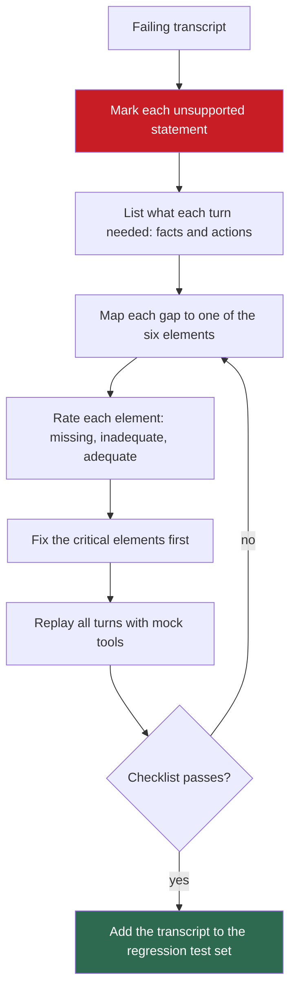

## 1. The question this idea answers

A deployed chatbot fails a customer. One engineer wants a bigger model. Another wants a friendlier prompt. Both are guesses. How do I find which part of the context is broken, in a fixed order, and fix the part that matters first?

The handbook's exercise (Session 1, §5) gives a three-turn transcript and an audit template with one row for each of the six elements. This lesson works through it, corrects the handbook's own inconsistencies, and turns the audit into a procedure that you can run on any failing transcript.

## 2. Mental model

> [!analogy] A mechanic's checklist
> A car does not start. A bad mechanic replaces parts at random: first the battery, then the starter, then the spark plugs. A good mechanic follows a checklist: fuel, spark, air, compression. Each check confirms or excludes one cause, and the first failed check is the first repair.
>
> The six elements of context are the checklist for an LLM failure.
>
> **Where it stops working:** car systems fail mostly one at a time. Context elements depend on each other. A system prompt that says "use the escalate_to_human tool" is useless if the tool does not exist. It can even make the model claim an action that it cannot take. So fix related elements together, and test them together.

## 3. Terms

| Term | Plain meaning |
|---|---|
| context audit | A diagnosis of a failing interaction that checks each of the six elements for what is missing or inadequate. |
| audit rating | One of three values for each element: missing (absent), inadequate (present but too weak), adequate (fine for this task). |
| critical element | An element without which the task is not solvable. Fix critical elements first. |
| authority level | What the bot may decide alone, and what needs a human. |
| escalation | Handing a conversation to a human, with a summary of the case. |
| key-fact block | A short, structured list of the facts of this conversation, kept up to date by the application. |
| structured intake | Asking for required fields, such as the order number, at the start of a conversation. |
| policy precedence | The rule that says which policy rule wins, or how rules combine, when several apply. |
| policy as code | Computing a policy decision in deterministic code, usually behind a tool, instead of asking the model to reason it out. |
| replay | Running the same user turns again against a changed context, to compare the answers. |
| mock tool | A fake tool implementation that returns fixed results, so a replay is repeatable and costs nothing outside the model call. |

## 4. Method and math

### 4.1 The failing interaction

An electronics store deploys a chatbot. Its whole system prompt is: "You are a helpful customer support assistant." That is 8 tokens in `o200k_base`. The customer bought a USD 2,400 laptop. The screen began to flicker after 2 weeks. She writes 35 days after the purchase.

| Turn | Customer | Bot |
|---|---|---|
| 1 | "I bought a laptop from you guys last month and the screen is flickering. I want to return it." | "I am sorry to hear about the flickering screen! You can return most items within 30 days of purchase. Please visit our returns page at www.example.com/returns to initiate your return." |
| 2 | "But I bought it 35 days ago. Can you make an exception?" | "Unfortunately, our return policy is 30 days. I am not able to make exceptions to this policy. You may want to check if your purchase is covered under the manufacturer's warranty." |
| 3 | "This is ridiculous. The laptop was USD 2,400 and the screen started flickering after 2 weeks. I want to speak to a manager." | "I understand your frustration. Unfortunately, I do not have the ability to connect you with a manager. Please call our customer service line at 1-800-555-0123 for further assistance." |

This site writes prices as "USD 2,400". The handbook uses the dollar sign.

### 4.2 Read the transcript as evidence

Before you rate anything, ask of each bot reply: which statement has no support in the window? Each unsupported statement points to a missing element.

| Turn | Bot statement | What the window held | Missing element |
|---|---|---|---|
| 1 | "You can return most items within 30 days" | No policy at all. The 30 days come from the weights. | 4 Retrieved knowledge |
| 1 | A returns-page URL | No URL anywhere in the window | 4 Retrieved knowledge |
| 1 | Treats a flickering screen like any return | No rule that defects differ from a change of mind | 1 System instructions, 4 Retrieved knowledge |
| 2 | "I am not able to make exceptions to this policy" | No authority rules and no exception rules | 1 System instructions, 4 Retrieved knowledge |
| 2 | "check if your purchase is covered under the manufacturer's warranty" | No way to check the warranty | 5 Tools |
| 3 | "I do not have the ability to connect you with a manager" | True: there is no escalation tool | 5 Tools |
| 3 | A phone number | No phone number anywhere in the window | 4 Retrieved knowledge |
| 1 to 3 | Never uses the price, the defect or the 35 days together | The facts are scattered across raw turns | 3 History, 6 State |

Every bot reply contains a claim that nothing in the window supports. That is the signature of missing context (lesson [1.1](/notes/ai/context-engineering/01-foundations/l1-what-a-model-does-with-context)). The URL and the phone number are the most dangerous: they look precise, and they are invented.

### 4.3 The audit template and the ratings

The handbook's template has two lines for each element:

```text
Element N - <name>:
  Missing: ______________________________
  Should provide: _______________________
```

The workshop notebook (Lab 1) adds a rating for each element: `missing`, `inadequate` or `adequate`. Use both. The rating gives a quick overview, and the two lines force a concrete fix.

### 4.4 The solution, element by element

| # | Element | Rating | What is wrong | Fix |
|---|---|---|---|---|
| 1 | System instructions | Inadequate | A generic prompt: no persona, no rules, no authority level, no escalation rule, no tone guide | A TechStore persona with authority limits, a defect rule, a "use tools for order facts" rule and an escalation rule |
| 2 | User input | Adequate | The customer states the problem, the timeline and the wish clearly. | Optional: a structured intake for the order number, purchase date and issue type |
| 3 | Conversation history | Inadequate | The facts are in the raw turns, but nothing tracks them. The bot treats each turn "somewhat independently". | A key-fact block: product = laptop, price = USD 2,400, issue = hardware defect, days since purchase = 35 |
| 4 | Retrieved knowledge | Missing | No policy document, so the bot invents one | The return policy with defect rules, high-value rules, warranty terms and a precedence rule |
| 5 | Tool definitions and results | Missing | The bot cannot read the order, check the warranty, start a return or escalate. | Four tools: `lookup_order`, `check_warranty`, `initiate_return`, `escalate_to_human` |
| 6 | State and memory | Missing | No profile, purchase history or record of earlier contacts | A customer profile: purchase history, loyalty status, earlier support contacts |

Two notes on element 3. First, the facts are already in the raw history: 35 days (turn 2), USD 2,400 and the 2-week defect (turn 3). The problem is that nothing uses them for a decision. A key-fact block makes them explicit. Second, the key-fact block alone does not help without the policy: a bot that knows "35 days, defect" but no defect rule still says "30 days".

The handbook's system prompt fix reads, in short: a support agent for TechStore. For orders over USD 1,000, it has "authority to extend return windows by 15 days". It must "Always offer to check warranty status before suggesting a return". If a customer asks for a manager, it must "use the escalate_to_human tool".

The handbook's policy fix reads: "Electronics with manufacturer defects: 90-day return window." And: items over USD 1,000 get an "automatic 15-day extension on return window."

### 4.5 How many failures? The handbook disagrees with itself

The handbook says the interaction has "at least four major context engineering failures". Its own materials count differently.

| Source | Elements marked as failed |
|---|---|
| Section headings of §5.3 ("Critical Failure") | 1, 4, 5 |
| Key Takeaway of §5.3 ("Four of six elements") | 1, 4, 5, 6 |
| Solution text of §5.3.3 | Also lists a gap in element 3 |
| Notebook Lab 1 answer key | 1, 3, 4, 5, 6 rated missing or inadequate, while it prints "4 of 6" |

Use the solvability test of lesson 2.1 to settle it. The task needs seven items. Five are facts: the days since purchase, the issue type, the price, the policy and the warranty status. Two concern actions: the bot's authority for exceptions and a way to escalate. The customer asks for an exception at turn 2, so the bot must know what it may decide alone. With elements 1, 4 and 5 repaired, all seven are available. `lookup_order` returns the date and the price. The policy gives the rules. The system instructions state the authority. The other tools check the warranty and escalate. So:

- **Critical (the task is not solvable without them):** elements 1, 4 and 5.
- **Need work, but not critical for this task:** elements 3 and 6. They make the bot faster and more personal, and they make its decisions easier to check.
- **Adequate:** element 2.

The count matters less than the order of the repairs. Fix the critical elements first.

> [!note] Source check: how many elements failed
> **Corrected (internal inconsistency).** The handbook (Session 1, §5.3 Key Takeaway) says "Four of six elements were missing or inadequate" and names elements 1, 4, 5 and 6. Its own §5.3.3 lists a gap in element 3, and its section headings mark only elements 1, 4 and 5 as critical. The notebook's answer key (Lab 1) rates five elements as missing or inadequate but prints "4 of 6". This lesson rates five elements as needing work, of which three (1, 4, 5) are critical. Source: the handbook and notebook text themselves.

> [!note] Source check: "authority to extend" against "automatic extension"
> **Corrected (internal inconsistency).** The handbook's system prompt fix (Session 1, §5.3.1) gives the bot "authority to extend return windows by 15 days" for orders over USD 1,000, which is a choice. Its policy fix (§5.3.4) says that such items get an "automatic 15-day extension", which is not a choice. The model would receive two different rules for the same fact. Keep the rule in one place, the policy document, and let the system prompt point to it. Source: the handbook text itself.

One more gap: in the PDF, the handbook's tool list stops in the middle of `initiate_return(ord`. Its full signature is unknown, so section 4.7 uses a design of this lesson.

### 4.6 Policy arithmetic: two readings of one policy

The policy has a base window and an extension. It does not say how they combine. Define:

- $d$: days since purchase.
- $D$: 1 if the item has a manufacturer defect, else 0.
- $H$: 1 if the price is over USD 1,000, else 0.
- $W_{\text{base}} = 90$ if $D = 1$, else 30.

Two readings are possible:

$$
W_A = \max\left(W_{\text{base}},\; 30 + 15H\right)
\qquad
W_B = W_{\text{base}} + 15H
$$

The symbols mean:

- $W_A$ is the window if the 15-day extension applies only to the standard 30-day window.
- $W_B$ is the window if the extension adds to whatever window applies.
- The return is allowed when $d \le W$.

> [!example] Worked example: three customers, two readings
> | Case | $D$ | $H$ | $d$ | $W_A$ | $W_B$ | Allowed under A? | Allowed under B? |
> |---|---|---|---|---|---|---|---|
> | Our customer: defective, USD 2,400 | 1 | 1 | 35 | $\max(90, 45) = 90$ | $90 + 15 = 105$ | Yes | Yes |
> | Defective, USD 2,400, late | 1 | 1 | 100 | 90 | 105 | No | Yes |
> | Not defective, USD 2,400 | 0 | 1 | 40 | $\max(30, 45) = 45$ | $30 + 15 = 45$ | Yes | Yes |
>
> For our customer, both readings allow the return. Two rules allow it on their own: the defect rule (35 ≤ 90) and the high-value rule (35 ≤ 45). The bot refused a return that the policy allows twice.
>
> The second case shows the ambiguity. The same facts give "no" under reading A and "yes" under reading B. The third case has a different problem. Under the handbook's system prompt, with its "authority to extend", it becomes a choice instead of a rule.

Two lessons follow:

1. **The policy document must state its precedence.** For example: "The 15-day extension applies only to the standard window." Without that sentence, two runs of the same model can decide differently.
2. **Do not let the model do this arithmetic.** Put the decision in code behind a tool, for example `check_return_eligibility(order_id)`. The tool returns the window, the rule that applied and the verdict. The model then explains a decision instead of computing it. This is **policy as code**.

### 4.7 The repaired context

**System instructions.** This is the structure only. You write the text in Exercise 6.2.

1. Identity: the TechStore support agent.
2. Authority: what the agent may do alone, and what needs a human. It may start a return that the policy allows. Any exception to the policy needs a human.
3. Facts rule: get order facts only from tools. Quote policy only from the policy document. Never state a URL, phone number or rule that is not in the window.
4. Defect rule: treat a hardware defect differently from a change of mind, as the policy says.
5. Escalation rule: when the customer asks for a manager, call `escalate_to_human` with a summary.
6. Tone: empathetic, direct, short.

**Retrieved knowledge:** the return policy, with a version, an effective date and an explicit precedence rule.

**State and memory:** a key-fact block, updated after every turn, and a customer profile.

```text
<key_facts updated_turn="3">
product: laptop | order_id: A17 | price_usd: 2400
issue: hardware defect (screen flicker from day 14) | days_since_purchase: 35
customer_wants: return, or a manager
</key_facts>
```

**Tools:**

| Tool | Inputs | Returns | When to call it |
|---|---|---|---|
| `lookup_order` | `order_id` | Product, price, purchase date, days since purchase | At the start, for any order fact |
| `check_warranty` | `product_id` | Warranty status and end date | Before a return for a defect, as the handbook's rule asks |
| `initiate_return` | `order_id`, `reason` (this lesson's design) | A return ID and shipping instructions | When the policy allows the return and the customer wants it |
| `escalate_to_human` | `reason`, `context_summary` | A ticket ID and the expected wait | When the customer asks for a manager, or wants an exception |

Here is the full definition of the last tool, in the Anthropic `tools` format. You write the other three in Exercise 6.2. Anthropic's tool docs advise: "Aim for at least 3–4 sentences for each tool description" (checked on 2026-10-12).

```json
{
  "name": "escalate_to_human",
  "description": "Transfer the conversation to a human support manager. Call this when the customer asks for a manager, or when the customer wants an exception that the return policy does not allow. Do not call it for questions that the policy or the other tools can answer. It returns a ticket ID and the expected wait time, which you must tell the customer.",
  "input_schema": {
    "type": "object",
    "properties": {
      "reason": {
        "type": "string",
        "enum": ["customer_request", "policy_exception", "other"],
        "description": "Why the conversation needs a human."
      },
      "context_summary": {
        "type": "string",
        "description": "Two to four sentences: the order, the issue, what the customer wants, and what the agent already did."
      }
    },
    "required": ["reason", "context_summary"]
  }
}
```

The `context_summary` field matters. Without it, the customer must repeat the whole story to the manager. With it, the human starts where the bot stopped.

### 4.8 Replay: test the repair

A repair is a hypothesis until a replay confirms it. Replay the same three customer turns against the repaired context. Use mock tools with fixed results, for example `lookup_order("A17")` returns price 2,400 and 35 days, so every run sees the same facts.

Score each run with a checklist:

1. The bot recognizes a hardware defect.
2. It states the correct window from the policy document.
3. It offers or starts the return that the policy allows.
4. It checks the warranty with the tool, not by telling the customer to check.
5. It escalates with a summary when the customer asks for a manager.
6. It states nothing that the window does not support: no invented URL, phone number or rule.

The original transcript scores 0 of 6. Item 3 also fails: turn 1 points to an invented returns page, and turn 2 refuses the return. Read the transcript again with the checklist to confirm.

> [!trap] The notebook's "fix" cannot test two of the elements
> The notebook's Lab 1 fix cell sends only the third customer message, with the policy and the profile pasted into that one message. It sends no history and no tools. So the replay cannot test element 3, and the bot still cannot escalate, although the exercise asks for escalation rules. Replay all three turns with the full history, and give the bot the tools (mocked).

### 4.9 The audit as a procedure



The last step is the most valuable in production. Every audited failure becomes a test case, so the same failure cannot return unnoticed after the next prompt change (Part 9).

### 4.10 Production view

| Concern | What this lesson means for it |
|---|---|
| Reliability | Invented URLs and phone numbers are the most dangerous outputs. Forbid unsupported facts in the system prompt, and check outputs for them. |
| Correctness | Compute policy decisions in code behind a tool. The model explains them. |
| Governance | Each policy rule lives in one place, with a version and an effective date. The system prompt points to it. |
| Customer experience | An escalation tool with a context summary saves the customer from repeating the story. |
| Evaluation | Every audited failure becomes a regression test, replayed with mock tools on each change. |
| Observability | Log the full assembled context with each transcript. An audit needs to see what the model saw. |

## 5. Code

These exercises go in `notebooks/02-paradigm-shift.ipynb`. Put the tools and the policy code in `src/techstore/`, with tests in `tests/`. Exercises 6.1 to 6.4 call no API.

**Exercise 6.1: the audit (notebook Lab 1, step 1).**

1. Write the audit as a dictionary: for each of the six elements, a `status` (`missing`, `inadequate` or `adequate`) and a one-sentence `problem`.
2. Compare your ratings with the notebook's answer key.
3. For each disagreement, write one sentence that defends your rating with evidence from the transcript.

Acceptance tests:

- Every element has a status and a problem sentence.
- Your notes name the inconsistency between the key's five failed elements and its printed "4 of 6".

**Exercise 6.2: write the fixes.**

1. A system prompt of 150 to 300 words with the six parts of section 4.7.
2. A policy document with a version, an effective date, the defect rule, the high-value rule and an explicit precedence rule.
3. A customer profile and a key-fact block.
4. Anthropic tool definitions for `lookup_order`, `check_warranty` and `initiate_return`, in the format of section 4.7.

Acceptance tests:

- Each tool definition is valid JSON with `name`, `description` and `input_schema`, and each description has at least 3 sentences.
- The system prompt names each tool and says when to call it.
- The policy contradicts neither itself nor the system prompt: the high-value rule appears in one place only.

**Exercise 6.3: policy as code.**

1. Write `return_window(defect: bool, price_usd: Decimal, reading: str) -> int` for the readings A and B of section 4.6.
2. Write `check_return_eligibility(order: dict, reading: str) -> dict` that returns the window, the rule that applied and the verdict.
3. Write mock implementations of the four tools that return fixed results for order A17.

Acceptance tests:

- The three cases of section 4.6 give the windows 90, 90, 45 under reading A, and 105, 105, 45 under reading B.
- A price of exactly USD 1,000 does not trigger the extension ("over USD 1,000").
- A negative number of days raises a `ValueError`.

**Exercise 6.4: an automatic request audit.**

1. Write `audit_request(body: dict) -> dict[str, str]` that rates the six elements of an Anthropic request body with simple rules. For example: no `tools` means element 5 is missing, and no tagged document means element 4 is missing.
2. Build the request body of the failing bot at turn 3, and the request body of your repaired bot.

Acceptance tests:

- The failing request gives element 4 and element 5 as `missing`.
- The repaired request gives `adequate` for all six elements.
- One sentence names a failure that your rules cannot detect, for example a policy that is present but wrong (lesson 2.5).

**Exercise 6.5 (optional, costs money): replay.** Use the same model for the failing and the repaired context. Send all three customer turns with the full history and the mock tools. Run each context 3 times.

Acceptance tests:

- A table with the checklist score of section 4.8 for each run.
- One paragraph on which checklist item failed most often, and which element you would change next.

## 6. Common mistakes

1. **"The bot failed because the model is weak."** The window held no policy, no tools and no authority rules. Coverage was 3/7, about 0.43, at turn 3 (lesson 2.1). A larger model would invent a more fluent policy.
2. **"Make the system prompt more empathetic."** Tone was not the problem. The bot was polite in every turn and wrong in every turn.
3. **"The system prompt can mention a tool that we add later."** A prompt that names a missing tool invites the model to claim an action that it cannot take. Ship the rule and the tool together.
4. **"The model can apply the policy text itself."** The policy has two readings. Compute the decision in code and let the model explain it.
5. **"Replay only the last message."** That removes the history element from the test. Replay all turns, with tools.
6. **"The audit is done when I count the failures."** The order of repairs matters more than the count. Fix the elements without which the task is unsolvable first.

## 7. One-minute explanation

A context audit diagnoses a failing chatbot by checking the six elements of context in turn. Start with the transcript, and mark every statement that nothing in the window supports. In the TechStore case, the bot invented a 30-day rule, a URL and a phone number, because it had no policy document. It could not check the order or the warranty, or reach a manager, because it had no tools. Its one-line system prompt gave no authority or escalation rules. Those three elements are critical: without them the task is not solvable. History and state need work too, but they are not critical here. The handbook's fixes contain a contradiction: the prompt gives the bot authority to extend the window, but the policy calls the extension automatic. The policy also does not say how its rules combine. So keep each rule in one place, and compute the decision in code behind a tool. Then replay the full conversation with mock tools to prove the repair.

## 8. Check questions

```check
{
  "question": "Use both readings of section 4.6. Case 1: not defective, USD 900, day 32. Case 2: defective, USD 1,500, day 95. Is the return allowed?",
  "hint": "W_A = max(W_base, 30 + 15H) and W_B = W_base + 15H.",
  "answer": "Case 1: D = 0, H = 0, so W_base = 30 and both readings give 30. Day 32 > 30, so no return under either reading. Case 2: D = 1, H = 1. W_A = max(90, 45) = 90, so day 95 is not allowed. W_B = 90 + 15 = 105, so day 95 is allowed. The policy must state its precedence."
}
```

```check
{
  "question": "List the bot statements in the transcript that nothing in the window supports, and the element whose absence explains each one.",
  "answer": "\"You can return most items within 30 days\" and \"I am not able to make exceptions\": no policy document (element 4) and no authority rules (element 1). The returns-page URL and the phone number 1-800-555-0123: no source in the window (element 4). The advice to check the warranty yourself: no warranty tool (element 5)."
}
```

```check
{
  "question": "At turn 3 the history already contains the 35 days, the USD 2,400 price and the 2-week defect. Why is element 3 still rated inadequate, and why does fixing it alone not help?",
  "answer": "The facts are scattered across raw turns, and nothing converts them into a tracked set of facts that the bot uses for its decision. A key-fact block makes them explicit. But without the policy document, the bot still has no defect rule or high-value rule to apply, so it would still answer with an invented 30-day rule."
}
```

```check
{
  "question": "What is wrong with the notebook's Lab 1 fix cell as a test of the repaired context?",
  "answer": "It sends only the third customer message, with the policy and the profile pasted into it, and no history and no tools. It cannot test element 3, and the bot still cannot escalate or look up the order. A fair replay sends all three turns with the full history and mock tools."
}
```

```check
{
  "question": "The handbook says four elements failed, its headings mark three as critical, and the notebook key rates five as failed. Which count does this lesson use, and by what test?",
  "answer": "Five elements need work (1, 3, 4, 5, 6), and three of them are critical (1, 4, 5). The test is solvability: with the system rules, the policy and the four tools in place, every needed fact and action is available, so the task becomes solvable. History tracking and the profile improve the bot but are not required for this task."
}
```

```check
{
  "question": "Write the four or more sentences that a good description of check_warranty must contain. Do not write the JSON.",
  "answer": "One possible answer: \"Return the warranty status of one product. Call this before you suggest a return for a hardware defect, and whenever the customer asks about the warranty. Do not call it for orders that are not hardware products. It returns the warranty status, the end date and the type of coverage, which you must state exactly.\" It says what the tool does, when to call it, when not to call it, and what it returns."
}
```

## 9. Links

- Previous: [L5: Same task, three approaches](/notes/ai/context-engineering/02-paradigm-shift/l5-same-task-three-approaches)
- Interview practice: [Hard questions: Paradigm shift](/notes/ai/context-engineering/02-paradigm-shift/hard-questions)
- [L1: From prompts to context engineering](/notes/ai/context-engineering/02-paradigm-shift/l1-from-prompts-to-context-engineering): the solvability test
- [L3: The six elements of context](/notes/ai/context-engineering/02-paradigm-shift/l3-the-six-elements-of-context): where each fix goes in the request
- Next part: [03 System layer](/notes/ai/context-engineering/03-system-layer)
- [Glossary](/notes/ai/context-engineering/glossary)
