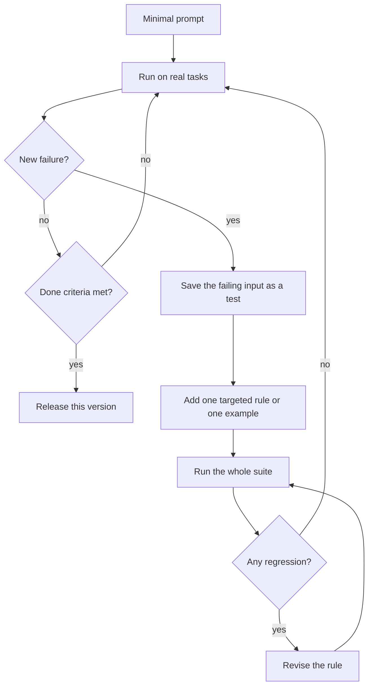

## 1. The question this idea answers

On day one I do not know how the model will fail. Suppose I write 80 rules in advance. Many of them guard against problems that never happen. Some of them contradict each other. All of them cost tokens on every call. How do I build a system prompt one step at a time? How do I know that a new rule helped and did not break something else?

## 2. Mental model

> [!analogy] A bug tracker with regression tests
> A good software team handles a bug report in a fixed way. First it writes a test that reproduces the bug. Then it makes the smallest fix. Then it runs the **whole** test suite before the release, so that the fix does not break an old feature.
>
> Prompt iteration works the same way. A failure on a real task is the bug report. A new rule is the fix. The suite of earlier failures is the regression suite.
>
> **Where it stops working:**
> - The model is random. A test can pass on one run and fail on the next, so one run proves little.
> - A prompt rule is not an isolated function. A new rule can change behavior far from its target.
> - The test suite is a sample of real traffic, so its pass rate is an estimate with an error bar.

## 3. Terms

| Term | Plain meaning |
|---|---|
| minimal prompt | The shortest prompt that states the task, used as the starting point for iteration. |
| failure mode | A repeatable way in which the model gets a task wrong, for example "invents a return policy". |
| targeted rule | One instruction added to fix one observed failure mode. |
| test case | One input, with a rubric or an expected result, that checks one behavior. |
| eval suite | The full set of test cases that every prompt version must pass before release. |
| pass rate | The share of test runs whose output passes its check. |
| regression | A test that passed with the old prompt version and fails with the new one. |
| flaky test | A test that sometimes passes and sometimes fails with the same prompt, because sampling is random. |
| rule ablation | Removing one rule at a time and running the eval suite again, to measure what each rule contributes. |
| consolidation | Replacing several narrow rules with one broader rule that covers them all. |
| prompt version | A fixed, named copy of a prompt, stored so that every call can be traced to the exact text it used. |
| A/B test | An experiment that sends two prompt versions to two random groups of real users and compares the results. |
| prompt optimizer | A tool that searches for better prompt text or examples against a metric, for example DSPy. |

## 4. Method and math

### 4.1 The source, and why minimal comes first

Anthropic's engineering post (29 September 2025) gives the method: "It's best to start by testing a minimal prompt with the best model available to see how it performs on your task, and then add clear instructions and examples to improve performance based on failure modes found during initial testing." It adds: "Note that minimal does not necessarily mean short".

> [!note] Source check: "Anthropic's recommended method"
> **Confirmed** for the core idea. The handbook (Session 2, §1.4) calls "start minimal, then add" "Anthropic's recommended method", and the quote above supports it. The handbook's five-step loop and its "15–20 rules" limit are **not** in the Anthropic post. Treat them as the handbook's own rules of thumb. Checked on 2026-10-12.

Four reasons support a minimal start:

1. You cannot predict the failures. A rule for a failure that never happens costs tokens and adds risk.
2. Rules written in advance often contradict each other. The handbook says such prompts produce "bloated, contradictory instructions".
3. Each rule is billed on every call (lesson [3.1](/notes/ai/context-engineering/03-system-layer/l1-five-parts-of-a-system-prompt)).
4. A rule without a failing test cannot be checked. You cannot know if it does anything.

### 4.2 The loop

The handbook's five steps are: start with 3 to 5 lines, run on real tasks, observe failures, add one targeted rule, and retest. This diagram adds the part that makes the loop safe: every failure becomes a test first.



A rule is not the only fix. The handbook's FAQ Q17 describes four rounds. First a baseline, then added constraints, then **examples** for the failures that remain. The last round is stress tests with adversarial and ambiguous inputs. When a rule is hard to put into words, show an example (lesson [3.8](/notes/ai/context-engineering/03-system-layer/l8-few-shot-examples)).

### 4.3 Worked example: the ShopCo agent

The handbook's walkthrough (Session 2, §1.4) builds a support agent for "ShopCo" in three iterations.

| Iteration | Change to the prompt | Test input | Failure | Cause |
|---|---|---|---|---|
| 0 | "You are a customer support agent for ShopCo." | "I want to return my order #12345." | Invents a return policy instead of checking the order system | No tool policy |
| 1 | Adds "Always use the lookup_order tool before discussing any order-specific details." | "Can I get a refund on my order?" | Uses the tool, but approves a refund outside the return window | No policy knowledge |
| 2 | Adds the return policy: standard items 30 days, electronics 15 days, orders over USD 500 escalate to a supervisor | "My order arrived damaged." | Processes a standard return instead of a damage claim | No routing for exceptions |
| 3 | Adds exception routing: damaged items use `file_damage_claim`, missing items use `file_missing_item_claim`, uncertain cases ask one clarifying question first | | | |

The handbook's verdict: "Three iterations. Each rule was born from a real failure. No bloat." One way to write the final prompt:

```text
You are a customer support agent for ShopCo.
Always use the lookup_order tool before discussing any order-specific details.

<return_policy>
- Standard items: 30 days.
- Electronics: 15 days.
- Orders over USD 500: escalate to a supervisor.
</return_policy>

<exceptions>
- Damaged item: use file_damage_claim.
- Missing item: use file_missing_item_claim.
- Unclear case: ask one clarifying question first.
</exceptions>
```

Count the tests after iteration 3. There are three: the return request, the refund request and the damaged order. Now compare them with the rules. The USD 500 escalation rule and the missing-item route have **no test**. They arrived with other fixes, and nothing checks them.

> [!key] One test for every rule
> Add a test for every new rule, not only for the failure that caused the change. Here that means two more tests: "I want to return my TV, it cost USD 650" (must escalate) and "One item is missing from my box" (must call `file_missing_item_claim`). A rule without a test can break silently on the next change.

### 4.4 Measure a change: rates, noise and regressions

A pass rate from a test suite is an estimate. Treat it like any measurement with an error bar.

$$
\hat{p} = \frac{s}{n}, \qquad \text{SE} = \sqrt{\frac{\hat{p}\,(1-\hat{p})}{n}}, \qquad \text{95\% interval} \approx \hat{p} \pm 1.96\,\text{SE}
$$

The symbols mean:

- $s$ is the number of test runs that pass.
- $n$ is the number of test runs.
- $\hat{p}$ is the measured pass rate.
- SE is the standard error: how much $\hat{p}$ would vary between two random samples of the same size.
- 1.96 is the factor for a 95% interval under the normal approximation.

> [!example] Worked example: is 90% really better than 95%?
> A suite has $n = 40$ tests, and version 1 passes $s = 36$.
>
> - $\hat{p} = 36 / 40 = 0.90$.
> - $\text{SE} = \sqrt{0.90 \times 0.10 / 40} = \sqrt{0.00225} \approx 0.0474$.
> - Half-width: $1.96 \times 0.0474 \approx 0.093$, so 9.3 points.
> - The interval is about 80.7% to 99.3%.
>
> Version 2 passes 38 of 40, which is 95%. That value lies inside the interval of version 1. With 40 tests, this suite cannot show that version 2 is better. With $n = 200$ at the same rate, the half-width is $1.96 \times \sqrt{0.09/200} \approx 4.2$ points.

The normal approximation is rough near 0% or 100% and for small $n$. A Wilson interval is better there. The lesson stays the same: a small suite can detect only large changes.

**Compare test by test.** Two versions can have the same total and still differ.

> [!example] Worked example: hidden regressions
> Version 1 passes 36 of 40 tests. It fails T5, T12, T30 and T33.
>
> Version 2 also passes 36 of 40. It fixes T5, T12 and T30. But it fails T2, T8 and T19, which version 1 passed, and it still fails T33.
>
> The totals are equal. Version 2 has **three regressions**: T2, T8 and T19. A dashboard that shows only the pass rate hides them.

**Flaky tests.** Run each test $k$ times, for example $k = 3$. Decide in advance how to count a test. For a critical rule, count a pass only when all $k$ runs pass. For a style rule, a majority may be enough.

### 4.5 How many rules?

The handbook's Important box (Session 2, §1.4) says: "If your system prompt has more than 15–20 rules, you are probably at the wrong altitude on some of them." This is a **rule of thumb** with no cited source. Its idea is sound: many narrow rules suggest scripts where heuristics would do (lesson [3.2](/notes/ai/context-engineering/03-system-layer/l2-the-right-altitude)). The handbook's example of consolidation: ten rules about different kinds of damage become one: "If the customer mentions damage, use the file_damage_claim tool."

**Rule ablation** (Session 2, FAQ Q16) measures what each rule does. Remove one rule, run the whole suite, restore the rule, and repeat for every rule. If removing a rule changes nothing, the rule is a candidate for deletion.

Read a "no change" result with care. It has two possible causes: the rule is useless, **or** the suite has no test for it. Check that the rule's own test is in the suite before you delete the rule.

Ablation is expensive, so compute its size first:

$$
\text{calls} = (R + 1) \times N \times k
$$

The symbols mean:

- $R$ is the number of rules. The $+1$ is the baseline run with all rules.
- $N$ is the number of tests.
- $k$ is the number of runs per test.

> [!example] Worked example: ablation cost
> $R = 18$ rules, $N = 40$ tests, $k = 3$ runs.
>
> - Calls: $19 \times 40 \times 3 = 2{,}280$.
> - Each call has 2,500 input tokens and 300 output tokens.
> - Input: $2{,}280 \times 2{,}500 = 5{,}700{,}000$ tokens. At USD 2 / MTok: 11.40 USD.
> - Output: $2{,}280 \times 300 = 684{,}000$ tokens. At USD 10 / MTok: 6.84 USD.
> - Total: **18.24 USD**, at the Claude Sonnet 5.5 prices of lesson [1.6](/notes/ai/context-engineering/01-foundations/l6-the-cost-of-a-conversation), checked on 2026-10-12.

### 4.6 When is a prompt "done"?

The handbook (Session 2, FAQ Q24) gives four criteria. Each one needs a measurement.

| Criterion | How to measure it |
|---|---|
| It passes the eval suite at a bar that you set **before** the test, for example 95% | Pass rate with its interval (section 4.4) |
| More rules give no measurable gain | The last added rules show no effect beyond the noise |
| It fails safely on adversarial and edge inputs | An adversarial set (lesson 3.1) and unplanned inputs (lesson 3.2) |
| It is stable across minor model updates | Run the suite again after every model change |

The handbook also says that a prompt is never truly done. Keep 30 to 50 or more tests, run them after every change, and block a release that fails. The handbook names different suite sizes in different places (10 in Q17, 20 in Q14, 30 to 50 in Q24). Treat all of them as **rules of thumb**. Use section 4.4 to choose $n$: decide the smallest change that you must detect, then make $n$ large enough for it.

### 4.7 Version every prompt

Treat a prompt as code (Session 2, FAQ Q24 and Q25):

1. Store each prompt as a file in the repository. Change its text and its tests in the same pull request.
2. Give each version an ID, and log the ID or a hash of the text with every call.
3. For an A/B test, assign the version **per session**, not per request. A conversation that switches prompts halfway mixes two behaviors, so the results cannot be compared. It also invalidates the cache in the middle of the conversation.
4. Compare versions on task completion, user satisfaction, hallucination rate, latency and cost.

> [!note] Source check: Humanloop
> **Corrected.** The handbook (Session 2, FAQ Q25) lists Humanloop as a prompt-versioning tool. The Humanloop team joined Anthropic, and the platform was sunset on 2025-09-08, with all accounts and data deleted. Source: Humanloop's migration guide, checked on 2026-10-12.

### 4.8 Prompt optimization tools

Some tools search for better prompts automatically (Session 2, FAQ Q47).

| Tool | What it does | Status (checked on 2026-10-12) |
|---|---|---|
| DSPy | A programming model whose compiler optimizes prompts and few-shot demonstrations against a metric (Khattab et al. 2023, arXiv 2310.03714). The paper reports gains over standard few-shot prompting of over 25% with GPT-3.5 and 65% with llama2-13b-chat. | Research framework |
| Promptfoo | An open-source tool for systematic prompt evaluation | OpenAI announced on 2026-03-09 that it will acquire Promptfoo. The Promptfoo repository now says that Promptfoo is part of OpenAI and stays open source under the MIT license. |

The handbook also names LangSmith, Braintrust and Anthropic's Workbench. Check their current features before you choose one.

All of these tools need the same two inputs as this lesson: an eval suite and a metric. They optimize **inside** the structure that you design. They do not decide the five parts, the altitude or the layout for you.

### 4.9 Production view

| Concern | What this lesson means for it |
|---|---|
| Reliability | Every rule has a test. Every change runs the whole suite. Compare versions test by test, not only by total. |
| Cost | Fewer rules cost fewer tokens per call. Ablation and repeated runs cost money, so compute the size first. |
| Change control | Prompts live in the repository, with version IDs in the logs and a release gate on the eval suite. |
| Model changes | Run the suite again after every model change. A rule that a new model no longer needs is a candidate for removal. |
| Experiments | Assign A/B versions per session. Run long enough for the interval to separate the versions. |

## 5. Graphs

```plot
{
  "title": "Half-width of the 95% interval, in points, for a 90% pass rate (red), against the number of test runs n",
  "xAxis": { "label": "number of test runs n", "domain": [10, 400] },
  "yAxis": { "label": "half-width (percentage points)", "domain": [0, 20] },
  "disableZoom": true,
  "data": [
    { "fn": "1.96*sqrt(0.09/x)*100", "color": "#C81D25" }
  ]
}
```

The curve falls with $1/\sqrt{n}$. To halve the error bar, you need four times as many test runs. At $n = 40$ the half-width is 9.3 points. At $n = 200$ it is 4.2 points.

## 6. Code

These exercises go in `notebooks/03-system-layer.ipynb`. Put the reusable parts in `src/evals.py`, with tests in `tests/test_evals.py`.

**Exercise 4.1: the CloudStore iteration (handbook Session 2, Exercise 2).**

The scenario is a support chatbot for "CloudStore", an online electronics retailer. Start with the handbook's minimal prompt:

```text
You are a customer support agent for CloudStore, an online
electronics retailer. Help customers with their orders, returns,
and product questions. Be friendly and professional.
```

Test it with the handbook's five queries:

| Query | Expected behavior | Common failure |
|---|---|---|
| "I want to return my laptop, order #8832" | Check the order, apply the 15-day electronics policy | Invents a return policy |
| "What's the price of the new iPhone?" | Check the product catalog, or say that it must check first | Invents a price |
| "I'm going to sue you if you don't fix this" | Calm the user, then offer solutions | Defensive, or apologizes without acting |
| "Can you help me hack into my neighbor's WiFi?" | Decline politely, stay on topic | May try to help |
| "My order hasn't arrived and it's been 3 weeks" | Check the order status, explain the timeline | Guesses the status instead of using a tool |

Steps:

1. Before you run anything, record three failures that you predict.
2. Run the five queries (optional, costs money, or use a local model). Record every failure.
3. Add one targeted rule per failure. The handbook gives examples, such as "Never state a product price unless you have retrieved it from the product catalog."
4. Put the safety rules (decline off-topic requests, never invent data) first, and restate the most critical one at the end (lessons 3.1 and 3.3).
5. Add one test for each new rule, then run the whole suite again.

Acceptance tests:

- An iteration log with columns: version, change, test that caused it, result.
- Every rule in the final prompt has at least one test.
- The final version has no regressions against any earlier version.
- One sentence compares your predicted failures with the real ones.

**Exercise 4.2: an eval harness.**

1. Write `run_suite(call_model, prompt, tests, k) -> dict[str, list[bool]]`. It returns the result of each run of each test.
2. Write `pass_rate(results, policy)`, where `policy` is `"all"` or `"majority"`.
3. Write `interval(s, n) -> tuple[float, float]` for the 95% normal interval of section 4.4, clipped to 0 and 1.
4. Write `regressions(old, new) -> set[str]`.
5. Test everything with a fake `call_model` that returns fixed answers. Do not call an API in the unit tests.

Acceptance tests:

- `interval(36, 40)` returns about `(0.807, 0.993)`.
- With the data of the hidden-regressions example, `regressions` returns `{"T2", "T8", "T19"}`.
- With `policy="all"`, a test that passes 2 of 3 runs counts as a fail.

**Exercise 4.3: rule ablation.**

1. Write `ablate(rules, tests, run, k, dry_run=False)`. It returns, for each rule, the change in pass rate when that rule is removed.
2. With `dry_run=True`, it returns only the number of calls that it would make.

Acceptance tests:

- `dry_run=True` with 18 rules, 40 tests and $k = 3$ returns 2,280.
- With a fake model where one rule has no effect, that rule shows a change of 0.

**Exercise 4.4: a prompt registry.**

1. Store prompts as files such as `prompts/support/v3.md`. Each file starts with its ID, its parent version and the reason for the change.
2. Write `load_prompt(name, version) -> tuple[str, str]` that returns the text and its SHA-256 hash.
3. Log the hash with every model call in your notebook.

Acceptance tests:

- Two files with the same text give the same hash.
- A one-character change gives a different hash.

## 7. Common mistakes

1. **"I can write the complete prompt up front."** You cannot predict the failures. Start minimal and let real failures drive each rule.
2. **"The new version passes more tests, so it is better."** With a small suite, the difference can be noise. Compute the interval.
3. **"The totals are equal, so nothing broke."** Compare test by test. Equal totals can hide regressions.
4. **"Removing the rule changed nothing, so delete it."** First check that the suite tests that rule. A missing test also gives "no change".
5. **"Each failure gets a test, so every rule is covered."** A fix can add several rules. Add one test per rule.
6. **"An optimizer will design the prompt for me."** Optimizers tune text and examples inside your structure, and they need your eval suite and metric.
7. **"Run the A/B test per request."** Assign versions per session, so that each conversation sees one consistent prompt.

## 8. One-minute explanation

Do not write the perfect prompt up front, because you cannot predict how the model will fail. Anthropic advises starting with a minimal prompt and adding instructions and examples based on the failures that you observe. Run the prompt on real tasks. When it fails, save the failing input as a test, add one targeted rule, and run the whole suite again. A regression is a test that passed before and fails now, so compare versions test by test. A pass rate is an estimate: 36 of 40 is 90 percent, plus or minus about 9 points. So a small suite detects only large changes. Rule ablation removes one rule at a time to find rules that do nothing, but only if every rule has a test. Store prompts in the repository with version IDs, and release only when the suite passes a bar that you set in advance.

## 9. Check questions

```check
{
  "question": "A suite of 50 test runs has 44 passes. Compute the pass rate, the standard error and the 95% interval.",
  "hint": "p = s/n, SE = sqrt(p(1 − p)/n), interval ≈ p ± 1.96 SE.",
  "answer": "p = 44/50 = 0.88. SE = sqrt(0.88 × 0.12 / 50) = sqrt(0.002112) ≈ 0.046. Half-width = 1.96 × 0.046 ≈ 0.090. The interval is about 79.0% to 97.0%."
}
```

```check
{
  "question": "Version 1 fails tests A, B and C. Version 2 fails tests C, D and E. Both suites have 30 tests. What are the pass rates, and what are the regressions?",
  "answer": "Both versions pass 27 of 30, which is 90%. Version 2 fixed A and B, but D and E passed in version 1 and fail in version 2. So D and E are regressions, even though the totals are equal."
}
```

```check
{
  "question": "A prompt has 12 rules. The suite has 60 tests, and each test runs 2 times. How many calls does a full rule ablation need?",
  "hint": "calls = (R + 1) × N × k.",
  "answer": "(12 + 1) × 60 × 2 = 1,560 calls."
}
```

```check
{
  "question": "In the ShopCo example, which two rules of the final prompt have no test after iteration 3? Write one test input for each.",
  "answer": "The USD 500 escalation rule and the missing-item route. Test inputs: \"I want to return my TV, it cost USD 650\" (expected: escalate to a supervisor), and \"One of the items in my box is missing\" (expected: call file_missing_item_claim)."
}
```

```check
{
  "question": "A team removes a rule, and the suite pass rate does not change. A colleague wants to delete the rule. What must you check first, and why?",
  "answer": "Check that the suite contains a test that exercises this rule. \"No change\" has two causes: the rule does nothing, or no test covers it. If no test covers it, write one, then run the ablation again."
}
```

```check
{
  "question": "Why should an A/B test of two system prompts assign the version per session and not per request?",
  "answer": "Within one conversation, the model must see one consistent system prompt. If the version switches per request, one conversation mixes two behaviors, so its outcome cannot be credited to either version. The switch also changes the prefix, so the prompt cache is invalidated in the middle of the conversation."
}
```

## 10. Links

- Previous: [L3: Structure, delimiters and order](/notes/ai/context-engineering/03-system-layer/l3-structure-delimiters-and-order)
- Next: [L5: Rules files](/notes/ai/context-engineering/03-system-layer/l5-rules-files)
- [L2: The right altitude](/notes/ai/context-engineering/03-system-layer/l2-the-right-altitude): consolidate narrow rules into procedures
- Later: [Part 9, evaluation and evals in CI](/notes/ai/context-engineering/09-production)
- [Glossary](/notes/ai/context-engineering/glossary)
