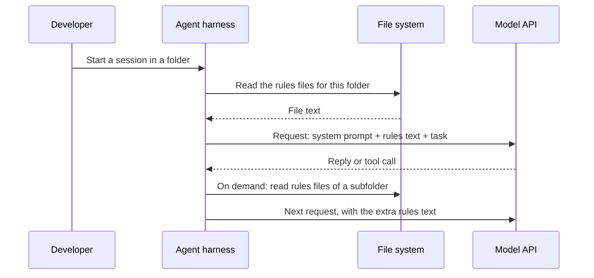

## 1. The question this idea answers

A coding agent starts every session with no memory of my repository. It does not know that we use `uv`, that services never raise HTTP errors, or that we had a PII incident from debug logging. How do I give it the same project knowledge in every session, without typing it again?

Every agent tool answers with a **rules file** in the repository. But each tool has its own file names and its own loading rules, and the handbook's table of them is out of date. This lesson gives the current names, the exact loading rules, and what a good rules file contains.

## 2. Mental model

> [!analogy] Signs in a building
> A sign at the front door applies to the whole building, for example *No food in the labs*. Signs in each corridor and room add local rules, for example *Room 3.14: lab coats required*. A visitor who walks to room 3.14 reads every sign on the way, in order. The nearest sign is the most specific one.
>
> **Where it stops working:** the model does not walk through the building. The agent tool decides which signs to read and when. Some files load at the start of a session, and some load only when the agent touches a file in that folder. Also, the visitor can still ignore a sign. A rules file is context, not a lock.

## 3. Terms

| Term | Plain meaning |
|---|---|
| rules file | A Markdown file in a repository or a user folder that an agent tool loads into the model's context. It tells the model the project's conventions. |
| agent harness | The program around the model that reads files, builds each request, runs tools and loops, for example Claude Code, Codex or Cursor. |
| CLAUDE.md | The rules file of Claude Code. It can exist at several levels: managed policy, user, project and local. |
| CLAUDE.local.md | A personal, project-level rules file for Claude Code that stays out of version control. |
| AGENTS.md | An open, plain-Markdown format for instructions to coding agents, read by many tools and stewarded by the Agentic AI Foundation. |
| instruction chain | The rules files from several directory levels, joined in order from the root to the working directory. |
| import (`@path`) | A line in CLAUDE.md that inserts the text of another file. |
| path-scoped rule | A rule that loads only when the agent works on files that match a pattern. |
| glob | A file-name pattern with wildcards, for example `src/api/**/*.py`. |
| managed policy file | A rules file that an organization installs on a machine, so that it applies to every user of that machine. |
| hook | A user-defined shell command that the harness runs at a fixed point, for example before a tool call. It can block the action. |
| Agentic AI Foundation (AAIF) | A Linux Foundation body, announced on 2025-12-09, that stewards open agent projects such as MCP and AGENTS.md. |

## 4. Method and math

### 4.1 How a rules file reaches the model

The model cannot open files. Only the harness can read a file, and only the harness builds the request. So "the agent reads CLAUDE.md" really means this:



For Claude Code, the docs give the exact place: "CLAUDE.md content is delivered as a user message after the system prompt, not as part of the system prompt itself." So the rules text sits in a user message, not in the `system` field. Every later call sends it again, because each call is stateless (lesson [1.3](/notes/ai/context-engineering/01-foundations/l3-the-chat-api-call)). It is also part of the cacheable prefix (lesson [1.7](/notes/ai/context-engineering/01-foundations/l7-prompt-caching)).

> [!note] Source check: "prepended to the system prompt"
> **Corrected.** The handbook (Session 2, FAQ Q12) says that Claude Code "prepends its contents to the system prompt before sending the API request". The Claude Code docs say that CLAUDE.md is "delivered as a user message after the system prompt, not as part of the system prompt itself". The FAQ's main point is right: the tool injects the file, and a 2,000-token file leaves 2,000 fewer tokens for everything else. Source: Claude Code docs, "How Claude remembers your project", checked on 2026-10-12.

The same docs say that Claude treats these files "as context, not enforced configuration". For a rule that must hold, they point to hooks: "To block an action regardless of what Claude decides, use a PreToolUse hook instead." [Part 9](/notes/ai/context-engineering/09-production) covers hooks.

### 4.2 Current file names and loading rules

All rows were checked on 2026-10-12 in each tool's docs. These names change often.

| Tool | Project rules | Other levels | When it loads | Reads AGENTS.md? |
|---|---|---|---|---|
| Claude Code | `CLAUDE.md` or `.claude/CLAUDE.md`. Also `.claude/rules/*.md`. | Managed policy, user (`~/.claude/CLAUDE.md`), local (`CLAUDE.local.md`) | Files in the working directory and its parents at launch. Subdirectory files on demand. | Yes (v2.1.277 or later). By default, only when no CLAUDE.md, `.claude/CLAUDE.md` or CLAUDE.local.md exists in the working directory or above it. |
| OpenAI Codex | `AGENTS.md` in each directory | Global: `~/.codex/AGENTS.override.md`, else `~/.codex/AGENTS.md` | Global file, then one file per directory from the project root to the working directory | Native format |
| Cursor | `.cursor/rules/*.mdc` with frontmatter `description`, `globs`, `alwaysApply` | User Rules, Team Rules | Four modes: Always Apply, Apply Intelligently, Apply to Specific Files, Apply Manually | Yes, in the root and in subdirectories |
| GitHub Copilot | `.github/copilot-instructions.md`, and `.github/instructions/NAME.instructions.md` with `applyTo` globs | Agent instructions: `AGENTS.md`, or one root `CLAUDE.md` or `GEMINI.md` | Repository-wide, or by path | Yes. "the nearest `AGENTS.md` file in the directory tree will take precedence" |
| Cline | `.clinerules/` or `.cline/rules/` folder of Markdown files | Global: `Documents/Cline/Rules` | Conditional rules with `paths:` frontmatter. Each rule can be toggled. | Yes. It also detects `.cursorrules` and `.windsurfrules`. |
| Devin Desktop (formerly Windsurf) | `.devin/rules/*.md` (preferred), `.windsurf/rules/*.md` (fallback) | Global: `~/.codeium/windsurf/memories/global_rules.md` | Triggers: `always_on`, `model_decision`, `glob`, `manual` | Yes. A root AGENTS.md is always on. A subdirectory file is scoped to its directory. |

> [!note] Source check: the rules-file table
> **Corrected.** The handbook's Table 2 (Session 2, §2.1) and FAQ Q3, Q35 and Q38 are out of date in five places:
>
> 1. **Cursor:** project rules "must use the `.mdc` extension", and a plain `.md` file in `.cursor/rules` is ignored. `.cursorrules` is legacy: the older docs said it "will be deprecated", and the current page does not mention it.
> 2. **Cline:** there is no `cline.md`. Workspace rules live in `.clinerules/` or `.cline/rules/`.
> 3. **Windsurf:** the product is now Devin Desktop. Rules live in `.devin/rules/` or `.windsurf/rules/`. "The legacy single-file `.windsurfrules` at the workspace root is also still read."
> 4. **Copilot:** FAQ Q38 says its instructions are limited to VS Code. The support matrix also covers GitHub.com, Visual Studio, JetBrains, Eclipse, Xcode and Copilot CLI, with different coverage per surface.
> 5. **Loading:** "every session, project-wide" is too simple for every tool. Most tools have several levels, path-scoped rules and on-demand loading.
>
> Sources: the docs of Cursor, Cline, Devin Desktop and GitHub Copilot, checked on 2026-10-12.

### 4.3 Claude Code in detail

Claude Code has four locations. They load from the broadest to the most specific:

| Level | Location | Shared with |
|---|---|---|
| Managed policy | Linux and WSL: `/etc/claude-code/CLAUDE.md`. macOS: `/Library/Application Support/ClaudeCode/CLAUDE.md`. Windows: `C:\Program Files\ClaudeCode\CLAUDE.md`. | All users of the machine |
| User | `~/.claude/CLAUDE.md` | You, in every project |
| Project | `./CLAUDE.md` or `./.claude/CLAUDE.md` | The team, through git |
| Local | `./CLAUDE.local.md` (add it to `.gitignore`) | Only you, in this project |

The loading rules, from the docs (checked on 2026-10-12):

1. **At launch**, CLAUDE.md and CLAUDE.local.md in the working directory and in every directory above it load. "All discovered files are concatenated into context rather than overriding each other… instructions closer to where you launched Claude are read last."
2. **On demand**, a CLAUDE.md in a subdirectory loads when Claude reads, writes or edits a file in that subdirectory.
3. **Imports:** a line `@path/to/file` inserts the text of another file. Relative paths start from the importing file. Imports can nest to "a maximum depth of four hops".
4. **Rules folder:** Claude Code finds `.md` files in `.claude/rules/` and in its subfolders. A rule without `paths:` frontmatter loads at launch. A rule with `paths:` globs loads when Claude touches a matching file. Personal rules for every project go in `~/.claude/rules/`.
5. **Size:** "target under 200 lines per CLAUDE.md file. Longer files consume more context and reduce adherence." This is guidance. The only hard limit is that a file over 4 MiB is skipped.
6. **`/init`** writes a starter CLAUDE.md. **`/memory`** lists the memory files and opens them for editing.

> [!example] Worked example: a monorepo
> The repository `platform/` has three files: `platform/CLAUDE.md`, `platform/services/billing/CLAUDE.md` and `platform/services/billing/api/CLAUDE.md`. You also have `~/.claude/CLAUDE.md`. You launch Claude Code in `platform/services/billing/`.
>
> - **At launch:** the user file, then `platform/CLAUDE.md`, then `platform/services/billing/CLAUDE.md`. They are joined in that order. The billing rules come last.
> - **Not yet:** `api/CLAUDE.md`. It loads when Claude edits a file such as `api/routes.py`.

> [!note] Source check: "reads the nearest CLAUDE.md and traverses up"
> **Corrected.** The handbook (Session 2, FAQ Q21) says that Claude Code "reads the nearest CLAUDE.md and traverses up to the root". It loads **all** CLAUDE.md files from the working directory and its parents at launch and joins them, with none overriding another. Files below the working directory load on demand. The FAQ's limit of 200 lines for the root file matches the docs' guidance. Its limit of 100 lines for service files has no source: treat it as a rule of thumb. Checked on 2026-10-12.

### 4.4 AGENTS.md: one file for many tools

The handbook (Session 2, §2.2) presents AGENTS.md as "the industry's attempt to solve the fragmentation problem". The facts, checked on 2026-10-12:

- The site agents.md calls it "a simple, open format for guiding coding agents". It is plain Markdown with no required fields.
- The format came from work by OpenAI Codex, Amp, Jules (Google), Cursor and Factory. The Linux Foundation says it was "Released by OpenAI in August 2025".
- On 2025-12-09, the Linux Foundation announced the Agentic AI Foundation. Its founding projects are Anthropic's MCP, Block's goose and OpenAI's AGENTS.md.
- The site lists 23 tools that read it, not the seven that the handbook names (Session 2, §2.2). It says that over 60k open-source projects use it.
- Claude Code is not on that list, but its own docs confirm native support (v2.1.277 or later).

> [!note] Source check: where AGENTS.md comes from
> **Corrected.** The handbook (Session 2, FAQ Q9) says that AGENTS.md is "a broader concept from the Anthropic agent SDK" for organization-wide rules, and that it "sits above CLAUDE.md". That is wrong on all three points. AGENTS.md is an open format from OpenAI Codex and partners (August 2025). It is a project-level file. It is now stewarded by the Agentic AI Foundation under the Linux Foundation. The lecture's own §2.2 is closer to the facts. Sources: agents.md and the Linux Foundation press release, checked on 2026-10-12.

**The instruction chain.** The handbook shows how Codex joins nested files:

```text
repo-root/
  AGENTS.md              <-- read first (project-wide rules)
  src/
    AGENTS.md            <-- read second (src-specific rules)
    api/
      AGENTS.md          <-- read third (api-specific rules)
```

This is confirmed. The Codex docs give the full order. The global file comes first. Then comes one file per directory, from the project root down to the working directory, joined root first. "Files closer to your current directory override earlier guidance because they appear later in the combined prompt." The combined size is capped by `project_doc_max_bytes`, 32 KiB by default.

> [!example] Worked example: a conflict in the chain
> The root AGENTS.md says "Max line length 88." `src/api/AGENTS.md` says "Max line length 100 in route files." You run Codex in `src/api/`.
>
> The chain is: `~/.codex/AGENTS.md`, then `AGENTS.md`, then `src/AGENTS.md`, then `src/api/AGENTS.md`, where each file exists. The rule about 100 characters comes later, so it wins for this directory. Nothing deletes the earlier rule. Both rules are in the window, and the model must resolve them. So write the specific rule so that it names its exception clearly: "in route files".

Tools differ in one detail. Codex builds the chain from the directory where you start it. The agents.md site says: "The closest AGENTS.md to the edited file wins; explicit user chat prompts override everything." Copilot uses the nearest file in the tree. Test how your tool behaves before you depend on a subtle override.

### 4.5 Using CLAUDE.md and AGENTS.md together

The handbook's Tip (Session 2, §2.2) says that you can "maintain both: CLAUDE.md for Claude-specific behaviors and AGENTS.md for universal conventions". That plan has a trap.

> [!note] Source check: "maintain both"
> **Corrected (nuance).** If a CLAUDE.md exists, Claude Code reads "Your `CLAUDE.md` files only" by default, and it ignores AGENTS.md. Two fixes work: put the line `@AGENTS.md` in CLAUDE.md, or set the **Project instructions** setting to `claude-md-and-agents-md`. Claude Code does not read `AGENTS.local.md`, `AGENTS.override.md` or `.agents/`. Source: Claude Code docs, checked on 2026-10-12.

A clean layout for a team with several tools:

```text
AGENTS.md      <- all shared conventions (the one source of truth)
CLAUDE.md      <- one line "@AGENTS.md", then only Claude-specific lines
```

The handbook's FAQ Q35 also suggests one canonical file with links or a build script. Avoid two copies of the same rules: they drift apart.

### 4.6 Anatomy of an effective rules file

The handbook (Session 2, §2.3) proposes six sections, "based on patterns from production teams". This is the handbook's own template, not a vendor standard. I measured its tokens with `o200k_base`:

| Section | Purpose | What happens without it | Tokens in the template |
|---|---|---|---|
| Project Overview | Orients the model | It may assume a web app when the project is a CLI tool | 28 |
| Project Structure | Navigation | Files go to the wrong place, or existing ones get duplicated | 57 |
| Code Conventions | Consistency | A different style every time | 49 |
| Testing Requirements | Quality gate | Skips tests or writes too few cases | 46 |
| Important Patterns | Reuse | Reinvents utilities that already exist | 38 |
| Common Mistakes to Avoid | Negative examples | Repeats the team's recurring mistakes | 56 |
| Total (33 lines) | | | 274 |

The handbook calls "Common Mistakes to Avoid" "often the highest-value section", because it holds knowledge that otherwise lives only in code-review comments. Its advice: "Start your rules file by listing the top 5 mistakes from your last 10 code reviews."

**Why a file beats a wiki page** (Session 2, FAQ Q13). The harness loads it for everyone, every time. It is written for a model reader: short, direct rules instead of prose. And it lives in version control, so a convention and its rule change in the same pull request.

**The specificity test.** For each line, ask: could a reviewer say yes or no to "does this code follow the rule"? "Use type hints on all function signatures" passes. "Follow best practices" fails. The handbook's Important box (Exercise 1) names vagueness as the most common mistake.

**What stays out of a rules file:**

| Content | Where it goes instead | Why |
|---|---|---|
| Secrets, keys, internal URLs | Environment variables or a secret store | The file goes into git and into every model request |
| Rules that a linter or formatter enforces | The linter config, plus one line that names the command | The tool enforces them, so the text adds tokens and no safety |
| Long reference documents | A separate file, loaded by import, by a path-scoped rule or by a tool read | Most tasks do not need them |
| Task details | The task spec (lesson [3.6](/notes/ai/context-engineering/03-system-layer/l6-the-context-stack)) | They change every task |
| Personal preferences | `CLAUDE.local.md` or the user-level file | They are not team rules |
| Facts that go stale, such as the current sprint | The task spec or the issue tracker | A stale fact misleads every session |

### 4.7 Every line costs tokens on every call

The harness sends the rules text in every request of the session. So its cost scales with the number of calls:

$$
T = L \times d, \qquad \text{daily cost} = \frac{T \times C \times p}{10^6}
$$

The symbols mean:

- $L$ is the number of lines in the rules files that load.
- $d$ is the average number of tokens per line.
- $T$ is the number of tokens of rules text per request.
- $C$ is the number of model calls per day.
- $p$ is the input price in USD per MTok.

> [!example] Worked example: a 200-line rules file for a team
> - Token density: the handbook template has 274 tokens in 33 lines, so $d = 274 / 33 \approx 8.3$ (`o200k_base`, an estimate for other tokenizers).
> - $L = 200$ lines, so $T \approx 200 \times 8.3 \approx 1{,}661$ tokens.
> - $C$: 10 developers × 20 tasks per day × 60 model calls per task = 12,000 calls per day.
> - Tokens per day: $1{,}661 \times 12{,}000 \approx 19.9$ million.
> - At USD 2 / MTok (Claude Sonnet 5.5, lesson [1.6](/notes/ai/context-engineering/01-foundations/l6-the-cost-of-a-conversation), checked on 2026-10-12): about **39.86 USD per day** without caching.
> - With cache reads at 0.05 × the input price: about **1.99 USD per day**, plus cache writes.
> - Window share: $1{,}661 / 1{,}000{,}000 \approx 0.17\%$ of a 1M-token window.
>
> Count with your model's own tokenizer. Claude 4.7 and later produce about 30% more tokens than earlier Claude models for the same text (lesson [1.2](/notes/ai/context-engineering/01-foundations/l2-tokens-and-tokenizers)).

With caching, cost is rarely the main problem. Adherence is. The Claude Code docs warn that longer files "reduce adherence". Every tool sets a size advice or a cap:

| Tool | Size advice or limit (checked on 2026-10-12) |
|---|---|
| Claude Code | "target under 200 lines per CLAUDE.md file". Files over 4 MiB are skipped. |
| Cursor | "Keep rules under 500 lines" |
| Codex | `project_doc_max_bytes`: 32 KiB by default for the joined chain |
| Devin Desktop | 6,000 characters for the global file, "12,000 characters each" for workspace rule files |
| Handbook (FAQ Q21) | Root file at most 200 lines (matches Claude Code). Service files at most 100 lines (rule of thumb, no source). |

### 4.8 Production view

| Concern | What this lesson means for it |
|---|---|
| Reliability | One source of truth (AGENTS.md), imported by tool-specific files. Each line passes the specificity test. |
| Security | No secrets in rules files. Hard limits go in hooks, permissions and CI, because rules files are context, not enforcement. |
| Cost | Rules text is sent on every call. Keep it short and stable, so that the cache can reuse it. |
| Change control | Review rules files in pull requests, like code. Remove rules that no longer match the code. |
| Portability | File names and loading rules change often. Check the docs of each tool that your team uses. |
| Observability | In Claude Code, `/memory` lists the memory files. Check the list when the agent seems to ignore a rule. |

## 5. Code

These exercises go in `notebooks/03-system-layer.ipynb`. Put the reusable functions in `src/rules_chain.py`, with tests in `tests/test_rules_chain.py`.

**Exercise 5.1: rules files for one of your own repositories.**

1. Pick a real repository from your work, for example an MCP server or a data pipeline.
2. Read your last 10 code reviews. List the top 5 recurring mistakes.
3. Write `AGENTS.md` with the six sections of section 4.6. Put the 5 mistakes in "Common Mistakes to Avoid".
4. Write `CLAUDE.md` with the line `@AGENTS.md` first, then only Claude-specific lines.
5. Count the tokens of both files. Use `count_tokens` for Claude, or `tiktoken` as an estimate.
6. Start a Claude Code session in the repository, and run `/memory` to list the memory files.

Acceptance tests:

- `AGENTS.md` is under 200 lines and contains no secrets or internal URLs.
- Every line in Code Conventions and Common Mistakes passes the specificity test.
- `CLAUDE.md` repeats no line of `AGENTS.md`.
- A short note records the token count and the files that `/memory` showed.

**Exercise 5.2: build the AGENTS.md chain.**

Write `agents_chain(repo_root: Path, target: Path, global_file: Path | None = None, max_bytes: int = 32 * 1024) -> str`.

1. If `target` is a file, use its parent directory.
2. Raise `ValueError` if `target` is outside `repo_root`.
3. Walk from `repo_root` down to the target directory. Read `AGENTS.md` where one exists.
4. Put the global file first, if it is given.
5. Before each file's text, add a header line such as `<!-- from: src/api/AGENTS.md -->`.
6. Stop adding files when the next one would pass `max_bytes`, and add a marker line that says the chain was cut.

Acceptance tests (use pytest's `tmp_path`):

- With files in the root, `src/` and `src/api/`, the target `src/api/handlers.py` gives the three texts in the order root, `src`, `src/api`.
- A missing `src/AGENTS.md` is skipped, and the order of the rest stays the same.
- A target outside the root raises `ValueError`.
- A small `max_bytes` gives the cut marker, and no file appears in part.
- A repository with no AGENTS.md returns an empty string.

**Exercise 5.3: expand CLAUDE.md imports.**

Write `expand_imports(path: Path, max_hops: int = 4) -> str`. A line that starts with `@` followed by a path is an import.

Acceptance tests:

- A relative import starts from the folder of the importing file.
- A chain of 5 imports stops after 4 hops and reports the file that was not loaded.
- A cycle (A imports B, B imports A) stops without an endless loop.

## 6. Common mistakes

1. **"The model reads CLAUDE.md."** The harness reads it and puts its text into the request. The model sees only tokens.
2. **"CLAUDE.md is part of the system prompt."** Claude Code delivers it as a user message after the system prompt.
3. **"`.cursorrules` is Cursor's rules file."** It is legacy. Current project rules are `.mdc` files in `.cursor/rules/`, and Cursor also reads AGENTS.md.
4. **"AGENTS.md comes from Anthropic and sits above CLAUDE.md."** It is an open format from OpenAI Codex and partners, at project level, now under the Agentic AI Foundation.
5. **"If both files exist, Claude Code reads both."** By default it reads only CLAUDE.md. Import AGENTS.md, or change the setting.
6. **"A rule in CLAUDE.md is enforced."** It is context. Use hooks, permissions or CI for rules that must hold.
7. **"A longer rules file is safer."** Longer files cost tokens on every call and, per the Claude Code docs, reduce adherence.

## 7. One-minute explanation

A coding agent forgets the repository after every session, so teams write a rules file that the agent tool loads every time. The model never opens the file itself. The harness reads it and puts the text into the request. Claude Code sends CLAUDE.md as a user message after the system prompt, and it joins all CLAUDE.md files from the working directory and its parents. AGENTS.md is the shared format. OpenAI released it in August 2025, and the Agentic AI Foundation now stewards it. Codex joins nested AGENTS.md files from the root down, so the closer file comes later and wins. File names change: Cursor uses `.mdc` files in `.cursor/rules`, Cline uses `.clinerules`, and Windsurf is now Devin Desktop. A good file has six short sections, with a list of the team's common mistakes. Keep it under about 200 lines, because every line costs tokens on every call. It is context, not enforcement, so use hooks for hard rules.

## 8. Check questions

```check
{
  "question": "You run Codex in src/api/ of a repository with AGENTS.md files in the root, in src/ and in src/api/, plus ~/.codex/AGENTS.md. List the chain in order. Which file wins a conflict, and why?",
  "answer": "~/.codex/AGENTS.md, then AGENTS.md (root), then src/AGENTS.md, then src/api/AGENTS.md. The src/api file wins a conflict, because the Codex docs say that files closer to the current directory override earlier guidance by appearing later in the combined prompt. The earlier rule is still in the window."
}
```

```check
{
  "question": "A team's CLAUDE.md has 150 lines at about 8 tokens per line. The team makes 5,000 model calls per day at USD 2 / MTok. What does the file cost per day without caching, and with cache reads at 0.05 times the price?",
  "hint": "T = L × d, daily cost = T × C × p / 10^6.",
  "answer": "T = 150 × 8 = 1,200 tokens. Tokens per day: 1,200 × 5,000 = 6,000,000 = 6 MTok. Without caching: 6 × 2 = 12 USD per day. With cache reads: 12 × 0.05 = 0.60 USD per day, plus cache writes."
}
```

```check
{
  "question": "A repository has both CLAUDE.md and AGENTS.md. A developer says that Claude Code ignores the testing rules in AGENTS.md. Why, and what are two fixes?",
  "answer": "By default, when a CLAUDE.md exists, Claude Code reads only the CLAUDE.md files and not AGENTS.md. Fix 1: add the line @AGENTS.md to CLAUDE.md. Fix 2: set the Project instructions setting to claude-md-and-agents-md."
}
```

```check
{
  "question": "A developer adds .cursor/rules/style.md with ten style rules, but Cursor never applies them. What is wrong?",
  "answer": "Cursor project rules must use the .mdc extension. A plain .md file in .cursor/rules is ignored. Rename it to style.mdc and add the frontmatter fields description, globs and alwaysApply as needed."
}
```

```check
{
  "question": "Classify each line for a rules file as keep, move or delete: (a) \"Write clean, maintainable code.\" (b) \"DATABASE_URL=postgres://admin:pw@prod/db\" (c) \"Services receive a DB session parameter and never create their own.\" (d) \"This sprint we are migrating the billing API.\"",
  "answer": "(a) Delete or rewrite: it fails the specificity test. (b) Move out at once: a secret never goes into a rules file, because the file goes into git and into every request. Use an environment variable. (c) Keep: specific and checkable. (d) Move to the task spec or the issue tracker: it will go stale."
}
```

## 9. Links

- Previous: [L4: Start minimal, then add](/notes/ai/context-engineering/03-system-layer/l4-start-minimal-then-add)
- Next: [L6: The context stack](/notes/ai/context-engineering/03-system-layer/l6-the-context-stack)
- [L7: Prompt caching](/notes/ai/context-engineering/01-foundations/l7-prompt-caching): why a stable rules file is cheap
- Later: [Part 9, project files, commands, skills and hooks](/notes/ai/context-engineering/09-production)
- [Glossary](/notes/ai/context-engineering/glossary)
