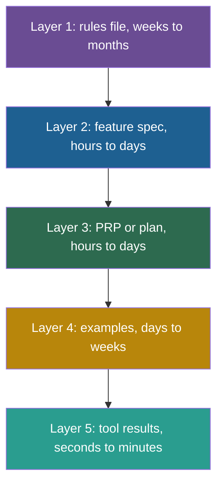
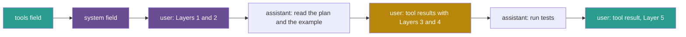

## 1. The question this idea answers

The rules file of lesson [3.5](/notes/ai/context-engineering/03-system-layer/l5-rules-files) is only one layer of context. To build one feature, an agent also needs the task, a plan, a few reference examples and the live results of its tools. These parts differ in how long they stay valid: months for a coding convention, seconds for a test result.

How do I organize them? Where does each one go in the request? Which order lets the provider's cache reuse the most work?

## 2. Mental model

> [!analogy] Building a house extension
> A builder works from five kinds of information:
>
> 1. The **building code**: valid for years, the same for every job.
> 2. The client's **work order**: "Add a kitchen extension of 4 by 5 metres."
> 3. The architect's **plan** with inspection points: valid until the job ends.
> 4. **Photos** of a similar extension that the client liked.
> 5. **Today's measurements** and inspection results: valid for minutes.
>
> The builder keeps the code on the shelf, the plan on the wall and the measurements on a notepad.
>
> **Where it stops working:** a model has no shelf, wall or notepad. The application converts all five layers into one flat sequence of tokens in one request. "Layer" is a design idea for the engineer, not a structure that the model sees (Session 2, FAQ Q11).

## 3. Terms

| Term | Plain meaning |
|---|---|
| context stack | A design model that sorts the context of an agent into layers by how long each layer stays valid. |
| lifespan (of a layer) | How long the content of a layer stays valid before it must change. |
| feature spec | A short document that says what to build, with references, examples and edge cases. In the PRP template it is the file `INITIAL.md`. |
| PRP (Product Requirements Prompt) | A detailed implementation blueprint for one feature, written for an AI agent: goal, context, tasks and validation steps. |
| validation loop | A set of commands, such as linters and tests, that the agent runs after each step and must pass before it continues. |
| examples folder | A folder of reference code and input-output pairs that show the agent the patterns to copy. |
| dynamic tool results | The outputs of tools during the task, for example search results, test output and API responses. |
| append-only history | A conversation history where new content is added at the end and old content never changes. It keeps the cached prefix valid. |

## 4. Method and math

### 4.1 The five layers, in one orientation

The handbook (Session 2, §2.4) names five layers. This lesson uses one convention: **Layer 1 is the most persistent. It is listed first, and it comes first in the request.**

| Layer | Name | What it holds | Changes when | Lifespan (handbook) |
|---|---|---|---|---|
| 1 | Rules file (AGENTS.md, CLAUDE.md) | Project rules, conventions, structure | The team's conventions change | Weeks to months |
| 2 | Feature spec (INITIAL.md) | What to build, references, edge cases | A new task starts | Hours to days |
| 3 | PRP or implementation plan | A step-by-step plan with validation loops | The feature is planned or replanned | Hours to days |
| 4 | Examples folder | Sample code, input-output pairs | The team adds a better pattern | Days to weeks |
| 5 | Dynamic tool results | Search results, test output, API responses | Every step | Seconds to minutes |

> [!note] Source check: which way the stack points
> **Corrected.** The handbook contradicts itself. Its §2.4 lists Layer 1 first but says that "The layers near the bottom change rarely… The layers near the top change frequently". Its FAQ Q4 says that layers higher in the stack are more persistent and seen first. These notes use one orientation only: Layer 1 is the most persistent, it is listed first, and it comes first in the request.

The table shows two facts. First, each layer is valid for a different length of time. Second, the order by lifespan is almost the order by change rate. Layer 4 is an exception: it lives longer than Layers 2 and 3. It still comes after them, because the agent usually loads examples for the current task. Section 4.5 shows what this order means for the cache.

The spread of lifespans is large. One second is $10^0$ seconds. One month of 30 days is $2{,}592{,}000$ seconds, about $10^{6.4}$. So the lifespans span more than six orders of magnitude. Even one week against one minute is a factor of $10{,}080$, about $10^4$.



### 4.2 What PRP means

The handbook gives PRP two meanings. The lecture (§2.4) says "PRP / Implementation Plan". The FAQ (Q4, Q23 and Q37) says "Prompt-Response Pairs" and calls it the conversation history.

> [!note] Source check: PRP
> **Corrected.** PRP means **Product Requirements Prompt**. Cole Medin's template repository "context-engineering-intro" (July 2025) says: "PRPs (Product Requirements Prompts) are comprehensive implementation blueprints". Rasmus Widing's older repository "PRPs-agentic-eng" (first commit June 2025) defines it as "PRD + curated codebase intelligence + agent/runbook". The lecture's "Implementation Plan" is close. The FAQ's "Prompt-Response Pairs" is wrong. Checked on 2026-10-12.

The same template gives Layers 2 and 4 their file names. `INITIAL.md` is the feature request, with four sections: FEATURE, EXAMPLES, DOCUMENTATION and OTHER CONSIDERATIONS. The `examples/` folder holds the reference code, and the template's README calls it "critical!". [Part 9](/notes/ai/context-engineering/09-production) teaches the full PRP workflow.

Where is the conversation history? It is not one of the lecture's five layers. In a coding agent, most of the history is Layer 5: tool calls and their results, step after step. The user's own messages are few, and they usually carry Layer 2.

### 4.3 Worked example: a stack for JWT authentication

The handbook's example (Session 2, §2.4) fills all five layers for one feature:

| Layer | Content |
|---|---|
| 1 | CLAUDE.md: project structure, code conventions, test requirements |
| 2 | INITIAL.md: "Build JWT authentication middleware with refresh token rotation", plus links to the FastAPI security docs |
| 3 | PRP: a step-by-step implementation plan with validation checkpoints |
| 4 | `examples/auth_middleware.py`: a reference implementation from another project |
| 5 | Tool results: codebase search results, test output, linter output |

Which layer matters most? The handbook says Layer 1, "because it affects every single interaction", with Layer 4 "a close second": "Concrete examples are more powerful than abstract rules." Anthropic's engineering post also values examples: they are "the 'pictures' worth a thousand words" (29 September 2025). These are judgments, not measurements. To measure them, remove one layer at a time and run your eval suite (lesson [3.4](/notes/ai/context-engineering/03-system-layer/l4-start-minimal-then-add)).

### 4.4 How the stack maps onto one request

The handbook's FAQ Q11 makes the key point: the stack "is primarily a mental model and design framework, but it maps directly to code", namely to the **messages array**. Here is one Anthropic request in the middle of the JWT task. Claude Code delivers CLAUDE.md as a user message after the system prompt (lesson 3.5). The agent reads the PRP and the example with a tool, so they arrive as tool results.

```json
{
  "model": "<model id>",
  "max_tokens": 4096,
  "tools": [
    { "name": "read_file", "description": "<...>", "input_schema": { "type": "object" } },
    { "name": "run_tests", "description": "<...>", "input_schema": { "type": "object" } }
  ],
  "system": "<the harness's own system prompt>",
  "messages": [
    { "role": "user", "content": "<Layer 1: CLAUDE.md text>\n\n<Layer 2: INITIAL.md for JWT middleware>" },
    { "role": "assistant", "content": [
      { "type": "tool_use", "id": "t1", "name": "read_file", "input": { "path": "PRPs/jwt-auth.md" } },
      { "type": "tool_use", "id": "t2", "name": "read_file", "input": { "path": "examples/auth_middleware.py" } }
    ] },
    { "role": "user", "content": [
      { "type": "tool_result", "tool_use_id": "t1", "content": "<Layer 3: the PRP>" },
      { "type": "tool_result", "tool_use_id": "t2", "content": "<Layer 4: the example>" }
    ] },
    { "role": "assistant", "content": [
      { "type": "tool_use", "id": "t3", "name": "run_tests", "input": { "path": "tests/test_auth.py" } }
    ] },
    { "role": "user", "content": [
      { "type": "tool_result", "tool_use_id": "t3", "content": "<Layer 5: 3 passed, 1 failed>" }
    ] }
  ]
}
```



Two lessons follow from this picture:

1. The layers are positions in one sequence, so the position effects of lesson [1.5](/notes/ai/context-engineering/01-foundations/l5-position-and-length-effects) apply. After 40 steps, the plan of Layer 3 sits deep in the middle of a long history.
2. Layer 5 grows on every step. It is the part that [Part 7](/notes/ai/context-engineering/07-compress-and-isolate) clears and compresses.

A RAG chatbot has a different stack: system prompt, retrieval instructions, retrieved chunks, history and the user message (Session 2, FAQ Q48). [Part 4](/notes/ai/context-engineering/04-write-and-rag) builds it.

### 4.5 Which layers are cache-friendly

Prompt caching needs an exact prefix (lesson [1.7](/notes/ai/context-engineering/01-foundations/l7-prompt-caching)). The order by lifespan is therefore also a good order for the cache: the layers that change least come first.

| Layer | Changes | Effect on the cache |
|---|---|---|
| 1 Rules file | Rarely | Part of the prefix in every session |
| 2 Feature spec | Once per task | Part of the prefix for the whole task |
| 3 Plan | When replanned | Safe if updates are **appended**. Editing it in place breaks the prefix. |
| 4 Examples | Rarely | Safe once loaded |
| 5 Tool results | Every step | New results go at the end, so the earlier prefix still matches |

In an agent loop where every step only appends, call $k$ can reuse the whole input of call $k-1$ (with automatic caching, lesson 1.7). The cached share of call $k$ is:

$$
h_k = \frac{S + (k-2)\,t}{S + (k-1)\,t}, \qquad k \ge 2
$$

The symbols mean:

- $S$ is the number of tokens in the stable layers, Layers 1 to 4.
- $t$ is the number of tokens that one step adds: one tool call and its result.
- $k$ is the number of the call.
- $h_k$ is the share of the input of call $k$ that comes from the cache.

> [!example] Worked example: append, or edit in place?
> Layer 1 has 2,000 tokens, Layer 2 has 800, Layer 3 has 3,000 and Layer 4 has 1,500. So $S = 7{,}300$. Each step adds $t = 1{,}200$ tokens.
>
> **Append only, call 10:**
>
> - Input: $7{,}300 + 9 \times 1{,}200 = 18{,}100$ tokens.
> - Matching prefix: $7{,}300 + 8 \times 1{,}200 = 16{,}900$ tokens.
> - $h_{10} = 16{,}900 / 18{,}100 \approx 93.4\%$.
>
> **The agent edits the plan in place before call 10:** the prefix now differs from the start of Layer 3. Only Layers 1 and 2 match: $2{,}800 / 18{,}100 \approx 15.5\%$.
>
> So write a plan change as a new message at the end ("Plan update: step 4 now uses PyJWT"). Do not rewrite Layer 3.

The share $h_k$ grows toward 1 as $k$ grows, because each new step is small compared with the growing prefix. Two things can still break it. A pause longer than the cache lifetime, such as a slow test run, causes a full cache write. And clearing old tool results rewrites the history, which Part 7 balances against the cache.

### 4.6 Production view

| Concern | What this lesson means for it |
|---|---|
| Design | Design all five layers on purpose. A missing feature spec or a missing example often explains a bad result better than the model does. |
| Cost | Order the request by lifespan. Append updates. Never edit early layers in place during a task. |
| Quality | Long tasks push the plan into the middle of the window. Restate the current step of the plan near the end when the history grows. |
| Observability | Log the token count of each layer on each call. A growing Layer 5 is the usual cause of rising cost and falling quality. |
| Change control | Layers 1, 2, 3 and 4 are files. Version them in git with the code. |

## 5. Code

These exercises go in `notebooks/03-system-layer.ipynb`. Put the assembler in `src/context_stack.py`, with tests in `tests/test_context_stack.py`.

**Exercise 6.1: a stack assembler with a budget.**

Write `build_request(layers: dict[int, list[str]], budget: int, count_tokens) -> dict`.

1. `layers` maps the layer number (1 to 5) to a list of text blocks. Layer 5 blocks are in time order.
2. Return an Anthropic-style dictionary with `system` and `messages`. Put Layers 1 and 2 in the first user message, and the other layers after them, in layer order.
3. If the total is over `budget`, remove content in this order: the oldest Layer 5 blocks first, then Layer 4 blocks from the largest down.
4. Never remove Layers 1, 2 or 3. If they alone exceed the budget, raise `ValueError` with the token count of each layer.
5. Use a simple counter for tests, for example the number of words. Use `tiktoken` as an estimate in the notebook.

Acceptance tests:

- With a large budget, the output contains every block in layer order.
- With a tight budget, the newest Layer 5 block is still present, and the oldest one is gone.
- When Layers 1 to 3 exceed the budget, the error message names all three counts.

**Exercise 6.2: a cache-share calculator.**

1. Write `cached_share(S, t, k)` for the formula of section 4.5.
2. Write `cached_share_after_edit(prefix_kept, S, t, k)` for the case where the prefix matches only up to `prefix_kept` tokens.
3. Plot $h_k$ for $k$ from 2 to 50 with $S = 7{,}300$ and $t = 1{,}200$.

Acceptance tests:

- `cached_share(7300, 1200, 10)` returns about 0.934.
- `cached_share_after_edit(2800, 7300, 1200, 10)` returns about 0.155.
- `cached_share` raises `ValueError` for $k < 2$.

**Exercise 6.3: the stack of one real task.**

1. Choose a feature that you built recently in one of your repositories.
2. Fill a table with the five layers: what each layer held, where it came from and its token count.
3. Mark each layer that you never recorded and that the agent had to guess.

Acceptance tests:

- A table with five rows and three columns.
- One paragraph that names the missing layer that hurt the result most, and why.

## 6. Common mistakes

1. **"The context stack is a data structure that the model sees."** It is a design model. The model sees one flat sequence of tokens.
2. **"PRP means Prompt-Response Pairs."** It means Product Requirements Prompt: an implementation blueprint for one feature.
3. **"Layer 1 is at the bottom, so it comes last."** Use one orientation: Layer 1 is the most persistent and comes first.
4. **"Editing the plan in place is free."** It changes the prefix and invalidates the cache from that point on. Append updates instead.
5. **"Examples are optional decoration."** The handbook and Anthropic both rank concrete examples highly. Measure their effect by removing them.
6. **"The rules file is all the context that a coding agent needs."** A feature also needs a spec, a plan, examples and live tool results.

## 7. One-minute explanation

An agent that builds a feature needs five kinds of context, and they live for very different times. The rules file lasts months, the spec and the plan last days, the examples last weeks, and tool results last minutes. PRP here means Product Requirements Prompt, a detailed plan for one feature, not prompt-response pairs. The stack is only a design model. In the API, all five layers become one messages array. The rules and the task go in the first user message, and the plan and the examples often arrive as tool results. Then comes a long tail of tool calls and results. So order the request by lifespan, with the most persistent layer first. That order also suits the cache. If every step only appends, call 10 of my example reuses 93 percent of its input. If the agent edits the plan in place, that share falls to about 15 percent.

## 8. Check questions

```check
{
  "question": "Sort these items into the five layers: (a) the output of pytest at step 12, (b) \"All services receive a DB session parameter\", (c) \"Add CSV export to the reports page\", (d) examples/csv_writer.py, (e) a 9-step plan with a test command after each step.",
  "answer": "(a) Layer 5, a dynamic tool result. (b) Layer 1, a rule in the rules file. (c) Layer 2, the feature spec. (d) Layer 4, the examples folder. (e) Layer 3, the PRP or implementation plan."
}
```

```check
{
  "question": "S = 5,000 stable tokens and each step adds t = 2,000 tokens. With append-only history, what share of call 6 comes from the cache?",
  "hint": "h_k = (S + (k − 2)t) / (S + (k − 1)t).",
  "answer": "Input of call 6: 5,000 + 5 × 2,000 = 15,000. Matching prefix: 5,000 + 4 × 2,000 = 13,000. h_6 = 13,000 / 15,000 ≈ 86.7%."
}
```

```check
{
  "question": "A colleague says that PRP stands for Prompt-Response Pairs and means the conversation history. What is the correct meaning, and what is the source?",
  "answer": "PRP means Product Requirements Prompt: an implementation blueprint for one feature, with goal, context, tasks and validation loops. Cole Medin's context-engineering-intro template calls PRPs \"comprehensive implementation blueprints\", and Rasmus Widing's earlier PRPs-agentic-eng repository defines PRP as a PRD plus curated codebase intelligence plus an agent runbook."
}
```

```check
{
  "question": "An agent's cost per task doubled after a change: it now rewrites its plan file in the first user message whenever the plan changes. Explain the cause with the cache rule, and give the fix.",
  "answer": "The plan sits early in the request. Each rewrite changes the prefix from that point on, so every later token must be written to the cache again instead of read from it. The fix is to keep the original plan unchanged and append each plan update as a new message at the end, so that the earlier prefix stays identical."
}
```

## 9. Links

- Previous: [L5: Rules files](/notes/ai/context-engineering/03-system-layer/l5-rules-files)
- Next: [L7: Atomic and molecular prompts](/notes/ai/context-engineering/03-system-layer/l7-atomic-and-molecular-prompts)
- [L3: The chat API call](/notes/ai/context-engineering/01-foundations/l3-the-chat-api-call): the messages array and tool results
- [L7: Prompt caching](/notes/ai/context-engineering/01-foundations/l7-prompt-caching): why order matters for cost
- Later: [Part 7, compress and isolate](/notes/ai/context-engineering/07-compress-and-isolate) and [Part 9, the PRP workflow](/notes/ai/context-engineering/09-production)
- [Glossary](/notes/ai/context-engineering/glossary)
