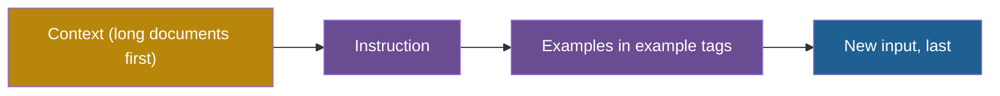

## 1. The question this idea answers

The earlier lessons covered context that stays the same on every call. This lesson is about the prompt that the application composes at runtime, for one task.

A short prompt works for a quick task, but sometimes the output has the wrong length, the wrong style or the wrong label. What is the smallest prompt that is still complete? What changes when I add examples? And why do examples help at all, when the model's weights do not change during a call?

## 2. Mental model

> [!analogy] An order at a print shop
> **The atom:** "Print 200 flyers, A5 size, on matte paper." You get exactly that. But the shop guesses the design quality, the font and the layout.
>
> **The molecule:** the same order, plus three flyers from last year that you liked, plus the facts of this year's event, plus the new text. The shop now sees your standard instead of guessing it.
>
> **Where it stops working:** the print shop learns your taste and remembers it next year. The model learns nothing permanent. Its weights do not change, and the examples only shift its predictions on this one call. The model also copies features that you did not intend, for example the length of your samples or the order of their labels.

## 3. Terms

| Term | Plain meaning |
|---|---|
| atomic prompt (atom) | The smallest complete prompt: a task, its constraints and an output format, with no examples. |
| task | The part of a prompt that says what to do, for example "summarize" or "classify". |
| molecular prompt (molecule) | A prompt with four parts: an instruction, examples, context for this request and the new input. |
| demonstration (shot) | One example input with its desired output, placed in the prompt. |
| zero-shot prompting | Asking the model to do a task with instructions only, with no demonstrations. |
| few-shot prompting | Asking the model to do a task with a small number of demonstrations in the prompt. |
| k-shot | A prompt with exactly k demonstrations, for example 3-shot. |
| in-context learning (ICL) | A model doing a new task from instructions and demonstrations in its input, with no change to its weights. |
| gradient update | A change to a model's weights during training. In-context learning makes none. |
| label space | The set of possible outputs of a classification task, for example POSITIVE, NEGATIVE and NEUTRAL. |
| input distribution | The kind of inputs that a task receives: their topic, length and style. |
| semantic prior | What a model already associates with a word or a label from training, for example that "positive" means good. |

## 4. Method and math

### 4.1 The atom: task, constraints and output format

The handbook (Session 2, §3.1) defines:

$$
\text{ATOM} = \text{TASK} + \text{CONSTRAINTS} + \text{OUTPUT FORMAT}
$$

An atom is "the smallest complete prompt that produces useful output". It answers three questions: what to do, within which limits, and in what shape. The handbook gives three atoms:

| Task | Constraints | Format | Combined |
|---|---|---|---|
| Summarize this article | 3 bullet points, each under 20 words | Formal English, no jargon | "Summarize this article in 3 bullet points, each under 20 words, using formal English with no jargon." |
| Find bugs in this function | Focus on security issues | Numbered list with severity ratings | "Find security bugs in this function. Output a numbered list, each item with a severity rating (HIGH/MEDIUM/LOW)." |
| Generate test cases | For the login endpoint | pytest format with docstrings | "Generate pytest test cases for the login endpoint. Each test should have a descriptive docstring." |

The line between a constraint and a format is not sharp. The lecture puts "formal English, no jargon" under Format. FAQ Q5 puts "using markdown formatting" there. What matters is that each of the three questions has an answer.

> [!example] Worked example: find the missing piece
> "Write SQL for monthly revenue."
>
> - Task: write SQL for monthly revenue. Present.
> - Constraints: which table, which dialect, which definition of revenue, which date range? Missing.
> - Format: only the query, or the query with an explanation? Missing.
>
> A complete atom: "Write a Databricks SQL query for monthly revenue from `gold.sales`, where revenue is the sum of `net_amount` for orders with status `completed`, for 2026. Return only the query, in one code block."

### 4.2 The ceiling of atoms

The handbook says that atoms "hit a ceiling quickly": "The model has to guess your quality standard, your style, your edge cases."

Take a sentiment atom: "Classify the customer message as POSITIVE, NEGATIVE or NEUTRAL." Now give it two hard inputs:

- "I received order #4521 today." Is a plain fact NEUTRAL, or POSITIVE because the order arrived?
- "Great product, terrible shipping." Is it mixed, NEGATIVE, or POSITIVE?

The atom does not say. The model picks by its own defaults, and the defaults may not match your team's labelling rules. More words in the instruction can help, but each new case needs a new sentence. One example often settles a case faster than a paragraph of rules.

### 4.3 The molecule: instruction, examples, context and new input

The handbook (Session 2, §3.2) defines:

$$
\text{MOLECULE} = \text{INSTRUCTION} + \text{EXAMPLES} + \text{CONTEXT} + \text{NEW INPUT}
$$

| Part | What it holds | Where it usually goes in the request |
|---|---|---|
| Instruction | The atom, expanded: what to do and how | System prompt (stable) or the start of the user turn |
| Examples | 2 to 5 demonstrations of the input-output behavior, in the handbook's words | System prompt if they are static (cacheable). User turn if they change per query. |
| Context | Background for this request, for example the customer's order | User turn |
| New input | The actual task | The end of the user turn |

Anthropic advises structure for the examples: wrap them in `<example>` tags, and the set in `<examples>` tags (prompting best practices, checked on 2026-10-12).

**The formula lists parts. It does not fix their order.** When the context is long, Anthropic's long-context rule applies. Put long documents near the top, above the query, instructions and examples (lesson [3.3](/notes/ai/context-engineering/03-system-layer/l3-structure-delimiters-and-order)). The new input always goes last.



A molecule as a template:

```text
<context>
{order_record}
</context>

<instructions>
Classify the customer message as POSITIVE, NEGATIVE or NEUTRAL.
A plain statement of fact with no opinion is NEUTRAL.
Answer with the label only.
</instructions>

<examples>
<example>
<message>I love your product! It arrived early and works perfectly.</message>
<label>POSITIVE</label>
</example>
<example>
<message>The shipping took 3 weeks and the box was damaged.</message>
<label>NEGATIVE</label>
</example>
<example>
<message>I received order #4521 today.</message>
<label>NEUTRAL</label>
</example>
</examples>

<message>{new_message}</message>
```

### 4.4 In-context learning: why examples work without training

Brown et al. (2020), "Language Models are Few-Shot Learners" (arXiv 2005.14165, NeurIPS 2020), showed that GPT-3 can do a task from text demonstrations alone. "For all tasks, GPT-3 is applied without any gradient updates or fine-tuning". This ability is called **in-context learning**.

Lesson [1.1](/notes/ai/context-engineering/01-foundations/l1-what-a-model-does-with-context) showed that a model predicts the next token from the tokens in its window. Demonstrations are just more tokens in the window. They change what the model conditions on:

$$
P(y \mid x_{\text{new}}) \quad \longrightarrow \quad P(y \mid I,\ (x_1, y_1),\ \ldots,\ (x_k, y_k),\ x_{\text{new}})
$$

The symbols mean:

- $y$ is the output that the model writes.
- $x_{\text{new}}$ is the new input.
- $I$ is the instruction.
- $(x_i, y_i)$ is demonstration $i$: an input and its output.
- $k$ is the number of demonstrations.

The weights are the same on both sides of the arrow. Only the conditioning changed. The demonstrations make outputs that continue their pattern much more probable.

One detail of the paper matters for the vocabulary. In GPT-3, "few-shot" usually meant $K$ = 10 to 100 examples, as many as fit in the 2,048-token window. It did not mean 3. Today's default of 3 to 5 examples comes from vendor advice (lesson [3.8](/notes/ai/context-engineering/03-system-layer/l8-few-shot-examples)).

### 4.5 What the examples actually teach

If demonstrations teach a mapping from input to output, then wrong labels in the examples should ruin the result. Min et al. (2022), "Rethinking the Role of Demonstrations: What Makes In-Context Learning Work?" (arXiv 2202.12837, EMNLP 2022), tested this.

| What they changed | Effect on classification and multiple-choice tasks |
|---|---|
| Correct labels replaced with random labels | Only 0 to 5 points lower. "randomly replacing labels in the demonstrations barely hurts performance" |
| The label space (which labels exist) | A main driver of performance |
| The input distribution (which kind of text) | A main driver of performance |
| The overall format (input, then label) | A main driver of performance |

So demonstrations mainly teach the **shape** of the task: which inputs to expect, which outputs are allowed, and how to lay them out.

There is a limit to this finding. Wei et al. (2023), "Larger language models do in-context learning differently" (arXiv 2303.03846), found that "large models can override semantic priors when presented with in-context exemplars that contradict priors". A large model can follow flipped labels. So on large models, the labels of your examples do steer the output. Keep them correct.

> [!note] Source check: what makes examples good
> **Corrected (nuance).** The handbook (Session 2, §3.4 and FAQ Q10) stresses well-chosen, correct examples and says that "Poorly chosen examples actively harm performance". The research is more specific. Format, label space and input distribution drive most of the gain. Random labels cost only 0 to 5 points on the tasks of Min et al. (2022). Large models can follow flipped labels (Wei et al. 2023), so correct labels still matter there. Checked on 2026-10-12.

### 4.6 Why showing beats telling

An instruction **describes** the output. An example **specifies** it. The word "concise" can mean 10 words or 100. One example fixes the length, the format, the tone and the label set at the same time. The handbook's FAQ Q6 says that "even 1–2 well-chosen examples often outperform paragraphs of detailed instructions". Anthropic's engineering post calls examples "the 'pictures' worth a thousand words" (29 September 2025).

Showing has a cost: the model copies every feature of the examples, the intended ones and the accidental ones. Anthropic advises diverse examples that cover edge cases, so that the model does not learn unintended patterns.

> [!example] Worked example: an accidental pattern
> Three summary examples are each one sentence long. The new input is a 2,000-word incident report that needs three findings. The model writes one sentence, because every example had one sentence.
>
> The fix is not a longer instruction. Add one example with a longer input and a longer summary. Then the length of the examples varies, and the model learns that the length follows the input.

### 4.7 When an atom is enough

The handbook's FAQ Q10 asks whether a great system prompt removes the need for examples. Its answer: often not. The system prompt says **what** to do in general. Examples show **how**, on concrete cases. The exception is an unambiguous task with a standard output, such as "translate this to French".

| Property of the task | Atom | Molecule |
|---|---|---|
| One correct output that everyone agrees on | Enough | Not needed |
| A house format or style | Risky | Better |
| Labels with fuzzy borders (what counts as NEUTRAL?) | Risky | Better |
| Multi-step reasoning with a fixed procedure | Risky | Better, with reasoning in the examples (lesson 3.8) |
| Very long new input, small token budget | Better | Examples compete for the budget |

### 4.8 Production view

| Concern | What this lesson means for it |
|---|---|
| Cost | Examples are billed on every call. Static examples in a stable prefix can come from the cache (lesson [1.7](/notes/ai/context-engineering/01-foundations/l7-prompt-caching)). |
| Quality | Check the examples for accidental patterns: length, label order, topic. |
| Privacy | Examples from real traffic can contain personal data. Remove or replace it before an example goes into a prompt. |
| Observability | Log which examples each call used, so that a bad answer can be traced to its examples. |
| Evaluation | Measure zero-shot and few-shot on your own eval suite. The gain differs by task and by model. |

## 5. Code

These exercises go in `notebooks/03-system-layer.ipynb`. Put the builder in `src/molecule.py`, with tests in `tests/test_molecule.py`.

**Exercise 7.1: take ten prompts apart.**

Mark the task, the constraints and the format of each prompt. Write "missing" where a piece is absent.

1. "Summarize this meeting transcript."
2. "Explain the error in this stack trace in two sentences."
3. "Write a Python function that validates email addresses. Use type hints."
4. "List the top 5 customers by revenue as a Markdown table."
5. "Translate this release note into Spanish."
6. "Review this pull request."
7. "Write a SQL query that finds duplicate orders in `silver.orders`."
8. "Draft a reply to this customer complaint. Be polite."
9. "Extract all dates from this contract as ISO 8601 strings in a JSON list."
10. "Make this paragraph better."

Then upgrade two of them into molecules with the template of section 4.3.

Acceptance tests:

- A table with ten rows and the columns task, constraints and format.
- At least four prompts have a missing piece, and you name it.
- Each molecule has two or more examples that differ in an important way, and the new input is last.

**Exercise 7.2: a molecule builder.**

Write `build_molecule(instruction: str, examples: list[tuple[str, str]], context: str, new_input: str) -> str`.

1. Wrap each part in tags: `<context>`, `<instructions>`, `<examples>` with one `<example>` per pair, and the new input last.
2. Escape `<` and `>` inside every inserted value (lesson 3.3).
3. With no examples, omit the `<examples>` block completely.

Acceptance tests:

- The new input is always the last block.
- With an empty example list, the output has no `<examples>` tag.
- An example input that contains `</example>` cannot close the block.

**Exercise 7.3 (local model, or optional and costs money with an API): gold labels against random labels.**

This is a small replication of Min et al. (2022).

1. Take 100 labelled customer messages with three labels.
2. Build three prompts for each message: zero-shot, 4-shot with correct labels, and 4-shot with random labels.
3. Run a small local instruct model from Hugging Face, or an API model.
4. Measure the accuracy of each version.

Acceptance tests:

- A table with three rows: zero-shot, gold labels, random labels.
- One sentence that compares your gap between gold and random labels with the 0 to 5 points of the paper.
- One sentence that names the model and its size, because the effect depends on scale.

## 6. Common mistakes

1. **"Few-shot examples train the model."** The weights do not change. The examples only change what the model conditions on, for this call.
2. **"Few-shot means exactly three examples."** In the GPT-3 paper, few-shot usually meant 10 to 100 examples. Three to five is a vendor default.
3. **"The examples work because their labels are correct."** Format, label space and input distribution drive most of the gain. Labels still matter on large models.
4. **"The formula gives the order of the parts."** It lists the parts. Long context goes first, and the new input goes last.
5. **"A longer description is clearer than an example."** One example fixes length, format and tone at once. A description leaves room to guess.
6. **"The model copies only what I intended."** It copies every regular feature of the examples, including accidental ones.

## 7. One-minute explanation

An atom is the smallest complete prompt. It has a task, constraints and an output format, so it says what to do, within which limits and in what shape. Atoms leave the quality bar, the style and the edge cases to the model's defaults. A molecule adds examples, context for this request and the new input. Examples work through in-context learning. The model does a task from the demonstrations in its window, with no change to its weights. Min and colleagues found that random labels in the examples cost only a few points. Most of the gain comes from showing the format, the possible labels and the kind of input. Large models can follow wrong labels, so keep the labels correct. Showing beats telling because one example fixes length, format and tone at once. But the model also copies accidental patterns, so vary your examples.

## 8. Check questions

```check
{
  "question": "Take apart the prompt \"Write unit tests for the parser.\" Which pieces of an atom are missing? Write a complete atom.",
  "answer": "The task is present: write unit tests. Constraints are missing: which parser, which framework, which cases. The format is missing: one file or several, names, docstrings. A complete atom: \"Write pytest unit tests for parse_invoice() in src/parser.py. Cover one valid invoice, one invoice with a missing total and one invoice with a negative amount. Return one test file with a docstring for each test.\""
}
```

```check
{
  "question": "In the formula P(y | I, (x_1, y_1), ..., (x_k, y_k), x_new), what changes when you add examples, and what stays the same?",
  "answer": "The conditioning changes: the model now predicts y given the instruction, the k demonstrations and the new input. The weights stay the same. No gradient update happens, so nothing persists after the call."
}
```

```check
{
  "question": "A team replaces the correct labels in its 4-shot sentiment prompt with random labels by mistake. On a small model, accuracy falls by only 2 points. Why is that plausible, and why should they still fix it?",
  "hint": "Think about Min et al. 2022 and Wei et al. 2023.",
  "answer": "Min et al. (2022) found that random labels cost only 0 to 5 points, because the examples mainly teach the format, the label space and the kind of input. They should still fix it: Wei et al. (2023) found that large models can follow flipped labels, so after a model upgrade the wrong labels could steer the output much more."
}
```

```check
{
  "question": "All five examples in a summarization prompt have outputs of 40 to 60 words. Users complain that summaries of long reports miss key findings. Diagnose the problem and give a fix.",
  "answer": "The model copies the length of the examples, so every summary is about 50 words, even for long inputs. The fix is to vary the examples: add at least one long input with a longer summary, so that the output length follows the input. You can also state the rule, for example one sentence per key finding."
}
```

## 9. Links

- Previous: [L6: The context stack](/notes/ai/context-engineering/03-system-layer/l6-the-context-stack)
- Next: [L8: Few-shot examples](/notes/ai/context-engineering/03-system-layer/l8-few-shot-examples)
- [L1: What a model does with context](/notes/ai/context-engineering/01-foundations/l1-what-a-model-does-with-context): next-token prediction
- [L3: Structure, delimiters and order](/notes/ai/context-engineering/03-system-layer/l3-structure-delimiters-and-order): tags and the order of long context
- [Glossary](/notes/ai/context-engineering/glossary)
