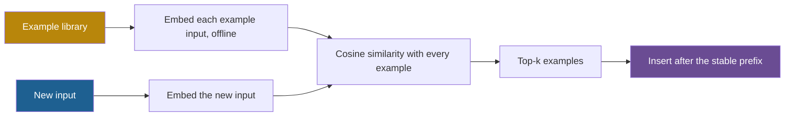

## 1. The question this idea answers

Lesson [3.7](/notes/ai/context-engineering/03-system-layer/l7-atomic-and-molecular-prompts) showed why examples work. Now the engineering questions:

1. Which pattern of example fits my task?
2. Which examples, how many, and in which order?
3. Should every call get the same examples, or should I pick them per query?
4. What gain should I expect, and how do I measure it?

The handbook answers with confident numbers and rules. Several of them do not match the research or the current APIs. This lesson keeps what holds and corrects the rest.

## 2. Mental model

> [!analogy] A teacher's sheet of worked examples
> Before an exam, a teacher gives the class a sheet of worked examples. A good sheet covers each type of problem once, includes one trap, and shows the full method, not only the answers. For a student who struggles with one topic, the teacher picks the examples closest to that topic.
>
> **Where it stops working:** a student does not care which example came last on the sheet. A model can. Models tend to repeat the answer that appears most often in the examples, and the answer that appears near the end (Zhao et al. 2021). The same examples in a different order can change the result a lot (Lu et al. 2022). So order is a design choice to test, not a detail.

## 3. Terms

| Term | Plain meaning |
|---|---|
| input-output pair | A demonstration that shows one input and its desired output, with no reasoning in between. |
| chain-of-thought (CoT) | Writing out intermediate reasoning steps before the final answer. |
| CoT example | A demonstration that shows the input, the reasoning steps and the final answer. |
| output priming | Writing the first part of the desired output so that the model continues it. |
| assistant prefill | Output priming done through the API: the application sends a final assistant message that the model must continue. |
| structured outputs | An API feature that forces the model's output to match a given JSON schema. |
| extended thinking | A model feature where the model writes reasoning tokens before its answer. They count as output tokens. |
| majority label bias | The tendency of a model to predict the label that appears most often in the examples. |
| recency bias | The tendency of a model to repeat answers that appear near the end of the prompt. |
| common token bias | The tendency of a model to prefer outputs made of tokens that are common in its training data. |
| contextual calibration | A correction that measures a model's bias on a content-free input and then adjusts its output probabilities. |
| static selection | Using the same examples on every call. |
| dynamic selection | Choosing the examples for each call from a library, usually by similarity to the new input. |
| example library | A stored set of curated examples, with their inputs, outputs and metadata, for dynamic selection. |
| embedding | A vector of numbers that represents the meaning of a text, so that similar texts get similar vectors. |
| cosine similarity | A measure of how closely two vectors point in the same direction, from −1 to 1. |
| top-k | The k items with the highest scores. |
| many-shot in-context learning | In-context learning with hundreds or thousands of examples in the prompt. |

## 4. Method and math

### 4.1 Pattern 1: input-output pairs

The handbook (Session 2, §3.3.1) shows sentiment classification with three labelled examples and one new input. Lesson 3.7 shows the same set in XML tags.

| Example | Input | Output |
|---|---|---|
| 1 | "I love your product! It arrived early and works perfectly." | POSITIVE |
| 2 | "The shipping took 3 weeks and the box was damaged." | NEGATIVE |
| 3 | "I received order #4521 today." | NEUTRAL |
| New | "Your support team was incredibly helpful resolving my issue." | ? |

The expected answer is POSITIVE. In the handbook's plain-label layout, the whole prompt is 112 tokens with `o200k_base`. Use this pattern for classification, structured extraction and any clear mapping from input to output.

Two details make this set good. It has exactly one example per label, so no label is the majority. And example 3 settles the hard case of lesson 3.7: a plain fact is NEUTRAL.

### 4.2 Pattern 2: chain-of-thought examples

For reasoning tasks, the example shows the steps, not only the answer. Wei et al. (2022), "Chain-of-Thought Prompting Elicits Reasoning in Large Language Models" (arXiv 2201.11903), gave PaLM 540B "just eight chain of thought exemplars" and reached the state of the art on the GSM8K math benchmark. Kojima et al. (2022, arXiv 2205.11916) showed a zero-shot form. Adding "Let's think step by step" raised MultiArith accuracy from 17.7% to 78.7%, and GSM8K from 10.4% to 40.7%. Those numbers are for 2022 models.

The handbook's example (Session 2, §3.3.2) decides refund eligibility:

```text
INSTRUCTION: Determine if the customer is eligible for a refund.
Show your reasoning step by step.

EXAMPLE 1:
Input: Customer ordered a laptop 45 days ago. Item is unopened.
Reasoning:
- Order date: 45 days ago
- Return window for electronics: 15 days
- 45 > 15, so outside the return window
- Item condition (unopened) is irrelevant since window has closed
Output: NOT ELIGIBLE -- outside 15-day electronics return window

EXAMPLE 2:
Input: Customer ordered a sweater 10 days ago. Worn once, has tags.
Reasoning:
- Order date: 10 days ago
- Return window for standard items: 30 days
- 10 < 30, so within the return window
- Item condition: worn once -- policy requires "unused"
- Worn = used, even if tags are still attached
Output: NOT ELIGIBLE -- item has been used (worn)

NEW INPUT:
Input: Customer ordered headphones 12 days ago. Sealed in
original packaging.
Reasoning:
```

> [!example] Worked example: solve the headphones case
> - Item class: headphones are electronics, so the window is 15 days.
> - Order date: 12 days ago. $12 < 15$, so the order is inside the window.
> - Condition: sealed in the original packaging, so the item is unused. The "unused" condition holds.
> - **Output: ELIGIBLE, inside the 15-day electronics window, and the item is unused.**
>
> The answer is robust. If headphones counted as standard items, the window would be 30 days, and $12 < 30$ gives the same answer.
>
> Note one weakness of this prompt. The rule "policy requires unused" appears only inside example 2. A policy that lives only in an example is fragile. Put the policy itself in the instruction or the knowledge section, and use the examples to show the procedure.

**The cost of reasoning in examples.** With `o200k_base`, example 1 is 79 tokens with its reasoning, and 30 tokens as a plain input-output pair. The reasoning makes the example about 2.6 times as long.

**A good CoT example** (Session 2, FAQ Q33) has four parts:

1. Restate the key constraints from the input.
2. Make one reasoning move per step.
3. Show intermediate conclusions: "Based on X and Y, this means Z."
4. State the final answer separately from the reasoning.

The handbook's test: cover the final answer. If a reader can derive it from the reasoning alone, the example is good.

**With reasoning models.** Many current models think before they answer. The handbook (Session 2, FAQ Q41) gives three rules. Do not repeat "think step by step", because the model already reasons. Say **what** to reason about, not **how**. And budget for the thinking tokens, because they count as output (lesson [1.1](/notes/ai/context-engineering/01-foundations/l1-what-a-model-does-with-context)). The API also changed. On Claude, manual extended thinking with `budget_tokens` is deprecated on Claude 4.6 and rejected on 4.7 and later. Adaptive thinking replaces it (checked on 2026-10-12).

### 4.3 Pattern 3: output priming, and why prefill is legacy

The handbook (Session 2, §3.3.3) calls the third pattern "Prefix-Suffix": "you start the output for the model and let it continue". Its example asks for an API docstring in a house format. It shows one complete docstring for `POST /api/users`, then the new input, and ends the prompt with the start of the output:

```text
NEW INPUT:
Endpoint: DELETE /api/users/{user_id}/sessions
Docstring:
"""
```

When these opening characters are sent as the start of the **assistant** turn, the technique is called assistant prefill.

> [!note] Source check: the "Prefix-Suffix" pattern
> **Corrected.** The handbook's Prefix-Suffix pattern is assistant prefill. Starting with Claude 4.6 models and Claude Mythos Preview, a prefilled last assistant turn is no longer supported: "Requests with prefilled assistant messages to these models return a 400 error." Earlier models still accept prefill. Prefill also conflicts with manual extended thinking, because the final assistant turn of a thinking request "must begin with a thinking block". The Anthropic docs have a section "Migrating away from prefilled responses". Checked on 2026-10-12. Teach prefill as a model-dependent, legacy technique, and check each provider's docs.

Also note a clash of names. In code models, "prefix" and "suffix" usually name the two sides of a fill-in-the-middle task, where the model writes the code between them. That is a different technique.

Each goal of prefill has a replacement:

| Goal of the prefill | Replacement |
|---|---|
| A fixed text format, such as the docstring layout | A format instruction plus one complete example in `<example>` tags |
| Valid JSON | Structured outputs. On the Anthropic API they use `output_config.format`, and the old `output_format` is deprecated (checked on 2026-10-12). |
| No preamble before the answer | An instruction such as "Start with the docstring. Write nothing before it.", plus a check in code |
| Continue a partial document | Put the partial document in the user turn, inside tags, and ask for the continuation |

### 4.4 Which examples to choose

The handbook (Session 2, §3.4) names four principles, and Anthropic's guide asks for examples that are relevant, diverse and structured (checked on 2026-10-12).

| Principle | Why | Check |
|---|---|---|
| Diversity: cover different cases, not variants of one case | The model copies regular features (lesson 3.7) | No two examples share the same label, length and topic |
| Edge cases: at least one tricky or ambiguous example | It shows how to decide at a fuzzy border | One example sits near a border, such as a plain fact for NEUTRAL |
| Relevance: mirror the real use case | Input distribution drives much of the gain (Min et al. 2022) | Examples look like real traffic in topic, length and style |
| Realism: curated real examples over synthetic ones (FAQ Q22) | Synthetic text often has a different distribution | Real structure, simplified content, checked on held-out cases |

For classification, the handbook's FAQ Q15 adds one exception to small counts: give one example per category. A 10-category classifier needs about 10 examples.

### 4.5 Order effects

The handbook's third principle is "Simple to Complex": "Order examples from easiest to hardest. This builds the model's 'confidence' before hitting the hard case."

Zhao et al. (2021), "Calibrate Before Use" (arXiv 2102.09690, ICML 2021), found that few-shot results are unstable because of three biases:

- **Majority label bias:** the model is "biased towards answers that are frequent in the prompt".
- **Recency bias:** "the tendency to repeat answers that appear towards the end of the prompt".
- **Common token bias:** a pull toward tokens that are common in the training data.

Their contextual calibration improved accuracy by up to 30.0 points absolute. Lu et al. (2022), "Fantastically Ordered Prompts and Where to Find Them" (arXiv 2104.08786, ACL 2022), found that "the order in which the samples are provided can make the difference between near state-of-the-art and random guess performance". Their entropy-based method for choosing an order gave a 13% relative improvement across 11 classification tasks.

> [!note] Source check: "simple to complex builds confidence"
> **Corrected.** The handbook (Session 2, §3.4) says that ordering examples from easiest to hardest "builds the model's 'confidence'". A model has no confidence to build. The research shows order sensitivity: order alone can swing accuracy from near state of the art to chance (Lu et al. 2022). It also shows majority-label and recency biases (Zhao et al. 2021). No general easy-to-hard rule follows. Test several orders on your own task. Checked on 2026-10-12.

The number of possible orders grows fast:

$$
\text{orders} = k!
$$

The symbols mean: $k$ is the number of examples, and $k! = 1 \times 2 \times \cdots \times k$.

> [!example] Worked example: how many orders to test
> - $k = 3$: $3! = 6$ orders. Test all of them.
> - $k = 5$: $5! = 120$ orders. Test a random sample, for example 10.
> - $k = 8$: $8! = 40{,}320$ orders. Sample, and report the mean and the spread.
>
> A practical rule has three parts. Balance the labels. Do not put two examples of the same label at the end. Report accuracy as a mean over several orders.

### 4.6 How many examples

| Source | What it says |
|---|---|
| Anthropic prompting guide (checked on 2026-10-12) | "Include 3–5 examples for best results." This is a vendor default. |
| Brown et al. 2020 (GPT-3) | "Few-shot" usually meant 10 to 100 examples. |
| Agarwal et al. 2024, "Many-Shot In-Context Learning" (arXiv 2404.11018, NeurIPS 2024) | "Going from few-shot to many-shot, we observe significant performance gains". With hundreds or thousands of examples, many-shot prompts can even override pretraining biases. |
| Handbook (Session 2, §3.2 and FAQ Q15) | Diminishing returns after 3 to 5 examples |

> [!note] Source check: "diminishing returns after 3–5 examples"
> **Corrected.** The handbook (Session 2, §3.2 and FAQ Q15) says that after 3 to 5 examples "you spend tokens without meaningful quality gains". Three to five is Anthropic's default, not a ceiling. Agarwal et al. (2024) report significant gains with hundreds or thousands of examples on some tasks. The real limit is cost and window space. Measure the curve on your own task.

Examples cost tokens on every call:

$$
\text{daily cost} = \frac{k \times e \times C \times p}{10^6}
$$

The symbols mean:

- $k$ is the number of examples.
- $e$ is the average number of tokens per example.
- $C$ is the number of calls per day.
- $p$ is the input price in USD per MTok.

> [!example] Worked example: five CoT examples against five pairs
> $C = 100{,}000$ calls per day, $p = 2$ (Claude Sonnet 5.5, lesson [1.6](/notes/ai/context-engineering/01-foundations/l6-the-cost-of-a-conversation), checked on 2026-10-12).
>
> - Five CoT examples at $e = 79$: $5 \times 79 = 395$ tokens per call. Per day: $395 \times 100{,}000 = 39.5$ MTok, so 79 USD.
> - Five input-output pairs at $e = 30$: $150$ tokens per call. Per day: 15 MTok, so 30 USD.
> - If the examples are static and sit in a cached prefix at 0.05 × the price: 3.95 USD and 1.50 USD per day.

### 4.7 The handbook's accuracy numbers

The handbook's "Accuracy Comparison" box (Session 2, §3.2) says: zero-shot about 65–70%, 1-shot about 80–85%, 3-shot about 85–95%. It adds: "Adding 2–3 examples typically yields a 10–30% accuracy gain."

> [!note] Source check: the few-shot accuracy numbers
> **Rule of thumb, unsourced.** These numbers name no task, no model and no dataset, and no primary source states them. Real gains depend on the task and the model. They can be small: GPT-3 on TriviaQA went from 64.3% (zero-shot) to 68.0% (one-shot) to 71.2% (few-shot) (Brown et al. 2020). Example order alone can swing results from near state of the art to chance (Lu et al. 2022). Modern instruction-tuned models often have high zero-shot scores. Treat the handbook's numbers as illustrative only, and measure the gain on your own eval set.

"A 10–30% gain" is also ambiguous. It can mean percentage points or a relative change.

$$
\Delta = a_k - a_0, \qquad r = \frac{a_k - a_0}{a_0}
$$

The symbols mean:

- $a_0$ is the zero-shot accuracy, and $a_k$ is the $k$-shot accuracy.
- $\Delta$ is the absolute gain, in percentage points.
- $r$ is the relative gain.

> [!example] Worked example: absolute and relative gains
> **GPT-3, TriviaQA (measured):**
>
> - One-shot: $\Delta = 68.0 - 64.3 = 3.7$ points. $r = 3.7 / 64.3 \approx 5.8\%$.
> - Few-shot: $\Delta = 71.2 - 64.3 = 6.9$ points. $r = 6.9 / 64.3 \approx 10.7\%$.
>
> **The handbook's bands, at their midpoints (not measured):**
>
> - Zero-shot 67.5% to 3-shot 90%: $\Delta = 22.5$ points, and $r = 22.5 / 67.5 \approx 33.3\%$.
>
> The same change reads as "22.5" or "33%" depending on the definition. Always say which one you report.

### 4.8 Static or dynamic selection

The handbook's Table 4 (Session 2, §3.5) compares the two:

| | Static selection | Dynamic selection |
|---|---|---|
| How it works | Same examples every time | Examples chosen per query by embedding similarity |
| Token efficiency | Low: irrelevant examples waste tokens | High: only relevant examples |
| Accuracy | Good for narrow tasks | Better for broad tasks with diverse inputs |
| Complexity | Zero: hardcoded | Moderate: an embedding model and an example library |
| Best for | Prototypes, single-purpose tools | Production systems, multi-domain assistants |

The handbook calls dynamic selection "RAG for few-shot examples". The pipeline:



Similarity is usually the cosine of the angle between two embedding vectors. [Part 4](/notes/ai/context-engineering/04-write-and-rag) teaches embeddings and this formula in depth.

$$
\cos(\mathbf{q}, \mathbf{e}) = \frac{\mathbf{q} \cdot \mathbf{e}}{\lVert \mathbf{q} \rVert \, \lVert \mathbf{e} \rVert}
$$

The symbols mean:

- $\mathbf{q}$ is the embedding of the new input, and $\mathbf{e}$ is the embedding of one example input.
- $\mathbf{q} \cdot \mathbf{e}$ is the dot product: multiply the matching numbers and add the products.
- $\lVert \mathbf{q} \rVert$ is the length of the vector: the square root of the sum of its squared numbers.

> [!example] Worked example: pick 2 of 4 examples
> Real embeddings have hundreds of dimensions. This toy uses 3. The new input is a refund request: $\mathbf{q} = (0.9, 0.1, 0.3)$.
>
> For the example "refund after the window", $\mathbf{e}_1 = (0.8, 0.2, 0.4)$:
>
> - $\mathbf{q} \cdot \mathbf{e}_1 = 0.9 \times 0.8 + 0.1 \times 0.2 + 0.3 \times 0.4 = 0.72 + 0.02 + 0.12 = 0.86$.
> - $\lVert \mathbf{q} \rVert = \sqrt{0.81 + 0.01 + 0.09} = \sqrt{0.91} \approx 0.9539$.
> - $\lVert \mathbf{e}_1 \rVert = \sqrt{0.64 + 0.04 + 0.16} = \sqrt{0.84} \approx 0.9165$.
> - $\cos = 0.86 / (0.9539 \times 0.9165) = 0.86 / 0.8743 \approx 0.984$.
>
> | Example | Vector | Cosine |
> |---|---|---|
> | Refund after the window | (0.8, 0.2, 0.4) | 0.984 |
> | Shipping delay | (0.1, 0.9, 0.2) | 0.271 |
> | Refund for a damaged item | (0.7, 0.1, 0.6) | 0.927 |
> | Password reset | (0.0, 0.2, 0.9) | 0.330 |
>
> The top 2 are the two refund examples.

Four production details:

1. **Diversity.** Top-k by similarity can return near-duplicates, for example two refund cases with the same label. Then the majority label bias of section 4.5 returns. Balance the labels, or use a diversity method such as MMR ([Part 5](/notes/ai/context-engineering/05-retrieval-quality)).
2. **Latency.** The handbook (FAQ Q20) says that the search adds "just a few milliseconds". The search over 100 vectors is fast. Embedding the new input can take longer, especially through an API. Measure both parts.
3. **Cache.** Dynamic examples change on every call, so they break the cache from their position on. Put them after the stable prefix (lesson [1.7](/notes/ai/context-engineering/01-foundations/l7-prompt-caching)).
4. **Observability.** Log the IDs of the chosen examples with each call.

### 4.9 Production view

| Concern | What this lesson means for it |
|---|---|
| Quality | Measure zero-shot against few-shot on your eval set. Report the mean and the spread over several example orders. |
| Cost | CoT examples cost about 2.6 times as much as plain pairs in the handbook's case. Static examples can sit in the cached prefix. |
| Compatibility | Assistant prefill returns a 400 error on Claude 4.6 and later. Use format instructions, examples or structured outputs. |
| Latency | Dynamic selection adds an embedding call and a search. Measure both. |
| Reliability | Balance labels. Keep each policy in the instruction, not only inside an example. |
| Observability | Log the IDs of the examples that each call used. |

## 5. Code

These exercises go in `notebooks/03-system-layer.ipynb`. Put the selector in `src/example_selector.py`, with tests in `tests/test_example_selector.py`.

**Exercise 8.1 (local model, or optional and costs money with an API): the shot curve and the order spread.**

1. Use a labelled sentiment set with three labels. Keep 100 messages for testing, and a separate pool for examples.
2. For $k$ = 0, 1, 3, 5 and 10, build prompts with balanced labels.
3. For each $k \ge 3$, run 5 random orders of the same examples.
4. Plot the mean accuracy against $k$, with the spread over the orders.

Acceptance tests:

- A table of $k$, mean accuracy, minimum and maximum.
- A plot of the mean with the range.
- One sentence that compares your gain with the handbook's bands and says whether it is absolute or relative.

**Exercise 8.2: a dynamic example selector.**

1. Build a library of 50 examples with fields `id`, `input`, `output` and `label`.
2. Embed the inputs with a small local model from `sentence-transformers`. Normalize each vector to length 1.
3. Write `top_k(query: str, k: int, balance_labels: bool = False) -> list[dict]`. Use numpy for the cosine.
4. Compare static and dynamic selection on 30 held-out queries.

Acceptance tests:

- On the toy vectors of section 4.8, a function `cosine(a, b)` returns 0.984 for $\mathbf{q}$ and $\mathbf{e}_1$, and `top_k` returns the two refund examples.
- With `balance_labels=True`, no label appears more than once when $k$ is at most the number of labels.
- Ties are broken by `id`, so the result is deterministic.
- The notebook reports the embedding time and the search time separately.

**Exercise 8.3: chain-of-thought examples.**

1. Solve the headphones case in your own words, with the four parts of a good CoT example.
2. Write two new CoT examples for the same policy: one item outside the window, and one item inside the window that is unused.
3. Apply the cover-the-answer test to each example. Ask a colleague, or a model, to derive the answer from the reasoning only.
4. Move the "unused" rule from the examples into the instruction.

Acceptance tests:

- Each example restates the constraints, makes one move per step, and states the answer separately.
- In the cover-the-answer test, the reader derives the correct answer for all three examples.

**Exercise 8.4 (optional, costs money): replace the prefill.**

1. Take the handbook's docstring task.
2. Run it in three ways. Use a format instruction with one complete example. Use a structured-output schema with the fields of the docstring. Use an assistant prefill on a current Claude model.
3. Record the result of each way.

Acceptance tests:

- The prefill on a Claude 4.6 or later model returns a 400 error, and you record the message.
- One sentence that says which replacement gave the most reliable format.

## 6. Common mistakes

1. **"Order the examples from simple to complex to build confidence."** A model has no confidence. Order changes results through biases. Test several orders.
2. **"Three to five examples is the maximum that helps."** It is a vendor default. Many-shot studies show gains with hundreds of examples on some tasks.
3. **"Few-shot gives 85–95% accuracy."** That number has no source. Measure the gain on your own task, and say whether it is absolute or relative.
4. **"Prefill the assistant turn to force the format."** Prefill returns a 400 error on Claude 4.6 and later. Use instructions, examples or structured outputs.
5. **"Top-k similarity always gives the best examples."** It can return near-duplicates with one label. Balance labels and keep diversity.
6. **"A rule shown in an example is a rule stated."** Put each policy in the instruction. Use examples to show the procedure.

## 7. One-minute explanation

Few-shot examples come in three patterns. Input-output pairs suit classification and extraction. Chain-of-thought examples show the reasoning steps, and they suit tasks with a procedure. The third pattern, starting the output for the model, is assistant prefill, and current Claude models reject it with an error. So use format instructions, examples or structured outputs instead. Choose diverse examples with at least one edge case, and balance the labels. Models show majority-label and recency biases, and order alone can swing accuracy from near state of the art to chance. So test several orders. Anthropic suggests three to five examples as a default, but many-shot studies show gains far beyond that. For broad tasks, pick examples per query by embedding similarity, and place them after the stable prefix. Never trust a quoted accuracy gain. Measure it on your own eval set.

## 8. Check questions

```check
{
  "question": "Use the refund policy of the handbook's CoT examples to solve a new input: \"Customer ordered a monitor 20 days ago. Unopened.\" Show the reasoning in the CoT format.",
  "hint": "A monitor is electronics.",
  "answer": "Order date: 20 days ago. Return window for electronics: 15 days. 20 > 15, so outside the return window. The item condition (unopened) does not matter because the window has closed. Output: NOT ELIGIBLE, outside the 15-day electronics return window."
}
```

```check
{
  "question": "You have 6 examples. How many orders are possible? What is a practical test plan?",
  "answer": "6! = 720 orders. Testing all of them is expensive. Sample about 10 random orders with balanced labels, run the eval set on each, and report the mean accuracy and the spread."
}
```

```check
{
  "question": "Compute the cosine similarity of q = (1, 0, 1) and e = (1, 1, 0).",
  "hint": "Dot product, then divide by the two lengths.",
  "answer": "q · e = 1 × 1 + 0 × 1 + 1 × 0 = 1. The length of q is sqrt(2) ≈ 1.414, and the length of e is sqrt(2) ≈ 1.414. cos = 1 / (1.414 × 1.414) = 1 / 2 = 0.5."
}
```

```check
{
  "question": "Zero-shot accuracy is 72% and 3-shot accuracy is 81%. Give the absolute and the relative gain. Which one matches the phrase \"a 12.5% gain\"?",
  "answer": "Absolute gain: 81 − 72 = 9 percentage points. Relative gain: 9 / 72 = 0.125 = 12.5%. The phrase \"a 12.5% gain\" is the relative gain."
}
```

```check
{
  "question": "After a model upgrade to Claude 4.6, an application that formats docstrings starts to fail with HTTP 400 on every call. The request ends with an assistant message that contains three quote characters. What happened, and what are two fixes?",
  "answer": "The application uses assistant prefill: a final assistant message that the model must continue. Claude 4.6 and later models do not support prefill and return a 400 error. Fix 1: remove the assistant message, and add a format instruction with one complete docstring example in <example> tags. Fix 2: if the output can be JSON, use structured outputs with a schema for the docstring fields, and render the docstring in code."
}
```

```check
{
  "question": "A dynamic selector returns the top 3 examples by cosine similarity. For a refund question, all three are refunds with the label NOT ELIGIBLE. The model now says NOT ELIGIBLE too often. Name the bias and the fix.",
  "answer": "This is majority label bias: the model favors the label that appears most often in its examples. Fix: balance the labels in the chosen set, for example the best example of each label, or use a diversity method such as MMR. Then measure the effect on the eval set."
}
```

## 9. Links

- Previous: [L7: Atomic and molecular prompts](/notes/ai/context-engineering/03-system-layer/l7-atomic-and-molecular-prompts)
- Part overview: [03 System layer](/notes/ai/context-engineering/03-system-layer)
- [Hard questions: System layer](/notes/ai/context-engineering/03-system-layer/hard-questions)
- [L4: Start minimal, then add](/notes/ai/context-engineering/03-system-layer/l4-start-minimal-then-add): how to measure a gain
- Later: [Part 4, embeddings](/notes/ai/context-engineering/04-write-and-rag) and [Part 5, diversity with MMR](/notes/ai/context-engineering/05-retrieval-quality)
- [Glossary](/notes/ai/context-engineering/glossary)
