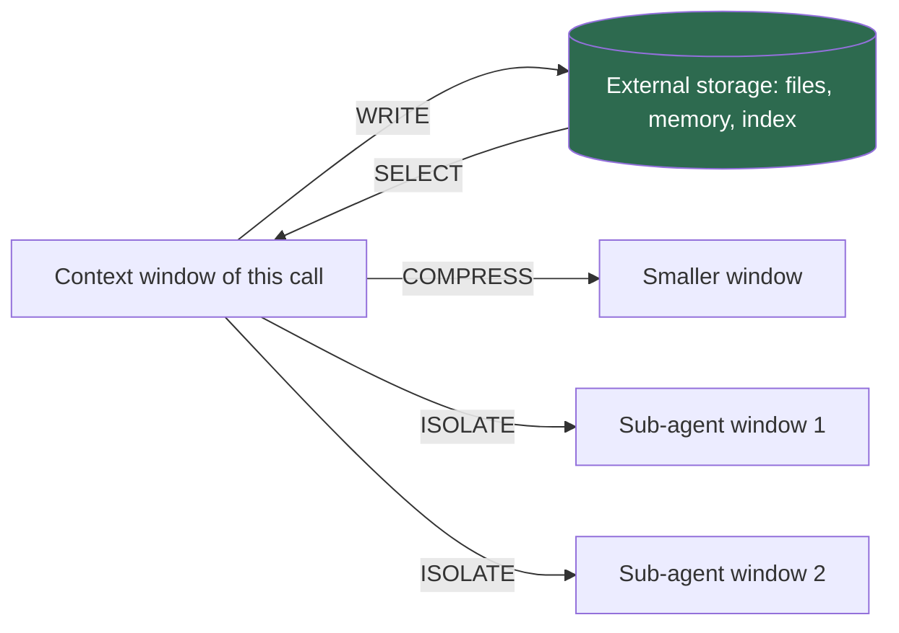

## 1. The question this idea answers

Part 1 showed what the window is and what it costs. Part 3 showed how to build its fixed part: the system prompt and the rules files. But in a real agent, the context changes on every step. Tool results arrive. The history grows. Facts must come from documents and databases. Old content becomes stale.

So which moves can an engineer make on the window? A short list of moves helps in two ways. It lets me name a failure: "a fact was never saved", "the wrong document entered the window", "the summary lost the key number". And it lets me choose a fix from the right family.

Lance Martin's four strategies give this list. This lesson defines them exactly, shows each one in real systems, and maps them to Parts 4 to 8.

## 2. Mental model

> [!analogy] A desk and a filing cabinet
> An analyst works at a small desk. The desk is the **context window**: the only place where work happens. Next to the desk is a large filing cabinet: **external storage**.
>
> - **WRITE**: the analyst files a page in the cabinet, to use it later.
> - **SELECT**: the analyst takes the pages that the current task needs from the cabinet and puts them on the desk.
> - **COMPRESS**: the analyst replaces a pile of pages on the desk with a one-page summary.
> - **ISOLATE**: the analyst gives a sub-task to a colleague at another desk. The colleague returns a short memo.
>
> **Where it stops working:** the desk has a hard size limit, but the real problem starts earlier. A model gets worse as its window fills, long before the limit (lesson [1.5](/notes/ai/context-engineering/01-foundations/l5-position-and-length-effects)). Also, a colleague in an office can ask questions. A sub-agent sees only the brief that it gets, so a weak brief gives a weak result. Finally, the cabinet is not free. A cabinet full of useless pages makes the next search slower and less accurate.

## 3. Terms

| Term | Plain meaning |
|---|---|
| WRITE | A context strategy: save information outside the context window, so that a later step or a later call can use it. |
| SELECT | A context strategy: pull relevant information from outside the context window into it. |
| COMPRESS | A context strategy: keep only the tokens that the task needs, for example by summarizing, trimming or clearing content that is already in the window. |
| ISOLATE | A context strategy: split the context across separate windows, for example across sub-agents, so that each window holds one focused part of the task. |
| WSCI | This course's short name for the four context strategies: write, select, compress, isolate. |
| external storage | Any place outside the context window that holds information: a file, a database, a vector index or a memory store. |
| sub-agent | A model call or agent loop with its own context window. A main agent starts it for one sub-task, and it returns a short result. |
| fine-tuning | More training of a model on new examples. It changes the weights, not the context. |
| inference time | The time when a trained model runs to answer a request. Context engineering works at inference time. |

## 4. Method and math

### 4.1 Where the four strategies come from

Lance Martin (LangChain) published "Context Engineering for Agents" on his own blog on 23 June 2025. LangChain re-published it on its blog on 2 July 2025. He writes: "I group approaches into 4 buckets — write, select, compress, and isolate — and give some examples of each one below."

His one-line definitions are the definitions of this course:

| Strategy | Lance Martin's definition |
|---|---|
| WRITE | "Writing context means saving it outside the context window to help an agent perform a task." |
| SELECT | "Selecting context means pulling it into the context window to help an agent perform a task." |
| COMPRESS | "Compressing context involves retaining only the tokens required to perform a task." |
| ISOLATE | "Isolating context involves splitting it up to help an agent perform a task." |

All four definitions end with the same purpose: "to help an agent perform a task". The strategies are not goals in themselves. Each one is worth its cost only if the task gets done better, cheaper or faster.

> [!note] Source check: date and status of the four strategies
> **Corrected.** The handbook (Session 3, §14, reference 1) dates the post "LangChain Blog, October 2025". The post appeared on Lance Martin's blog on 23 June 2025, and on the LangChain blog on 2 July 2025. The handbook (Session 3, §1 and §1.2) also calls the strategies "the four verbs" and says that "the WSCI taxonomy is exhaustive". The post calls them "4 buckets" of common approaches. It does not use the name "WSCI", and it does not claim that the list is complete. It says: "Patterns for agent context engineering are still evolving." Source: rlancemartin.github.io, 23 June 2025, checked on 2026-10-12.

### 4.2 The direction of each strategy

The simplest way to distinguish the strategies is to ask: **which way do the tokens move?**



| Strategy | Tokens move | Effect on the current window | Typical mechanisms | Main risk |
|---|---|---|---|---|
| WRITE | Window to storage | None at once. Later windows can be smaller. | A file write, a memory store, a field in the agent state | Too many saved items add noise to a later SELECT |
| SELECT | Storage to window | Adds tokens | RAG, memory retrieval, a file read, grep, tool selection | Wrong or too many tokens enter (lesson 1.5) |
| COMPRESS | Window to a smaller window | Removes tokens | A summary, trimming, clearing old tool results | A removed fact matters later |
| ISOLATE | One window to several windows | Each window holds less | Sub-agents, sandboxes, separate state fields | A sub-agent lacks a fact, and total tokens can grow |

A five-question test classifies any technique. Ask the questions in order:

1. Does it save information outside the window for later? Then it is WRITE.
2. Does it bring outside information into the window? Then it is SELECT.
3. Does it make content that is already in the window smaller? Then it is COMPRESS.
4. Does it give part of the task to another window? Then it is ISOLATE.
5. None of these? Then it is outside the four strategies (section 4.6).

Many real techniques combine two strategies. Lesson [L2](/notes/ai/context-engineering/04-write-and-rag/l2-write-scratchpads-memories-files) shows "write, then select": an agent saves a large tool result to a file and reads parts of it later. A sub-agent that returns a 1,000-token summary of 40,000 tokens of work is ISOLATE plus COMPRESS.

### 4.3 Two definitions in the handbook, and the one this course uses

The handbook defines the four strategies twice, and the two definitions differ.

| Strategy | Lecture (Session 3, §1.1) | FAQ (Session 3, Q5) |
|---|---|---|
| WRITE | "Save context outside the window for later use." | "authoring context: system prompts, knowledge base articles, tool descriptions" |
| SELECT | "Pull relevant information into the window from external storage." | "choosing which pieces of that authored context are relevant" |
| COMPRESS | "Reduce tokens while preserving meaning." | "shrinking selected context to fit within token budgets" |
| ISOLATE | "Split context across multiple parallel windows (multiple agents)" | "separating contexts so they do not interfere with each other" |

The lecture matches Lance Martin. The FAQ turns WRITE into a different activity: authoring.

Authoring a good system prompt is the work of Part 3. It decides the **quality** of the content, but it moves no tokens. It becomes WRITE only when a running agent saves something for a later call. For example, an agent that adds a new rule to `CLAUDE.md` after a failure does WRITE. The next session loads that file at the start, which is SELECT.

The FAQ's ISOLATE is also broader. "Separating contexts so they do not interfere" can mean delimiters inside one window (Part 3) or access control between users (lesson [L7](/notes/ai/context-engineering/04-write-and-rag/l7-vector-search)). Martin's ISOLATE means separate windows.

> [!note] Source check: what WRITE means
> **Corrected.** The handbook FAQ (Session 3, Q5) defines WRITE as "authoring context: system prompts, knowledge base articles, tool descriptions". The lecture (Session 3, §1.2) puts the writing of system prompts under WRITE. In the source, WRITE means "saving it outside the context window to help an agent perform a task": scratchpads, memories and files. This course uses the source definition. Source: Lance Martin, 23 June 2025, checked on 2026-10-12.

The lecture (Session 3, §1.2) also quotes Harrison Chase with the words "the discipline of". His post "The rise of context engineering" (LangChain, 23 June 2025) starts: "Context engineering is building dynamic systems to provide the right information and tools in the right format such that the LLM can plausibly accomplish the task." Part 2 covers the definitions of context engineering.

### 4.4 Examples of each strategy

| Strategy | In a support chatbot | In a coding agent | In a LangGraph agent |
|---|---|---|---|
| WRITE | Save "prefers email" to a memory store for this user | Keep a to-do list or a `NOTES.md` file with progress and decisions | Write the plan into a field of the graph state |
| SELECT | Retrieve three policy chunks for the question (RAG) | Load `CLAUDE.md` at the start, then grep the repository and read one file | A node queries a vector store and puts the chunks into the state |
| COMPRESS | Replace turns 1 to 20 with a 300-token summary | Clear old tool results and keep their IDs | A node trims old messages before the model call |
| ISOLATE | A separate small call classifies the intent from the last message only | A sub-agent explores the codebase in its own window and returns a summary | A sub-graph with its own state handles one sub-task |

Three examples come from the sources:

1. **WRITE as structured notes.** Anthropic describes agents that write notes which "get pulled back into the context window at later times". Its examples are "Claude Code creating a to-do list, or your custom agent maintaining a NOTES.md file" (Anthropic Engineering, "Effective context engineering for AI agents", 29 September 2025). Lesson 4.2 covers this.
2. **SELECT applied to tools.** An agent with many tools can retrieve only the relevant tool descriptions. The RAG-MCP paper (Gan and Sun, arXiv 2505.03275, May 2025) reports a tool-selection accuracy of 43.13% with retrieval, against 13.62% without it. It also cut prompt tokens by more than 50%. Part 6 covers agents with many tools.
3. **Two styles of SELECT in one agent.** In Claude Code, `CLAUDE.md` files go into the window at the start. Tools such as glob and grep load other files only when the agent needs them. Anthropic's post says that "the most effective agents might employ a hybrid strategy". Part 5 covers this just-in-time retrieval.

### 4.5 One agent and the four strategies

> [!example] Worked example: the agent from lesson 1.6
> Lesson [1.6](/notes/ai/context-engineering/01-foundations/l6-the-cost-of-a-conversation) used an agent with a 6,000-token fixed prefix. Each step adds a 200-token tool call and a 3,000-token result, so each step adds 3,200 tokens to the history. Call 30 sends the prefix and the 29 earlier steps: $6{,}000 + 29 \times 3{,}200 = 98{,}800$ tokens.
>
> The table shows the input of call 30 after each strategy. The sizes of the summary, the reference and the sub-agent result are assumptions for the example.
>
> | Change | Input of call 30 | Computation |
> |---|---|---|
> | No strategy | 98,800 | $6{,}000 + 29 \times 3{,}200$ |
> | WRITE, then SELECT on demand: each result goes to a file, and the window keeps a 150-token reference | 16,150 | $6{,}000 + 29 \times (200 + 150)$ |
> | COMPRESS: steps 1 to 20 become one 2,000-token summary | 36,800 | $6{,}000 + 2{,}000 + 9 \times 3{,}200$ |
> | ISOLATE: a sub-agent does steps 11 to 25 and returns 1,500 tokens | 52,300 | $6{,}000 + 14 \times 3{,}200 + 1{,}500$ |
>
> The sub-agent has its own window. Assume that it has the same 6,000-token prefix. At its last step it holds $6{,}000 + 14 \times 3{,}200 = 50{,}800$ tokens. So ISOLATE made the main window smaller, but the total tokens over both windows did not fall.

Each row has a hidden cost. The WRITE row pays again for each file that the agent reads. The COMPRESS row loses detail. The ISOLATE row pays for a second window. Lesson 4.2 measures the first cost. Part 7 measures the other two.

### 4.6 What is outside the four strategies

| Technique | Why it is outside | Where this course covers it |
|---|---|---|
| Fine-tuning | It changes the weights, not the window. Context engineering works at inference time. The handbook (Session 3, §1.2) agrees. | Lesson [4.3](/notes/ai/context-engineering/04-write-and-rag/l3-why-retrieval) compares it with RAG. |
| Prompt caching | It changes the price and the time to first token of a prefix. The model still reads the same tokens. | Lesson [1.7](/notes/ai/context-engineering/01-foundations/l7-prompt-caching) |
| Model choice and settings | Temperature and `max_tokens` change how the model writes, not what it reads. | Part 1 |
| Authoring content | Good wording decides the quality of what the strategies move. It moves no tokens itself. | Part 3 |

> [!trap] Prompt caching is not SELECT
> The handbook (Session 3, §1.2) calls caching "an optimization of SELECT". This course keeps caching outside the four strategies. A cache hit does not change which tokens are in the window. It changes only how the provider processes and bills them (lesson [1.7](/notes/ai/context-engineering/01-foundations/l7-prompt-caching)). A cached prefix of 500,000 tokens still gives the model 500,000 tokens to read.

The four strategies also do not say **how much** to move. A budget (Part 5 and Part 7) sets the amount. An evaluation (Part 9) shows whether a move helped.

### 4.7 Where this course teaches each strategy

| Strategy | Lessons |
|---|---|
| WRITE | Lesson 4.2 (scratchpads, memories, files). Part 8 (memory: storage, conflicts, deletion). Part 9 (project files). |
| SELECT | Lessons 4.3 to 4.7 (RAG, chunking, embeddings, vector search). Part 5 (keyword and hybrid search, rerankers, query transformation, budgets, just-in-time retrieval, evaluation). Part 6 (tool selection). Part 8 (memory retrieval). |
| COMPRESS | Part 7, lessons 7.1 to 7.6 and 7.10 (summaries, tool-result clearing, trimming, triggers, budgets, metrics). |
| ISOLATE | Part 7, lessons 7.7 to 7.9 (sub-agents, isolation patterns, contracts). |

Part pages: [Part 5: Retrieval quality](/notes/ai/context-engineering/05-retrieval-quality), [Part 6: Tools and MCP](/notes/ai/context-engineering/06-tools-and-mcp), [Part 7: Compress and isolate](/notes/ai/context-engineering/07-compress-and-isolate), [Part 8: Memory](/notes/ai/context-engineering/08-memory).

### 4.8 Production view

| Concern | What this lesson means for it |
|---|---|
| Diagnosis | When an answer is wrong, ask which strategy failed. Was a fact never written? Did SELECT bring the wrong content? Did a summary drop a fact? Did a sub-agent lack context? |
| Cost | WRITE and COMPRESS make later windows smaller. SELECT adds tokens. ISOLATE can raise the total even when each window is smaller. Track tokens for each strategy. |
| Observability | Log each write, each select (with IDs and scores), each compression (tokens before and after) and each sub-agent call (brief and result). |
| Security | SELECT brings untrusted text into the window. WRITE makes it permanent: an injected instruction saved to memory returns on every later call (Parts 6 and 8). |
| Reliability | Every COMPRESS loses information. Keep the original in storage when a lost detail can matter. |

## 5. Code

These exercises go in `notebooks/04-write-and-rag.ipynb` in the lab repository. I write all the code myself.

**Exercise 1.1: a context ledger.**

1. Write a class `ContextLedger` with a list of window blocks and a dictionary for external storage.
2. Add `write(key, text)`, `select(key)`, `compress(start, end, summary)` and `isolate(task, worker)`.
3. Make each method record the strategy name and the change in window tokens.
4. Count tokens with `tiktoken` and the `o200k_base` encoding.
5. Make `isolate` call `worker(task)` with a new, empty ledger. Add only the return value to the window.
6. Write `report()`, which returns the total token change for each strategy.

Acceptance tests:

- `write` does not change the window token count.
- `select` of a missing key raises a `KeyError`.
- `compress(0, 5, summary)` replaces blocks 0 to 4 with one block.
- After `isolate`, the window holds the worker's result and none of the worker's blocks.

**Exercise 1.2: reproduce section 4.5.**

1. Write `input_at_call(prefix, step_sizes)`, where `step_sizes` lists the tokens that each earlier step added.
2. Build the four lists of step sizes from section 4.5.

Acceptance test: the function returns 98,800, 16,150, 36,800 and 52,300.

**Exercise 1.3: classify ten techniques.** In a Markdown cell, classify each technique with the five questions of section 4.2. Give one line of reason for each.

1. Prompt caching of the system prompt.
2. Loading `CLAUDE.md` at the start of a session.
3. Automatic compaction of a long chat.
4. RAG over a company wiki.
5. Saving "the user prefers short answers".
6. A LangGraph sub-graph with its own state.
7. Clearing tool results older than 10 steps.
8. Fine-tuning on 5,000 support tickets.
9. An agent that keeps a to-do list file.
10. Retrieving 5 tool schemas out of 60.

Acceptance test: your ten answers match the first check question, or your reason line defends each difference.

## 6. Common mistakes

1. **"WRITE means writing a good system prompt."** In the source, WRITE means saving information outside the window during a task. Authoring a prompt is Part 3 work. It moves no tokens.
2. **"The four strategies cover every technique."** Lance Martin calls them buckets of common approaches and says the patterns "are still evolving". Fine-tuning and prompt caching are outside them.
3. **"ISOLATE always saves tokens."** It makes each window smaller. The total over all windows can grow, because each sub-agent needs its own prefix and its own work.
4. **"ISOLATE and tenant isolation are the same idea."** The handbook FAQ (Session 3, Q28) links multi-tenant filters to ISOLATE. Tenant isolation is access control: one customer must never see another customer's data (lesson [L7](/notes/ai/context-engineering/04-write-and-rag/l7-vector-search)). ISOLATE splits one task across windows. The words are similar, but the problems are different.
5. **"SELECT means RAG."** RAG is one form of SELECT. Memory retrieval, file reads, grep, tool selection and always-loaded rules files are also SELECT.
6. **"COMPRESS is safe because a summary keeps the meaning."** Every summary drops detail. Keep the original in storage when a lost detail can matter.

## 7. One-minute explanation

Context engineering has four basic moves. Lance Martin calls them four buckets: write, select, compress and isolate. WRITE saves information outside the window, for example a note, a memory or a file. SELECT brings information into the window, for example retrieved documents or a file that the agent reads. COMPRESS makes the content of the window smaller, for example a summary of old turns. ISOLATE splits the work across several windows, for example sub-agents that each see one part of the task. To classify a technique, ask which way the tokens move. Some techniques are outside the four moves. Fine-tuning changes the weights, and caching changes only the price and the speed. Parts 4 and 5 teach SELECT, Part 7 teaches COMPRESS and ISOLATE, and Part 8 teaches memory.

## 8. Check questions

```check
{
  "question": "Classify the ten techniques of Exercise 1.3 as WRITE, SELECT, COMPRESS, ISOLATE or outside.",
  "hint": "Ask which way the tokens move, and when.",
  "answer": "1. Outside: caching changes price and latency, not the tokens that the model reads. 2. SELECT: an always-loaded file (someone did WRITE earlier when they saved it). 3. COMPRESS. 4. SELECT. 5. WRITE (a memory). 6. ISOLATE. 7. COMPRESS. 8. Outside: it changes the weights. 9. WRITE, and SELECT when the agent reads the file again. 10. SELECT applied to tools."
}
```

```check
{
  "question": "Use the agent of section 4.5. Steps 1 to 25 become one 3,000-token summary. What is the input of call 30?",
  "hint": "Call 30 holds the prefix, the summary and the steps that were not summarized.",
  "answer": "Steps 26 to 29 stay, which is 4 steps. Input = 6,000 + 3,000 + 4 × 3,200 = 21,800 tokens, against 98,800 without compression."
}
```

```check
{
  "question": "The handbook FAQ says WRITE is 'authoring context: system prompts, knowledge base articles, tool descriptions'. Why does this course not use that definition?",
  "answer": "The source (Lance Martin, 23 June 2025) defines WRITE as saving context outside the window to help an agent perform a task: scratchpads, memories and files. Authoring a system prompt moves no tokens. It decides the quality of content, which is the topic of Part 3. It becomes WRITE only when a running agent saves something, for example a new rule in CLAUDE.md, for a later call."
}
```

```check
{
  "question": "A chatbot asks every user for their preferred language at the start of each new session. Which strategy is missing? What would you check first?",
  "answer": "The fact must survive between sessions, so the app needs WRITE (save it to a memory store for the user) and SELECT (load it at the start of each session). Check first whether the fact is in storage. If it is there, the failure is in SELECT. If it is not there, the failure is in WRITE."
}
```

```check
{
  "question": "A team moves a long research task to five sub-agents. Each main-agent call is now much smaller, but the monthly bill grew. Is this a contradiction?",
  "answer": "No. ISOLATE makes each window smaller, but each sub-agent has its own prefix and its own growing history. The total tokens over all windows can be larger than one long window. ISOLATE pays when the smaller, focused windows give better answers or when the work runs in parallel. It is not a cost-saving tool by default."
}
```

## 9. Links

- Next: [L2: WRITE: scratchpads, memories, files](/notes/ai/context-engineering/04-write-and-rag/l2-write-scratchpads-memories-files)
- [L6: The cost of a conversation](/notes/ai/context-engineering/01-foundations/l6-the-cost-of-a-conversation): the agent of section 4.5
- [Part 5: Retrieval quality](/notes/ai/context-engineering/05-retrieval-quality) and [Part 7: Compress and isolate](/notes/ai/context-engineering/07-compress-and-isolate)
- [Glossary](/notes/ai/context-engineering/glossary)
