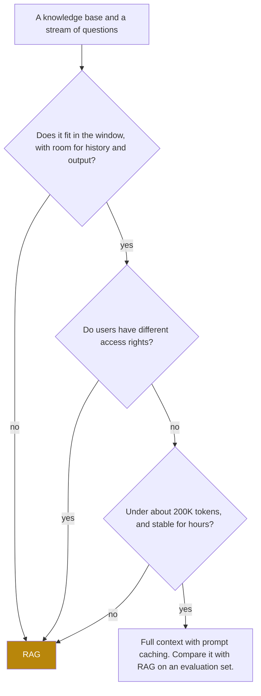

## 1. The question this idea answers

A company has 4,000 pages of policies, product manuals and support articles. A model must answer questions about them. There are three options:

1. Put the whole knowledge base into the prompt on every call.
2. Retrieve only the relevant parts for each question, and put those into the prompt.
3. Train the model on the documents, so that the knowledge is in the weights.

Windows now hold about a million tokens. So is option 1 now the simple answer? This lesson compares the three options with numbers from Part 1, and gives a rule for when each one wins.

## 2. Mental model

> [!analogy] An open-book exam
> - **Option 1** is to carry the whole library into the exam room and search it during the exam. It is complete, but slow, and the answer can hide among thousands of pages.
> - **Option 2** is an open-book exam with a good index. You look in the index, open the three right pages, and answer from them. You can also show the examiner which page you used.
> - **Option 3** is to memorize the textbook before the exam. It is fast in the room, but you cannot update what you learned, and you cannot show where a fact came from.
>
> **Where it stops working:** a model can read a whole book in one call, which a person cannot do in an exam. So for a small book, option 1 is often the best. Also, the index can fail without a warning. If it opens the wrong page, the model answers from that page with full confidence.

## 3. Terms

| Term | Plain meaning |
|---|---|
| retrieval-augmented generation (RAG) | A design where the application retrieves relevant documents for each query and puts them into the context window, so that the model answers from them. |
| retriever | The part of a RAG system that finds the relevant documents or chunks for a query. |
| knowledge base | The set of documents that a RAG system can retrieve from, for example manuals, policies and articles. |
| parametric memory | Knowledge stored in the weights of a model. Training writes it. |
| non-parametric memory | Knowledge stored outside the model, for example in a document index, and read at inference time. |
| full-context prompting | Putting the whole knowledge base into the prompt on every call, without retrieval. |
| grounded answer | An answer that the documents in the window support. |
| citation | A reference in an answer to the document or chunk that supports a statement. |
| freshness | How current the information is that the model uses for an answer. |

## 4. Method and math

### 4.1 What RAG is

Lewis et al. introduced the name in "Retrieval-Augmented Generation for Knowledge-Intensive NLP Tasks" (NeurIPS 2020, arXiv 2005.11401). Their system joins two kinds of memory: "the parametric memory is a pre-trained seq2seq model and the non-parametric memory is a dense vector index of Wikipedia".

These two kinds of memory are the two places where knowledge lives (lesson [1.1](/notes/ai/context-engineering/01-foundations/l1-what-a-model-does-with-context)). The weights are parametric memory. The index is non-parametric memory, and the context window is how its content reaches the model.

The original system trained the retriever and the generator together, end to end. Today, "RAG" usually means the general pattern: retrieve with a separate search system, then put the results into the prompt of an unchanged model. This course uses the word in this general sense. In the terms of lesson [4.1](/notes/ai/context-engineering/04-write-and-rag/l1-four-strategies), RAG is the main form of SELECT.

### 4.2 The context formula

RAG does not replace the other parts of the context. It adds one part. The handbook (Session 3, §3.2) writes:

$$
C_{\text{RAG}} = \text{Assemble}(q,\ D_k,\ I,\ M)
$$

The symbols mean:

- $C_{\text{RAG}}$ is the input of one model call.
- $q$ is the user's query.
- $D_k$ is the set of $k$ retrieved documents or chunks.
- $I$ is the instructions: the system prompt, and the tool definitions if there are tools.
- $M$ is the memory and state: facts about the user, a summary of earlier turns.
- $\text{Assemble}$ is the application code that chooses the order, the labels and the format.

> [!example] Worked example: one assembled RAG call
> A support bot has instructions of 600 tokens and 100 tokens of memory. It retrieves three chunks of 400 tokens each. The question has 30 tokens.
>
> Input $= 600 + 100 + 3 \times 400 + 30 = 1{,}930$ tokens.
>
> A good order follows lesson [1.5](/notes/ai/context-engineering/01-foundations/l5-position-and-length-effects): long documents near the top, the question at the end.
>
> ```text
> [system]    Instructions (600 tokens): answer only from the documents,
>             cite them as [doc-id], say "I do not know" if they do not answer.
> [user]      <memory> Customer since 2021. Prefers email. </memory>
>             <documents>
>               <doc id="returns-2026#3"> ... </doc>
>               <doc id="warranty#1"> ... </doc>
>               <doc id="shipping#7"> ... </doc>
>             </documents>
>             Question: Can I return an opened laptop after 35 days?
> ```

The quality of $C_{\text{RAG}}$ depends on every argument. Perfect chunks with weak instructions give uncited answers. Strong instructions with wrong chunks give confident, wrong answers.

### 4.3 Reason 1 for retrieval: cost

The handbook (Session 3, §3.3) gives four reasons to retrieve instead of sending everything: cost, context rot, freshness and verifiability. This lesson adds three more: latency, size and access control. Cost comes first, because lesson [1.6](/notes/ai/context-engineering/01-foundations/l6-the-cost-of-a-conversation) gives the tools to compute it.

> [!example] Worked example: one query against a 500,000-token knowledge base
> Prices: Claude Sonnet 5.5, input USD 2 / MTok, cache read USD 0.10 / MTok (0.05 times the input price), checked on 2026-10-12. RAG sends 3,000 tokens: instructions, three chunks and the question.
>
> | Design | Input tokens per query | Cost per query | 10,000 queries |
> |---|---|---|---|
> | Full context, no cache | 500,000 | USD 1.00 | USD 10,000 |
> | Full context, every query a cache hit | 500,000 | USD 0.05 | USD 500, plus cache writes |
> | RAG | 3,000 | USD 0.006 | USD 60 |
>
> Without caching, the full prompt costs $1.00 / 0.006 \approx 167$ times more per query. With caching, it still costs about 8.3 times more. A cache write of 500,000 tokens costs USD 1.25 at 1.25 times the input price, every time the cache expires (lesson [1.7](/notes/ai/context-engineering/01-foundations/l7-prompt-caching)).

The cost of retrieval itself is small. Embedding a 15-token question with an API model at USD 0.02 / MTok costs USD 0.0000003.

The difference grows in a conversation. Lesson 1.6 showed that the fixed prefix $S$ is sent again on every call. In full-context prompting, the knowledge base is part of $S$.

> [!example] Worked example: a 10-turn chat
> Use the formula of lesson 1.6, $C_N = N(S + u) + t\,\frac{N(N-1)}{2}$, with $t = u + a$ and $N = 10$ turns. Replies have $a = 300$ tokens.
>
> - **Full context:** a 200,000-token knowledge base and a 2,000-token system prompt, so $S = 202{,}000$. User messages have $u = 100$ tokens, so $t = 400$. $C_{10} = 10 \times 202{,}100 + 400 \times 45 = 2{,}039{,}000$ tokens, about USD 4.08 without caching.
> - **RAG:** $S = 2{,}000$. Each user message carries 2,000 tokens of retrieved chunks, so $u = 2{,}100$ and $t = 2{,}400$. $C_{10} = 10 \times 4{,}100 + 2{,}400 \times 45 = 149{,}000$ tokens, about USD 0.30.

### 4.4 Reasons 2 and 3: latency and quality

**Latency.** Prefill must process every input token before the first output token (lesson [1.4](/notes/ai/context-engineering/01-foundations/l4-attention-and-the-cost-of-length)). So a 500,000-token prompt has a much longer time to first token than a 3,000-token prompt. A cache hit makes prefill faster, but only for a stable prefix within the cache lifetime.

**Quality.** More tokens do not mean better use of them (lesson [1.5](/notes/ai/context-engineering/01-foundations/l5-position-and-length-effects)):

1. Liu et al. found that GPT-3.5-Turbo scored 53.8% with the answer document at position 10 of 20. With no documents at all, it scored 56.1%.
2. Chroma's report used a conversational-memory task. All tested models did much better with a focused prompt of about 300 tokens than with the full prompt of about 113,000 tokens.

RAG keeps the window small and focused. But it moves the risk. A full-context prompt can fail because the model misses a fact that is in the window. A RAG prompt can fail because the retriever never brings the fact in. Part 5 measures the retriever, so that this risk is visible.

### 4.5 Reasons 4 to 7: size, freshness, citations, access control

**Size.** Some knowledge bases do not fit in any window. At about 800 tokens per page (the basis of OpenAI's page estimates for its embedding prices), 4,000 pages are about 3.2 million tokens. Current Claude models have a 1,000,000-token window, and current OpenAI flagship models list 1,050,000 (lesson [1.1](/notes/ai/context-engineering/01-foundations/l1-what-a-model-does-with-context)). The window must also hold the history and the output.

> [!note] Source check: "Gemini has a 2-million-token context window"
> **Corrected.** The handbook (Session 3, §3.3) bases its argument on a 2-million-token Gemini window. The current Gemini API docs say: "Many Gemini models come with large context windows of 1 million or more tokens." The 2-million-token window belonged to Gemini 1.5 Pro, which Google retired on 29 September 2025. The argument does not change. Checked on 2026-10-12.

**Freshness.** When a document changes, a RAG system re-embeds only that document (lesson [L4](/notes/ai/context-engineering/04-write-and-rag/l4-the-rag-pipeline)). A full-context prompt is also fresh, if the application rebuilds it from the current documents. So freshness is a strong argument against fine-tuning, and a weak one against full context.

**Citations.** RAG gives a small, labeled set of evidence for each answer. You can log the five chunk IDs that the model saw and check each claim against them. A full-context prompt can also carry document IDs, but the evidence set is the whole corpus. It is much harder to check which part the model used.

**Access control.** Different users may see different documents. A retriever can filter by the user's rights inside the database query (lesson [L7](/notes/ai/context-engineering/04-write-and-rag/l7-vector-search)). A full-context prompt must be built for each set of rights, so each group needs its own cached prefix.

> [!key] RAG is a focus tool, not a workaround
> The numbers above show that cost, latency and quality all improve when the window holds only what the question needs. So the handbook's summary is right: "RAG is not a workaround for small context windows. It is a design principle for keeping context focused, even when you have unlimited window space."

### 4.6 When to put everything in the prompt

Retrieval is not always the right answer. Anthropic's post "Introducing Contextual Retrieval" (19 September 2024) says: "If your knowledge base is smaller than 200,000 tokens (about 500 pages of material), you can just include the entire knowledge base in the prompt". Full context then has real advantages. There is no retriever that can miss, no chunking, and no index to keep in sync.



Full context is a good first design when all these conditions hold:

1. The knowledge base is small, about 200,000 tokens or less. This is Anthropic's rule of thumb. Measure the length effect on your own model.
2. The content is stable for hours, so the cache prefix stays the same and most queries are cache hits.
3. All users may see all the content.
4. Questions often need the whole corpus, for example "list every policy that mentions refunds".

There is also a middle way. The handbook FAQ (Session 3, Q49) describes it: retrieve a generous set of candidates, then put them all into a large window for the answer. Anthropic describes a similar mix for agents. Claude Code loads `CLAUDE.md` at the start. It uses glob and grep to load other files when it needs them.

### 4.7 RAG or fine-tuning

Fine-tuning writes knowledge into parametric memory. RAG keeps it in non-parametric memory. The difference decides what each one is good for.

| Need | RAG | Fine-tuning | Full context |
|---|---|---|---|
| Add or update a fact | Re-index one document | Train again | Rebuild the prompt |
| Remove a fact, for example after a deletion request | Delete its chunks | Train again, and it may still leak | Remove it from the prompt |
| Cite the source of an answer | Yes, by chunk ID | No | Possible, if documents carry IDs |
| Different rights for different users | Filter in the retriever | One model serves all users | One prompt for each group |
| Change style, format or tone | Weak | Strong | Weak |
| Teach a new task format or skill | Weak | Strong | Weak |
| Cost profile | Small input per query, plus an index | Training runs, then short prompts | Large input per query |

The handbook lecture (Session 3, §13, FAQ) says: "Most production systems use RAG first and add fine-tuning only when needed." Treat this as a rule of thumb. The two methods also combine well: fine-tune for the output format, and retrieve for the facts. Fine-tuning an **embedding** model is a different topic (lesson [L6](/notes/ai/context-engineering/04-write-and-rag/l6-embeddings-and-similarity)).

### 4.8 What RAG does not fix

1. **Wrong chunks give confident, wrong answers.** The model trusts what is in its window. Part 2 shows this failure with code.
2. **A missing answer invites a guess.** If no chunk contains the answer, the model must be told to say so. Part 5 covers abstention.
3. **Questions that need several chunks.** "Compare product A and product B" needs chunks about both. Top-k retrieval may return five chunks about A. Part 5 covers query decomposition and diversity.

Diagnose in a fixed order. First, test retrieval alone: do the right chunks appear in the top $k$? Second, give the model the correct chunks by hand and test the answer. This separates retrieval failures from generation failures. The handbook FAQ (Session 3, Q29) says that "nine times out of ten" the problem is retrieval. That number has no source, but the order of the test is sound.

### 4.9 Production view

| Concern | What this lesson means for it |
|---|---|
| Cost | Compute the cost per query and per conversation for full context, cached full context and RAG before you choose. |
| Latency | Time to first token grows with the input. RAG adds a retrieval step, but it removes most of the prefill. |
| Quality | RAG trades the length effect for the risk of a retrieval miss. Measure both. |
| Freshness | Re-index changed documents. Log the index version with each answer. |
| Security | Enforce access rights in the retriever, not in the prompt. |
| Observability | Log the chunk IDs and scores that went into each answer. Without them, a wrong answer cannot be traced. |

## 5. Graphs

```plot
{
  "title": "Input cost per query in USD against knowledge-base size: full context without cache (red), full context with cache hits (gold), RAG with 3,000 tokens (blue)",
  "xAxis": { "label": "knowledge-base size (thousands of tokens)", "domain": [0, 1000] },
  "yAxis": { "label": "USD per query", "domain": [0, 0.12] },
  "disableZoom": true,
  "data": [
    { "fn": "0.002*x", "color": "#C81D25" },
    { "fn": "0.0001*x", "color": "#B8860B" },
    { "fn": "0.006", "color": "#1E6091" }
  ]
}
```

The prices are those of section 4.3. The red line passes the blue line at 3,000 tokens. The gold line passes the blue line at 60,000 tokens: $0.10 \times 60{,}000 / 10^6 = 0.006$. So even with a cache hit on every query, full context costs more than this RAG design above 60,000 tokens. The plot ignores cache writes and answer quality.

## 6. Code

These exercises go in `notebooks/04-write-and-rag.ipynb`.

**Exercise 3.1: the cost model.**

1. Write `cost_per_query(input_tokens, price_per_mtok)`.
2. Write `compare(kb_tokens, rag_tokens, price, read_multiplier)`, which returns the three costs of section 4.3.
3. Write `break_even_kb(rag_tokens, read_multiplier)`, the size where cached full context costs as much as RAG.

Acceptance tests:

- `compare(500_000, 3_000, 2, 0.05)` returns 1.00, 0.05 and 0.006 USD.
- `break_even_kb(3_000, 0.05)` returns 60,000.

**Exercise 3.2: the chat comparison.** Use `cumulative_input(N, S, u, a)` from Exercise 6.1 of Part 1 for the two designs of section 4.3.

Acceptance test: the function returns 2,039,000 tokens for full context and 149,000 tokens for RAG.

**Exercise 3.3: a strategy chooser.**

1. Write `choose(kb_tokens, window, stable_hours, access_groups, needs_whole_corpus)`.
2. Return `"full context"` or `"RAG"` with a one-line reason, as in the flowchart of section 4.6.

Acceptance tests:

- A 3.2-million-token knowledge base gives `"RAG"` because it does not fit.
- A 90,000-token handbook, stable for weeks, with one access group, gives `"full context"`.
- The same handbook with two access groups gives `"RAG"`.

**Exercise 3.4 (optional, costs money): measure both designs.**

1. Take a corpus of about 60,000 tokens and write 30 questions with known answers.
2. Answer each question twice: with the full corpus, and with the top 3 chunks.
3. Record accuracy, input tokens and time to first token. Estimate the cost before you run it.

Acceptance test: a table with two rows and three columns, and one sentence on which design wins on your data.

## 7. Common mistakes

1. **"A 1M-token window makes RAG unnecessary."** The window removes the size limit for small corpora only. Cost, latency, length effects and access control remain.
2. **"RAG solves hallucination."** RAG gives the model evidence. If the retriever brings the wrong evidence, the model answers wrongly with confidence.
3. **"Fine-tune the model on our documents so that it knows them."** Fine-tuning is weak for facts that change, cannot cite, and cannot forget one fact on request. Use it for behavior and format.
4. **"Full context is always simpler and therefore better."** It is simpler. For a small, stable corpus with one access group it can be the best design. Measure it against RAG.
5. **"Caching makes full context as cheap as RAG."** With cache hits on every query, a 500,000-token prompt still costs about 8 times a 3,000-token RAG prompt. It is also no help against the length effect.

## 8. One-minute explanation

A model knows only its weights and its window. RAG adds a third source: an index of documents that the application searches for each question. The application retrieves the few relevant chunks and puts them into the window next to the instructions, memory and question. Why not paste the whole knowledge base instead? It costs much more on every call, it delays the first token, and accuracy drops as the input grows. Large knowledge bases do not fit at all, and users with different rights need different content. RAG also gives a small set of evidence that you can cite and check. If the knowledge base is under about 200,000 tokens, stable and shared by all users, full context with caching can be the better design. Fine-tuning is for behavior and format, not for facts that change.

## 9. Check questions

```check
{
  "question": "A knowledge base has 150,000 tokens. Use the prices of section 4.3. What is the input cost per query for full context without cache, full context with a cache hit, and RAG with 4,000 tokens?",
  "hint": "Multiply tokens by the price and divide by one million.",
  "answer": "Full context: 150,000 × 2 / 10^6 = USD 0.30. Cache hit: 150,000 × 0.10 / 10^6 = USD 0.015. RAG: 4,000 × 2 / 10^6 = USD 0.008. Cached full context costs about 1.9 times RAG here, so quality and simplicity can decide."
}
```

```check
{
  "question": "A team says: 'Freshness is a reason to use RAG instead of a long-context prompt.' Is this a strong argument?",
  "answer": "Weak. A long-context prompt is also fresh if the application rebuilds it from the current documents on each call. Freshness is a strong argument against fine-tuning, which needs a new training run for each change. The strong arguments against full context are cost, latency, length effects, size limits and access control."
}
```

```check
{
  "question": "A RAG chatbot gives a confident, wrong answer about a refund rule. Describe a two-step test that finds whether retrieval or generation failed.",
  "answer": "Step 1: send the question to the retriever alone and check whether the chunk with the correct rule is in the top k. If it is not, retrieval failed. Step 2: give the model the correct chunk by hand with the same prompt. If the answer is still wrong, generation failed: for example weak instructions, a bad order, or a conflicting chunk."
}
```

```check
{
  "question": "An HR handbook has 120 pages, at about 800 tokens per page. It changes once a month, and all employees may read all of it. Which design would you try first, and what would you measure?",
  "answer": "120 × 800 = 96,000 tokens, below Anthropic's 200,000-token rule of thumb. The content is stable and has one access group. So full context with prompt caching is a sound first design. Measure answer accuracy on an evaluation set, the cache hit rate and the time to first token, and compare with a RAG baseline."
}
```

```check
{
  "question": "In the terms of Lewis et al. (2020), what are parametric and non-parametric memory, and which one does fine-tuning change?",
  "answer": "Parametric memory is the knowledge in the model's weights. Non-parametric memory is knowledge outside the model, such as a dense vector index of documents, read at inference time. Fine-tuning changes parametric memory. RAG uses non-parametric memory and brings it into the window."
}
```

## 10. Links

- Previous: [L2: WRITE: scratchpads, memories, files](/notes/ai/context-engineering/04-write-and-rag/l2-write-scratchpads-memories-files)
- Next: [L4: The RAG pipeline](/notes/ai/context-engineering/04-write-and-rag/l4-the-rag-pipeline)
- [L5: Position and length effects](/notes/ai/context-engineering/01-foundations/l5-position-and-length-effects) and [L7: Prompt caching](/notes/ai/context-engineering/01-foundations/l7-prompt-caching)
- [Part 5: Retrieval quality](/notes/ai/context-engineering/05-retrieval-quality)
- [Glossary](/notes/ai/context-engineering/glossary)
