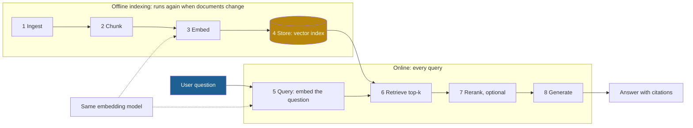

## 1. The question this idea answers

Lesson [L3](/notes/ai/context-engineering/04-write-and-rag/l3-why-retrieval) showed why to retrieve. Now: what exactly happens between "the user asks" and "the model answers with a citation"? Which parts run once, which run on every query, and which decision in each part decides the quality of the answer?

A RAG system is a pipeline of eight stages. Most RAG failures come from one stage that nobody looked at. This lesson names the stages and the decision that each one makes. It builds a minimal pipeline in prose. It also shows how to keep the index in sync with changing documents.

## 2. Mental model

> [!analogy] A library catalogue
> **Before anyone asks** (offline), the library buys books, cuts them into sections, writes one index card for each section, and files the cards by subject.
>
> **When a reader asks** (online), a librarian turns the question into the catalogue's terms and pulls the closest cards. The librarian puts the best cards on top and hands those sections to an expert, who writes the answer.
>
> **Where it stops working:** the catalogue in RAG is numeric. It compares meanings approximately, as vectors. It always returns the closest cards, even when none of them is relevant. A human librarian would say "we have nothing on that". Also, a library catalogue changes slowly. A company's documents change every day, so the index needs a sync process.

## 3. Terms

| Term | Plain meaning |
|---|---|
| indexing phase | The offline part of a RAG pipeline: ingest, chunk, embed and store. It runs before the queries, and again when documents change. |
| query phase | The online part of a RAG pipeline: embed the query, retrieve, rerank and generate. It runs on every query. |
| ingestion | Loading raw documents, converting them to clean text and attaching metadata. |
| chunk | One piece of a document, small enough to embed and to place in a prompt. A RAG system retrieves chunks, not whole documents. |
| embedding | A list of numbers (a vector) that an embedding model computes for a text. Texts with similar meaning get vectors that are close. |
| embedding model | A neural network that turns a text into an embedding of fixed length. |
| vector index | A data structure that stores embeddings and finds the ones nearest to a query vector. A vector database holds one or more. |
| top-k retrieval | Returning the $k$ chunks whose embeddings are nearest to the query embedding. |
| reranking | A second scoring step that reorders the retrieved candidates with a slower, more exact model. |
| metadata | Fields stored with each chunk, such as the source file, the section, the date and the access group. |
| collection | Chroma's name for a named set of chunks, embeddings and metadata with one distance metric. |
| content hash | A short fingerprint of a document's text, for example SHA-256. It changes when the text changes. |
| incremental sync | Updating an index by processing only new, changed and deleted documents. |

## 4. Method and math

### 4.1 Two phases, eight stages



The handbook lecture (Session 3, §4.2.1) puts the embedding of the question into its own stage, stage 5. That stage holds the most common silent bug (section 4.3), so it deserves its own name.

> [!note] Source check: seven or eight stages
> **Corrected.** The handbook lecture (Session 3, §4) has eight stages. The handbook FAQ (Session 3, Q2) says "The pipeline has seven stages" and has no query stage. Both describe the same pipeline. This course uses the eight stages of the lecture, because the query-embedding step must use the same model as the indexing step.

The lecture also says that "Stages 1–4 happen once (offline indexing)." They happen before the queries, but not once. They run again for every new, changed or deleted document (section 4.6). The handbook's own FAQ (Session 3, Q17) calls stale data "one of the biggest operational challenges in production RAG".

### 4.2 What each stage decides

| # | Stage | Input and output | What it decides | Typical failure |
|---|---|---|---|---|
| 1 | Ingest | Raw files to clean text with metadata | Which sources to include, how to parse PDFs, HTML and tables, which access group each document has | Broken text from a PDF, a lost table, two versions of one policy |
| 2 | Chunk | Text to chunks | Size, overlap and boundaries (lesson [L5](/notes/ai/context-engineering/04-write-and-rag/l5-chunking)) | An idea split in two, or chunks longer than the model's input limit |
| 3 | Embed | Chunks to vectors | Model, dimensions, input format (lesson [L6](/notes/ai/context-engineering/04-write-and-rag/l6-embeddings-and-similarity)) | A model that does not fit the domain, or silent truncation |
| 4 | Store | Vectors, text and metadata to an index | Database, index type, distance metric (lesson [L7](/notes/ai/context-engineering/04-write-and-rag/l7-vector-search)) | The wrong metric, or no metadata for filters |
| 5 | Query | Question to query vector | The same model as stage 3, and query rewriting (Part 5) | A different model, or a missing query prefix |
| 6 | Retrieve | Query vector to top-k chunks | The value of $k$, filters, hybrid search (Part 5) | The right chunk is not in the top $k$ |
| 7 | Rerank | Candidates to a better order | Which reranker, and how many candidates (Part 5) | Added latency |
| 8 | Generate | Instructions, chunks and question to an answer | Order, labels, rules for citations and abstention (Part 5) | An answer that the chunks do not support |

Ingestion and chunking are the least visible stages, and they decide the most. If a table is lost at ingestion, no embedding model and no reranker can restore it.

### 4.3 The same embedding model for indexing and querying

The handbook (Session 3, §4.2.1 and §6.2) states the rule: "you must use the same model for both indexing and querying". Why is it a rule?

An embedding model learns its own coordinate system during training. Dimension 17 of one model has no relation to dimension 17 of another model. A distance between a vector from model A and a vector from model B is a number without meaning.

> [!example] Worked example: two kinds of mismatch
> **Loud mismatch.** The index holds 384-dimensional vectors from `all-MiniLM-L6-v2`. The query uses `text-embedding-3-small`, with 1,536 dimensions. The database rejects the query because the lengths differ. This bug is easy to find.
>
> **Silent mismatch.** The index holds vectors from `intfloat/e5-large-v2`, which has 1,024 dimensions. The query uses `voyage-4`, which also has 1,024 dimensions by default. The database accepts the query and returns $k$ chunks with normal-looking distances. The results are close to random. Nothing raises an error.

"The same model" means more than the same name:

1. **The same version.** A provider can release a new version under a new name. Old vectors do not match new ones.
2. **The same input format.** Some models need a prefix. `intfloat/e5-large-v2` expects `"query: "` before questions and `"passage: "` before documents. A missing prefix lowers quality without an error.
3. **The same settings.** If the index uses shortened vectors (lesson 4.6), the query vector must use the same length.

A simple guard stops the silent case. Store the model name, version and dimensions in the collection's metadata. Check them before each query, and refuse to run when they differ.

### 4.4 Numbers for one small knowledge base

> [!example] Worked example: a 40-page policy manual
> **Size.** At about 800 tokens per page, 40 pages are 32,000 tokens.
>
> **Chunks.** Chunks of 500 tokens with an overlap of 50 tokens start every 450 tokens. Lesson 4.5 derives the count: $\lceil (32{,}000 - 50) / 450 \rceil = \lceil 71.0 \rceil = 71$ chunks.
>
> **Embedding cost.** The chunks hold $71 \times 500 = 35{,}500$ tokens. With `text-embedding-3-small` at USD 0.02 / MTok (checked on 2026-10-12), that is $35{,}500 \times 0.02 / 10^6 \approx$ USD 0.0007.
>
> **Storage.** 71 vectors of 1,536 numbers at 4 bytes each: $71 \times 1{,}536 \times 4 = 436{,}224$ bytes, about 0.44 MB.
>
> **Per query.** The question embedding costs almost nothing. Three retrieved chunks put 1,500 tokens into the prompt.

The offline phase is cheap in money. Its real value is time: the work is done before the user waits. The expensive part of every query is generation (section 4.8).

### 4.5 A minimal pipeline with Chroma

Chroma runs inside the Python process and needs no server, so it suits a first pipeline. The steps below use `chromadb` 1.5.9 (checked on 2026-10-12). Exercise 4.1 asks you to write the code.

1. **Create a client.** `chromadb.Client()` keeps everything in memory. `chromadb.PersistentClient(path=...)` saves the index to disk.
2. **Create a collection, and choose the metric now.** Call `create_collection(name, configuration={"hnsw": {"space": "cosine"}})`. Without this configuration, the metric is squared L2 distance (lesson 4.6). A collection name must have 3 to 512 characters from letters, digits, ".", "_" and "-", and must start and end with a letter or a digit.
3. **Add chunks.** Call `add(ids=..., documents=..., metadatas=...)`. If you pass no embeddings, Chroma computes them with its default embedding function, Sentence Transformers `all-MiniLM-L6-v2`, run locally. The first use downloads the model.
4. **Query.** Call `query(query_texts=[question], n_results=3)`. Chroma embeds the question with the same embedding function. Add `where={"source": "returns.md"}` to filter by metadata.
5. **Read the result.** By default it holds `ids`, `documents`, `metadatas` and `distances`, with one list for each query. A lower distance means a closer chunk.
6. **Generate.** Put the chunks with their IDs into the prompt (lesson 4.3, section 4.2), and call the model.

Use deterministic chunk IDs, for example `returns.md:0007`. Then a second run of the same indexing code replaces chunks instead of duplicating them.

> [!trap] Top-k always returns k results
> The handbook's Chroma example (Session 3, §10.1.3) adds three documents and asks "How does RAG work?" with `n_results=2`. Its comment says that the weather document "is NOT returned". That is true only because $k = 2$ and the weather document is third. With `n_results=3`, the weather document is returned too, with the largest distance. A retriever ranks. It does not judge relevance. Lesson 4.7 shows how to set a threshold.

### 4.6 Keep the index in sync

Documents change. The handbook FAQ (Session 3, Q17) describes two approaches: a full rebuild, and incremental sync with document hashes. Incremental sync has seven steps:

1. For each document, compute a content hash of its normalized text, for example SHA-256.
2. Load the manifest of the last run: a map from document ID to hash.
3. A document ID that is not in the manifest is **new**. Chunk it, embed it and add its chunks with the metadata `source_doc_id`.
4. A document ID with a different hash is **changed**. Delete all chunks where `source_doc_id` equals the ID, then add the new chunks.
5. A document ID in the manifest that is no longer in the source is **deleted**. Delete its chunks.
6. A document with the same hash is **unchanged**. Do nothing.
7. Save the new manifest only after all writes succeed.

Step 4 must delete before it adds. A changed document can have fewer chunks than before. Assume that the old version had 12 chunks and the new one has 10. An "add or update by ID" then leaves old chunks 10 and 11 in the index. A query can then return text that is no longer in the document. In Chroma, `delete(where={"source_doc_id": doc_id})` removes all chunks of one document.

> [!example] Worked example: a nightly sync
> An index holds 1,000 documents with about 30 chunks each, so 30,000 chunks. Last night, 12 documents changed, 3 are new and 2 were deleted.
>
> - Incremental sync embeds $(12 + 3) \times 30 = 450$ chunks and deletes the chunks of 14 documents.
> - A full rebuild embeds all 30,000 chunks.
>
> The incremental sync embeds $450 / 30{,}000 = 1.5\%$ of the chunks.

One change always forces a full rebuild: a new embedding model (section 4.3). Lesson 4.6 covers this case.

### 4.7 Build a pipeline, or use a hosted one

OpenAI offers file search as a hosted tool. It does semantic and keyword search over "vector stores" that OpenAI manages. The facts below were checked on 2026-10-12.

| Item | Hosted file search |
|---|---|
| Chunking | `auto` by default: 800-token chunks with a 400-token overlap. Or `static`: `max_chunk_size_tokens` from 100 to 4,096, and `chunk_overlap_tokens` at most half of it. |
| Retrieval | `max_num_results`, `ranking_options` (a ranker and a `score_threshold` from 0 to 1), hybrid weights `rrf_embedding_weight` and `rrf_text_weight`, metadata filters |
| Embedding model | You cannot choose it. |
| Price | USD 2.50 per 1,000 tool calls in the Responses API. Storage is USD 0.10 per GB per day, with 1 GB free. |

The default overlap is half the chunk size. Lesson 4.5 shows that this stores every token about twice.

> [!note] Source check: "you cannot control the chunking strategy"
> **Corrected.** The handbook FAQ (Session 3, Q37) says that the Assistants API file search is "a black box: you cannot control the chunking strategy, embedding model, retrieval algorithm, or reranking logic". You can set the chunking strategy, the number of results, the ranker, a score threshold, the hybrid weights and metadata filters. You cannot choose the embedding model. Also, OpenAI retired the Assistants API on 26 August 2026. File search is available in the Responses API. Source: OpenAI vector stores reference, file search guide and deprecations page, checked on 2026-10-12.

A hosted pipeline is a sound choice for a prototype or a small internal tool. Build your own when you need a specific embedding model, data that stays inside your network, custom ingestion, or full control of evaluation.

### 4.8 Where the time goes

The online phase has four steps, and generation is usually the slowest. Decode writes one token at a time (lesson [1.4](/notes/ai/context-engineering/01-foundations/l4-attention-and-the-cost-of-length)). So a 300-token answer takes much longer than a question embedding or a search in a small index.

The handbook FAQ (Session 3, Q27) gives a time range for each step and says that generation is "70–85% of the total time". It gives no source for these numbers, so this course does not repeat them. Measure your own pipeline: put one trace span around each stage, and log the time of each span with every query (Part 9).

### 4.9 Production view

| Concern | What this lesson means for it |
|---|---|
| Correctness | Store the embedding model's name, version and dimensions with the index. Refuse queries that use a different model. |
| Freshness | Run incremental sync on a schedule or on each change. Delete the old chunks of a changed document before you add the new ones. |
| Security | Attach the access group at ingestion. Filter by it inside the database query (lesson 4.7). |
| Cost | Indexing is cheap. Generation is the main cost of each query. Fewer, better chunks lower it. |
| Reliability | Use deterministic chunk IDs. Save the sync manifest only after all writes succeed. |
| Observability | Log the index version, the chunk IDs and the distances of every query. One trace span for each stage. |

## 5. Code

These exercises build a reusable module in `src/rag/` of the lab repository, with tests in `tests/`. As a corpus, use the Markdown files of Part 1 of these notes. Everything runs locally and costs nothing, except Exercise 4.3.

**Exercise 4.1: a minimal pipeline.**

1. Write `load_documents(folder)`, which returns text and metadata for each `.md` file.
2. Write `chunk_documents(docs)` with the token-based splitter of lesson 4.5.
3. Write `build_index(chunks, collection)` with deterministic IDs and the metadata `source_doc_id`, `chunk_index`, `content_hash` and `embedding_model`.
4. Write `retrieve(collection, question, k)`, which returns IDs, texts and distances.
5. Create the collection with the cosine metric.

Acceptance tests:

- Every stored chunk has the four metadata fields.
- A second call of `build_index` with the same files does not change the chunk count.
- The question "When is prompt caching cheaper than no caching?" returns a chunk from the prompt-caching lesson in the top 3.
- `retrieve` raises an error when the collection's `embedding_model` differs from the model of the query.

**Exercise 4.2: incremental sync.**

1. Write `sync(folder, collection, manifest_path)` with the seven steps of section 4.6.
2. Return the counts of new, changed, deleted and unchanged documents.

Acceptance tests:

- A second run with no file changes embeds 0 chunks.
- After you edit one file so that it has fewer chunks, no chunk of its old version remains.
- After you delete one file, no chunk has its `source_doc_id`.
- If a write fails in the middle, the old manifest stays on disk.

**Exercise 4.3 (optional, costs money): generate with citations.**

1. Write `answer(question)`, which retrieves 3 chunks and asks the model to cite them as `[chunk-id]`.
2. Instruct the model to say "I do not know" when the chunks do not answer the question.

Acceptance tests:

- Every cited ID is in the set of retrieved IDs.
- A question about a topic that is not in the corpus gives "I do not know".

## 6. Common mistakes

1. **"Indexing happens once."** It happens again for every new, changed and deleted document. A stale index gives answers from old text.
2. **"Two embedding models are compatible if the dimensions match."** Equal dimensions only hide the bug. Each model has its own coordinate system.
3. **"Top-k returns only relevant chunks."** It returns the $k$ nearest chunks, relevant or not.
4. **"Update a changed document by writing its new chunks."** If the new version has fewer chunks, the old extra chunks stay. Delete by document ID first.
5. **"Hosted file search gives no control."** It lets you set chunking, ranking, thresholds, hybrid weights and filters. It does not let you choose the embedding model.
6. **"The vector database is the RAG system."** It is stage 4 of 8. Ingestion and chunking decide more about quality.

## 7. One-minute explanation

A RAG system has two phases. Offline, it loads the documents and cuts them into chunks. An embedding model turns each chunk into a vector, and a database stores the vectors with their text and metadata. Online, the system embeds the question with the same model and finds the nearest chunks. It can rerank them, and then it gives the best ones to the model with the question. Each stage makes a decision that can break the answer, and ingestion and chunking are the easiest to forget. The query must use exactly the same embedding model as the index, or the distances mean nothing. The retriever always returns k chunks, even if none is relevant. Documents change, so the index needs an incremental sync with content hashes. For a changed document, delete its old chunks before adding the new ones.

## 8. Check questions

```check
{
  "question": "A 60-page document has about 800 tokens per page. You use 400-token chunks with a 40-token overlap. How many chunks do you get, and what does embedding them cost with text-embedding-3-small at USD 0.02 / MTok?",
  "hint": "The document has 48,000 tokens. Chunks start every 400 − 40 = 360 tokens. n = ⌈(L − O)/(C − O)⌉.",
  "answer": "n = ⌈(48,000 − 40) / 360⌉ = ⌈133.2⌉ = 134 chunks. Each of the 133 boundaries repeats 40 tokens, so the chunks hold 48,000 + 133 × 40 = 53,320 tokens. The cost is 53,320 × 0.02 / 10^6 ≈ USD 0.001."
}
```

```check
{
  "question": "A team indexes with intfloat/e5-large-v2 and later queries with voyage-4. Both give 1,024-dimensional vectors. Nothing crashes. What happens, and how do you stop it?",
  "answer": "The query vector and the index vectors come from two different coordinate systems, so the distances have no meaning and the results are close to random. No error appears because the lengths match. Store the model name, version and dimensions with the index, check them before each query, and refuse to run on a mismatch."
}
```

```check
{
  "question": "After a nightly sync, users sometimes get a paragraph that was removed from a policy last week. The sync code writes the new chunks of each changed document with add-or-update by chunk ID. What is the bug?",
  "answer": "The new version of the policy has fewer chunks than the old one. Add-or-update by ID replaces only the IDs that still exist, so the old extra chunks stay in the index and can be retrieved. Fix: delete all chunks where source_doc_id equals the document ID, then add the new chunks."
}
```

```check
{
  "question": "The handbook lecture lists eight RAG stages and the FAQ lists seven. Which stage is missing in the FAQ, and why does this course keep it separate?",
  "answer": "The FAQ has no separate query stage, where the question is embedded. This course keeps it, because the query embedding must use exactly the same model, version, settings and input prefix as the index. A mismatch there is the most common silent RAG bug."
}
```

```check
{
  "question": "OpenAI file search uses 800-token chunks with a 400-token overlap by default. Which file-search settings can you change, and which important choice can you not make?",
  "answer": "You can change the chunking strategy (static chunks of 100 to 4,096 tokens with an overlap of at most half), the number of results, the ranker and a score threshold, the hybrid RRF weights, and metadata filters. You cannot choose the embedding model."
}
```

## 9. Links

- Previous: [L3: Why retrieval](/notes/ai/context-engineering/04-write-and-rag/l3-why-retrieval)
- Next: [L5: Chunking](/notes/ai/context-engineering/04-write-and-rag/l5-chunking)
- [L6: Embeddings and similarity](/notes/ai/context-engineering/04-write-and-rag/l6-embeddings-and-similarity) and [L7: Vector search](/notes/ai/context-engineering/04-write-and-rag/l7-vector-search)
- [Part 5: Retrieval quality](/notes/ai/context-engineering/05-retrieval-quality): rerankers, hybrid search and evaluation
- [Glossary](/notes/ai/context-engineering/glossary)
