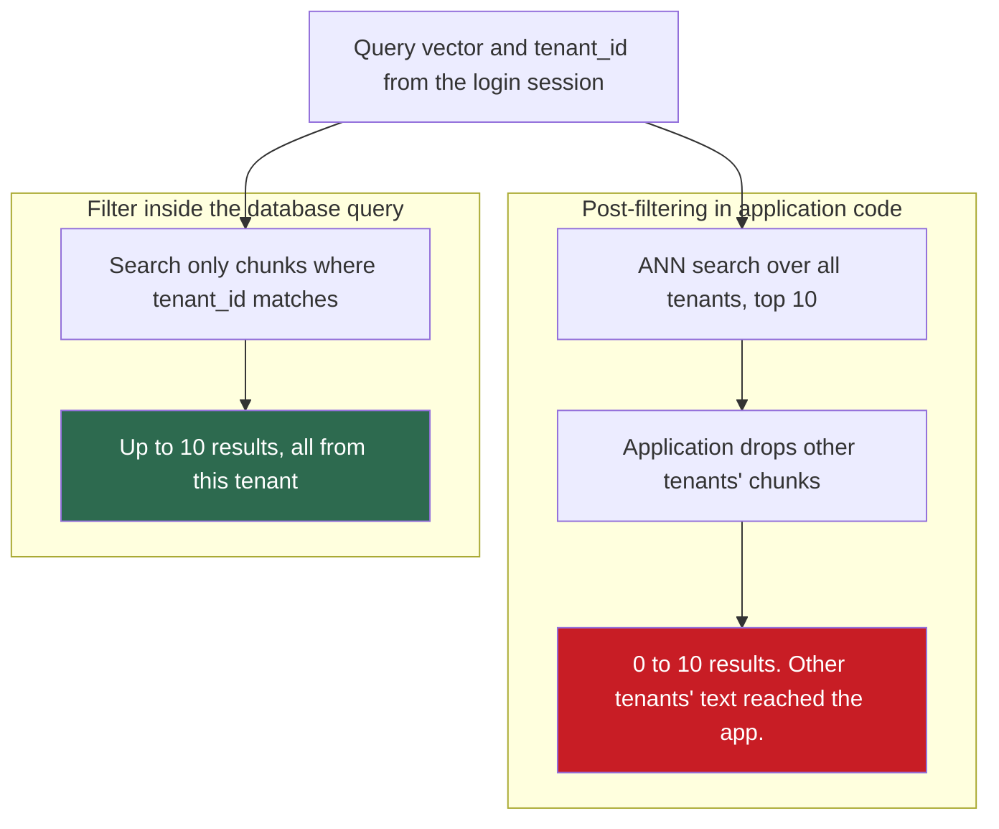

## 1. The question this idea answers

Stage 6 of the RAG pipeline finds the chunks nearest to the query vector (lesson [L4](/notes/ai/context-engineering/04-write-and-rag/l4-the-rag-pipeline)). With 71 chunks, a loop over all of them is instant. With 10 million chunks, a loop over all of them is slow and needs a lot of memory.

How do vector indexes find near neighbors fast, and what do they lose in exchange? What is the difference between a vector library and a vector database? How do filters, for example "only this customer's documents", interact with the index? And when is a chunk "similar enough" to use?

## 2. Mental model

> [!analogy] Finding the nearest café in a country
> - **Exact search:** measure the distance to every café in the country, then take the nearest one. It is always right and always slow.
> - **IVF:** the country has districts. First find the few districts nearest to you, then measure only the cafés in those districts.
> - **HNSW:** a road network with highways and local streets. Start on the highway, leave it near your target, then take local streets to the nearest café.
>
> **Where it stops working:** a vector space has hundreds of dimensions, not two. In such a space, "the nearest district" can miss a café just across its border. The greedy road search can also stop at a place that only looks best. So the result is approximate, and the size of the error must be measured, as recall.

## 3. Terms

| Term | Plain meaning |
|---|---|
| k-nearest-neighbor search (k-NN) | Finding the $k$ stored vectors that are nearest to a query vector. |
| exact search | k-NN search that compares the query with every stored vector. It always returns the true nearest neighbors. |
| approximate nearest neighbor search (ANN) | k-NN search that compares the query with only part of the stored vectors. It is faster and can miss some true neighbors. |
| ANN recall | The share of the true $k$ nearest neighbors that an approximate index returns. |
| centroid | The mean of a group of vectors. It stands for the whole group in a fast first comparison. |
| k-means | A clustering method that places a chosen number of centroids and assigns each vector to its nearest centroid, in repeated rounds. |
| inverted file index (IVF) | An ANN index that groups the vectors into cells around centroids and searches only the cells nearest to the query. |
| nlist | The number of cells in an IVF index. |
| nprobe | The number of cells that an IVF search scans for one query. |
| HNSW | Hierarchical navigable small world: an ANN index that links each vector to near neighbors in a stack of graph layers. A search moves greedily from the top layer down. |
| ef_search | The size of the candidate list during an HNSW query. A larger value gives higher recall and slower queries. |
| vector library | Code that builds and searches vector indexes inside one program, for example FAISS. It has no storage service, access control or API of its own. |
| vector database | A service that stores vectors with their text and metadata, keeps them on disk, updates and deletes them, filters them and serves queries. |
| metadata filter | A condition on stored fields, for example a tenant ID or a date, that a result must meet. |
| post-filtering | Running the vector search first and dropping the results that fail the filter afterwards. |
| pre-filtering | Restricting the search to the vectors that pass the filter, before or during the vector search. |
| multi-tenancy | One system that serves several customers (tenants), each of whom must see only their own data. |
| similarity threshold | A minimum similarity, or a maximum distance, that a chunk must meet to be used. |

## 4. Method and math

### 4.1 Exact search and its cost

Exact search computes the distance from the query to every stored vector and keeps the $k$ best. Its work and memory are:

$$
\text{work per query} \approx N \cdot d, \qquad \text{memory} = N \cdot d \cdot b
$$

The symbols mean:

- $N$ is the number of stored vectors.
- $d$ is the vector dimension.
- $N \cdot d$ counts multiply-add operations: one for each value of each stored vector.
- $b$ is the bytes for each value: 4 for 32-bit floats.

> [!example] Worked example: exact search at two sizes
> **1 million chunks** with `text-embedding-3-small` vectors ($d = 1{,}536$):
>
> - Work: $10^6 \times 1{,}536 = 1.536 \times 10^9$ multiply-adds for each query.
> - Memory: $10^6 \times 1{,}536 \times 4 = 6.144 \times 10^9$ bytes, about 6.1 GB.
>
> **10 million chunks:** $1.536 \times 10^{10}$ multiply-adds and about 61 GB, for every single query.

Exact search is not wrong. It is the reference that every other method is measured against. pgvector uses it by default: "By default, pgvector performs exact nearest neighbor search, which provides perfect recall." For a prototype with tens of thousands of chunks, a NumPy matrix product is often fast enough. Measure it before you add an index.

### 4.2 Approximate search and ANN recall

An approximate index compares the query with a small part of the vectors. It can miss a true neighbor. The quality measure is:

$$
\text{ANN recall@}k = \frac{\lvert A_k \cap E_k \rvert}{k}
$$

The symbols mean:

- $A_k$ is the set of $k$ results of the approximate index.
- $E_k$ is the set of $k$ results of exact search for the same query.
- $\lvert A_k \cap E_k \rvert$ is the number of results that the two sets share.

> [!example] Worked example: one query
> Exact search returns 10 chunks. The HNSW index returns 10 chunks, and 9 of them are in the exact list. ANN recall@10 $= 9/10 = 0.9$. Average this over a few hundred queries to compare index settings.

Do not confuse ANN recall with the retrieval recall of Part 5. ANN recall compares the index with exact search. Retrieval recall compares the results with the chunks that truly answer the question. An index with ANN recall 1.0 can still miss the right chunk, if the embedding model ranks it low.

### 4.3 The IVF index

An inverted file index works in two phases. FAISS describes the idea: "We define Voronoi cells in the d-dimensional space, and each database vector falls in one of the cells."

1. **Build.** Run k-means on a sample of vectors to find `nlist` centroids. Put each vector into the list of its nearest centroid.
2. **Query.** Compare the query with the `nlist` centroids. Scan only the vectors in the `nprobe` nearest cells.

If the cells are about equal in size, the number of comparisons per query is:

$$
\text{comparisons} \approx \text{nlist} + \text{nprobe} \cdot \frac{N}{\text{nlist}}
$$

> [!example] Worked example: IVF on 1 million vectors
> $N = 1{,}000{,}000$, $\text{nlist} = 1{,}000$, $\text{nprobe} = 10$.
>
> - Centroid comparisons: 1,000.
> - Vectors in 10 cells: $10 \times 1{,}000{,}000 / 1{,}000 = 10{,}000$.
> - Total: 11,000 comparisons, which is 1.1% of exact search, about 91 times fewer.

The cost is recall. A true neighbor near the border of a cell can sit in a cell that the search does not scan. A larger `nprobe` scans more cells: higher recall, slower queries. With `nprobe = nlist`, IVF becomes exact search. FAISS comes from this line of work (Johnson, Douze and Jégou, "Billion-scale similarity search with GPUs", arXiv 1702.08734).

### 4.4 The HNSW index

Malkov and Yashunin describe HNSW as a "hierarchical set of proximity graphs (layers) for nested subsets of the stored elements" (arXiv 1603.09320). A search has five steps:

1. Each stored vector is a node, linked to a few near neighbors. The bottom layer holds all nodes. Each higher layer holds a smaller random subset.
2. The search starts at an entry node in the top layer.
3. In a layer, it moves to the linked neighbor that is nearest to the query. It repeats this until no neighbor is nearer.
4. It goes one layer down from that node and repeats step 3.
5. In the bottom layer, it keeps a list of the best `ef_search` candidates, and returns the best $k$ of them.

The higher layers act as highways: few nodes, long jumps. The paper reports that search time grows about logarithmically with $N$.

| Setting | What it controls | Chroma 1.5.9 default |
|---|---|---|
| Links per node (`M` in the paper, `max_neighbors` in Chroma) | Memory and recall. More links give better recall and a larger index. | 16 |
| `ef_construction` | The candidate list while the index is built. A larger value gives a better graph and a slower build. | 100 |
| `ef_search` | The candidate list during a query. A larger value gives higher recall and slower queries. | 100 |

The Chroma defaults were read from a new collection on 2026-10-12. Chroma accepts other values at creation, for example `configuration={"hnsw": {"space": "cosine", "ef_search": 50}}`.

pgvector offers both index types. Its README compares them: HNSW has a better speed–recall trade-off but builds more slowly and uses more memory. IVFFlat builds faster and uses less memory.

### 4.5 Libraries and databases

FAISS is a library, not a database. Its paper says: "Faiss is a toolkit of indexing methods and related primitives used to search, cluster, compress and transform vectors" (Douze et al., arXiv 2401.08281). FAISS builds and searches indexes inside your program. A database adds what production needs:

1. Storage on disk, with the text and metadata next to each vector.
2. Inserts, updates and deletes while queries run.
3. Metadata filters inside the search.
4. Access control, an API, replication and backups.

The handbook FAQ (Session 3, Q35) states this correctly.

| System | What it is |
|---|---|
| FAISS | A library of exact and approximate index types (flat, IVF, HNSW, compressed). You add storage, filters, updates and access control yourself. |
| Chroma | An open-source vector database that can run inside the Python process. HNSW index, squared L2 by default, MiniLM as the default embedding function. |
| pgvector | A PostgreSQL extension. Vectors live next to relational data and are queried with SQL. Exact search by default, HNSW and IVFFlat indexes. |
| Qdrant | An open-source vector database. It applies filters during the HNSW search. |
| Pinecone | A managed vector database service. |
| Weaviate | An open-source vector database with a managed cloud option. |
| Milvus | An open-source vector database that can run as a distributed cluster. |

Facts about pgvector that matter for design (README, v0.8.7, checked on 2026-10-12):

- Operators: `<->` for L2 distance, `<#>` for negative inner product, `<=>` for cosine distance.
- An index on the `vector` type supports up to 2,000 dimensions. The `halfvec` type (16-bit values) supports up to 4,000.
- So 3,072-dimensional `text-embedding-3-large` vectors need `halfvec`, or the `dimensions` parameter to shorten them (lesson [L6](/notes/ai/context-engineering/04-write-and-rag/l6-embeddings-and-similarity)).

The handbook FAQ (Session 3, Q41) says that pgvector "starts to lag behind dedicated vector databases above roughly 5–10 million vectors". This is a rule of thumb with no source. Its advice is sound: if you already run PostgreSQL, start with pgvector, and measure recall and latency at your real size.

### 4.6 Metadata filters: inside the search, not after it

A filter such as "tenant = acme" or "date ≥ 2026-01-01" can run in two places.



Qdrant's article on filtering names the two problems. Post-filtering: "If many of the top results fail, you get fewer results than you asked for." Pre-filtering: "Results are exact, but scoring every match is expensive when many points pass the filter." Qdrant itself filters during the HNSW search.

> [!example] Worked example: post-filtering a small tenant
> A tenant owns 1% of the chunks in a shared index. Assume that the similarity to a query does not depend on the tenant. The application takes the top 10 over all tenants and then drops the other tenants' chunks.
>
> - Expected chunks of this tenant in the top 10: $10 \times 0.01 = 0.1$.
> - Probability of at least one: $1 - 0.99^{10} = 0.096$, so about 9.6%.
> - To get 10 chunks of this tenant on average, the application must fetch about $10 / 0.01 = 1{,}000$ results.
>
> So post-filtering returns nothing for this tenant about 90% of the time.

Approximate indexes can show the same problem inside a database. pgvector's README says that with an approximate index, filtering happens after the index scan, so a query can return fewer rows than its limit. Version 0.8 added iterative index scans, for example `SET hnsw.iterative_scan = strict_order;`, which scan further until enough rows pass. In Chroma, pass the condition as `where={...}` in the query.

### 4.7 The multi-tenant leak

The handbook FAQ (Session 3, Q28) gives the right rule for a shared index: "you must ensure the filter is applied at the database level, not post-retrieval, to prevent data leakage." Post-filtering has two problems. The first is the empty results of section 4.6. The second is security: the other tenants' chunks already reached your application. One missed check, a debug log, a cache or a reranker can then send them to the model or to a log file.

Rules for a shared index:

1. Put the tenant filter inside the database query.
2. Take the tenant ID from the authenticated session. Never take it from the model, the prompt or the user's text.
3. Allow only one search function to reach the index, and make the tenant ID a required argument of it.
4. Test it. Random queries from tenant A must never return a chunk of tenant B.

The other design is one collection or namespace for each tenant (handbook FAQ, Session 3, Q28). It gives full isolation, at the cost of more collections to manage.

> [!trap] Tenant isolation is not ISOLATE
> The handbook FAQ (Session 3, Q28) says that tenant filtering "connects directly to the ISOLATE principle". The words are similar, but the problems differ. ISOLATE splits one task across several context windows (lesson [L1](/notes/ai/context-engineering/04-write-and-rag/l1-four-strategies)). Tenant isolation is access control: it decides which data may ever enter a window.

### 4.8 Similarity thresholds belong to one model and one metric

Top-k always returns $k$ chunks (lesson 4.4). A threshold lets the system say "no relevant document found" instead of passing weak chunks to the model.

> [!note] Source check: "a cosine similarity of, say, 0.75"
> **Corrected.** The handbook FAQ (Session 3, Q10) suggests to "retrieve all chunks above a cosine similarity of, say, 0.75". The handbook lecture (Session 3, §10.1.3) treats a distance of 0.9 as poor. Both numbers depend on the model and the metric. Each embedding model spreads its similarity scores differently. A Chroma distance of 0.9 is a cosine of 0.55 with the default squared L2, and 0.1 with the cosine metric (lesson 4.6). Calibrate thresholds on your own data. Source: Chroma docs, checked on 2026-10-12.

To calibrate a threshold:

1. Collect 100 to 200 pairs of a query and a chunk, and label each pair "relevant" or "not relevant".
2. Compute the similarity of each pair with your model and your metric.
3. Plot the two groups of scores. Choose the threshold that gives the precision you need.
4. Repeat the calibration after every change of model, metric or chunking.

The handbook FAQ (Session 3, Q33) suggests a monitoring signal: the average similarity of the top results over time. A falling trend can mean that user questions are less and less similar to the corpus. Compare it with your own baseline, never with a number from another model.

### 4.9 From prototype to production

The handbook FAQ (Session 3, Q50) says it well: the principles stay the same, and only the infrastructure changes.

| Item | Prototype | Production |
|---|---|---|
| Storage | In memory | On disk, with backups and a plan to rebuild |
| Index | Exact search or default HNSW | Index settings chosen by measured ANN recall and latency |
| Filters | Optional | Inside the database query, with tests for tenant isolation |
| Updates | Rebuild everything | Incremental sync (lesson 4.4) |
| Model | One model, no record | Model name and version stored with the index |
| Monitoring | None | Latency percentiles, ANN recall on a sample, retrieval metrics (Part 5) |

> [!note] Source check: scale numbers in the handbook FAQ
> **Unsupported.** The handbook FAQ (Session 3, Q25) says that ChromaDB "tops out at a few million vectors on a single machine" and that dedicated databases handle "billions of vectors with sub-100ms query latency". FAQ Q4 recommends ChromaDB for "datasets under a few hundred thousand documents". None of these numbers has a source. Capacity depends on the dimension, the index settings, the hardware and the filters. Measure your own system at your real size.

### 4.10 Production view

| Concern | What this lesson means for it |
|---|---|
| Latency | Approximate indexes cut the work per query by orders of magnitude. Tune `nprobe` or `ef_search` against a latency target. |
| Quality | Measure ANN recall against exact search on a sample of queries. Keep it separate from retrieval recall. |
| Memory | Raw vectors need $N \cdot d \cdot 4$ bytes, and the index needs more. Shorter or 16-bit vectors reduce it. |
| Security | Filter tenants inside the database query. Take the tenant ID from the login session. Test for leaks. |
| Reliability | A database gives storage, updates and backups. A library gives only the index. |
| Observability | Log the distances of the top results. Calibrate thresholds for each model and metric, and watch their trend. |

## 5. Code

These exercises go in `notebooks/04-write-and-rag.ipynb`. They run locally and cost nothing, except Exercise 7.5.

**Exercise 7.1: exact search and its cost.**

1. Make random unit vectors with $d = 384$ for $N$ = 10,000, 100,000 and 1,000,000.
2. Write `exact_topk(Q, X, k)` with one matrix product and `np.argpartition`.
3. Time 100 queries at each size, and print the memory of `X`.

Acceptance tests:

- The results equal those of a slow loop over all vectors, for 10 queries at $N$ = 10,000.
- A table with the size, the time per query and the memory.

**Exercise 7.2: IVF from scratch.**

1. Write a small k-means with NumPy, or use `sklearn.cluster.KMeans`.
2. Build an IVF index with `nlist` = 100 on 100,000 vectors.
3. Search with `nprobe` = 1, 5, 20 and 100.

Acceptance tests:

- A table with `nprobe`, the share of vectors scanned and ANN recall@10 against Exercise 7.1.
- With `nprobe` = 100, ANN recall@10 is 1.0.

**Exercise 7.3: tune HNSW in Chroma.**

1. Create three Chroma collections with `ef_search` = 10, 50 and 100, and the cosine space.
2. Add the same 50,000 random unit vectors to each one.
3. Run 200 queries on each collection.

Acceptance test: a table of `ef_search`, the mean query time and ANN recall@10 against exact search.

**Exercise 7.4: a tenant-safe search.**

1. Put chunks of three tenants into one Chroma collection with a `tenant_id` field.
2. Write `search(session, question, k)`, which reads the tenant ID only from `session` and always passes `where={"tenant_id": ...}`.
3. Write a second function that post-filters, for comparison.

Acceptance tests:

- Over 1,000 random queries, `search` never returns a chunk of another tenant.
- For a tenant with 1% of the chunks, the post-filter version returns fewer than $k$ results on most queries.

**Exercise 7.5 (optional): pgvector.** If Docker is available, run PostgreSQL with pgvector. Store the chunks of Exercise 4.1 with an HNSW index and the cosine operator `<=>`. Run a filtered query, then repeat it with `SET hnsw.iterative_scan = strict_order;`.

Acceptance test: a note that compares the row counts of the two runs and explains the difference, or explains why there is none.

## 6. Common mistakes

1. **"FAISS is a vector database."** It is a library. Storage, updates, filters and access control are your job.
2. **"The index returns the true nearest neighbors."** HNSW and IVF are approximate. Measure ANN recall, and tune `ef_search` or `nprobe`.
3. **"We can filter by tenant after retrieval."** The results can be empty, and other tenants' text reaches your application. Filter inside the database query.
4. **"0.75 is a good similarity threshold."** Only for one model and one metric. Calibrate it on labeled pairs.
5. **"A higher ef_search is free."** It raises recall and also the query time. Choose it against a latency target.
6. **"Our 50,000 chunks need a vector database for speed."** Exact search over 50,000 vectors is often fast enough. Measure first, and add an index for a reason.
7. **"A 3,072-dimensional vector fits any pgvector index."** The `vector` type indexes up to 2,000 dimensions. Use `halfvec` or shorter vectors.

## 7. One-minute explanation

Retrieval needs the k stored vectors nearest to the query. Exact search compares the query with every vector, so its work grows with the number of vectors times the dimension. That is fine for a small corpus and too slow for millions. Approximate indexes compare the query with far fewer vectors. IVF groups the vectors into cells and scans only the nearest cells. HNSW links each vector to its neighbors in layered graphs and walks greedily toward the query. Both trade a little recall for speed, so measure ANN recall against exact search. FAISS is a library of such indexes, and a database adds storage, updates, filters and access control. Tenant filters must run inside the database query, or other customers' data can leak. Similarity thresholds belong to one model and one metric, so calibrate them on your own labeled pairs.

## 8. Check questions

```check
{
  "question": "An index holds 5 million vectors with 768 dimensions as 32-bit floats. How much memory do the raw vectors need, and how many multiply-adds does exact search need for one query?",
  "hint": "Memory = N · d · 4 bytes. Work ≈ N · d.",
  "answer": "Memory: 5,000,000 × 768 × 4 = 15,360,000,000 bytes, about 15.4 GB. Work: 5,000,000 × 768 = 3.84 × 10^9 multiply-adds per query."
}
```

```check
{
  "question": "An IVF index has N = 2,000,000 vectors, nlist = 2,000 and nprobe = 20. About how many comparisons does one query need, and what share of exact search is that?",
  "hint": "comparisons ≈ nlist + nprobe · N / nlist.",
  "answer": "2,000 centroid comparisons + 20 × 1,000 = 20,000 vector comparisons, so 22,000 in total. That is 1.1% of the 2,000,000 comparisons of exact search, about 91 times fewer."
}
```

```check
{
  "question": "A tenant owns 2% of a shared index. The application takes the top 5 over all tenants and then removes other tenants' chunks. How many of this tenant's chunks does a query return on average, and how often does it return at least one?",
  "answer": "Expected: 5 × 0.02 = 0.1 chunks. At least one: 1 − 0.98^5 ≈ 0.096, so about 9.6% of queries. About 90% of queries return nothing for this tenant, and the other tenants' chunks already reached the application."
}
```

```check
{
  "question": "A team says: 'We use FAISS as our vector database.' What do they have, and what is missing?",
  "answer": "They have a library that builds and searches indexes inside their program. It does not give storage of text and metadata, inserts and deletes during queries, metadata filters, access control, an API, replication or backups. They must build these themselves, or use a vector database."
}
```

```check
{
  "question": "A pgvector query with an HNSW index, WHERE tenant_id = 42 and LIMIT 10 returns only 3 rows, although the tenant has thousands of chunks. Why, and what pgvector feature helps?",
  "answer": "With an approximate index, pgvector applies the filter after the index scan. The scan returns its candidates, most of them belong to other tenants and are dropped, so fewer rows than the limit remain. Iterative index scans (pgvector 0.8 and later), for example SET hnsw.iterative_scan = strict_order, keep scanning until enough rows pass the filter."
}
```

```check
{
  "question": "A team moves from all-MiniLM-L6-v2 to text-embedding-3-small and keeps its threshold 'cosine ≥ 0.75'. Recall drops sharply. What went wrong?",
  "answer": "The threshold belongs to the old model. Each model spreads its similarity scores differently, so 0.75 can be a strong match for one model and a weak cut-off for another. Calibrate a new threshold on labeled relevant and non-relevant pairs with the new model and metric."
}
```

## 9. Links

- Previous: [L6: Embeddings and similarity](/notes/ai/context-engineering/04-write-and-rag/l6-embeddings-and-similarity)
- Interview practice: [Hard questions: Write and RAG](/notes/ai/context-engineering/04-write-and-rag/hard-questions)
- [L4: The RAG pipeline](/notes/ai/context-engineering/04-write-and-rag/l4-the-rag-pipeline): top-k always returns k results
- [Part 5: Retrieval quality](/notes/ai/context-engineering/05-retrieval-quality): hybrid search, rerankers and retrieval recall
- [Glossary](/notes/ai/context-engineering/glossary)
