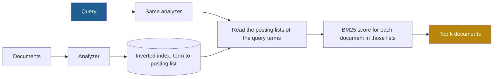

## 1. The question this idea answers

A user of a support bot types "error 4012". The vector search of Part 4 returns three chunks about printer errors in general. The one chunk that explains error 4012 is at rank 9. Why does a search that "understands meaning" miss the one exact match?

An embedding puts the meaning of a text into one vector. The code "4012" is a small part of that meaning, so two chunks about printer errors look almost the same to it. Anthropic gives the same example: a user who queries "Error code TS-999" in a technical support database. Embedding search can return general content about error codes and miss the exact match.

Keyword search solves the other half of the problem. It ranks documents by the exact words that they share with the query. BM25 is the standard ranking function for keyword search. This lesson builds it from first principles, so that I can compute a score by hand and know when to use it.

## 2. Mental model

> [!analogy] The index at the back of a textbook
> A textbook index lists each word and the pages where it appears. To answer "error 4012", you read the entries for "error" and "4012" and go to those pages. You do not read the whole book.
>
> Three rules make a good reader of that index:
>
> 1. **Rare words tell you more.** "4012" is on one page. "The" is on every page. A match on "4012" is strong evidence. A match on "the" is no evidence.
> 2. **Repeats help, but less and less.** A page that says "error" three times is probably more about errors than a page that says it once. It is not three times more about errors.
> 3. **Long pages match by chance.** A 20-page chapter contains "error" somewhere just because it is long. A short page that contains "error" is more focused.
>
> BM25 turns these three rules into one formula.
>
> **Where it stops working:** the index knows only words, not meaning. "Login" and "sign-in" are two unrelated entries. Word order also does not count: "dog bites man" and "man bites dog" have the same entries.

## 3. Terms

| Term | Plain meaning |
|---|---|
| lexical retrieval | Retrieval that matches the exact words (terms) of the query against the words of the documents. |
| sparse retrieval | Another name for lexical retrieval. A document is a vector with one slot for each word of the vocabulary, and almost all slots are 0. |
| dense retrieval | Retrieval that compares embedding vectors, where every slot holds a number (Part 4). |
| term | One unit that the index stores, usually a word after lowercasing and other clean-up. |
| analyzer | The steps that turn raw text into terms: split, lowercase, and optionally remove stop words and stem. The same analyzer must run on documents and queries. |
| stemming | Cutting a word to a common root, so that "validated" and "validation" can match. |
| stop word | A very frequent word such as "the" or "is" that some analyzers remove. |
| inverted index | A map from each term to the list of documents that contain it, with the count in each document. |
| posting list | The list of documents for one term in an inverted index. |
| term frequency, $f(q, D)$ | How many times term $q$ appears in document $D$. |
| document frequency, $n(q)$ | How many documents in the collection contain term $q$ at least once. |
| inverse document frequency (IDF) | A weight that is high for rare terms and close to 0 for terms that almost every document contains. |
| BM25 | A ranking function that scores a document by the query terms it contains, with IDF weights, term-frequency saturation and length normalization. "Okapi BM25" is its full name. |
| $k_1$ | The BM25 parameter that controls how fast extra repeats of a term stop adding to the score. |
| $b$ | The BM25 parameter that controls how strongly a long document is penalized, from 0 (no penalty) to 1 (full penalty). |
| avgdl | The average document length in terms, over the whole collection. |
| bag of words | A model of text that keeps only which words appear and how often, not their order. |
| vocabulary mismatch | The query and the relevant document use different words for the same idea, so lexical retrieval finds no match. |

## 4. Method and math

### 4.1 From "contains the word" to a ranking

The simplest keyword search is a filter: return every document that contains all query words. This fails in two ways. A common word returns thousands of documents with no order. A document that misses one query word disappears, even if it is the best answer.

A **ranking function** solves both problems. It gives each document a number, and the search returns the top $k$ documents by that number. A document can rank high with only some of the query words. BM25 is that ranking function for lexical retrieval.

### 4.2 The inverted index

The index makes keyword search fast. During indexing, the analyzer turns each document into terms. The index stores, for each term, its posting list.

> [!example] Worked example: the index of three documents
> The analyzer lowercases the text and splits it at every character that is not a letter or a digit.
>
> - D1: "Error 4012: the paper tray is open." → 7 terms.
> - D2: "Error codes: each error has a code. Read the error log." → 11 terms.
> - D3: "After an update, restart the printer to clear any error and print a test page." → 15 terms.
>
> Part of the inverted index:
>
> | Term | Posting list (document: count) | $n(q)$ |
> |---|---|---|
> | error | D1: 1, D2: 3, D3: 1 | 3 |
> | 4012 | D1: 1 | 1 |
> | the | D1: 1, D2: 1, D3: 1 | 3 |
> | printer | D3: 1 | 1 |
>
> The average length is $\text{avgdl} = (7 + 11 + 15) / 3 = 11$ terms.

At query time, the search reads only the posting lists of the query terms. A query with two terms reads two lists, even if the collection holds millions of documents. This is why keyword search on a large collection takes milliseconds.



### 4.3 The BM25 formula

This is Okapi BM25 in the form that most libraries use (Robertson and Zaragoza, 2009):

$$
\text{score}(D, Q) = \sum_{q \in Q} \text{IDF}(q) \cdot \frac{f(q, D)\,(k_1 + 1)}{f(q, D) + k_1 \left(1 - b + b\,\dfrac{\lvert D \rvert}{\text{avgdl}}\right)}
$$

The symbols mean:

- $Q$ is the query, as a set of terms after the analyzer. $q$ is one query term.
- $D$ is one document. $\lvert D \rvert$ is its length in terms.
- $f(q, D)$ is the term frequency of $q$ in $D$.
- $\text{avgdl}$ is the average document length in the collection.
- $k_1$ controls term-frequency saturation (section 4.5).
- $b$ controls length normalization (section 4.6).
- $\text{IDF}(q)$ is the weight of the term (section 4.4).

A query term that is not in $D$ has $f(q, D) = 0$, so it adds 0. The factor $(k_1 + 1)$ is the same for every document, so it does not change the ranking. It only scales the score so that one occurrence in a document of average length gives a factor of exactly 1.

### 4.4 IDF: rare terms count more

Lucene, the search library under Elasticsearch and OpenSearch, uses this IDF:

$$
\text{IDF}(q) = \ln\!\left(1 + \frac{N - n(q) + 0.5}{n(q) + 0.5}\right)
$$

The symbols mean:

- $N$ is the number of documents in the collection.
- $n(q)$ is the document frequency of $q$.
- $\ln$ is the natural logarithm.

> [!example] Worked example: IDF in a collection of 1,000,000 documents
> | Documents that contain the term, $n(q)$ | IDF |
> |---|---|
> | 1 | 13.41 |
> | 1,000 | 6.91 |
> | 100,000 | 2.30 |
> | 500,000 | 0.69 |
> | 900,000 | 0.11 |
> | 1,000,000 | almost 0 |
>
> Compare a term in one document with a term in half of the documents. A match on the rare term is worth about 19 times more ($13.41 / 0.69$).

The "1 +" inside the logarithm keeps the IDF positive. The original Robertson–Spärck Jones form has no "1 +". In that form, a term that is in more than half of the documents gets a **negative** weight.

> [!trap] Libraries use different IDF formulas
> The Python package `rank_bm25` (version 0.2.2, `BM25Okapi`) uses $\ln\frac{N - n + 0.5}{n + 0.5}$, without "1 +". When that value is negative, the library replaces it with `epsilon` × the average IDF, with `epsilon = 0.25` by default. Its default is also $k_1 = 1.5$, not 1.2. So `rank_bm25` and Lucene give different scores for the same documents. Know which formula your library uses before you compare numbers (checked on 2026-10-12).

### 4.5 Saturation: the parameter $k_1$

Take one term in a document of average length, so that $\lvert D \rvert = \text{avgdl}$. The term-frequency part of the formula becomes:

$$
\frac{f\,(k_1 + 1)}{f + k_1}
$$

Here $f$ is the term frequency. This part grows with $f$, but it can never pass $k_1 + 1$. That limit is **saturation**.

> [!example] Worked example: repeats with $k_1 = 1.2$
> | Term frequency $f$ | $\frac{2.2 f}{f + 1.2}$ |
> |---|---|
> | 1 | 1.000 |
> | 2 | 1.375 |
> | 3 | 1.571 |
> | 5 | 1.774 |
> | 10 | 1.964 |
> | 100 | 2.174 |
>
> The third occurrence adds 0.196. The tenth adds much less. A document cannot win only because it repeats one word 100 times.

A small $k_1$ saturates fast: one occurrence gives almost the full value. A large $k_1$ keeps rewarding repeats for longer. With $k_1 = 0$, the term-frequency part is 1 for any $f > 0$, so BM25 only checks presence.

### 4.6 Length normalization: the parameter $b$

The denominator holds the length factor:

$$
K = k_1 \left(1 - b + b\,\frac{\lvert D \rvert}{\text{avgdl}}\right)
$$

$K$ replaces $k_1$ in the saturation formula of section 4.5. A long document gets a larger $K$, so each occurrence of a term counts for less.

- $b = 0$: no length normalization. $K = k_1$ for every document.
- $b = 1$: full normalization. $K$ grows in direct proportion to the length.
- $b = 0.75$: the Lucene default, between the two.

Lucene's defaults are $k_1 = 1.2$ and $b = 0.75$. Robertson and Zaragoza give no single fixed value. They write that values in the ranges $0.5 < b < 0.8$ and $1.2 < k_1 < 2$ "are reasonably good in many circumstances". Tune them on your own labeled queries (lesson [5.8](/notes/ai/context-engineering/05-retrieval-quality/l8-measure-retrieval)).

### 4.7 A full score by hand

> [!example] Worked example: the query "error 4012" on D1, D2 and D3
> Use the index of section 4.2, $N = 3$, $\text{avgdl} = 11$, $k_1 = 1.2$, $b = 0.75$.
>
> **Step 1: IDF of each query term.**
>
> - "error" is in 3 documents: $\ln\left(1 + \frac{3 - 3 + 0.5}{3 + 0.5}\right) = \ln(1.1429) = 0.1335$.
> - "4012" is in 1 document: $\ln\left(1 + \frac{3 - 1 + 0.5}{1 + 0.5}\right) = \ln(2.6667) = 0.9808$.
>
> **Step 2: the length factor $K$ of each document.**
>
> - D1: $1.2 \times (0.25 + 0.75 \times 7/11) = 1.2 \times 0.7273 = 0.8727$.
> - D2: $1.2 \times (0.25 + 0.75 \times 11/11) = 1.2 \times 1 = 1.2$.
> - D3: $1.2 \times (0.25 + 0.75 \times 15/11) = 1.2 \times 1.2727 = 1.5273$.
>
> **Step 3: the term-frequency part, $\frac{2.2 f}{f + K}$.**
>
> - D1, "error" ($f = 1$): $2.2 / 1.8727 = 1.1748$. D1, "4012" ($f = 1$): also 1.1748.
> - D2, "error" ($f = 3$): $6.6 / 4.2 = 1.5714$. D2 has no "4012".
> - D3, "error" ($f = 1$): $2.2 / 2.5273 = 0.8705$. D3 has no "4012".
>
> **Step 4: multiply by IDF and add.**
>
> | Document | "error" | "4012" | Score |
> |---|---|---|---|
> | D1 | $0.1335 \times 1.1748 = 0.1569$ | $0.9808 \times 1.1748 = 1.1522$ | **1.3091** |
> | D2 | $0.1335 \times 1.5714 = 0.2098$ | 0 | **0.2098** |
> | D3 | $0.1335 \times 0.8705 = 0.1162$ | 0 | **0.1162** |
>
> D1 wins by a factor of more than 6, because it holds the rare term. All three effects are visible:
>
> 1. **IDF:** "4012" contributes more than 7 times as much as "error" in D1.
> 2. **Saturation:** D2 says "error" 3 times, but its "error" part is only 1.34 times the part of D1.
> 3. **Length:** D1 and D3 both say "error" once. D3 is longer, so its part is 0.8705 against 1.1748.

With the query "error" alone, the order changes: D2 (0.2098), then D1 (0.1569), then D3 (0.1162). Then term frequency decides, because no rare term separates the documents.

> [!note] Source check: BM25 in the handbook
> **Corrected.** The handbook (Session 3, §7.2 and FAQ Q8) describes BM25 only as "a term-frequency-based scoring algorithm", weighted by term frequency and inverse document frequency. It gives no formula, no parameters and no length normalization. The exact form is above. Sources: Robertson and Zaragoza, "The Probabilistic Relevance Framework: BM25 and Beyond" (2009), and the Lucene `BM25Similarity` docs, checked on 2026-10-12.

### 4.8 The analyzer decides what can match

BM25 can only match terms that the analyzer produced. A wrong analyzer breaks the exact matches that are the reason to use BM25.

| Text | Analyzer choice | Effect |
|---|---|---|
| "TS-999" | Split at every non-alphanumeric character | Two terms, "ts" and "999". A query for "TS-998" still matches "ts" in every TS error. |
| "TS-999" | Keep hyphenated codes as one term | One term "ts-999". Only that exact code matches. |
| "validation" vs "validated" | No stemming | No match for this pair. For the handbook's query "How does JWT token validation work?", only "jwt" matches "JWT tokens are validated". |
| "validation" vs "validated" | Stemming to "valid" | Match. But stemming can also merge words with different meanings. |
| "The", "is" | Stop-word removal | Smaller index. A query such as "to be or not to be" loses all its terms. |

> [!trap] Run the same analyzer on both sides
> If the index lowercases and the query code does not, "Error" in the query never matches "error" in the index. Put the analyzer in one function and call it for documents and for queries.

### 4.9 When sparse wins and when dense wins

| Query type | Better retriever | Why |
|---|---|---|
| Exact IDs, order numbers, error codes ("TS-999", "4012") | Sparse | The ID is one rare term with a high IDF. In an embedding it is a small part of the meaning. |
| Product names, people, rare technical terms ("RS256", "JWT") | Sparse | Same reason. A new name may also be unknown to the embedding model. |
| Code identifiers (`get_user_by_id`) | Sparse, with an analyzer that keeps them whole | Exact strings matter in code. |
| Paraphrase ("I forgot my login" for a page about "password reset") | Dense | Vocabulary mismatch: the words differ, the meaning is the same. |
| Natural-language questions with few shared words | Dense | The embedding captures the meaning of the full sentence. |
| A query in one language, documents in another | Dense, with a multilingual model | Lexical matching needs the same words (lesson [5.9](/notes/ai/context-engineering/05-retrieval-quality/l9-beyond-basic-rag)). |

The handbook summarizes this well (Session 3, §7.1 and §7.2): dense retrieval misses exact keyword matches such as "JWT" and "RS256", and sparse retrieval has "no semantic understanding". Most real query sets hold both types. That is why lesson [5.2](/notes/ai/context-engineering/05-retrieval-quality/l2-hybrid-search-and-rrf) combines the two retrievers.

### 4.10 What BM25 scores mean, and what they do not mean

1. **A BM25 score has no fixed range.** It grows with the number of query terms and with their IDF. A score of 1.3 is high in the example above. In another collection, the top score can be 25.
2. **Scores are not comparable across queries.** A longer query gives larger scores. Do not use one fixed score threshold for all queries.
3. **Scores are not comparable with cosine similarity.** Cosine values are between −1 and 1. This is the main problem of lesson [5.2](/notes/ai/context-engineering/05-retrieval-quality/l2-hybrid-search-and-rrf).
4. **A score of 0 means no query term matched.** Dense retrieval always returns $k$ results, even when none is relevant. BM25 can return nothing.

### 4.11 Production view

| Concern | What this lesson means for it |
|---|---|
| Latency | The search reads only the posting lists of the query terms. It is fast even on a large collection. |
| Cost | No embedding model and no GPU. The index is cheap to build and to update. |
| Reliability | The analyzer is the main source of bugs. Test it on IDs, codes and mixed case. |
| Quality | Strong on exact terms, weak on paraphrase. Measure both query types (lesson [5.8](/notes/ai/context-engineering/05-retrieval-quality/l8-measure-retrieval)). |
| Updates | A new document needs only an index insert. The IDF of every term changes slightly, but no vectors need a re-embed. |
| Observability | Log the query terms after the analyzer. A query that lost its key term in the analyzer explains many misses. |

## 5. Graphs

```plot
{
  "title": "Term-frequency part at average length: k1 = 0.5 (gold), k1 = 1.2 (red), k1 = 2.0 (blue)",
  "xAxis": { "label": "term frequency f", "domain": [0, 20] },
  "yAxis": { "label": "f(k1 + 1) / (f + k1)", "domain": [0, 3.2] },
  "disableZoom": true,
  "data": [
    { "fn": "1.5*x/(x+0.5)", "color": "#B8860B" },
    { "fn": "2.2*x/(x+1.2)", "color": "#C81D25" },
    { "fn": "3*x/(x+2)", "color": "#1E6091" }
  ]
}
```

Each curve rises fast and then flattens toward its limit $k_1 + 1$: 1.5, 2.2 and 3.0. The term frequency is a whole number, so only the values at 1, 2, 3, … occur.

```plot
{
  "title": "Effect of length for one occurrence, k1 = 1.2: b = 0 (gold), b = 0.75 (red), b = 1 (blue)",
  "xAxis": { "label": "document length / avgdl", "domain": [0, 4] },
  "yAxis": { "label": "term-frequency part for f = 1", "domain": [0, 2.2] },
  "disableZoom": true,
  "data": [
    { "fn": "1", "color": "#B8860B" },
    { "fn": "2.2/(1.3+0.9*x)", "color": "#C81D25" },
    { "fn": "2.2/(1+1.2*x)", "color": "#1E6091" }
  ]
}
```

All curves pass through 1 at average length. With $b = 0.75$, a document of half the average length gets 1.257, and a document of twice the average length gets 0.710.

## 6. Code

These exercises go in `notebooks/05-retrieval-quality.ipynb`. Put the reusable BM25 code in `src/retrieval/bm25.py` and its tests in `tests/test_bm25.py`.

**Exercise 1.1: BM25 from scratch.**

1. Write `analyze(text) -> list[str]` that lowercases the text and splits it at characters that are not letters or digits.
2. Write a class `BM25` with `__init__(docs, k1=1.2, b=0.75)`. It builds an inverted index: a dictionary from each term to a dictionary of document IDs and counts.
3. Use the Lucene IDF of section 4.4.
4. Write `score(query, doc_id)` and `search(query, k)`. `search` must read only the posting lists of the query terms.

Acceptance tests:

- The three documents of section 4.2 give scores 1.3091, 0.2098 and 0.1162 for "error 4012" (to 4 decimals).
- The query "error" ranks D2, D1, D3.
- A query with no known term returns an empty list, not three results with score 0.
- `search` does not loop over all documents. Test this with a counter or a mock.

**Exercise 1.2: compare with `rank_bm25`.**

1. Install `rank_bm25`. Build `BM25Okapi` on the same three analyzed documents with `k1=1.2, b=0.75`.
2. Print its scores for "error 4012" next to yours.

Acceptance tests:

- `rank_bm25` gives about 0.683, 0.111 and 0.061. The order is the same as yours.
- A Markdown cell explains the difference with the IDF formulas of section 4.4. It names the query term whose raw IDF is negative.

**Exercise 1.3: the analyzer test.**

1. Add three documents that contain "TS-998", "TS-999" and "error TS".
2. Run the query "TS-999" with the analyzer of exercise 1.1. Then write a second analyzer that keeps codes with the pattern letters-hyphen-digits as one term.

Acceptance tests:

- With the first analyzer, a document that contains only "TS-998" gets a score above 0.
- With the second analyzer, only the "TS-999" document scores above 0.

**Exercise 1.4: sparse against dense on your own queries.**

1. Take 40 to 60 short documents from a real source, for example an internal FAQ or a product manual. Include some IDs and error codes.
2. Write 20 queries. Make 10 of them keyword queries (IDs, codes, names) and 10 of them paraphrase queries. For each query, write the ID of the document that answers it.
3. Run BM25 and a dense retriever with `sentence-transformers/all-MiniLM-L6-v2` (it runs locally and costs nothing).
4. For each retriever and each query type, count how many queries have their document in the top 5.

Acceptance tests:

- A 2 × 2 table: retriever × query type.
- One sentence for each column that explains the result with section 4.9.
- Save the queries and their document IDs in `data/queries.jsonl`. Lessons 5.2 and 5.8 reuse them.

## 7. Common mistakes

1. **"Embeddings make keyword search obsolete."** Embeddings miss exact IDs, codes and rare names. Anthropic's "TS-999" example shows the failure.
2. **"A document that repeats a word 10 times is 10 times more relevant."** Saturation limits the term-frequency part to $k_1 + 1$. With $k_1 = 1.2$, 10 occurrences give 1.96, not 10.
3. **"A BM25 score of 5 is good."** BM25 scores have no fixed range and change with the query length and the collection.
4. **"BM25 is the same in every library."** Lucene and `rank_bm25` use different IDF formulas and different default $k_1$.
5. **"The analyzer is a detail."** A split at the hyphen of "TS-999", or a missing lowercase step, destroys the exact match.
6. **"Common words help the match."** A term in almost every document has an IDF near 0. It adds almost nothing.

## 8. One-minute explanation

Keyword search ranks documents by the exact words that they share with the query. An inverted index maps each word to the documents that contain it, so a search reads only a few lists. BM25 scores each document with three ideas. First, rare words count more: the IDF weight is high for a word in few documents. It is near zero for a word in all of them. Second, repeats help less and less: the parameter k1 makes the term-frequency part flatten toward k1 + 1. Third, long documents get a penalty: the parameter b scales the effect of length. Lucene uses k1 = 1.2 and b = 0.75. BM25 is strong for IDs, error codes and rare names, where embeddings are weak. It fails when the query and the document use different words for the same idea. So production systems usually combine BM25 with dense retrieval.

## 9. Check questions

```check
{
  "question": "A collection has N = 1,000 documents. The term \"refund\" is in 9 documents. What is its Lucene IDF?",
  "hint": "IDF = ln(1 + (N − n + 0.5) / (n + 0.5)).",
  "answer": "(1,000 − 9 + 0.5) / (9 + 0.5) = 991.5 / 9.5 = 104.37. IDF = ln(1 + 104.37) = ln(105.37) ≈ 4.66."
}
```

```check
{
  "question": "With k1 = 1.2 and b = 0.75, a document has exactly the average length and contains a query term 4 times. What is the term-frequency part? What is the largest value that it can reach?",
  "hint": "At average length, K = k1.",
  "answer": "2.2 × 4 / (4 + 1.2) = 8.8 / 5.2 ≈ 1.692. The limit is k1 + 1 = 2.2, which it approaches as the count grows."
}
```

```check
{
  "question": "Two documents both contain the query term once. Document A has 50 terms and document B has 200 terms. The average length is 100. With k1 = 1.2 and b = 0.75, compute the term-frequency part of each.",
  "answer": "A: K = 1.2 × (0.25 + 0.75 × 0.5) = 1.2 × 0.625 = 0.75, so 2.2 / 1.75 ≈ 1.257. B: K = 1.2 × (0.25 + 0.75 × 2) = 1.2 × 1.75 = 2.1, so 2.2 / 3.1 ≈ 0.710. The short document scores about 1.77 times higher for the same match."
}
```

```check
{
  "question": "A user searches for \"ORD-55871\", an order number. Dense retrieval returns other orders. Explain the failure, and say which retriever to add.",
  "answer": "The order number is a rare, exact string. In an embedding it is a small part of the meaning, so all order records look similar. In BM25 it is one term with a very high IDF, because only one document contains it. Add BM25 with an analyzer that keeps \"ORD-55871\" as one term, and fuse it with the dense results (lesson 5.2)."
}
```

```check
{
  "question": "Your BM25 search returns nothing for \"How does token validation work?\", but the corpus has \"Tokens are validated with RS256.\" Give two causes and two fixes.",
  "answer": "Causes: \"token\" does not equal \"tokens\", and \"validation\" does not equal \"validated\", because the analyzer has no stemming. Also, the remaining words may be stop words or absent. Fixes: add a stemmer to the analyzer for both documents and queries. Or add dense retrieval, which handles this vocabulary mismatch, and fuse the two lists."
}
```

## 10. Links

- Next: [L2: Hybrid search and RRF](/notes/ai/context-engineering/05-retrieval-quality/l2-hybrid-search-and-rrf)
- Part 4: [Embeddings and similarity](/notes/ai/context-engineering/04-write-and-rag/l6-embeddings-and-similarity) and [Vector search](/notes/ai/context-engineering/04-write-and-rag/l7-vector-search): the dense side
- [L8: Measure retrieval and answers](/notes/ai/context-engineering/05-retrieval-quality/l8-measure-retrieval): how to tune $k_1$ and $b$ with data
- [Glossary](/notes/ai/context-engineering/glossary)
