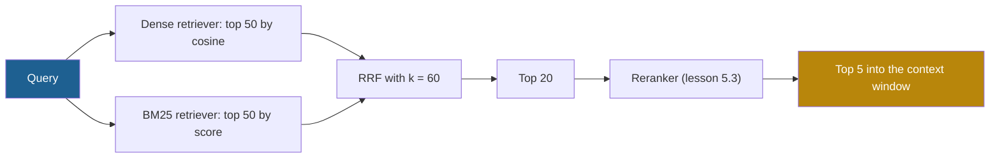

## 1. The question this idea answers

Lesson [5.1](/notes/ai/context-engineering/05-retrieval-quality/l1-bm25) showed that BM25 finds exact IDs and rare terms, and that dense retrieval finds paraphrases. A real query set holds both kinds of query. Some single queries need both: "How does JWT validation work?" has a rare term ("JWT") and a concept ("validation").

So I run both retrievers. Now I have two ranked lists. The dense list has cosine similarities such as 0.82 and 0.70. The BM25 list has scores such as 12.4 and 2.0. How do I merge them into one list that is better than either one?

## 2. Mental model

> [!analogy] Two judges with different score sheets
> Two judges rate the same contestants. Judge A scores from 0 to 1. Judge B scores from 0 to 20. If you add the raw scores, judge B decides almost everything, because the numbers are larger.
>
> A fair method ignores the raw numbers and uses the **places**. A contestant that both judges place in their top three beats a contestant that one judge loves and the other judge ignores. That is rank fusion.
>
> **Where it stops working:** places discard the size of the gaps. If judge A gives 0.99 to the first contestant and 0.40 to the second, rank fusion treats this gap the same as 0.81 against 0.80. Also, rank fusion trusts both judges equally unless you give them weights.

## 3. Terms

| Term | Plain meaning |
|---|---|
| hybrid retrieval | Running a dense retriever and a sparse retriever for the same query and merging their results into one list. |
| rank fusion | Merging several ranked lists by using the positions of the documents, not their scores. |
| rank, $r(d)$ | The position of document $d$ in one ranked list, starting at 1 for the top result. |
| Reciprocal Rank Fusion (RRF) | A rank-fusion method that gives each document the sum of $1/(k + r)$ over all lists where it appears. |
| RRF constant $k$ | The number added to every rank in RRF. A larger $k$ makes the top ranks count less compared with lower ranks. |
| score normalization | Rescaling the scores of one retriever to a common range, for example 0 to 1, before they are combined. |
| min-max normalization | Score normalization that maps the lowest score of a list to 0 and the highest to 1. |
| weighted RRF | RRF with a weight for each list, so that one retriever counts more than the other. |
| retrieval failure rate | The share of relevant documents that are not in the top $k$ results. It equals 1 − Recall@k. |
| contextual retrieval | Anthropic's method: an LLM writes a short context for each chunk. That context goes before the chunk in the embedding index and in the BM25 index. |
| contextual embeddings | The dense half of contextual retrieval: embed the chunk with its context prefix. |
| contextual BM25 | The sparse half of contextual retrieval: index the chunk with its context prefix in BM25. |

## 4. Method and math

### 4.1 Two retrievers fail in different places

The handbook (Session 3, §7.3) gives a clear example for the query "How does JWT token validation work?":

| Retriever | What it finds | Why |
|---|---|---|
| Dense | "The authentication module verifies user identity..." | Same meaning, few shared words |
| Dense | "Session management ensures secure access..." | Related meaning |
| BM25 | "JWT tokens are validated using RS256..." | Exact rare term "JWT" |
| BM25 | "Token expiry is set to 15 minutes..." | Exact term "token" |

Each retriever finds documents that the other one misses. The two lists overlap only in part. Hybrid retrieval wants one list that keeps the strong results of both.

### 4.2 Why you cannot add the raw scores

> [!example] Worked example: adding raw scores
> Five dense results with cosine similarity, and five BM25 results:
>
> | Dense rank | Chunk | Cosine | BM25 rank | Chunk | BM25 score |
> |---|---|---|---|---|---|
> | 1 | C3 | 0.82 | 1 | C1 | 12.4 |
> | 2 | C7 | 0.79 | 2 | C4 | 9.8 |
> | 3 | C1 | 0.77 | 3 | C12 | 7.1 |
> | 4 | C9 | 0.74 | 4 | C3 | 6.5 |
> | 5 | C4 | 0.70 | 5 | C20 | 2.0 |
>
> Add the two scores for each chunk (0 where a chunk is missing from a list):
>
> C1 13.17, C4 10.50, C3 7.32, C12 7.10, C20 2.00, C7 0.79, C9 0.74.
>
> The merged order is almost exactly the BM25 order. C7, the second-best dense result, falls to rank 6. The cosine values lie in a narrow band below 1, so they cannot compete with BM25 values up to 12.4.

Score normalization is one fix. Min-max normalization maps each list to the range 0 to 1, and then a weighted sum combines them. This has two problems:

1. The lowest result of each list gets exactly 0. In the example, C20 is rank 5 in BM25. After min-max, it scores the same as a chunk that BM25 did not return.
2. One outlier changes every normalized value. A single very high BM25 score pushes all the others toward 0.

Score-based fusion can work, but it needs tuning on labeled queries. Rank fusion avoids the problem: ranks are on the same scale in every list.

### 4.3 Reciprocal Rank Fusion

Cormack, Clarke and Büttcher introduced RRF at SIGIR 2009:

$$
\text{RRF}(d) = \sum_{r \in R} \frac{1}{k + r(d)}
$$

The symbols mean:

- $d$ is one document (here, one chunk).
- $R$ is the set of ranked lists, one for each retriever. In hybrid retrieval, $R$ holds two lists: dense and BM25.
- $r(d)$ is the rank of $d$ in list $r$, starting at 1.
- $k$ is a constant. The paper uses $k = 60$.
- A list that does not contain $d$ adds nothing to the sum.

Sort the documents by $\text{RRF}(d)$, from high to low. Keep the top results. The method needs only the ranks, so the scales of the two retrievers do not matter.

> [!example] Worked example: the same two lists with RRF, $k = 60$
> | Chunk | Dense rank | BM25 rank | RRF score |
> |---|---|---|---|
> | C1 | 3 | 1 | $1/63 + 1/61 = 0.015873 + 0.016393 = 0.032266$ |
> | C3 | 1 | 4 | $1/61 + 1/64 = 0.016393 + 0.015625 = 0.032018$ |
> | C4 | 5 | 2 | $1/65 + 1/62 = 0.015385 + 0.016129 = 0.031514$ |
> | C7 | 2 | — | $1/62 = 0.016129$ |
> | C12 | — | 3 | $1/63 = 0.015873$ |
> | C9 | 4 | — | $1/64 = 0.015625$ |
> | C20 | — | 5 | $1/65 = 0.015385$ |
>
> The fused order is C1, C3, C4, C7, C12, C9, C20. The three chunks that **both** retrievers found take the first three places. C7, the second dense result, is now fourth, not sixth.
>
> C1 is the handbook's example (Session 3, FAQ Q14): rank 1 in one list and rank 3 in the other give $1/61 + 1/63 = 0.0323$. That arithmetic is correct.

### 4.4 What $k$ does

The constant $k$ sets how much a top rank is worth compared with a lower rank. Compare two chunks:

- X is rank 1 in one list and missing from the other: $\text{RRF}(X) = \frac{1}{k + 1}$.
- Y is rank 5 in both lists: $\text{RRF}(Y) = \frac{2}{k + 5}$.

> [!example] Worked example: agreement against one first place
> | $k$ | X (rank 1, one list) | Y (rank 5, both lists) | Winner |
> |---|---|---|---|
> | 0 | 1.0000 | 0.4000 | X |
> | 3 | 0.2500 | 0.2500 | tie |
> | 10 | 0.0909 | 0.1333 | Y |
> | 60 | 0.0164 | 0.0308 | Y |
>
> In general, a chunk at rank $r$ in both lists beats a chunk at rank 1 in one list when $\frac{2}{k + r} > \frac{1}{k + 1}$, which means $r < k + 2$. With $k = 60$, a chunk at rank 61 in both lists still beats a chunk at rank 1 in one list: $2/121 = 0.016529 > 1/61 = 0.016393$.

So $k = 60$ rewards **agreement** between retrievers strongly. A small $k$ rewards a **single strong vote**. The paper explains the constant like this: "The constant k mitigates the impact of high rankings by outlier systems."

The relative weight of rank $r$ compared with rank 1 is:

$$
\frac{1/(k + r)}{1/(k + 1)} = \frac{k + 1}{k + r}
$$

With $k = 0$, rank 20 has 5% of the weight of rank 1. With $k = 60$, it has $61/80 = 76\%$. Section 5 plots both views.

> [!note] Source check: "RRF is parameter-free"
> **Corrected.** The handbook (Session 3, FAQ Q14) calls RRF "a simple, parameter-free algorithm". RRF has one constant, $k$, and its value changes the ranking (table above). Cormack et al. write that "k = 60 was fixed during a pilot investigation and not altered during subsequent validation". So RRF needs no tuning in the sense that $k = 60$ works well as a fixed value. It is not free of parameters. The handbook's worked example, 0.0323, is correct. Source: Cormack, Clarke and Büttcher, SIGIR 2009.

### 4.5 Practical details

**Documents missing from one list.** A list adds nothing for a document that it did not return. So the depth of each list matters. If each retriever returns only 5 results, a chunk at dense rank 6 gets no dense vote at all. A common pattern takes a deeper list from each retriever, for example 50, and fuses them. Then it keeps the top 5, or it sends the top 20 to a reranker (lesson [5.3](/notes/ai/context-engineering/05-retrieval-quality/l3-rerankers)).

**Ties.** Two chunks with the same ranks in mirror positions get the same score. Use a fixed tie-break, for example the better single rank, then the chunk ID. A random tie-break makes evaluation results change from run to run.

**Weights.** Weighted RRF gives each list a weight $w_r$:

$$
\text{RRF}_w(d) = \sum_{r \in R} \frac{w_r}{k + r(d)}
$$

Here $w_r$ is the weight of list $r$. For example, a query set with many IDs can give BM25 a higher weight. OpenAI's hosted file search exposes two such weights, `rrf_embedding_weight` and `rrf_text_weight` (checked on 2026-10-12). Tune weights on labeled queries, not by intuition.

**More than two lists.** RRF works for any number of lists. Lesson [5.4](/notes/ai/context-engineering/05-retrieval-quality/l4-query-transformation) uses it to merge the results of several query variants.

### 4.6 The architecture



The two retrievers run in parallel, so hybrid search adds little latency. The total latency is the slower of the two searches, plus a fusion step that sorts a few hundred numbers.

### 4.7 Contextual retrieval: better input for both retrievers

A chunk often lacks the context that would make it findable. Anthropic's example is a chunk that says "The company's revenue grew by 3% over the previous quarter." The chunk does not say which company or which quarter. So neither BM25 nor an embedding can match it to a query about that company. Anthropic's contextualized version starts with "This chunk is from an SEC filing on ACME corp's performance in Q2 2023".

Anthropic's **contextual retrieval** (19 September 2024) fixes the chunk, not the retriever:

1. For each chunk, an LLM reads the whole document and writes a short context for the chunk. Anthropic reports that this text is "usually 50-100 tokens".
2. The context goes before the chunk. The combined text goes into the embedding index (contextual embeddings) and into the BM25 index (contextual BM25).
3. At query time, hybrid retrieval and then a reranker select the chunks.

Anthropic measured the top-20 retrieval failure rate, defined as 1 minus Recall@20.

> [!example] Worked example: Anthropic's reported results
> | Configuration | Failure rate | Reduction against 5.7% |
> |---|---|---|
> | Baseline (standard chunks, before contextualization) | 5.7% | — |
> | Contextual embeddings | 3.7% | $(5.7 - 3.7)/5.7 = 35\%$ |
> | Contextual embeddings + contextual BM25 | 2.9% | $(5.7 - 2.9)/5.7 = 49\%$ |
> | The same, plus reranking | 1.9% | $(5.7 - 1.9)/5.7 = 67\%$ |
>
> For reranking, they retrieved the top 150 chunks and kept the top 20. They tested 5, 10 and 20 chunks, and 20 was the best of these options. The post also says that "Embeddings+BM25 is better than embeddings on their own", but the text gives no number for that pair without contexts.

Cost: Anthropic generated the contexts with Claude 3 Haiku and prompt caching (lesson [1.7](/notes/ai/context-engineering/01-foundations/l7-prompt-caching)). They report a one-time cost of USD 1.02 per million document tokens. Caching matters here: each chunk's prompt repeats the full document, and only the chunk at the end changes.

The same post gives a limit for when retrieval is not needed at all: "If your knowledge base is smaller than 200,000 tokens (about 500 pages of material), you can just include the entire knowledge base in the prompt". Part 4 discusses that choice ([Why retrieval](/notes/ai/context-engineering/04-write-and-rag/l3-why-retrieval)).

> [!note] Source check: "hybrid consistently outperforms either approach alone"
> **Corrected.** The handbook (Session 3, §7.3 and §10.3) says that hybrid retrieval with RRF "consistently outperforms either approach alone". Hybrid retrieval usually helps, but no method wins on every query set. Anthropic's measurement is the best primary evidence: contextual embeddings alone cut failures by 35%, and adding contextual BM25 raised the cut to 49%. That is one vendor benchmark on its own datasets. Measure on your own labeled queries (lesson [5.8](/notes/ai/context-engineering/05-retrieval-quality/l8-measure-retrieval)). Source: Anthropic, "Introducing Contextual Retrieval", 19 September 2024.

### 4.8 Production view

| Concern | What this lesson means for it |
|---|---|
| Latency | Run the two retrievers in parallel. Fusion itself costs almost nothing. |
| Cost | BM25 adds an index but no model calls. Contextual retrieval adds one LLM call per chunk at indexing time, once. |
| Quality | Fuse deep lists (for example 50 each), then cut. Shallow lists lose the votes that make RRF work. |
| Reliability | Use a fixed tie-break. Keep the same analyzer and embedding model for indexing and queries. |
| Tuning | Start with $k = 60$ and equal weights. Change them only when labeled queries show a gain. |
| Observability | Log both input lists and the fused list with ranks. A missing chunk can then be traced to one retriever. |

## 5. Graphs

```plot
{
  "title": "RRF contribution 1/(k + r): k = 0 (red), k = 10 (blue), k = 60 (gold)",
  "xAxis": { "label": "rank r", "domain": [1, 20] },
  "yAxis": { "label": "1/(k + r)", "domain": [0, 1.05] },
  "disableZoom": true,
  "data": [
    { "fn": "1/x", "color": "#C81D25" },
    { "fn": "1/(10+x)", "color": "#1E6091" },
    { "fn": "1/(60+x)", "color": "#B8860B" }
  ]
}
```

With $k = 0$, rank 1 gives 1.0 and rank 20 gives 0.05. With $k = 10$, the values go from 0.091 to 0.033. With $k = 60$, they go from 0.0164 to 0.0125: the gold line is almost flat at this scale.

```plot
{
  "title": "Weight of rank r relative to rank 1, (k + 1)/(k + r): k = 0 (red), k = 10 (blue), k = 60 (gold)",
  "xAxis": { "label": "rank r", "domain": [1, 20] },
  "yAxis": { "label": "share of the rank-1 weight", "domain": [0, 1.05] },
  "disableZoom": true,
  "data": [
    { "fn": "1/x", "color": "#C81D25" },
    { "fn": "11/(10+x)", "color": "#1E6091" },
    { "fn": "61/(60+x)", "color": "#B8860B" }
  ]
}
```

At rank 20, the share is 0.05 for $k = 0$, 0.37 for $k = 10$ and 0.76 for $k = 60$. A larger $k$ flattens the curve, so presence in several lists matters more than first place in one.

## 6. Code

These exercises go in `notebooks/05-retrieval-quality.ipynb`. Put the fusion code in `src/retrieval/fusion.py` and its tests in `tests/test_fusion.py`.

**Exercise 2.1: RRF from scratch.**

1. Write `rrf(lists, k=60, weights=None) -> list[tuple[str, float]]`. Each input list is a list of chunk IDs in rank order.
2. Use a fixed tie-break: the better single rank first, then the chunk ID.

Acceptance tests:

- The two lists of section 4.2 give the order C1, C3, C4, C7, C12, C9, C20 and a top score of 0.032266.
- `rrf([["a", "b"], ["c", "a"]], k=60)` gives "a" the score $1/61 + 1/62$.
- With `k=0`, chunk X (rank 1 in one list) beats chunk Y (rank 5 in both lists). With `k=10`, Y wins.
- A chunk ID that appears twice in one list raises a `ValueError`.

**Exercise 2.2: hybrid search on your queries.**

1. Reuse the corpus and `data/queries.jsonl` from exercise 1.4.
2. For each query, take the top 20 from BM25 and the top 20 from the dense retriever. Fuse them with RRF.
3. For dense, BM25 and hybrid, count the queries whose answer document is in the top 5. Split the count by query type (keyword and paraphrase).

Acceptance tests:

- A 3 × 2 table: retriever × query type.
- One sentence that says whether hybrid is better than the best single retriever on each query type. Do not assume it. Report what you measured.

**Exercise 2.3: change $k$ and the weights.**

1. Repeat exercise 2.2 with $k$ = 0, 10 and 60.
2. With $k = 60$, try the weights (BM25, dense) = (1, 1), (2, 1) and (1, 2).

Acceptance tests:

- A table of the 6 settings and their top-5 hit counts.
- One query whose result changes with $k$. Show its ranks in both input lists and explain the change with section 4.4.

**Exercise 2.4: a free contextual prefix.**

1. Prefix each chunk with its document title and section heading, for example "Printer manual > Error codes: ...". This needs no LLM.
2. Rebuild both indexes and repeat exercise 2.2.
3. (Optional, costs money.) Generate a 50 to 100 token context for each chunk with an LLM. Use prompt caching, as in section 4.7. Estimate the cost before you run it.

Acceptance test: a before-and-after table of top-5 hits for BM25, dense and hybrid.

## 7. Common mistakes

1. **"Add the cosine and the BM25 score."** The scales differ, so the larger scale decides almost alone (section 4.2).
2. **"RRF has no parameters."** It has the constant $k$. The value 60 comes from a pilot study, and a different $k$ can change the order.
3. **"Fuse the top 5 of each list."** Shallow lists drop the votes that RRF needs. Fuse deeper lists, then cut.
4. **"Hybrid always beats dense or BM25 alone."** It usually helps, but measure it on your queries. A query set of pure paraphrases may gain nothing from BM25.
5. **"Contextual retrieval needs a new retriever."** It changes the chunk text before indexing. The retrievers stay the same.
6. **"A chunk missing from one list gets a penalty."** It gets no penalty, only no vote from that list. The effect is the same as a very low rank.

## 8. One-minute explanation

Dense retrieval finds paraphrases, and BM25 finds exact IDs and rare terms. Hybrid retrieval runs both and merges the two ranked lists. You cannot add the raw scores, because cosine values sit between −1 and 1 and BM25 scores have no fixed range. Reciprocal Rank Fusion uses ranks instead. Each list gives a document 1 divided by k plus its rank, and the votes add up. With k = 60, a document that both retrievers found at moderate ranks beats a document that only one retriever ranked first. The constant k is the one parameter of RRF, so the claim that it is parameter-free is not exact. Fuse deep lists, for example 50 from each retriever, then keep the top results or rerank them. Anthropic's contextual retrieval adds an LLM-written context to each chunk before indexing. In its benchmark, this with hybrid search cut failed retrievals by 49%, and by 67% with reranking.

## 9. Check questions

```check
{
  "question": "A chunk is rank 2 in the dense list and rank 7 in the BM25 list. What is its RRF score with k = 60?",
  "hint": "Add 1/(k + r) for each list.",
  "answer": "1/62 + 1/67 = 0.016129 + 0.014925 = 0.031054."
}
```

```check
{
  "question": "With k = 60, chunk P is rank 1 in BM25 only. Chunk Q is rank 30 in both lists. Which ranks higher? At which rank in both lists would Q tie with P?",
  "hint": "Q wins when r < k + 2.",
  "answer": "P = 1/61 = 0.016393. Q = 2/90 = 0.022222, so Q ranks higher. Q ties with P when 2/(60 + r) = 1/61, which gives r = 62."
}
```

```check
{
  "question": "A team min-max normalizes the dense and BM25 scores and adds them. Users report that the fifth BM25 result never appears in the answers. Explain.",
  "answer": "Min-max normalization maps the lowest score of each list to exactly 0. So the fifth BM25 result gets 0 from BM25, the same as a chunk that BM25 never returned. Unless the dense list also ranks it, it falls to the bottom. Rank fusion such as RRF does not have this problem, because rank 5 still gives 1/(k + 5)."
}
```

```check
{
  "question": "Anthropic reports a top-20 failure rate of 2.9% with contextual embeddings plus contextual BM25, and 1.9% with reranking added. What is the relative reduction from reranking alone? What is the Recall@20 in each case?",
  "answer": "Reduction: (2.9 − 1.9) / 2.9 ≈ 34%. Recall@20 is 1 − failure rate: 97.1% before reranking and 98.1% after."
}
```

```check
{
  "question": "Your queries are 80% product codes and 20% paraphrased questions. Hybrid RRF with equal weights performs worse than BM25 alone on the codes. Name two changes to test.",
  "answer": "1. Weighted RRF with a higher weight for BM25, tuned on labeled queries. 2. Deeper input lists, so that the exact-match chunk also gets a vote from the dense list, even at a low dense rank. A third option is a router that sends queries with a code pattern to BM25 first. Measure each change on the labeled set."
}
```

## 10. Links

- Previous: [L1: Keyword search and BM25](/notes/ai/context-engineering/05-retrieval-quality/l1-bm25)
- Next: [L3: Rerankers](/notes/ai/context-engineering/05-retrieval-quality/l3-rerankers)
- [L4: Query transformation](/notes/ai/context-engineering/05-retrieval-quality/l4-query-transformation): RRF for several query variants
- [L1.7: Prompt caching](/notes/ai/context-engineering/01-foundations/l7-prompt-caching): why contextual retrieval is affordable
- [Glossary](/notes/ai/context-engineering/glossary)
