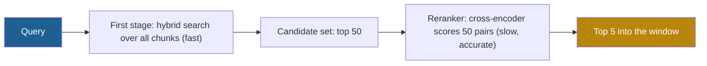

## 1. The question this idea answers

Hybrid retrieval returns 50 candidate chunks. The window has room for 5. The chunk that answers the question is at rank 14. A better first-stage retriever is not available. How can I move that chunk into the top 5?

The answer is a second stage: a **reranker**. It reads the query and each candidate **together** and gives a more accurate relevance score. This lesson explains why that model is more accurate, why it cannot search the whole corpus, and what it costs.

## 2. Mental model

> [!analogy] A CV screen, then interviews
> A company gets 10,000 applications for one job. A recruiter writes a short summary card for each CV once, when it arrives. For each job, a fast search over the cards finds 50 candidates. Then an interviewer meets each of the 50 with the job description in hand and ranks them.
>
> - The summary cards are **bi-encoder** vectors: computed once, without knowing the job.
> - The interview is a **cross-encoder**: it looks at the candidate and the job together. It is more accurate, but too slow for 10,000 people.
>
> **Where it stops working:** the interviewer meets only the 50 that the screen passed. If the best candidate failed the screen, no interview can find them. A reranker can only reorder what the first stage returned.

## 3. Terms

| Term | Plain meaning |
|---|---|
| first-stage retrieval | The fast search over the whole corpus that returns a candidate set, for example dense, BM25 or hybrid retrieval. |
| candidate set | The chunks that the first stage returns for the reranker to score, for example the top 50. |
| reranking | Scoring each candidate again with a slower, more accurate model, and sorting by the new score. |
| reranker | The model that does the reranking, usually a cross-encoder. |
| bi-encoder | A model that encodes the query and each document separately into one vector each. Document vectors can be computed once and stored. |
| cross-encoder | A model that reads the query and one document together in one input and outputs one relevance score. Nothing can be stored in advance. |
| late interaction | A design that stores one vector per document token and compares query tokens with document tokens only at query time. |
| ColBERT | The late-interaction retriever of Khattab and Zaharia (SIGIR 2020). |
| MaxSim | The ColBERT score: for each query token, take its highest similarity with any document token, then add these maximums. |
| recall ceiling | The limit that the first stage sets: if a relevant chunk is not in the candidate set, reranking cannot recover it. |
| search unit | Cohere's billing unit for reranking: one query with up to 100 documents. |
| residual compression | The ColBERTv2 method that stores each token vector as a nearby centroid plus a small, compressed difference. |

## 4. Method and math

### 4.1 Two stages: recall first, precision second

A retrieval pipeline has two goals that pull against each other:

1. **Recall:** do not miss the relevant chunk. This needs a search over the whole corpus, so it must be fast.
2. **Precision:** put the relevant chunk at the top. This needs a careful comparison of the query and each chunk, so it is slow.

One model cannot be fast on millions of chunks and careful on each one. So the pipeline splits the work.



The handbook gives this pattern (Session 3, FAQ Q22 and Q39): retrieve the top 50 cheaply, rerank them, keep the top 5. The Sentence-Transformers documentation describes the same pipeline with about 100 candidates. Anthropic's contextual-retrieval test retrieved 150 and kept 20.

### 4.2 The bi-encoder: fast because it never sees the pair

A bi-encoder (Reimers and Gurevych, Sentence-BERT, 2019) maps each text to one vector:

$$
s_{\text{bi}}(q, d) = \cos\big(E(q),\, E(d)\big)
$$

The symbols mean:

- $q$ is the query and $d$ is a document.
- $E$ is the encoder. $E(q)$ and $E(d)$ are computed **separately**.
- $\cos$ is cosine similarity (Part 4, [Embeddings and similarity](/notes/ai/context-engineering/04-write-and-rag/l6-embeddings-and-similarity)).

All document vectors are computed once at indexing time. A query needs one encoder pass and one vector search. That is why the first stage uses it.

The cost of that speed: the encoder compresses each document into one vector **before** it knows the query. A detail that matters only for this query, such as a negation or a date, may be lost in the average.

### 4.3 The cross-encoder: accurate because it reads the pair

A cross-encoder joins the query and the document into one input. Every query token can attend to every document token in every layer (lesson [1.4](/notes/ai/context-engineering/01-foundations/l4-attention-and-the-cost-of-length)). The model outputs one number:

$$
s_{\text{cross}}(q, d) = f\big([q\,;\,d]\big)
$$

The symbols mean:

- $[q\,;\,d]$ is the query and the document joined into one token sequence, with a separator token between them.
- $f$ is the cross-encoder. It returns one relevance score for the pair.

The Sentence-Transformers docs give both sides: "The advantage of Cross-Encoders is the higher performance, as they perform attention across the query and the document." Also: "Scoring thousands or millions of (query, document)-pairs would be rather slow."

> [!example] Worked example: why a cross-encoder cannot be the first stage
> The Sentence-BERT paper finds the most similar pair among 10,000 sentences.
>
> - Number of pairs: $\frac{10{,}000 \times 9{,}999}{2} = 49{,}995{,}000$. A cross-encoder needs one full model pass for each pair.
> - The paper reports about **65 hours** with a BERT cross-encoder, and **about 5 seconds** with Sentence-BERT.
>
> The same logic holds for search. A query against 1,000,000 chunks needs 1,000,000 cross-encoder passes. At the 1,800 passes per second of section 4.6, that is about 556 seconds for one query. Against 50 candidates, it is 50 passes.

### 4.4 Late interaction: ColBERT

ColBERT (Khattab and Zaharia, SIGIR 2020) sits between the two. It stores **one vector per token** of each document. At query time it encodes the query into one vector per query token. The score is:

$$
S_{q,d} = \sum_{i=1}^{\lvert E_q \rvert} \max_{j=1}^{\lvert E_d \rvert} E_{q_i} \cdot E_{d_j}^{\top}
$$

The symbols mean:

- $E_q$ is the list of query token vectors. $\lvert E_q \rvert$ is the number of query tokens.
- $E_d$ is the list of document token vectors. $\lvert E_d \rvert$ is the number of document tokens.
- $E_{q_i} \cdot E_{d_j}^{\top}$ is the dot product of query token $i$ and document token $j$. The vectors are normalized, so this is a cosine similarity.
- The inner $\max$ finds the best-matching document token for each query token. This is **MaxSim**.
- The sum adds the MaxSim values of all query tokens.

> [!example] Worked example: MaxSim with 2-dimensional vectors
> Query tokens: $q_1 = (1, 0)$ and $q_2 = (0.6, 0.8)$.
>
> Document A has three tokens: $a_1 = (0.8, 0.6)$, $a_2 = (0, 1)$, $a_3 = (1, 0)$.
>
> | | $a_1$ | $a_2$ | $a_3$ | MaxSim |
> |---|---|---|---|---|
> | $q_1$ | 0.80 | 0.00 | 1.00 | 1.00 |
> | $q_2$ | 0.96 | 0.80 | 0.60 | 0.96 |
>
> $S_{q,A} = 1.00 + 0.96 = 1.96$.
>
> Document B has two tokens: $b_1 = (0.6, 0.8)$, $b_2 = (0.28, 0.96)$.
>
> | | $b_1$ | $b_2$ | MaxSim |
> |---|---|---|---|
> | $q_1$ | 0.60 | 0.28 | 0.60 |
> | $q_2$ | 1.00 | 0.936 | 1.00 |
>
> $S_{q,B} = 0.60 + 1.00 = 1.60$.
>
> A ranks above B. B matches $q_2$ perfectly, but no token of B matches $q_1$ well. Each query token must find its own match, so a document must cover **every** part of the query to score high.

Two properties follow:

1. **Document vectors are stored in advance**, like a bi-encoder. So ColBERT can search a large collection or rerank cheaply.
2. **Token-level matching** keeps detail that one pooled vector loses, so the quality comes closer to a cross-encoder.

The paper reports that ColBERT is "two orders-of-magnitude faster and requiring four orders-of-magnitude fewer FLOPs per query" than BERT cross-encoder rerankers. The cost is storage: a 300-token chunk stores 300 vectors instead of 1. ColBERTv2 (Santhanam et al., NAACL 2022) uses residual compression and reports "reducing the space footprint of late interaction models by 6--10×".

> [!note] Source check: "ColBERT multiplies storage by 100x or more"
> **Corrected.** The handbook (Session 3, FAQ Q42) says that ColBERT storage grows "by 100x or more". One vector per token does mean many more vectors than one per chunk. But ColBERTv2's residual compression cuts the space footprint by 6 to 10 times compared with uncompressed late interaction. Compute the real size for your chunk length and vector format. Source: Santhanam et al., arXiv 2112.01488.

### 4.5 Three designs side by side

| | Bi-encoder | Late interaction (ColBERT) | Cross-encoder |
|---|---|---|---|
| What is stored per chunk | 1 vector | 1 vector per token | Nothing |
| When the query meets the chunk | Only at the final dot product | At the token-level MaxSim | In every layer |
| Work per query | 1 query pass and a vector search | 1 query pass and many token comparisons | 1 full pass per candidate |
| Can search the whole corpus | Yes | Yes, with a special index | No |
| Typical role | First stage | First stage or reranker | Reranker only |
| Relative accuracy | Lowest of the three | Between | Highest |

### 4.6 Cost and latency, with sourced numbers

The open model `cross-encoder/ms-marco-MiniLM-L6-v2` is a common local reranker. Its model card reports (checked on 2026-10-12):

| Model | NDCG@10, TREC DL 19 | MRR@10, MS MARCO dev | Documents per second on a V100 GPU |
|---|---|---|---|
| ms-marco-MiniLM-L6-v2 | 74.30 | 39.01 | 1,800 |
| ms-marco-MiniLM-L12-v2 | 74.31 | 39.02 | 960 |

The 12-layer model is almost twice as slow and gives almost the same quality. Lesson [5.8](/notes/ai/context-engineering/05-retrieval-quality/l8-measure-retrieval) defines NDCG and MRR.

> [!example] Worked example: GPU time to rerank
> Assume the throughput of the model card also holds for one batch of candidates.
>
> - 50 candidates with L6: $50 / 1{,}800 = 0.028$ s, about 28 ms.
> - 50 candidates with L12: $50 / 960 = 0.052$ s, about 52 ms.
> - 150 candidates (Anthropic's setting) with L6: $150 / 1{,}800 = 0.083$ s, about 83 ms.
>
> These are estimates of model time on that GPU. Longer chunks, a CPU, or network calls change them. Measure on your own hardware.

**Hosted rerankers.** Cohere bills reranking in **search units**. The docs say: "A single search unit is defined as one query with up to 100 documents to be ranked". If the query plus a document is longer than 500 tokens, the document splits into chunks, and each chunk counts as one document. The current models are `rerank-v4.0-pro`, `rerank-v4.0-fast` and `rerank-v3.5` (checked on 2026-10-12).

> [!example] Worked example: search units
> - 1 query, 50 candidates of 300 tokens each: each query-plus-document fits in 500 tokens, so this is 50 documents and **1 search unit**.
> - 1 query of 20 tokens, 50 candidates of 1,200 tokens each: each piece holds at most about 480 document tokens. So each document splits into 3 pieces. That is 150 documents, so **2 search units**.

On 2026-10-12, Cohere's pricing page did not show a price per search. A secondary source reports USD 2.00 per 1,000 searches for Rerank 4 Fast and USD 2.50 for Rerank 4 Pro. Check the current price before you budget. Voyage prices its rerankers per token instead, for example USD 0.05 / MTok for `rerank-3` (checked on 2026-10-12).

Anthropic's comment on reranking latency is qualitative: reranking "inevitably adds a small amount of latency". Fewer, better chunks also reduce the cost and latency of the generation call that follows.

> [!note] Source check: reranker gain, price and model name
> **Corrected.** Four handbook claims need a change.
>
> 1. "Adding a reranker improves answer quality by 10–25% in most benchmarks" (Session 3, FAQ Q22). No source is given. A measured example: Anthropic's reranking step cut the top-20 failure rate from 2.9% to 1.9%. Treat any fixed gain as unproven, and measure.
> 2. Cohere Rerank "costs roughly" USD 1 "per 1,000 rerank calls" (FAQ Q39). The billing unit is the search unit above, and the public price was not shown on 2026-10-12.
> 3. The model ID `cross-encoder/ms-marco-MiniLM-L-6-v2` (Session 3, §4.2.3) is now `cross-encoder/ms-marco-MiniLM-L6-v2`, without the hyphen after "L". The old ID still resolves.
> 4. The latency split "reranking: 50–200ms" (FAQ Q27) is a rule of thumb. Measure it.
>
> Sources: Anthropic, "Introducing Contextual Retrieval" (2024). Cohere Rerank docs. The ms-marco-MiniLM-L6-v2 model card. All checked on 2026-10-12.

### 4.7 How many candidates?

The size $N$ of the candidate set is the main design choice. It sets the recall ceiling and the reranking cost.

$$
\text{Recall@5 after reranking} \le \text{Recall@}N \text{ of the first stage}
$$

The symbols mean:

- $N$ is the number of candidates that the reranker scores.
- Recall@$N$ is the share of relevant chunks that the first stage returns in its top $N$ (lesson [5.8](/notes/ai/context-engineering/05-retrieval-quality/l8-measure-retrieval)).

The inequality holds because the reranker only reorders the $N$ candidates. If Recall@50 is 0.80, at most 80% of the relevant chunks can reach the final top 5, even with a perfect reranker.

A practical method:

1. Measure the first-stage Recall@$N$ for $N$ = 10, 20, 50, 100 and 150.
2. Find the point where a larger $N$ adds almost no recall.
3. Check that the reranking time at that $N$ fits the latency budget.
4. Measure the final quality after reranking, not only the first-stage recall.

### 4.8 Reranker scores as a filter

A cross-encoder gives a relevance score for each pair. You can use it in two ways:

1. **Sort only.** Keep the top 5, whatever their scores.
2. **Sort and filter.** Keep only chunks above a score threshold. If no chunk passes, the application can tell the model that nothing relevant was found. This supports abstention (lesson [5.8](/notes/ai/context-engineering/05-retrieval-quality/l8-measure-retrieval)).

The raw score of a cross-encoder has no fixed meaning across models. Set the threshold on labeled queries, and check it again after a model change.

### 4.9 Production view

| Concern | What this lesson means for it |
|---|---|
| Latency | The reranker runs after the first stage, so its time adds to every query. Measure it at your $N$ and chunk length. |
| Cost | Local cross-encoder: GPU or CPU time. Hosted API: search units or tokens per query. Fewer, better chunks reduce the generation cost after it. |
| Quality | The first stage sets the recall ceiling. Measure Recall@$N$ before you tune the reranker. |
| Reliability | A hosted reranker is one more network dependency. On a timeout, use the first-stage order. |
| Storage | Late interaction stores one vector per token. Use a compressed format such as ColBERTv2's. |
| Observability | Log each candidate's first-stage rank and reranked rank. Large moves show what the reranker adds. |

## 5. Code

These exercises go in `notebooks/05-retrieval-quality.ipynb`. Put the reranking step in `src/retrieval/rerank.py`.

**Exercise 3.1: MaxSim by hand.**

1. Write `maxsim(query_vecs, doc_vecs) -> float` with NumPy, using one matrix product and one `max` along an axis.
2. Use the vectors of section 4.4.

Acceptance tests:

- Document A gives 1.96 and document B gives 1.60.
- The function accepts any number of query and document tokens.
- A document that repeats its best token 10 times gets the same score. Explain why in a comment.

**Exercise 3.2: add a cross-encoder to your hybrid search.**

1. Use `sentence_transformers.CrossEncoder("cross-encoder/ms-marco-MiniLM-L6-v2")`. It runs locally and costs nothing.
2. Take the top 50 from the hybrid search of exercise 2.2. Score the 50 (query, chunk) pairs. Sort by the new score.
3. Count the queries whose answer chunk is in the top 5, before and after reranking.

Acceptance tests:

- A table with two rows: hybrid only, and hybrid plus reranking.
- A list of the queries that reranking fixed and the queries that it broke, with their ranks before and after.

**Exercise 3.3: find the recall ceiling.**

1. Use $N$ = 5, 10, 20, 50 and 100. For each $N$, measure the share of queries with the answer chunk in the first-stage top $N$.
2. For each $N$, rerank the top $N$ and measure the share in the final top 5.

Acceptance tests:

- A table with three columns: $N$, first-stage hit rate at $N$, and final hit rate at 5.
- The final hit rate is never above the first-stage hit rate at $N$. Explain this in one sentence.

**Exercise 3.4: measure the latency on your machine.**

1. Time the reranking of 20, 50 and 100 candidates on your laptop CPU. Repeat each 10 times and report the median.
2. Compare with the estimate of section 4.6.

Acceptance test: a table of the median times, and one sentence that chooses $N$ for a 300 ms reranking budget.

## 6. Common mistakes

1. **"The reranker will find the answer."** It can only reorder the candidates. If the first stage missed the chunk, the reranker cannot recover it.
2. **"Use the cross-encoder for the whole search."** It needs one model pass per chunk per query: about 556 seconds for 1,000,000 chunks at 1,800 passes per second.
3. **"A bigger reranker is always better."** The L12 MiniLM model scores 74.31 NDCG@10 against 74.30 for L6, at about half the speed.
4. **"A reranker adds 10–25% quality."** That number has no source. Measure the gain on your own queries.
5. **"ColBERT storage is 100 times larger, so it is impractical."** ColBERTv2's compression cuts the footprint by 6 to 10 times. Compute the size for your data.
6. **"A cross-encoder score of 0.5 means 50% relevant."** The scale depends on the model. Calibrate any threshold on labeled data.

## 7. One-minute explanation

Retrieval has two jobs: find every relevant chunk, and put the best ones at the top. A bi-encoder does the first job. It turns each chunk into one vector in advance, so a search over millions of chunks is fast. But it compresses each chunk before it sees the query. A cross-encoder does the second job. It reads the query and one chunk together, so it is more accurate. But it needs one full model pass per chunk, so it can only score a few dozen candidates. The standard pattern retrieves wide, for example 50 or 150 candidates, and reranks to the top 5 or 20. ColBERT sits between the two: it stores one vector per token and scores with MaxSim. The reranker can never fix a chunk that the first stage missed. So measure the first-stage recall at your candidate count before you tune the reranker.

## 8. Check questions

```check
{
  "question": "Query tokens: q1 = (1, 0), q2 = (0, 1). Document tokens: d1 = (0.6, 0.8), d2 = (0.8, 0.6). Compute the ColBERT MaxSim score.",
  "hint": "For each query token, take the largest dot product with any document token, then add.",
  "answer": "q1: max(0.6, 0.8) = 0.8. q2: max(0.8, 0.6) = 0.8. Score = 0.8 + 0.8 = 1.6."
}
```

```check
{
  "question": "A first stage has Recall@20 = 0.72 and Recall@100 = 0.91. A perfect reranker keeps 5 chunks. What is the best possible Recall@5 after reranking with N = 20, and with N = 100?",
  "answer": "With N = 20, at most 0.72, because only those chunks reach the reranker. With N = 100, at most 0.91. A real reranker gives less than these ceilings. Note also that if a query has more than 5 relevant chunks, Recall@5 is lower still."
}
```

```check
{
  "question": "A cross-encoder scores 1,800 documents per second on your GPU. Your latency budget for reranking is 50 ms. What is the largest candidate set? What else limits the choice?",
  "answer": "1,800 × 0.050 = 90 candidates. Other limits: longer chunks reduce the throughput, and the first-stage recall must be checked at that N. If Recall@90 is not much higher than Recall@50, use 50 and keep the spare time."
}
```

```check
{
  "question": "Why can a bi-encoder index a corpus in advance but a cross-encoder cannot?",
  "answer": "A bi-encoder encodes each document alone, so its vector does not depend on the query. It can be computed once and stored. A cross-encoder needs the query and the document in the same input, so its output exists only after the query arrives. Every query needs new passes."
}
```

```check
{
  "question": "Your team plans to rerank 50 candidates of 1,500 tokens each with Cohere for every query, with a 30-token query. Estimate the search units per query.",
  "hint": "Query plus each piece must fit in 500 tokens. One search unit covers up to 100 documents.",
  "answer": "Each piece holds about 500 − 30 = 470 document tokens. 1,500 / 470 ≈ 3.2, so each document splits into 4 pieces. 50 × 4 = 200 documents, which is 2 search units per query. Check the current price per search before you budget."
}
```

## 9. Links

- Previous: [L2: Hybrid search and RRF](/notes/ai/context-engineering/05-retrieval-quality/l2-hybrid-search-and-rrf)
- Next: [L4: Query transformation](/notes/ai/context-engineering/05-retrieval-quality/l4-query-transformation)
- Part 4: [Embeddings and similarity](/notes/ai/context-engineering/04-write-and-rag/l6-embeddings-and-similarity): the bi-encoder side
- [L8: Measure retrieval and answers](/notes/ai/context-engineering/05-retrieval-quality/l8-measure-retrieval): Recall@N, MRR and NDCG
- [Glossary](/notes/ai/context-engineering/glossary)
