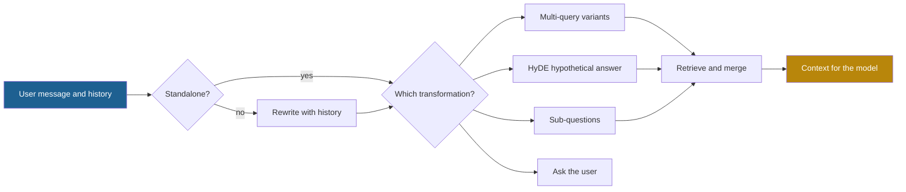

## 1. The question this idea answers

Lessons 5.1 to 5.3 improved the retriever. But the retriever can only search with the text that it receives. Users write search keys that are short, vague or tied to the conversation:

- "And for tablets?" (the topic is in an earlier turn)
- "Tell me about the system." (no clear target)
- "Compare the pricing of Product A and Product B." (two targets in one question)

The best retriever still fails on these inputs. **Query transformation** changes the query before retrieval. This lesson covers five methods, the problem that each one solves, and the extra LLM calls that each one costs.

## 2. Mental model

> [!analogy] A reference librarian
> A good librarian does not type your words into the catalog as they are. The librarian:
>
> 1. remembers what you asked before, so "and for tablets?" becomes a full question (**rewriting**),
> 2. searches with several phrasings (**multi-query**),
> 3. pictures the page that would answer you, and looks for pages like it (**HyDE**),
> 4. splits a two-part question into two searches (**decomposition**),
> 5. asks "do you mean the billing system or the login system?" (**clarification**).
>
> **Where it stops working:** each step takes the librarian time, and for an application each step is an extra LLM call. The librarian can also misunderstand you and search for the wrong thing with confidence. A rewritten query can lose a detail that the original had.

## 3. Terms

| Term | Plain meaning |
|---|---|
| query transformation | Any change to the user's query before retrieval, made to get better search results. |
| query rewriting | An LLM turns the latest message, plus the conversation history, into one complete search query. |
| standalone query | A query that makes sense without the conversation history. |
| multi-query retrieval | An LLM writes several variants of the query. The system retrieves for each variant and merges the results. |
| query variant | One of the alternative phrasings in multi-query retrieval. |
| union-dedup merge | A merge of several result lists that keeps every chunk once and has no ranking rule of its own. |
| RAG-Fusion | Multi-query retrieval with Reciprocal Rank Fusion as the merge step (Rackauckas, 2024). |
| HyDE | Hypothetical Document Embeddings: an LLM writes a hypothetical answer, and the system retrieves real documents that are similar to it (Gao et al., 2023). |
| hypothetical document | The text that the LLM writes in HyDE. It is used only as a search key, never as a source of facts. |
| query decomposition | Splitting a complex question into simpler sub-questions and retrieving for each one. |
| multi-hop question | A question whose answer needs two or more facts, where finding one fact needs another fact first. |
| iterative retrieval | Retrieval in several rounds, where each round uses what the earlier rounds found. |
| clarifying question | A question that the application asks the user before it retrieves, because the query has several likely meanings. |
| query drift | A transformed query that no longer means what the user asked. |

## 4. Method and math

### 4.1 Why the raw query is a weak search key

The query and the answer chunk differ in four ways. Each method of this lesson closes one of the gaps.

| Gap | Example | Method |
|---|---|---|
| Missing context | "And for tablets?" does not name the topic. | Query rewriting |
| Different words | The user writes "sign-in problem". The document says "authentication failure". | Multi-query, hybrid search (lesson [5.2](/notes/ai/context-engineering/05-retrieval-quality/l2-hybrid-search-and-rrf)) |
| Different form | The query is a short question. The answer chunk is a long statement. | HyDE |
| Several needs in one query | "Compare A and B" needs chunks about A **and** about B. | Decomposition |
| Several likely meanings | "Tell me about the system" | Clarifying question |



### 4.2 Query rewriting with history

In a chat, the latest message often depends on earlier turns. A retriever sees only the text that it gets, so "And for tablets?" retrieves nothing useful.

> [!example] Worked example: a rewrite
> History:
>
> - User: "Do laptops have a 30-day return window?"
> - Assistant: "Yes. Laptops can be returned within 30 days if they are unopened."
> - User: "And for tablets?"
>
> Rewrite prompt to a small, fast model: "Rewrite the last user message as one standalone search query. Keep every product name, number and constraint. Output only the query."
>
> Rewritten query: "return window for tablets".
>
> Retrieval uses the rewritten query. The main model still sees the original conversation, so it answers the user in context.

Three rules make rewriting safe:

1. **Skip it when the message is already standalone.** A cheap check, for example "does the message contain a pronoun or start with 'and'?", can save the extra call on many turns.
2. **Keep constraints.** A rewrite that drops "unopened" or "in 2025" is query drift. Tell the rewriter to keep names, numbers and dates.
3. **Log both queries.** When retrieval fails, the log shows whether the rewrite or the retriever caused it.

The cost is one extra LLM call per turn, before retrieval. Its input is the recent history, and its output is short. It adds the full time of that call to the latency, because retrieval must wait for it.

### 4.3 Multi-query retrieval

One phrasing can miss chunks that use other words. Multi-query retrieval asks an LLM for $n$ variants, retrieves for each, and merges the lists. The handbook's example (Session 3, §10.2.1):

- Original: "What is context engineering?"
- Variant 1: "How do you define context engineering in AI?"
- Variant 2: "Context engineering vs prompt engineering differences"
- Variant 3: "Why is context engineering important for LLMs?"

The handbook uses two different merge rules. The lab merges by "Union of all results (deduplicated by chunk ID)". The FAQ (Q23) says to "merge results with RRF". Both exist in practice. LangChain's `MultiQueryRetriever` takes the unique union of the results. RAG-Fusion (Rackauckas, 2024) fuses them with RRF.

> [!example] Worked example: union against RRF
> Three variants return these lists (rank 1 first):
>
> - V1: C2, C5, C1, C8
> - V2: C5, C9, C2
> - V3: C5, C2, C7, C1
>
> **Union-dedup**, in order of first appearance: C2, C5, C1, C8, C9, C7. That is 6 unique chunks. If the window takes only 4, a cut at 4 gives C2, C5, C1, C8. That is exactly the list of V1, so the other two variants changed nothing.
>
> **RRF** with $k = 60$ (lesson [5.2](/notes/ai/context-engineering/05-retrieval-quality/l2-hybrid-search-and-rrf)):
>
> | Chunk | Ranks | RRF score |
> |---|---|---|
> | C5 | 2, 1, 1 | $1/62 + 1/61 + 1/61 = 0.048916$ |
> | C2 | 1, 3, 2 | $1/61 + 1/63 + 1/62 = 0.048395$ |
> | C1 | 3, —, 4 | $1/63 + 1/64 = 0.031498$ |
> | C9 | —, 2, — | $1/62 = 0.016129$ |
> | C7 | —, —, 3 | $1/63 = 0.015873$ |
> | C8 | 4, —, — | $1/64 = 0.015625$ |
>
> The top 4 are C5, C2, C1, C9. C5, which all three variants ranked high, is now first. C9, which only V2 found, replaces C8.

When to use each merge:

| Merge | Use it when | Weak point |
|---|---|---|
| Union-dedup | You keep **all** merged chunks, or a reranker orders them next (lesson [5.3](/notes/ai/context-engineering/05-retrieval-quality/l3-rerankers)). | It gives a set, not a ranking. A cut by first appearance favors the first variant. |
| RRF | You must cut the merged list to $k$ chunks without a reranker. | Chunks that only one variant found get one vote, so they rank low. |

The cost of multi-query: one LLM call to write the variants, then $n$ embeddings and $n$ searches. The searches can run in parallel. The merged set is also larger, so a reranker after it has more pairs to score.

> [!note] Source check: Lab 2 and its merge rule
> **Corrected.** The handbook titles Lab 2 "Chunking Strategy Shootout" and says that you "chunk the same document three different ways" (Session 3, §10.2). The lab then compares three **retrieval** strategies on one chunking: basic similarity, multi-query and MMR. Its figure caption is about chunking again. Treat it as a retrieval-strategy comparison. The lab also merges multi-query results by union, and the FAQ (Q23) merges them by RRF. Both are valid. Choose by the table above. Source: the handbook text itself.

### 4.4 HyDE: search with a hypothetical answer

A question and its answer have different forms. "What is the warranty on refurbished phones?" is a short question. The answer chunk is a statement: "Refurbished phones carry a 12-month limited warranty that covers...". A dense retriever compares their vectors, and the difference in form lowers the similarity.

HyDE (Gao, Ma, Lin and Callan, ACL 2023) changes the search key:

1. An LLM writes a hypothetical document that answers the query.
2. The system embeds that document.
3. The dense retriever finds real documents near that vector.
4. Only the **real** documents go into the context window.

The paper itself warns that the generated document "is unreal and may contain false details". That is acceptable because the hypothetical document is only a search key. It answers the question "what does an answer look like?", not "what is the answer?".

> [!trap] Never put the hypothetical document in the window
> The hypothetical document can contain invented facts, numbers and names. If it reaches the model as context, the model can repeat them as facts. Use it to retrieve, then remove it.

HyDE has limits:

1. **The LLM must know the domain.** For private jargon or internal product names, the hypothetical answer can describe the wrong thing. Then it retrieves the wrong documents.
2. **It is a dense-retrieval method.** In BM25, invented terms from the hypothetical document can match unrelated chunks.
3. **It costs output tokens.** The LLM writes a full paragraph before retrieval can start. Output tokens are the slow part of a call (lesson [1.4](/notes/ai/context-engineering/01-foundations/l4-attention-and-the-cost-of-length)).

### 4.5 Decomposition for multi-part and multi-hop questions

Some questions need several facts. The handbook's example (Session 3, FAQ Q19): "Compare the pricing of Product A and Product B". Plain top-$k$ retrieval can return five chunks about A, if A is slightly more similar to the wording.

There are two kinds of decomposition:

| Kind | Example | How to retrieve |
|---|---|---|
| Parallel | "Compare the pricing of A and B." | Sub-questions "pricing of A" and "pricing of B". Retrieve for each at the same time. Give each its share of the chunk budget. |
| Sequential (multi-hop) | "Who manages the owner of Project X?" | First find the owner of Project X. Then use that name in the second query: "manager of <owner>". The second query cannot exist before the first answer. |

> [!example] Worked example: a sequential decomposition
> Question: "Who manages the owner of Project X?"
>
> 1. Sub-question 1: "Who owns Project X?" Retrieval finds "Project X is owned by Bob." The model extracts "Bob".
> 2. Sub-question 2: "Who manages Bob?" Retrieval finds "Alice manages Bob."
> 3. The final answer uses both chunks: "Alice".
>
> A single query "Who manages the owner of Project X?" may retrieve chunks about Project X and about managers in general. It can miss "Alice manages Bob", because that chunk does not mention Project X.

Two research results support this pattern:

- **Least-to-most prompting** (Zhou et al., ICLR 2023) prompts the model to "break down a complex problem into a series of simpler subproblems and then solve them in sequence".
- **IRCoT** (Trivedi et al., ACL 2023) "interleaves retrieval with steps (sentences) in a CoT". It reports gains of "up to 21 points" in retrieval and "up to 15 points" in question answering on multi-hop benchmarks.

An agent that can call a search tool several times does sequential decomposition by itself (lesson [5.7](/notes/ai/context-engineering/05-retrieval-quality/l7-just-in-time-retrieval)). The cost is one LLM call to plan, plus one retrieval and often one LLM call for each hop. Hops in sequence add their latencies.

### 4.6 Ask the user

The handbook calls clarification "underrated in production systems where the UX supports it" (Session 3, FAQ Q23). A query such as "tell me about the system" has several likely meanings. Any retrieval for it matches many chunks weakly and none strongly.

A simple decision rule:

1. Retrieve once with the query.
2. If the top results come from several unrelated topics and none scores high, do not answer.
3. Ask one short question with the options that the results suggest: "Do you mean the billing system or the login system?"

A clarifying question costs one extra turn for the user. A confident answer about the wrong system costs more: the user must notice the error, and may not.

### 4.7 The cost of each method

Let $t_{\text{LLM}}$ be the time of one transformation call and $t_{\text{ret}}$ the time of one retrieval. The time before the main model can start is:

| Method | Extra LLM calls | Time before generation | Retrievals |
|---|---|---|---|
| None | 0 | $t_{\text{ret}}$ | 1 |
| Rewriting | 1 | $t_{\text{LLM}} + t_{\text{ret}}$ | 1 |
| Multi-query ($n$ variants) | 1 | $t_{\text{LLM}} + t_{\text{ret}}$ if the $n$ searches run in parallel | $n$ |
| HyDE | 1, with a paragraph of output | $t_{\text{LLM}} + t_{\text{ret}}$ | 1 |
| Parallel decomposition ($m$ parts) | 1 | $t_{\text{LLM}} + t_{\text{ret}}$ | $m$ |
| Sequential decomposition ($h$ hops) | about $h$ | about $h\,(t_{\text{LLM}} + t_{\text{ret}})$ | $h$ |
| Clarifying question | 0 or 1 | One extra user turn | 1 or more |

The symbols mean:

- $t_{\text{LLM}}$: the time of one transformation call, which is usually much larger than $t_{\text{ret}}$.
- $t_{\text{ret}}$: the time of one search, including the query embedding.
- $n$, $m$, $h$: the number of variants, parts and hops.

Methods can combine: rewrite first, then multi-query on the rewritten query. Each layer adds a call. Add a method only when labeled queries show that it fixes real failures (lesson [5.8](/notes/ai/context-engineering/05-retrieval-quality/l8-measure-retrieval)).

### 4.8 Production view

| Concern | What this lesson means for it |
|---|---|
| Latency | Each transformation call runs before retrieval, so its full time adds to the response time. Use a small, fast model for it. |
| Cost | One extra call per query, plus more embeddings and searches. Skip the call when a cheap check shows it is not needed. |
| Quality | Rewriting fixes context gaps. Multi-query and HyDE fix vocabulary and form gaps. Decomposition fixes multi-part questions. Measure each on the queries that it targets. |
| Reliability | A rewrite can drop a constraint (query drift). Keep the original query for generation and log the transformed one. |
| Security | The rewriter reads user text, so a prompt injection can change the search query. Treat the transformed query as untrusted input to the retriever (Part 6). |
| Observability | Log the original query, every transformed query and the results of each. |

## 5. Code

These exercises go in `notebooks/05-retrieval-quality.ipynb`. Put the merge functions in `src/retrieval/fusion.py`, next to `rrf` from exercise 2.1.

**Exercise 4.1: two merge functions.**

1. Write `union_dedup(lists) -> list[str]` that keeps the order of first appearance.
2. Reuse `rrf(lists, k=60)` from exercise 2.1.
3. Run both on the three lists of section 4.3.

Acceptance tests:

- `union_dedup` returns C2, C5, C1, C8, C9, C7.
- `rrf` returns C5, C2, C1, C9 as its top 4, with C5 at 0.048916.
- A Markdown cell explains, in two sentences, why the union cut at 4 equals V1.

**Exercise 4.2: multi-query without an LLM, then with one.**

1. For 10 paraphrase queries from `data/queries.jsonl`, write 3 variants by hand.
2. Retrieve the top 10 for each variant with your dense retriever. Merge with union-dedup and with RRF. Keep 5.
3. Count the queries whose answer chunk is in the top 5: original query only, union, RRF.
4. (Optional, costs money.) Generate the variants with an LLM instead. Estimate the cost first.

Acceptance test: a table with three rows, and one sentence about the variants that helped most.

**Exercise 4.3: HyDE by hand.**

1. For 5 queries, write a short hypothetical answer paragraph yourself. Include one deliberately wrong number in each.
2. Retrieve with the embedding of the paragraph instead of the query.
3. Compare the rank of the answer chunk with and without HyDE.

Acceptance tests:

- A table of 5 rows: query, rank without HyDE, rank with HyDE.
- A check in code that the hypothetical paragraph is not in the final context string.
- One sentence on whether the wrong number changed the retrieval.

**Exercise 4.4: decomposition for comparison questions.**

1. Write 5 comparison questions over your corpus, each about two items.
2. Retrieve the top 6 for the full question. Count how many of the 6 chunks are about each item.
3. Retrieve the top 3 for each sub-question and merge.

Acceptance test: for each question, a count of chunks per item with and without decomposition.

## 6. Common mistakes

1. **"The retriever should see the user's exact words."** In a chat, the latest message often lacks its topic. Rewrite it with the history for retrieval, and keep the original for generation.
2. **"Union of the variants, then take the top 5."** A union has no ranking. A cut by first appearance mostly returns the first variant's list.
3. **"HyDE answers the question."** The hypothetical document only serves as a search key. It may contain false details and must never reach the model as context.
4. **"Retrieve more chunks to answer a comparison."** More chunks about the more similar item do not help. Retrieve for each item separately.
5. **"Add every transformation to be safe."** Each one adds an LLM call and its latency before retrieval. Add one only when measured failures need it.
6. **"Asking the user a question is a failure."** For an ambiguous query, one short question is cheaper than a confident answer about the wrong topic.

## 7. One-minute explanation

The retriever can only search with the text that it gets, and users write weak search keys. Query transformation improves the key before retrieval. Rewriting turns a message such as "and for tablets?" into a standalone query, using the history. Multi-query search writes several phrasings, retrieves for each and merges the lists. A union of the lists has no order, so either rerank the union or fuse it with RRF. HyDE asks an LLM for a hypothetical answer and searches with its embedding. An answer looks more like the answer chunks than a question does. That text may be false, so it never enters the context. Decomposition splits comparison and multi-hop questions into sub-questions. Sometimes the best step is to ask the user what they mean. Each method costs an LLM call before retrieval, so measure before you add it.

## 8. Check questions

```check
{
  "question": "Four variants return these lists. V1: A, B, C. V2: B, D. V3: B, A. V4: E, B. Compute the RRF scores with k = 60 and give the top 3.",
  "hint": "B appears in all four lists.",
  "answer": "B: 1/62 + 1/61 + 1/61 + 1/62 = 0.016129 + 0.016393 + 0.016393 + 0.016129 = 0.065045. A: 1/61 + 1/62 = 0.032522. E: 1/61 = 0.016393. C: 1/63 = 0.015873. D: 1/62 = 0.016129. Top 3: B, A, E."
}
```

```check
{
  "question": "A team uses HyDE and puts both the hypothetical answer and the retrieved chunks into the prompt. Users see wrong prices in some answers. Explain the cause and the fix.",
  "answer": "The hypothetical answer is generated text that may contain false details, such as invented prices. In the prompt, the model treats it as context and repeats it. Fix: use the hypothetical answer only to compute the search vector. Put only the retrieved real chunks into the window."
}
```

```check
{
  "question": "Classify each question as needing rewriting, parallel decomposition or sequential decomposition: (a) \"What about the Pro model?\" after a turn about the Basic model. (b) \"Which team owns the service that failed last night?\" (c) \"List the refund rules for Canada and for Mexico.\"",
  "answer": "(a) Rewriting: the topic is in the history. (b) Sequential decomposition: first find which service failed, then find its owning team. (c) Parallel decomposition: two independent sub-questions, one per country."
}
```

```check
{
  "question": "A rewrite call takes 400 ms, one retrieval takes 60 ms, and the four multi-query searches run in parallel. How long is the time before generation for: no transformation, rewriting only, and rewriting followed by multi-query with a second LLM call?",
  "answer": "No transformation: 60 ms. Rewriting: 400 + 60 = 460 ms. Rewriting then multi-query: 400 (rewrite) + 400 (variants) + 60 (parallel searches) = 860 ms, before any reranking."
}
```

```check
{
  "question": "The handbook's lab merges multi-query results by union, and its FAQ merges them by RRF. Which would you choose for a pipeline that sends the merged set to a cross-encoder, and why?",
  "answer": "Union-dedup. The cross-encoder scores every candidate again and sorts them, so the merge only needs to collect the candidates, not to rank them. RRF fits a pipeline that must cut the merged list without a reranker."
}
```

## 9. Links

- Previous: [L3: Rerankers](/notes/ai/context-engineering/05-retrieval-quality/l3-rerankers)
- Next: [L5: Diversity with MMR](/notes/ai/context-engineering/05-retrieval-quality/l5-diversity-with-mmr)
- [L2: Hybrid search and RRF](/notes/ai/context-engineering/05-retrieval-quality/l2-hybrid-search-and-rrf): the RRF formula
- [L7: Just-in-time retrieval](/notes/ai/context-engineering/05-retrieval-quality/l7-just-in-time-retrieval): agents that decide when to search again
- [Glossary](/notes/ai/context-engineering/glossary)
