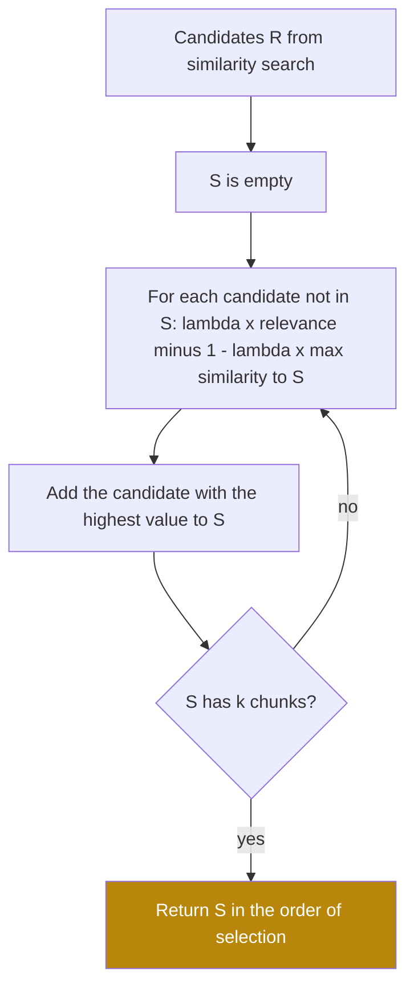

## 1. The question this idea answers

I retrieve the top 5 chunks for "What is our refund policy?". Chunks 1, 2 and 3 are the same paragraph. One comes from the policy page and one from the FAQ that copies it. The third overlaps with chunk 1 because of the chunk overlap of Part 4. The rule for digital products is at rank 7, so it never reaches the window.

Three of my five chunks carry one fact. I paid for 5 chunks of tokens and got 3 chunks of information. How do I choose $k$ chunks that are relevant **and** different from each other?

## 2. Mental model

> [!analogy] Choosing a panel of speakers
> You choose four speakers for a conference panel on one topic. You pick the most relevant expert first. For the second seat, a colleague of the first expert who gives the same talk adds little. A less famous expert with a different view adds more. For each new seat, you ask: "How relevant is this person, and how much do they repeat someone already on the panel?"
>
> **Where it stops working:** MMR judges "repeats" by embedding similarity. Two chunks can look almost the same and still differ in one key fact, for example two versions of a policy with different deadlines. MMR may drop the one that you need. Also, diversity can cost relevance: the plain top $k$ always has the highest total relevance.

## 3. Terms

| Term | Plain meaning |
|---|---|
| redundancy | Several retrieved chunks carry the same information, so they use tokens without adding facts. |
| near-duplicate | A chunk whose text or embedding is almost the same as another chunk. |
| Maximal Marginal Relevance (MMR) | A selection method that adds chunks one at a time. Each time, it chooses the chunk with the best balance of relevance to the query and difference from the chunks already chosen. |
| marginal relevance | The value that one more chunk adds, given the chunks already chosen. |
| $\lambda$ (lambda) | The MMR weight between relevance and diversity, from 0 to 1. 1 gives the plain relevance ranking. 0 gives maximal diversity. |
| $\text{Sim}_1$ | In MMR, the similarity between a candidate chunk and the query. |
| $\text{Sim}_2$ | In MMR, the similarity between two chunks. |
| candidate set $R$ | The chunks that MMR may choose from, for example the top 20 of a similarity search. |
| selected set $S$ | The chunks that MMR has already chosen. |
| greedy algorithm | An algorithm that makes the best choice at each step and never changes an earlier choice. |
| `fetch_k` | In LangChain, the number of candidates that the vector store returns before MMR selects from them. |
| `lambda_mult` | LangChain's name for $\lambda$ in MMR search. |

## 4. Method and math

### 4.1 Where redundancy comes from

| Source | Example |
|---|---|
| Chunk overlap | With 15% overlap, the end of chunk N repeats at the start of chunk N + 1 (Part 4, [Chunking](/notes/ai/context-engineering/04-write-and-rag/l5-chunking)). |
| Copied content | A policy paragraph appears on the policy page, in the FAQ and in a support macro. |
| Versions | The 2024 and 2025 handbooks both hold the same section. |
| One dense topic | Several chunks of one long page all match the query, and the other pages that the user needs rank lower. |

Similarity search ranks each chunk by its own relevance. It ignores the other chunks. So the more a fact repeats in the corpus, the more seats it takes in the top $k$.

### 4.2 The MMR formula

Carbonell and Goldstein introduced MMR at SIGIR 1998:

$$
\text{MMR} = \operatorname*{arg\,max}_{D_i \in R \setminus S} \Big[ \lambda\, \text{Sim}_1(D_i, Q) - (1 - \lambda) \max_{D_j \in S} \text{Sim}_2(D_i, D_j) \Big]
$$

The symbols mean:

- $Q$ is the query.
- $R$ is the candidate set. $S$ is the set already selected. $R \setminus S$ is the set of candidates not yet selected.
- $D_i$ is one candidate. $D_j$ is one chunk already selected.
- $\text{Sim}_1(D_i, Q)$ is the relevance of $D_i$ to the query.
- $\max_{D_j \in S} \text{Sim}_2(D_i, D_j)$ is the similarity of $D_i$ to the **closest** chunk already selected. It measures redundancy.
- $\lambda$ is a number between 0 and 1.
- $\operatorname{arg\,max}$ returns the candidate with the highest value in the brackets, not the value.

The paper states the two ends. With $\lambda = 1$, MMR "computes incrementally the standard relevance-ranked list". With $\lambda = 0$, it "computes a maximal diversity ranking among the documents in R".

### 4.3 The greedy loop

The formula picks **one** chunk. MMR repeats it until it has $k$ chunks:

1. Start with $S$ empty.
2. For each candidate not in $S$, compute the value in the brackets. When $S$ is empty, the redundancy term is 0. So for any $\lambda > 0$ the first pick is the most relevant candidate.
3. Add the candidate with the highest value to $S$.
4. If $S$ has $k$ chunks, stop. Otherwise go to step 2. The redundancy of each candidate can change, because $S$ now holds one more chunk.

The loop is greedy. It never removes a chunk that it chose earlier, even if a later choice makes the earlier one less useful.



### 4.4 A full example by hand

> [!example] Worked example: four candidates, $\lambda = 0.5$, $k = 3$
> Relevance to the query, $\text{Sim}_1$:
>
> | Candidate | A | B | C | D |
> |---|---|---|---|---|
> | $\text{Sim}_1$ | 0.90 | 0.88 | 0.75 | 0.60 |
>
> Similarity between candidates, $\text{Sim}_2$. A and B are near-duplicates:
>
> | | A | B | C | D |
> |---|---|---|---|---|
> | A | — | 0.95 | 0.30 | 0.20 |
> | B | 0.95 | — | 0.35 | 0.25 |
> | C | 0.30 | 0.35 | — | 0.40 |
> | D | 0.20 | 0.25 | 0.40 | — |
>
> **Step 1** ($S$ empty, redundancy 0). Values $0.5 \times \text{Sim}_1$: A 0.450, B 0.440, C 0.375, D 0.300. Select **A**.
>
> **Step 2** ($S = \{A\}$). Redundancy is the similarity to A.
>
> - B: $0.5 \times 0.88 - 0.5 \times 0.95 = 0.440 - 0.475 = -0.035$
> - C: $0.5 \times 0.75 - 0.5 \times 0.30 = 0.375 - 0.150 = 0.225$
> - D: $0.5 \times 0.60 - 0.5 \times 0.20 = 0.300 - 0.100 = 0.200$
>
> Select **C**.
>
> **Step 3** ($S = \{A, C\}$). Redundancy is the larger similarity to A or C.
>
> - B: $\max(0.95, 0.35) = 0.95$, so $0.440 - 0.475 = -0.035$
> - D: $\max(0.20, 0.40) = 0.40$, so $0.300 - 0.200 = 0.100$
>
> Select **D**.
>
> **Result:** A, C, D. Plain top-3 by relevance is A, B, C. MMR removed B, the near-duplicate of A, and added D.

Note step 3: D's redundancy grew from 0.20 to 0.40, because C is now in $S$ and D is similar to C. That update is why the loop must recompute the values after each pick.

### 4.5 The role of $\lambda$

In the example, the selection changes at three values of $\lambda$. At step 2, each value is a straight line in $\lambda$:

- B: $0.88\lambda - 0.95(1 - \lambda) = 1.83\lambda - 0.95$
- C: $0.75\lambda - 0.30(1 - \lambda) = 1.05\lambda - 0.30$
- D: $0.60\lambda - 0.20(1 - \lambda) = 0.80\lambda - 0.20$

> [!example] Worked example: where the choice changes
> - C beats D at step 2 when $1.05\lambda - 0.30 > 0.80\lambda - 0.20$, which gives $\lambda > 0.4$.
> - B beats C at step 2 when $1.83\lambda - 0.95 > 1.05\lambda - 0.30$, which gives $\lambda > 0.65 / 0.78 = 0.833$.
> - After A and C, B beats D at step 3 when $1.83\lambda - 0.95 > \lambda - 0.40$, which gives $\lambda > 0.55 / 0.83 = 0.663$.
>
> | $\lambda$ | Selected, in order |
> |---|---|
> | below 0.4 | A, D, C |
> | 0.4 to 0.663 | A, C, D |
> | 0.663 to 0.833 | A, C, B |
> | above 0.833 | A, B, C (the plain top 3) |

So $\lambda$ is not a percentage of diversity. Its effect depends on the actual similarity values. With these numbers, any $\lambda$ above 0.833 gives the plain ranking. With more similar candidates, the same $\lambda$ can behave differently. Tune it on your own data.

> [!note] Source check: the MMR formula in the handbook
> **Corrected.** The handbook (Session 3, §10.2.2) gives $\text{MMR} = \lambda \cdot \text{Sim}(q, d_i) - (1 - \lambda) \cdot \max_{d_j \in S} \text{Sim}(d_i, d_j)$. That is the value for **one** candidate. It omits two parts. The first is the $\arg\max$ over the candidates not yet selected ($R \setminus S$). The second is the greedy loop that repeats the choice $k$ times and updates $S$. Without them, a reader can compute one score per chunk and sort once, which is not MMR. The handbook's "λ = 0.5 Balanced (good default)" matches LangChain's default. Source: Carbonell and Goldstein, SIGIR 1998.

### 4.6 MMR in LangChain

LangChain's vector-store interface has MMR built in (checked on 2026-10-12):

```python
docs = vector_store.max_marginal_relevance_search(
    query, k=4, fetch_k=20, lambda_mult=0.5
)
```

| Parameter | Default | Meaning |
|---|---|---|
| `k` | 4 | Chunks to return. |
| `fetch_k` | 20 | Candidates to fetch by similarity before MMR selects. This is the size of $R$. |
| `lambda_mult` | 0.5 | $\lambda$. The docstring: "0 corresponding to maximum diversity and 1 to minimum diversity". |

`as_retriever(search_type="mmr")` uses the same defaults. The ratio of `fetch_k` to `k` matters. If `fetch_k` equals `k`, MMR can only reorder the same chunks and cannot add diversity.

### 4.7 The cost of MMR

MMR needs the embedding of every candidate, to compute $\text{Sim}_2$. With the redundancy of each candidate stored and updated after each pick, step $t$ needs one new similarity for each remaining candidate.

> [!example] Worked example: the work for LangChain's defaults
> $k = 4$, `fetch_k` = 20.
>
> - Step 1: no $\text{Sim}_2$ needed.
> - Steps 2, 3 and 4: $19 + 18 + 17 = 54$ new similarities.
>
> With 384-dimensional vectors, that is 54 dot products of 384 numbers each: almost nothing next to the vector search and the LLM call.

So MMR is cheap. Its real cost is the extra candidates that the vector store must return and the risk of dropping a relevant chunk.

### 4.8 Use MMR with care

**$\text{Sim}_1$ and $\text{Sim}_2$ must be on similar scales.** MMR subtracts one from the other. If $\text{Sim}_1$ is a cross-encoder score (lesson [5.3](/notes/ai/context-engineering/05-retrieval-quality/l3-rerankers)) and $\text{Sim}_2$ is a cosine similarity, the value of $\lambda$ loses its meaning. Use cosine for both, or rescale both to the same range.

**Simpler tools may be enough.**

| Problem | Simpler fix |
|---|---|
| Exact copies of a chunk | Remove duplicates by hash at indexing time (lesson [5.9](/notes/ai/context-engineering/05-retrieval-quality/l9-beyond-basic-rag)). |
| Many chunks from one long page | A cap such as "at most 2 chunks per source document". |
| A question with two named parts | Decomposition (lesson [5.4](/notes/ai/context-engineering/05-retrieval-quality/l4-query-transformation)). |

**When diversity hurts.** For a question with one precise answer, the top chunk and a near-copy may both be fine. The chunk that MMR adds instead may be noise. Two chunks can look alike but differ in one fact, such as two versions of a policy. MMR can then drop the one that the user needs. In that case, filter by version or date with metadata first.

### 4.9 Production view

| Concern | What this lesson means for it |
|---|---|
| Cost | MMR itself is cheap. Fewer redundant chunks mean fewer wasted tokens in the window. |
| Latency | The vector store must return `fetch_k` candidates with their vectors. The selection adds almost nothing. |
| Quality | Measure coverage on multi-aspect questions and accuracy on single-fact questions. MMR can help one and hurt the other. |
| Reliability | Keep $\text{Sim}_1$ and $\text{Sim}_2$ on the same scale. Retune $\lambda$ after an embedding-model change. |
| Observability | Log the plain top $k$ and the MMR top $k$. Each chunk that MMR dropped should be a real near-duplicate. |

## 5. Graphs

```plot
{
  "title": "Step-2 MMR values of the worked example after A is chosen: B (red), C (blue), D (gold)",
  "xAxis": { "label": "lambda", "domain": [0, 1] },
  "yAxis": { "label": "MMR value", "domain": [-1, 0.9] },
  "disableZoom": true,
  "data": [
    { "fn": "1.83*x - 0.95", "color": "#C81D25" },
    { "fn": "1.05*x - 0.30", "color": "#1E6091" },
    { "fn": "0.80*x - 0.20", "color": "#B8860B" }
  ]
}
```

The highest line wins step 2. Gold (D) is highest below $\lambda = 0.4$. Blue (C) is highest from 0.4 to 0.833. Red (B, the near-duplicate) is highest above 0.833.

## 6. Code

These exercises go in `notebooks/05-retrieval-quality.ipynb`. Put the MMR function in `src/retrieval/mmr.py` and its tests in `tests/test_mmr.py`.

**Exercise 5.1: MMR from similarity values.**

1. Write `mmr_select(rel, sim, k, lam) -> list[int]`. `rel` is a list of $\text{Sim}_1$ values and `sim` is a square matrix of $\text{Sim}_2$ values.
2. Keep an array of the current redundancy of each candidate. Update it after each pick instead of recomputing all maximums.

Acceptance tests:

- The data of section 4.4 with `lam=0.5` gives A, C, D.
- `lam=0.7` gives A, C, B. `lam=0.9` gives A, B, C. `lam=0.3` gives A, D, C.
- `lam=1.0` returns the plain relevance order for any input.
- `k` larger than the number of candidates returns all candidates without an error.

**Exercise 5.2: MMR from vectors.**

1. Write `mmr(query_vec, cand_vecs, k, lam)` that computes cosine values for $\text{Sim}_1$ and $\text{Sim}_2$ and then calls `mmr_select`.
2. Count the new similarity computations. Reproduce the 54 of section 4.7 for $k = 4$ and 20 candidates.

Acceptance tests:

- For random unit vectors, `mmr` returns the same indices as `mmr_select` on the cosine values that you compute separately.
- The counter shows 54 for $k = 4$ and 20 candidates.
- With `lam=1.0`, the result is the top $k$ by cosine similarity to the query.

**Exercise 5.3: redundancy on a real corpus.**

1. Chunk 5 documents of your corpus with 20% overlap, so that neighbors share text.
2. Write 10 questions that need facts from two or more documents. Compare plain top 5 against MMR top 5 with `fetch_k=20` and $\lambda$ = 0.5 and 0.7.
3. For each setting, report two numbers: the mean pairwise cosine similarity of the 5 chunks, and the number of distinct source documents.

Acceptance tests:

- A table with three rows (plain, $\lambda$ = 0.7, $\lambda$ = 0.5) and two columns.
- One example where MMR dropped a chunk. Say whether that chunk held a fact that no selected chunk held.

**Exercise 5.4 (optional): compare with LangChain.** Run `max_marginal_relevance_search` on an in-memory vector store with the same vectors.

Acceptance test: for the same `k`, `fetch_k` and $\lambda$, it returns the same chunks as your function.

## 7. Common mistakes

1. **"MMR scores each chunk once, then sorts."** MMR is a greedy loop. The redundancy of each candidate changes after every pick.
2. **"λ = 0.5 means half relevance, half diversity in the result."** The effect of $\lambda$ depends on the similarity values. In the example, any $\lambda$ above 0.833 gives the plain ranking.
3. **"`fetch_k` = `k` is fine."** Then MMR has no other candidates to choose from.
4. **"Use the reranker score as relevance and cosine as redundancy."** The two scales differ, so the subtraction in MMR is no longer balanced.
5. **"Diversity always helps."** Two chunks that look alike can differ in one key fact. Filter by version or date before MMR.
6. **"MMR fixes exact duplicates."** Remove exact duplicates at indexing time. MMR is for near-duplicates at query time.

## 8. One-minute explanation

Similarity search ranks each chunk alone, so a fact that repeats in the corpus can fill several of the top seats. Maximal Marginal Relevance picks chunks one at a time. For each candidate, it takes lambda times its relevance to the query, minus one minus lambda times its similarity to the closest chunk already picked. It adds the candidate with the highest value and repeats until it has k chunks. With lambda equal to 1 it gives the plain ranking. With lambda equal to 0 it gives maximal diversity. The first pick is always the most relevant chunk, and later picks avoid near-duplicates. The effect of lambda depends on the real similarity values, so tune it on your data. LangChain's defaults are k = 4, fetch_k = 20 and lambda_mult = 0.5. The handbook's formula omits the arg max and the loop.

## 9. Check questions

```check
{
  "question": "Candidates: A (Sim1 0.80), B (0.78), C (0.60). Sim2: A–B 0.90, A–C 0.20, B–C 0.30. With λ = 0.6 and k = 2, which two chunks does MMR choose?",
  "hint": "Step 1 picks the most relevant. Step 2 uses the similarity to A.",
  "answer": "Step 1: A. Step 2: B = 0.6 × 0.78 − 0.4 × 0.90 = 0.468 − 0.360 = 0.108. C = 0.6 × 0.60 − 0.4 × 0.20 = 0.360 − 0.080 = 0.280. C wins. Result: A, C."
}
```

```check
{
  "question": "In the previous question, for which values of λ does MMR choose B second instead of C?",
  "answer": "B wins when 0.78λ − 0.90(1 − λ) > 0.60λ − 0.20(1 − λ). That is 1.68λ − 0.90 > 0.80λ − 0.20, so 0.88λ > 0.70, which gives λ > 0.795."
}
```

```check
{
  "question": "A team uses MMR with k = 5 and fetch_k = 5. Users still see redundant chunks. Why?",
  "answer": "MMR can only choose among the fetch_k candidates. With fetch_k = k, all 5 candidates are returned whatever λ is, so MMR only changes their order. Raise fetch_k, for example to 20, so that MMR can replace near-duplicates with other chunks."
}
```

```check
{
  "question": "The refund policy exists in a 2024 version and a 2025 version. The two chunks have cosine similarity 0.97. A user asks about the current refund deadline. What can go wrong with MMR, and what should come first?",
  "answer": "MMR treats the two chunks as near-duplicates and keeps only one. If it keeps the 2024 chunk because it ranked slightly higher, the model answers with the old deadline. First filter by version or effective date with metadata, so that only the current policy can be retrieved. Then apply MMR if needed."
}
```

## 10. Links

- Previous: [L4: Query transformation](/notes/ai/context-engineering/05-retrieval-quality/l4-query-transformation)
- Next: [L6: Retrieval budgets and chunk order](/notes/ai/context-engineering/05-retrieval-quality/l6-retrieval-budgets-and-order)
- Part 4: [Chunking](/notes/ai/context-engineering/04-write-and-rag/l5-chunking): overlap creates near-duplicates
- [Glossary](/notes/ai/context-engineering/glossary)
