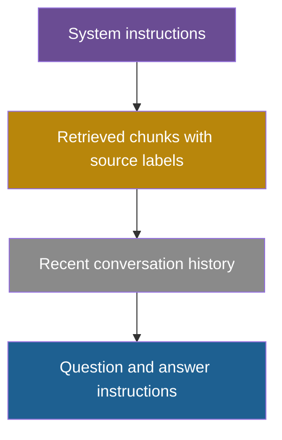

## 1. The question this idea answers

The retriever and the reranker return a ranked list of chunks. The last step of SELECT puts some of them into the context window. Four decisions remain:

1. **How many tokens** may the chunks use?
2. **Which chunks** fill that space, when they have different sizes?
3. **How are they labeled**, so that the model can say where each fact came from?
4. **In which order** do they go, given that position changes accuracy (lesson [1.5](/notes/ai/context-engineering/01-foundations/l5-position-and-length-effects))?

The handbook answers the first question with a fixed split and gives code for the second (Session 3, §8). Both need corrections. This lesson builds each decision from first principles.

## 2. Mental model

> [!analogy] Packing a carry-on bag
> A carry-on bag has a size limit. You plan the space first: room for clothes, for a laptop, for the things you need on the flight. Then you pack the most important items. When one item does not fit, you do not stop packing. You put it aside and try the smaller items. You label the pouches so that you can find things fast. You put what you need first at the top or at the side pocket, not at the bottom.
>
> - The bag's limit is the **context window**.
> - The planned spaces are the **budget split**.
> - Skipping an item that does not fit is **skip packing**.
> - The labels are **source labels**.
> - The top and the side pocket are the **edges of the window**.
>
> **Where it stops working:** items in a bag do not affect each other. Chunks do: a second chunk with the same fact adds nothing (lesson [5.5](/notes/ai/context-engineering/05-retrieval-quality/l5-diversity-with-mmr)). Also, a bag has no "middle" where items become harder to use. A model's window does.

## 3. Terms

| Term | Plain meaning |
|---|---|
| token budget | The largest number of tokens that one part of the input may use on a call. |
| budget split | The planned division of the window between instructions, history, retrieved chunks, the question and the output. |
| output reserve | The window space kept free for the answer. It must be at least the `max_tokens` value of the call. |
| packing | Choosing which ranked chunks go into the retrieval budget. |
| break packing | Packing that stops at the first chunk that does not fit. |
| skip packing | Packing that skips a chunk that does not fit and tries the next one. |
| knapsack problem | The problem of choosing items with sizes and values so that the total value is highest and the total size stays within a limit. |
| value density | The value of a chunk divided by its size in tokens. |
| source label | A short tag around each chunk, with an ID and its source, so that the model can name the source of a fact. |
| citation | A reference in the answer to the source label of the chunk that supports a claim. |
| metadata enrichment | Adding the title, section heading and other metadata to the chunk text at indexing time, so that the search can match them. |
| contextual chunk prefix | A short text before a chunk that says where the chunk comes from and what it is about. |
| chunk order | The sequence of the retrieved chunks in the window. |

## 4. Method and math

### 4.1 The budget equation

Lesson [1.1](/notes/ai/context-engineering/01-foundations/l1-what-a-model-does-with-context) gives the hard limit: the input and the output share the window. For a RAG call, write the input as parts:

$$
I + H + C + q + O \le W
$$

The symbols mean:

- $W$ is the window size of the model, in tokens.
- $I$ is the instructions: system prompt and tool definitions.
- $H$ is the conversation history that the call sends.
- $C$ is the retrieved chunks, with their labels.
- $q$ is the current question.
- $O$ is the output reserve. Set it to the `max_tokens` value of the call.

So the largest possible retrieval budget is:

$$
C_{\max} = W - I - H - q - O
$$

> [!example] Worked example: two windows
> **A 4,000-token window** (the handbook's example): $I = 600$, $H = 600$, $q = 50$, $O = 400$. Then $C_{\max} = 4{,}000 - 600 - 600 - 50 - 400 = 2{,}350$ tokens.
>
> **A 200,000-token window:** $I = 3{,}000$, $H = 8{,}000$, $q = 50$, $O = 4{,}000$. Then $C_{\max} = 200{,}000 - 15{,}050 = 184{,}950$ tokens.
>
> The second budget is a **limit**, not a target. Lesson 1.5 showed that accuracy can fall as the input grows, and lesson 1.6 showed that every token is billed on every call. Retrieval should send the chunks that the question needs, then stop.

### 4.2 The 15/60/15/10 split is a rule of thumb

The handbook gives a "default budget" (Session 3, §8.1): about 15% instructions, 60% retrieved context, 15% history and 10% generation. For a 4,000-token budget, that is 600, 2,400, 600 and 400 tokens. The handbook's own FAQ (Q12) calls these numbers "a starting heuristic, not a rigid rule". Treat the split as a **rule of thumb** and measure.

A split by percentages has three weak points:

1. **The instructions have a fixed size.** A 600-token system prompt is 600 tokens in a 4K window and in a 200K window. A percentage gives it 30,000 tokens in the larger window.
2. **The output reserve must hold the longest answer.** The handbook says "Always reserve 10% for the model's output". The right rule is $O \ge$ `max_tokens`. A 10% share of a small window can be shorter than the answer that you need (Part 7, [Token budgets](/notes/ai/context-engineering/07-compress-and-isolate/l6-token-budgets)).
3. **More retrieved tokens are not always better.** The FAQ notes that 60% of a 128K window is about 77K tokens ($0.6 \times 128{,}000 = 76{,}800$). Filling that space with marginal chunks adds cost and can lower accuracy.

A better plan uses fixed sizes for fixed parts and limits for the rest:

| Part | Rule |
|---|---|
| Instructions $I$ | Measure it. It is fixed for a given prompt version. |
| Output reserve $O$ | Set it to `max_tokens`, sized for the longest expected answer. |
| History $H$ | A limit, for example the last $n$ turns or a token cap. Compress beyond it (Part 7). |
| Retrieved chunks $C$ | The smaller of three limits: $C_{\max}$, a planned cap such as 2,400 tokens, and the chunks that pass a relevance threshold. |

### 4.3 Packing: skip, do not stop

The ranked chunks have different sizes. The handbook's code (Listing 4) stops at the first chunk that does not fit. That is **break packing**. **Skip packing** tries the next chunk instead.

> [!example] Worked example: break, skip and best
> Retrieval budget: 2,400 tokens. Five ranked chunks:
>
> | Rank | Chunk | Relevance | Tokens |
> |---|---|---|---|
> | 1 | C1 | 0.92 | 900 |
> | 2 | C2 | 0.85 | 1,300 |
> | 3 | C3 | 0.80 | 700 |
> | 4 | C4 | 0.55 | 200 |
> | 5 | C5 | 0.50 | 500 |
>
> **Break packing:** C1 (900), C2 (2,200). C3 would give 2,900, so the loop stops. Result: C1, C2. 2,200 tokens, relevance sum 1.77. C4 still fits but is never tried.
>
> **Skip packing:** C1 (900), C2 (2,200), skip C3, C4 (2,400), skip C5. Result: C1, C2, C4. 2,400 tokens, relevance sum 2.32.
>
> **Best total relevance (knapsack):** C1, C3, C4, C5. $900 + 700 + 200 + 500 = 2{,}300$ tokens, relevance sum $0.92 + 0.80 + 0.55 + 0.50 = 2.77$. It omits C2, the second-best chunk, because C2 is large.

Skip packing is never worse than break packing on the same ranking: it keeps every chunk that break packing keeps and may add more. The knapsack view goes further. It chooses the set with the highest total value under the size limit:

$$
\max_{x} \sum_{i=1}^{n} v_i x_i \quad \text{subject to} \quad \sum_{i=1}^{n} t_i x_i \le B, \quad x_i \in \{0, 1\}
$$

The symbols mean:

- $n$ is the number of candidate chunks.
- $v_i$ is the value of chunk $i$, for example its reranker score.
- $t_i$ is its size in tokens.
- $B$ is the retrieval budget.
- $x_i$ is 1 if chunk $i$ enters the context, and 0 if it does not.

For a few dozen chunks, dynamic programming solves this exactly in a fraction of a second. A simpler rule sorts by **value density** $v_i / t_i$ and packs with skip. In the example, density order is C4, C3, C1, C5, C2, and it finds the same best set.

> [!trap] The knapsack is only as good as its values
> The sum of relevance scores is a model, not the truth. A large chunk can hold the one fact that the question needs. Two small chunks with high scores can repeat each other. Use the knapsack with diversity (lesson [5.5](/notes/ai/context-engineering/05-retrieval-quality/l5-diversity-with-mmr)) and check the result on labeled questions.

### 4.4 Source labels: the model can only cite what it can see

The handbook's Listing 4 joins the chunks with `"\n---\n"` and then tells the model: "Answer using ONLY the provided context. Cite sources." The context has no sources in it. The model has no IDs, file names or titles to cite, so it either cites nothing or invents a source.

Wrap each chunk in a label that carries an ID and its metadata:

```text
<source id="S1" doc="refund-policy.md" section="Digital products" updated="2026-03-01">
Digital products can be refunded within 14 days if they were not downloaded.
</source>
<source id="S2" doc="faq.md" section="Returns" updated="2025-11-20">
Physical products can be returned within 30 days.
</source>

Answer only from the sources above. After each claim, cite its source ID in brackets, for example [S1]. If the sources do not contain the answer, say so.
```

Then **check the citations in code** after the call:

1. Every cited ID must exist in the context. An unknown ID is an invented citation.
2. Optionally, the cited chunk must contain the key terms or numbers of the claim.
3. Log the result. A rising rate of invented citations is an early sign of a problem.

> [!example] Worked example: the cost of labels
> The opening and closing tags of the first label above use 30 tokens with the `o200k_base` tokenizer. Five labeled chunks use about 150 tokens of labels. Count the labels inside the retrieval budget $C$, not outside it. In a 2,400-token budget, that is about 6% of the space.

### 4.5 Metadata enrichment and contextual prefixes

Metadata has two jobs, at two different times. Keep them apart.

| When | What | Example | Purpose |
|---|---|---|---|
| Indexing time | Metadata enrichment of the chunk text | "From: API Reference > Authentication > OAuth2 Flow: ..." | The embedding and BM25 can match the title and the section, not only the body. |
| Indexing time | Metadata fields stored next to the chunk | `doc_type="api"`, `updated="2026-03-01"`, `tenant_id="acme"` | Filters before or during the search (Part 4, [Vector search](/notes/ai/context-engineering/04-write-and-rag/l7-vector-search)). |
| Prompt time | Source labels | `<source id="S1" doc="...">` | The model can cite, and the reader can check. |

The handbook (Session 3, FAQ Q21) calls a title and section header before each chunk "one of the highest-ROI improvements you can make to a RAG pipeline". That is a rule of thumb without a measurement. Anthropic's contextual retrieval is the measured version of the same idea. It adds an LLM-written prefix of 50 to 100 tokens. Contextual embeddings alone cut failed retrievals by 35% (lesson [5.2](/notes/ai/context-engineering/05-retrieval-quality/l2-hybrid-search-and-rrf)). Start with the free title-and-section prefix, then measure whether an LLM-written prefix adds more.

### 4.6 Chunk order in the window

Lesson 1.5 showed the position effect. Liu et al. (TACL 2024) found that "performance is often highest when relevant information occurs at the beginning or end of the input context". For GPT-3.5-Turbo with 20 documents, accuracy was 75.8% with the answer document first, 53.8% in position 10 and 63.2% in position 20.

Anthropic's prompting guide gives a related rule: put long documents near the top, above the question, and put the question at the end. It reports that this can improve response quality "by up to 30 percent in tests" (lesson 1.5).

So a RAG prompt usually has this layout:



Within block B, two orders are common:

| Order | Positions of ranks 1 to 5 | Idea |
|---|---|---|
| Rank order | 1, 2, 3, 4, 5 | The best chunk is first, at the start edge. |
| Edges order | 1, 3, 5, 4, 2 | The best chunk is first and the second-best is last, so the weakest chunks sit in the middle. |

> [!note] Source check: "Place the most relevant chunk first, closest to the query"
> **Corrected.** The handbook (Session 3, FAQ Q24) says: "Place the most relevant chunk first, closest to the query". If the question comes after the chunks, as Anthropic recommends, the first chunk is the **farthest** from the question. The two halves of the advice conflict. The evidence supports this version. Put the most relevant chunks at the edges of the context, and put the long material before the question. Then measure rank order against edges order on your model. Sources: Liu et al., TACL 2024. Anthropic, "Prompting best practices", checked on 2026-10-12.

With 3 to 5 chunks, the middle is short, and the order matters less than with 20. The research track tests this question directly ([Retrieval order](/notes/ai/context-engineering/11-research-track/e2-retrieval-order)).

### 4.7 Production view

| Concern | What this lesson means for it |
|---|---|
| Reliability | Compute $C_{\max}$ on every call from measured sizes. Never let the input crowd out `max_tokens`. |
| Quality | Use skip packing or a knapsack, not break packing. Cap the chunks by relevance, not only by space. |
| Cost | The budget is a limit. Sending fewer, better chunks lowers the input bill on every call (lesson [1.6](/notes/ai/context-engineering/01-foundations/l6-the-cost-of-a-conversation)). |
| Trust | Label every chunk with an ID and a source. Check every citation in code. |
| Caching | Retrieved chunks change per question, so they break the cache prefix. Put stable instructions first and the chunks after them (lesson [1.7](/notes/ai/context-engineering/01-foundations/l7-prompt-caching)). |
| Observability | Log the budget numbers, the chosen chunks with their sizes, the dropped chunks and the reason for each drop. |

## 5. Code

These exercises go in `notebooks/05-retrieval-quality.ipynb`. Put the reusable parts in `src/retrieval/pack.py` and `src/retrieval/context.py`, with tests in `tests/`.

**Exercise 6.1: the budget calculator.**

1. Write `retrieval_budget(window, instructions, history, question, max_tokens, cap=None) -> int`.
2. Count tokens with the tokenizer of your target model (lesson [1.2](/notes/ai/context-engineering/01-foundations/l2-tokens-and-tokenizers)).

Acceptance tests:

- The 4,000-token example of section 4.1 returns 2,350.
- With `cap=2400` and a 200,000-token window, it returns 2,400.
- A negative result raises a `ValueError` that names the part that is too large.

**Exercise 6.2: three packers.**

1. Write `pack_break`, `pack_skip` and `pack_knapsack`. Each takes a list of `(chunk_id, value, tokens)` and a budget.
2. Solve the knapsack with dynamic programming over the budget.

Acceptance tests:

- The five chunks of section 4.3 give C1, C2 (break), C1, C2, C4 (skip), and C1, C3, C4, C5 (knapsack).
- On 1,000 random inputs, the value of `pack_skip` is never below `pack_break`, and `pack_knapsack` is never below `pack_skip`.

**Debug exercise 6.3: the handbook's budget code.** This is the core of Listing 4 (Session 3, §8.2). Find every bug, then write a fixed version.

```python
budget = {
    'instructions': int(max_context_tokens * 0.15),
    'retrieved':    int(max_context_tokens * 0.60),
    'history':      int(max_context_tokens * 0.15),
    'generation':   int(max_context_tokens * 0.10),
}
results = collection.query(query_texts=[query], n_results=10)
selected_chunks, tokens_used = [], 0
for doc in results['documents'][0]:
    doc_tokens = count_tokens(doc)
    if tokens_used + doc_tokens <= budget['retrieved']:
        selected_chunks.append(doc)
        tokens_used += doc_tokens
    else:
        break    # budget exhausted
context = "\n---\n".join(selected_chunks)
system = "Answer using ONLY the provided context. Cite sources."
prompt = f"Context:\n{context}\n\nQuestion: {query}"
return call_llm(prompt=prompt, model=model, system=system)
```

Acceptance tests for your fixed version:

- A small chunk after a large one that does not fit is still included.
- The context string contains one source label with an ID for each chunk.
- The call sets `max_tokens` to the output reserve.
- An empty result list produces a prompt that tells the model to say that it has no information.

The answer is in the check questions below. Try it first.

**Exercise 6.4: labels and a citation checker.**

1. Write `build_context(chunks) -> str`. It wraps each chunk in a `<source>` label with an ID, the document name, the section and the date.
2. Write `check_citations(answer, context_ids) -> dict` that finds every `[S…]` in the answer and reports unknown IDs.

Acceptance tests:

- An answer that cites `[S7]` when only S1 to S5 exist is flagged.
- An answer with no citations is flagged as "uncited".

**Exercise 6.5 (optional, costs money): order test.** For 20 labeled questions with 5 chunks each, compare rank order and edges order. Record accuracy and the share of answers with valid citations.

## 6. Common mistakes

1. **"60% of the window goes to retrieval."** The split is a rule of thumb. For a large window, the budget is a limit, not a target.
2. **"Reserve 10% for the output."** Reserve at least `max_tokens`. The output must fit, whatever the window size.
3. **"`break` when the budget is full."** The first chunk that does not fit does not mean that nothing else fits. Skip it and try the rest.
4. **"Tell the model to cite sources."** It can only cite IDs that appear in the context. Label every chunk, then check the citations in code.
5. **"Put the best chunk first, closest to the question."** With the question at the end, the first chunk is the farthest from it. Put the strongest chunks at the edges and measure.
6. **"Count only the chunk text."** Labels, separators and the prompt template also use tokens.

## 7. One-minute explanation

Retrieved chunks share the window with the instructions, the history, the question and the answer. The space left for chunks is the window minus all the other parts, and the output reserve must be at least max_tokens. The handbook's 15/60/15/10 split is a rule of thumb, and on a large window the retrieval budget is a limit, not a target. To fill the budget, skip a chunk that does not fit and try the next one. Do not stop at the first one, as the handbook's code does. A knapsack view can find a better set when chunk sizes differ a lot. Wrap each chunk in a source label with an ID, because the model can only cite what it can see. Check every citation in code. Put the chunks before the question, keep the strongest ones at the edges, and measure the order on your own model.

## 8. Check questions

```check
{
  "question": "A model has a 32,000-token window. The system prompt and tools use 2,500 tokens, the history 6,000, the question 80, and max_tokens is 2,000. The team caps retrieval at 4,000 tokens. What is the retrieval budget?",
  "hint": "C_max = W − I − H − q − O, then take the smaller of C_max and the cap.",
  "answer": "C_max = 32,000 − 2,500 − 6,000 − 80 − 2,000 = 21,420. The cap is 4,000, so the budget is min(21,420, 4,000) = 4,000 tokens."
}
```

```check
{
  "question": "Budget 1,000 tokens. Ranked chunks (value, tokens): A (0.9, 600), B (0.8, 500), C (0.6, 300), D (0.5, 100). Give the result of break packing, skip packing and the best knapsack.",
  "answer": "Break: A (600), then B gives 1,100, so stop. Result A, value 0.9. Skip: A (600), skip B, C (900), D (1,000). Result A, C, D, value 2.0. Knapsack: compare all sets that fit. A + C + D = 1,000 tokens, value 2.0. B + C + D = 900 tokens, value 1.9. A + B does not fit. The best is A, C, D with 2.0."
}
```

```check
{
  "question": "Debug exercise 6.3: list the bugs in the handbook's budget code.",
  "hint": "Examine the loop, at which budget entries are used, and at what the model is asked to do.",
  "answer": "1. break stops at the first chunk that does not fit, so smaller chunks after it are never tried. Use continue (skip packing). 2. Only the retrieval budget is enforced. The instructions, history and generation budgets are computed but never used: the system prompt is not counted, no history is sent, and call_llm gets no max_tokens. 3. The chunks are joined with --- and no source labels, but the system prompt says \"Cite sources\". The model cannot cite what it cannot see, so it invents citations. Fetch the metadata and label each chunk with an ID. 4. count_tokens counts only the chunk text, not the separators, labels and template, and it may use a different tokenizer from the model. 5. All 10 results are used with no relevance threshold, and an empty result gives an empty context with no instruction to abstain."
}
```

```check
{
  "question": "Five chunks are ranked 1 to 5. Write their order in the window for edges order, and explain the idea.",
  "answer": "Positions: 1, 3, 5, 4, 2. The best chunk is first and the second-best is last, so the two strongest chunks sit at the edges. The weakest chunks sit in the middle, where Liu et al. found the lowest accuracy. Measure it against rank order on your model."
}
```

```check
{
  "question": "A model answers \"Refunds take 14 days [S9]\", but the context has only S1 to S5. What happened, and how should the application respond?",
  "answer": "The model invented a citation: S9 does not exist in the context. The citation checker must flag it. The application can retry with a stricter instruction, remove the uncited claim, or show the answer as unverified. Log the case, because a rising rate of invented citations shows a prompt or retrieval problem."
}
```

## 9. Links

- Previous: [L5: Diversity with MMR](/notes/ai/context-engineering/05-retrieval-quality/l5-diversity-with-mmr)
- Next: [L7: Just-in-time retrieval](/notes/ai/context-engineering/05-retrieval-quality/l7-just-in-time-retrieval)
- [L1.5: Position and length effects](/notes/ai/context-engineering/01-foundations/l5-position-and-length-effects): why order and length matter
- Part 7: [Token budgets](/notes/ai/context-engineering/07-compress-and-isolate/l6-token-budgets): budgets across a whole agent
- [Glossary](/notes/ai/context-engineering/glossary)
