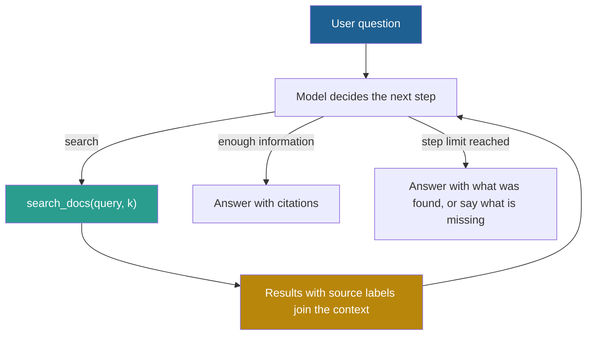

## 1. The question this idea answers

The RAG pipeline of Part 4 retrieves once, before the model runs, with the user's question as the search key. That works for a question-answering bot. It works less well for an agent that fixes a bug in a codebase or answers a question that needs three lookups. Such an agent does not know at the start which files it will need. The second file depends on what the first file says.

Two simple options both fail. Loading every file up front fills the window with irrelevant tokens. Retrieving once with the first question misses what the task needs later. **Just-in-time retrieval** lets the model decide what to load and when, with tools. This lesson explains how it works, what it costs, and when a mix of up-front and on-demand loading is better.

## 2. Mental model

> [!analogy] A desk in a library
> **Eager loading:** a librarian puts all 50 books on your desk before you start. Most of the desk is covered with books you will never open.
>
> **Just in time:** you get the catalog, with titles, shelf numbers and one-line descriptions. You fetch a book when you need it, read the chapter that matters, and return for the next one.
>
> **Hybrid:** the one reference manual that you use every day stays on the desk. Everything else comes from the catalog when needed.
>
> **Where it stops working:** each trip to the shelf takes time. For a model, each trip is one more call in the agent loop. A bad catalog hides books: if the descriptions are vague, the model does not know that the right file exists. And a reader can make many useless trips.

## 3. Terms

| Term | Plain meaning |
|---|---|
| eager loading | Putting all possibly useful content into the context window before the model starts. |
| retrieve-once RAG | The classic pipeline: one retrieval with the user's question, then one model call. |
| just-in-time (JIT) retrieval | The model keeps references to content and loads the content with tools only when a step needs it. |
| lightweight identifier | A short reference to content, such as a file path, a stored query or a URL, that costs few tokens. |
| progressive disclosure | Showing content in levels, from a list to a summary to the full text, so that the model loads detail only where it needs it. |
| agentic RAG | RAG where the model decides whether to search, what to search for, and whether to search again, by calling a retrieval tool. |
| retrieval tool | A tool that the model can call to search a knowledge base, for example `search_docs(query, k)`. |
| hybrid strategy | Loading some content up front for speed and leaving the rest for the model to load on demand. |
| always-loaded file | A file that the application puts into the context on every call, such as CLAUDE.md or AGENTS.md. |
| tool retrieval | Retrieving only the tool descriptions that fit the current request, instead of sending all tool definitions on every call. |
| prompt bloat | Too many tokens of instructions or tool definitions in the input, which raises cost and can lower accuracy. |

## 4. Method and math

### 4.1 Three ways to select content

| | Eager loading | Retrieve-once RAG | Just-in-time retrieval |
|---|---|---|---|
| Who decides what loads | The developer, in advance | The retriever, from the first question | The model, at each step |
| When content loads | Before the first call | Before the first call | During the task, through tool calls |
| Tokens per call | High from the start | Moderate | Low at the start, growing with each read |
| Model calls | 1 | 1 | 1 + the number of tool steps |
| Main failure | Irrelevant tokens, cost, length effects | Misses needs that appear later in the task | Slow, and the model can search badly |

### 4.2 What Anthropic actually describes

Anthropic's "Effective context engineering for AI agents" (29 September 2025) describes the just-in-time approach. Agents built this way "maintain lightweight identifiers (file paths, stored queries, web links, etc.)". They "use these references to dynamically load data into context at runtime using tools". The article says that this "also enables progressive disclosure", and that the metadata of the references helps: "Folder hierarchies, naming conventions, and timestamps all provide important signals".

It also names the cost: "Of course, there's a trade-off: runtime exploration is slower than retrieving pre-computed data."

And it does not end with "always use JIT". It says: "In certain settings, the most effective agents might employ a hybrid strategy, retrieving some data up front for speed, and pursuing further autonomous exploration at its discretion". Its example is Claude Code. CLAUDE.md files go into the context up front, and the agent uses tools such as glob and grep to find other files at runtime. The article adds that "the hybrid strategy might be better suited for contexts with less dynamic content, such as legal or finance work."

> [!note] Source check: "Anthropic recommends JIT over eager loading"
> **Corrected.** The handbook (Session 3, §9.3) says that "Anthropic recommends Just-in-Time (JIT) retrieval over eager pre-loading". It quotes Anthropic: "Start by providing the agent with a lightweight set of identifiers and let the agent decide what to read." That sentence is not in the article. The article describes JIT, names its cost ("runtime exploration is slower"), and says that the most effective agents "might employ a hybrid strategy". The handbook's takeaway "Just-in-time retrieval beats eager pre-loading" (§11) is too strong. Source: Anthropic Engineering, "Effective context engineering for AI agents", 29 September 2025, checked on 2026-10-12.

### 4.3 Light identifiers

A light identifier tells the model that content exists and how to load it, at a small token cost. Good identifiers carry enough metadata for the model to choose.

| Content | Light identifier | Tool to load it |
|---|---|---|
| A code repository | File paths with sizes and one-line descriptions | `read_file(path, start_line, end_line)` |
| A long manual | A table of contents with section IDs | `read_section(section_id)` |
| A database | Table names with one-line descriptions and row counts | `describe_table(name)`, `run_query(sql)` |
| Web sources | URLs with titles | `fetch(url)` |
| A document store | A search tool, without a list | `search_docs(query, k)` |

The handbook's example (Session 3, §9.3): loading all 50 project files costs about 100K tokens. A file list with paths, sizes and descriptions costs about 500 tokens. The model then reads only the files that it needs.

> [!trap] The identifier is the only thing the model sees
> If a file is named `utils2.py` with no description, the model cannot know that it holds the tax rules. JIT depends on good names, good descriptions and a good folder structure. A poor catalog makes JIT miss content that eager loading would include.

### 4.4 The cost of JIT: fewer tokens per call, more calls

JIT saves tokens on each call, but it adds calls. Each tool step is a new model call that sends the whole history again (lesson [1.6](/notes/ai/context-engineering/01-foundations/l6-the-cost-of-a-conversation)). So the right comparison is the **cumulative** input of the task.

Use these assumptions, based on the handbook's example:

- Fixed prefix (system prompt and tools): 2,000 tokens. Question: 50 tokens.
- Eager: all 50 files, 100,000 tokens, in one call.
- JIT: a 500-token file list. Each read adds a 100-token tool call and a 2,000-token file (100,000 / 50).

The JIT task makes $r$ reads and then answers, so it has $r + 1$ calls. Call $i$ (from 0 to $r$) sends:

$$
I_i = 2{,}550 + 2{,}100\, i
$$

The cumulative input of the task is:

$$
C_{\text{JIT}}(r) = \sum_{i=0}^{r} I_i = 2{,}550\,(r + 1) + 2{,}100\,\frac{r(r+1)}{2}
$$

The symbols mean:

- $r$ is the number of file reads.
- 2,550 is the first call: 2,000 (prefix) + 500 (list) + 50 (question).
- 2,100 is what each read adds to the history: 100 (tool call) + 2,000 (file).
- $\frac{r(r+1)}{2}$ counts how often the reads are sent again on later calls.

The eager task sends $2{,}000 + 100{,}000 + 50 = 102{,}050$ tokens in one call.

> [!example] Worked example: when does JIT cost more?
> | Reads $r$ | Model calls | Last call input | Cumulative JIT input | Eager input |
> |---|---|---|---|---|
> | 1 | 2 | 4,650 | 7,200 | 102,050 |
> | 3 | 4 | 8,850 | 22,800 | 102,050 |
> | 5 | 6 | 13,050 | 46,800 | 102,050 |
> | 8 | 9 | 19,350 | 98,550 | 102,050 |
> | 9 | 10 | 21,450 | 120,000 | 102,050 |
>
> Check $r = 3$: $2{,}550 \times 4 + 2{,}100 \times 6 = 10{,}200 + 12{,}600 = 22{,}800$.
>
> With 3 reads, JIT uses 22% of the eager input. From 9 reads on, its cumulative input is higher than eager loading, because each file is sent again on every later call. And every read is one more model round trip, so JIT is slower in time.

Three facts change this picture:

1. **Prompt caching** (lesson [1.7](/notes/ai/context-engineering/01-foundations/l7-prompt-caching)) bills the repeated history at a low read rate, so the quadratic term costs much less.
2. **Quality** is not in the table. Even at 9 reads, the largest JIT call holds 21,450 tokens, against 102,050 for eager. Lesson 1.5 showed that shorter, focused inputs are often more accurate.
3. **Clearing old tool results** (Part 7) removes files that the agent no longer needs, so later calls do not carry them.

### 4.5 Progressive disclosure

Progressive disclosure means that each tool returns the smallest useful level first:

1. **List:** names and one-line descriptions.
2. **Outline:** the headings or the function signatures of one file.
3. **Section:** the lines or the section that matters.
4. **Full text:** only when the task needs all of it.

Design tools for this. A search tool that returns paths and line numbers costs far fewer tokens than one that returns whole files. A `read_file` tool with a line range lets the model read 40 lines instead of 4,000. Part 6 covers tool-result design ([Tool results and errors](/notes/ai/context-engineering/06-tools-and-mcp/l4-tool-results-and-errors)).

### 4.6 Agentic RAG: retrieval as a tool

In agentic RAG, retrieval is a tool that the model calls (handbook Session 3, FAQ Q46). The model decides:

- **whether** to search at all,
- **what** query to use,
- **whether** the results are enough, or a new search is needed.



This is how sequential decomposition (lesson [5.4](/notes/ai/context-engineering/05-retrieval-quality/l4-query-transformation)) happens in practice. The model searches for the owner of Project X and reads the result. Then it searches for that person's manager. The FAQ's example: a first search returns general chunks about "Python Flask". The agent sees that the user asked about "Flask security vulnerabilities in version 2.x", rewrites the query and searches again.

The failure modes are new:

| Failure | Sign | Guard |
|---|---|---|
| The model does not search | It answers from its weights, with no citations. | Require a citation for each claim. Check citations in code (lesson [5.6](/notes/ai/context-engineering/05-retrieval-quality/l6-retrieval-budgets-and-order)). |
| The model searches too much | Many similar queries, rising cost | A step limit and a token budget per task |
| A loop | The same query again and again | Detect repeated tool calls with the same arguments. |
| Weak queries | Short, vague search terms | Describe in the tool definition what a good query looks like. |

The cost is latency and tokens: each search is one more round trip and one more call, as in section 4.4. The FAQ states the same trade-off.

### 4.7 Always-loaded files

Not all selection is dynamic. The handbook (Session 3, §9.2) calls this the "always-select" pattern: files such as CLAUDE.md and AGENTS.md go into the context on every call, without retrieval. This is the "up front" half of the hybrid strategy.

Two rules follow from the cost model:

1. **Keep them short.** An always-loaded file is part of the fixed prefix, so every call of every task pays for it (lesson 1.6).
2. **Put pointers in them, not content.** "API conventions: see `docs/api.md`" is a light identifier inside an always-loaded file. The model reads `docs/api.md` only when it works on the API.

Part 3 covers what goes into these files ([Rules files](/notes/ai/context-engineering/03-system-layer/l5-rules-files)).

### 4.8 Tool retrieval: RAG over tool descriptions

Tools are context too. With 50 or more tools, every call sends every tool definition. The handbook (Session 3, §9.1) proposes RAG over the tool descriptions:

1. Embed all tool descriptions in a vector index.
2. At query time, retrieve the top $k$ tools for the request.
3. Send only those tool definitions with the call.

The measured evidence is the RAG-MCP paper (Gan and Sun, arXiv 2505.03275, May 2025). It retrieves only the relevant MCP tool descriptions. Tool-selection accuracy rose to 43.13% from a 13.62% baseline, which is $43.13 / 13.62 = 3.17$ times. Prompt tokens fell by more than half.

> [!note] Source check: "LangChain reports a 3× improvement"
> **Corrected.** The handbook (Session 3, §9.1) says that "LangChain reports a 3× improvement in tool selection accuracy using this pattern". The number comes from the RAG-MCP paper, not from a LangChain measurement: 43.13% against 13.62%. Lance Martin's post cites it as "some recent papers". Sources: Gan and Sun, arXiv 2505.03275. Lance Martin, "Context Engineering for Agents", 23 June 2025.

> [!trap] Tool retrieval breaks the prompt cache
> The tool definitions sit at the very start of the prompt (lesson 1.7). If the set of tools changes with each request, the prefix changes, and nothing after it comes from the cache. Weigh the saved tokens against the lost cache reads. Part 6 discusses designs that keep the tool list stable ([Many tools](/notes/ai/context-engineering/06-tools-and-mcp/l5-many-tools)).

### 4.9 Choosing a strategy

| Situation | Strategy |
|---|---|
| A small, stable knowledge base that fits well in the window | Eager loading, with prompt caching. Anthropic's limit: under about 200,000 tokens (lesson [5.2](/notes/ai/context-engineering/05-retrieval-quality/l2-hybrid-search-and-rrf)). |
| Question answering over a large document set, one question at a time | Retrieve-once RAG with hybrid search and reranking |
| Multi-step tasks, code, or questions that need several lookups | JIT with search and read tools |
| A task with a small set of always-needed rules and a large optional set | Hybrid: short always-loaded files, JIT for the rest |
| Many tools (the handbook says 50 or more), most unused per request | Tool retrieval, or tool groups that load on demand. Check the cache cost. |
| A tight latency budget | Fewer round trips: eager or retrieve-once for the known part |

### 4.10 Production view

| Concern | What this lesson means for it |
|---|---|
| Latency | Each JIT step is one more model call. Set a step limit and measure the time per task, not per call. |
| Cost | Compare cumulative input per task (section 4.4). Use prompt caching and clear old tool results. |
| Quality | JIT keeps each call shorter and more focused. It depends on clear identifiers and good tool descriptions. |
| Reliability | Guard against loops and endless searching with step limits and repeat detection. |
| Security | Content that a tool loads can hold instructions (prompt injection). Treat loaded content as data (Part 6). |
| Observability | Trace every tool call with its arguments, result size and step number. |

## 5. Graphs

```plot
{
  "title": "Cumulative input of the task (thousands of tokens): JIT with r reads (red points), eager loading (blue)",
  "xAxis": { "label": "number of file reads r", "domain": [0, 12] },
  "yAxis": { "label": "thousands of input tokens", "domain": [0, 200] },
  "disableZoom": true,
  "data": [
    { "points": [[0, 2.55], [1, 7.2], [2, 13.95], [3, 22.8], [4, 33.75], [5, 46.8], [6, 61.95], [7, 79.2], [8, 98.55], [9, 120], [10, 143.55], [11, 169.2], [12, 196.95]], "fnType": "points", "graphType": "polyline", "color": "#C81D25", "skipTip": true },
    { "points": [[0, 2.55], [1, 7.2], [2, 13.95], [3, 22.8], [4, 33.75], [5, 46.8], [6, 61.95], [7, 79.2], [8, 98.55], [9, 120], [10, 143.55], [11, 169.2], [12, 196.95]], "fnType": "points", "graphType": "scatter", "color": "#C81D25", "skipTip": true },
    { "fn": "102.05", "color": "#1E6091", "skipTip": true }
  ]
}
```

The red points follow $C_{\text{JIT}}(r)$ of section 4.4, without caching. They cross the blue line between 8 and 9 reads. Prompt caching would bend the red curve down.

## 6. Code

These exercises go in `notebooks/05-retrieval-quality.ipynb`.

**Exercise 7.1: the cost model.**

1. Write `jit_cumulative(r, prefix, listing, question, call_tokens, file_tokens)` and `eager_input(prefix, all_files, question)`.
2. Check the closed formula against a loop that adds each call.
3. Find the smallest $r$ where JIT costs more input than eager.
4. Add a cache-read rate $\rho$ (for example 0.1) for the repeated part of each call, as in lesson 1.7. Find the new break-even $r$.

Acceptance tests:

- `jit_cumulative(3, 2000, 500, 50, 100, 2000)` returns 22,800.
- The break-even without caching is $r = 9$.
- With caching, the break-even is at a higher $r$. Print it.

**Exercise 7.2: a light index of a folder.**

1. Write `build_index(folder) -> list[dict]` with the path, the size in tokens and the first heading or first line of each file.
2. Render it as a compact text list. Count its tokens and the tokens of all file contents together.

Acceptance tests:

- A table: number of files, tokens of the index, tokens of all files, and the ratio.
- Files with no heading get a placeholder description, and the script lists them so that you can fix their names.

**Exercise 7.3: an agent loop without an LLM.**

1. Write a `search_docs(query, k)` tool over your corpus and a `read_doc(doc_id, start, end)` tool.
2. Write a scripted policy for the two-hop example of lesson 5.4. It searches, reads the top result, extracts a name, and searches again.
3. Log each step: tool, arguments, result tokens and the cumulative input.

Acceptance tests:

- The loop stops after a maximum of 5 steps.
- A repeated call with the same arguments is detected and stopped.
- (Optional, costs money.) Replace the scripted policy with a real model that has the two tools. Compare its steps with yours.

**Exercise 7.4: tool retrieval.**

1. Write 40 short tool descriptions for a fictional support system, for example `refund_order`, `track_shipment`, `update_address`.
2. Write 20 requests, each with the name of the correct tool.
3. Embed the descriptions with `all-MiniLM-L6-v2` and retrieve the top 5 tools for each request.

Acceptance tests:

- The share of requests whose correct tool is in the top 5, and in the top 1.
- The total tokens of the 40 definitions against the average tokens of the top 5.
- One sentence on the cache cost of changing the tool list on every request.

## 7. Common mistakes

1. **"Anthropic says to always use JIT."** The article describes JIT, names its cost, and says that the most effective agents "might employ a hybrid strategy".
2. **"JIT always uses fewer tokens."** Per call, yes. Per task, the repeated history can make it more expensive than eager loading after enough reads (section 4.4).
3. **"Give the agent a search tool and it will find everything."** It finds only what its identifiers and descriptions reveal. Vague names hide content.
4. **"Put all project knowledge in CLAUDE.md, so the agent always has it."** Every call pays for that file. Keep it short and put pointers in it.
5. **"Tool retrieval is free."** Changing the tool list changes the start of the prompt and breaks the prompt cache.
6. **"The 3× tool-selection gain is a LangChain result."** It comes from the RAG-MCP paper: 43.13% against 13.62%.

## 8. One-minute explanation

Classic RAG retrieves once, before the model runs. Just-in-time retrieval gives the model light identifiers, such as file paths, tables of contents or a search tool. The model loads content when a step needs it. Each tool can show content in levels, from a list to a section to the full text. This is progressive disclosure. JIT keeps each call short and focused, but it costs more model calls, and the history grows with every read. In a simple model, JIT used 22% of the eager tokens with 3 reads, and more than eager from 9 reads. Anthropic describes JIT and its cost, and says that the best agents may use a hybrid: short always-loaded files up front, tools for the rest. The same idea applies to tools: retrieve only the relevant tool descriptions. The RAG-MCP paper measured 43% against 14% tool-selection accuracy, but changing the tool list breaks the prompt cache.

## 9. Check questions

```check
{
  "question": "Use the cost model of section 4.4. What is the cumulative input of a JIT task with 6 reads? Is it below the 102,050 tokens of eager loading?",
  "hint": "C = 2,550 (r + 1) + 2,100 r (r + 1) / 2.",
  "answer": "2,550 × 7 + 2,100 × 21 = 17,850 + 44,100 = 61,950 tokens. Yes, it is below 102,050, but the task needs 7 model calls instead of 1."
}
```

```check
{
  "question": "The handbook quotes Anthropic: \"Start by providing the agent with a lightweight set of identifiers and let the agent decide what to read.\" What does the article actually say about JIT and eager loading?",
  "answer": "That sentence is not in the article. The article says that JIT agents \"maintain lightweight identifiers\" and load data at runtime with tools, which enables progressive disclosure. It names the cost: runtime exploration is slower than retrieving pre-computed data. And it says that the most effective agents might use a hybrid strategy, with some data up front and more exploration on demand, as in Claude Code."
}
```

```check
{
  "question": "RAG-MCP reports a tool-selection accuracy of 43.13% against a 13.62% baseline. Compute the ratio, and name one cost of tool retrieval that the accuracy number does not show.",
  "answer": "43.13 / 13.62 ≈ 3.17 times. A hidden cost: the tool definitions sit at the start of the prompt, so a tool list that changes per request breaks the prompt cache. Another cost is the retrieval step itself, and the risk that the right tool is not in the top k."
}
```

```check
{
  "question": "An agent answers questions about a 600-page policy manual. It has a search tool, but it often answers without calling it, and its answers contain wrong details. Diagnose and give two fixes.",
  "answer": "The model answers from its weights instead of the manual. Fixes: require a citation with a source ID for every claim and check the citations in code, then retry or flag uncited answers. Also describe in the system prompt and the tool description that every policy question must use the search tool. A third option is a hybrid: always retrieve once with the question before the first call."
}
```

```check
{
  "question": "Which strategy fits each case? (a) A 40,000-token product FAQ that changes monthly, for a chat bot. (b) An agent that fixes bugs in a 2,000-file repository. (c) A legal assistant with a 3,000-token style guide that applies to every answer and a large case database.",
  "answer": "(a) Eager loading with prompt caching: it fits easily and is stable. (b) JIT with search and read tools, plus a short always-loaded rules file. (c) Hybrid: the style guide is always loaded, and the case database is searched on demand or with retrieve-once RAG."
}
```

## 10. Links

- Previous: [L6: Retrieval budgets and chunk order](/notes/ai/context-engineering/05-retrieval-quality/l6-retrieval-budgets-and-order)
- Next: [L8: Measure retrieval and answers](/notes/ai/context-engineering/05-retrieval-quality/l8-measure-retrieval)
- Part 6: [Many tools](/notes/ai/context-engineering/06-tools-and-mcp/l5-many-tools) and [The tool-call loop](/notes/ai/context-engineering/06-tools-and-mcp/l2-the-tool-call-loop)
- Part 7: [Tool-result clearing](/notes/ai/context-engineering/07-compress-and-isolate/l3-tool-result-clearing)
- [Glossary](/notes/ai/context-engineering/glossary)
