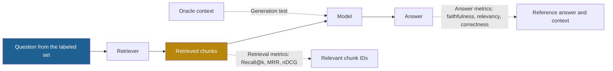
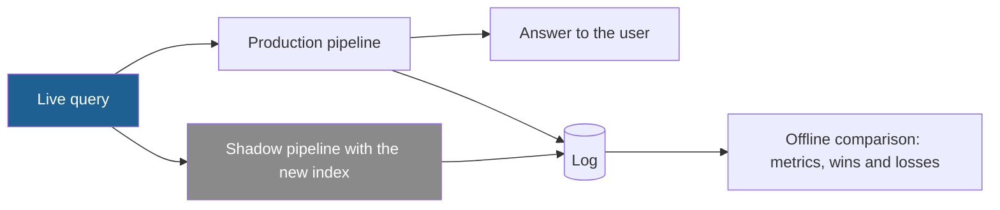

## 1. The question this idea answers

Lessons 5.1 to 5.7 offer many changes: BM25, hybrid search, a reranker, query rewriting, MMR, a new packing rule. Each change helps some queries and hurts others. After a change, a few manual tests "look better". Is the pipeline better?

The handbook says it plainly (Session 3, FAQ Q16): "Without evaluation, you are tuning blind". This lesson gives the exact metrics for the two halves of a RAG system: retrieval and generation. It also shows how to keep measuring them in production.

## 2. Mental model

> [!analogy] A kitchen and a cook
> A restaurant serves a bad dish. Either the kitchen fetched the wrong ingredients, or the cook used good ingredients badly. If you only taste the dish, you cannot tell which.
>
> So you test them apart. First, check the ingredients that the kitchen fetched against the recipe's list (**retrieval metrics**). Then give the cook exactly the right ingredients and taste the dish (**generation with oracle context**).
>
> **Where it stops working:** in a RAG system the cook can also use ingredients from memory: the model's weights. A correct answer can come from the weights even when retrieval failed. Also, the recipe's list is written by people. If a label misses a relevant chunk, a correct retrieval looks like a miss.

## 3. Terms

| Term | Plain meaning |
|---|---|
| labeled set | A fixed set of test questions, each with the IDs of the chunks that answer it and often a reference answer. Also called a golden set. |
| relevance label | The judgment that a chunk is relevant to a question, either yes/no or a grade. |
| graded relevance | Relevance labels with levels, for example 0 (not relevant), 1 (partly relevant), 2 (fully answers). |
| Recall@k | The share of the relevant chunks of a question that appear in the top $k$ results. |
| Precision@k | The share of the top $k$ results that are relevant. |
| hit rate@k | The share of questions with at least one relevant chunk in the top $k$. |
| reciprocal rank | 1 divided by the rank of the first relevant result, or 0 if no result is relevant. |
| MRR | Mean reciprocal rank: the average of the reciprocal ranks over all questions. |
| DCG | Discounted cumulative gain: the sum of the relevance gains of the results, each divided by a discount that grows with the rank. |
| nDCG | Normalized DCG: the DCG divided by the DCG of the ideal order, so the best possible value is 1. |
| faithfulness | The share of the claims in an answer that the retrieved context supports. |
| answer relevancy | How well an answer addresses the question. RAGAS measures it from questions that an LLM generates from the answer. |
| context precision | A RAGAS metric that is high when the relevant chunks are at the top of the retrieved list. |
| context recall | The share of the claims in a reference answer that the retrieved context supports. |
| LLM-as-judge | Using an LLM to grade answers or to check claims against context. |
| abstention | The model says that the context does not contain the answer, instead of guessing. |
| oracle context | The correct chunks, given to the model by hand, to test generation without retrieval errors. |
| shadow mode | Running a new pipeline next to the production pipeline on real traffic, logging its results, and not showing them to users. |
| drift | A slow change in queries, documents or models that lowers quality over time. |

## 4. Method and math

### 4.1 Two halves, two tests

A RAG answer can fail in retrieval or in generation. One end-to-end score hides which.



The handbook gives the right diagnostic process (Session 3, FAQ Q29): "first check retrieval quality in isolation", "then check generation quality given perfect context". Then you can sort each failure:

| Retrieval found the chunk? | Answer correct with oracle context? | Diagnosis |
|---|---|---|
| No | Yes | Retrieval failure. Improve retrieval with Lessons 5.1 to 5.5. |
| Yes | No | Generation failure. Improve the prompt, the order or the model (lesson [5.6](/notes/ai/context-engineering/05-retrieval-quality/l6-retrieval-budgets-and-order), Part 3). |
| No | No | Both. Fix retrieval first, then test again. |

The same FAQ answer says: "Nine times out of ten, the problem is retrieval, not generation." No source supports that number. It is a **rule of thumb**. Count your own failures with the table above.

### 4.2 Build the labeled set

The handbook suggests "even 50–100 question-answer pairs" (FAQ Q16). That is a good start, with three rules.

1. **Cover the query types.** Include keyword queries (IDs, codes), paraphrases, multi-part and multi-hop questions, and **unanswerable** questions whose answer is not in the corpus.
2. **Label stable targets.** Chunk IDs change when you re-chunk (Part 4). Store each label as a document ID plus the text span or section, and map it to chunk IDs at test time.
3. **Use real questions where possible.** Take them from logs or from the people who will use the system. LLM-generated questions are useful for volume, but review them, because they often copy the wording of the source chunk. That makes lexical matching look better than it is.

A small set gives noisy numbers. Treat the share of questions with a hit as a proportion $p$ over $n$ questions.

$$
\text{SE} = \sqrt{\frac{p\,(1 - p)}{n}}
$$

The symbols mean:

- $p$ is the measured share, for example a hit rate of 0.8.
- $n$ is the number of questions.
- $\text{SE}$ is the standard error. About 95% of repeated samples fall within $\pm 1.96\,\text{SE}$ of the true value.

> [!example] Worked example: how precise is a hit rate of 0.8?
> - $n = 50$: $\text{SE} = \sqrt{0.8 \times 0.2 / 50} = 0.057$, so $\pm 0.11$.
> - $n = 100$: $\text{SE} = 0.040$, so $\pm 0.078$.
> - $n = 400$: $\text{SE} = 0.020$, so $\pm 0.039$.
>
> With 50 questions, a change from 0.80 to 0.84 is within the noise. Compare two pipelines on the **same** questions, and count the questions that each one fixes and breaks.

### 4.3 Recall@k and Precision@k

For one question $q$:

$$
\text{Recall@}k = \frac{\lvert \text{Rel}_q \cap \text{Top}_k \rvert}{\lvert \text{Rel}_q \rvert}, \qquad \text{Precision@}k = \frac{\lvert \text{Rel}_q \cap \text{Top}_k \rvert}{k}
$$

The symbols mean:

- $\text{Rel}_q$ is the set of relevant chunks for $q$, from the labels.
- $\text{Top}_k$ is the set of the first $k$ results.
- $\lvert X \rvert$ is the number of elements in the set $X$.
- $\cap$ is the intersection: the chunks in both sets.

Average each metric over all questions. For RAG, Recall@k is usually the main retrieval metric, because the model reads all $k$ chunks. A relevant chunk at rank 4 of 5 still reaches the model.

### 4.4 Mean reciprocal rank

$$
\text{MRR} = \frac{1}{\lvert Q \rvert} \sum_{q \in Q} \frac{1}{\text{rank}_q}
$$

The symbols mean:

- $Q$ is the set of questions. $\lvert Q \rvert$ is their number.
- $\text{rank}_q$ is the rank of the **first** relevant result for $q$. If no result is relevant, $1/\text{rank}_q$ is 0.

MRR comes from the TREC-8 question-answering track (Voorhees and Tice, 1999). It rewards a relevant result at the very top and ignores everything after the first hit.

### 4.5 nDCG

Järvelin and Kekäläinen introduced cumulated gain metrics (ACM TOIS, 2002). The common modern form is:

$$
\text{DCG@}k = \sum_{i=1}^{k} \frac{2^{\text{rel}_i} - 1}{\log_2(i + 1)}, \qquad \text{nDCG@}k = \frac{\text{DCG@}k}{\text{IDCG@}k}
$$

The symbols mean:

- $i$ is the rank, from 1 to $k$.
- $\text{rel}_i$ is the relevance grade of the result at rank $i$, for example 0, 1 or 2.
- $2^{\text{rel}_i} - 1$ is the gain: 0 for grade 0, 1 for grade 1, 3 for grade 2.
- $\log_2(i + 1)$ is the discount: 1 at rank 1, 1.585 at rank 2, 2 at rank 3.
- $\text{IDCG@}k$ is the DCG of the ideal order: all relevant chunks sorted by grade at the top.

nDCG is between 0 and 1. It rewards relevant results near the top, and it can use graded labels.

### 4.6 One worked example for all four metrics

> [!example] Worked example: three questions, top 5
> | Question | Relevant chunks (grade) | Retrieved top 5 |
> |---|---|---|
> | q1 | C4 (2), C9 (1) | C2, **C4**, C7, **C9**, C1 |
> | q2 | C3 (1) | **C3**, C8, C5, C6, C2 |
> | q3 | C10, C11, C12 (1 each) | C5, C6, **C10**, C7, C8 |
>
> **Recall@5:** q1 = 2/2 = 1. q2 = 1/1 = 1. q3 = 1/3 = 0.333. Mean = **0.778**.
>
> **Precision@5:** q1 = 2/5 = 0.4. q2 = 1/5 = 0.2. q3 = 1/5 = 0.2. Mean = **0.267**.
>
> **MRR:** first hits at ranks 2, 1 and 3. $(1/2 + 1 + 1/3) / 3 = 1.833 / 3 =$ **0.611**.
>
> **nDCG@5 for q1, with grades:**
>
> - DCG: C4 at rank 2 gives $(2^2 - 1)/\log_2 3 = 3 \times 0.6309 = 1.8928$. C9 at rank 4 gives $(2^1 - 1)/\log_2 5 = 0.4307$. Total 2.3235.
> - IDCG: C4 at rank 1 gives $3/1 = 3$. C9 at rank 2 gives $1/\log_2 3 = 0.6309$. Total 3.6309.
> - nDCG@5 = $2.3235 / 3.6309 =$ **0.640**.
>
> For q2, nDCG@5 = 1. For q3: DCG = $1/\log_2 4 = 0.5$, IDCG = $1 + 0.6309 + 0.5 = 2.1309$, so nDCG@5 = 0.235. Mean nDCG@5 = 0.625.

Each metric tells a different story. Recall@5 says that q1 and q2 are solved. MRR shows that q1's best chunk is not at the top. nDCG for q1 also says that the more important chunk, C4, ranks below an irrelevant one. q3 is weak on every metric: two of its three relevant chunks are missing.

| Metric | Question it answers | Use it when |
|---|---|---|
| Recall@k | Did the relevant chunks reach the window? | Always, for RAG. $k$ = the number of chunks that you send. |
| Precision@k | How much of the window is noise? | You care about tokens and distractors. |
| Hit rate@k | Did at least one relevant chunk arrive? | Each question has one answer chunk. |
| MRR | How high is the first relevant chunk? | The top result matters most, for example a reranker's top 1. |
| nDCG@k | Is the ranking good, with grades? | You have graded labels and care about order. |

### 4.7 Answer metrics: RAGAS

RAGAS (Es et al., 2023) is a framework for "reference-free evaluation of Retrieval Augmented Generation (RAG) pipelines". Its current docs (ragas 0.4.3, checked on 2026-10-12) define the four core metrics:

| Metric | Definition | Needs a reference answer? |
|---|---|---|
| Faithfulness | (claims in the response supported by the retrieved context) / (total claims in the response) | No |
| Answer relevancy | An LLM generates questions from the response (3 by default). The score is the mean cosine similarity between each generated question and the user input. It does not check facts. | No |
| Context precision@K | $\frac{\sum_{k=1}^{K} \text{Precision@}k \times v_k}{\text{relevant items in the top } K}$, with $v_k = 1$ if the item at rank $k$ is relevant | Needs relevance judgments |
| Context recall | (claims in the reference answer supported by the retrieved context) / (claims in the reference answer) | Yes |

> [!example] Worked example: faithfulness and context precision
> **Faithfulness.** An answer makes 4 claims. A judge finds that 3 of them are supported by the retrieved chunks. Faithfulness = 3/4 = **0.75**. The fourth claim may still be true, from the model's weights, but the context does not support it.
>
> **Context precision@5** for a list with relevance flags $v = (1, 0, 1, 0, 0)$:
>
> - Precision@1 = 1/1 = 1. Precision@3 = 2/3.
> - Sum over relevant positions: $1 \times 1 + \frac{2}{3} \times 1 = 1.667$.
> - Divide by 2 relevant items: **0.833**.
>
> For q1 of section 4.6, $v = (0, 1, 0, 1, 0)$: $(1/2 + 2/4)/2 = 0.5$.

> [!trap] "Reference-free" is only partly true
> Faithfulness and answer relevancy need no reference answer. Context recall does: it compares the context with the claims of a reference answer. Also, every RAGAS metric that extracts or checks claims uses an LLM judge, and the judge can be wrong. Check a sample of its verdicts by hand before you trust a trend.

### 4.8 Abstention tests

A RAG system must decline to answer when the context lacks the answer. The handbook calls this "the 'faithful abstention' problem" (Session 3, FAQ Q26). It lists three defenses: an explicit instruction, citation enforcement, and a verification call that checks support, as RAGAS faithfulness does.

Test abstention with two numbers:

| Metric | Computed on | Good value |
|---|---|---|
| Abstention rate | Unanswerable questions | High: the system declines. |
| False-abstention rate | Answerable questions | Low: the system answers when it can. |

A system can reach a perfect abstention rate by declining everything. So report both numbers, always.

> [!note] Source check: unsourced effect sizes
> **Unsupported.** The handbook gives two numbers without a source. "The system prompt instruction alone reduces hallucination by 40–60% in most benchmarks" (Session 3, FAQ Q26). "Nine times out of ten, the problem is retrieval, not generation" (FAQ Q29). The source check found no primary source for either. Treat both as rules of thumb, and measure them with the abstention test and the failure table of section 4.1.

### 4.9 Change the pipeline safely

Treat each pipeline version like a model version (FAQ Q30). Give it a version ID, run the labeled set, and compare with the current version on the same questions.

Some changes need more care. A new embedding model means re-embedding the whole corpus, and every vector changes. The FAQ describes **shadow mode** for this case: "run the new pipeline in parallel, log its results alongside production, and compare offline before switching."



Shadow mode costs a second retrieval and often a second generation for each query. Run it on a sample of traffic if the cost is high.

### 4.10 Monitor drift

Quality can fall with no code change. The FAQ (Q33) names three causes: users ask new kinds of questions ("concept drift"), the documents change ("data drift"), and models change ("model drift"). It suggests these signals:

| Signal | What a change means | Caveat |
|---|---|---|
| Average top-1 or top-$k$ similarity | Falling: queries move away from the corpus. | The scale depends on the embedding model. Reset the baseline after a model change. |
| Share of "I do not have enough information" answers | Rising: coverage gaps, or a retrieval fault. | Compare by topic, not only in total. |
| User feedback and follow-up questions | Falling satisfaction | Feedback is sparse and biased toward problems. |
| Faithfulness on a nightly sample | Falling: the model adds unsupported claims. | The judge itself can drift if its model changes. |
| Latency per stage | Rising: index growth, or a slow reranker | Watch percentiles, not only the mean. |

Add new failure cases from production to the labeled set. Over time, the set becomes a regression test of the real problems.

### 4.11 Production view

| Concern | What this lesson means for it |
|---|---|
| Quality | Measure retrieval and generation apart. Report Recall@k for the $k$ that you send, plus MRR or nDCG for order. |
| Reliability | Run the labeled set on every pipeline change, like unit tests. Block a release that loses on it. |
| Cost | LLM-judge metrics cost one or more calls per question. Run the cheap retrieval metrics on every change, and the judge metrics nightly or before release. |
| Safety | Include unanswerable questions. Report abstention and false abstention together. |
| Observability | Log the retrieved chunk IDs and ranks for every production query, so that any answer can be traced to its retrieval. |

## 5. Graphs

```plot
{
  "title": "Weight of a relevant result at rank i: nDCG discount 1/log2(i + 1) (blue), reciprocal rank 1/i (red)",
  "xAxis": { "label": "rank i", "domain": [0, 11] },
  "yAxis": { "label": "weight", "domain": [0, 1.05] },
  "disableZoom": true,
  "data": [
    { "points": [[1, 1], [2, 0.6309], [3, 0.5], [4, 0.4307], [5, 0.3869], [6, 0.3562], [7, 0.3333], [8, 0.3155], [9, 0.301], [10, 0.2891]], "fnType": "points", "graphType": "polyline", "color": "#1E6091", "skipTip": true },
    { "points": [[1, 1], [2, 0.6309], [3, 0.5], [4, 0.4307], [5, 0.3869], [6, 0.3562], [7, 0.3333], [8, 0.3155], [9, 0.301], [10, 0.2891]], "fnType": "points", "graphType": "scatter", "color": "#1E6091", "skipTip": true },
    { "points": [[1, 1], [2, 0.5], [3, 0.3333], [4, 0.25], [5, 0.2], [6, 0.1667], [7, 0.1429], [8, 0.125], [9, 0.1111], [10, 0.1]], "fnType": "points", "graphType": "polyline", "color": "#C81D25", "skipTip": true },
    { "points": [[1, 1], [2, 0.5], [3, 0.3333], [4, 0.25], [5, 0.2], [6, 0.1667], [7, 0.1429], [8, 0.125], [9, 0.1111], [10, 0.1]], "fnType": "points", "graphType": "scatter", "color": "#C81D25", "skipTip": true }
  ]
}
```

Reciprocal rank falls fast: rank 2 is worth half of rank 1. The nDCG discount falls slowly: rank 10 still keeps 0.29 of the weight of rank 1. So MRR punishes a late first hit much more than nDCG does.

## 6. Code

These exercises go in `notebooks/05-retrieval-quality.ipynb`. Put the metrics in `src/eval/retrieval_metrics.py` and their tests in `tests/test_retrieval_metrics.py`.

**Exercise 8.1: the metrics module.**

1. Write `recall_at_k`, `precision_at_k`, `reciprocal_rank`, `ndcg_at_k` and `context_precision_at_k`. Each takes a ranked list of IDs and the relevance labels of one question.
2. Write `evaluate(runs, k)` that averages each metric over a dictionary of questions.

Acceptance tests:

- The three questions of section 4.6 give mean Recall@5 0.778, Precision@5 0.267, MRR 0.611 and mean nDCG@5 0.625 (graded).
- `context_precision_at_k` gives 0.833 for $v = (1, 0, 1, 0, 0)$.
- A question with no relevant result in the list gives Recall 0, reciprocal rank 0 and nDCG 0, without a division error.
- A question with an empty label set raises a `ValueError`.

**Exercise 8.2: a labeled set of 50 questions.**

1. Grow `data/queries.jsonl` to at least 50 questions. Include at least 10 keyword, 10 paraphrase, 5 multi-part and 10 unanswerable questions.
2. Store each label as a document ID plus a section or text span, not as a chunk ID.
3. Write `labels_to_chunk_ids(labels, chunks)` that maps the spans to the current chunk IDs.

Acceptance tests:

- Re-chunking the corpus with a different size does not require new labels.
- A table that counts the questions of each type.

**Exercise 8.3: compare every pipeline of this part.**

1. Run BM25, dense, hybrid RRF, hybrid plus reranker, and hybrid plus MMR on the answerable questions.
2. Report Recall@5, MRR and nDCG@5 for each.
3. For the best two pipelines, list the questions that each one fixes and breaks against the other.

Acceptance tests:

- A table of 5 pipelines × 3 metrics.
- A bootstrap 95% interval for the Recall@5 of each pipeline (resample the questions 1,000 times).
- One sentence that says whether the best pipeline is better than the second beyond the noise.

**Exercise 8.4 (optional, costs money): oracle test and faithfulness.**

1. For 20 answerable questions, generate answers twice: with the retrieved chunks and with the oracle chunks.
2. Sort each failure into the table of section 4.1.
3. Write a small faithfulness judge: an LLM splits the answer into claims and checks each claim against the context. Check 10 of its verdicts by hand.

Acceptance test: the count of retrieval failures and generation failures, and the judge's agreement with your hand checks.

**Exercise 8.5: abstention.** Run the 10 unanswerable and 10 answerable questions with an instruction to abstain. Report the abstention rate and the false-abstention rate.

## 7. Common mistakes

1. **"The answers look good on my five test questions."** Five questions cannot show a change. With 50 questions, a hit rate of 0.8 is still uncertain by about ±0.11.
2. **"One end-to-end score is enough."** It hides whether retrieval or generation failed. Test retrieval alone, then generation with oracle context.
3. **"Label chunk IDs."** Chunk IDs change when you re-chunk. Label documents and spans, and map them at test time.
4. **"RAGAS is reference-free."** Context recall needs a reference answer, and the LLM judge can be wrong.
5. **"A higher abstention rate is better."** Declining everything gives a perfect abstention rate. Report false abstention too.
6. **"Nine of ten failures are retrieval."** That is an unsourced rule of thumb. Count your own failures.
7. **"Compare similarity scores across embedding models."** Each model has its own score scale. Reset monitoring baselines after a change.

## 8. One-minute explanation

To improve a RAG system, you must measure it, and you must measure retrieval and generation apart. Build a labeled set of 50 to 100 questions with the chunks or spans that answer them. Include unanswerable questions. For retrieval, Recall@k says whether the relevant chunks reached the window, and Precision@k says how much is noise. MRR says how high the first hit is, and nDCG scores the whole order with graded labels. For generation, give the model the oracle chunks and check the answer. RAGAS faithfulness is the share of answer claims that the context supports. Context recall needs a reference answer. Test abstention with two numbers: declining on unanswerable questions, and not declining on answerable ones. Small sets are noisy, so compare pipelines on the same questions. In production, use shadow mode for big changes such as a new embedding model, and watch for drift.

## 9. Check questions

```check
{
  "question": "A question has relevant chunks A and B (grade 1 each). The retriever returns X, A, Y, Z, B. Compute Recall@5, Precision@5, the reciprocal rank and nDCG@5.",
  "hint": "DCG adds 1/log2(i + 1) at each relevant rank. IDCG puts both relevant chunks at ranks 1 and 2.",
  "answer": "Recall@5 = 2/2 = 1. Precision@5 = 2/5 = 0.4. Reciprocal rank = 1/2 = 0.5. DCG = 1/log2(3) + 1/log2(6) = 0.6309 + 0.3869 = 1.0178. IDCG = 1 + 0.6309 = 1.6309. nDCG@5 = 1.0178 / 1.6309 ≈ 0.624."
}
```

```check
{
  "question": "Pipeline A has a hit rate@5 of 0.70 (42 of 60 questions) and pipeline B has 0.75 (45 of 60), on the same 60 questions. Is B clearly better?",
  "hint": "Compute 1.96 × sqrt(p(1 − p)/n) for p = 0.7.",
  "answer": "1.96 × sqrt(0.7 × 0.3 / 60) ≈ 0.116, so each value is uncertain by about ±0.12. A difference of 0.05 is inside that range. Since both ran on the same questions, count the questions that B fixes and breaks against A. If B fixes 5 and breaks 2, that is better evidence than the two averages, but still a small sample."
}
```

```check
{
  "question": "An answer makes 6 claims. The retrieved context supports 3 of them. One of the other 3 is true, but it comes from the model's weights. What is the faithfulness? What does the number mean?",
  "answer": "Faithfulness = 3/6 = 0.5. Faithfulness measures support by the retrieved context, not truth. The true claim from the weights still lowers it, because the user cannot check it against a source."
}
```

```check
{
  "question": "A team tests 30 failures. With oracle context, 21 answers become correct. What does this say about where to work first?",
  "answer": "21 of 30 failures (70%) disappear when retrieval is perfect, so they are retrieval failures. The other 9 fail even with the right chunks, so they are generation failures. Fix retrieval first, but do not ignore the 30% generation share."
}
```

```check
{
  "question": "A team switches to a new embedding model. Their dashboard shows the average top-1 cosine similarity falling from 0.82 to 0.61 overnight. Is retrieval worse?",
  "answer": "Not necessarily. Each embedding model has its own score scale, so cosine values from two models are not comparable. Reset the baseline after the change and judge quality with the labeled set: Recall@k, MRR and the answer metrics. Shadow mode before the switch would have given this comparison without risk."
}
```

## 10. Links

- Previous: [L7: Just-in-time retrieval](/notes/ai/context-engineering/05-retrieval-quality/l7-just-in-time-retrieval)
- Next: [L9: Beyond basic RAG](/notes/ai/context-engineering/05-retrieval-quality/l9-beyond-basic-rag)
- Part 9: [Evaluation](/notes/ai/context-engineering/09-production/l6-evaluation) and [Evals in CI and versioning](/notes/ai/context-engineering/09-production/l7-evals-in-ci-and-versioning)
- Research track: [Context precision and recall](/notes/ai/context-engineering/11-research-track/e8-context-precision-recall)
- [Glossary](/notes/ai/context-engineering/glossary)
