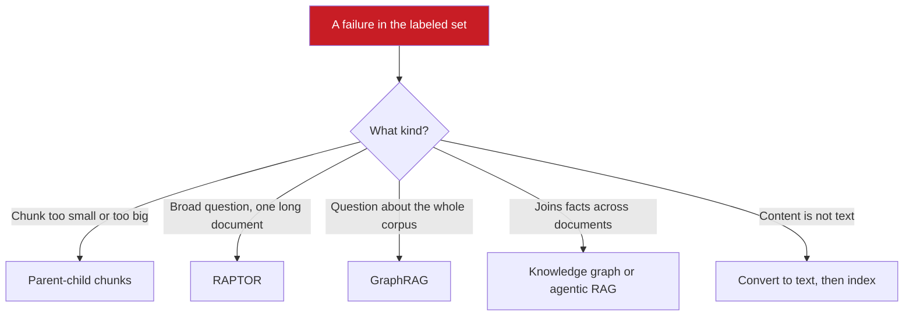
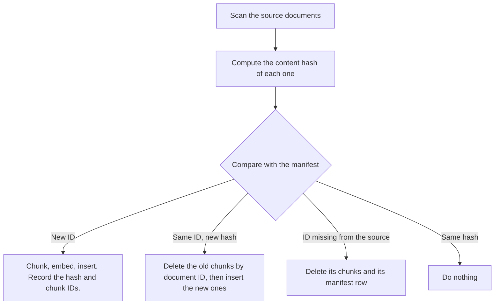

## 1. The question this idea answers

Basic RAG chunks the documents, embeds the chunks, and retrieves the top $k$ for each question. Lessons 5.1 to 5.8 made that pipeline accurate and measurable. Some failures remain, and they need a different structure, not better tuning:

- A broad question: "What is the overall architecture of this system?" Every chunk describes one part, and no chunk describes the whole.
- A relationship question: "Who manages someone on Project X?" The answer needs two facts from two documents.
- A corpus that changes every day, many customers in one index, scanned diagrams, or questions in five languages.

The research and vendor world offers many named techniques. This lesson is a map. For each technique, it gives the failure that it fixes, when to use it, and what it costs. Start with basic RAG plus Lessons 5.1 to 5.8, and add a technique only when the labeled set shows its failure.

## 2. Mental model

> [!analogy] A general doctor and specialists
> A general doctor handles most cases. For a specific problem, the doctor refers the patient to a specialist. Each specialist costs more and takes longer, so a referral needs a diagnosis first.
>
> Basic RAG with hybrid search and reranking is the general doctor. GraphRAG, RAPTOR and the others are specialists for specific failures.
>
> **Where it stops working:** some items on this map are not specialists at all. Incremental sync and tenant isolation are basic hygiene. Every production system needs them from day one. Also, unlike doctors, the techniques combine: a system can use parent-child chunks, hybrid search and tenant filters together.

## 3. Terms

| Term | Plain meaning |
|---|---|
| parent-child retrieval | Retrieval that matches small child chunks but returns the larger parent chunk or document that contains them. |
| parent document | The larger unit that a child chunk belongs to, for example a section or a page. |
| RAPTOR | A method that recursively clusters and summarizes chunks into a tree, and retrieves across all levels of the tree (Sarthi et al., ICLR 2024). |
| summary tree | The tree of RAPTOR: leaf chunks at the bottom, summaries of clusters above them, and broader summaries above those. |
| GraphRAG | Microsoft's method that uses an LLM to build an entity graph and community summaries. It answers questions about a whole corpus (Edge et al., 2024). |
| global question | A question about a whole corpus, such as "What are the main themes?", whose answer is in no single chunk. |
| community summary | In GraphRAG, an LLM-written summary of a group of closely connected entities. |
| knowledge graph | A store of facts as nodes (entities) and edges (relationships) that a query can traverse. |
| triple | One fact in a knowledge graph, in the form subject, predicate, object. For example: Alice, manages, Bob. |
| multimodal RAG | RAG over content that is not plain text, such as images, tables, audio or video. |
| incremental sync | Updating the index only for documents that were added, changed or deleted, instead of rebuilding it. |
| content hash | A short fingerprint of a document's content. A different hash means that the content changed. |
| manifest | A table that records, for each source document, its hash, its chunk IDs and when it was indexed. |
| multi-tenant RAG | One RAG system that serves several customers or groups, each of which may see only its own documents. |
| tenant | One customer or group whose data must stay separate from the data of others. |
| pre-filter | A filter that limits the search to allowed documents before or during the vector search. |
| post-filter | A filter that removes disallowed documents after the search has returned its results. |
| cross-lingual retrieval | Retrieval where the query and the documents are in different languages. |

## 4. Method and math

### 4.1 The map

| Failure of basic RAG | Technique | Extra cost at indexing | Extra cost per query |
|---|---|---|---|
| Small chunks lack context, large chunks match badly | Parent-child chunks | Store parents | Larger context |
| Broad questions about a long document | RAPTOR | LLM summaries for every cluster | Search over more nodes |
| Global questions about a whole corpus | GraphRAG | Many LLM calls for entities and summaries | Summaries of communities |
| Questions that join facts across documents | Knowledge graph | Entity and relation extraction, upkeep | A graph query |
| Questions that need several searches | Agentic RAG | None | More model calls |
| Images, tables, audio, video | Multimodal RAG (convert to text first) | Vision or speech models | None or small |
| Documents change | Incremental sync | A manifest and hashes | None |
| Several customers in one index | Multi-tenant filters | A tenant field on every chunk | A filter on every query |
| Several languages | Multilingual retrieval | A multilingual model or translation | Translation calls, if used |



### 4.2 Parent-child chunks

**The problem.** Part 4 showed the chunk-size dilemma ([Chunking](/notes/ai/context-engineering/04-write-and-rag/l5-chunking)). Small chunks give precise matches but lack context. Large chunks carry context but their embeddings blur several topics. The handbook (Session 3, FAQ Q31) describes the fix: "store both large parent chunks and small child chunks, retrieve by child (for precision), but pass the parent (for context) to the LLM."

**How it works.** Index the small child chunks in the vector store. Store the parents in a separate document store, keyed by ID. Each child keeps its parent ID. At query time, retrieve the top children, map them to their parents, remove duplicate parents, and put the parents into the window. LangChain's `ParentDocumentRetriever` does this. Its docstring says: "Retrieve small chunks then retrieve their parent documents."

> [!example] Worked example: the token cost of parents
> Children have 200 tokens and parents have 1,000 tokens. The top 5 children map to parents.
>
> - If the 5 children come from 5 different parents: $5 \times 1{,}000 = 5{,}000$ tokens.
> - If they come from 2 parents: $2 \times 1{,}000 = 2{,}000$ tokens.
> - The children alone would use $5 \times 200 = 1{,}000$ tokens.
>
> So the context can grow 2 to 5 times. Pack the parents with the budget rules of lesson [5.6](/notes/ai/context-engineering/05-retrieval-quality/l6-retrieval-budgets-and-order).

**When to use it:** documents with clear sections, where an answer needs the surrounding paragraph. **Cost:** a second store, and larger inputs.

### 4.3 RAPTOR: a tree of summaries

**The problem.** Flat retrieval returns leaf chunks. A broad question such as "What is the overall argument of this report?" matches many leaves weakly, and none holds the overview.

**How it works.** RAPTOR (Sarthi, Abdullah, Tuli, Khanna, Goldie and Manning, ICLR 2024) builds a tree by "recursively embedding, clustering, and summarizing chunks of text". An LLM summarizes each cluster of leaf chunks. Then it clusters and summarizes those summaries, up to a root. Retrieval searches all levels, so a detail question finds a leaf and a broad question finds a summary. The paper reports that RAPTOR with GPT-4 improved the best result on the QuALITY benchmark by 20 points of absolute accuracy.

> [!example] Worked example: the number of summary calls
> Assume 1,000 leaf chunks and clusters of 10 at every level.
>
> - Level 1: $1{,}000 / 10 = 100$ summaries.
> - Level 2: $100 / 10 = 10$ summaries.
> - Level 3: $10 / 10 = 1$ summary.
>
> Total: $100 + 10 + 1 = 111$ LLM calls. For $N$ leaves and clusters of size $c$, when $N$ is a power of $c$, the total is exactly $(N - 1)/(c - 1)$: here $999 / 9 = 111$.

**When to use it:** long documents with broad questions, for example reports, books and long contracts. **Cost:** the summary calls at indexing, and a partial rebuild of the tree when documents change.

### 4.4 GraphRAG: questions about the whole corpus

**The problem.** Edge et al. (Microsoft, 2024) state it directly: "RAG fails on global questions directed at an entire text corpus". "What are the main themes in these 500 interviews?" has no answer chunk.

**How it works.**

1. An LLM reads each chunk and extracts entities (people, systems, organizations) and the relationships between them.
2. The entities and relationships form a graph.
3. A graph algorithm groups closely connected entities into communities.
4. An LLM writes a summary for each community, in advance.
5. A global question is answered from the community summaries, not from raw chunks.

The paper targets "sensemaking" questions over corpora of about 1 million tokens.

**When to use it:** global questions about a large set of documents, and questions about the relations between many entities. **Cost:** the handbook (FAQ Q44) says that the graph is "expensive (many LLM calls), slow to construct, and requires ongoing maintenance". For most question-answering workloads, hybrid RAG with reranking is enough. Both FAQ claims about origin are correct: GraphRAG is from Microsoft Research, and RAPTOR is from Stanford.

### 4.5 Knowledge graphs: facts as triples

**The problem.** Some questions join facts. The FAQ's example (Q45): "Alice manages Bob" and "Bob works on Project X" are in two documents. The question "Who manages someone on Project X?" needs both. Vector retrieval may find one fact and miss the other, because neither chunk matches the whole question.

**How it works.** Store facts as triples and traverse them.

> [!example] Worked example: a two-hop query
> Triples:
>
> | Subject | Predicate | Object |
> |---|---|---|
> | Alice | manages | Bob |
> | Bob | works_on | Project X |
> | Carol | works_on | Project Y |
>
> Query: find every `?m` such that (`?m`, manages, `?p`) and (`?p`, works_on, Project X).
>
> 1. Hop 1: who works on Project X? → Bob.
> 2. Hop 2: who manages Bob? → Alice.
>
> Answer: Alice. The graph query is exact and cheap once the triples exist.

**When to use it:** relationship-heavy questions over data with clear entities: org charts, product catalogs, systems and their dependencies. The FAQ is right that graphs and vectors are "complementary, not competing". **Cost:** extracting triples, resolving entity names ("Bob", "Robert Smith" and "R. Smith" must become one node), and keeping the graph current. An agent with a search tool (lesson [5.7](/notes/ai/context-engineering/05-retrieval-quality/l7-just-in-time-retrieval)) can also do two hops by searching twice, without a graph.

### 4.6 Agentic RAG

Lesson [5.7](/notes/ai/context-engineering/05-retrieval-quality/l7-just-in-time-retrieval) covers this in full. The model calls a retrieval tool as often as it needs, rewrites its queries, and stops when it has enough. It handles multi-hop questions without a graph (lesson [5.4](/notes/ai/context-engineering/05-retrieval-quality/l4-query-transformation)). **Cost:** more model calls and more latency per question.

### 4.7 Multimodal RAG: convert to text first

The FAQ's rule (Q18): "if the embedding model cannot understand a content type natively, convert it to text first."

| Content | Conversion | Note |
|---|---|---|
| Tables | Markdown or another structured text form | Keep the header row with every chunk of a long table. |
| Code | Keep each function or block whole. Add a short summary as a prefix. | Do not split a function across chunks. |
| Images and diagrams | A vision model writes a description, and the description is embedded. | Keep a link to the original image so that the user or the model can see it. |
| Audio | Speech-to-text transcription | Keep timestamps for citations. |
| Video | Transcribe the audio and describe keyframes | Index both with timestamps. |

Some embedding models also accept images directly. For example, Cohere's `embed-v4.0` takes text and images (checked on 2026-10-12). The FAQ (Q48) says that the text-description approach is the more mature one. That is a judgment, so test both on your content if images matter.

**Cost:** one vision or speech call per item at indexing. Descriptions can miss details, so measure retrieval on questions about images.

### 4.8 Incremental sync

Documents change. If the index keeps old chunks, the model can answer from a policy that no longer applies. That is a correctness problem, not only a freshness problem (stale context, lesson [1.5](/notes/ai/context-engineering/01-foundations/l5-position-and-length-effects)).

The FAQ (Q17) gives the method: track a hash or timestamp for each document and handle three cases.



> [!example] Worked example: one nightly run
> The manifest has 10,000 documents. Tonight, 150 documents changed, 40 are new and 10 were deleted.
>
> - Re-embed: $150 + 40 = 190$ documents, which is 1.9% of the corpus.
> - Delete: the old chunks of 150 changed documents and all chunks of 10 deleted documents.
> - Skip: $10{,}000 - 150 - 10 = 9{,}840$ unchanged documents.
>
> The embedding price is small either way. OpenAI estimates about 62,500 pages per US dollar for `text-embedding-3-small`, at about 800 tokens per page. If each document is about one page, a full re-embed of the 10,000 documents costs about USD 0.16 (checked on 2026-10-12). The real gains of incremental sync are time, a stable index, and correct deletes.

Delete before insert, and do both in one transaction where the store allows it. Otherwise a crash can leave both versions, or neither, in the index. Hash the cleaned text, not the raw file, so that a changed timestamp inside a PDF does not count as a change.

### 4.9 Multi-tenant RAG

One index serves several customers. Customer A must never see a chunk of customer B. The FAQ (Q28) gives two designs:

| Design | Isolation | Operations |
|---|---|---|
| One collection (or namespace) per tenant | Complete. A query cannot reach another tenant's data. | Many collections to create, copy for recovery and monitor. |
| One collection with a `tenant_id` field and a filter on every query | Depends on the filter on every query | One collection, simpler |

The FAQ's key rule is correct: apply the filter "at the database level, not post-retrieval, to prevent data leakage". A post-filter has two problems:

1. **Leakage risk.** The other tenant's chunks leave the database. One bug in the application code, or a log line, can expose them.
2. **Missing results.** The search returns the top $k$ over all tenants, then the filter removes most of them. A query can get fewer than $k$ results, or none. pgvector documents this for approximate indexes: filtering happens after the index scan, so a query can return fewer rows. Its iterative index scans (version 0.8 and later) reduce the problem. Qdrant applies filters during the HNSW search (Part 4, [Vector search](/notes/ai/context-engineering/04-write-and-rag/l7-vector-search)).

> [!trap] The tenant ID must come from the session, never from the model
> Take the tenant ID from the authenticated session on the server. Never let the model, the user's text or a tool argument set it. A prompt injection such as "search the documents of tenant 42" must have no path to the filter (Part 6, [Tool security](/notes/ai/context-engineering/06-tools-and-mcp/l9-tool-security-and-prompt-injection)).

Test isolation like a security feature. For each tenant, run queries that match the other tenants' documents exactly. Assert that no foreign chunk ID ever returns.

### 4.10 Multilingual retrieval

Two designs exist (FAQ Q34):

1. **A multilingual embedding model.** Queries and documents in different languages map into one vector space. A Spanish query can then find an English document (cross-lingual retrieval).
2. **Translation.** Translate the query into each document language, retrieve for each, and merge with RRF (lesson [5.2](/notes/ai/context-engineering/05-retrieval-quality/l2-hybrid-search-and-rrf)). This costs one translation call per query.

BM25 needs a language-specific analyzer. Chinese, Japanese and Thai have no spaces between words, so a whitespace split gives useless terms (lesson [5.1](/notes/ai/context-engineering/05-retrieval-quality/l1-bm25)).

> [!note] Source check: "100+ languages"
> **Corrected.** The handbook (Session 3, FAQ Q34) says that "Cohere's embed-v3 and OpenAI's text-embedding-3 models support 100+ languages". Cohere says that its multilingual model `embed-multilingual-v3.0` "supports over 100 languages". OpenAI gives no language count. It publishes average scores on the MIRACL multilingual retrieval benchmark: 31.4 for ada-002, 44.0 for `text-embedding-3-small` and 54.9 for `text-embedding-3-large`. The current Cohere model is `embed-v4.0`. Measure cross-lingual retrieval on your own language pairs. Sources: Cohere Embed docs and OpenAI's embedding announcement, checked on 2026-10-12.

### 4.11 Production view

| Concern | What this lesson means for it |
|---|---|
| Cost | GraphRAG and RAPTOR move cost to indexing: many LLM calls, repeated when documents change. Parent-child moves cost to the query: larger contexts. |
| Latency | Agentic RAG and translation add calls per query. Graph queries are fast once the graph exists. |
| Correctness | Incremental sync must delete old chunks. A stale chunk is a wrong answer waiting to happen. |
| Security | Tenant isolation is a database filter from the session, tested like any access control. |
| Quality | Add a technique only when the labeled set shows its failure. Measure before and after (lesson [5.8](/notes/ai/context-engineering/05-retrieval-quality/l8-measure-retrieval)). |
| Operations | Keep a manifest of documents, hashes and chunk IDs. It makes sync, deletes and audits possible. |

## 5. Code

These exercises go in `notebooks/05-retrieval-quality.ipynb`. Put the sync code in `src/retrieval/sync.py`, with its manifest in a local SQLite file.

**Exercise 9.1: incremental sync with a manifest.**

1. Create a SQLite table `manifest(doc_id, content_hash, chunk_ids, indexed_at)`.
2. Write `sync(source_docs, index, manifest)` that handles new, changed, deleted and unchanged documents as in section 4.8.
3. Hash the cleaned text with SHA-256.

Acceptance tests:

- Change one document and run `sync`: only its chunks change, and the run reports 1 changed.
- Delete one document: a search for its unique terms returns nothing.
- Run `sync` twice with no changes: the second run re-embeds nothing.
- A simulated crash between delete and insert leaves the manifest consistent with the index.

**Exercise 9.2: parent-child retrieval.**

1. Split each document into sections (parents) and each section into 200-token children.
2. Embed the children. Store the parents in a dictionary keyed by ID.
3. Retrieve the top 5 children, map them to parents, remove duplicates and pack them into a 3,000-token budget.

Acceptance tests:

- The output never holds the same parent twice.
- On 10 labeled questions, compare child-only and parent context: hit rate and total tokens.

**Exercise 9.3: a tenant-isolation test.**

1. Index documents for three tenants in one collection, with a `tenant_id` field.
2. Write `search(query, tenant_id, k)` that filters in the database query, not after it.
3. For each tenant, run 10 queries copied word for word from the other tenants' documents.

Acceptance tests:

- No query returns a chunk of another tenant.
- Each query still returns $k$ results when the tenant has at least $k$ chunks.
- `search` takes the tenant ID as a required argument with no default.

**Exercise 9.4: a tiny knowledge graph.**

1. Store the triples of section 4.5 and 20 more in a SQLite table `triples(subject, predicate, object)`.
2. Write the two-hop query "who manages someone on project P?" as one SQL statement with a self-join.

Acceptance test: the query returns Alice for Project X, and an empty result for a project with no members.

**Exercise 9.5 (optional, costs money): RAPTOR-lite.** Cluster the chunks of one long document into groups of about 10 with k-means on their embeddings. Summarize each group with an LLM. Index leaves and summaries together. Compare broad and detail questions with and without the summaries.

## 6. Common mistakes

1. **"GraphRAG is better RAG, so use it everywhere."** It targets global questions about a whole corpus. Its graph needs many LLM calls and upkeep.
2. **"Parent-child retrieval is free precision."** The context grows by the parent size. Pack parents within the budget.
3. **"Re-index weekly and you are safe."** Between runs, deleted documents still answer questions. Sync on change, and always delete.
4. **"Filter by tenant after retrieval."** Other tenants' chunks leave the database, and queries return too few results. Filter in the database query.
5. **"The model can pass the tenant ID as a tool argument."** A prompt injection can then read another tenant's data. Take the ID from the session.
6. **"Every embedding model handles 100 languages."** Check the vendor's statement and measure your language pairs.
7. **"Embed the images and the job is done."** Without a description or a multimodal model, an image has no searchable text. Keep a link to the original for the user.

## 7. One-minute explanation

Basic RAG with hybrid search and reranking handles most questions. Some failures need a different structure. Parent-child retrieval matches small chunks but returns their larger parents, which fixes the chunk-size dilemma at the cost of a larger context. RAPTOR builds a tree of summaries for broad questions about long documents. GraphRAG builds an entity graph and community summaries for questions about a whole corpus, at a high indexing cost. Knowledge graphs store facts as triples and answer relationship questions with exact traversals. Agentic RAG lets the model search several times. Non-text content is usually converted to text first. Two items are hygiene, not options: incremental sync with hashes, which deletes stale chunks, and tenant isolation with a database filter from the session. Add any other technique only when your labeled set shows the failure that it fixes.

## 8. Check questions

```check
{
  "question": "Children have 150 tokens and parents have 1,200 tokens. The top 6 children come from 4 distinct parents. How many tokens do the parents use, against the children alone?",
  "answer": "Parents: 4 × 1,200 = 4,800 tokens. Children alone: 6 × 150 = 900 tokens. The parent context is about 5.3 times larger, so it must fit the retrieval budget."
}
```

```check
{
  "question": "A RAPTOR tree has 625 leaf chunks and clusters of 5 at every level. How many summary calls does it need?",
  "hint": "Divide by 5 at each level until one node is left.",
  "answer": "625 / 5 = 125, 125 / 5 = 25, 25 / 5 = 5, 5 / 5 = 1. Total: 125 + 25 + 5 + 1 = 156 calls. Check with (N − 1)/(c − 1) = 624 / 4 = 156."
}
```

```check
{
  "question": "A multi-tenant system retrieves the top 10 chunks from the shared index, then removes chunks of other tenants in Python. Name two problems.",
  "answer": "1. Leakage risk: other tenants' chunks leave the database and pass through application code and possibly logs. 2. Missing results: if most of the top 10 belong to other tenants, the user gets fewer than 10 chunks, or none, even when their own relevant chunks exist further down. Filter in the database query instead."
}
```

```check
{
  "question": "A document changes, and the sync job inserts the new chunks but does not delete the old ones. What can happen to answers?",
  "answer": "Both versions stay in the index. Retrieval can return the old chunk, and the model can answer from the outdated text, or see two conflicting versions. This is stale context. The sync must delete the old chunks by document ID before inserting the new ones."
}
```

```check
{
  "question": "Which technique fits each question? (a) \"What are the recurring complaints across 3,000 support tickets?\" (b) \"Which services depend on the payments database?\" (c) \"What does section 4.2 of the contract say about termination?\"",
  "answer": "(a) A global question over a corpus: GraphRAG, or a map-reduce summary over the tickets. (b) A relationship question: a knowledge graph of service dependencies, or an agent that searches twice. (c) A precise lookup: basic hybrid RAG, possibly with parent-child chunks so that the whole section is returned."
}
```

## 9. Links

- Previous: [L8: Measure retrieval and answers](/notes/ai/context-engineering/05-retrieval-quality/l8-measure-retrieval)
- Next: [Hard questions: Retrieval quality](/notes/ai/context-engineering/05-retrieval-quality/hard-questions)
- Part 4: [Chunking](/notes/ai/context-engineering/04-write-and-rag/l5-chunking) and [Vector search](/notes/ai/context-engineering/04-write-and-rag/l7-vector-search)
- Part 8: [Persistent memory](/notes/ai/context-engineering/08-memory/l6-persistent-memory): user isolation for memory stores
- [Glossary](/notes/ai/context-engineering/glossary)
