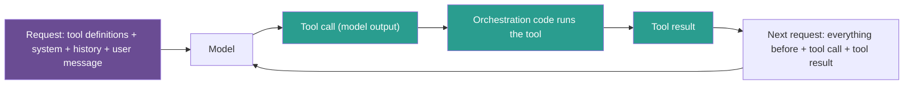

## 1. The question this idea answers

A model alone can only write text from its weights and its window (lesson [1.1](/notes/ai/context-engineering/01-foundations/l1-what-a-model-does-with-context)). It cannot read today's orders, multiply two large numbers with certainty, or send an email. Tools add these abilities.

But tools are not free. The application must describe every tool to the model, and every tool result comes back into the window. How many tokens do tools use, how long do those tokens stay, and how do I keep them small? The handbook calls this "the central insight of the entire session: tool design is context design" (Session 4, §1.2).

## 2. Mental model

> [!analogy] An expert with a phone list and a fax machine
> Remember the expert from lesson 1.1, who has one sheet of paper for each request. Now the expert also has a **phone list** of specialists at the top of the sheet. When the expert needs a fact, the expert writes "please call the order desk about order 456". An assistant makes the call. The answer comes back by **fax**, and the fax prints onto the same sheet.
>
> - The phone list is the set of **tool definitions**. It takes space on every sheet.
> - The note "please call..." is a **tool call**.
> - The fax is the **tool result**. A 40-page fax fills the sheet.
>
> **Where it stops working:** the sheet does not stay on the desk. Each new request starts a new sheet, and the assistant copies all earlier notes and faxes onto it (lesson [1.3](/notes/ai/context-engineering/01-foundations/l3-the-chat-api-call)). So one long fax is paid for again on every later sheet.

## 3. Terms

| Term | Plain meaning |
|---|---|
| tool | A function that the application runs for the model, for example an API call, a database query, a calculation or an action. |
| tool use (function calling) | The model asks the application to run a tool, and then uses the result. Anthropic says "tool use". OpenAI and Google say "function calling". |
| tool definition | The name, the description and the parameter schema of one tool. The application sends it to the model in the request. |
| tool call | A structured request from the model to run one tool with given arguments. The model writes it, and the application runs it. |
| tool result | The output of a tool that the application sends back to the model. It enters the window as new context. |
| side effect | A change in the world that a tool makes, for example a sent email, a new record or a deleted file. |
| orchestration code | The application code that sends requests to the model, runs the tools that the model asks for, and sends the results back. |
| context budget | The number of input tokens that a design allows for one call. It is often much smaller than the window. |

## 4. Method and math

### 4.1 Three limits of a model without tools

The handbook (Session 4, §1.1) names three limits. Each limit has its own kind of tool.

| Limit | What the model cannot do alone | Kind of tool | Example tool |
|---|---|---|---|
| No live data | Read today's weather, stock prices or your database | Information access | `get_order_status`, `search_web` |
| No exact computation | Multiply large numbers with certainty, or run code | Computation | `calculate`, a code sandbox |
| No side effects | Send an email, create a file, deploy code | Action | `send_email`, `create_ticket` |

> [!example] Worked example: 7,823 × 4,519
> The exact product is 35,352,137. A capable model can often reach it with step-by-step reasoning. But each step is a token prediction, so one wrong digit gives a confident wrong answer. A calculator tool returns 35,352,137 every time.
>
> The handbook gives two views. The lecture (§1.1) says that the calculator is "obvious". The FAQ (Q16) says that one-off calculations that chain-of-thought can handle do not need a tool. Both are true for different needs. If an exact answer matters, use the tool. If a rough answer is enough, the extra round trip may not pay.

The handbook (§10) gives a good rule for the split between tools and prompts:

1. If an answer can be wrong because the model **invented a fact**, the fact must come from a tool.
2. If an answer can be wrong because the model **reasoned poorly**, better instructions in the prompt are the fix.

Tools also have a cost. Each tool call adds at least one more model call, so it adds latency and tokens. The FAQ (Q16) lists cases that need no tool. The first case is a fact that is already in the weights or the window. The second case is a simple transformation such as formatting, translation or summary.

### 4.2 Where tool tokens enter the window



Tools put three kinds of tokens into the window. Each kind enters at a different time and stays for a different time.

| Tokens | When they enter | How long they stay |
|---|---|---|
| Tool definitions | On every call, at the start of the input. On the Anthropic API the order is tools, then system, then messages (lesson [1.7](/notes/ai/context-engineering/01-foundations/l7-prompt-caching)). | On every call while the tool is available. |
| Tool call | As output on the call that writes it. | As input on every later call of the conversation. |
| Tool result | As input on the next call. | As input on every later call, until the application removes it (Part 7). |

> [!key] The main idea
> A tool result is not a one-time cost. It becomes part of the history. The application sends the history again on every call, so the result is billed and read again on every later call.

### 4.3 The cost of the tool definitions

Let a request carry $n$ tool definitions. The definition tokens on each call are:

$$
D = n \times d
$$

The symbols mean:

- $D$ is the number of tokens that the tool definitions use on one call.
- $n$ is the number of tools in the request.
- $d$ is the average number of tokens in one tool definition.

> [!example] Worked example: three estimates of $d$
> 1. **The handbook (§4.1):** 50 tools × 100 to 200 tokens = 5,000 to 10,000 tokens on every call.
> 2. **A measurement:** the handbook's `search_products` schema (§3.1) is 145 tokens as compact JSON and 211 tokens as indented JSON, counted with `o200k_base`.
> 3. **A real system:** Anthropic reports "58 tools consuming approximately 55K tokens before the conversation even starts" (Anthropic Engineering, "Introducing advanced tool use", 24 November 2025). That is $55{,}000 / 58 \approx 948$ tokens for each tool.
>
> So the handbook's 100 to 200 tokens fits short schemas. Real tools with long descriptions, many parameters and examples can be about 5 to 10 times larger.

Each provider also renders the definitions into its own internal format, so the billed count differs from a `tiktoken` count. Count with the provider's method, for example Anthropic's `count_tokens` endpoint (lesson [1.2](/notes/ai/context-engineering/01-foundations/l2-tokens-and-tokenizers)).

### 4.4 The cost of a tool result

A tool result of $r$ tokens enters the history. After that, the agent makes $m$ more calls. The result is input on each of them:

$$
E = r \times m
$$

The symbols mean:

- $E$ is the extra input tokens that this one result causes over the rest of the task.
- $r$ is the number of tokens in the tool result.
- $m$ is the number of model calls after the result arrives, including the next call.

> [!example] Worked example: a raw dump against a summary
> A tool returns a 5,000-token JSON object. A 50-token summary would give the model the same useful facts. The agent makes 10 more calls in the task.
>
> - Raw result: $E = 5{,}000 \times 10 = 50{,}000$ input tokens.
> - Summary: $E = 50 \times 10 = 500$ input tokens.
>
> At USD 2 / MTok input (the price of lesson [1.6](/notes/ai/context-engineering/01-foundations/l6-the-cost-of-a-conversation)), the raw result costs $50{,}000 \times 2 / 10^6 = 0.10$ USD per task. The summary costs 0.001 USD. For 10,000 tasks a day, that is 1,000 USD against 10 USD a day.

Prompt caching lowers the price of the repeated tokens (lesson [1.7](/notes/ai/context-engineering/01-foundations/l7-prompt-caching)). It does not lower the window use. The model still reads all 5,000 tokens on every call, so the length effect of lesson [1.5](/notes/ai/context-engineering/01-foundations/l5-position-and-length-effects) stays.

### 4.5 The handbook's budget picture, with numbers

The handbook (§1.2) shows a window before and after one tool call: system 20%, history 15%, retrieved documents 30%, then a tool result of 25%. The total goes from 65% to 90%, and "only 10%" is left for the answer.

> [!example] Worked example: a 20,000-token context budget
> A team sets a context budget of 20,000 tokens for each call, to control latency and cost. The handbook's shares then become real numbers.
>
> | Part | Share | Tokens |
> |---|---|---|
> | System prompt | 20% | 4,000 |
> | History | 15% | 3,000 |
> | Retrieved documents | 30% | 6,000 |
> | Tool result (raw) | 25% | 5,000 |
> | Total | 90% | 18,000 |
>
> The raw result is exactly the handbook's "5,000-token JSON blob". With the 50-token summary, the total is 13,050 tokens, or 65.25% of the budget.

With a 1,000,000-token window, the same 5,000 tokens are only 0.5% of the window. So on current models the main risk is not "no room for the answer". The first main risk is the repeated cost of section 4.4. The second is the quality loss of lesson [1.5](/notes/ai/context-engineering/01-foundations/l5-position-and-length-effects): a long, noisy result is a strong distractor. The handbook says that a large result can push instructions out of the model's "effective attention range". There is no fixed range of that kind. The measured effect is that accuracy drops as the input gets longer and noisier.

### 4.6 Tool design is context design

Every choice about a tool is a choice about the window. The rest of this part follows these choices.

| Choice | Context question | Lesson |
|---|---|---|
| How many tools to offer | How many definition tokens on every call? | [6.5](/notes/ai/context-engineering/06-tools-and-mcp/l5-many-tools) |
| How to describe each tool | Will the model pick the right tool and write valid arguments? | [6.3](/notes/ai/context-engineering/06-tools-and-mcp/l3-tool-schemas-and-structured-outputs) |
| What a tool returns | How many result tokens, for how many later calls? | [6.4](/notes/ai/context-engineering/06-tools-and-mcp/l4-tool-results-and-errors) |
| What an error says | Can the model correct itself on the next step? | [6.4](/notes/ai/context-engineering/06-tools-and-mcp/l4-tool-results-and-errors) |
| Where tool guidance lives | System prompt on every call, or inside the result when needed? | [6.5](/notes/ai/context-engineering/06-tools-and-mcp/l5-many-tools) |
| How many steps the agent takes | How fast does the history grow? | [6.6](/notes/ai/context-engineering/06-tools-and-mcp/l6-execution-patterns-and-react) |

Anthropic's guide "Writing effective tools for agents" (11 September 2025) gives practical rules for small results:

1. Return meaningful context, for example names rather than UUIDs.
2. Offer a `response_format` parameter with a "concise" and a "detailed" option.
3. Use pagination, range selection, filtering and truncation, with sensible defaults.
4. Claude Code limits a tool response to 25,000 tokens by default, and warns above 10,000 tokens for MCP output (checked on 2026-10-12).

> [!example] Worked example: 50 customers
> A database tool finds 50 customers. A row of 6 fields is about 50 tokens with `o200k_base`, so 50 rows are about 2,500 tokens. The summary "Found 50 customers. Top 5 by revenue: Acme Corp (USD 1.2M), ..." with five names is 62 tokens. If the user asked for the top customers, the summary gives the same answer for about 2.5% of the tokens.

### 4.7 Production view

| Concern | What this lesson means for it |
|---|---|
| Cost | Price the whole task, not one call. A large result is billed again on every later call ($E = r \times m$). |
| Latency | Each tool call adds a model round trip and the tool's own run time. Larger inputs also raise the time to first token. |
| Quality | Large, noisy results act as distractors. Small, focused results help the model use the facts. |
| Observability | Log the token count of every tool definition set and every tool result. Alert when a tool's average result size grows. |
| Security | Every tool result is text that the model reads. A result can carry hidden instructions (lesson [6.9](/notes/ai/context-engineering/06-tools-and-mcp/l9-tool-security-and-prompt-injection)). |

## 5. Graphs

```plot
{
  "title": "Extra input tokens from one tool result over the later calls: 5,000-token raw result (red), 50-token summary (blue)",
  "xAxis": { "label": "later model calls m", "domain": [0, 20] },
  "yAxis": { "label": "extra input tokens (thousands)", "domain": [0, 105] },
  "disableZoom": true,
  "data": [
    { "fn": "5*x", "color": "#C81D25" },
    { "fn": "0.05*x", "color": "#1E6091" }
  ]
}
```

The red line reaches 50,000 tokens after 10 later calls and 100,000 after 20. The blue line stays near zero at this scale: 1,000 tokens after 20 calls.

## 6. Code

These exercises go in `notebooks/06-tools-and-mcp.ipynb`. They use `tiktoken` only, so they cost nothing.

**Exercise 1.1: measure a tool result.**

1. Make a list of 50 customer records with 6 fields each, as a Python list of dictionaries.
2. Write `count_tokens(text)` with `tiktoken` and `o200k_base`.
3. Count the tokens of the raw JSON, of the compact JSON (no spaces), and of a one-line summary of the top 5.
4. For each version, print the share of an 8,000-token budget and of a 200,000-token window.

Acceptance tests:

- The table has three rows and two share columns.
- The summary uses less than 5% of the tokens of the raw JSON.
- One sentence says which version you would return, and why.

**Exercise 1.2: the definition budget.**

1. Write five tool definitions by hand for a support agent, in the Anthropic format (`name`, `description`, `input_schema`).
2. Write `definition_tokens(tools)` that returns $D$ and the average $d$.
3. Print $D$ for 5, 20 and 58 copies of your average tool.

Acceptance tests:

- `definition_tokens` returns the sum of the per-tool counts.
- One sentence compares your $d$ with the handbook's 100 to 200 tokens and with Anthropic's 948.

**Exercise 1.3: the repeated cost.** Write `extra_input(r, m)` and `task_cost(r, m, price_per_mtok)`.

Acceptance tests:

- `extra_input(5000, 10)` returns 50,000.
- `task_cost(5000, 10, 2)` returns 0.1.

## 7. Common mistakes

1. **"A tool result is a one-time cost."** It joins the history, so every later call reads it and bills it again.
2. **"Tool definitions are free because they are not part of my prompt."** The provider puts them into the input on every call. A large tool set can use tens of thousands of tokens before the user says anything.
3. **"Return everything, the model will find what it needs."** Extra tokens cost money on every call, and they act as distractors (lesson [1.5](/notes/ai/context-engineering/01-foundations/l5-position-and-length-effects)).
4. **"With a 1M-token window, result size no longer matters."** Cost and quality still depend on length. The window size only removes the hard limit.
5. **"A model that reasons well needs no calculator."** Reasoning can reach the right number, but not with certainty. Use a tool when an exact answer matters.

## 8. One-minute explanation

A model alone has three limits: no live data, no exact computation and no actions. Tools remove these limits. The model asks for a tool, the application runs it, and the result comes back as text in the window. That is why tool design is context design. Tool definitions use tokens on every call. A real set of 58 tools used about 55,000 tokens before the conversation started. A tool result joins the history, so the application sends it again on every later call. A 5,000-token result in a 10-step task costs 50,000 input tokens, where a 50-token summary costs 500. Large results also hurt quality, because long and noisy input distracts the model. So a good tool returns the smallest result that answers the question.

## 9. Check questions

```check
{
  "question": "An agent offers 30 tools of about 400 tokens each. How many definition tokens does each call carry? Over a 12-call task, how many input tokens do the definitions use in total?",
  "hint": "D = n × d on every call.",
  "answer": "D = 30 × 400 = 12,000 tokens on each call. Over 12 calls: 12 × 12,000 = 144,000 input tokens, before any history or results. Prompt caching can lower the price of these repeated tokens, but the model still reads them on every call."
}
```

```check
{
  "question": "A tool returns 8,000 tokens at step 3 of a 15-call task. How many extra input tokens does this one result cause? What if the tool returned a 200-token summary instead?",
  "hint": "Count the calls after the result arrives, including the next call.",
  "answer": "The result arrives after call 3, so it is input on calls 4 to 15: m = 12. Raw: 8,000 × 12 = 96,000 tokens. Summary: 200 × 12 = 2,400 tokens. The summary saves 93,600 input tokens on this task."
}
```

```check
{
  "question": "A user asks: \"What is 7,823 times 4,519?\" When is it reasonable to answer without a calculator tool, and when is the tool required?",
  "answer": "Without a tool is reasonable when a rough answer is enough, because each tool call adds a round trip. The tool is required when the exact value matters, for example in an invoice. A model can reason to 35,352,137, but one wrong digit gives a confident wrong answer. The calculator is exact every time."
}
```

```check
{
  "question": "A team moves from a 200,000-token window to a 1,000,000-token window and stops limiting tool result size. Their cost per task rises and their accuracy drops. Explain both effects.",
  "answer": "Cost: each large result is input on every later call, so E = r × m grows with the result size. The larger window let results grow, so the bill grew. Accuracy: longer and noisier input lowers accuracy, even when the facts are present (the length effect of lesson 1.5). The larger window removed only the hard limit, not these two effects."
}
```

```check
{
  "question": "Name the three kinds of tool tokens in the window, and say how long each one stays.",
  "answer": "Tool definitions: on every call while the tool is available. The tool call: output on its own call, then input on every later call. The tool result: input on the next call and every later call, until the application removes it."
}
```

## 10. Links

- Next: [L2: The tool-call loop](/notes/ai/context-engineering/06-tools-and-mcp/l2-the-tool-call-loop)
- [Lesson 1.1: What a model does with context](/notes/ai/context-engineering/01-foundations/l1-what-a-model-does-with-context)
- [Lesson 1.6: The cost of a conversation](/notes/ai/context-engineering/01-foundations/l6-the-cost-of-a-conversation)
- [Lesson 7.3: Tool-result clearing](/notes/ai/context-engineering/07-compress-and-isolate/l3-tool-result-clearing)
- Part overview: [06 Tools and MCP](/notes/ai/context-engineering/06-tools-and-mcp)
- [Glossary](/notes/ai/context-engineering/glossary)
