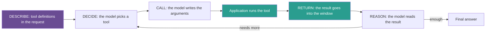

## 1. The question this idea answers

The model "uses a tool". But a model only writes tokens. So what exactly travels between the model and my code? Which fields does the model write, which fields does my code write, and how does a result find its way back to the right call?

A framework hides these details. When it fails, I must read the raw messages. The handbook (Session 4, FAQ Q10) recommends the raw API first, and it says that the loop is "15–20 lines of Python". This lesson gives the exact shapes for three providers.

## 2. Mental model

> [!analogy] A doctor and a lab
> The handbook (FAQ Q2) compares the loop with a doctor's visit.
>
> 1. The lab's list of tests is on the wall (**describe**).
> 2. The doctor reads the symptoms and writes an order for one test (**decide** and **call**).
> 3. The lab runs the test. The doctor does not touch the lab equipment.
> 4. The result comes back with the order number on it (**return**).
> 5. The doctor reads it and either orders another test or gives a diagnosis (**reason**).
>
> **Where it stops working:** a real doctor remembers the morning's tests. The model remembers nothing between calls, so the application must send all earlier orders and results again on every call (lesson [1.3](/notes/ai/context-engineering/01-foundations/l3-the-chat-api-call)). Also, a real lab trusts the doctor. Your code must not trust the model, because text in the window can trick it (lesson [6.9](/notes/ai/context-engineering/06-tools-and-mcp/l9-tool-security-and-prompt-injection)).

## 3. Terms

| Term | Plain meaning |
|---|---|
| tool lifecycle | The five stages of one tool use: describe, decide, call, return, reason. Reason can lead back to decide. |
| `tool_use` block | The Anthropic content block in which the model asks for a tool. It has an `id`, a `name` and an `input` object. |
| `tool_result` block | The Anthropic content block in which the application returns a tool's output. It names the `tool_use_id` of the call that it answers. |
| call ID | The identifier that pairs a tool call with its result: `tool_use_id` (Anthropic), `tool_call_id` (OpenAI Chat Completions), `call_id` (OpenAI Responses), `id` (Gemini). |
| parallel tool calls | Several tool calls in one model response. The application can run them at the same time and return all the results together. |
| `tool_choice` | A request setting that controls whether the model may, must or must not call a tool, or which tool it must call. |
| forced tool use | A `tool_choice` value that makes the model call a tool, or one named tool, instead of writing text. |
| security boundary | The line between what the model writes (a request) and what the application executes (an action). The application decides what crosses it. |

## 4. Method and math

### 4.1 The five stages

The handbook (§2.1) names five stages. The FAQ (Q2) adds the loop back from reason to decide.



| Stage | Who acts | Tokens | Context question (handbook §2.2) |
|---|---|---|---|
| Describe | Developer | Tool definitions on every call | How many definitions fit in my budget? |
| Decide | Model | Part of the output | Will the model pick the right tool? |
| Call | Model writes, application runs | Tool call: output now, input later | Will the model write valid arguments? |
| Return | Application | Tool result: input on every later call | Is the result too large? |
| Reason | Model | Output | Does the model know how to read the result? |

### 4.2 The model never runs the tool

The model writes a structured request: "call `get_weather` with these arguments". That request is only tokens. The orchestration code reads it and decides what to do. The handbook (§2.1) calls this "a critical security boundary".

So the application, not the model, is responsible for four checks before it runs anything:

1. **Is the tool name allowed?** The model can write a name that is not in the list.
2. **Are the arguments valid?** Check them against the schema (lesson [6.3](/notes/ai/context-engineering/06-tools-and-mcp/l3-tool-schemas-and-structured-outputs)).
3. **Is this user allowed to do this?** Use the user's permissions, not the model's wish.
4. **Does this action need a human?** Side effects can need a confirmation (lesson [6.9](/notes/ai/context-engineering/06-tools-and-mcp/l9-tool-security-and-prompt-injection)).

### 4.3 The loop as an algorithm

Every provider follows the same steps. Only the field names change.

1. Build the request: tool definitions, system prompt, history, new user message.
2. Call the model.
3. Append the **whole** assistant response to the history, including its tool calls.
4. If the response has no tool calls, the turn is over. Handle the stop reason (lesson [1.3](/notes/ai/context-engineering/01-foundations/l3-the-chat-api-call)).
5. For each tool call: check it (section 4.2), run it, and build a result with the same call ID.
6. Append the results to the history in the provider's format.
7. Check the loop guards: maximum iterations and token budget (lesson [6.6](/notes/ai/context-engineering/06-tools-and-mcp/l6-execution-patterns-and-react)). Then go to step 2.

The API is stateless, so step 1 sends the tool definitions again on every call.

### 4.4 Anthropic: `tool_use` and `tool_result`

All shapes in sections 4.4 to 4.6 were checked on 2026-10-12 in the provider docs. The first request carries the tools in `tools`, and each tool has `name`, `description` and `input_schema`:

```json
{
  "model": "<model id>",
  "max_tokens": 1024,
  "tools": [
    {
      "name": "get_weather",
      "description": "Get the current weather for one city. Returns the temperature and a short condition. Use it when the user asks about current weather.",
      "input_schema": {
        "type": "object",
        "properties": {
          "location": { "type": "string", "description": "City and region, for example New York, NY" },
          "unit": { "type": "string", "enum": ["celsius", "fahrenheit"] }
        },
        "required": ["location"]
      }
    }
  ],
  "messages": [ { "role": "user", "content": "What is the weather in New York?" } ]
}
```

The response stops with `stop_reason: "tool_use"` and holds a `tool_use` block. The `id` comes from the docs example:

```json
{
  "role": "assistant",
  "content": [
    { "type": "tool_use", "id": "toolu_01A09q90qw90lq917835lq9", "name": "get_weather", "input": { "location": "New York, NY", "unit": "fahrenheit" } }
  ],
  "stop_reason": "tool_use"
}
```

The next request sends the same `tools` again, and three messages:

```json
[
  { "role": "user", "content": "What is the weather in New York?" },
  { "role": "assistant", "content": [ { "type": "tool_use", "id": "toolu_01A09q90qw90lq917835lq9", "name": "get_weather", "input": { "location": "New York, NY", "unit": "fahrenheit" } } ] },
  { "role": "user", "content": [ { "type": "tool_result", "tool_use_id": "toolu_01A09q90qw90lq917835lq9", "content": "59 F, light rain" } ] }
]
```

If the tool fails, the result says so, and the model can react. This example is from the docs:

```json
{ "type": "tool_result", "tool_use_id": "toolu_01A09q90qw90lq917835lq9", "content": "ConnectionError: the weather service API is not available (HTTP 500)", "is_error": true }
```

Rules from the docs:

1. The `tool_result` blocks come **first** in the next user message. Text, if any, comes after them.
2. Put the results of all parallel calls in **one** user message.
3. Each `tool_use_id` must match the `id` of a `tool_use` block in the message before it.

### 4.5 OpenAI: two APIs, two shapes

**Chat Completions.** Each tool is `{"type": "function", "function": {"name", "description", "parameters", "strict"}}`. The assistant message holds `tool_calls`. The `arguments` field is a **JSON string**, not an object:

```json
{
  "role": "assistant",
  "tool_calls": [
    { "id": "call_12345xyz", "type": "function", "function": { "name": "get_weather", "arguments": "{\"location\":\"Paris, France\"}" } }
  ]
}
```

The application appends that assistant message to the history. Then it adds one message with the role `tool` for each call:

```json
{ "role": "tool", "tool_call_id": "call_12345xyz", "content": "14 C, cloudy" }
```

**Responses API.** The tool definition is flat: `{"type": "function", "name", "description", "parameters", "strict"}`. The output holds a `function_call` item, and the application sends back a `function_call_output` item. Both shapes and IDs are from the docs. The output text "14 C, cloudy" is an illustration:

```json
{ "id": "fc_12345xyz", "call_id": "call_12345xyz", "type": "function_call", "name": "get_weather", "arguments": "{\"location\":\"Paris, France\"}" }
{ "type": "function_call_output", "call_id": "call_12345xyz", "output": "14 C, cloudy" }
```

> [!trap] Two IDs on one item
> A Responses `function_call` item has an `id` (`fc_...`) and a `call_id` (`call_...`). The result must name the `call_id`. A result with the `id` does not match the call.

### 4.6 Gemini: `functionCall` and `functionResponse`

In the `generateContent` API, tools go in `tools: [{functionDeclarations: [{name, description, parameters}]}]`. The model returns a `functionCall` part with `name`, `args` and `id`. The application returns a `functionResponse` part with `name`, `response` and the same `id`. The `args` field is an object, as on Anthropic.

The guide says: "Gemini 3 now always returns a unique `id` with every `functionCall`." The default Gemini docs now show the newer Interactions API. There, the model writes a `function_call` step, and the application returns a `function_result` step with `call_id`.

| Item | Anthropic | OpenAI Chat Completions | OpenAI Responses | Gemini `generateContent` |
|---|---|---|---|---|
| Schema field | `input_schema` | `function.parameters` | `parameters` | `functionDeclarations[].parameters` |
| Call | `tool_use` block | `tool_calls[]` on the assistant message | `function_call` item | `functionCall` part |
| Arguments type | object (`input`) | JSON string | JSON string | object (`args`) |
| Result | `tool_result` block in a `user` message | message with role `tool` | `function_call_output` item | `functionResponse` part |
| Call ID field | `tool_use_id` | `tool_call_id` | `call_id` | `id` |

The FAQ (Q12) is right that the idea is the same everywhere. The details in this table are where adapters break.

### 4.7 Parallel tool calls

One response can hold several tool calls. The FAQ (Q18) example: "Compare the weather in NYC and London" gives two `get_weather` calls in one response.

> [!example] Worked example: one round trip saved
> **Sequential:** call 1 asks for NYC. The application runs it. Call 2 asks for London. The application runs it. Call 3 writes the answer. That is 3 model calls.
>
> **Parallel:** call 1 asks for NYC and London together. The application runs both at the same time. Call 2 writes the answer. That is 2 model calls.
>
> One model call less means less latency, and one less copy of the whole history as input.

| Provider | Parallel calls | How to limit them |
|---|---|---|
| Anthropic | On by default | `disable_parallel_tool_use: true` inside `tool_choice`, not at the top level |
| OpenAI | Supported | `parallel_tool_calls: false` gives zero or one call |

Calls that depend on each other cannot run in parallel: first find the customer ID, then read the orders. Lesson [6.6](/notes/ai/context-engineering/06-tools-and-mcp/l6-execution-patterns-and-react) covers the patterns and their latency.

### 4.8 `tool_choice`: may, must or must not

| Intent | Anthropic | OpenAI | Gemini (`generateContent` mode) |
|---|---|---|---|
| The model decides (default) | `auto` | `auto` | `AUTO` |
| The model must call some tool | `any` | `required` | `ANY` |
| The model must call one named tool | `tool` with a name | a forced function | `ANY` with `allowedFunctionNames` |
| Restrict the choice to some tools | — | `allowed_tools` | `allowedFunctionNames` with `ANY` or `VALIDATED` |
| No tool calls | `none` | `none` | `NONE` |
| Constrained decoding of calls, model still decides | `strict: true` on the tool | `strict: true` on the tool | `VALIDATED` |

> [!note] Source check: forced tool use
> **Corrected.** The handbook (FAQ Q12) says that "all three support forced tool use". The Anthropic docs say that on Claude Opus 5.5, Sonnet 5.5, Fable 5.1 and Mythos 5.1, "`any` and `tool` return a 400 error". Forced tool use also fails with manual extended thinking. On these models, use `auto` with `strict: true` on the tools instead. The FAQ (Q40) also lists only ANY, AUTO and NONE for Gemini. The current API also has `VALIDATED`. Sources: Anthropic tool-use docs, Gemini API reference, checked on 2026-10-12.

### 4.9 A full trace: 7,823 × 4,519

> [!example] Worked example: two model calls for one answer
> The application offers one tool, `calculate(expression)`.
>
> | Step | What travels | Who writes it |
> |---|---|---|
> | Call 1, input | tools + user: "What is 7,823 times 4,519?" | Application |
> | Call 1, output | `tool_use` with `id` X and `input` `{"expression": "7823 * 4519"}`, stop reason `tool_use` | Model |
> | Run | The application checks the expression and computes 35352137. | Application |
> | Call 2, input | tools + user message + the assistant `tool_use` + a user `tool_result` with `tool_use_id` X and content "35352137" | Application |
> | Call 2, output | "7,823 × 4,519 = 35,352,137." with stop reason `end_turn` | Model |
>
> Call 2 sends everything from call 1 again, plus the call and the result. This is the growth of lesson [1.6](/notes/ai/context-engineering/01-foundations/l6-the-cost-of-a-conversation).

> [!trap] Never `eval()` the model's expression
> A calculator that runs Python's `eval()` on the model's text runs any code that the text contains. Parse the expression and allow only numbers and arithmetic operators.

### 4.10 Production view

| Concern | What this lesson means for it |
|---|---|
| Latency | Each tool step adds one model call. Parallel calls save model calls when the calls do not depend on each other. |
| Reliability | Check every call ID. Parse OpenAI `arguments` strings with error handling. Handle a model that asks for an unknown tool. |
| Security | The model's tool call is a request, not an action. Check the name, the arguments, the permissions and the need for a human. |
| Portability | Store tool calls and results in a neutral format. Convert them to each provider's shape at the last step. |
| Observability | Log every call ID with its tool name, arguments, result size, latency and error flag. |

## 5. Code

These exercises go in `notebooks/06-tools-and-mcp.ipynb`. Exercises 2.1 and 2.3 cost nothing.

**Exercise 2.1: the raw loop with a scripted model.**

1. Write `fake_model(messages, tools)`. On the first call it returns an Anthropic-style response with one `tool_use` block for `calculate`. When the last message holds a `tool_result`, it returns text with `stop_reason` `end_turn`.
2. Write `calculate(expression)` with Python's `ast` module. Allow only numbers and the operators `+ - * / **` and parentheses.
3. Write `run_loop(user_text, model, tools, max_iterations)` that follows the seven steps of section 4.3.
4. Print every message of the history after the loop.

Acceptance tests:

- For "What is 7,823 times 4,519?", the final text contains 35,352,137.
- The `tool_use_id` of the result equals the `id` of the call.
- The assistant message with the `tool_use` block is in the history before the `tool_result` message.
- `calculate("__import__('os').getcwd()")` returns an error string and runs nothing.
- With a fake model that always asks for a tool, the loop stops at `max_iterations` and reports it.

**Exercise 2.2 (optional, costs money): the real loop.** Replace `fake_model` with one real provider SDK. Keep `run_loop` unchanged except for a small adapter.

Acceptance tests:

- The model calls `calculate` and gives the exact product.
- The printed history shows both IDs and the stop reason of each call.
- A question with two independent products ("7,823 × 4,519 and 1,234 × 5,678") gives two calls in one response, and both results go back in one message.

**Exercise 2.3: a format adapter for tool messages.** Store a tool call as `{"call_id", "name", "arguments"}` and a result as `{"call_id", "content", "is_error"}`. Write converters to Anthropic, OpenAI Chat Completions and OpenAI Responses messages. Do not call any API.

Acceptance tests:

- Anthropic: two results become one user message with two `tool_result` blocks.
- OpenAI Chat Completions: two results become two messages with the role `tool`.
- OpenAI Chat Completions and Responses: `arguments` is a JSON string. Anthropic: `input` is an object.

## 6. Common mistakes

1. **"The model runs the tool."** The model writes a request. The application runs the tool and is responsible for every check.
2. **Not appending the assistant message with the tool call.** The next request then holds a result with no call before it. The API rejects it, or the model loses track.
3. **One user message for each Anthropic result.** All results of one response go in one user message, with the `tool_result` blocks first.
4. **Using the Responses `id` instead of `call_id`.** The result does not match the call.
5. **"The tools only need to go in the first request."** The API is stateless. Send the tool definitions on every call.
6. **"Forced tool use works on every model."** On the newest Claude models, `any` and `tool` return a 400 error. Use `auto` with `strict: true`.

## 7. One-minute explanation

A tool call is a loop between the model and the application. The application sends the tool definitions with the messages. The model reads them and, if it needs a tool, it writes a structured call with a name, arguments and an ID. The model never runs anything. The application checks the call, runs the tool and sends the result back with the same ID. Then it calls the model again with the whole history, because the API is stateless. The model reads the result and either asks for another tool or answers. Anthropic uses `tool_use` and `tool_result` blocks. OpenAI uses `tool_calls` and `tool` messages, or `function_call` items. Gemini uses `functionCall` and `functionResponse` parts. Independent calls can come in one response and run in parallel.

## 8. Check questions

```check
{
  "question": "A user asks for the weather in three cities. The model asks for all three in one response. How many Anthropic user messages carry the results, and how many tool_result blocks?",
  "hint": "Look at the placement rules in section 4.4.",
  "answer": "One user message with three tool_result blocks. Each block names the tool_use_id of its call. The tool_result blocks come first in that message."
}
```

```check
{
  "question": "An OpenAI Responses integration sends back function_call_output with the value fc_12345xyz. The model says it has no result for its call. What is wrong?",
  "answer": "The result used the item id (fc_...) instead of the call_id (call_...). The function_call_output must name the call_id of the function_call item."
}
```

```check
{
  "question": "A task needs 4 tool steps and then an answer. In plan A, every step needs the result of the step before it. In plan B, steps 2 and 3 both need step 1 but not each other, and step 4 needs steps 2 and 3. How many model calls does each plan need?",
  "hint": "Each round of tool calls needs one model call to ask for it, and the answer needs one more call.",
  "answer": "Plan A: 4 calls that each ask for one tool, plus 1 call for the answer = 5 model calls. Plan B: call 1 asks for step 1, call 2 asks for steps 2 and 3 together, call 3 asks for step 4, and call 4 answers = 4 model calls."
}
```

```check
{
  "question": "A team sets tool_choice to {\"type\": \"any\"} on Claude Sonnet 5.5 and gets HTTP 400. Why, and what should they use instead?",
  "answer": "The docs say that any and tool return a 400 error on Opus 5.5, Sonnet 5.5, Fable 5.1 and Mythos 5.1. Use tool_choice auto, and set strict: true on the tools so that the inputs follow the schema."
}
```

```check
{
  "question": "Why is the line between the model's tool call and the application's execution called a security boundary? Name two checks that belong on the application side.",
  "answer": "The model only writes text, and text in its window can manipulate it. Nothing happens until the application acts. So the application must check that the tool name is allowed and the arguments are valid, that the user has permission, and that a side effect has a human confirmation when needed."
}
```

## 9. Links

- Previous: [L1: Tools are context](/notes/ai/context-engineering/06-tools-and-mcp/l1-tools-are-context)
- Next: [L3: Tool schemas and structured outputs](/notes/ai/context-engineering/06-tools-and-mcp/l3-tool-schemas-and-structured-outputs)
- [Lesson 1.3: The chat API call](/notes/ai/context-engineering/01-foundations/l3-the-chat-api-call): roles, stop reasons and statelessness
- [L6: Execution patterns and ReAct](/notes/ai/context-engineering/06-tools-and-mcp/l6-execution-patterns-and-react)
- [Glossary](/notes/ai/context-engineering/glossary)
