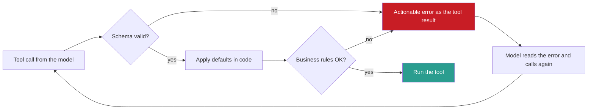

## 1. The question this idea answers

The model never sees my tool's code. It sees only a name, a description and a parameter schema. From those few hundred tokens it must decide when to call the tool and which arguments to write. The handbook calls schema design "one of the highest-leverage skills in context engineering" (Session 4, §3).

Three questions follow. What makes a schema good? Can I guarantee that the arguments match the schema? And if they are valid JSON, are they correct?

## 2. Mental model

> [!analogy] A paper form at an office counter
> A good form has a clear title and a line that says what the form is for. It has boxes to tick instead of free text, a star on each required field, and few fields. A clerk checks each form before processing it. If a field is wrong, the clerk hands it back with a note: "Date must be DD/MM/YYYY. You wrote 'next Tuesday'."
>
> - The form is the **schema**. The title and the purpose line are the **name** and the **description**.
> - The tick boxes are **enums**. The stars are the **required** list.
> - The clerk is **argument validation** in your code. The note is an **actionable error**.
>
> **Where it stops working:** a person reads the whole form and thinks. The model predicts one token at a time. With **strict mode**, a stencil makes a malformed form impossible. But a stencil cannot check that the content is true. A valid date can still be the wrong date.

## 3. Terms

| Term | Plain meaning |
|---|---|
| JSON Schema | A standard JSON format that describes the allowed shape of JSON data: types, fields, required fields and allowed values. |
| `required` | The JSON Schema keyword that lists the properties that must be present. Properties are optional by default. |
| `enum` | The JSON Schema keyword that lists every allowed value of a field. |
| `additionalProperties` | The JSON Schema keyword that controls extra keys. The value `false` forbids keys that are not in `properties`. |
| `default` | A JSON Schema annotation that documents a default value. Validators do not insert it, so the application must apply it. |
| structured outputs | A provider feature that makes the model's output follow a given JSON schema. |
| constrained decoding | A decoding method that allows only the tokens that keep the output valid under a schema or grammar. |
| strict mode | A tool setting (`strict: true`) that applies constrained decoding to the tool's arguments. |
| argument validation | The application checks the model's arguments against the schema and business rules before it runs the tool. |
| actionable error | An error message that names the field, the expected value, the received value and a valid example, so the model can fix the call. |
| namespacing | Giving related tools a common prefix by service or resource, for example `asana_search` and `jira_search`. |

## 4. Method and math

### 4.1 JSON Schema essentials

Tool schemas use JSON Schema. MCP uses the 2020-12 dialect when a schema names no other dialect. These keywords cover most tools (JSON Schema docs, checked on 2026-10-12):

| Keyword | Meaning | Example |
|---|---|---|
| `type` | The JSON type: `string`, `number`, `integer`, `boolean`, `array`, `object` or `null`. It can be a list. | `"type": ["integer", "null"]` |
| `properties` | The fields of an object, each with its own schema. | `"properties": {"query": {"type": "string"}}` |
| `required` | The fields that must be present. "By default, the properties defined by the `properties` keyword are not required." | `"required": ["query"]` |
| `enum` | The complete list of allowed values. | `"enum": ["past_day", "past_week"]` |
| `items` | One schema that every element of an array must match. | `"items": {"type": "string"}` |
| `additionalProperties` | Extra keys are allowed by default. `false` forbids them. | `"additionalProperties": false` |
| `description` | Text for the reader. For tools, the reader is the model. | `"description": "City and region"` |
| `default` | An annotation only. "This value is not used to fill in missing values during the validation process." | `"default": 5` |

> [!note] Source check: `default`
> **Corrected.** The handbook's reference schema for `search_web` (Session 4, §9.1) gives `"default": 5` for `num_results` and implies that the default takes effect. JSON Schema says that `default` is an annotation. A validator does not insert the value. If the model leaves out `num_results`, your code must apply 5. Source: json-schema.org, "Annotations", checked on 2026-10-12.

### 4.2 One schema, four envelopes

The schema inside is the same JSON Schema. The field that holds it has a different name on each platform.

| Platform | Field that holds the parameter schema |
|---|---|
| OpenAI Chat Completions | `tools[].function.parameters` |
| OpenAI Responses | `tools[].parameters` |
| Anthropic | `tools[].input_schema` |
| MCP | `inputSchema`, and an optional `outputSchema` for the result |
| Gemini | `tools[].functionDeclarations[].parameters`, an OpenAPI-style schema |

> [!note] Source check: schema envelope names
> **Corrected.** The lecture (§3.1, §9.1) writes every schema with `parameters`, the OpenAI style. The FAQ (Q3) uses `input_schema`, the Anthropic style. Neither says that the name depends on the platform. MCP uses `inputSchema`. Sources: OpenAI function-calling guide, Anthropic tool-use docs, MCP 2026-07-28 schema, checked on 2026-10-12.

### 4.3 Anatomy of a good schema

This is the handbook's example (§3.1), in the Anthropic envelope:

```json
{
  "name": "search_products",
  "description": "Search the product catalog by name, category, or price range. Returns top 10 matches with name, price, and availability status. Use this when the user asks about finding, browsing, or looking for products.",
  "input_schema": {
    "type": "object",
    "properties": {
      "query": { "type": "string", "description": "Search terms: product name or keywords (e.g., 'wireless headphones')" },
      "category": { "type": "string", "enum": ["electronics", "clothing", "books", "home"], "description": "Filter by product category (optional)" },
      "max_price": { "type": "number", "description": "Maximum price in USD (optional, e.g., 50.00)" }
    },
    "required": ["query"]
  }
}
```

Four decisions make it good:

1. **Name.** `search_products` is verb_noun. Compare the bad names `products` (no verb), `do_search` (vague verb) and `sp` (cryptic). On Anthropic, a name must match `^[a-zA-Z0-9_-]{1,128}$`.
2. **Description.** It has three parts: what the tool does, what it returns, and when to use it. The handbook calls it "the most important field". Anthropic's docs say: "Aim for at least 3–4 sentences for each tool description".
3. **Enum.** `category` allows exactly four values. Without the enum, the model can write "Electronics" (wrong case), "tech" (wrong value) or "electronics & gadgets" (invented value).
4. **Required.** Only `query` is required, so `search_products(query="headphones")` is a valid call.

### 4.4 The six principles, with their sources

The handbook (§3.2) gives six principles. The FAQ (Q15) gives five, and adds examples inside parameter descriptions.

| Principle | Why | Source status |
|---|---|---|
| Clear, specific descriptions: what, returns, when | The model chooses a tool from its description. | Confirmed: Anthropic tool-use docs. |
| Enums for fixed choices | No invented values. | Confirmed: an enum is a hard limit under strict mode (section 4.5). |
| Mark required and optional | The model knows what it must give. | Confirmed: JSON Schema `required`. |
| Describe what the tool returns | The model can plan the next step. | Confirmed: part of the description advice. |
| verb_noun names | Clear action. With many tools, add a service prefix (namespacing). | Confirmed: Anthropic, "Writing effective tools for agents" (11 September 2025). |
| Fewer than 6 parameters | Fewer chances for wrong arguments. | Rule of thumb from the handbook. Measure on your own tools. |
| Examples in parameter descriptions (FAQ Q15) | The model copies the format. | Confirmed in kind: Anthropic's `input_examples` field. Anthropic reports that "tool use examples improved accuracy from 72% to 90% on complex parameter handling" in its own tests. |

How large is the effect of a good schema? The FAQ (Q49) says that good schemas give "85–95% tool selection accuracy" and vague schemas "40–60%". These numbers have no source, so treat them as an illustration. Anthropic's figures above come from its own evaluations, not from your tools. Measure tool-selection accuracy on a labeled set of your own requests.

> [!example] Worked example: repair the `data` tool
> The handbook (§3.2) shows a tool named `data` with the description "handles data operations". It has no verb, a vague description, no "when to use" and no return format.
>
> A better design splits it into focused tools:
>
> - `search_orders`: "Search orders by customer name, status or date range. Returns up to 20 orders with ID, date, status and total. Use it to find orders when the order ID is unknown."
> - `get_order`: "Get one order by its ID. Returns items, shipping address and payment status. Use it after `search_orders` or when the user gives an order ID."
> - `update_order_status`: "Change the status of one order. Returns the old and the new status. Use it only when the user asks to change an order."
>
> Anthropic's guide also warns against one tool for each API endpoint. It suggests tools that match a task, for example one `schedule_event` tool instead of several calendar endpoints.

### 4.5 Constrained decoding: how strict mode works

Lesson [1.1](/notes/ai/context-engineering/01-foundations/l1-what-a-model-does-with-context) showed that the model computes a probability for every token. Constrained decoding removes every token that would break the schema, then scales the rest so that they add up to 1 again:

$$
p'(t) = \frac{p(t)\, a(t)}{\sum_{s \in V} p(s)\, a(s)}
$$

The symbols mean:

- $p(t)$ is the model's probability for token $t$.
- $a(t)$ is 1 if token $t$ keeps the output valid under the schema, and 0 if it does not.
- $V$ is the vocabulary.
- $p'(t)$ is the probability after the constraint.

> [!example] Worked example: the `category` enum
> The model has written `{"query": "headphones", "category": "` and must write the next token. Assume these probabilities (invented for the example):
>
> | Token | $p(t)$ | Allowed by the enum? | $p'(t)$ |
> |---|---|---|---|
> | `elect` (starts "electronics") | 0.50 | yes | 0.50 / 0.55 = 0.909 |
> | `tech` | 0.30 | no | 0 |
> | `Elect` | 0.15 | no, the enum is case-sensitive | 0 |
> | `books` | 0.05 | yes | 0.05 / 0.55 = 0.091 |
>
> The allowed mass is 0.50 + 0.05 = 0.55. Without the constraint, an invalid value had a 45% chance. With it, the chance is 0.

The same idea works for structure: a closing brace is allowed only when all required keys are present. Gemini's `VALIDATED` mode uses this method too. The API reference says the model "will validate function calls with constrained decoding."

### 4.6 Strict mode rules by provider

All rules below were checked on 2026-10-12.

| Provider | How to turn it on | Rules for the schema |
|---|---|---|
| OpenAI | `"strict": true` on the function | "`additionalProperties` must be set to `false` for each object in the `parameters`." "All fields in `properties` must be marked as `required`." For an optional field, add `null` to its type. Responses "will attempt to normalize your schema into strict mode when possible". "Chat Completions requests remain non-strict by default." |
| Anthropic | `"strict": true` on the tool | Grammar-constrained inputs. The structured-outputs schema rules apply: `additionalProperties` "must be set to false for objects". Not supported: recursive schemas, numeric constraints (minimum, maximum), string length constraints, external `$ref`. |
| Gemini | Mode `VALIDATED` | The model still chooses between a call and text, but its calls are constrained. |

> [!example] Worked example: `search_web` in OpenAI strict form
> In strict mode every field is required. So an optional field becomes a **nullable** field, and `null` means "use the default":
>
> ```json
> {
>   "type": "function",
>   "name": "search_web",
>   "description": "Search the web for current information on any topic. Returns a list of results with titles, URLs and text snippets. Use it for recent events or facts you are unsure about.",
>   "strict": true,
>   "parameters": {
>     "type": "object",
>     "properties": {
>       "query": { "type": "string", "description": "Specific search query, for example: MCP protocol Anthropic 2025" },
>       "num_results": { "type": ["integer", "null"], "description": "Number of results, 1 to 20. Null means 5." },
>       "date_filter": { "type": ["string", "null"], "enum": ["past_day", "past_week", "past_month", "past_year", "any", null] },
>       "domain_filter": { "type": ["string", "null"], "description": "One domain, for example arxiv.org" }
>     },
>     "required": ["query", "num_results", "date_filter", "domain_filter"],
>     "additionalProperties": false
>   }
> }
> ```
>
> Two details matter. The enum also lists `null`, because `enum` checks every value. And the range 1 to 20 is only in the description. Anthropic strict mode does not support `minimum` and `maximum`, so a schema that must work on both providers leaves them out. Your code must check the range.

### 4.7 What strict mode does not fix

> [!note] Source check: "removes the need for retry logic entirely"
> **Corrected.** The handbook (FAQ Q41) says that strict mode "removes the need for retry logic around JSON parsing failures entirely". Strict mode guarantees the **shape** of the arguments. These failures remain:
>
> 1. **Semantic errors.** `"date": "2026-02-30"` is a valid string. `"num_results": 500` is a valid integer when the range is not enforced.
> 2. **Truncation.** If the output reaches `max_tokens`, the JSON is cut (lesson [1.3](/notes/ai/context-engineering/01-foundations/l3-the-chat-api-call)).
> 3. **Refusals.** A refusal is not a tool call.
> 4. **Wrong tool.** A valid call to the wrong tool is still wrong.
> 5. **Unsupported keywords.** A constraint that the provider ignores is not enforced.
>
> Sources: OpenAI function-calling guide, Anthropic structured-outputs docs, checked on 2026-10-12.

### 4.8 Structured outputs without tools

Constrained decoding also works for a plain answer. Use it when the final answer must be JSON, for example a classification or a data extraction. On Anthropic, structured outputs now use `output_config.format`, and the older `output_format` is deprecated (checked on 2026-10-12). The rule: use a tool when the model must ask for an **action** or a lookup. Use structured outputs when the model must return **data** in a fixed shape.

### 4.9 Validate, then let the model correct itself

Validation in your code is the clerk at the counter. Do it on every call, with or without strict mode.



An actionable error has four parts: the field, the expected value, the received value and a valid example. The handbook (FAQ Q6) gives a good one: "Error: the date parameter must be in YYYY-MM-DD format, but received next Tuesday."

Where does the error go? Send it back as a **tool result** with the error flag, not as an exception that stops the loop. The model can read a tool result, so it can fix its call. MCP added this guidance in the 2025-11-25 revision: input validation errors "should be returned as Tool Execution Errors rather than Protocol Errors to enable model self-correction". Lesson [6.4](/notes/ai/context-engineering/06-tools-and-mcp/l4-tool-results-and-errors) covers the error format.

How often does the model fix the call? The FAQ (Q6) says that models "almost always" fix it on the second attempt. That is a rule of thumb with no source. Anthropic's docs say that on invalid input, "Claude will retry 2-3 times with corrections before apologizing to the user". Measure the repair rate on your own tools, and cap the retries.

### 4.10 Production view

| Concern | What this lesson means for it |
|---|---|
| Reliability | Use strict mode where the provider supports it, and still validate every call in code. Apply defaults in code. |
| Cost | Every word of a description is sent on every call. Keep descriptions complete but short, and measure their tokens (lesson [6.1](/notes/ai/context-engineering/06-tools-and-mcp/l1-tools-are-context)). |
| Change control | A small wording change in a description can change tool selection. Version schemas, and run the evaluation set before release (FAQ Q33). |
| Portability | Keep one neutral schema and generate each provider's envelope from it. Strict mode needs a converted form. |
| Security | Validation is the first gate. It does not replace permissions or confirmation (lesson [6.9](/notes/ai/context-engineering/06-tools-and-mcp/l9-tool-security-and-prompt-injection)). |

## 5. Code

These exercises go in `notebooks/06-tools-and-mcp.ipynb`. Reusable functions go in `src/tool_schemas.py`. Exercises 3.1 to 3.4 cost nothing.

**Exercise 3.1: the four research tools (handbook Exercise A).** Write Anthropic-style definitions for these tools:

1. `search_web`: `query` (required), `num_results` (optional, default 5, maximum 20), `date_filter` (optional enum), `domain_filter` (optional).
2. `read_document`: `source` (required, a URL or a file path), `max_length` (optional, maximum characters), `format` (optional: "full", "summary" or "outline").
3. `save_note`: `title` (required), `content` (required), `tags` (optional, a list of strings), `source_url` (optional).
4. `create_summary`: `topic` (optional), `format` (optional: "bullet_points", "paragraph" or "outline"), `max_length` (optional, maximum words).

Acceptance tests:

- Each `input_schema` passes `jsonschema.Draft202012Validator.check_schema`.
- Each description says what the tool does, what it returns and when to use it.
- `tags` uses `"type": "array"` with `"items": {"type": "string"}`.
- `save_note` with no `content` fails validation. `search_web` with only `query` passes.

**Exercise 3.2: `validate_args(schema, args, defaults)`.**

1. Validate `args` with `jsonschema`.
2. Return a list of actionable errors: field, expected, received, valid example.
3. Apply the defaults for missing optional fields, then check ranges that the schema cannot express in strict mode.

Acceptance tests:

- `{"query": "MCP", "num_results": 50}` gives one error that names `num_results`, the range 1 to 20 and the value 50.
- `{"query": "MCP"}` returns arguments with `num_results` equal to 5.
- `{"query": "MCP", "date_filter": "last_week"}` gives an error that lists the five allowed values.

**Exercise 3.3: `to_openai_strict(schema)`.** Convert an Anthropic `input_schema` into the OpenAI strict form of section 4.6.

Acceptance tests:

- Every object has `"additionalProperties": false`, also nested objects.
- Every property is in `required`. Each property that was optional now allows `null`, and its enum lists `null`.
- The converted `search_web` matches the worked example.

**Exercise 3.4: repair a bad tool.** Take the `data` tool of section 4.4. Write two or three replacement tools that pass all six principles. Count the tokens of the old and the new definitions with `tiktoken`.

**Exercise 3.5 (optional, costs money): the enum experiment.** Write 20 user requests that name a category in loose words ("gadgets", "kitchen stuff"). Call one model twice per request: with the `category` enum and without it.

Acceptance test: a table with the count of invalid category values in each setting, and one sentence that explains the difference.

## 6. Common mistakes

1. **"`default` fills in the value."** It is an annotation. Your code applies the default.
2. **"Every platform uses `parameters`."** OpenAI uses `parameters`, Anthropic uses `input_schema`, MCP uses `inputSchema`.
3. **"Strict mode means the arguments are correct."** Strict mode guarantees the shape. A valid date can be the wrong date.
4. **"Optional fields work the same in strict mode."** OpenAI strict mode needs every field in `required`. Make optional fields nullable, and put `null` in their enums.
5. **"A short description saves tokens, so keep it to one line."** A vague description causes wrong calls, and each wrong call costs a full model round trip. Anthropic advises 3 to 4 sentences.
6. **"Raise an exception when the arguments are invalid."** Return an actionable error as the tool result, so the model can correct the call.

## 7. One-minute explanation

The model knows a tool only from its definition: a name, a description and a JSON Schema for the parameters. A good name is verb_noun. A good description says what the tool does, what it returns and when to use it. Enums stop the model from inventing values, and the required list says what the model must give. Strict mode goes further. It uses constrained decoding, which removes every token that would break the schema, so the arguments always have the right shape. But strict mode cannot check meaning. A valid date can still be wrong, and an output can still be cut or refused. So the application validates every call, applies defaults, and returns an actionable error as the tool result. The model then reads the error and corrects its call.

## 8. Check questions

```check
{
  "question": "Before the constraint, the model gives these probabilities for the next token: 'past_week' 0.40, 'last_week' 0.35, 'past_month' 0.15, 'recent' 0.10. Only the past_* values are in the enum. What are the probabilities after constrained decoding?",
  "hint": "Remove the disallowed tokens, then divide by the remaining mass.",
  "answer": "Allowed mass = 0.40 + 0.15 = 0.55. p'(past_week) = 0.40 / 0.55 ≈ 0.727. p'(past_month) = 0.15 / 0.55 ≈ 0.273. The two disallowed tokens get 0."
}
```

```check
{
  "question": "A schema has \"num_results\": {\"type\": \"integer\", \"default\": 5}. The model calls search_web with only a query. The tool code reads args[\"num_results\"] and crashes. Why?",
  "answer": "default is an annotation only. Neither the validator nor the provider inserts the value. The key is missing, so the code fails. The code must apply the default, for example args.get(\"num_results\", 5)."
}
```

```check
{
  "question": "A team enables strict mode and deletes all argument validation. Name three failures that can still reach the tool.",
  "answer": "Any three of these: a valid but wrong value, such as the date 2026-02-30 or num_results = 500 when the range is not enforced; a call to the wrong tool; output cut at max_tokens; a refusal instead of a call; a constraint keyword that the provider does not support."
}
```

```check
{
  "question": "Convert this optional field to OpenAI strict form: \"format\": {\"type\": \"string\", \"enum\": [\"full\", \"summary\", \"outline\"]}. What else must change in the parent object?",
  "answer": "The field becomes {\"type\": [\"string\", \"null\"], \"enum\": [\"full\", \"summary\", \"outline\", null]}. In the parent object, format must be in required, and additionalProperties must be false. The code treats null as the default."
}
```

```check
{
  "question": "A tool gets the argument date = \"next Tuesday\". Write an actionable error for the model, and say where it goes.",
  "answer": "For example: \"Error: date must be in YYYY-MM-DD format, for example 2026-10-20. Received: next Tuesday.\" It goes back as the tool result with the error flag (is_error on Anthropic, isError in MCP), so that the model can read it and call again."
}
```

## 9. Links

- Previous: [L2: The tool-call loop](/notes/ai/context-engineering/06-tools-and-mcp/l2-the-tool-call-loop)
- Next: [L4: Tool results and errors](/notes/ai/context-engineering/06-tools-and-mcp/l4-tool-results-and-errors)
- [Lesson 1.1: What a model does with context](/notes/ai/context-engineering/01-foundations/l1-what-a-model-does-with-context): next-token probabilities
- [L5: Many tools](/notes/ai/context-engineering/06-tools-and-mcp/l5-many-tools): when descriptions start to overlap
- [Glossary](/notes/ai/context-engineering/glossary)
