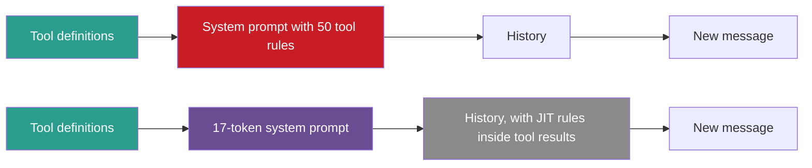
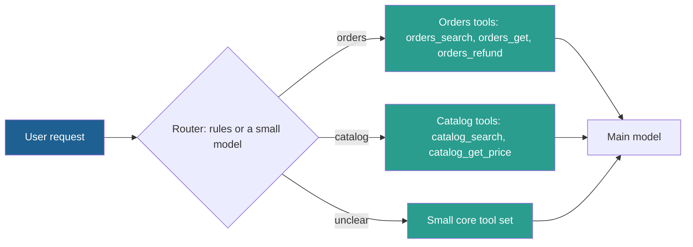

## 1. The question this idea answers

An agent starts with 5 tools and works well. A year later it has 60 tools from four teams. It picks the wrong tool more often, and it uses the right tool in the wrong way. Its system prompt is a wall of special cases. What breaks as the tool count grows, and what are the fixes?

Shopify described this path for its Sidekick agent. The handbook (Session 4, §4) builds on that post, but it adds claims that the post does not make. This lesson separates the two.

## 2. Mental model

> [!analogy] From a workbench to a hardware store
> A workbench with 5 tools on the wall is easy: you see every tool and you know which one to take. A hardware store with 5,000 tools needs two things. First, a **clerk** who brings you the few tools that fit your job. Second, a **tag** on each tool with its own instructions. You read the tag when you pick the tool, instead of one thick manual at the door.
>
> - The clerk is **tool retrieval** or **tool search**.
> - The tags are **just-in-time instructions**.
> - The thick manual is the monolithic system prompt.
>
> **Where it stops working:** if the clerk brings the wrong tools, you cannot see the right one at all. A retrieval miss is worse than a crowded wall. Also, the model keeps every tag that it reads in its history, so tags are not free.

## 3. Terms

| Term | Plain meaning |
|---|---|
| tool-count zones | Shopify's three ranges of tool count (0–20, 20–50, 50+), each with its own typical problems. |
| death by a thousand instructions | Shopify's name for a system prompt that grows into many special cases and conflicting rules, one set for each tool. |
| just-in-time instructions (JIT instructions) | Guidance for a tool that the tool returns together with its data, at the moment the model needs it, instead of in the system prompt. |
| tool retrieval | Choosing the tools for a request by search over the tool descriptions, then sending only those tools to the model. |
| deferred loading | Anthropic's `defer_loading: true`: a tool's definition is sent in the request but enters the model's context only when a search finds it. |
| tool search tool | A tool that the model can call to search a large tool catalog and load matching tools. |
| tool recall@k | The share of test requests for which every needed tool is among the top $k$ tools that retrieval returns. |
| routing | A first step, by rules or a small model, that chooses a group of tools or a sub-agent for the request. |

## 4. Method and math

### 4.1 Three things that grow with the tool count

| What grows | Why it hurts | Fix in this lesson |
|---|---|---|
| Definition tokens | Every definition is input on every call (lesson [6.1](/notes/ai/context-engineering/06-tools-and-mcp/l1-tools-are-context)). | Tool retrieval, deferred loading (4.6, 4.7) |
| Overlap between tools | Similar descriptions make the choice ambiguous. | Better descriptions, namespacing, routing (4.8) |
| Per-tool guidance | The system prompt fills with special cases. | JIT instructions (4.3 to 4.5) |

The FAQ (Q14) adds a fourth effect: latency. The model must process all definitions on every request, so prefill takes longer (lesson [1.4](/notes/ai/context-engineering/01-foundations/l4-attention-and-the-cost-of-length)).

### 4.2 Shopify's three zones

The source is the Shopify Engineering post "Building production-ready agentic systems" by Andrew McNamara (26 August 2025). The zones, in the post's words:

| Zone | The post's description |
|---|---|
| 0–20 tools | "Clear boundaries, easy to debug, straightforward behavior" |
| 20–50 tools | "Boundaries become unclear, tool combinations start causing unexpected outcomes" |
| 50+ tools | "Multiple ways to accomplish the same task, system becomes difficult to reason about" |

Two other vendors give similar limits (checked on 2026-10-12):

- Anthropic's tool search docs: "Claude's ability to pick the right tool degrades once you exceed 30–50 available tools."
- OpenAI's function-calling guide: "Aim for fewer than 20 functions available at the start of a turn at any one time, though this is just a soft suggestion."

> [!note] Source check: what the Shopify post says
> **Corrected.** The handbook adds claims that the post does not make:
>
> 1. The lecture's "What to do" column (§4.1) and "use RAG to select relevant tool descriptions" are not in the post. The post does not mention RAG for tool selection.
> 2. FAQ Q14 says that 50+ tools require retrieving "the relevant 5–10". The post has no such figure.
> 3. FAQ Q23 says that "Shopify's research suggests that 10–15 well-designed specific tools outperform one or two flexible tools". The post has no such figure.
> 4. FAQ Q13 says that "Shopify's research showed" JIT is critical at 20–50 tools. The post gives zones, not this threshold.
>
> Treat these numbers as the handbook's own rules of thumb. Source: Shopify Engineering, 26 August 2025, checked on 2026-10-12.

### 4.3 Death by a thousand instructions

The second problem is not the choice of tool but its use. The post says that Sidekick's system prompt became "an unwieldy collection of special cases, conflicting guidance, and edge case handling". The handbook (§4.2.1) shows the pattern:

```text
You are Shopify Sidekick...
When using the pricing tool:
  - Always check the user's currency
  - Display prices with 2 decimal places
When using the inventory tool:
  - Stock counts update every 15 min
  - Never promise exact availability
... (50 more blocks of tool-specific instructions) ...
```

The handbook puts this at 3,000 to 5,000 tokens. Every call carries all of it, even when the model uses one tool. And when the model finally uses the shipping tool, the shipping rule is one block among fifty.

### 4.4 Just-in-time instructions

The post's fix: "Instead of cramming all guidance into the system prompt, we return relevant instructions" with the tool data, "exactly when they're needed." The handbook's example (§4.2.2):

```json
{
  "data": {
    "shipping_options": [
      { "method": "Standard", "days": 5, "cost": 0 },
      { "method": "Express", "days": 2, "cost": 12.99 }
    ]
  },
  "jit_instructions": "Display shipping times in the merchant's local timezone. Always show free shipping options first, regardless of sort order requested."
}
```

The system prompt shrinks to one line: "You are Shopify Sidekick. Use the available tools to help merchants manage their store." That line is 17 tokens with `o200k_base`. The handbook says about 50. The whole result above is 76 tokens as single-line JSON, and the instruction text is 23.

The post names three benefits:

| Benefit | Meaning |
|---|---|
| Localized guidance | The rule appears only when its tool runs, next to the data that it is about. |
| Cache efficiency | Instructions can change without breaking prompt caches (section 4.5). |
| Modularity | Different instructions for beta flags, model versions or page context. |

The handbook renames the third benefit "modular ownership" by team. That is a fair use of the idea, but it is not the post's wording. The FAQ (Q13) adds "better adherence" because the rule sits next to its data. This is plausible, but no source measures it. Test it on your own tools.

> [!trap] JIT text is tool output
> JIT instructions work because the model follows text in tool results. So the model may also follow text in tool results that **you did not write**, such as a web page. Accept JIT instructions only from your own trusted tools, and keep them in a fixed field (lesson [6.9](/notes/ai/context-engineering/06-tools-and-mcp/l9-tool-security-and-prompt-injection)).

### 4.5 Why JIT helps prompt caching

Lesson [1.7](/notes/ai/context-engineering/01-foundations/l7-prompt-caching) showed that a cache hit needs an exact prefix, in the order tools, system, messages. A change in the tools or the system prompt invalidates everything after it.



In the top layout, an edit to one tool rule changes block B, so every cached prefix misses. In the bottom layout, the edited rule appears only in tool results that the tool returns after the edit. The prefix blocks E and F stay the same.

> [!example] Worked example: the cost of one edit
> The prefix is 5,000 tokens of tool definitions plus a 4,000-token system prompt: 9,000 tokens. Use the multipliers of lesson 1.7 (5-minute cache, most Claude models). A write costs $w = 1.25$ and a read costs $r = 0.1$ times the input price.
>
> - Normal call: $9{,}000 \times 0.1 = 900$ token-units for the prefix.
> - First call after an edit to the system prompt: $9{,}000 \times 1.25 = 11{,}250$ token-units. That is 12.5 times more, on the first call of every active conversation.
> - With JIT: the edit changes no prefix block, so the prefix still costs 900.

Two more rules protect the cache. Keep the tool list in a fixed order. The MCP 2026-07-28 revision says that servers "SHOULD return tools from `tools/list` in a deterministic order", and it adds `ttlMs` and `cacheScope` fields to list results. And remember the trade-off: a JIT rule in a result joins the history. Like any result, it costs its size times the number of later calls (lesson 6.1). A 23-token rule is a good trade. A 2,000-token rule is not.

### 4.6 Tool retrieval: RAG over tool descriptions

When the catalog is large, send only the tools that fit the request. This is the retrieval idea of Parts 4 and 5, applied to tool descriptions (see [Part 5: Retrieval quality](/notes/ai/context-engineering/05-retrieval-quality)).

1. **Offline:** for each tool, embed a text with its name, description and a few example requests.
2. **Online:** embed the user request, score every tool by cosine similarity, and take the top $k$.
3. Send those $k$ tools plus a small fixed set of core tools.

Cosine similarity between a request vector $\mathbf{q}$ and a tool vector $\mathbf{v}$:

$$
\cos(\mathbf{q}, \mathbf{v}) = \frac{\mathbf{q} \cdot \mathbf{v}}{\lVert \mathbf{q} \rVert \, \lVert \mathbf{v} \rVert}
$$

The symbols mean:

- $\mathbf{q} \cdot \mathbf{v}$ is the dot product: the sum of the products of matching components.
- $\lVert \mathbf{q} \rVert$ is the length of $\mathbf{q}$: the square root of the sum of its squared components.

> [!example] Worked example: three tools, three dimensions
> Real embeddings have hundreds of dimensions. This toy has three. The request is "Which delivery options can I offer?": $\mathbf{q} = (0.9, 0.1, 0.3)$, with $\lVert \mathbf{q} \rVert = \sqrt{0.91} \approx 0.954$.
>
> | Tool | Vector | Dot product | Length | Cosine |
> |---|---|---|---|---|
> | `get_shipping_options` | (0.8, 0.2, 0.4) | 0.86 | 0.917 | 0.984 |
> | `check_inventory` | (0.3, 0.3, 0.9) | 0.57 | 0.995 | 0.601 |
> | `get_price` | (0.1, 0.9, 0.2) | 0.24 | 0.927 | 0.271 |
>
> With $k = 1$, only `get_shipping_options` goes to the model.

The danger of retrieval is a **miss**: if the needed tool is not in the top $k$, the model cannot call it. So measure **tool recall@k** on a labeled set of requests:

$$
\text{recall@}k = \frac{\text{requests with all needed tools in the top } k}{\text{all test requests}}
$$

Pick $k$ from this curve, not from a fixed rule. The handbook's "5–10" is a starting point to test. Lesson [5.8](/notes/ai/context-engineering/05-retrieval-quality/l8-measure-retrieval) covers retrieval metrics in depth.

### 4.7 Vendor tool search and deferred loading

Anthropic shipped this pattern as a product feature ("Introducing advanced tool use on the Claude Developer Platform", 24 November 2025). Facts checked on 2026-10-12:

| Item | Value |
|---|---|
| Mechanism | Mark tools with `defer_loading: true`. You still send their full definitions, but they enter the context only when the model finds them with a search tool. |
| Search tools | `tool_search_tool_regex_20251119` and `tool_search_tool_bm25_20251119` |
| Limits | At most 10,000 deferred tools. Up to 5 results for each search by default. |
| Rules | Do not defer the search tool itself. `defer_loading` cannot be combined with `cache_control`. Claude Opus 4.1 and earlier models do not support it. |
| Reported effect | "58 tools consuming approximately 55K tokens", and "an 85% reduction in token usage" with tool search. "Opus 4 improved from 49% to 74%, and Opus 4.5 improved from 79.5% to 88.1%" on Anthropic's own evaluations. |

Claude Code uses this by default: "Tool search is enabled by default: MCP tools are deferred and discovered on demand." The `ENABLE_TOOL_SEARCH` setting controls it, with the values unset, `true`, `auto` (a 10% threshold), `auto:N` and `false`. Claude Code also cuts tool descriptions and server instructions at 2,048 characters. OpenAI's guide also points large tool sets to "tool search", and the Responses output has `tool_search_call` items.

The difference from section 4.6: with tool search, the **model** decides when to search and what to search for. With your own tool retrieval, the **application** chooses the tools before the call.

### 4.8 Grouping and routing

Not every large tool set needs retrieval. Simpler options come first.



| Approach | How it works | Main risk |
|---|---|---|
| All tools, good descriptions | Send every tool. Fine in the 0–20 zone. | Token cost and overlap as the count grows |
| Namespacing | Prefix by service and resource: `asana_search`, `jira_search`. Anthropic says this "can help delineate boundaries between lots of tools." | Does not reduce tokens |
| Restrict the choice | OpenAI `allowed_tools` limits which listed tools the model may call on this turn. The tools list itself stays the same. | Tokens stay the same |
| Routing | A router picks a tool group or a sub-agent with its own tools. | A wrong route hides the right tools |
| Tool retrieval | Search over descriptions picks $k$ tools (4.6). | Retrieval misses |
| Tool search | The model searches the catalog itself (4.7). | Extra search steps, provider support |

Sub-agents with their own tool sets also isolate their context (Part 7, and FAQ Q45). Use them when the groups are large and the tasks are separable.

### 4.9 Production view

| Concern | What this lesson means for it |
|---|---|
| Cost | Count the definition tokens on every call. Defer or retrieve tools when they pass a few thousand tokens. |
| Quality | Track tool-selection accuracy as the catalog grows. Re-run the evaluation set after each new tool (FAQ Q33). |
| Caching | Keep tool definitions stable and in a fixed order. Move per-tool rules into JIT instructions. |
| Retrieval | Measure tool recall@k. Always include a small core set. |
| Ownership | Each team owns its tools, descriptions and JIT rules. A review checks for overlap with other teams' tools. |
| Security | Accept JIT instructions only from your own tools. Treat all other tool output as data. |

## 5. Graphs

```plot
{
  "title": "Definition tokens on every call, D = n × d: d = 150 tokens (blue), d = 948 tokens (red)",
  "xAxis": { "label": "number of tools n", "domain": [0, 60] },
  "yAxis": { "label": "definition tokens (thousands)", "domain": [0, 60] },
  "disableZoom": true,
  "data": [
    { "fn": "0.15*x", "color": "#1E6091" },
    { "fn": "0.948*x", "color": "#C81D25" }
  ]
}
```

The blue line uses a short schema like the handbook's examples: 50 tools give 7,500 tokens. The red line uses Anthropic's measured average of about 948 tokens for each tool: 58 tools give about 55,000 tokens.

## 6. Code

These exercises go in `notebooks/06-tools-and-mcp.ipynb`. They use `sentence-transformers` and `tiktoken` locally, so they cost nothing.

**Exercise 5.1: tool retrieval.**

1. Write 60 synthetic tool definitions in 6 groups (orders, catalog, shipping, billing, users, reports). Give some of them overlapping descriptions on purpose.
2. Write 20 test requests, and label the tool or tools that each request needs.
3. Embed each tool text (name, description, two example requests) with a small local model, for example `all-MiniLM-L6-v2`.
4. Write `retrieve_tools(request, k)` with cosine similarity.

Acceptance tests:

- A table of tool recall@k for $k$ = 1, 3, 5 and 10.
- A list of the requests that miss at $k = 5$, with one sentence on the cause of each miss.
- A second run with namespaced tool names, and its recall@5 next to the first.

**Exercise 5.2: JIT instructions.**

1. Write a monolithic system prompt with rules for 10 tools.
2. Write a wrapper `with_jit(tool_name, data)` that returns `{"data": ..., "jit_instructions": ...}` from a rules table.
3. Count the tokens of the monolithic prompt, the short prompt and each JIT rule.

Acceptance tests:

- The short system prompt is under 50 tokens.
- A tool with no rule returns data with no `jit_instructions` key.
- One sentence states after how many tool calls with rules the JIT history costs more tokens than the monolithic prompt costs on one call.

**Exercise 5.3: the cache test.** Reuse `first_change` from Exercise 7.1 of lesson 1.7. Build two requests for each layout: before and after an edit to the shipping rule.

Acceptance test: in the monolithic layout, the first changed block is the system prompt. In the JIT layout, the first changed block is a tool result after the edit.

## 7. Common mistakes

1. **"The Shopify post says to use RAG for tools and to retrieve 5–10 tools."** The post gives zones and JIT instructions. The retrieval advice and its numbers are the handbook's own.
2. **"More tools always make an agent more capable."** Past about 20 to 50 tools, boundaries blur and selection gets worse. Every vendor in this lesson gives a similar limit.
3. **"Put every tool rule in the system prompt."** Each call then carries all rules, and one edit invalidates the cache.
4. **"Tool retrieval has no failure mode."** A missed tool is invisible to the model. Measure tool recall@k and keep a core set.
5. **"JIT instructions are free."** They join the history like any tool result. Keep them short.
6. **"Any text in a tool result is a valid instruction."** Only your own tools may carry instructions. Other tool output is data.

## 8. One-minute explanation

As the tool count grows, three things grow with it: definition tokens on every call, overlap between tools, and rules in the system prompt. Shopify describes three zones. Up to 20 tools are clear, and 20 to 50 tools get unclear boundaries. Above 50, the system is hard to reason about. Its fix for the rules is just-in-time instructions: each tool returns its own guidance with its data. The system prompt then stays short and stable, which also protects the prompt cache. For the token problem, send only the tools that fit the request. You can retrieve them by embedding search, or let the model search with a tool such as Anthropic's tool search with deferred loading. Simpler options are better names, namespacing and routing to tool groups. Whatever you choose, measure tool selection and tool recall on a labeled set.

## 9. Check questions

```check
{
  "question": "An agent has 45 tools with an average definition of 600 tokens. How many definition tokens does each call carry? With retrieval of k = 8 tools plus 3 core tools, how many?",
  "hint": "D = n × d.",
  "answer": "All tools: 45 × 600 = 27,000 tokens. Retrieval: (8 + 3) × 600 = 6,600 tokens. That saves 20,400 tokens on every call."
}
```

```check
{
  "question": "A request vector is (0.6, 0.8, 0) and a tool vector is (0.8, 0.6, 0). What is their cosine similarity?",
  "hint": "Both vectors already have length 1.",
  "answer": "Dot product = 0.6 × 0.8 + 0.8 × 0.6 + 0 = 0.96. Both lengths are 1. So the cosine is 0.96."
}
```

```check
{
  "question": "On a test set of 50 requests, the needed tools are in the top 5 for 41 requests and in the top 10 for 48. What are recall@5 and recall@10? Which k would you start with, and what else would you check?",
  "answer": "recall@5 = 41/50 = 0.82. recall@10 = 48/50 = 0.96. Start with k = 10, because a miss makes the tool invisible. Then check the token cost of 10 tools and the two remaining misses, which may need better descriptions or a core tool."
}
```

```check
{
  "question": "Why does moving per-tool rules from the system prompt into JIT instructions protect the prompt cache? What new cost does it add?",
  "answer": "The cache needs an exact prefix of tools and system prompt. With JIT, a rule change only changes later tool results, so the prefix stays the same. The new cost: each JIT rule joins the history as part of a tool result, so later calls read and bill it again."
}
```

```check
{
  "question": "The handbook says that Shopify's research shows 10–15 specific tools beat 1–2 flexible tools. How should you treat this claim?",
  "answer": "As the handbook's own rule of thumb. The Shopify post (26 August 2025) has no such figure. To decide, build both designs and compare tool-selection accuracy, safety and token cost on your own evaluation set."
}
```

## 10. Links

- Previous: [L4: Tool results and errors](/notes/ai/context-engineering/06-tools-and-mcp/l4-tool-results-and-errors)
- Next: [L6: Execution patterns and ReAct](/notes/ai/context-engineering/06-tools-and-mcp/l6-execution-patterns-and-react)
- [Lesson 1.7: Prompt caching](/notes/ai/context-engineering/01-foundations/l7-prompt-caching): why a stable prefix matters
- [Part 5: Retrieval quality](/notes/ai/context-engineering/05-retrieval-quality) and [lesson 5.7: Just-in-time retrieval](/notes/ai/context-engineering/05-retrieval-quality/l7-just-in-time-retrieval)
- [Glossary](/notes/ai/context-engineering/glossary)
