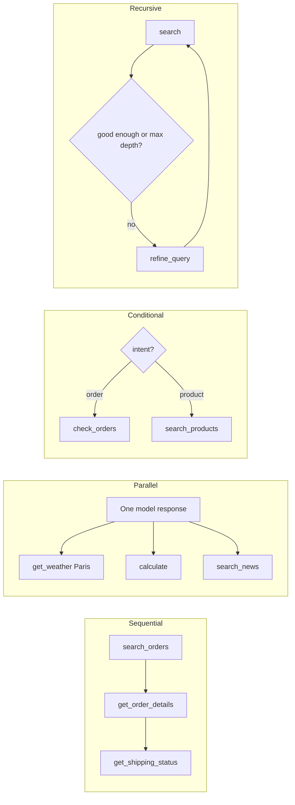
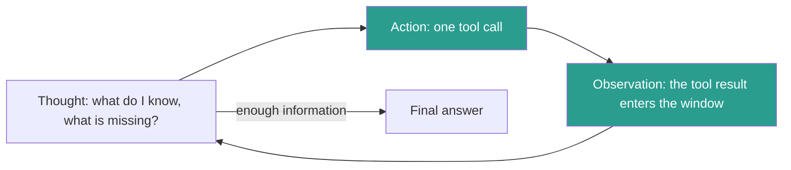

## 1. The question this idea answers

Most real questions need more than one tool call. "Where is my latest order?" needs a search and then a shipping lookup. "Compare the weather in NYC and London" needs two lookups that do not depend on each other. Some tasks need a search, a check and a better search.

So I need answers to four questions. In which order do the calls run? Which calls can run at the same time? How does the model choose the next step? And what stops a loop that never ends?

## 2. Mental model

> [!analogy] A detective with a notebook
> A detective works in a loop. First the detective **thinks**: what do I know, and what is missing? Then the detective **acts**: interview one witness. Then the detective **observes**: write the answer in the notebook. The loop repeats until the case is clear.
>
> A good chief gives the detective a limit: "Report by Friday, with what you have." The chief also notices when the detective interviews the same witness twice with the same questions.
>
> **Where it stops working:** a detective rereads only the relevant pages. The model rereads the **whole** notebook on every step, because the application sends the full history on every call. So each step makes all later steps more expensive.

## 3. Terms

| Term | Plain meaning |
|---|---|
| sequential execution | Tool calls that run one after another, because each call needs the result of the one before. |
| parallel execution | Independent tool calls that run at the same time. The total tool time is the time of the slowest call. |
| conditional execution | A step that chooses the next tool from the input, for example by the intent of the request. |
| recursive execution | A loop that calls the same kind of tool again with a refined input, until a condition or a maximum depth is reached. |
| ReAct | A method in which the model alternates reasoning steps and actions, and reads the result of each action before the next step (Yao et al.). |
| thought | A reasoning step in ReAct. It does not change the environment. |
| observation | The result of an action, added to the context before the next thought. |
| trajectory | The full sequence of thoughts, actions and observations of one task. |
| loop guard | A rule in the orchestration code that stops an agent loop: a maximum number of iterations, a token budget, or a repeated-call check. |
| workflow | Anthropic's term for a system in which code paths fixed in advance orchestrate the model and the tools. |
| agent | Anthropic's term for a system in which the model directs its own process and tool use. |
| augmented LLM | A model with retrieval, tools and memory. Anthropic calls it the building block of workflows and agents. |

## 4. Method and math

### 4.1 Four patterns

The handbook (Session 4, §7) names four patterns.

| Pattern | Flow | Use | Handbook example |
|---|---|---|---|
| Sequential | A then B then C | Each step needs the result of the step before | `search_orders` then `get_order_details` then `get_shipping_status` |
| Parallel | A, B and C together | Independent lookups | `get_weather("Paris")`, `calculate("85 * 0.15")`, `search_news("AI")` |
| Conditional | If X then A, else B | Route by input | `classify_intent` then `check_orders`, `search_products` or `get_account_info` |
| Recursive | A, check, A again | Refine until good enough | `search`, results weak, `refine_query`, `search` again |



### 4.2 Sequential and parallel: the latency arithmetic

Let a turn need $n$ independent tool calls with run times $t_1, \ldots, t_n$. The tool time is the sum when the calls run one after another, and the maximum when they run at the same time:

$$
T_{seq} = \sum_{i=1}^{n} t_i \qquad T_{par} = \max_{i} t_i
$$

The symbols mean:

- $t_i$ is the run time of tool call $i$.
- $T_{seq}$ is the total tool time when the calls run one after another.
- $T_{par}$ is the total tool time when the calls run at the same time.

Parallel work has two layers. The **model** must ask for all independent calls in one response, which saves model calls (lesson [6.2](/notes/ai/context-engineering/06-tools-and-mcp/l2-the-tool-call-loop)). The **application** must then run them at the same time, for example with `asyncio.gather`, which saves tool time.

> [!example] Worked example: three independent lookups
> The tools take 0.4 s, 1.2 s and 0.8 s. Assume each model call takes 1.0 s (an assumption for the example, not a measurement).
>
> - **One call per model turn:** 3 model calls that each ask for one tool, plus 1 call for the answer. Time: $4 \times 1.0 + (0.4 + 1.2 + 0.8) = 4.0 + 2.4 = 6.4$ s.
> - **All three in one turn, run in parallel:** 1 model call asks for all three, then 1 call answers. Time: $2 \times 1.0 + \max(0.4, 1.2, 0.8) = 2.0 + 1.2 = 3.2$ s.
>
> Parallel execution halves the time here. It also sends the history two fewer times.

The FAQ (Q29) gives typical ranges. A model decision takes 500 to 1,500 ms, and a tool takes 50 ms to 5 s. A 3-step loop takes 3 to 8 s. These are illustrations, not measurements. Measure your own. The FAQ also says: "The worst user experience is a silent wait." Stream progress to the user during long loops.

### 4.3 Conditional and recursive

**Conditional.** Either code or the model can route. If code classifies the intent and then calls a fixed tool, the path is fixed in advance. That is a workflow (section 4.8). If the model reads the request and chooses the tool, the model routes. Code routing is easier to test. Model routing handles requests that the rules did not foresee.

**Recursive.** The handbook (§7.1.4) calls this "the most powerful pattern and the most dangerous". A loop that refines its own query can run forever. So the orchestration code, not the prompt, must enforce a maximum depth. The stop rule is: stop when the result is good enough **or** the depth reaches its maximum.

### 4.4 ReAct: the original method

The source is Yao et al., "ReAct: Synergizing Reasoning and Acting in Language Models" (arXiv 2210.03629, first version 6 October 2022, ICLR 2023). The paper's key idea is to add language to the set of actions:

$$
\hat{A} = A \cup L
$$

The symbols mean:

- $A$ is the set of actions that change or query the environment, for example a search.
- $L$ is the space of language: free-text thoughts.
- $\hat{A}$ is the extended action space. The model may act, or it may think.

A thought "does not affect the external environment". It only adds text to the context, so that the next action is better informed. On HotpotQA, the paper's trajectories use labeled steps: `Thought n`, `Action n` and `Observation n`. The actions are `Search[entity]`, `Lookup[string]` and `Finish[answer]`. For example, "Action 2 Lookup[eastern sector]" gives "Observation 2 (Result 1 / 1) The eastern sector extends into the High Plains…".

The paper reports that ReAct "outperforms imitation and reinforcement learning methods by an absolute success rate of 34% and 10% respectively" on ALFWorld and WebShop.

The original ReAct used few-shot prompts in plain text. The application parsed lines such as `Action 1 Search[...]` from the output. Today the model writes structured tool calls instead (lesson 6.2). The "thought" can be visible text before the call, hidden extended thinking, or absent. The loop shape stays the same: reason, act, observe.



The handbook (§8.3) explains why the thought helps. It makes the model state what it knows from earlier observations, what is still missing, and which tool with which arguments fills the gap. The FAQ (Q8) adds a practical benefit: the reasoning is visible in the trace, which helps debugging.

### 4.5 The order-status walkthrough

The handbook (§8.2) traces the question "What is the status of my most recent order?". The token counts below are for the text alone, with `o200k_base`. Real calls add some formatting tokens.

> [!example] Worked example: three iterations
> | Iteration | Thought | Action | Observation | Tokens added |
> |---|---|---|---|---|
> | 1 | Find the most recent order. | `search_orders(user_id="user_123", sort="newest", limit=1)` | order ORD-456, 2026-02-18, shipped, two items, total USD 89.97 | 18 + 18 + 54 = 90 |
> | 2 | Shipped, so the user wants the delivery date. | `get_shipping_status(order_id="ORD-456")` | FedEx, tracking FX789012345, in transit, ETA 2026-02-22, last seen in Chicago | 26 + 10 + 46 = 82 |
> | 3 | Enough information. No action. | — | — | final answer: 61 |
>
> Let the system prompt and the tool definitions be $S = 1{,}500$ tokens, and the question $u = 10$ tokens.
>
> - Call 1 input: $1{,}500 + 10 = 1{,}510$.
> - Call 2 input: $1{,}510 + 90 = 1{,}600$.
> - Call 3 input: $1{,}600 + 82 = 1{,}682$.
> - Total input of the task: $1{,}510 + 1{,}600 + 1{,}682 = 4{,}792$ tokens, for a 61-token answer.

### 4.6 Each iteration adds tokens

The history grows on each iteration, exactly like the conversation of lesson [1.6](/notes/ai/context-engineering/01-foundations/l6-the-cost-of-a-conversation). If each iteration adds about $t$ tokens, the cumulative input after $K$ model calls is:

$$
C_K = K\,(S + u) + t\,\frac{K(K-1)}{2}
$$

The symbols mean:

- $S$ is the fixed prefix: system prompt and tool definitions.
- $u$ is the user message.
- $t$ is the tokens that one iteration adds: thought, tool call and observation.
- $K$ is the number of model calls in the task.

> [!example] Worked example: 10 against 20 iterations
> $S = 3{,}000$ (a system prompt and 10 tools), $u = 50$, $t = 1{,}200$ (a medium tool result).
>
> - $K = 10$: $C_{10} = 10 \times 3{,}050 + 1{,}200 \times 45 = 30{,}500 + 54{,}000 = 84{,}500$ tokens. The last call alone sends $3{,}050 + 9 \times 1{,}200 = 13{,}850$.
> - $K = 20$: $C_{20} = 20 \times 3{,}050 + 1{,}200 \times 190 = 61{,}000 + 228{,}000 = 289{,}000$ tokens. The last call sends 25,850.
>
> Twice the iterations cost $289{,}000 / 84{,}500 \approx 3.4$ times the input. This is why the handbook warns that after 10 tool calls the window "may be significantly consumed", and why Part 7 clears old tool results.

### 4.7 Loop guards

The FAQ (Q24) gives three guards. All three live in the orchestration code.

| Guard | Rule | What it catches |
|---|---|---|
| Maximum iterations | Stop after $K_{max}$ tool rounds in one user turn. | Endless loops, slow drift |
| Token budget | Stop when the cumulative input or the history passes a limit. | Cost blow-ups, a full window |
| Repeated-call check | Stop or intervene when the same tool gets the same arguments twice. | A stuck model that repeats itself |

When a guard trips, do not just stop. Force a final answer. Call the model once more with tools disabled (`tool_choice` set to `none`). Add an instruction to answer from the information so far and to say what is missing. The user then gets a partial answer instead of an error.

For the repeated-call check, compare a key made from the tool name and the arguments in a canonical form, for example JSON with sorted keys.

> [!note] Source check: how many iterations?
> **Rule of thumb.** The handbook gives two limits that conflict. FAQ Q17 says "typically 3–5 tool calls per turn". FAQ Q24 says "typically 5–10 tool calls per user turn". FAQ Q30 adds that "a good agent solves 90%+ of queries within 3 iterations", with no source. Set the limit from data. Run your evaluation set, record the iterations of the successful runs, and set $K_{max}$ above their high percentile.

The FAQ (Q24) also suggests a prompt line: "Plan your approach before acting. Prefer fewer, well-targeted tool calls over many exploratory ones." A prompt can lower the iteration count, but only code can enforce a limit.

### 4.8 Pipeline or agent?

The FAQ (Q26) draws the line by control flow. If the application fixes the sequence of steps, it is "a pipeline with tools". If the model decides which tools to call, in what order and when to stop, it is an agent.

Anthropic's post "Building effective agents" (19 December 2024) uses the same line:

- "Workflows are systems where LLMs and tools are orchestrated through predefined code paths."
- "Agents, on the other hand, are systems where LLMs dynamically direct their own processes and tool usage".

The post names the augmented LLM as the building block and five workflow patterns: prompt chaining, routing, parallelization, orchestrator-workers, and evaluator-optimizer. Its main advice: "we recommend finding the simplest solution possible, and only increasing complexity when needed."

| | Workflow (pipeline) | Agent |
|---|---|---|
| Who chooses the next step | Code | Model |
| Predictability | High: the same path each time | Lower: the path depends on the model |
| Testing | Test each step | Test trajectories and outcomes (FAQ Q30) |
| Cost and latency | Known in advance | Varies with the number of iterations |
| Best for | Known, repeatable tasks | Open tasks where the steps cannot be listed in advance |

More autonomy means that errors can compound. If each step succeeds with probability $p$, and the steps fail independently, a $K$-step task succeeds with probability $p^K$:

> [!example] Worked example: compounding errors
> - $p = 0.95$, $K = 10$: $0.95^{10} \approx 0.599$. About 4 tasks in 10 fail.
> - $p = 0.99$, $K = 10$: $0.99^{10} \approx 0.904$.
>
> Real steps are not independent, and an agent can sometimes repair an error. But the direction holds: long loops need reliable steps, or checks between steps.

### 4.9 Beyond the basic loop

The FAQ (Q44) lists extensions: plan first and then execute, explore several branches, reflect and retry, create tools, and delegate to sub-agents. Part 7 covers delegation with isolated windows.

One newer pattern changes the token picture. In Anthropic's **programmatic tool calling**, Claude calls tools from code inside a code-execution tool, so intermediate results stay out of the context. Tools opt in with `allowed_callers`. Anthropic reports: "Average usage dropped from 43,588 to 27,297 tokens, a 37% reduction on complex research tasks" (checked on 2026-10-12).

### 4.10 Production view

| Concern | What this lesson means for it |
|---|---|
| Latency | Ask for independent calls in one turn and run them with `asyncio.gather`. Stream progress during long loops. |
| Cost | Cumulative input grows with the square of the iteration count. Cap iterations, and clear old results (Part 7). |
| Reliability | Enforce maximum iterations, a token budget and a repeated-call check in code. Force a final answer when a guard trips. |
| Testing | Log full trajectories. Measure iterations per task, tool-selection accuracy and task success on an evaluation set. |
| Design | Start with a workflow. Move to an agent only when the steps cannot be fixed in advance. |

## 5. Graphs

```plot
{
  "title": "Cumulative input of an agent task, S + u = 3,050 and t = 1,200 tokens (red)",
  "xAxis": { "label": "model calls K", "domain": [1, 20] },
  "yAxis": { "label": "cumulative input (thousands of tokens)", "domain": [0, 300] },
  "disableZoom": true,
  "data": [
    { "fn": "3.05*x + 0.6*x*(x-1)", "color": "#C81D25" }
  ]
}
```

The curve passes 84.5 thousand tokens at 10 calls and 289 thousand at 20 calls. It bends upward because every new step resends all earlier steps.

## 6. Code

These exercises go in `notebooks/06-tools-and-mcp.ipynb`. Exercises 6.1 to 6.3 use fake tools and a scripted model, so they cost nothing.

**Exercise 6.1: the four patterns with fake latency.**

1. Write three async fake tools with `asyncio.sleep` of 0.4, 1.2 and 0.8 seconds.
2. Run them one after another, then with `asyncio.gather`. Time both.
3. Write a conditional router with a keyword classifier.
4. Write a recursive search that refines a query until a fake "quality score" passes 0.8, with `max_depth`.

Acceptance tests:

- The sequential run takes about 2.4 s, and the parallel run about 1.2 s (within 0.1 s).
- The recursive search stops at `max_depth` when the score never passes 0.8, and it reports the reason.

**Exercise 6.2: a guarded ReAct loop.**

1. Extend `run_loop` from Exercise 2.1 with three guards: `max_iterations`, `token_budget` and a repeated-call check.
2. Count the tokens of each call's input with `tiktoken`.
3. When a guard trips, make one final call with tools disabled.

Acceptance tests:

- A scripted model that asks for `get_weather("Paris")` twice in a row trips the repeated-call check on the second request.
- A scripted model that never stops trips `max_iterations`, and the loop returns a final answer, not an exception.
- A huge fake tool result trips `token_budget` before the next model call.
- The log lists every iteration with its input tokens.

**Exercise 6.3: the walkthrough in numbers.** Rebuild the order-status trace of section 4.5 as messages. Count the input of each call with your own system prompt and tool definitions.

Acceptance test: a table with the input tokens of calls 1 to 3 and the total. Add one sentence that compares your $S$ with the 1,500 of the example.

**Exercise 6.4 (optional, costs money): ReAct on a real model.** Give a real model `search_orders` and `get_shipping_status` as fake local tools. Ask the order-status question.

Acceptance test: the trace has two tool calls and a final answer, and the guards never trip.

## 7. Common mistakes

1. **"Parallel tool calls are automatic."** The model must ask for them in one response, and the application must run them at the same time.
2. **"The prompt can enforce the loop limit."** A prompt can only ask. The orchestration code enforces limits.
3. **"When the limit is hit, return an error."** Force a final answer from the information so far, and say what is missing.
4. **"Each iteration costs the same."** Each call resends all earlier steps, so cumulative input grows with the square of the iteration count.
5. **"ReAct needs the words Thought, Action, Observation in the prompt."** That was the original text format. Native tool calling keeps the loop and replaces the text parsing.
6. **"Everything with tools is an agent."** If code fixes the steps, it is a workflow. Start there, and add autonomy only when needed.

## 8. One-minute explanation

Tool calls combine in four patterns. Sequential calls depend on each other. Parallel calls are independent, so the model asks for them together and the code runs them at the same time. Conditional calls route by the input, and recursive calls refine and repeat up to a maximum depth. ReAct is the loop behind most agents. The model thinks about what it knows and what is missing, calls a tool, reads the observation and repeats. Each iteration adds its thought, call and result to the history, and every later call resends them. So the total input grows with the square of the number of iterations. Code must guard the loop with a maximum iteration count, a token budget and a repeated-call check. When a guard trips, force a final answer. And if code can fix the steps in advance, build a workflow, not an agent.

## 9. Check questions

```check
{
  "question": "Four independent tools take 0.3, 0.9, 0.5 and 1.4 seconds. What is the tool time sequentially and in parallel?",
  "hint": "Sum against maximum.",
  "answer": "Sequential: 0.3 + 0.9 + 0.5 + 1.4 = 3.1 s. Parallel: max = 1.4 s. The model must also ask for all four calls in one response to save model round trips."
}
```

```check
{
  "question": "An agent has S + u = 2,000 tokens and adds t = 800 tokens per iteration. What is the cumulative input after 8 model calls? What does the 8th call send?",
  "hint": "C_K = K(S + u) + t·K(K − 1)/2.",
  "answer": "C_8 = 8 × 2,000 + 800 × 28 = 16,000 + 22,400 = 38,400 tokens. The 8th call sends 2,000 + 7 × 800 = 7,600 tokens."
}
```

```check
{
  "question": "Each step of an agent succeeds with probability 0.97, independently. What is the chance that a 12-step task succeeds? What does this suggest for long tasks?",
  "answer": "0.97^12 ≈ 0.694. About 3 in 10 tasks fail. Long tasks need more reliable steps, checks between steps, or a shorter fixed workflow."
}
```

```check
{
  "question": "A trace shows search_docs(query=\"refund policy\") called four times in a row with the same arguments, and the task ends at the iteration limit. Which guard should have caught this earlier, and what should happen when it trips?",
  "answer": "The repeated-call check: the second identical call (same tool, same canonical arguments) shows that the model is stuck. The code should stop the loop, or tell the model that this call was already made and show its result. Then it should force a final answer with tools disabled."
}
```

```check
{
  "question": "A support bot always classifies the intent, then calls exactly one fixed tool, then writes the answer. Is it an agent by Anthropic's definition? Why does it matter?",
  "answer": "No. Code fixes the path in advance, so it is a workflow (prompt chaining with routing). It matters because a workflow is more predictable, easier to test step by step, and has a known cost. Anthropic advises the simplest solution that works."
}
```

## 10. Links

- Previous: [L5: Many tools](/notes/ai/context-engineering/06-tools-and-mcp/l5-many-tools)
- Next: [L7: MCP: the protocol](/notes/ai/context-engineering/06-tools-and-mcp/l7-mcp-the-protocol)
- [Lesson 1.6: The cost of a conversation](/notes/ai/context-engineering/01-foundations/l6-the-cost-of-a-conversation): the same quadratic growth
- [Lesson 7.7: ISOLATE: one window is not enough](/notes/ai/context-engineering/07-compress-and-isolate/l7-isolate-one-window-is-not-enough)
- [Glossary](/notes/ai/context-engineering/glossary)
