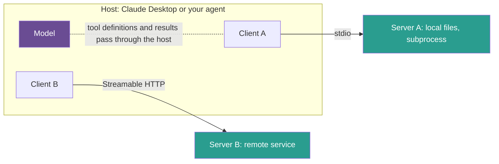
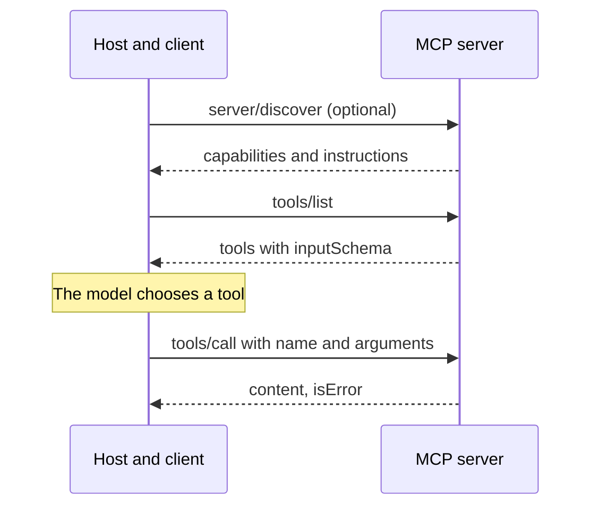

## 1. The question this idea answers

Lessons 6.1 to 6.6 used tools that live inside one application. But the same GitHub, database or file tools are useful in a chat app, an IDE and a custom agent. Without a standard, each application writes its own GitHub integration, and each tool provider must support each application.

The Model Context Protocol (MCP) standardizes this connection. What exactly does it standardize? Who are the parties, what messages do they exchange, over which transports, and what changed in the current revision? The handbook (Session 4, §5) describes an older form of the protocol. This lesson teaches the current one.

## 2. Mental model

> [!analogy] USB-C for AI tools
> The handbook uses the USB-C analogy. Before USB-C, each device had its own plug. With one standard port, any charger works with any device. MCP is one standard "port" between AI applications and tools: a server written once works with every application that speaks MCP.
>
> **Where it stops working:** USB-C does not decide whether a device is safe to plug in. MCP does not either. The spec says that MCP "cannot enforce these security principles at the protocol level". The **application** must ask the user for consent (lesson [6.9](/notes/ai/context-engineering/06-tools-and-mcp/l9-tool-security-and-prompt-injection)). Also, the model is not the device that plugs in. The application holds the connections, and the model only sees what the application passes to it.

## 3. Terms

| Term | Plain meaning |
|---|---|
| Model Context Protocol (MCP) | An open protocol that standardizes how AI applications connect to servers that offer tools, resources and prompts. |
| host | The AI application that the user runs, for example Claude Desktop, an IDE or your agent. It creates and manages MCP clients. |
| MCP client | A connector inside the host. Each client holds a 1:1 connection with one MCP server. |
| MCP server | A program that offers tools, resources or prompts to clients over MCP. |
| JSON-RPC 2.0 | A small standard for remote procedure calls in JSON: requests with an ID, responses with the same ID, and notifications with no ID. |
| notification | A JSON-RPC message with no ID. The receiver must not reply to it. |
| transport | The channel that carries the JSON-RPC messages: stdio or Streamable HTTP. |
| stdio transport | The host starts the server as a subprocess and exchanges newline-delimited messages over its standard input and output. |
| Streamable HTTP | The HTTP transport of MCP: one endpoint that accepts POST and replies with one JSON object or a stream of events for that request. |
| server primitive | One of the three things a server offers: tools (model-controlled), resources (application-controlled) and prompts (user-controlled). |
| elicitation | The MCP client feature through which a server asks the user for input during a request. |
| spec revision | A version of the MCP specification, named by its release date, for example 2026-07-28. |
| `server/discover` | The 2026-07-28 method that returns a server's capabilities and instructions. A client may call it first. |
| A2A (Agent2Agent) | An open protocol, created by Google, for communication between agents. MCP connects an agent to tools. A2A connects agents to agents. |
| Agent Card | A2A's JSON document that describes an agent's identity, endpoint, capabilities, skills and authentication needs. |

## 4. Method and math

### 4.1 The N×M problem

Let $N$ be the number of AI applications and $M$ the number of services. Without a standard, each pair needs its own integration. With a standard, each application implements the protocol once, and each service ships one server:

$$
I_{\text{custom}} = N \times M \qquad I_{\text{MCP}} = N + M
$$

The symbols mean:

- $N$ is the number of AI applications (hosts).
- $M$ is the number of services with tools or data.
- $I$ is the number of integrations to build and maintain.

> [!example] Worked example: two sizes
> - $N = 3$, $M = 3$: custom $3 \times 3 = 9$, MCP $3 + 3 = 6$. This is the handbook's example (§5.1.1).
> - $N = 10$, $M = 20$: custom $10 \times 20 = 200$, MCP $10 + 20 = 30$.
>
> The gap grows quickly. For $N = M$, custom work grows with $N^2$ and MCP work grows with $2N$.

The handbook's diagram draws the models (Claude, GPT-4, Gemini) as the clients. In MCP the $N$ side is the **applications**, not the models. One application can use any model, because it converts the MCP tool definitions into its model's format (lesson [6.3](/notes/ai/context-engineering/06-tools-and-mcp/l3-tool-schemas-and-structured-outputs)). This is why MCP works with OpenAI and Google models too (FAQ Q38).

### 4.2 Host, client, server

The spec (revision 2026-07-28, checked on 2026-10-12) defines three roles. Hosts are "LLM applications that initiate connections". Clients are "Connectors within the host application". Servers are "Services that provide context and capabilities". And: "A host application creates and manages multiple clients, with each client having a 1:1 relationship with a particular server."



The host collects the tools of all its servers and gives them to the model. It runs the model's tool calls through the right client and puts the results into the window. Every rule of lessons 6.1 to 6.6 still applies: MCP tools are tools, and their results are context.

> [!note] Source check: host and client
> **Corrected.** The handbook (§5.3.1) lists Claude Desktop, Cursor IDE and VS Code under "MCP Client (AI Application)". In the spec, these applications are **hosts**. A host holds one client for each server. The difference matters for security: the host, not the protocol, asks the user for consent. Source: MCP specification 2026-07-28, "Architecture", checked on 2026-10-12.

### 4.3 JSON-RPC 2.0 messages

MCP messages are JSON-RPC 2.0. There are four shapes (spec, Base Protocol):

| Message | Fields | Rule |
|---|---|---|
| Request | `jsonrpc: "2.0"`, `id`, `method`, optional `params` | "Unlike base JSON-RPC, the ID **MUST NOT** be `null`." |
| Result response | `jsonrpc`, the same `id`, `result` | In 2026-07-28 every `result` has a `resultType`. A missing `resultType` counts as `"complete"`. |
| Error response | `jsonrpc`, `id`, `error` with `code`, `message` and optional `data` | For protocol errors, not tool errors (lesson [6.4](/notes/ai/context-engineering/06-tools-and-mcp/l4-tool-results-and-errors)). |
| Notification | `jsonrpc`, `method`, optional `params` | "Notifications **MUST NOT** include an ID." The receiver must not reply. |

A tool listing, as a request and its result. This pair is an illustration built from the field definitions in the 2026-07-28 `schema.ts`. It is not a copy of a spec example. The `clientInfo` values, the `ttlMs` value and the tool are examples.

```json
{
  "jsonrpc": "2.0",
  "id": 1,
  "method": "tools/list",
  "params": {
    "_meta": {
      "io.modelcontextprotocol/protocolVersion": "2026-07-28",
      "io.modelcontextprotocol/clientCapabilities": {},
      "io.modelcontextprotocol/clientInfo": { "name": "my-agent", "version": "0.1.0" }
    }
  }
}
```

The schema marks `protocolVersion` and `clientCapabilities` as required. An empty capabilities object means that the client supports no optional capabilities. `clientInfo` is recommended. In the result, `ttlMs` tells the client how long it may cache the list. `cacheScope` says whether a shared cache may keep it (`"public"`) or only the same authorization context (`"private"`).

```json
{
  "jsonrpc": "2.0",
  "id": 1,
  "result": {
    "resultType": "complete",
    "ttlMs": 300000,
    "cacheScope": "public",
    "tools": [
      {
        "name": "get_weather",
        "description": "Get the current weather for one location. Returns temperature and conditions.",
        "inputSchema": { "type": "object", "properties": { "location": { "type": "string" } }, "required": ["location"] }
      }
    ]
  }
}
```

A tool call, as in the spec's example. Each request also carries the `_meta` fields of section 4.4:

```json
{ "jsonrpc": "2.0", "id": 2, "method": "tools/call", "params": { "name": "get_weather", "arguments": { "location": "New York" } } }
```

Next, a notification that the tool list changed. In 2026-07-28 the server sends it only on a `subscriptions/listen` stream, and only when the client asked for it there. Its `_meta` names that stream by the ID of the `subscriptions/listen` request (here 9).

Then an error for a version that the server does not support. The code -32022 is `UnsupportedProtocolVersionError`. Its `data` must list the `supported` versions and the `requested` version, so that the client can retry with a common one. The message text and the version values are an illustration:

```json
{ "jsonrpc": "2.0", "method": "notifications/tools/list_changed", "params": { "_meta": { "io.modelcontextprotocol/subscriptionId": 9 } } }
{ "jsonrpc": "2.0", "id": 3, "error": { "code": -32022, "message": "Unsupported protocol version", "data": { "supported": ["2026-07-28", "2025-11-25"], "requested": "2024-11-05" } } }
```

The method names in revision 2026-07-28:

| Area | Methods |
|---|---|
| Tools | `tools/list`, `tools/call` |
| Resources | `resources/list`, `resources/read`, `resources/templates/list` |
| Prompts | `prompts/list`, `prompts/get` |
| Other | `completion/complete`, `server/discover`, `subscriptions/listen` |
| Notifications | `notifications/tools/list_changed`, `notifications/prompts/list_changed`, `notifications/resources/list_changed`, `notifications/resources/updated`, `notifications/progress`, `notifications/message`, `notifications/cancelled`, `notifications/subscriptions/acknowledged` |

> [!note] Source check: which JSON-RPC
> **Corrected.** The handbook (FAQ Q11) says that JSON-RPC "has been a standard since 2005". That date belongs to JSON-RPC 1.0. MCP uses JSON-RPC 2.0, dated 2010-03-26. MCP also forbids `null` IDs and removed batching in revision 2025-06-18. Source: MCP specification, Base Protocol and changelogs, checked on 2026-10-12.

### 4.4 The lifecycle: from handshake to stateless

Up to revision 2025-11-25, a connection started with a handshake:

1. The client sends `initialize` with `protocolVersion`, `capabilities` and `clientInfo`.
2. The server replies with its `protocolVersion`, `capabilities`, `serverInfo` and `instructions`.
3. The client sends the notification `notifications/initialized`.

Over HTTP, the server could also start a session with the `Mcp-Session-Id` header.

Revision 2026-07-28 removes all of this. Its blog post says: "The highlight of this release is a stateless protocol core." The changes:

1. No `initialize` and no `notifications/initialized`. No protocol sessions and no `Mcp-Session-Id`.
2. Every request carries `_meta` with `io.modelcontextprotocol/protocolVersion` and `io.modelcontextprotocol/clientCapabilities` (required) and `.../clientInfo` (recommended).
3. A new method, `server/discover`, returns the capabilities and the `instructions`. Servers must implement it, and clients may call it first.
4. A server that needs state across calls uses "explicit, server-minted handles passed as ordinary tool arguments".



> [!note] Source check: "the server advertises its capabilities"
> **Corrected.** The handbook (§5.3) describes a connection in which "the server advertises its capabilities" after the client connects. That is the handshake of revisions up to 2025-11-25. In 2026-07-28 each request carries its version and capabilities in `_meta`, and capabilities come from the optional `server/discover`. The Python SDK v2 still answers the old `initialize` call. Source: MCP 2026-07-28 changelog, checked on 2026-10-12.

### 4.5 Transports: stdio and Streamable HTTP

| | stdio | Streamable HTTP |
|---|---|---|
| How | The host starts the server as a subprocess. Messages travel on stdin and stdout. | The server exposes one MCP endpoint that accepts POST. |
| Framing | "Messages are delimited by newlines, and **MUST NOT** contain embedded newlines." | Each reply is one JSON object or an SSE stream for that one request. |
| Rules | "The server **MUST NOT** write anything to its `stdout` that is not a valid MCP message." Logs go to stderr. | Headers on every POST: `MCP-Protocol-Version`, `Mcp-Method`, and `Mcp-Name` for `tools/call`, `resources/read` and `prompts/get`. Servers must validate `Origin`. Local servers should bind to 127.0.0.1. |
| Use | Local tools, development, one user | Remote and shared servers |
| Credentials | From the environment | OAuth 2.1-based authorization (section 4.8) |

Two practical rules follow from stdio. Never `print()` to stdout in a stdio server, because a stray line breaks the protocol. And a stdio process is "not a conversation or session" in 2026-07-28, so do not keep user state in global variables.

> [!note] Source check: HTTP + SSE
> **Corrected.** The handbook (§5.3.2, FAQ Q11 and Q28) teaches HTTP+SSE as the remote transport. The spec says: "Streamable HTTP was introduced in protocol version 2025-03-26 as a replacement for the HTTP+SSE transport from protocol version 2024-11-05." HTTP+SSE is deprecated, and Claude Code's docs say: "Use HTTP servers instead, where available." Source: MCP 2026-07-28 transports page, checked on 2026-10-12.

### 4.6 Server primitives and who controls each

| Primitive | Control | Spec description | Methods | Example |
|---|---|---|---|---|
| Tools | Model-controlled | "Functions exposed to the LLM to take actions" | `tools/list`, `tools/call` | `search_database`, `create_ticket` |
| Resources | Application-controlled | "Contextual data attached and managed by the client" | `resources/list`, `resources/read` | A user profile, a configuration file |
| Prompts | User-controlled | "Interactive templates invoked by user choice" | `prompts/list`, `prompts/get` | A "code review" template that the user picks |

The control column is the key idea. The **model** decides when to call a tool. The **application** decides when to load a resource into the window, for example when the user attaches it. The **user** picks a prompt, and the server returns messages that the host puts into the conversation. The handbook calls prompts "parameterized system prompts". That is a loose comparison, because the result is messages, not the system prompt.

Tools can carry **annotations**, which are hints about their behavior (schema 2026-07-28):

| Annotation | Default | Meaning |
|---|---|---|
| `readOnlyHint` | false | The tool does not change its environment. |
| `destructiveHint` | true | The tool may destroy data. Meaningful only when `readOnlyHint` is false. |
| `idempotentHint` | false | Repeated calls with the same arguments have no extra effect. |
| `openWorldHint` | true | The tool talks to an open world, such as the web. |

The schema says that "all properties in `ToolAnnotations` are **hints**". Clients "MUST consider tool annotations to be untrusted unless they come from trusted servers."

> [!note] Source check: "exactly three capabilities"
> **Corrected.** The handbook (§5.4) says that servers "expose exactly three types of capabilities". Servers do have three primitives. But the spec also defines a client feature (elicitation), utilities such as progress and completion, and opt-in extensions. Source: MCP specification 2026-07-28, checked on 2026-10-12.

### 4.7 Client features and extensions in 2026-07-28

| Feature | Status | Note |
|---|---|---|
| Elicitation | Active, the only active client feature | The server asks the user for input, in form mode or URL mode. Form mode "MUST NOT" ask for "passwords, API keys, access tokens, or payment credentials". |
| Sampling | Deprecated | The server asked the client's model for a completion. It still works for at least 12 months. |
| Roots | Deprecated | The client told the server which folders it may use. It still works for at least 12 months. |
| Logging utility | Deprecated | Log to stderr or use OpenTelemetry instead. |

The earliest removal of the deprecated features is the "First revision released on or after 2027-07-28". In 2026-07-28, a server no longer sends its own `elicitation/create`, `sampling/createMessage` or `roots/list` requests to the client. Instead it returns `resultType: "input_required"` with `inputRequests`, and the client retries with `inputResponses`. The spec calls this the Multi Round-Trip Requests pattern.

Extensions are opt-in. Examples: Tasks (`io.modelcontextprotocol/tasks`, moved out of the core), MCP Apps, and Skills over MCP.

### 4.8 Spec revisions and their main changes

| Revision | Main changes |
|---|---|
| 2024-11-05 | The first revision. Anthropic open-sourced MCP on 2024-11-25. |
| 2025-03-26 | OAuth 2.1 authorization. Streamable HTTP replaces HTTP+SSE. Tool annotations. JSON-RPC batching (removed again later). |
| 2025-06-18 | Batching removed. Structured tool output (`outputSchema`, `structuredContent`). Servers become OAuth resource servers. Elicitation. `MCP-Protocol-Version` header. |
| 2025-11-25 | Experimental tasks. URL-mode elicitation. JSON Schema 2020-12 as the default dialect. Input validation errors returned as tool execution errors. |
| **2026-07-28 (current)** | Stateless core: no handshake, no sessions, `server/discover`, `_meta` on every request. Multi Round-Trip Requests. Tasks become an extension. Roots, Sampling, Logging and HTTP+SSE deprecated. Servers "SHOULD return tools from `tools/list` in a deterministic order", for cache hits. |

The Tier 1 SDKs (TypeScript, Python, Go and C#) shipped support on the release day.

**Authorization, at a high level.** Authorization is optional. HTTP servers should use the OAuth 2.1-based framework. A stdio server "**SHOULD NOT** follow this specification, and instead retrieve credentials from the environment." An HTTP server is an OAuth resource server: it "**MUST** implement OAuth 2.0 Protected Resource Metadata (RFC9728)". Clients must send the RFC 8707 `resource` parameter and validate the issuer (RFC 9207). Client ID Metadata Documents are the preferred registration, and Dynamic Client Registration is deprecated. And servers "**MUST NOT** accept or transit any other tokens" (lesson [6.9](/notes/ai/context-engineering/06-tools-and-mcp/l9-tool-security-and-prompt-injection)).

### 4.9 Governance and adoption

| Date | Event |
|---|---|
| 2024-11-25 | Anthropic open-sources MCP: spec, SDKs, local servers in Claude Desktop |
| 2025-03-26 | OpenAI adopts MCP in its Agents SDK |
| 2025-04-09 | Demis Hassabis says that Gemini models and SDK will support MCP. This was an intent with no timeline. |
| 2025-05-21 | OpenAI adds remote MCP servers to the Responses API |
| 2025-09-08 | The MCP Registry launches in preview |
| 2025-10-06 | OpenAI's Apps SDK "builds on the Model Context Protocol (MCP)" |
| 2025-12-09 | MCP goes to the Agentic AI Foundation, "a directed fund under the Linux Foundation", co-founded by Anthropic, Block and OpenAI |
| 2026-07-28 | Revision 2026-07-28 and Python SDK v2 |

Adoption numbers with sources: Anthropic reported "more than 10,000 active public MCP servers" and "97M+ monthly SDK downloads" on 2025-12-09. The MCP blog reported "close to half-a-billion downloads a month" on 2026-07-28. A secondary source counted 24,240 distinct servers in the official registry on 2026-08-22.

> [!note] Source check: the MCP timeline
> **Corrected.** The handbook (§5.2) has four problems. (1) It dates the official registry to November 2025. The registry preview launched on 2025-09-08, and November 2025 was the 2025-11-25 spec revision. (2) It says that Google added MCP to Gemini in April 2025. That was an announced intent. The Gemini SDK support came later, and the docs call it experimental and tools-only. (3) "13,000+ MCP servers on GitHub" has no source or date. Use Anthropic's figure above. (4) FAQ Q43 compares MCP only with OpenAI's plugins and GPT Actions, which "are confined to the ChatGPT ecosystem". It leaves out that OpenAI supports MCP in its Agents SDK, the Responses API and the Apps SDK. Sources: MCP blog, Anthropic and OpenAI announcements, checked on 2026-10-12.

The handbook's "Why MCP won" table (§5.5) is an opinion. The N + M arithmetic and the network effect are real. The "security model" row is wrong (section 2 and lesson 6.9).

### 4.10 MCP and A2A

Google announced Agent2Agent (A2A) on 2025-04-09 with "more than 50 technology partners". The Linux Foundation launched the A2A project on 2025-06-23. Google calls it "an open protocol that complements Anthropic's Model Context Protocol (MCP)".

| | MCP | A2A |
|---|---|---|
| Connects | An agent to tools and data | An agent to other agents |
| Discovery | `tools/list`, `server/discover` | An Agent Card at `/.well-known/agent-card.json` |
| Main objects | Tools, resources, prompts | Task, Message, Part, Artifact |
| Wire | JSON-RPC 2.0 over stdio or Streamable HTTP | JSON-RPC, gRPC and HTTP+JSON/REST bindings |
| Governance | Agentic AI Foundation (Linux Foundation) | Linux Foundation project, created by Google |
| Current version | 2026-07-28 | 1.0.0 |

A typical design uses both: an agent reaches its own tools through MCP and hands a sub-task to a specialist agent through A2A.

### 4.11 Production view

| Concern | What this lesson means for it |
|---|---|
| Reuse | Build a server once for each service. Every host that speaks MCP can use it. |
| Versioning | Pin the spec revision and the SDK version. Test against hosts that still speak 2025-11-25. |
| Caching | Return tools in a deterministic order, so the host's prompt prefix stays stable. |
| Security | The protocol does not enforce safety. Hosts must ask for consent, and servers must check every input (lesson 6.9). |
| Operations | stdio: logs on stderr only. HTTP: validate `Origin`, bind local servers to 127.0.0.1, use OAuth for remote servers. |

## 5. Graphs

```plot
{
  "title": "Integrations for N applications and N services: custom N×N (red), MCP N+N (blue)",
  "xAxis": { "label": "N (applications = services)", "domain": [0, 20] },
  "yAxis": { "label": "integrations", "domain": [0, 400] },
  "disableZoom": true,
  "data": [
    { "fn": "x^2", "color": "#C81D25" },
    { "fn": "2*x", "color": "#1E6091" }
  ]
}
```

At $N = 3$ the curves are close: 9 against 6. At $N = 20$ the custom count is 400 and the MCP count is 40.

## 6. Code

These exercises go in `notebooks/06-tools-and-mcp.ipynb`. They cost nothing.

**Exercise 7.1: a JSON-RPC message checker.** Write `classify(msg)` that returns "request", "result", "error" or "notification", or raises `ValueError` with the broken rule.

Acceptance tests:

- A message with `method` and a non-null `id` is a request.
- A message with `method` and `"id": null` raises, because MCP forbids null IDs.
- A notification with an `id` raises.
- A response with both `result` and `error` raises.
- A list of messages (a batch) raises, because batching was removed in 2025-06-18.

**Exercise 7.2: talk to a server by hand.** Use the minimal server of lesson [6.8](/notes/ai/context-engineering/06-tools-and-mcp/l8-build-an-mcp-server).

1. Start it with `subprocess.Popen`, with pipes for stdin, stdout and stderr.
2. Read the Base Protocol page of revision 2026-07-28 for the exact `_meta` fields.
3. Write one `tools/list` request as a single JSON line to stdin, and read one line from stdout.
4. Log every raw message that you send and receive.

Acceptance tests:

- The response has the same `id` as the request.
- Every line on stdout parses as JSON. Server logs appear only on stderr.
- One sentence names the method that you would call first and why.

**Exercise 7.3: a schema translator.** Convert the MCP `inputSchema` of each tool from `tools/list` into an Anthropic tool and an OpenAI strict function. Reuse `to_openai_strict` from Exercise 3.3.

Acceptance test: the three envelopes hold the same properties, and only the OpenAI one has every field in `required`.

## 7. Common mistakes

1. **"The model connects to the MCP server."** The host connects through one client for each server. The model sees only what the host passes to it.
2. **"Claude Desktop is the MCP client."** Claude Desktop is the host. It holds one client for each server.
3. **"Remote MCP uses HTTP + SSE."** That transport is deprecated. Use Streamable HTTP.
4. **"Every connection starts with `initialize`."** That was true up to 2025-11-25. Revision 2026-07-28 is stateless, with `_meta` on every request and an optional `server/discover`.
5. **"MCP has built-in permission boundaries."** The spec says that MCP cannot enforce security at the protocol level. Hosts must ask for consent.
6. **"`print()` is fine for debugging a stdio server."** Anything on stdout that is not an MCP message breaks the connection. Log to stderr.

## 8. One-minute explanation

MCP is an open protocol between AI applications and tool servers. It turns N times M custom integrations into N plus M: each application speaks MCP once, and each service ships one server. The application is the host. It holds one client for each server and passes the tools to its model, whatever the model is. Messages are JSON-RPC 2.0: requests and responses with matching IDs, and notifications with no ID. Methods include `tools/list`, `tools/call`, `resources/read` and `prompts/get`. Local servers run over stdio, and remote servers use Streamable HTTP. HTTP plus SSE is deprecated. Servers offer tools, which the model controls, resources, which the application controls, and prompts, which the user picks. The current revision, 2026-07-28, is stateless: no handshake and no sessions. MCP does not enforce security, so the host must ask the user for consent.

## 9. Check questions

```check
{
  "question": "A company has 6 AI applications and 15 internal services. How many integrations does it need without a standard, and with MCP? What does each side build?",
  "hint": "N × M against N + M.",
  "answer": "Without a standard: 6 × 15 = 90 integrations. With MCP: 6 + 15 = 21. Each application implements an MCP client once, and each service ships one MCP server."
}
```

```check
{
  "question": "Classify these messages: (a) {\"jsonrpc\":\"2.0\",\"id\":5,\"method\":\"tools/call\",...}, (b) {\"jsonrpc\":\"2.0\",\"method\":\"notifications/tools/list_changed\"}, (c) {\"jsonrpc\":\"2.0\",\"id\":5,\"result\":{...}}. Which one must not get a reply?",
  "answer": "(a) is a request, (b) is a notification, (c) is the result response to request 5. The notification (b) has no ID, and the receiver must not reply to it."
}
```

```check
{
  "question": "A stdio MCP server works in tests but fails in Claude Desktop with parse errors. The code has print(\"loaded 120 papers\") at start. Explain the failure and the fix.",
  "answer": "In stdio, stdout carries only MCP messages, one JSON object per line. The print writes a non-JSON line to stdout, so the client cannot parse it. Write logs to stderr instead, for example with the logging module or print(..., file=sys.stderr)."
}
```

```check
{
  "question": "Name the three server primitives and say who controls each. Give one example where using the wrong primitive causes a context problem.",
  "answer": "Tools are model-controlled, resources are application-controlled, prompts are user-controlled. Example: a large configuration file offered as a tool that the model calls on every turn adds its tokens again and again. As a resource, the application can attach it once, or only when the user asks."
}
```

```check
{
  "question": "What does revision 2026-07-28 remove from the connection lifecycle, and what replaces it?",
  "answer": "It removes the initialize request, the notifications/initialized notification and protocol sessions with Mcp-Session-Id. Each request now carries the protocol version and client capabilities in _meta. Servers implement server/discover, which a client may call first. State across calls uses explicit handles passed as tool arguments."
}
```

## 10. Links

- Previous: [L6: Execution patterns and ReAct](/notes/ai/context-engineering/06-tools-and-mcp/l6-execution-patterns-and-react)
- Next: [L8: Build an MCP server](/notes/ai/context-engineering/06-tools-and-mcp/l8-build-an-mcp-server)
- [L3: Tool schemas and structured outputs](/notes/ai/context-engineering/06-tools-and-mcp/l3-tool-schemas-and-structured-outputs): the envelope names
- [L9: Tool security and prompt injection](/notes/ai/context-engineering/06-tools-and-mcp/l9-tool-security-and-prompt-injection)
- [Glossary](/notes/ai/context-engineering/glossary)
