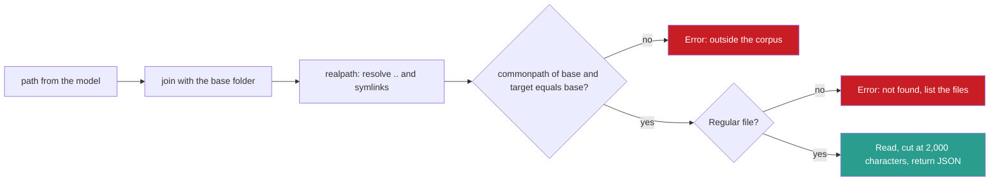

## 1. The question this idea answers

Lesson 6.7 explained the protocol. Now I build a server: the handbook's Exercise B (Session 4, §9.2), with a database tool and a file tool. Three problems stand in the way. The handbook's code does not run with the official SDK. Its security checks have holes. And its Claude Desktop configuration uses a relative path.

This lesson gives the current SDK API, the design and the interface of the server, the tests that it must pass, and the client configuration. I write the implementation myself.

## 2. Mental model

> [!analogy] A kitchen hatch
> A restaurant kitchen serves the dining room through a hatch. The menu on the hatch lists the dishes (the **tools**). Waiters pass order slips through the hatch, and plates come back (stdio messages). Customers never enter the kitchen. The kitchen only uses the pantry shelves that it is allowed to use (**one folder, read-only data**).
>
> **Where it stops working:** a waiter can be tricked into passing a strange slip, for example "dish 4, and also open the safe". The kitchen cannot trust the slip because a waiter brought it. The server must check every input itself (lesson [6.9](/notes/ai/context-engineering/06-tools-and-mcp/l9-tool-security-and-prompt-injection)).

## 3. Terms

| Term | Plain meaning |
|---|---|
| MCP Python SDK | The official Python package `mcp` for MCP servers and clients. Version 2 is the current line. |
| `MCPServer` | The high-level server class of the Python SDK v2. It was called `FastMCP` in v1. |
| MCP Inspector | A developer tool that connects to an MCP server, lists its tools, resources and prompts, and calls them by hand. |
| `claude_desktop_config.json` | The file where Claude Desktop reads its local MCP servers: a command, arguments and an environment for each one. |
| MCP scope (Claude Code) | Where Claude Code stores an MCP server entry: `local` (default), `project` (shared `.mcp.json`) or `user` (all projects). |
| read-only connection | A database connection that cannot write. In SQLite, open the file with the URI option `mode=ro`. |
| `PRAGMA query_only` | A SQLite setting that makes a connection refuse every statement that changes the database. |
| SQLite authorizer | A callback, set with `connection.set_authorizer()`, that SQLite calls for each action of a statement. It can deny actions such as `ATTACH` or `PRAGMA`. |
| path traversal | An attack that uses `..`, absolute paths or links in a file path to read files outside the allowed folder. |
| `os.path.commonpath` | A Python function that returns the longest common folder path of several paths, by whole path parts. |
| symbolic link (symlink) | A file-system entry that points to another file or folder, possibly outside the current folder. |

## 4. Method and math

### 4.1 The SDK today

All values below were checked on 2026-10-12 on PyPI and in the SDK docs.

| Item | Value |
|---|---|
| Current version | `mcp` 2.3.0, released 2026-10-02 |
| v2 release | 2.0.0 on 2026-07-28, the same day as spec revision 2026-07-28 |
| v1 line | Still maintained. Latest 1.30.0, released 2026-09-07. |
| What `pip install mcp` gives | 2.x |
| Python | 3.11 or later is safe. The README says 3.11+, PyPI metadata says 3.10+. |
| Install with the CLI | `uv add "mcp[cli]"` or `pip install "mcp[cli]"` |
| Stay on v1 | The v1 README says: keep a `<2` bound, "for example `mcp>=1.28,<2`" |

The SDK's minimal server, from its README (the run guard comes from the "Running your server" page):

```python
from mcp.server import MCPServer          # migration guide: from mcp.server.mcpserver import MCPServer, Context

mcp = MCPServer("Demo")

@mcp.tool()
def add(a: int, b: int) -> int:
    """Add two numbers."""
    return a + b

if __name__ == "__main__":
    mcp.run()                              # no argument = stdio
```

The decorator does the work that lesson 6.3 did by hand. The function name becomes the tool name. The docstring becomes the description. The type hints become the `inputSchema`. The other decorators are `@mcp.resource("uri://{param}")` and `@mcp.prompt()`. In v2, transport options go to `run()`, not to the constructor.

| API | Status | Code shape |
|---|---|---|
| v2 high level | Current | `MCPServer`, `@mcp.tool()`, `mcp.run()` |
| v2 low level | Current | `Server("my-server", on_list_tools=..., on_call_tool=...)`, with no decorators |
| v1 high level | Legacy | `from mcp.server.fastmcp import FastMCP`. In v2 this import raises `ModuleNotFoundError`. |
| v1 low level | Legacy | `Server(...)` with `@server.list_tools()` and `@server.call_tool()`, run with `server.run(read_stream, write_stream, InitializationOptions(...))`: three arguments |
| Standalone `fastmcp` | A separate package (PrefectHQ, 4.1.0) | `from fastmcp import FastMCP` and `@mcp.tool` with no parentheses |

> [!note] Source check: the handbook's server code
> **Corrected.** The handbook (§5.4, §6.1, §9.2) writes `server = Server("research-tools")` with `@server.tool()`, and runs it with `server.run(read, write)`. The official SDK never had `@server.tool()` on `Server`. The v1 low-level `run()` needs a third argument, the initialization options. The code also imports `Tool` and `TextContent` without using them, and it uses `vector_db`, `db` and `db_conn` without defining them. With SDK v2, use `MCPServer` and `@mcp.tool()`. Sources: MCP Python SDK README and migration guide, checked on 2026-10-12.

### 4.2 The design: a thin adapter over plain functions

Put the logic in plain Python functions, and keep the MCP layer thin. Then `pytest` can test the logic without MCP, and the server file only connects the functions to the protocol.

```text
context-engineering-lab/
  data/papers.db                     the SQLite database
  shared/data/sample-corpus/         the only folder that read_file may read
  src/research_db/core.py            run_readonly_query(), read_corpus_file()
  src/research_db/server.py          MCPServer with two thin tools
  tests/test_research_db.py          the acceptance tests of section 5
```

The interface of the two tools:

| | `query_papers` | `read_file` |
|---|---|---|
| Input | `sql: str`: one read-only SQL statement on the table `papers(id, title, authors, year, abstract, citations)` | `path: str`: a path relative to `shared/data/sample-corpus/`, for example `mcp_protocol.md` |
| Success result | JSON: `{"columns", "rows", "row_count", "truncated"}`, at most 50 rows | JSON: `{"path", "size", "content", "truncated"}`, content cut at 2,000 characters |
| Error result | Error flag set. Message with the cause and a suggestion, for example the list of columns. | Error flag set. Message with the cause and a suggestion, for example the available files. |
| Guard | A read-only connection, one statement only, a row cap and a time cap | Resolve the real path, then check it with `commonpath` against the real base folder |

The description of each tool follows lesson 6.3: what it does, what it returns, when to use it, and its limits. The FAQ (Q23) prefers specific tools, such as `search_papers(keyword, year_from, year_to)`, over one raw SQL tool. Exercise 8.4 adds that tool. The raw SQL tool stays here because it teaches the read-only guard.

### 4.3 The SQL guard: a read-only connection, not a prefix check

The handbook's guard checks text: `if not sql.strip().upper().startswith("SELECT")`. A text check is weak in both directions:

1. **It rejects valid reads.** `WITH recent AS (SELECT ...) SELECT ...` starts with `WITH`. A query that starts with a comment also fails.
2. **It trusts the wrong thing.** It checks the first word, not what the database will do. In Postgres, for example, `SELECT archive_old_rows()` starts with SELECT but can call a function that writes.

A stronger guard makes writes impossible at the database level:

| Layer | How | What it stops |
|---|---|---|
| Read-only connection | Open the file as a URI with `mode=ro`, and pass `uri=True` to `sqlite3.connect` | Every write to the file |
| `PRAGMA query_only = ON` | Run it once after connecting | Every statement that changes the database, on this connection |
| One statement | `cursor.execute()` runs one statement. A second one raises `sqlite3.ProgrammingError: You can only execute one statement at a time.` Never use `executescript()`. | Stacked statements such as `SELECT 1; DROP TABLE papers` |
| Authorizer and a new connection per call | `connection.set_authorizer()` returns `SQLITE_DENY` for `SQLITE_ATTACH` and `SQLITE_PRAGMA`. Set it after your own `PRAGMA query_only = ON`, because it also blocks your PRAGMA. Open a new connection for each tool call. | `ATTACH DATABASE 'other.db' AS o`, which lets a later `SELECT` read another database file. `PRAGMA query_only = OFF`. |
| Row cap | Fetch at most 50 rows, and set `truncated` | Huge results in the window (lesson [6.4](/notes/ai/context-engineering/06-tools-and-mcp/l4-tool-results-and-errors)) |
| Time cap | `connection.set_progress_handler()` can stop a long query | Expensive queries that block the server |

A read-only connection stops writes, but it does not stop reads of other files. On a connection that stays open, one call can send `ATTACH DATABASE` and a later call can read the attached file. The model can also send `PRAGMA query_only = OFF`. The authorizer row closes both holes. Python's `sqlite3` module confirms every row of this table.

In a server database such as Postgres, the same idea is a database role with only `SELECT` rights. The role is the guard. A text check is at most an early, friendly error message.

### 4.4 The path guard: `realpath`, then `commonpath`

The handbook's tip says: resolve the path with `os.path.realpath()` and check that it stays inside the allowed folder. The usual code checks with `startswith`. That has a prefix trap.



> [!example] Worked example: five paths against base `/lab/shared/data/sample-corpus`
> | Input `path` | Resolved path | `startswith(base)` | `commonpath` check |
> |---|---|---|---|
> | `mcp_protocol.md` | `/lab/shared/data/sample-corpus/mcp_protocol.md` | pass | pass |
> | `../../etc/passwd` | `/lab/shared/etc/passwd` | reject | reject |
> | `../sample-corpus-evil/secret.md` | `/lab/shared/data/sample-corpus-evil/secret.md` | **pass (wrong)** | reject |
> | `/etc/passwd` | `/etc/passwd`, because `join` drops the base before an absolute path | reject | reject |
> | `notes.md`, a symlink to `/home/me/.ssh/id_rsa` | `/home/me/.ssh/id_rsa` after `realpath` | reject | reject |
>
> Row 3 is the prefix trap: `sample-corpus-evil` starts with the text `sample-corpus`. `commonpath` compares whole folder names, so it rejects the path. These results were checked with Python's `posixpath` functions.

On Windows, `os.path.commonpath` raises `ValueError` when the two paths are on different drives, for example `C:` and `D:`. Catch it and reject the path.

The handbook's resource example has no guard at all: `open(f"docs/{path}").read()`. The URI `docs://../../.env` reads a file outside the folder. Every resource that takes a path needs the same guard as `read_file`.

### 4.5 Test with the MCP Inspector

The Inspector connects to a server and lets you call everything by hand. Commands checked on 2026-10-12:

| Goal | Command |
|---|---|
| Start the server under the Inspector (stdio) | `uv run mcp dev server.py`. It needs `npx`, because it starts `@modelcontextprotocol/inspector`. |
| Start the Inspector alone | `npx @modelcontextprotocol/inspector`. The npm `latest` tag is 2.10.1. The v1 Inspector is at `@v1-latest`. |
| Serve over Streamable HTTP | `uv run mcp run server.py --transport streamable-http`. It serves at `http://localhost:8000/mcp`. |

In the Inspector, check four things:

1. Both tools appear, with the descriptions and the `inputSchema` that the decorator built from your docstrings and type hints.
2. Good inputs return the JSON of section 4.2.
3. Bad inputs return a result with `isError: true`, not a protocol error. Find in the SDK docs how a tool reports an error, then confirm the flag in the raw response.
4. Nothing except MCP messages appears on stdout.

### 4.6 Connect to Claude Desktop on Windows

The configuration file is `%APPDATA%\Claude\claude_desktop_config.json` on Windows and `~/Library/Application Support/Claude/claude_desktop_config.json` on macOS. Each server has a `command`, `args` and an optional `env`.

```json
{
  "mcpServers": {
    "research-db": {
      "command": "C:\\absolute\\path\\to\\uv.exe",
      "args": ["run", "--with", "mcp[cli]", "mcp", "run", "C:\\Users\\ASohi\\Downloads\\AI\\context-engineering-lab\\src\\research_db\\server.py"],
      "env": { "RESEARCH_DB_PATH": "C:\\Users\\ASohi\\Downloads\\AI\\context-engineering-lab\\data\\papers.db" }
    }
  }
}
```

Four rules:

1. **Absolute paths.** The docs say: "Make sure the file paths included in `claude_desktop_config.json` are valid and that they are absolute and not relative". Find the path of `uv` with `where.exe uv` in a terminal. In PowerShell, a bare `where` means `Where-Object`, not the path search.
2. **Escaped backslashes.** In JSON, each Windows backslash is written `\\`.
3. **Restart.** Fully quit Claude Desktop and start it again after each edit.
4. **Logs.** Each server's stderr goes to `mcp-server-SERVERNAME.log` in `%APPDATA%\Claude\logs`.

The SDK can also write the entry for you: `uv run mcp install server.py`.

> [!note] Source check: the Claude Desktop configuration
> **Corrected.** The handbook (§6.2) uses `"command": "python"` and `"args": ["path/to/server.py"]`, and it does not name the file or its location. A relative path fails, because Claude Desktop does not start the server from your project folder. A bare `python` may start a different interpreter that does not have `mcp` installed. Use absolute paths, or `uv run` with an absolute path. Source: MCP docs, "Connect to local MCP servers", and Python SDK docs, checked on 2026-10-12.

### 4.7 Connect to Claude Code

Claude Code adds a stdio server with `claude mcp add [options] <name> -- <command> [args...]`. The Python SDK docs give this form:

```bash
claude mcp add research-db -- uv run --with "mcp[cli]" mcp run C:/Users/ASohi/Downloads/AI/context-engineering-lab/src/research_db/server.py
```

A remote server uses `claude mcp add --transport http <name> <url>`. The entry goes into one of three scopes. Run `claude mcp add --help` to see the option that selects the scope.

| Scope | Where it is stored | Who sees it |
|---|---|---|
| `local` (default) | `~/.claude.json` | You, in this project |
| `project` | `.mcp.json` in the project root, shared through version control | Everyone on the project, after approval |
| `user` | `~/.claude.json` | You, in all projects |

A shared `.mcp.json` for a remote server looks like this: `{"mcpServers":{"shared-server":{"type":"http","url":"https://example.com/mcp"}}}`. Claude Code asks for approval before it uses a project-scope server. It limits MCP tool output to 25,000 tokens by default (`MAX_MCP_OUTPUT_TOKENS`), with a warning above 10,000. It also defers MCP tools and finds them with tool search (lesson [6.5](/notes/ai/context-engineering/06-tools-and-mcp/l5-many-tools)), so a clear tool description matters even more.

### 4.8 Production view

| Concern | What this lesson means for it |
|---|---|
| Security | Make the guards structural: a read-only connection or role, and `commonpath` on the real path. Text checks are only early error messages. |
| Reliability | Pin the SDK version. Keep logic in plain functions with unit tests. |
| Observability | Log to stderr. Read the Claude Desktop log file when a server does not start. |
| Context | Cap rows and characters. Return JSON with a `truncated` flag and a suggestion on errors. |
| Configuration | Absolute paths, secrets in `env` or a secrets manager, never in the code. Share project servers through `.mcp.json`. |

## 5. Code

These exercises go in `src/research_db/` and `tests/` of the lab repository. They cost nothing.

**Exercise 8.1: the core functions.** In `src/research_db/core.py`, write `run_readonly_query(db_path, sql, max_rows=50)` and `read_corpus_file(base, path, max_chars=2000)`. Both return a dictionary. Errors return `{"error": ..., "suggestion": ...}` and never raise to the caller.

Acceptance tests (pytest):

- `SELECT title FROM papers WHERE year >= 2024` returns rows and `truncated` = `False` for a small result.
- `WITH t AS (SELECT * FROM papers) SELECT count(*) FROM t` succeeds.
- `INSERT INTO papers (title) VALUES ('x')`, `delete from papers` and `/* hi */ DROP TABLE papers` all fail, and the table still has all its rows.
- `SELECT 1; DROP TABLE papers` fails, and the table still exists.
- `ATTACH DATABASE 'other.db' AS o` and `PRAGMA query_only = OFF` both fail.
- A query that matches 500 rows returns 50 rows and `truncated` = `True`.
- `mcp_protocol.md` returns its content, its full size and `truncated` according to its length.
- `../../etc/passwd`, `../sample-corpus-evil/secret.md` and an absolute path all fail. Create the `sample-corpus-evil` folder in a temporary directory for the test.
- A symlink inside the corpus that points outside fails (skip the test where symlinks need admin rights).
- A missing file returns a suggestion that lists available files.

**Exercise 8.2: the server.** In `src/research_db/server.py`, create an `MCPServer` with two tools that call the core functions. Write a full description for each tool.

Acceptance tests:

- `uv run mcp dev src/research_db/server.py` shows both tools with their schemas in the Inspector.
- A bad path gives a result with `isError: true` in the raw response.
- The server prints nothing to stdout.

**Exercise 8.3: connect two hosts.** Add the server to Claude Desktop with the configuration of section 4.6, and to Claude Code with `claude mcp add`.

Acceptance tests:

- Claude Desktop lists the server's tools after a full restart, and the log file `mcp-server-research-db.log` exists.
- In both hosts, the question "Which 3 papers from 2024 have the most citations?" produces a `query_papers` call.

**Exercise 8.4: more primitives and a safer tool.**

1. Add a resource `papers://schema` that returns the table schema as text.
2. Add a prompt `summarize_paper(paper_id)` that returns a message asking for a summary of one paper.
3. Add a specific tool `search_papers(keyword, year_from, year_to, limit)` with fixed SQL and parameters.

Acceptance test: in the Inspector, all three appear. One sentence for each says who triggers it: the model, the application or the user.

**Debug exercise 8.5: the handbook's security checks.** The first two excerpts come from the handbook's code (§5.4, §6.1). The third is the usual code for the handbook's path tip (§9.2). Find every way to bypass or break each check, and write a fixed version. Compare your answer with the last check question.

```python
@server.resource("docs://{path}")
async def read_doc(path: str) -> str:
    return open(f"docs/{path}").read()

if not sql.strip().upper().startswith("SELECT"):
    return "Error: Only SELECT queries are allowed."
results = db.execute(sql)

resolved = os.path.realpath(os.path.join(BASE, path))
if not resolved.startswith(BASE):
    return "Error: access denied"
```

## 6. Common mistakes

1. **"`Server` with `@server.tool()` is the SDK API."** It never was. Use `MCPServer` with `@mcp.tool()` in v2.
2. **"`startswith("SELECT")` makes SQL read-only."** It rejects valid CTEs and checks text, not effects. Use a read-only connection or role.
3. **"`realpath` plus `startswith` stops traversal."** A sibling folder with the same prefix passes. Use `commonpath`.
4. **"A relative path works in `claude_desktop_config.json`."** Use absolute paths and escape the backslashes.
5. **"Debug with `print()`."** In a stdio server, stdout is the protocol channel. Log to stderr.
6. **"Put all logic in the decorated functions."** Keep the logic in plain functions with unit tests, and keep the MCP layer thin.

## 7. One-minute explanation

To build an MCP server in Python today, install the `mcp` package, version 2. Create an `MCPServer`, decorate plain functions with `@mcp.tool()`, and call `mcp.run()`, which uses stdio by default. The decorator turns the function name, docstring and type hints into the tool's name, description and input schema. The handbook's `Server` with `@server.tool()` never existed in the SDK. For the research server, keep the logic in plain functions and test them with pytest. Make the SQL tool safe with a read-only connection, one statement and a row cap, not with a check for the word SELECT. Make the file tool safe by resolving the real path and checking it with `commonpath`. Test the server in the MCP Inspector. Then add it to Claude Desktop with absolute paths, or to Claude Code with `claude mcp add`.

## 8. Check questions

```check
{
  "question": "Which line creates a server in the current Python SDK, and which decorator registers a tool? What happens if you run v1 FastMCP code on v2?",
  "answer": "from mcp.server import MCPServer, then mcp = MCPServer(\"Demo\") and @mcp.tool(). The v1 import from mcp.server.fastmcp raises ModuleNotFoundError in v2, because FastMCP was renamed MCPServer."
}
```

```check
{
  "question": "The base folder is C:\\lab\\corpus. The model asks for ..\\corpus-old\\keys.txt. Does a startswith check stop it? Does a commonpath check stop it?",
  "hint": "Resolve the path first, then compare text against whole folder names.",
  "answer": "The resolved path is C:\\lab\\corpus-old\\keys.txt. It starts with the text C:\\lab\\corpus, so startswith passes it, which is wrong. commonpath of the base and the target is C:\\lab, which is not the base, so the commonpath check rejects it."
}
```

```check
{
  "question": "Claude Desktop does not show the research-db tools. The config has \"command\": \"python\" and \"args\": [\"src/server.py\"]. Name two likely causes and where you would look to confirm.",
  "answer": "1. The relative path src/server.py does not resolve, because Claude Desktop does not start in the project folder. 2. The bare python may be an interpreter without the mcp package. Confirm in %APPDATA%\\Claude\\logs\\mcp-server-research-db.log. Fix with absolute paths, for example the absolute path of uv with run --with mcp[cli] mcp run and the absolute script path, then fully restart the app."
}
```

```check
{
  "question": "Why is a read-only SQLite connection a stronger guard than a check that the SQL starts with SELECT? Give one query that each approach handles differently.",
  "answer": "The connection guard stops writes at the database, whatever the text looks like. The text check only looks at the first word. Example 1: WITH t AS (SELECT * FROM papers) SELECT count(*) FROM t is a valid read. The text check rejects it, and the read-only connection runs it. Example 2: in Postgres, SELECT archive_old_rows() passes the text check but can call a function that writes. A read-only transaction or connection blocks that write."
}
```

```check
{
  "question": "Debug exercise 8.5: list the bugs in the three handbook checks and the fixes.",
  "answer": "read_doc: no check at all. docs://../../.env or an absolute path reads any file, and the file handle is never closed. Fix: the same realpath plus commonpath guard as read_file, a size cap, and a with block. SQL check: it rejects valid WITH queries and queries with leading comments, and it trusts text instead of effects. With executescript, SELECT 1; DROP TABLE would also run. Fix: a new read-only connection for each call (mode=ro and PRAGMA query_only), an authorizer that denies ATTACH and PRAGMA, execute() with one statement, a row cap and a time cap. Path check: startswith has the prefix trap (sample-corpus-evil passes). Fix: compare os.path.commonpath([base, resolved]) with base, where base is itself a realpath, and reject ValueError for paths on another drive. All three should return a structured error with the error flag, not a bare string."
}
```

## 9. Links

- Previous: [L7: MCP: the protocol](/notes/ai/context-engineering/06-tools-and-mcp/l7-mcp-the-protocol)
- Next: [L9: Tool security and prompt injection](/notes/ai/context-engineering/06-tools-and-mcp/l9-tool-security-and-prompt-injection)
- [L4: Tool results and errors](/notes/ai/context-engineering/06-tools-and-mcp/l4-tool-results-and-errors): result size and the error flag
- Capstone milestone: [M3: Tools and MCP](/notes/ai/context-engineering/10-capstone/m3-tools-and-mcp)
- [Glossary](/notes/ai/context-engineering/glossary)
