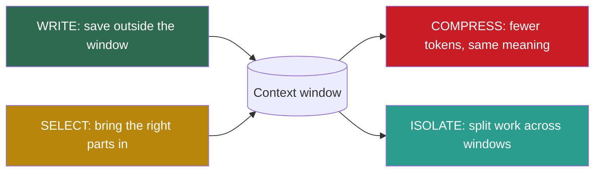

## 1. The question this idea answers

An agent works on a task for 200 steps. Every step adds a tool call, a tool result and some reasoning to the history. The window fills. Each call costs more, takes longer, and the answers get worse. What do I do with the tokens that are already inside the window?

Parts 4 and 5 taught the **external** side of context: write information out of the window, and select the right information back in. This part teaches the **internal** side. **Compress** shrinks what is already in the window. **Isolate** splits the work across several windows. This lesson explains why compression is necessary even with a 1M-token window, and what it must never touch.

## 2. Mental model

> [!analogy] Minutes, not a recording
> A long project meeting has a recording and a set of minutes. The recording holds every word. The minutes hold the decisions, the owners and the open items, on one page. A new team member reads the minutes, not the five-hour recording. The minutes are **compression**: less text, same decisions. Deleting the recording without minutes is **deletion**: the decisions are gone.
>
> **Where it stops working:** a human secretary knows which details matter later. An LLM summary does not know the future. It can drop a number or a file path that the next step needs. Also, minutes cannot be replayed. If the original is gone, a lost detail is lost for good. So keep the original outside the window when you can (lesson [4.2](/notes/ai/context-engineering/04-write-and-rag/l2-write-scratchpads-memories-files)).

## 3. Terms

| Term | Plain meaning |
|---|---|
| context compression | Any method that reduces the tokens in the window and tries to keep the information that later steps need. |
| deletion (pruning) | Removing content from the window without keeping its meaning in another form. |
| compression ratio | Tokens before compression divided by tokens after it. A ratio of 16 means 16 times fewer tokens. |
| token savings | The share of tokens removed: 1 minus (tokens after ÷ tokens before). |
| lossless compression | Compression that removes only redundancy, so the original can be rebuilt exactly. |
| lossy compression | Compression that removes some information, so the original cannot be rebuilt exactly. |
| entropy | Shannon's measure of the average information per symbol of a source, in bits. It is the lower limit for lossless compression of that source. |
| recoverable compression | Lossy compression where the removed content can be fetched again, for example by running the same tool call. |
| pending content | Content that the agent has not acted on yet. Examples: a plan before it runs, a diff before it is applied, a number before it is used. |

## 4. Method and math

### 4.1 Where compression sits



Write and select act at the border of the window (lesson [4.1](/notes/ai/context-engineering/04-write-and-rag/l1-four-strategies)). Compress and isolate act on the window itself. The handbook (Session 5, §1) gives the reason: an agent that runs more than a few turns reaches its limits. Agents that ignore context management "degrade quietly", with worse outputs and no error message.

### 4.2 Threat 1: cost grows with the square of the turns

Lesson [1.6](/notes/ai/context-engineering/01-foundations/l6-the-cost-of-a-conversation) derived the cost of a conversation. Call $k$ sends $I_k = S + u + (k-1)\,t$ input tokens, which is linear in $k$. The cumulative input over $N$ calls is $C_N = N(S+u) + t\,\frac{N(N-1)}{2}$, which is quadratic in $N$.

Compression changes this. Suppose that compression keeps every call below a limit $T$ tokens. Then each term of the sum is at most $T$:

$$
C_N = \sum_{k=1}^{N} I_k \le N \, T
$$

The symbols mean:

- $C_N$ is the cumulative input after $N$ calls.
- $I_k$ is the input of call $k$.
- $T$ is the largest input that compression allows on one call.

So with compression, the cumulative input grows at most **linearly** in $N$. Without it, it grows quadratically. The extra cost is the compression calls themselves (lesson [7.2](/notes/ai/context-engineering/07-compress-and-isolate/l2-summarization-and-compaction)).

> [!example] Worked example: the 50-turn chat of lesson 1.6
> $S = 2{,}000$, $u = 100$, $a = 300$, $t = 400$, 50 turns.
>
> - Without compression: $C_{50} = 595{,}000$ input tokens.
> - With compression that keeps every call at or below $T = 12{,}000$ tokens: $C_{50} \le 50 \times 12{,}000 = 600{,}000$.
>
> The bound is not smaller here, because the chat is short. Lesson 7.2 computes the exact value for this case: 374,400 tokens, including two summary calls. The gap grows with $N$: at 200 turns, the uncompressed chat sends $200 \times 2{,}100 + 400 \times 19{,}900 = 8{,}380{,}000$ tokens, and the bound is $2{,}400{,}000$.

> [!note] Source check: "cost scales linearly"
> **Corrected.** The handbook (Session 5, §2.1 and FAQ Q1) says that "cost scales linearly" with turns. One call grows linearly. The cumulative cost grows quadratically. Lesson [1.6](/notes/ai/context-engineering/01-foundations/l6-the-cost-of-a-conversation) has the derivation and the correct 50-turn ratio.

### 4.3 Threat 2: accuracy drops with length and with stale content

Lesson [1.5](/notes/ai/context-engineering/01-foundations/l5-position-and-length-effects) separated three effects. Two of them grow as an agent runs:

1. **Length effect.** Chroma's "Context Rot" report (14 July 2025) found that accuracy drops as the input gets longer, across 18 models, even on simple tasks.
2. **Stale context.** Old tool results, replaced instructions and finished sub-tasks stay in the window and mislead the model.

The handbook (Session 5, FAQ Q4) lists the symptoms well: the model ignores system-prompt instructions, contradicts earlier decisions, repeats itself, or hallucinates. Anthropic's context-engineering post draws the rule: context "must be treated as a finite resource with diminishing marginal returns".

> [!note] Source check: "a fundamental limitation of attention" and "quality peaks at 40–60%"
> **Corrected.** The handbook (Session 5, §2.2) calls context rot "a fundamental limitation of attention-based architectures". The length effect is an empirical result. Its size changes from model to model, so measure it. The FAQ (Q4) adds that "Anthropic's research shows that quality peaks at roughly 40–60% context utilization". No Anthropic source says this (lesson [1.5](/notes/ai/context-engineering/01-foundations/l5-position-and-length-effects)). Chroma measured a drop with absolute length, not a peak at a share of the window.

### 4.4 Threat 3: latency

The handbook's FAQ (Q1) adds a third threat that the lecture omits. Prefill must process every input token before the first output token appears (lesson [1.4](/notes/ai/context-engineering/01-foundations/l4-attention-and-the-cost-of-length)). So the time to first token grows as the history grows. Output length still dominates total latency for most calls, so this threat matters most for very long inputs.

### 4.5 Compression is not deletion

> [!example] Worked example: turns 1 to 10 (Session 5, FAQ Q5)
> Turns 1 to 10 of a project chat hold 3,000 tokens. They contain three decisions: FastAPI, PostgreSQL, OAuth2.
>
> - **Deletion:** remove the 10 turns. The window saves 3,000 tokens. The three decisions are gone.
> - **Compression:** replace the 10 turns with a 200-token summary that names the three decisions and their reasons. The window saves 2,800 tokens. The decisions stay.
>
> Compression costs one extra model call. Deletion costs nothing now, but it can cost much more later.

Deleted decisions cause two failures. The agent contradicts an earlier decision, or it asks the user to repeat information. The handbook's test (FAQ Q14) is a good rule: **if removing the content would make the agent ask the user again, summarize it. If the content has no information, such as "OK, thanks", delete it.**

### 4.6 How to measure a compression

$$
\rho = \frac{N_{\text{before}}}{N_{\text{after}}} \qquad \text{savings} = 1 - \frac{N_{\text{after}}}{N_{\text{before}}}
$$

The symbols mean:

- $N_{\text{before}}$ is the token count of the content before compression.
- $N_{\text{after}}$ is the token count after compression.
- $\rho$ is the compression ratio.

> [!example] Worked example: two handbook cases
> - Summary of 15 turns (Session 5, §3.1): 8,000 → 500 tokens. $\rho = 16$. Savings $= 1 - 500/8{,}000 = 0.9375$, so about 94%.
> - Cleared tool result (Session 5, §3.2): 2,000 → 20 tokens. $\rho = 100$. Savings $= 1 - 20/2{,}000 = 0.99$, so 99%.

Savings alone never tell you whether the compression is good. A compression that deletes everything has 100% savings. Lesson [7.10](/notes/ai/context-engineering/07-compress-and-isolate/l10-measure-compression) pairs savings with a retention measure.

### 4.7 Lossless, lossy and recoverable

Shannon ("A Mathematical Theory of Communication", 1948) defined the entropy of a source:

$$
H = -\sum_{i} p_i \log_2 p_i
$$

The symbols mean:

- $p_i$ is the probability of symbol $i$.
- $H$ is the average information per symbol, in bits. No lossless code can use fewer bits per symbol on average.

> [!example] Worked example: four symbols
> A source sends A, B, C and D with probabilities $\tfrac12$, $\tfrac14$, $\tfrac18$ and $\tfrac18$.
>
> $H = \tfrac12 \cdot 1 + \tfrac14 \cdot 2 + \tfrac18 \cdot 3 + \tfrac18 \cdot 3 = 1.75$ bits per symbol.
>
> A fixed-length code needs $\log_2 4 = 2$ bits per symbol. A good variable-length code reaches 1.75 bits. No lossless code can go below 1.75 bits.

The lesson for context: lossless compression removes only redundancy, and its limit is the entropy. A 16-times reduction of a conversation is far beyond that limit, so it must lose information. Every LLM summary is **lossy**.

| Method | Type | What is lost | Can it be recovered? |
|---|---|---|---|
| Summary of old turns | Lossy | Details that the summary prompt did not ask for | Only if the original is stored outside the window |
| Tool-result clearing | Recoverable | The raw result | Yes, by running the tool again, if the data did not change |
| Deletion of filler | Lossy, but little information | Greetings, acknowledgements | Not needed |
| Move to a file (WRITE) | Recoverable | Nothing, if the file persists | Yes, by reading the file |

The handbook (Session 5, FAQ Q47) makes a sharp point. With gzip or JPEG, you know exactly what kind of detail is lost. With an LLM summary, you do not know which details the model dropped. That is why you must measure retention (lesson 7.10).

### 4.8 The techniques of this part

The handbook names four compression techniques (Session 5, Table 1). Its savings figures are single examples, not guarantees.

| Technique | Mechanism | Handbook savings | Risk | Lesson |
|---|---|---|---|---|
| Summarization | An LLM condenses older turns | about 94% | Loses nuance | [7.2](/notes/ai/context-engineering/07-compress-and-isolate/l2-summarization-and-compaction) |
| Tool-result clearing | Replace a used result with a short note | about 99% | Very low | [7.3](/notes/ai/context-engineering/07-compress-and-isolate/l3-tool-result-clearing) |
| Priority trimming | Remove the lowest-priority content first | 50–80% | Medium | [7.4](/notes/ai/context-engineering/07-compress-and-isolate/l4-priority-trimming-and-hierarchical-compression) |
| Hierarchical compression | Keep more of important content, less of the rest | 70–90% | Medium | [7.4](/notes/ai/context-engineering/07-compress-and-isolate/l4-priority-trimming-and-hierarchical-compression) |

Anthropic's post "Effective context engineering for AI agents" (29 September 2025) names three levers for long tasks. They map onto this part:

1. **Compaction:** summarize a conversation near the limit and start a new window with the summary (lessons 7.2 and 7.3).
2. **Structured note-taking:** the agent writes notes outside the window and reads them again later. Examples are a `NOTES.md` file and Claude Code's to-do list (Part 8).
3. **Sub-agent architectures:** each sub-agent explores in its own window and returns a condensed summary (lessons [7.7](/notes/ai/context-engineering/07-compress-and-isolate/l7-isolate-one-window-is-not-enough) and [7.8](/notes/ai/context-engineering/07-compress-and-isolate/l8-isolation-patterns)).

### 4.9 What you must never compress

The handbook's FAQ (Q32) gives the most important rule of this part: **never compress content the model has not yet acted on.**

| Pending content | What goes wrong if you summarize it |
|---|---|
| A multi-step plan before it runs | The summary drops a step, so the agent skips it. |
| A code diff before it is applied | The exact characters matter. A summary cannot reproduce them. |
| Exact numbers, IDs, file paths, URLs | "About 4,500" is not 4,471. The next tool call fails or uses a wrong value. |
| A user preference that the agent has not applied yet | "Prefers well-known libraries" loses "but not Django". |
| An error message under investigation | The exact stack trace is the evidence. |

Tool-result clearing is safe for the same reason: it acts only on results that the model already used.

> [!trap] Compression that runs at the wrong moment
> A compaction that triggers in the middle of a task can summarize the plan that the agent is executing. Mark pending content and keep it verbatim. Compress it only after the agent has acted on it.

### 4.10 Production view

| Concern | What this lesson means for it |
|---|---|
| Cost | Without compression, the cumulative input grows with $N^2$. With a cap $T$ per call, it grows at most as $N \cdot T$. |
| Quality | Compression reduces the length effect and removes stale context. A bad summary can also remove a needed fact. |
| Latency | A shorter input gives a faster time to first token. A summary call adds its own latency. |
| Reliability | Never compress pending content. Store originals outside the window so that a lost detail can be recovered. |
| Observability | Log the tokens before and after each compression, and what was removed. Without this log, a failure after compression cannot be explained. |

## 5. Graphs

```plot
{
  "title": "Cumulative input in thousands of tokens: no compression (red), upper bound with a 12,000-token cap per call (blue)",
  "xAxis": { "label": "number of calls N", "domain": [1, 100] },
  "yAxis": { "label": "thousands of tokens", "domain": [0, 2200] },
  "disableZoom": true,
  "data": [
    { "fn": "2.1*x + 0.2*x*(x-1)", "color": "#C81D25" },
    { "fn": "12*x", "color": "#1E6091" }
  ]
}
```

The red curve is $C_N$ from lesson 1.6 ($S = 2{,}000$, $u = 100$, $t = 400$). The blue line is the bound $N \cdot T$. They cross near $N = 50$. After that, the total without compression is above the worst case with compression, and the gap grows with every turn.

## 6. Code

These exercises go in `notebooks/07-compress-and-isolate.ipynb`.

**Exercise 1.1: compression accounting.**

1. Write `compression_stats(before_tokens, after_tokens)` that returns the ratio and the savings.
2. Write `bounded_cumulative(N, S, u, t, T)` that sums $\min(I_k, T)$ for $k = 1$ to $N$.
3. Compare it with the closed form of lesson 1.6 for $N$ from 1 to 200.

Acceptance tests:

- `compression_stats(8000, 500)` returns a ratio of 16 and savings of 0.9375.
- `compression_stats(2000, 0)` raises a `ValueError`, because the ratio is not defined.
- `bounded_cumulative` is never larger than $N \cdot T$ and never larger than the closed form.

**Exercise 1.2: entropy against a real compressor.**

1. Write `char_entropy(text)` that computes $H$ from the character frequencies of a text.
2. Use a 20 KB English text and a 20 KB JSON tool result. For each, print $H$, the entropy size in bytes ($H \times$ length ÷ 8), and the size of `zlib.compress(text.encode())`.
3. Explain in two sentences why zlib can beat the character entropy. (Hint: it uses repeated words and keys, not single characters.)

Acceptance test: a table with two rows and the three sizes, and the explanation.

**Exercise 1.3: a pending-content detector.**

1. Write `is_pending(item)` for items of a message list. An item is pending in three cases:
   - It holds a plan with steps that are not all marked done.
   - It holds a diff with no "applied" event after it.
   - It is a tool result with no assistant message after it.
2. Write `compressible(messages)` that returns the indices that are safe to compress.

Acceptance tests:

- A plan with 5 steps and 3 marked done is pending.
- A tool result followed by an assistant reply is not pending.
- The last user message is never compressible.

## 7. Common mistakes

1. **"A 1M-token window means I do not need compression."** The window removes the hard limit only. Cost, latency and the length effect remain (lesson 1.5).
2. **"Compression and deletion are the same."** Deletion removes the meaning. Compression keeps it in fewer tokens. Delete only content with no information.
3. **"A high savings percentage means a good compression."** Deleting everything gives 100% savings. Measure what the agent can still answer (lesson 7.10).
4. **"A summary is lossless if it is well written."** A 16-times reduction goes far past the lossless limit of the text. It must lose information, and you do not know which.
5. **"Compress whatever is oldest."** Age is not the test. An old plan that is still running is pending content. Keep it verbatim.

## 8. One-minute explanation

An agent adds tokens on every step, so its window fills. That has three costs. The cumulative input grows with the square of the turns. Accuracy drops as the input gets longer and as stale content builds. And prefill gets slower. Compression keeps the meaning of old content in fewer tokens. Deletion throws the meaning away, so use it only for filler. A summary is always lossy, and you cannot see what it lost, so you must measure retention. Tool-result clearing is safer, because the model already used the result and can fetch it again. One rule has no exception: do not compress content that the agent has not acted on yet. Examples are a running plan, a diff or an exact number.

## 9. Check questions

```check
{
  "question": "A history of 12,000 tokens becomes a 750-token summary. What are the compression ratio and the savings?",
  "hint": "ρ = before / after. Savings = 1 − after / before.",
  "answer": "ρ = 12,000 / 750 = 16. Savings = 1 − 750 / 12,000 = 0.9375, so 93.75%."
}
```

```check
{
  "question": "Compression keeps every call at or below T = 20,000 input tokens. What is the largest possible cumulative input after 300 calls? Why is this bound linear in N?",
  "answer": "At most 300 × 20,000 = 6,000,000 tokens. Each call adds at most T, so the sum of N calls is at most N·T. Without compression, each call is larger than the one before, and the sum grows with N²."
}
```

```check
{
  "question": "A source sends two symbols with probabilities 0.9 and 0.1. What is its entropy? What does that number limit?",
  "hint": "H = −Σ p log₂ p.",
  "answer": "H = −(0.9 log₂ 0.9 + 0.1 log₂ 0.1) ≈ 0.9 × 0.152 + 0.1 × 3.322 ≈ 0.469 bits per symbol. No lossless code can use fewer than about 0.469 bits per symbol on average."
}
```

```check
{
  "question": "An agent is at step 6 of an 11-step migration plan. A compaction summarizes the plan as \"migrate the database in several steps\". What fails, and which rule was broken?",
  "answer": "The agent no longer knows steps 7 to 11, so it can skip or invent them. The rule: never compress content that the model has not yet acted on. A running plan is pending content and must stay verbatim until all steps are done."
}
```

```check
{
  "question": "Why is tool-result clearing called recoverable rather than lossless?",
  "answer": "The raw result is removed from the window, so the window alone cannot rebuild it. But the agent can run the same tool call again and get the data back, as long as the data did not change. Lossless means the original can be rebuilt from the compressed form itself."
}
```

## 10. Links

- Next: [L2: Summarization and compaction](/notes/ai/context-engineering/07-compress-and-isolate/l2-summarization-and-compaction)
- [1.5: Position and length effects](/notes/ai/context-engineering/01-foundations/l5-position-and-length-effects)
- [1.6: The cost of a conversation](/notes/ai/context-engineering/01-foundations/l6-the-cost-of-a-conversation)
- [4.1: Four strategies](/notes/ai/context-engineering/04-write-and-rag/l1-four-strategies)
- [Glossary](/notes/ai/context-engineering/glossary)
